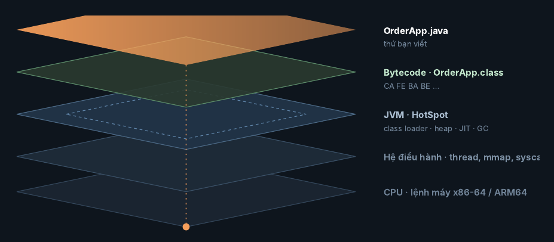
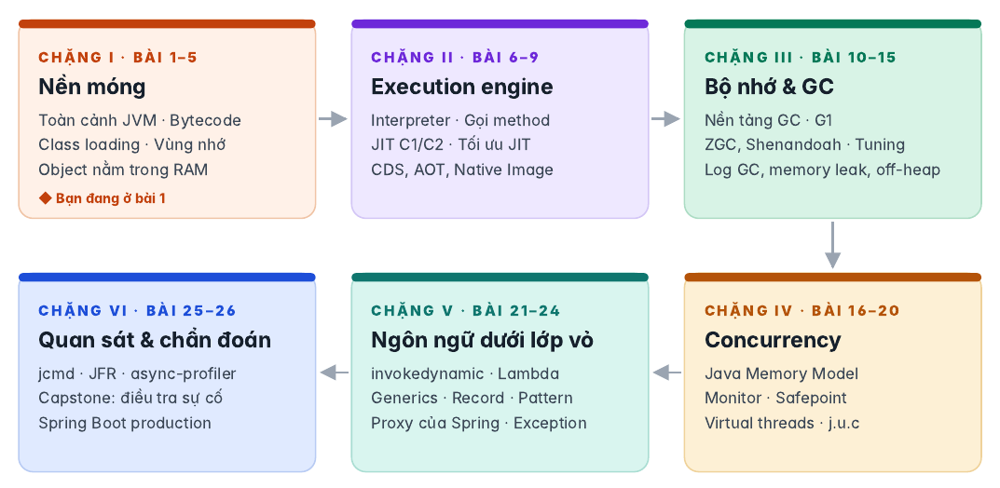

# Lộ trình series Java Under the Hood

Tài liệu gồm hai phần: **Lộ trình toàn bộ series** (26 bài, 6 chặng) và **Bài 01** viết hoàn chỉnh để bạn đánh giá văn phong, độ sâu và cách minh hoạ trước khi đi tiếp.

> **VỀ CÁC CON SỐ TRONG BÀI** — Mọi output (bytecode, log nạp class, log JIT, log GC, danh sách thread, bộ nhớ) đều lấy từ việc **chạy thật** chương trình mẫu trên OpenJDK 21.0.12, Linux x86-64, 2 vCPU, 8 GB RAM. Máy bạn sẽ ra số khác — điều quan trọng là *hình dạng* của kết quả, và bạn có thể tự lặp lại bằng đúng các lệnh trong bài. Phần lý thuyết bám theo JDK 25 LTS và JDK 27 (GA 15/09/2026); chỗ nào hành vi khác giữa các phiên bản đều được ghi chú.

26 bài, chia thành 6 chặng, đi từ “chương trình Java được chạy như thế nào” đến “điều tra một sự cố production bằng hiểu biết về JVM”. Mỗi chặng xây trên chặng trước, nhưng mỗi bài vẫn đọc độc lập được.

## Series này dành cho ai, học được gì

Bạn đã viết Java và Spring Boot vài năm: thạo `@Service`, `@Transactional`, JPA, REST, có thể đã deploy lên Kubernetes. Thứ còn thiếu thường không phải là API mới, mà là **mô hình trong đầu về những gì xảy ra bên dưới** — để khi gặp `OOMKilled`, latency nhảy vọt sau deploy, CPU 100% trong 3 phút đầu, hay `NoClassDefFoundError` chỉ xuất hiện trên môi trường thật, bạn biết phải nhìn vào đâu thay vì tăng RAM và cầu may.

Sau series, mục tiêu là bạn có thể:

- Vẽ lại được trên bảng trắng: một request đi vào Spring Boot thì bytecode nào chạy, nằm ở vùng nhớ nào, được JIT biên dịch lúc nào, rác của nó được dọn ra sao.
- Đọc được `javap`, log GC, log JIT, thread dump, heap dump, flame graph — và rút ra kết luận chứ không chỉ “nhìn cho biết”.
- Chọn và tinh chỉnh GC, heap, số thread, tham số container dựa trên lý do cụ thể.
- Hiểu các tính năng mới (virtual threads, compact object headers, AOT cache của Project Leyden, generational ZGC) ở mức cơ chế, để biết khi nào nên dùng.

## Bản đồ 6 chặng và 26 bài

*Hình A.1 — Sáu chặng của series. Màu của mỗi chặng được dùng lại trong mọi hình minh hoạ: khi thấy màu tím, bạn biết đang nói về execution engine/JIT; màu xanh lá là GC…*

### Chặng I — Nền móng: từ mã nguồn đến tiến trình

*Xây mô hình tổng thể và các khái niệm mà mọi bài sau sẽ dùng lại.*

**01 · [Chuyện gì xảy ra khi bạn gõ `java`? — Bức tranh toàn cảnh JVM](01-buc-tranh-toan-canh-jvm.md)** Theo một chương trình từ `javac` đến khi tiến trình thoát: class file, launcher, nạp class, các vùng nhớ, interpreter/JIT, GC, các thread ngầm, shutdown. Hỏi: Vì sao chương trình “một thread” của tôi có 20 thread hệ điều hành?

**02 · [Class file & bytecode: đọc `javap` như đọc mã nguồn](02-class-file-bytecode.md)** Cấu trúc class file, constant pool, descriptor, các nhóm opcode, StackMapTable và bytecode verifier; xem Lombok, record, switch, try-with-resources sinh ra gì. Hỏi: Vì sao `count++` không an toàn đa luồng — nhìn thấy tận mắt trong bytecode.

**03 · [Class loading chuyên sâu](03-class-loading.md)** Loading → Linking (verify, prepare, resolve) → Initialization; `<clinit>`; mô hình uỷ quyền; module system (JPMS); class loader của fat jar Spring Boot; rò rỉ class loader. Hỏi: `ClassNotFoundException` khác `NoClassDefFoundError` thế nào? Vì sao Metaspace OOM sau nhiều lần redeploy?

**04 · [Runtime Data Areas: stack, heap, metaspace, code cache và phần “ngoài heap”](04-runtime-data-areas.md)** Stack frame, `StackOverflowError`, heap, metaspace, code cache, direct memory, stack của thread; đo toàn bộ bộ nhớ tiến trình bằng Native Memory Tracking. Hỏi: Vì sao pod bị `OOMKilled` dù heap còn trống một nửa?

**05 · [Một object Java thực sự nằm trong RAM như thế nào](05-object-trong-ram.md)** Object header (mark word, klass pointer), compressed oops, alignment/padding, mảng; Compact Object Headers (JEP 519 ở JDK 25, mặc định từ JDK 27 với JEP 534); đo bằng JOL. Hỏi: Một `List<Long>` 1 triệu phần tử tốn bao nhiêu RAM — và vì sao không phải 8 MB?

### Chặng II — Execution engine: bytecode biến thành lệnh máy

*Hiểu vì sao Java “chậm lúc đầu, nhanh về sau” và làm gì với điều đó.*

**06 · [Interpreter & cơ chế gọi method](06-interpreter-goi-method.md)** Template interpreter; `invokestatic/special/virtual/interface/dynamic`; vtable, itable; dispatch đa hình. Hỏi: Gọi qua interface có chậm hơn gọi qua class không?

**07 · [JIT & tiered compilation](07-jit-tiered-compilation.md)** C1, C2, 5 tầng biên dịch, profiling, OSR, deoptimization, code cache; đọc `-XX:+PrintCompilation` và JFR. Hỏi: Vì sao latency tệ trong vài phút đầu sau deploy, và warm-up đúng cách là gì?

**08 · [Những phép tối ưu của JIT](08-toi-uu-jit.md)** Inlining, escape analysis & scalar replacement, lock elision, loop unrolling, intrinsics, auto-vectorization; viết microbenchmark đúng với JMH. Hỏi: Vì sao `new` một object trong vòng lặp nóng đôi khi… không cấp phát gì cả?

**09 · [Khởi động nhanh: CDS, AOT cache (Project Leyden), CRaC, GraalVM Native Image](09-khoi-dong-nhanh-cds-aot-native.md)** AppCDS; JEP 483/514/515 (AOT class loading, AOT ergonomics, AOT method profiling); so sánh các cách tăng tốc khởi động cho Spring Boot. Hỏi: Đưa thời gian khởi động một service Spring Boot từ vài giây xuống dưới một giây bằng cách nào, đánh đổi gì?

### Chặng III — Bộ nhớ & Garbage Collection

*Từ lý thuyết GC đến đọc log và săn memory leak.*

**10 · [Nền tảng GC](10-nen-tang-gc.md)** Reachability, GC roots, mark–sweep–compact, copying, giả thuyết thế hệ, TLAB, write barrier, card table, safepoint. Hỏi: GC biết object nào là “rác” bằng cách nào khi có vòng tham chiếu?

**11 · [Mổ xẻ G1](11-mo-xe-g1.md)** Region, remembered set, SATB, young/mixed GC, humongous object, mục tiêu pause; đọc từng dòng log G1. Hỏi: `MaxGCPauseMillis=200` thực sự hứa hẹn điều gì?

**12 · [ZGC & Shenandoah](12-zgc-shenandoah.md)** Colored pointers, load barrier, relocation đồng thời; Generational ZGC (mặc định từ JDK 23, bản không phân thế hệ bị gỡ ở JDK 24), Generational Shenandoah (chính thức ở JDK 25). Hỏi: Pause dưới 1 ms đổi lấy cái giá nào?

**13 · [Chọn và tinh chỉnh GC cho container](13-gc-cho-container.md)** Serial/Parallel/G1/ZGC; `MaxRAMPercentage`, CPU limit và ergonomics; JEP 523 (G1 mặc định ở mọi môi trường, JDK 27). Hỏi: Pod 1 vCPU của bạn đang chạy GC nào? (Rất có thể không phải G1 nếu dùng JDK ≤ 26.)

**14 · [Đọc log GC & săn memory leak](14-log-gc-memory-leak.md)** Unified logging, heap dump, Eclipse MAT, dominator tree, retained size; case study rò rỉ trong ứng dụng Spring Boot. Hỏi: Heap tăng dần qua nhiều ngày — leak thật hay chỉ là cache?

**15 · [Reference & bộ nhớ ngoài heap](15-reference-off-heap.md)** Soft/Weak/Phantom reference, Cleaner, finalization bị loại bỏ dần, rò rỉ ThreadLocal, DirectByteBuffer, Foreign Function & Memory API. Hỏi: Vì sao Netty/Kafka client dùng RAM vượt xa `-Xmx`?

### Chặng IV — Concurrency nhìn từ JVM

*Từ CPU cache đến virtual threads.*

**16 · [Java Memory Model](16-java-memory-model.md)** Reordering của compiler và CPU, happens-before, `volatile`, `final`, safe publication. Hỏi: Vì sao double-checked locking thiếu `volatile` lại hỏng?

**17 · [`synchronized` và monitor bên trong HotSpot](17-synchronized-monitor.md)** Mark word & trạng thái khoá, CAS, lock inflation, việc gỡ biased locking, so sánh với `ReentrantLock`. Hỏi: `synchronized` có thật sự “chậm” không?

**18 · [Thread, safepoint & stop-the-world](18-thread-safepoint.md)** Platform thread ↔ OS thread, trạng thái thread, safepoint poll, time-to-safepoint, đọc thread dump. Hỏi: Pause dài nhưng log GC lại ngắn — thời gian đi đâu?

**19 · [Virtual threads mổ xẻ](19-virtual-threads.md)** Continuation, carrier thread, mount/unmount, pinning và JEP 491 (JDK 24), structured concurrency; bật trong Spring Boot và những cái bẫy. Hỏi: Bật `spring.threads.virtual.enabled` rồi, khi nào hệ thống lại chậm hơn?

**20 · [Bên trong `java.util.concurrent`](20-java-util-concurrent.md)** AQS, `ConcurrentHashMap`, `ForkJoinPool`, `CompletableFuture`. Hỏi: `parallelStream()` trong một request Spring dùng chung pool với ai?

### Chặng V — Ngôn ngữ dưới lớp vỏ

*Cú pháp quen thuộc biến thành gì trong bytecode và runtime.*

**21 · [`invokedynamic`: lambda, nối chuỗi, record](21-invokedynamic.md)** Bootstrap method, `LambdaMetafactory`, `StringConcatFactory`, `ObjectMethods`, hidden class. Hỏi: Lambda có tạo class mới mỗi lần gọi không?

**22 · [Generics, record, sealed, pattern matching dưới bytecode](22-generics-record-pattern.md)** Type erasure, bridge method, signature attribute, `switch` trên pattern. Hỏi: Vì sao Jackson cần `TypeReference`?

**23 · [Reflection, MethodHandle, Proxy — cách Spring “làm phép”](23-reflection-proxy.md)** JDK dynamic proxy vs CGLIB, sinh bytecode lúc chạy; vì sao self-invocation làm mất `@Transactional`; Spring AOT processing. Hỏi: Gọi một method `@Transactional` từ chính class đó thì chuyện gì xảy ra trong bytecode?

**24 · [Exception & stack trace: chi phí thật](24-exception-stack-trace.md)** `fillInStackTrace`, `StackWalker`, `OmitStackTraceInFastThrow`, exception trong luồng điều khiển. Hỏi: Vì sao log production đôi khi có `NullPointerException` không kèm stack trace?

### Chặng VI — Quan sát & chẩn đoán

*Gom mọi thứ lại thành kỹ năng xử lý sự cố.*

**25 · [Bộ đồ nghề: jcmd, JFR, JMC, async-profiler, NMT](25-bo-do-nghe-chan-doan.md)** Thu thập và đọc profile CPU/allocation/lock, flame graph, JFR streaming trong production. Hỏi: Cách lấy dữ liệu chẩn đoán từ một pod đang chạy mà không restart?

**26 · [Capstone: điều tra sự cố Spring Boot production từ A đến Z](26-capstone-su-co-production.md)** Ba kịch bản dựng lại được: CPU cao sau deploy, latency spike định kỳ, `OOMKilled` — đi từ triệu chứng đến nguyên nhân bằng kiến thức của cả series. Hỏi: Bạn bắt đầu từ đâu khi on-call lúc 2 giờ sáng?

## Cấu trúc chung của mỗi bài & quy ước màu

Mỗi bài theo cùng một nhịp để bạn đọc nhanh và tra cứu lại dễ:

| Phần | Nội dung |
|---|---|
| **Câu hỏi mở đầu** | Một triệu chứng thực tế hoặc câu hỏi mà bài sẽ trả lời. |
| **Thí nghiệm** | Chương trình nhỏ + lệnh chạy + output thật. Bạn luôn tự lặp lại được. |
| **Sơ đồ cơ chế** | Hình vẽ chỉ ra cơ chế thật (vùng nhớ, luồng dữ liệu, trình tự), không phải hình trang trí. |
| **Đào sâu** | Chi tiết bên trong HotSpot, kèm phiên bản JDK nơi hành vi thay đổi. |
| **SPRING BOOT** | Kiến thức vừa học ảnh hưởng thế nào tới ứng dụng Spring Boot của bạn. |
| **Hiểu lầm & bài tập** | Các ngộ nhận phổ biến; vài bài tập ngắn để tự kiểm chứng. |

Quy ước màu dùng xuyên suốt: **javac / biên dịch** · **class loading** · **bộ nhớ** · **thực thi / JIT** · **GC** · **thread**.

**Môi trường đề xuất:** JDK 25 (LTS hiện hành) hoặc JDK 27; Spring Boot 4.x (baseline Java 17, hỗ trợ chính thức Java 25). Công cụ: `javap`, `jcmd`, JFR/JMC, JOL, async-profiler, Eclipse MAT — tất cả miễn phí.
