# Bài 01 — Bức tranh toàn cảnh JVM

*Lộ trình cả series: [Lộ trình series](00-lo-trinh-series.md).*

*Chuyện gì xảy ra khi bạn gõ java?*

*Nền tảng: JDK 25 LTS / 27 · Thí nghiệm chạy thật trên OpenJDK 21*

> **VỀ CÁC CON SỐ TRONG BÀI** — Mọi output (bytecode, log nạp class, log JIT, log GC, danh sách thread, bộ nhớ) đều lấy từ việc **chạy thật** chương trình mẫu trên OpenJDK 21.0.12, Linux x86-64, 2 vCPU, 8 GB RAM. Máy bạn sẽ ra số khác — điều quan trọng là *hình dạng* của kết quả, và bạn có thể tự lặp lại bằng đúng các lệnh trong bài. Phần lý thuyết bám theo JDK 25 LTS và JDK 27 (GA 15/09/2026); chỗ nào hành vi khác giữa các phiên bản đều được ghi chú.

Bức tranh toàn cảnh JVM — theo chân một chương trình 25 dòng từ lúc biên dịch tới lúc tiến trình thoát, và nhìn tận mắt từng thứ đang chạy bên trong.

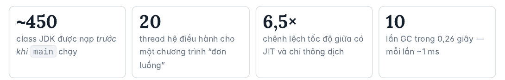

*Bốn con số trên đều đo được từ chương trình mẫu của bài. Đến cuối bài, bạn sẽ giải thích được từng con số.*

## 1 Vì sao một dev Spring Boot nên quan tâm

Phần lớn thời gian, JVM là thứ “vô hình”: bạn viết `@RestController`, chạy `./mvnw spring-boot:run`, mọi thứ chạy. Nó chỉ lộ diện khi có chuyện — và lúc đó, những câu hỏi đầu tiên thường là:

- **“Heap mới 60% mà pod bị `OOMKilled`?”** — vì tiến trình JVM dùng nhiều vùng nhớ ngoài heap (mục 7).
- **“Vừa deploy xong, p99 latency tăng vọt rồi tự hết sau vài phút?”** — vì code đang chạy ở chế độ thông dịch và JIT đang làm việc (mục 8).
- **“Ứng dụng khởi động mất 8 giây, làm sao nhanh hơn?”** — vì JVM phải nạp, kiểm tra và khởi tạo hàng nghìn class (mục 5, 6).
- **“Tôi chỉ có 1 thread xử lý, sao CPU dùng tới 2 core?”** — vì có cả chục thread của JVM chạy song song với bạn (mục 10).
- **“SIGTERM gửi tới rồi mà request đang xử lý vẫn bị cắt ngang?”** — vì cách JVM tắt và shutdown hook hoạt động (mục 11).

Bài này không đào sâu từng phần — đó là việc của 25 bài sau. Mục tiêu là cho bạn một **bản đồ** đầy đủ: biết có những bộ phận nào, chúng xuất hiện theo thứ tự nào, và mỗi bộ phận để lại “dấu vết” gì mà bạn có thể quan sát. Hình 1.1 là bản đồ đó; các mục tiếp theo đi lần lượt qua từng chặng được đánh số.

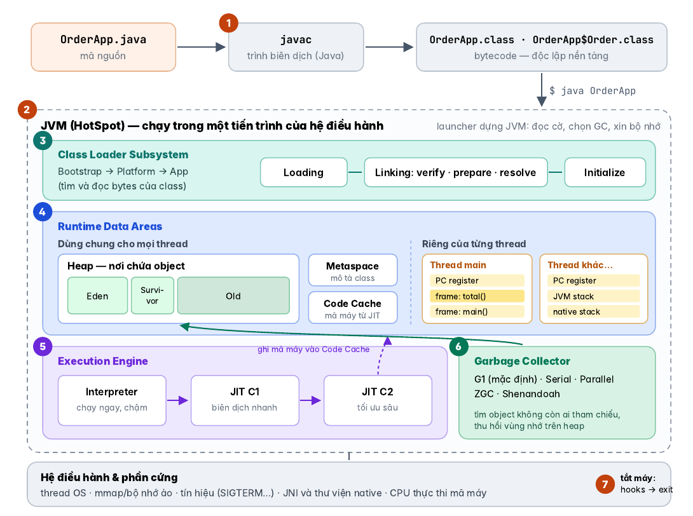

*Hình 1.1 — Bản đồ của bài. Các số tròn là thứ tự chương trình đi qua: (1) biên dịch, (2) launcher dựng JVM, (3) nạp class, (4) cấp phát các vùng nhớ, (5) thực thi bằng interpreter rồi JIT, (6) GC dọn heap, (7) tắt máy. Màu sắc theo quy ước của series.*

## 2 JDK, JRE, JVM, HotSpot — gọi đúng tên

Bốn cái tên này hay bị dùng lẫn lộn. Phân biệt rõ giúp bạn đọc tài liệu và đặt câu hỏi chính xác hơn — chẳng hạn “GC của Java” thực ra là “GC của HotSpot”.

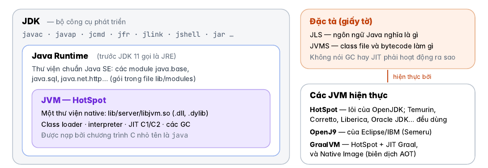

*Hình 1.2 — JDK chứa runtime, runtime chứa JVM. Đặc tả JVMS chỉ quy định “bytecode phải làm gì”; còn GC, JIT, cách bố trí object trong RAM là lựa chọn riêng của từng hiện thực. Series này nói về HotSpot — thứ gần như chắc chắn đang chạy ứng dụng của bạn.*

> **ĐIỀU CẦN NHỚ** — Khi bạn tải “Temurin 25” hay “Corretto 21”, bạn đang dùng cùng một mã nguồn OpenJDK/HotSpot, khác nhau chủ yếu ở chính sách bản vá và hỗ trợ. Vì vậy mọi cờ `-XX:` và log trong series áp dụng cho hầu hết các bản phân phối phổ biến (OpenJ9 là ngoại lệ, có bộ cờ riêng).

### Chương trình mẫu

Xuyên suốt bài, ta theo dõi chương trình dưới đây. Nó nhỏ nhưng được chọn để “chạm” vào mọi bộ phận: có hai class (một record lồng bên trong), có một hàm được gọi rất nhiều lần (để JIT để ý), và tạo ra rất nhiều object sống ngắn (để GC có việc làm) — giống hệt một request handler điển hình trong Spring Boot: tạo DTO, tính toán, rồi bỏ đi.

```java
public class OrderApp {
    record Order(long id, double amount) {}

    static double total(Order[] orders) {
        double sum = 0;
        for (Order o : orders) {
            sum += o.amount();
        }
        return sum;
    }

    public static void main(String[] args) throws Exception {
        double grand = 0;
        for (int round = 0; round < 20_000; round++) {
            Order[] batch = new Order[1_000];          // rác ngắn hạn
            for (int i = 0; i < batch.length; i++) {
                batch[i] = new Order(i, i * 1.5);
            }
            grand += total(batch);
        }
        System.out.println("Grand total = " + grand);
        if (args.length > 0) Thread.sleep(Long.parseLong(args[0])); // giữ JVM sống để quan sát
    }
}
```

*OrderApp.java — 20.000 vòng, mỗi vòng tạo 1.000 object `Order` rồi bỏ đi: tổng cộng 20 triệu object.*

## 3 Chặng 1 · `javac`: từ mã nguồn đến class file

Điều đầu tiên cần thay đổi trong mô hình tư duy: **`javac` gần như không tối ưu gì cả.** Nó dịch mã nguồn thành bytecode một cách trung thực, gần như từng câu lệnh một (chỉ gộp hằng số như `60 * 60` thành `3600`). Mọi tối ưu “thật” — inline hàm, bỏ cấp phát thừa, sinh lệnh SIMD — được dồn lại cho JIT lúc chạy, khi JVM đã biết CPU nào đang chạy và code nào thật sự nóng. Đây là thiết kế có chủ đích, và nó giải thích vì sao benchmark Java phải có giai đoạn warm-up.

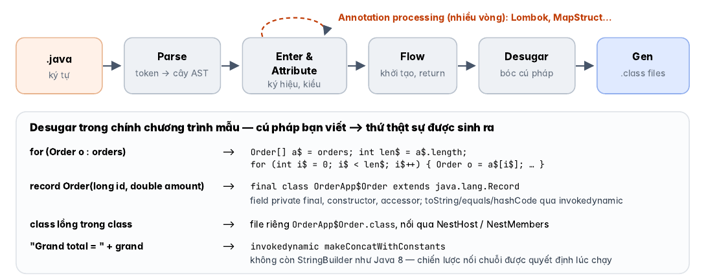

*Hình 1.3 — Các pha chính bên trong `javac`. Annotation processor chạy sớm, có thể sinh thêm mã nguồn và kích hoạt thêm vòng phân tích. “Desugar” là nơi cú pháp tiện lợi bị bóc thành cấu trúc đơn giản hơn — bốn ví dụ phía dưới đều kiểm chứng được bằng `javap`.*

```text
$ javac OrderApp.java && ls -l *.class
-rw-r--r-- 1 root root 1257 OrderApp$Order.class
-rw-r--r-- 1 root root 1475 OrderApp.class
$ javap -p 'OrderApp$Order.class'
final class OrderApp$Order extends java.lang.Record {
  private final long id;
  private final double amount;
  OrderApp$Order(long, double);
  public final java.lang.String toString();
  public final int hashCode();
  public final boolean equals(java.lang.Object);
  public long id();
  public double amount();
}
```

*Một dòng `record` sinh ra cả một class hoàn chỉnh. Lombok `@Data` cũng làm điều tương tự — nhưng bằng cách can thiệp vào cây AST trong pha annotation processing.*

> **SPRING BOOT** — **Cờ `-parameters`.** Mặc định `javac` không lưu tên tham số của method vào class file. Spring cần các tên đó để map `@PathVariable Long id` hay `@RequestParam String q` khi bạn không ghi tên rõ ràng. Từ Spring Framework 6.1, cơ chế dự phòng (đọc debug info) đã bị gỡ, nên nếu build bằng tay thay vì qua plugin của Spring Boot (vốn tự bật `-parameters`), bạn sẽ gặp lỗi kiểu “Name for argument of type … not specified” chỉ vì một cờ của `javac`.

### Bên trong một class file

Class file là một cấu trúc nhị phân được đặc tả chặt chẽ trong JVMS chương 4. Mở `OrderApp.class` bằng một trình xem hex, 10 byte đầu tiên đã kể khá nhiều chuyện:

```text
$ od -A x -t x1 -N 16 OrderApp.class
000000 ca fe ba be 00 00 00 41 00 51 0a 00 02 00 03 07
```

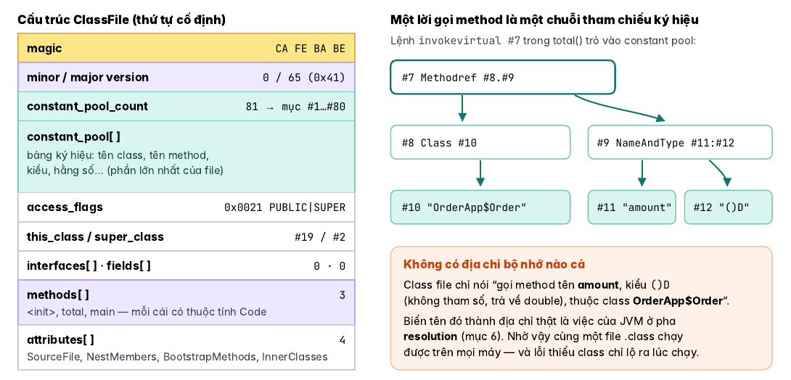

*Hình 1.4 — Trái: bố cục của `OrderApp.class` với giá trị thật đọc bằng `javap -v`. Phải: lời gọi `o.amount()` được mã hoá thành chuỗi tham chiếu trong constant pool, kết thúc ở các chuỗi UTF-8.*

Byte `00 41` là **major version 65**, tương ứng Java 21. Mỗi bản Java tăng số này lên 1: Java 8 = 52, 17 = 61, 21 = 65, 25 = 69, 27 = 71. JVM từ chối chạy class có version cao hơn nó hiểu — đó chính là lỗi quen thuộc:

```text
java.lang.UnsupportedClassVersionError: com/acme/OrderService has been compiled by a more recent
version of the Java Runtime (class file version 69.0), this version of the Java Runtime only
recognizes class file versions up to 65.0
```

*Build bằng JDK 25 nhưng image Docker chạy JDK 21. Cách sửa đúng: đặt `--release 21` (Maven: `<maven.compiler.release>`) để `javac` sinh đúng version và chỉ cho dùng API có trong Java 21.*

## 4 Bytecode: JVM là một máy ngăn xếp

Đây là toàn bộ bytecode của `total()`, lấy bằng `javap -c`. Hãy đọc nó cùng với chú thích bên phải — sau một lần, bạn sẽ thấy bytecode dễ đọc hơn bạn nghĩ:

```text
static double total(OrderApp$Order[]);   // stack=4, locals=7
   0: dconst_0                // đẩy 0.0 lên stack
   1: dstore_1                // sum = 0.0        (double chiếm 2 slot: 1 và 2)
   2: aload_0                 // lấy tham số orders (slot 0)
   3: astore_3                // a$ = orders      (biến ẩn do for-each sinh ra)
   4: aload_3
   5: arraylength
   6: istore        4         // len$ = a$.length
   8: iconst_0
   9: istore        5         // i$ = 0
  11: iload         5         // ┐ đầu vòng lặp
  13: iload         4         // │
  15: if_icmpge     38        // ┘ nếu i$ >= len$ thì nhảy tới 38 (thoát)
  18: aload_3
  19: iload         5
  21: aaload                  // a$[i$]
  22: astore        6         // o = a$[i$]
  24: dload_1                 // ┐
  25: aload         6         // │ sum += o.amount()
  27: invokevirtual #7        // │ Method OrderApp$Order.amount:()D
  30: dadd                    // │
  31: dstore_1                // ┘
  32: iinc          5, 1      // i$++
  35: goto          11        // quay lại đầu vòng
  38: dload_1
  39: dreturn                 // return sum
```

Mỗi lần một method được gọi, JVM tạo một **frame** trên stack của thread. Frame có hai phần chính: mảng **biến cục bộ** (local variables — đánh số slot, tham số nằm đầu tiên) và **ngăn xếp toán hạng** (operand stack). Mọi lệnh bytecode đều lấy đầu vào từ đỉnh stack và đẩy kết quả trở lại — không có “thanh ghi” nào cả. Hình 1.5 cho thấy dòng `sum += o.amount()` được thực thi qua 5 lệnh:

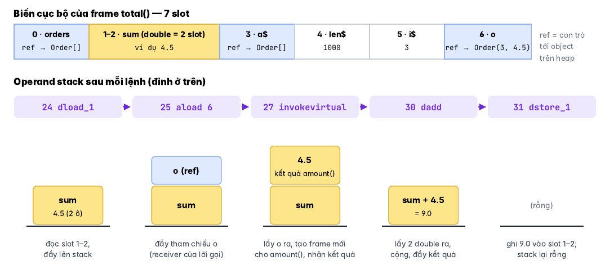

*Hình 1.5 — Năm lệnh cho một dòng Java. Chiều sâu stack tối đa ở đây là 4 ô (hai giá trị double), khớp với `stack=4` mà `javac` ghi sẵn trong class file — nhờ con số đó, JVM biết trước cần cấp bao nhiêu chỗ cho mỗi frame.*

Vì sao lại chọn mô hình máy ngăn xếp? Bytecode cần chạy trên mọi CPU — x86 có 16 thanh ghi đa dụng, ARM64 có 31 — nên nó không giả định gì về thanh ghi. Lệnh ngăn xếp cũng ngắn (đa số chỉ 1 byte), dễ kiểm tra tính hợp lệ, và là đầu vào thuận tiện để JIT phân tích rồi tự phân bổ lại thanh ghi thật cho từng CPU cụ thể.

> **THẤY TẬN MẮT: VÌ SAO COUNT++ KHÔNG AN TOÀN ĐA LUỒNG** — Với một field `int count`, câu lệnh `count++` biên dịch thành `getfield` → `iconst_1` → `iadd` → `putfield`: đọc, cộng, ghi là ba bước tách rời. Hai thread có thể cùng đọc giá trị 5 rồi cùng ghi 6. [Bài 02](02-class-file-bytecode.md) và [bài 16](16-java-memory-model.md) sẽ quay lại chuyện này ở mức bytecode và mức CPU.

## 5 Chặng 2 · Launcher dựng JVM lên

Lệnh `java` mà bạn gõ thực ra **không phải là JVM**. Nó là một chương trình C nhỏ (gọi là *launcher*, mã nguồn nằm trong thư viện `libjli`) có nhiệm vụ chuẩn bị rồi “mời” JVM vào. Những việc nó làm, theo thứ tự:

1. **Đọc tham số dòng lệnh** và biến môi trường `JDK_JAVA_OPTIONS` (chỉ launcher `java` đọc). Riêng `JAVA_TOOL_OPTIONS` do chính JVM đọc nên áp dụng cho cả `jcmd`, `javac` — đó là lý do bạn hay thấy dòng `Picked up JAVA_TOOL_OPTIONS: …` trong log container.
2. **Tìm và nạp `libjvm.so`** bằng `dlopen`, lấy con trỏ tới hàm `JNI_CreateJavaVM`. Đây là lúc “Java” mới thực sự bắt đầu tồn tại trong tiến trình.
3. **Tạo một thread mới** để chạy phần còn lại. Thread ban đầu của tiến trình (primordial thread) chỉ ngồi chờ thread mới kết thúc — vì vậy lát nữa bạn sẽ thấy hai thread cùng tên `java` ở mức hệ điều hành.
4. **Gọi `JNI_CreateJavaVM`** — phần tốn công nhất, mô tả bên dưới.
5. **Nạp main class** qua application class loader, tìm method `main`, gọi nó qua JNI. Từ đây code của bạn mới chạy.

### Bên trong `JNI_CreateJavaVM`: ergonomics và bộ nhớ

Việc đầu tiên JVM làm là **ergonomics**: nhìn xem mình đang chạy trên máy nào (bao nhiêu CPU, bao nhiêu RAM — có tính giới hạn cgroup của container) rồi tự chọn GC, kích thước heap, số thread biên dịch JIT. Cờ `-XX:+PrintFlagsFinal` cho thấy các giá trị nào do ergonomics quyết định:

```text
$ java -XX:+PrintFlagsFinal -version | grep -E "UseG1GC|HeapSize|CICompilerCount|ReservedCode"
intx   CICompilerCount       = 2           {ergonomic}  ← 1 thread C1 + 1 thread C2
size_t InitialHeapSize       = 98566144    {ergonomic}  ← ~94 MB  = 1/64 RAM
size_t MaxHeapSize           = 1568669696  {ergonomic}  ← ~1,5 GB = 1/4 RAM mà JVM thấy
uintx  ReservedCodeCacheSize = 251658240   {ergonomic}  ← 240 MB cho mã máy JIT
bool   UseG1GC               = true        {ergonomic}  ← máy “server class” → G1
```

Sau đó JVM **xin bộ nhớ ảo** từ hệ điều hành. Cần phân biệt hai khái niệm sẽ gặp lại suốt series:

- **Reserved** — giữ chỗ một dải địa chỉ ảo liên tục (ví dụ 1,5 GB cho heap). Chưa tốn RAM thật.
- **Committed** — phần thực sự được ánh xạ tới RAM và có thể dùng (ban đầu ~94 MB). Heap “lớn dần” bằng cách commit thêm trong vùng đã reserve.

Tiếp theo, JVM **ánh xạ CDS archive** (Class Data Sharing, file `lib/server/classes.jsa`) — một bản chụp sẵn của hàng trăm class lõi đã được phân tích và kiểm tra từ lúc build JDK. Nhờ nó, `java.lang.Object`, `String`, `Thread`… không phải đọc và phân tích lại từ đầu mỗi lần khởi động. Cuối cùng JVM khởi tạo các class lõi, tạo đối tượng `Thread` cho thread chính, khởi động các thread hệ thống (GC, JIT, Reference Handler…), dựng module system và application class loader.

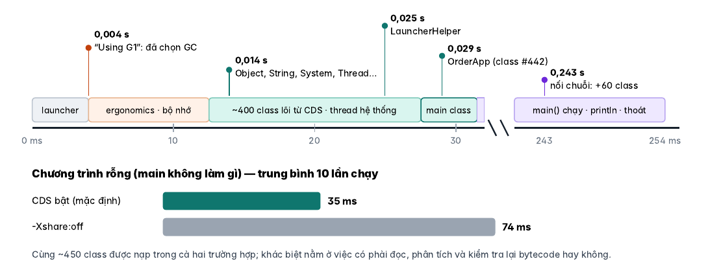

*Hình 1.6 — Dòng thời gian khởi động của `OrderApp`, mốc lấy từ `-Xlog:gc` và `-Xlog:class+load` (trục bị cắt giữa 32 ms và 243 ms). Khoảng 441 class của JDK được nạp trước cả class đầu tiên của bạn.*

```text
$ java -Xlog:class+load:file=cl.txt OrderApp && wc -l < cl.txt
546
$ head -3 cl.txt
[0.013s][info][class,load] java.lang.Object source: shared objects file
[0.014s][info][class,load] java.io.Serializable source: shared objects file
[0.014s][info][class,load] java.lang.Comparable source: shared objects file
$ grep -n OrderApp cl.txt
442:[0.029s][info][class,load] OrderApp source: file:/home/claude/lab/
451:[0.030s][info][class,load] OrderApp$Order source: file:/home/claude/lab/
```

*546 class được nạp tổng cộng; 535 đến từ CDS archive (“shared objects file”). Class của bạn đứng thứ 442.*

> **SPRING BOOT** — Chương trình 25 dòng đã cần ~550 class. Một ứng dụng Spring Boot với Web + JPA thường nạp **hàng chục nghìn** class — đa số không nằm trong CDS archive mặc định, phải đọc từ các jar lồng nhau, kiểm tra bytecode, cộng thêm việc Spring quét classpath, tạo proxy, khởi tạo bean. Đó là gốc rễ của thời gian khởi động tính bằng giây. Các kỹ thuật như AppCDS, AOT cache của JDK 24+ (Project Leyden) hay GraalVM Native Image đều tấn công đúng vào chặng này — [bài 09](09-khoi-dong-nhanh-cds-aot-native.md) sẽ đo từng cách trên một ứng dụng Spring Boot thật.

> **CONTAINER & ERGONOMICS** — JVM chỉ coi máy là “server class” (và chọn G1) khi thấy ít nhất 2 CPU và khoảng 2 GB RAM. Một pod đặt `limits.cpu: 1` chạy JDK 21 hoặc 25 sẽ âm thầm dùng **Serial GC** — một thread GC, dừng toàn bộ ứng dụng mỗi lần dọn. JDK 27 (JEP 523) đổi mặc định thành G1 ở mọi môi trường. Với các bản cũ hơn, hãy đặt GC tường minh và kiểm tra bằng `-Xlog:gc` (dòng đầu tiên “Using …”).

## 6 Chặng 3 · Nạp class: lười một cách có chủ đích

JVM không nạp mọi class trên classpath lúc khởi động. Nó nạp một class **khi lần đầu cần tới**. Log ở trên cho thấy rõ: `OrderApp$Order` chỉ được nạp ở 0,030 s, khi `main` chạy tới `new Order[1_000]`; còn gần 100 class khác (phần lớn phục vụ việc nối chuỗi bằng `invokedynamic`) chỉ xuất hiện từ 0,243 s — lúc dòng `println` cuối cùng chạy lần đầu.

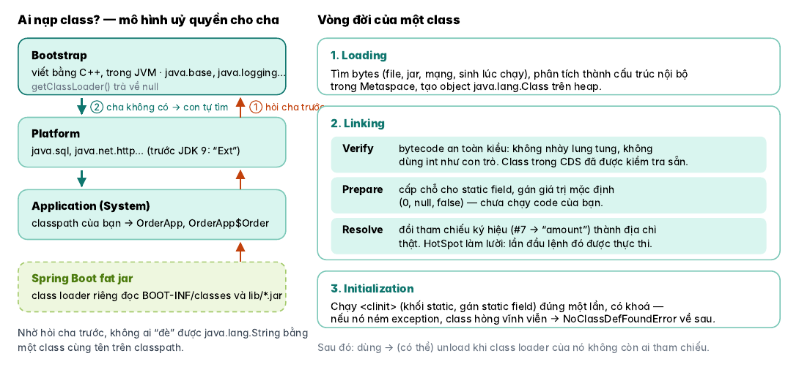

*Hình 1.7 — Trái: ba class loader của JDK (và loader riêng của fat jar Spring Boot). Phải: các pha một class đi qua. Ba pha của Linking không nhất thiết chạy liền nhau — đặc tả cho phép JVM trì hoãn, và HotSpot tận dụng triệt để.*

Cột `source:` trong log cho biết class đến từ đâu, và đó là một bức tranh thú vị:

| Nguồn trong log | Số class | Ý nghĩa |
|---|---|---|
| `shared objects file` | 535 | Lấy thẳng từ CDS archive: đã phân tích, đã verify, chỉ việc ánh xạ vào bộ nhớ. |
| `jrt:/java.base` | 2 | Đọc từ file `lib/modules` (image chứa toàn bộ thư viện chuẩn) vì không có trong archive. |
| `file:/home/claude/lab/` | 2 | Class của bạn, do application class loader đọc từ classpath. |
| `__JVM_LookupDefineClass__` | 7 | *Hidden class* sinh ra lúc chạy (không hề có file .class) — ở đây là mã nối chuỗi do `invokedynamic` tạo. Đây cũng là cơ chế đứng sau lambda; [bài 21](21-invokedynamic.md) sẽ mổ xẻ. |

> **NẠP ≠ KHỞI TẠO** — `new Order[1_000]` buộc JVM *nạp* class `Order` (để biết kiểu phần tử mảng) nhưng **chưa khởi tạo** nó; khối static của `Order` chỉ chạy ở `new Order(...)` đầu tiên. Các thời điểm kích hoạt khởi tạo gồm: `new`, gọi static method, đọc/ghi static field (trừ hằng số compile-time), `Class.forName`, khởi tạo class con. Chính quy tắc “khởi tạo một lần, có khoá” là thứ làm cho idiom *Holder* singleton an toàn đa luồng mà không cần `synchronized`.

> **HAI LỖI HAY BỊ NHẦM (XEM KỸ Ở BÀI 03)** — `ClassNotFoundException` là exception *kiểm tra được* khi *bạn* chủ động nạp class theo tên (`Class.forName`, `loadClass`) mà không tìm thấy. `NoClassDefFoundError` là lỗi khi *JVM* cần class trong lúc resolve một lệnh bytecode — class có lúc compile nhưng lúc chạy thì thiếu jar, xung đột phiên bản, hoặc `<clinit>` của nó đã từng thất bại.

## 7 Chặng 4 · Bộ nhớ: JVM chia RAM ra sao

Đặc tả JVM định nghĩa các **Runtime Data Areas** — những vùng nhớ mà mọi JVM đều phải có, chia làm hai nhóm: *riêng của từng thread* và *dùng chung*. Cách dễ nhớ nhất là hỏi: “mỗi thứ trong chương trình mẫu nằm ở đâu?”

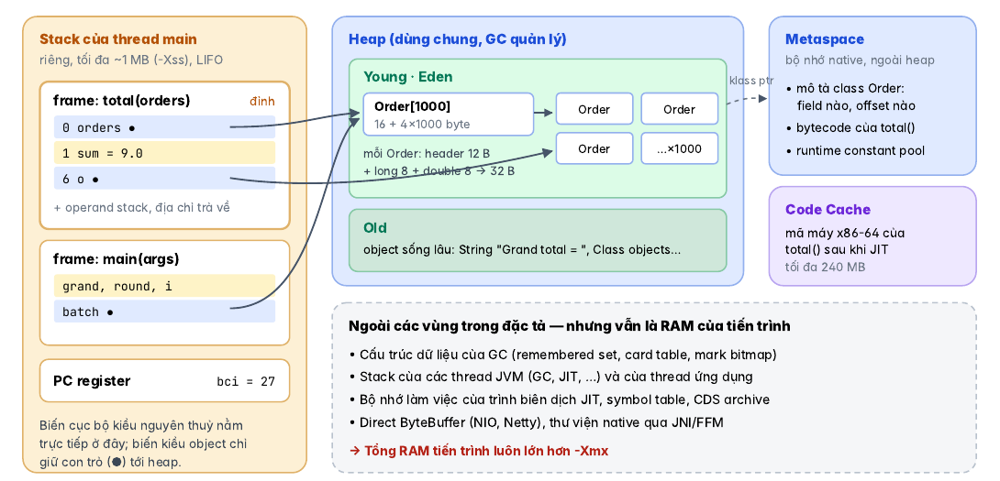

*Hình 1.8 — Ảnh chụp bộ nhớ khi thread main đang ở giữa vòng lặp của `total()`. Frame giữ giá trị nguyên thuỷ và con trỏ; object nằm trên heap; mỗi object trỏ về mô tả class của nó trong Metaspace; mã máy sau JIT nằm trong Code Cache.*

Đọc kỹ con số 32 byte cho một `Order`: hai field chỉ cần 16 byte dữ liệu, nhưng mỗi object còn mang một **header** 12 byte (8 byte *mark word* cho hash code, trạng thái khoá, tuổi GC; 4 byte con trỏ nén tới class) và được làm tròn lên bội số của 8. Header chiếm tới 3/8 kích thước object — lý do JDK 25 đưa Compact Object Headers (header 8 byte) thành tính năng chính thức và JDK 27 bật nó mặc định. [Bài 05](05-object-trong-ram.md) sẽ đo điều này bằng JOL.

### Đo thật: tiến trình dùng bao nhiêu, và cho cái gì?

Native Memory Tracking (NMT) cho phép JVM tự kê khai bộ nhớ theo từng hạng mục:

```text
$ java -XX:NativeMemoryTracking=summary OrderApp 5000 &
$ jcmd <pid> VM.native_memory summary scale=MB
Total: reserved=2931MB, committed=291MB
-                 Java Heap (reserved=1496MB, committed=224MB)
-                     Class (reserved=1024MB, committed=0MB)
-                    Thread (reserved=19MB, committed=1MB)
-                      Code (reserved=242MB, committed=7MB)
-                        GC (reserved=66MB, committed=42MB)
-        Shared class space (reserved=16MB, committed=13MB)
-                 Metaspace (reserved=64MB, committed=0MB)
  …
```


*Hình 1.9 — Phân bổ bộ nhớ committed của `OrderApp` theo NMT. Chương trình này gần như không có Metaspace hay thread đáng kể; với Spring Boot, các phần ngoài heap lớn hơn nhiều.*

> **SPRING BOOT TRÊN KUBERNETES** — Đặt `-Xmx` bằng đúng `limits.memory` của pod là công thức chắc chắn dẫn tới `OOMKilled`: kernel đếm *toàn bộ* RAM của tiến trình, không chỉ heap. Một service Spring Boot điển hình còn cần thêm Metaspace (thường 100–200 MB vì hàng chục nghìn class và proxy), code cache, stack cho hàng trăm thread Tomcat, buffer của driver/HTTP client, cộng chi phí GC như trên. Điểm khởi đầu hợp lý là `-XX:MaxRAMPercentage` khoảng 50–75% và đo bằng NMT — [bài 04](04-runtime-data-areas.md) sẽ xây dựng công thức đầy đủ.

## 8 Chặng 5 · Thực thi: interpreter và JIT

Khi `main` bắt đầu, mọi method đều chạy bằng **interpreter**. HotSpot dùng *template interpreter*: lúc khởi động, nó sinh sẵn một đoạn mã máy nhỏ cho mỗi opcode, rồi “nhảy” từ đoạn này sang đoạn khác theo bytecode. Cách này khởi động ngay lập tức nhưng chậm, vì mỗi lệnh bytecode tốn hàng chục lệnh máy và không có tối ưu xuyên lệnh nào.

Song song, interpreter **đếm**: mỗi method có bộ đếm số lần được gọi và số lần vòng lặp quay ngược (back-edge). Vượt ngưỡng, method được gửi vào hàng đợi cho trình biên dịch JIT — chạy trên các thread riêng, không chặn thread của bạn. HotSpot có hai trình biên dịch, phối hợp qua 5 tầng (*tiered compilation*):

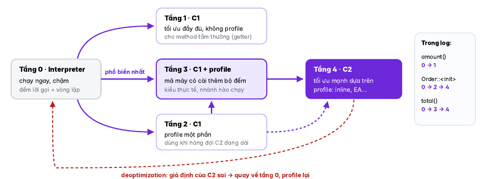

*Hình 1.10 — Năm tầng thực thi của HotSpot. C1 biên dịch nhanh và ở tầng 3 còn cài thêm mã thu thập profile; C2 dùng profile đó để tối ưu mạnh tay dựa trên giả định (“chỗ này chỉ có một kiểu”, “nhánh này không bao giờ chạy”). Cột phải: đường đi thực tế của ba method trong chương trình mẫu.*

### Xem JIT làm việc

```text
$ java -XX:+PrintCompilation OrderApp | grep OrderApp
ms   id  attr tầng  method                               ghi chú
41   11       2      OrderApp$Order::<init> (15 bytes)
41   12       1      OrderApp$Order::amount (5 bytes)
41   14       4      OrderApp$Order::<init> (15 bytes)
41   11       2      OrderApp$Order::<init> (15 bytes)   made not entrant
46   15   %   3      OrderApp::main @ 22 (99 bytes)
47   16       3      OrderApp::main (99 bytes)
48   17   %   3      OrderApp::total @ 11 (40 bytes)
48   18       3      OrderApp::total (40 bytes)
50   19   %   4      OrderApp::total @ 11 (40 bytes)
54   17   %   3      OrderApp::total @ 11 (40 bytes)   made not entrant
54   20   %   4      OrderApp::main @ 22 (99 bytes)
62   21       4      OrderApp::total (40 bytes)
64   18       3      OrderApp::total (40 bytes)   made not entrant
272  20   %   4      OrderApp::main @ 22 (99 bytes)   made not entrant
```

Cách đọc: cột đầu là thời điểm (ms kể từ khi JVM khởi động), tiếp theo là mã số lần biên dịch, thuộc tính, tầng, tên method và kích thước bytecode. Ba điều đáng chú ý:

- **Tốc độ lên tầng**: `total()` chạy thông dịch tới ms 48, có bản C1 ở ms 48, và bản C2 hoàn chỉnh ở ms 62 — chỉ ~30 ms sau khi `main` bắt đầu. Với code nóng như thế này, JIT phản ứng rất nhanh.
- **Dấu `%` là OSR (On-Stack Replacement)**. `main` chỉ được gọi *một lần*, nên chờ “lần gọi sau” để dùng bản biên dịch là vô ích. JIT biên dịch một phiên bản đặc biệt bắt đầu từ giữa vòng lặp (`@ 22` là vị trí bytecode của đầu vòng lặp) và *tráo* frame đang chạy sang mã máy ngay trong lúc vòng lặp đang quay.
- **`made not entrant`** nghĩa là phiên bản cũ không còn được dùng cho lời gọi mới — hoặc vì đã có phiên bản tầng cao hơn thay thế, hoặc vì một giả định của C2 bị phá vỡ (deoptimization). Dòng cuối ở ms 272 rất có thể thuộc loại thứ hai: C2 đã biên dịch vòng lặp của `main` với giả định đoạn mã sau vòng lặp “chưa từng chạy”, và khi vòng lặp kết thúc, JVM phải quay về interpreter cho phần còn lại.

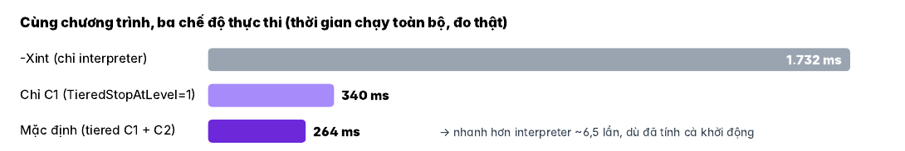

*Hình 1.11 — Đóng góp của JIT. Lưu ý chương trình này rất ngắn; với service chạy hàng giờ, khoảng cách giữa C1 và C2 thường rõ hơn nhiều vì C2 có thời gian tích luỹ profile và áp dụng tối ưu.*

> **SPRING BOOT** — **Đây là lý do của hiện tượng “chậm lúc mới deploy”.** Vài nghìn request đầu tiên chạy qua code đang thông dịch hoặc mới ở tầng C1, trong khi các thread JIT ngốn CPU để biên dịch hàng nghìn method của Spring, Jackson, Hibernate. Nếu pod bị giới hạn CPU chặt, thread JIT và thread xử lý request tranh nhau CPU — giai đoạn khởi động kéo dài, và latency p99 tăng vọt ngay đúng lúc readiness probe đã báo “sẵn sàng”. Các hướng xử lý (warm-up có chủ đích, cho thêm CPU lúc khởi động, AOT method profiling của JDK 25) được bàn ở [bài 07](07-jit-tiered-compilation.md) và [09](09-khoi-dong-nhanh-cds-aot-native.md).

## 9 Chặng 6 · Garbage Collector dọn rác

Mỗi vòng lặp của `main` tạo một mảng và 1.000 object `Order`, dùng chúng một lần trong `total()`, rồi bỏ đi. Theo tính toán ở mục 7 (32 byte mỗi `Order`, ~4 KB mỗi mảng), 20.000 vòng sinh ra khoảng **720 MB** object — trên một heap khởi đầu chỉ 94 MB. Chương trình không hề “hết bộ nhớ” vì GC liên tục thu hồi chỗ trống. Hai cơ chế làm điều đó trở nên rẻ:

- **Cấp phát bằng TLAB**. Mỗi thread được giao riêng một mảnh của Eden (Thread-Local Allocation Buffer). `new Order(...)` chỉ là tăng một con trỏ trong mảnh đó rồi ghi header — vài lệnh máy, không cần khoá. Cấp phát trong Java rẻ hơn `malloc` của C.
- **Thu gom theo thế hệ**. Giả thuyết thế hệ yếu (*weak generational hypothesis*): phần lớn object chết rất trẻ. Vì vậy heap được chia làm Young và Old; GC thường xuyên chỉ dọn vùng Young, và chỉ phải làm việc với những object *còn sống* — số object chết dù nhiều đến đâu cũng không tốn công.

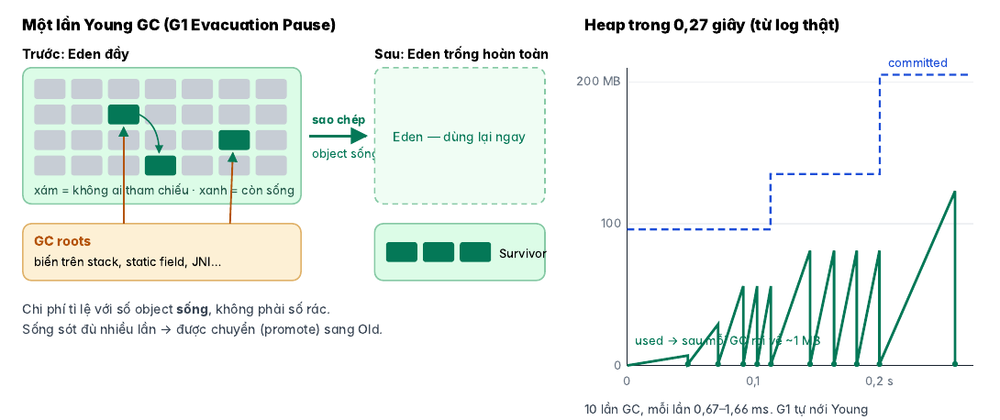

*Hình 1.12 — Trái: nguyên lý của một Young GC kiểu sao chép (evacuation). Phải: lượng heap đã dùng (xanh lá) và heap committed (xanh dương) dựng lại từ 10 dòng log GC thật. Hình răng cưa là “nhịp tim” điển hình của một ứng dụng tạo nhiều object ngắn hạn.*

```text
$ java -Xlog:gc OrderApp
[0.004s][info][gc] Using G1
[0.048s][info][gc] GC(0) Pause Young (Normal) (G1 Evacuation Pause) 7M->1M(96M) 1.046ms
[0.072s][info][gc] GC(1) Pause Young (Normal) (G1 Evacuation Pause) 29M->1M(96M) 0.669ms
[0.092s][info][gc] GC(2) Pause Young (Normal) (G1 Evacuation Pause) 56M->1M(96M) 0.770ms
  …
[0.200s][info][gc] GC(8) Pause Young (Normal) (G1 Evacuation Pause) 81M->1M(205M) 1.655ms
[0.260s][info][gc] GC(9) Pause Young (Normal) (G1 Evacuation Pause) 123M->1M(205M) 1.042ms
Grand total = 1.4985E10
```

Đọc một dòng: `GC(2)` là lần GC thứ ba; `Pause Young` — dừng ứng dụng để dọn Young; `56M->1M(96M)` — heap đã dùng giảm từ 56 MB xuống 1 MB, trên tổng 96 MB đang committed; `0.770ms` — thời gian ứng dụng bị dừng. Dọn 55 MB rác trong chưa tới 1 ms là minh chứng trực tiếp cho giả thuyết thế hệ: gần như mọi `Order` đã chết khi GC chạy.

Để ý cột trong ngoặc tăng dần 96 → 135 → 205 MB: G1 thấy GC xảy ra quá dày nên tự nới rộng heap (trong giới hạn 1,5 GB) để giảm tần suất. Ngược lại, chạy với `-Xmx64m` thì cùng chương trình phải GC **19 lần** thay vì 10 — heap nhỏ hơn, dọn thường xuyên hơn. Đây là đánh đổi cơ bản nhất của mọi GC: bộ nhớ, thông lượng và độ trễ — bạn không thể tối ưu cả ba cùng lúc.

> **SPRING BOOT** — Một request REST điển hình sinh ra rất nhiều object sống ngắn — DTO, entity, chuỗi JSON, iterator — đúng kiểu chương trình mẫu. Chúng chết trong Young và rất rẻ. Thứ làm GC vất vả là các object “trung niên”: danh sách kết quả lớn giữ qua nhiều bước, cache không giới hạn, session, buffer đọc file cả cục. Chúng sống qua vài lần Young GC, bị đẩy lên Old, và rồi phải được dọn bằng những chu kỳ đắt hơn nhiều. Chặng III của series xoay quanh việc nhận diện và xử lý loại object này.

## 10 Những thread bạn không hề tạo

`OrderApp` không tạo thread nào. Vậy mà khi nó đang chạy, hệ điều hành thấy **20 thread**. Dùng `jcmd <pid> Thread.print` (tên ở mức Java) và `/proc/<pid>/task` (mức hệ điều hành) để xem:

```text
$ java OrderApp 5000 &  ls /proc/$!/task | wc -l
20
$ jcmd <pid> Thread.print | grep '^"'
"main"  "Reference Handler"  "Finalizer"  "Signal Dispatcher"  "Service Thread"
"Monitor Deflation Thread"  "C2 CompilerThread0"  "C1 CompilerThread0"  "Notification Thread"
"Common-Cleaner"  "Attach Listener"  "GC Thread#0"  "GC Thread#1"  "VM Thread"
"VM Periodic Task Thread"  "G1 Service"  "G1 Refine#0"  "G1 Conc#0"  "G1 Main Marker"
```

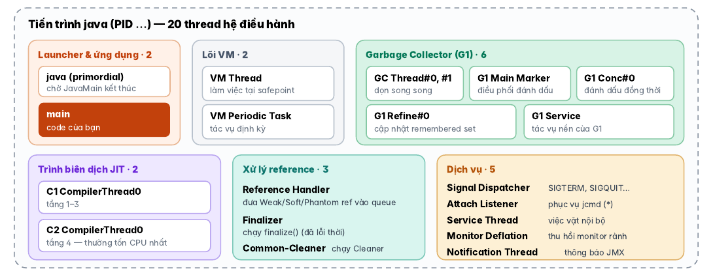

*Hình 1.13 — 20 thread của `OrderApp`, nhóm theo bộ phận. Số thread GC và JIT do ergonomics quyết định theo số CPU (ở đây 2 vCPU); trên máy 16 core bạn sẽ thấy nhiều hơn hẳn. `(*)` Attach Listener được tạo khi lần đầu có công cụ như `jcmd` kết nối — chính lệnh quan sát đã sinh ra nó.*

Mọi thread Java trên HotSpot (trừ virtual thread) đều là **một thread thật của hệ điều hành**, tỉ lệ 1:1. Hai thread đáng nhớ nhất ở thời điểm này:

- **VM Thread** thực hiện các “VM operation” cần cả thế giới đứng yên: một số pha GC, deoptimization, lấy thread dump. Để làm vậy, mọi thread Java phải dừng ở một *safepoint* — điểm mà trạng thái của chúng được JVM biết rõ. [Bài 18](18-thread-safepoint.md) sẽ giải thích vì sao “thời gian chờ mọi thread dừng” có khi còn dài hơn chính pause GC.
- **Signal Dispatcher** nhận tín hiệu từ hệ điều hành. Gửi `kill -3 <pid>` (SIGQUIT) và JVM in thread dump ra stdout thay vì chết; gửi SIGTERM thì nó kích hoạt quy trình tắt ở mục 11.

> **SPRING BOOT** — Một ứng dụng Spring Boot MVC lúc rảnh thường có 40–60 thread: ngoài các thread JVM như trên còn có pool của Tomcat (`http-nio-8080-exec-*`), thread nhận kết nối, pool của HikariCP, scheduler… Mỗi platform thread giữ một stack riêng (tối đa 1 MB mặc định) — đó là một khoản RAM ngoài heap. Virtual thread (`spring.threads.virtual.enabled=true`) thay đổi bài toán này: hàng nghìn virtual thread chạy trên vài carrier thread. [Bài 19](19-virtual-threads.md) dành riêng cho chủ đề này.

## 11 Chặng 7 · Kết thúc: JVM tắt như thế nào

Khi `main` return, chương trình chưa kết thúc ngay. Launcher gọi `DestroyJavaVM`, và JVM chạy một quy trình tắt có thứ tự. Bạn thậm chí thấy được dấu vết của nó: hai class cuối cùng trong log nạp class là `java.lang.Shutdown` và `java.lang.Shutdown$Lock`.

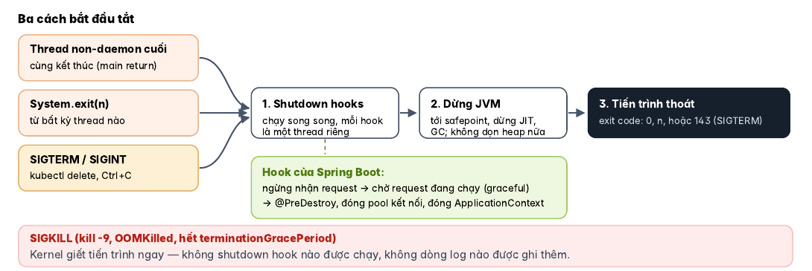

*Hình 1.14 — Trình tự tắt JVM. Shutdown hook chỉ chạy khi JVM được “mời” tắt; với SIGKILL thì không có cơ hội nào. Exit code 143 = 128 + 15 (số hiệu của SIGTERM), 137 = 128 + 9 (SIGKILL) — hai con số bạn sẽ thấy rất nhiều trong `kubectl describe pod`.*

Chi tiết quan trọng: nếu còn bất kỳ thread **non-daemon** nào đang chạy, JVM sẽ không tắt dù `main` đã return. Mọi thread hệ thống trong mục 10 đều là daemon nên không cản trở; nhưng một thread bạn tạo bằng `new Thread(...)` (mặc định non-daemon) hay một `ExecutorService` quên `shutdown()` sẽ khiến tiến trình “treo” sau khi làm xong việc.

> **SPRING BOOT TRÊN KUBERNETES** — Khi pod bị xoá, kubelet gửi SIGTERM → Signal Dispatcher → các shutdown hook chạy, trong đó có hook Spring Boot đăng ký sẵn. Từ Spring Boot 3.4, graceful shutdown được bật mặc định cho cả bốn web server nhúng: server ngừng nhận request mới và chờ request đang xử lý trong khoảng `spring.lifecycle.timeout-per-shutdown-phase`. Nếu tổng thời gian vượt `terminationGracePeriodSeconds` (mặc định 30 giây), kubelet gửi SIGKILL và mọi thứ dừng ngang. Ngoài ra, nếu ENTRYPOINT là một shell script không dùng `exec java …`, SIGTERM đến shell chứ không đến JVM — và graceful shutdown không bao giờ xảy ra.

## 12 Ghép lại: một trang để nhớ cả bài

Bảng dưới đây là “phiếu tra cứu” của bài: mỗi chặng, bộ phận chịu trách nhiệm, dấu vết bạn quan sát được trong chương trình mẫu, và lệnh để tự xem. Nếu chỉ giữ lại một trang từ bài này, hãy giữ trang này.

| Chặng | Bộ phận | Dấu vết trong OrderApp | Lệnh quan sát | Đào sâu |
|---|---|---|---|---|
| 1 · Biên dịch | `javac`, annotation processor | 2 file .class; record thành class con của `Record`; nối chuỗi thành `invokedynamic` | `javap -v -p` | [Bài 02](02-class-file-bytecode.md), [21](21-invokedynamic.md), [22](22-generics-record-pattern.md) |
| 2 · Khởi động | Launcher, ergonomics, CDS | G1 được chọn ở 4 ms; heap 94 MB → tối đa 1,5 GB; 35 ms vs 74 ms khi tắt CDS | `-XX:+PrintFlagsFinal`, `-Xshare:off` | [Bài 09](09-khoi-dong-nhanh-cds-aot-native.md), [13](13-gc-cho-container.md) |
| 3 · Nạp class | 3 class loader, verify, resolve, `<clinit>` | 546 class; class của bạn là #442; 7 hidden class | `-Xlog:class+load` | [Bài 03](03-class-loading.md) |
| 4 · Bộ nhớ | Stack, heap, Metaspace, code cache | Order = 32 byte; 291 MB committed, chỉ 224 MB là heap | `-XX:NativeMemoryTracking`, `jcmd VM.native_memory` | [Bài 04](04-runtime-data-areas.md), [05](05-object-trong-ram.md) |
| 5 · Thực thi | Interpreter, C1, C2 | `total()` lên C2 ở 62 ms; OSR cho vòng lặp của `main`; nhanh hơn `-Xint` 6,5 lần | `-XX:+PrintCompilation` | [Bài 06](06-interpreter-goi-method.md)–[08](08-toi-uu-jit.md) |
| 6 · Dọn rác | G1, TLAB, Young GC | ~720 MB cấp phát; 10 pause ~1 ms; heap rơi về 1 MB sau mỗi lần | `-Xlog:gc`, `-Xlog:gc*` | [Bài 10](10-nen-tang-gc.md)–[15](15-reference-off-heap.md) |
| Song song | Thread của JVM | 20 thread OS cho chương trình “đơn luồng” | `jcmd Thread.print`, `/proc/<pid>/task` | [Bài 18](18-thread-safepoint.md)–[20](20-java-util-concurrent.md) |
| 7 · Tắt | `DestroyJavaVM`, shutdown hook | Class cuối cùng được nạp: `java.lang.Shutdown` | `kill -TERM`, exit code | [Bài 26](26-capstone-su-co-production.md) |

*Và nếu cần tóm cả bài trong một đoạn: `javac` chỉ dịch thô sang bytecode chứa tên gọi ký hiệu. Launcher nạp `libjvm`, JVM tự đo máy để chọn cấu hình, nạp vài trăm class lõi từ CDS rồi mới nạp class của bạn — lười, theo nhu cầu. Code bắt đầu chạy bằng interpreter; những chỗ nóng được C1 rồi C2 biên dịch thành mã máy dựa trên profile thực tế, và bị huỷ khi giả định sai. Object được cấp phát gần như miễn phí trong TLAB và phần lớn chết trẻ, nên Young GC dọn chúng trong khoảng một mili-giây. Tất cả diễn ra song song trên hàng chục thread mà bạn không tạo ra, trong một tiến trình dùng nhiều RAM hơn heap của nó.*

## 13 Hiểu lầm thường gặp, bài tập, bài tiếp theo

### Hiểu lầm thường gặp

| Hiểu lầm | Thực tế |
|---|---|
| “Java chậm vì là ngôn ngữ thông dịch.” | Chỉ đúng trong vài chục mili-giây đầu với mỗi đoạn code. Code nóng chạy bằng mã máy đã tối ưu theo profile thật — có những tối ưu (inline xuyên interface, bỏ nhánh chưa từng chạy) mà trình biên dịch AOT tĩnh không dám làm. |
| “`-Xmx` là lượng RAM ứng dụng dùng.” | Chỉ là trần của heap. Tiến trình còn dùng Metaspace, code cache, stack của thread, bộ nhớ của GC, direct buffer… (mục 7). |
| “Tạo object tốn kém, nên dùng object pool.” | Cấp phát trong TLAB chỉ là tăng con trỏ, và object chết trẻ gần như không tốn công GC. Pool giữ object sống lâu, đẩy chúng lên Old — thường làm GC *tệ hơn*. Ngoại lệ: tài nguyên đắt thật sự như kết nối DB, thread, buffer native lớn. |
| “`javac` đã tối ưu code của tôi.” | `javac` gần như dịch nguyên văn; tối ưu diễn ra ở JIT lúc chạy (mục 3, 8). |
| “Chương trình một thread chỉ dùng một core.” | Thread GC và JIT chạy song song với bạn (mục 10). Trong container giới hạn CPU, chúng tranh CPU với code của bạn. |
| “Static field nằm trong Metaspace (hay PermGen).” | Từ JDK 7, giá trị static field nằm trong object `java.lang.Class` của class đó, *trên heap*. Metaspace chỉ chứa mô tả class — nên một static `Map` phình to là chuyện của heap, không phải Metaspace. |
| “Gọi `System.gc()` để giải phóng bộ nhớ.” | Chỉ là một lời gợi ý; với G1 mặc định nó kích hoạt một full GC dừng toàn bộ ứng dụng. Hiếm khi là ý hay trong code production. |

### Bài tập tự làm (khoảng 30 phút)

> **THỰC HÀNH**
>
> 1. **Lambda tốn bao nhiêu class?** Thay vòng for-each trong `total()` bằng `Arrays.stream(orders).mapToDouble(Order::amount).sum()`. Chạy lại với `-Xlog:class+load`: tổng số class tăng bao nhiêu, bao nhiêu trong đó là hidden class? (Gợi ý cho [bài 21](21-invokedynamic.md).)
> 2. **Khi nào C2 không bao giờ xuất hiện?** Giảm số vòng lặp xuống 50 và chạy với `-XX:+PrintCompilation`. `total()` dừng ở tầng nào?
> 3. **Đổi GC, đổi heap**. Chạy `-Xlog:gc` với `-Xmx32m`, `-Xmx2g`, rồi `-XX:+UseSerialGC` và `-XX:+UseZGC`. So sánh số lần GC, độ dài pause, và dòng “Using …”.
> 4. **Làm JVM “treo”**. Thêm vào cuối `main` một `new Thread(java.util.concurrent.locks.LockSupport::park).start();`. Chương trình có thoát không? Lấy thread dump bằng `jcmd <pid> Thread.print` và tìm thread tên `DestroyJavaVM`. Sau đó đánh dấu thread là daemon và thử lại.
> 5. **Đo ứng dụng Spring Boot của bạn** (bài tập quan trọng nhất). Với service đang làm ở công ty: đếm số class được nạp (`-Xlog:class+load`), số thread lúc rảnh, và bảng NMT sau khi đã nhận vài trăm request. Ghi lại ba con số này — [bài 03](03-class-loading.md) và [04](04-runtime-data-areas.md) sẽ dùng chúng.

### Thuật ngữ của bài

| Thuật ngữ | Nghĩa ngắn gọn |
|---|---|
| Bytecode | Tập lệnh của máy ảo, do `javac` sinh ra, lưu trong class file. |
| Constant pool | Bảng ký hiệu của class: tên class, method, kiểu, hằng số; bytecode trỏ vào đây bằng chỉ số. |
| Frame | Vùng trên stack của thread cho một lần gọi method: biến cục bộ + operand stack. |
| Ergonomics | Việc JVM tự chọn GC, kích thước heap, số thread dựa trên phần cứng/container. |
| CDS | Class Data Sharing — archive chứa class đã phân tích sẵn, giúp khởi động nhanh. |
| Reserved / committed | Địa chỉ ảo được giữ chỗ / bộ nhớ thật sự được ánh xạ và sử dụng được. |
| Tiered compilation | Phối hợp interpreter, C1 và C2 qua 5 tầng (0–4). |
| OSR | On-Stack Replacement — chuyển một vòng lặp đang chạy từ interpreter sang mã máy. |
| Deoptimization | Huỷ mã máy đã biên dịch khi giả định của nó sai, quay về interpreter. |
| TLAB | Thread-Local Allocation Buffer — mảnh Eden riêng của mỗi thread để cấp phát không cần khoá. |
| Safepoint | Điểm mà thread Java có thể dừng an toàn để JVM thực hiện thao tác toàn cục. |
| Daemon thread | Thread không giữ JVM sống; JVM tắt khi chỉ còn thread daemon. |

> **BÀI TIẾP THEO · BÀI 02** — **Class file & bytecode: đọc `javap` như đọc mã nguồn.** Ta sẽ mổ toàn bộ `OrderApp.class` từng byte, đi qua các nhóm opcode quan trọng, xem `StackMapTable` giúp verifier làm việc ra sao, và soi xem Lombok, `record`, `switch` trên String, try-with-resources thực sự sinh ra gì — kèm một bộ “cheat sheet” để đọc bytecode của chính ứng dụng Spring Boot.

### Tài liệu tham khảo

- The Java Virtual Machine Specification, Java SE 25 — chương 2 (cấu trúc JVM), 4 (class file), 5 (nạp, liên kết, khởi tạo). docs.oracle.com/javase/specs
- JEP 341 (Default CDS Archives), JEP 483/514/515 (AOT cache — Project Leyden), JEP 519 & 534 (Compact Object Headers), JEP 523 (G1 mặc định ở mọi môi trường). openjdk.org/jeps
- HotSpot Runtime Overview và mã nguồn OpenJDK (`src/java.base/share/native/libjli` cho launcher). openjdk.org
- Spring Boot Reference — Graceful Shutdown. docs.spring.io/spring-boot
