# Bài 02 — Class file & bytecode

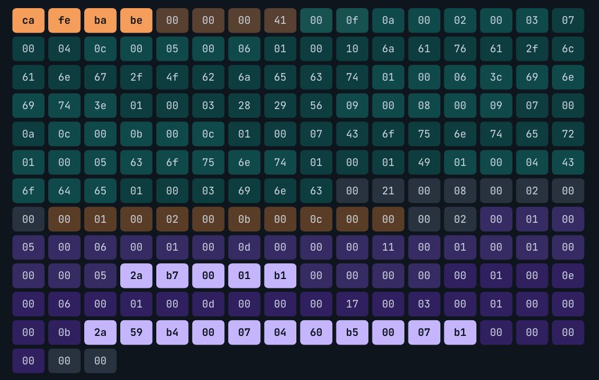

*Class file & bytecode: đọc `javap` như đọc mã nguồn*

*Toàn bộ 195 byte của một class, mổ từng byte — hình nền chính là nó · Chặng I · Nền móng · Nền tảng: JDK 25 LTS / 27 · Thí nghiệm chạy thật trên OpenJDK 21*

[Bài 01](01-buc-tranh-toan-canh-jvm.md) cho bạn bản đồ. Bài này đi vào chặng đầu tiên trên bản đồ đó — **class file và bytecode** — đủ sâu để bạn mở `javap` trên bất kỳ class nào, kể cả của Spring hay Hibernate, và hiểu nó đang làm gì.

> **MÔI TRƯỜNG THÍ NGHIỆM** — Như [Bài 01](01-buc-tranh-toan-canh-jvm.md): mọi output đều chạy thật trên OpenJDK 21.0.12 (Linux x86-64). Class file do JDK 21 sinh ra có major version 65; JDK 25 sẽ ghi 69, còn lại bytecode của các ví dụ trong bài gần như giống hệt. Các file mẫu đều ngắn — bạn có thể gõ lại và chạy trong vài phút.

Cú pháp Java là thứ bạn viết; bytecode là thứ thật sự chạy. Bài này dạy bạn đọc bytecode — và cho thấy nhiều bug quen thuộc trong ứng dụng Spring Boot thực ra được viết rõ ràng trong bytecode.

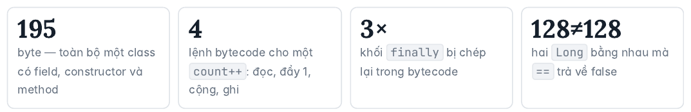

> **SAU BÀI NÀY BẠN SẼ**
>
> - Đọc được `javap -c -v` của một method bất kỳ và kể lại nó làm gì, từng lệnh một.
> - Giải thích bằng bytecode: vì sao `count++` mất cập nhật, vì sao `Long == Long` đúng ở môi trường test mà sai trên production, vì sao đổi hằng số trong thư viện không có tác dụng.
> - Biết class file chứa những thông tin nào mà Spring, Jackson, debugger và stack trace đang dựa vào.
> - Chẩn đoán được `VerifyError`, `UnsupportedClassVersionError`, “code too large”.

## 1 Vì sao phải đọc bytecode — và đọc bằng gì

Bạn sẽ không viết bytecode bằng tay, và cũng không cần thuộc 202 opcode. Nhưng đọc được bytecode cho bạn một năng lực đặc biệt: **nhìn thấy sự thật mà cú pháp che đi**. `for-each`, `record`, autoboxing, try-with-resources, `switch` trên String, nối chuỗi — tất cả là “đường” (syntactic sugar) mà `javac` bóc ra thành những lệnh đơn giản. Khi có bug kỳ lạ, câu trả lời thường nằm ở chỗ đường đã bị bóc ra.

Ngoài ra, bytecode là ngôn ngữ chung của cả hệ sinh thái: Spring đọc annotation từ class file mà không cần nạp class; Hibernate và Mockito sinh bytecode lúc chạy để tạo proxy; agent APM chèn lệnh đo thời gian vào method của bạn; Kotlin và Scala cũng biên dịch ra đúng định dạng này. Hiểu class file là hiểu “giao kèo” mà tất cả công cụ đó cùng tuân theo.

### Công cụ: `javap` và các cờ cần nhớ

| Cờ | Cho thấy gì | Khi nào dùng |
|---|---|---|
| `javap Foo` | Chỉ chữ ký các thành viên public/protected | Xem nhanh API của một class |
| `-p` | Thêm thành viên private và package-private | Xem javac sinh thêm gì (accessor, method lambda…) |
| `-c` | Bytecode của từng method | Hầu như mọi lúc |
| `-v` | Tất cả: version, constant pool, flags, mọi attribute | Điều tra sâu, kiểm tra version, annotation, StackMapTable |
| `-l` | Bảng số dòng và bảng biến cục bộ | Đối chiếu bytecode với dòng mã nguồn |
| `-s` · `-constants` | Descriptor nội bộ · giá trị hằng `static final` | Đọc lỗi `NoSuchMethodError`; kiểm tra hằng số |
| `-cp <path>` | Đọc class từ thư mục hoặc jar | `javap -c -cp app.jar com.acme.X` |

Trong IntelliJ IDEA, *View → Show Bytecode* hiển thị bytecode của class đang mở (sau khi build). Plugin/công cụ *jclasslib* cho phép duyệt class file dạng cây — tiện khi học cấu trúc. Trong bài, ta dùng `javap` vì nó luôn có sẵn trong JDK, kể cả trong container production.

## 2 Mổ từng byte một class 195 byte

Ở [Bài 01](01-buc-tranh-toan-canh-jvm.md) ta đã nhìn lướt cấu trúc class file. Lần này ta đi hết **từng byte** của một class đủ nhỏ để làm được điều đó — và đủ đầy đủ để có field, constructor và một method thật:

```java
public class Counter {
    private int count;
    public void inc() { count++; }
}
```

```bash
$ javac -g:none Counter.java && ls -l Counter.class        # -g:none: bỏ debug info
-rw-r--r-- 1 root root 195 Counter.class
```

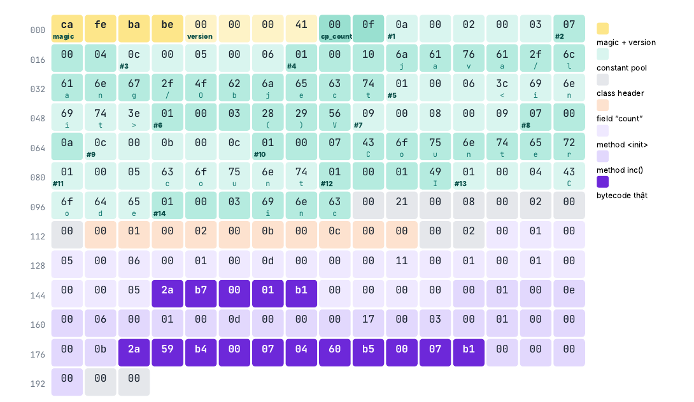

*Hình 2.1 — Toàn bộ 195 byte của `Counter.class`, 16 byte mỗi hàng (số bên trái là offset thập phân). Màu xanh ngọc là constant pool: mỗi mục bắt đầu bằng một byte tag (đánh dấu #1…#14), ký tự in nhỏ bên dưới là phần chuỗi UTF-8. Chỉ 16 byte màu tím đậm là bytecode thực sự chạy — phần còn lại là metadata để JVM hiểu 16 byte đó.*

| Offset | Byte | Ý nghĩa |
|---|---|---|
| 0–3 | `ca fe ba be` | **magic** — mọi class file đều bắt đầu như vậy. JVM thấy sai magic là từ chối ngay (`ClassFormatError`). |
| 4–7 | `00 00 00 41` | minor 0, **major 65** = Java 21. |
| 8–9 | `00 0f` | **constant_pool_count = 15**, nghĩa là có các mục #1…#14. Chỉ số #0 không bao giờ được dùng. |
| 10–104 | `0a 00 02 00 03` … | 14 mục constant pool. Mục #1 có tag `0a` (10 = Methodref) trỏ tới class #2 và name-and-type #3 — chính là `Object.<init>()`, constructor của lớp cha. |
| 105–106 | `00 21` | access flags: `ACC_PUBLIC` (0x0001) \| `ACC_SUPER` (0x0020). |
| 107–112 | `00 08 00 02 00 00` | this_class = #8 (`Counter`), super_class = #2 (`java/lang/Object`), 0 interface. |
| 113–122 | `00 01 \| 00 02 00 0b 00 0c 00 00` | 1 field: flags `PRIVATE`, tên #11 `"count"`, descriptor #12 `"I"` (int), 0 attribute. |
| 123–155 | `00 02 \| 00 01 00 05 00 06 …` | 2 method. Method đầu: `public <init>()V` — constructor mặc định mà *bạn không hề viết*. Attribute `Code` dài 17 byte: max_stack 1, max_locals 1, 5 byte lệnh `2a b7 00 01 b1`. |
| 156–192 | `00 01 00 0e 00 06 …` | Method `public inc()V`. Code dài 23 byte: max_stack 3, max_locals 1, 11 byte lệnh. |
| 193–194 | `00 00` | 0 attribute cấp class (đã bỏ `SourceFile` bằng `-g:none`). |

11 byte của `inc()` giải mã như sau — đây là bytecode thật, đọc bằng mắt thường:

```text
byte    opcode         ý nghĩa                                    stack sau lệnh
2a      aload_0        đẩy this                                   [this]
59      dup            nhân đôi đỉnh stack                        [this, this]
b4 0007 getfield #7    lấy this ra, đẩy this.count                [this, count]
04      iconst_1       đẩy hằng 1                                 [this, count, 1]
60      iadd           cộng hai int trên đỉnh                     [this, count+1]
b5 0007 putfield #7    ghi count+1 vào this.count                 []
b1      return
```

Stack sâu nhất là 3 ô — đúng `max_stack=3`. Lệnh `dup` tồn tại vì `this` cần dùng hai lần: một cho `getfield`, một cho `putfield`.

### Constant pool: 17 loại mục

Byte tag đầu mỗi mục cho biết phần còn lại dài bao nhiêu và nghĩa là gì. Counter chỉ dùng 5 loại; đặc tả hiện có 17:

| Tag | Loại | Chứa gì / ai dùng |
|---|---|---|
| 1 | Utf8 | Chuỗi “modified UTF-8”: tên, descriptor, tên attribute. Mọi mục khác cuối cùng đều trỏ về đây. |
| 3 · 4 | Integer · Float | Hằng 4 byte vượt ngoài phạm vi `iconst` / `bipush` / `sipush`; nạp bằng `ldc`. |
| 5 · 6 | Long · Double | Hằng 8 byte. Mỗi mục chiếm *hai* chỉ số — một quyết định thiết kế mà chính tác giả đặc tả về sau thừa nhận là đáng tiếc. |
| 7 · 8 | Class · String | Tham chiếu tới class (cho `new`, `checkcast`…) và chuỗi literal (cho `ldc`). |
| 9 · 10 · 11 | Fieldref · Methodref · InterfaceMethodref | Cặp (class, name-and-type) — đích của `getfield`, `invoke*`. |
| 12 | NameAndType | Cặp (tên, descriptor). |
| 15 · 16 | MethodHandle · MethodType | Dùng cho `invokedynamic` và lambda ([Bài 21](21-invokedynamic.md)). |
| 17 · 18 | Dynamic · InvokeDynamic | Hằng số tính lúc chạy (Java 11+) và call site của `invokedynamic`. |
| 19 · 20 | Module · Package | Chỉ xuất hiện trong `module-info.class`. |

> **GIỚI HẠN ẨN TRONG ĐỊNH DẠNG: “CODE TOO LARGE”** — Phần lớn chỉ số và độ dài trong class file là số 2 byte (u2). Hệ quả: tối đa 65.535 mục constant pool, mỗi method tối đa **65.535 byte** bytecode, tối đa 255 slot tham số (`long` / `double` tính 2). Bạn sẽ đụng giới hạn thứ hai khi code sinh tự động quá to — mapper khổng lồ, mảng hằng số hàng chục nghìn phần tử khởi tạo trong `static {}` (mỗi phần tử tốn vài lệnh), template engine biên dịch thành một method duy nhất. `javac` báo `error: code too large`; cách sửa là tách method hoặc đọc dữ liệu từ file resource.

## 3 Descriptor: cách JVM đặt tên cho kiểu

Trong class file không có `int` hay `String` — chỉ có **descriptor**, một cách viết kiểu cực gọn. Tên class dùng dấu `/` thay cho dấu chấm (gọi là *internal name*).

| Kiểu Java | Descriptor |
|---|---|
| `boolean` · `byte` · `char` | `Z` · `B` · `C` |
| `short` · `int` · `long` | `S` · `I` · `J` |
| `float` · `double` · `void` | `F` · `D` · `V` |
| `String` | `Ljava/lang/String;` |
| `int[]` · `Order[][]` | `[I` · `[[LOrder;` |

> **MẸO NHỚ** — `J` cho long vì `L` đã dành cho tham chiếu; `Z` cho boolean vì `B` đã là byte. Dấu `;` đóng một tên class, dấu `[` mở một chiều mảng.

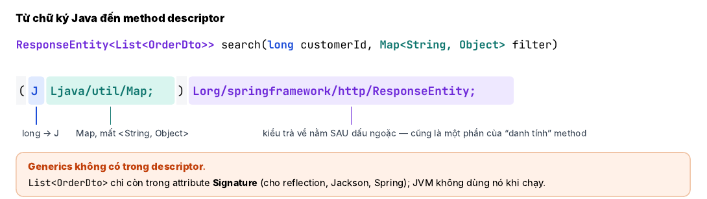

*Hình 2.2 — Cấu tạo một method descriptor. Tên tham số (`customerId`, `filter`) không xuất hiện; chỉ có kiểu, theo thứ tự.*

Vì kiểu trả về là một phần của descriptor, ở mức JVM hai method có thể trùng tên, trùng tham số và chỉ khác kiểu trả về. Java không cho bạn viết như vậy, nhưng `javac` tự sinh ra chúng (bridge method — [Bài 22](22-generics-record-pattern.md)). Hệ quả thực tế quan trọng hơn: **JVM tìm method bằng cả tên lẫn descriptor**.

> **SPRING BOOT · ĐỌC HIỂU NOSUCHMETHODERROR** — Giả sử service của bạn được build với `spring-data-commons` bản A, nhưng lúc chạy classpath lại có bản B (do một dependency khác kéo vào), và ở bản B một method đổi kiểu trả về từ `List` sang `Collection`. Mã nguồn của bạn vẫn biên dịch được với cả hai bản, nhưng class file đã ghi cứng descriptor cũ `()Ljava/util/List;`. Lúc chạy, JVM tìm đúng descriptor đó, không thấy, và ném `java.lang.NoSuchMethodError: 'java.util.List com.x.Y.items()'`. Đọc thông báo lỗi như đọc descriptor: nó cho bạn biết *chính xác* chữ ký mà code được biên dịch kỳ vọng. Bước tiếp theo luôn là `./mvnw dependency:tree` (hoặc `gradle dependencies`) để tìm phiên bản nào đang thắng.

## 4 Bản đồ tập lệnh: 202 opcode, đọc theo nhóm

Mỗi opcode dài đúng 1 byte, nên tối đa có 256 lệnh; đặc tả hiện dùng 202 (từ `0x00 nop` tới `0xc9 jsr_w`) và giữ 3 mã cho mục đích nội bộ. Bạn không cần học thuộc — chỉ cần nắm **quy tắc đặt tên**, là đọc được gần như mọi lệnh ngay lần đầu gặp:

| Quy tắc | Ví dụ |
|---|---|
| **Tiền tố = kiểu dữ liệu**: `i` int, `l` long, `f` float, `d` double, `a` tham chiếu; trong mảng thêm `b` byte/boolean, `c` char, `s` short | `iadd` / `ladd` / `dadd` · `aload` · `iaload` (đọc phần tử mảng int) · `bastore` |
| **Hậu tố `_n`** = dạng rút gọn 1 byte cho slot/hằng 0–3 | `aload_0` (1 byte) thay cho `aload 0` (2 byte) · `iconst_m1` … `iconst_5` |
| **Hằng số theo độ lớn** | `iconst_*` (−1…5) → `bipush` (1 byte) → `sipush` (2 byte) → `ldc` (constant pool) |
| **Ép kiểu** = `x2y` | `i2l`, `l2i`, `d2i`, `i2b` |
| **Không có số học cho byte/short/char/boolean** | Chúng được tính như `int` — vì vậy `byte c = a + b` cần ép kiểu, và bytecode có thêm `i2b`. |

Để biết lệnh nào thực sự quan trọng, ta đếm. Dùng `jimage extract` lấy 498 class của package `java.util` trong JDK, cho qua `javap -c` và đếm từng lệnh — tổng cộng **132.658 lệnh**, thuộc 180 loại khác nhau:

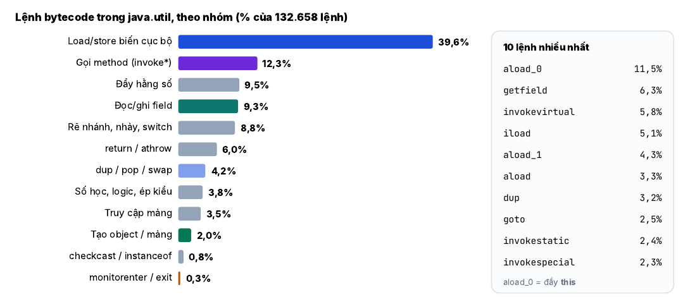

*Hình 2.3 — Phân bố lệnh trong 498 class của `java.util` (JDK 21), đếm bằng `javap -c`. Lệnh phổ biến nhất là `aload_0`: gần như mọi thao tác trên field của một object đều bắt đầu bằng “đẩy `this`”.*

> **CON SỐ NÀY NÓI GÌ VỀ HIỆU NĂNG** — Gần **một nửa** số lệnh (load/store + dup/pop) chỉ để chuyển dữ liệu qua lại giữa biến cục bộ và operand stack — công việc mà một CPU thật làm bằng thanh ghi, gần như miễn phí. Interpreter phải thực thi từng lệnh đó; JIT thì phân bổ thanh ghi và xoá sạch chúng. Đây là một lý do cụ thể cho khoảng cách 6,5 lần giữa `-Xint` và JIT mà ta đo được ở [Bài 01](01-buc-tranh-toan-canh-jvm.md).

## 5 Năm cách gọi một method

Gọi method chiếm 12% số lệnh và là nơi tập trung nhiều cơ chế nhất của JVM. Có đúng năm lệnh `invoke`, và `javac` chọn lệnh nào dựa vào *loại* method bạn gọi. Chương trình dưới đây gọi đủ cả năm:

```java
public class Inv extends ArrayList<String> {
    private int secret() { return 42; }
    static int util() { return 1; }
    int demo(List<String> list, ArrayList<String> arr) {
        int a = secret();          // private, cùng class
        int b = util();            // static
        int c = list.size();       // qua kiểu interface
        int d = arr.size();        // qua kiểu class
        int e = super.size();      // gọi bản của lớp cha
        Runnable r = () -> {};     // lambda
        return a + b + c + d + e;
    }
}
```

```text
$ javap -c -p Inv | grep invoke
   1: invokevirtual   #7      // Method secret:()I
   5: invokestatic    #13     // Method util:()I
  11: invokeinterface #16, 1  // InterfaceMethod java/util/List.size:()I
  19: invokevirtual   #21     // Method java/util/ArrayList.size:()I
  25: invokespecial   #21     // Method java/util/ArrayList.size:()I
  30: invokedynamic   #22, 0  // InvokeDynamic #0:run:()Ljava/lang/Runnable;
```

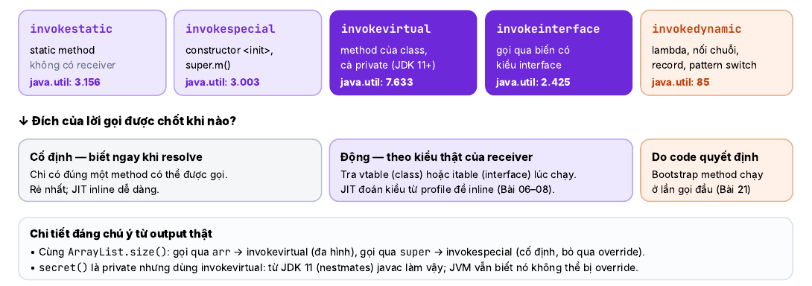

*Hình 2.4 — Năm lệnh invoke, số lần xuất hiện trong `java.util`, và thời điểm đích của lời gọi được chốt. `invokedynamic` hiếm trong thư viện chuẩn cũ nhưng rất phổ biến trong code hiện đại dùng nhiều lambda và stream.*

> **SPRING BOOT** — Khi bạn inject `OrderRepository` (một interface) vào service, mọi lời gọi `repo.findById(...)` là `invokeinterface` trên một object proxy do Spring Data tạo lúc chạy. Bytecode của bạn không hề biết đến proxy — nó chỉ nói “gọi `findById` trên bất kỳ thứ gì cài đặt interface này”. Chính sự gián tiếp ấy cho phép Spring chèn transaction, retry, metrics vào giữa. [Bài 23](23-reflection-proxy.md) sẽ mở proxy ra xem.

## 6 Mẫu hình · `new` – `dup` – `invokespecial`

Từ đây, ta đi qua các **mẫu hình** bytecode: những chuỗi lệnh lặp đi lặp lại mà khi nhận ra, bạn đọc bytecode nhanh như đọc câu văn. Mẫu hình phổ biến nhất là tạo object:

```java
static StringBuilder create() { return new StringBuilder("id-"); }

 0: new           #13   // class java/lang/StringBuilder
 3: dup
 4: ldc           #15   // String id-
 6: invokespecial #17   // Method java/lang/StringBuilder."<init>":(Ljava/lang/String;)V
 9: areturn
```

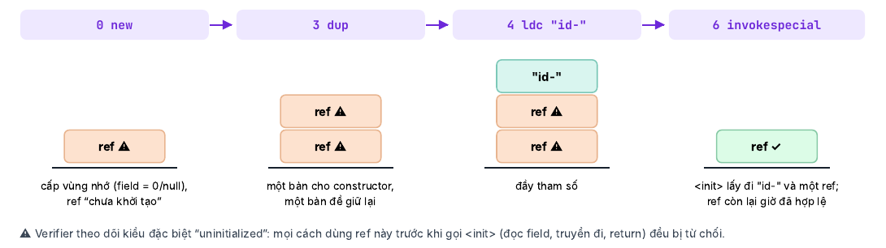

*Hình 2.5 — Vì sao luôn có `dup` sau `new`: constructor tiêu thụ một bản tham chiếu, và ta cần một bản nữa để dùng sau đó. Kể cả khi kết quả bị bỏ đi (viết `new StringBuilder("x");` như một câu lệnh), `javac` vẫn sinh `dup` rồi thêm `pop` ở cuối — đã kiểm chứng bằng `javap`.*

Mẫu hình này cũng cho thấy `new` trong Java là hai bước tách biệt: *cấp phát* (lệnh `new`, thường chỉ là tăng con trỏ trong TLAB như [Bài 01](01-buc-tranh-toan-canh-jvm.md)) và *khởi tạo* (gọi `<init>`, chạy code constructor của bạn và của mọi lớp cha). Lớp cha luôn được khởi tạo trước: dòng đầu tiên trong bytecode của mọi constructor là `aload_0; invokespecial` tới constructor cha — đúng như ta thấy ở `Counter.<init>`.

## 7 Mẫu hình · `count++` và lost update

Ở mục 2 ta đã thấy `count++` trên một field là `getfield → iconst_1 → iadd → putfield`. Với field static thì là `getstatic → iconst_1 → iadd → putstatic`. Bốn lệnh, ba bước: **đọc, tính, ghi**. Giữa “đọc” và “ghi”, một thread khác hoàn toàn có thể chen vào. Hãy đo:

```java
static int plain = 0;
static volatile int vol = 0;
static final AtomicInteger atomic = new AtomicInteger();

Runnable task = () -> {
    for (int i = 0; i < 1_000_000; i++) { plain++; vol++; atomic.incrementAndGet(); }
};
// chạy task trên 2 thread song song, join, rồi in kết quả
```

```text
$ for i in 1 2 3; do java Race; done
plain=1,937,811  volatile=1,774,357  atomic=2,000,000  (expected 2,000,000)
plain=1,893,117  volatile=1,614,644  atomic=2,000,000  (expected 2,000,000)
plain=1,891,697  volatile=1,713,014  atomic=2,000,000  (expected 2,000,000)
```

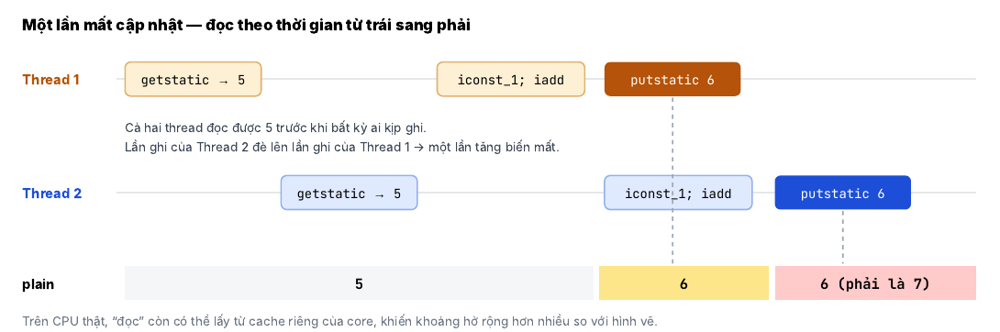

*Hình 2.6 — Lost update ở mức bytecode. Hai thread cùng chạy ba bước đọc–tính–ghi trên cùng một biến; thứ tự xen kẽ bất lợi làm mất một lần tăng. Lặp lại hàng triệu lần, ta mất hàng chục đến hàng trăm nghìn lần tăng như kết quả đo ở trên.*

- **`volatile` không cứu được** — thậm chí trong lần đo này còn mất *nhiều hơn*. `volatile` đảm bảo mỗi lần đọc thấy giá trị mới nhất và mỗi lần ghi được nhìn thấy ngay ([Bài 16](16-java-memory-model.md)), nhưng ba bước vẫn là ba bước. Nó không biến đọc–tính–ghi thành một thao tác nguyên tử.
- **`AtomicInteger.incrementAndGet()`** là một lời gọi method duy nhất trong bytecode, bên trong dùng lệnh CPU nguyên tử (trên x86 là `lock xadd`). Kết quả luôn đúng 2.000.000.
- Còn `i++` trên *biến cục bộ* thì sao? Nó biên dịch thành một lệnh `iinc` duy nhất — và dù sao biến cục bộ cũng nằm trong frame riêng của từng thread, không ai chia sẻ.

> **SPRING BOOT · SINGLETON LÀ SHARED STATE** — Bean mặc định là singleton: một object duy nhất phục vụ mọi thread của Tomcat. Một field như `private long processedCount;` rồi `processedCount++` trong `@Service` chính là chương trình `Race` ở trên, chỉ khác là chạy trên 200 thread. Test đơn luồng sẽ không bao giờ phát hiện ra. Dùng `AtomicLong` / `LongAdder`, hoặc tốt hơn là `Counter` của Micrometer cho số liệu đo; và nhớ rằng mọi field có thể thay đổi trong một singleton (`HashMap`, `SimpleDateFormat`, một `List` “cache”) đều mang cùng loại rủi ro.

## 8 Mẫu hình · Exception table: finally, try-with-resources, synchronized

Bytecode không có lệnh “try”. Thay vào đó, mỗi method có một **exception table**: danh sách các dòng “nếu exception kiểu X xảy ra trong khoảng lệnh [from, to), nhảy tới target”. Khi exception được ném, JVM duyệt bảng từ trên xuống, lấy dòng đầu tiên khớp; không có dòng nào khớp thì frame bị huỷ và exception lan lên method gọi. Hãy xem `finally` trông như thế nào:

```java
static int parse(String s) {
    try { return Integer.parseInt(s); }
    catch (NumberFormatException e) { return -1; }
    finally { System.out.println("done"); }
}
```

```text
 0: aload_0
 1: invokestatic  #20   // Integer.parseInt
 4: istore_1                                  // cất kết quả tạm
 5: getstatic #26; 8: ldc "done"; 10: invokevirtual println     // ← finally, bản 1
13: iload_1
14: ireturn
15: astore_1                                  // handler NumberFormatException
16: iconst_m1
17: istore_2
18: getstatic #26; 21: ldc "done"; 23: invokevirtual println     // ← finally, bản 2
26: iload_2
27: ireturn
28: astore_3                                  // handler "any": mọi exception khác
29: getstatic #26; 32: ldc "done"; 34: invokevirtual println     // ← finally, bản 3
37: aload_3
38: athrow                                    // ném lại exception ban đầu
Exception table:
   from    to  target type
      0     5    15   Class java/lang/NumberFormatException
      0     5    28   any
     15    18    28   any
```

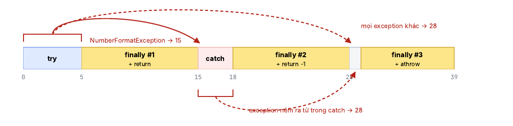

*Hình 2.7 — Bố cục bytecode của `parse()`. Khối `finally` không phải một “chương trình con”: `javac` chép nó vào từng lối ra — return bình thường, return trong catch, và lối ném exception. Các đường đỏ là ba dòng của exception table.*

- **Chi phí của try là 0 khi không có exception.** Lệnh 0–4 chạy y như không có try; exception table chỉ được tra khi có exception thật sự. Đặt try/catch trong vòng lặp nóng không làm chậm đường đi bình thường.
- **finally bị nhân bản** theo số lối ra. Một `finally` lớn trong method có nhiều `return` làm phình bytecode (và có thể góp phần vào “code too large”).
- **Đừng `return` trong `finally`.** Bản sao thứ 3 kết thúc bằng `athrow`; nếu bạn viết `return` trong finally, bản sao đó sẽ return thay vì ném lại — exception gốc biến mất không dấu vết.

### try-with-resources

```java
static String firstLine(File f) throws IOException {
    try (BufferedReader r = new BufferedReader(new FileReader(f))) { return r.readLine(); }
}

 0: new BufferedReader; 3: dup; 4: new FileReader; 7: dup; 8: aload_0
 9: invokespecial FileReader.<init>   12: invokespecial BufferedReader.<init>
15: astore_1                             // r
16: aload_1; 17: invokevirtual readLine; 20: astore_2
21: aload_1; 22: invokevirtual close    // đóng trên đường bình thường
25: aload_2; 26: areturn
27: astore_2                             // có exception trong thân try
28: aload_1; 29: invokevirtual close    // vẫn đóng
32: goto 41
35: astore_3                             // close() cũng ném exception?
36: aload_2; 37: aload_3
38: invokevirtual Throwable.addSuppressed   // gắn nó vào exception gốc
41: aload_2; 42: athrow
Exception table:  16–21 → 27 Throwable;   28–32 → 35 Throwable
```

Hai điều chỉ bytecode mới cho thấy rõ. Thứ nhất, exception từ `close()` không đè lên exception gốc mà được **gắn vào** nó qua `addSuppressed` — đó là lý do stack trace có mục “Suppressed:”. Thứ hai, vùng được bảo vệ bắt đầu từ lệnh 16, **sau khi cả hai constructor đã chạy xong**. Nếu `FileReader` mở file thành công nhưng constructor của `BufferedReader` ném exception, `FileReader` sẽ không bao giờ được đóng — vì nó chưa bao giờ là “resource” của câu lệnh try. Khi lớp bọc ngoài có thể ném lỗi, hãy khai báo riêng từng resource: `try (var fr = new FileReader(f); var r = new BufferedReader(fr))`.

> **SPRING BOOT** — `JdbcTemplate`, `RestClient`, Spring Data đều tự đóng tài nguyên cho bạn. Nhưng khi bạn tự lấy `dataSource.getConnection()` (để chạy một lệnh đặc thù, stream dữ liệu lớn…) mà quên try-with-resources, connection không bao giờ quay về pool. Triệu chứng không xuất hiện ngay mà sau vài giờ: HikariCP báo *“Connection is not available, request timed out after 30000ms”* và mọi request đứng chờ.

### synchronized: khoá cũng dùng exception table

```java
void syncBlock() { synchronized (lock) { n++; } }

 4: dup; 5: astore_1                // giữ tham chiếu lock trong slot 1
 6: monitorenter
 7: ... n++ ...
17: aload_1; 18: monitorexit       // lối ra bình thường
19: goto 27
22: astore_2; 23: aload_1; 24: monitorexit; 25: aload_2; 26: athrow // lối ra khi exception
Exception table:  7–19 → 22 any;   22–25 → 22 any
```

```java
synchronized void syncMethod() { n++; }

flags: (0x0020) ACC_SYNCHRONIZED
Code:  0: aload_0; 1: dup; 2: getfield n; 5: iconst_1; 6: iadd; 7: putfield n; 10: return
```

Khối `synchronized` là `monitorenter` / `monitorexit` cộng một handler “any” để chắc chắn khoá được nhả cả khi có exception — giống hệt cách `finally` được sinh ra. Còn method `synchronized` thì bytecode không có lệnh khoá nào: chỉ một cờ `ACC_SYNCHRONIZED`, và JVM tự khoá/nhả khi vào/ra method. Chuyện gì xảy ra bên trong `monitorenter` là chủ đề của [Bài 17](17-synchronized-monitor.md).

## 9 Mẫu hình · `switch`: bảng nhảy và tra cứu

`switch` trên số nguyên có hai cách biên dịch, và `javac` tự chọn dựa trên độ “dày” của các giá trị `case`:

```text
// case 1, 2, 3, 4                         // case 1, 100, 10_000
 1: tableswitch   { // 1 to 4               1: lookupswitch  { // 3
           1: 32                                      1: 36
           2: 35                                    100: 39
           3: 38                                  10000: 42
           4: 41                                default: 45 }
     default: 44 }
```

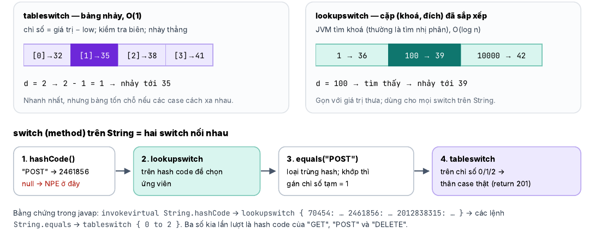

*Hình 2.8 — Hai lệnh switch của JVM và cách `javac` ghép chúng để switch trên String. Bản thân JVM không biết gì về String; toàn bộ là phép biến đổi của trình biên dịch.*

Hệ quả thực tế: `switch (s)` với `s == null` ném `NullPointerException` ngay ở bước `hashCode()` — trước cả khi xét tới `default`. Từ Java 21, switch kiểu mới có thể có `case null`, và switch trên pattern (`case Order o ->`) được biên dịch theo cách hoàn toàn khác, qua `invokedynamic` — [Bài 22](22-generics-record-pattern.md).

## 10 Mẫu hình · Autoboxing và cái bẫy `==`

Autoboxing là đường thuần tuý: chuyển `long` thành `Long` chỉ là một lời gọi `Long.valueOf`, và so sánh hai `Long` bằng `==` là so sánh **địa chỉ** hai object:

```java
static Long boxed(long v) { return v; }
 0: lload_0
 1: invokestatic  Long.valueOf:(J)Ljava/lang/Long;    // box ẩn
 4: areturn

static boolean sameId(Long a, Long b) { return a == b; }
 0: aload_0
 1: aload_1
 2: if_acmpne     9                    // so sánh tham chiếu, không phải giá trị!
```

```text
$ java BoxDemo
127 == 127   -> true
128 == 128   -> false
equals(128)  -> true
```

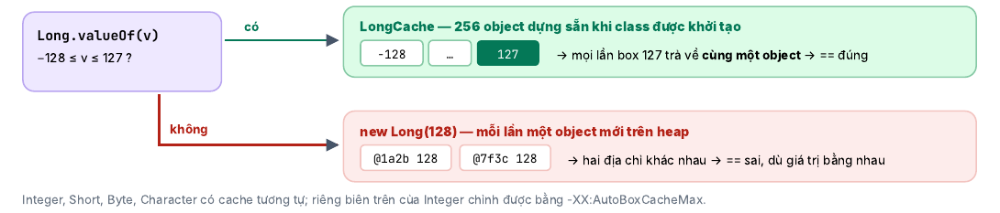

*Hình 2.9 — Vì sao `127 == 127` mà `128 != 128`. Chỉ khoảng −128…127 được đảm bảo dùng chung object; ngoài khoảng đó, kết quả của `==` phụ thuộc chi tiết hiện thực — đừng bao giờ dựa vào nó.*

> **SPRING BOOT · BUG QUA MẶT MỌI BÀI TEST** — Entity JPA hầu như luôn có `Long id`. Một đoạn kiểm tra quyền như `if (order.getOwnerId() == currentUser.getId())` chạy đúng trên môi trường dev và trong test — vì dữ liệu test có id 1, 2, 3 — rồi bắt đầu từ chối người dùng thật trên production khi id vượt 127. Luôn dùng `Objects.equals(a, b)` hoặc so sánh kiểu nguyên thuỷ. Chiều ngược lại cũng có bẫy: `long total = cache.get(key);` là một lời gọi ẩn `Long.longValue()` — nếu `get` trả về `null`, bạn nhận `NullPointerException` ở một dòng trông như không thể null.

## 11 Hằng số bị “nướng” vào class khác

Mục 3 ở [Bài 01](01-buc-tranh-toan-canh-jvm.md) có nói `javac` gần như không tối ưu — trừ việc gộp hằng số. Chi tiết nhỏ đó gây ra một trong những bug khó hiểu nhất khi làm việc với nhiều module. Thí nghiệm với hai class:

```java
public class Config {
    public static final int    TIMEOUT_SECONDS = 30;
    public static final String VERSION = "1.0";
    public static int retries() { return 3; }
}
public class Client {
    public static void main(String[] a) {
        System.out.println("timeout=" + Config.TIMEOUT_SECONDS + " version=" + Config.VERSION
                           + " retries=" + Config.retries());
    }
}
```

```text
$ javac *.java && java Client
timeout=30 version=1.0 retries=3
$ # sửa Config: 30 → 60, "1.0" → "2.0", 3 → 5 — rồi CHỈ build lại Config
$ javac Config.java && java Client
timeout=30 version=1.0 retries=5
$ javap -v Client | grep "String timeout"
  #38 = String  #39   // timeout=30 version=1.0 retries=\u0001
```

Hai hằng số giữ nguyên giá trị cũ, chỉ `retries()` là thấy giá trị mới. Lý do nằm trong constant pool của `Client`: `javac` đã thay `Config.TIMEOUT_SECONDS` và `Config.VERSION` bằng giá trị của chúng, rồi còn gộp luôn vào “công thức” nối chuỗi. Bytecode của `Client` **không còn một tham chiếu nào tới hai field đó** — chỉ có `invokestatic Config.retries`.

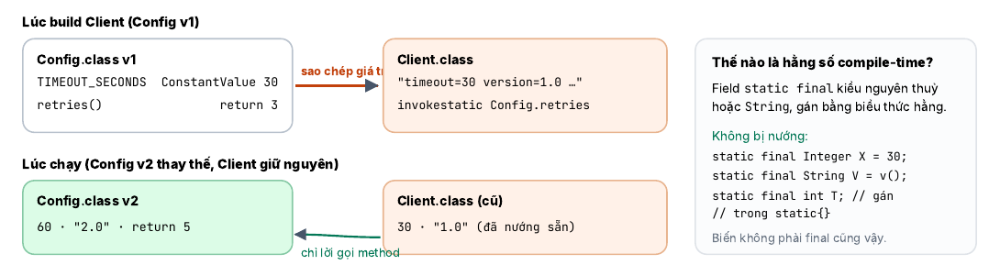

*Hình 2.10 — Hằng số compile-time được chép vào class sử dụng nó. Thay class định nghĩa hằng mà không build lại class sử dụng thì class sử dụng vẫn mang giá trị cũ — không có lỗi, không có cảnh báo.*

> **SPRING BOOT · THƯ VIỆN HẰNG SỐ DÙNG CHUNG** — Kịch bản điển hình: nhóm platform phát hành `common-contracts.jar` chứa `Topics.ORDER_CREATED = "order.created.v1"` và `ApiPaths.ORDERS = "/api/v1/orders"`. Bạn nâng phiên bản jar lên v2 (topic đổi thành `.v2`) trong một service *khác* mà không build lại code của service đó — hoặc một plugin/agent được nạp dạng binary. Code cũ vẫn gửi lên topic `.v1`. Đặc biệt, **giá trị trong annotation luôn là hằng số đã được tính sẵn**: với `@RequestMapping(ApiPaths.ORDERS + "/{id}")` hay `@KafkaListener(topics = Topics.ORDER_CREATED)`, chuỗi kết quả được ghi thẳng vào attribute annotation của class bạn (xem mục 12). Với giá trị có thể thay đổi giữa các môi trường hay phiên bản, hãy dùng placeholder cấu hình như `topics = "${app.topics.order-created}"` thay vì hằng số Java.

## 12 Attribute: class file còn mang theo những gì

Ngoài bytecode, mỗi class, field và method có thể mang **attribute** — các khối dữ liệu có tên. JVM chỉ cần vài attribute để chạy (`Code`, `StackMapTable`, `BootstrapMethods`…); phần lớn còn lại tồn tại cho công cụ và thư viện. Thí nghiệm sau cho thấy hai attribute mà mọi ứng dụng Spring đều đang dựa vào:

```java
static final String API = "/api/v1";

@Route(API + "/orders/{id}")        // annotation tự định nghĩa, Retention RUNTIME
public String find(long id, String status) { … }

// main: in giá trị annotation và tên tham số qua reflection
System.out.println("route  = " + m.getAnnotation(Route.class).value());
System.out.println("params = " + names(m.getParameters()));
```

```text
$ javac *.java && java OrderController
route  = /api/v1/orders/{id}
params = [arg0, arg1]
$ javac -parameters *.java && java OrderController
route  = /api/v1/orders/{id}
params = [id, status]
$ javap -v OrderController
  public java.lang.String find(long, java.lang.String);
    descriptor: (JLjava/lang/String;)Ljava/lang/String;
    MethodParameters:
      Name                           Flags
      id
      status
    RuntimeVisibleAnnotations:
        Route(
          value="/api/v1/orders/{id}"         ← đã nối sẵn lúc biên dịch
        )
```

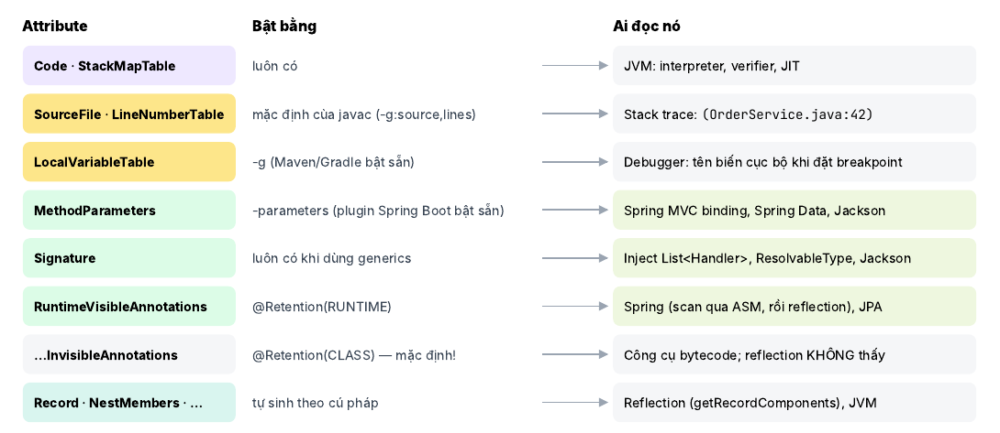

*Hình 2.11 — Các attribute quan trọng, cách bật chúng, và ai thực sự dùng. Nền xanh lá là những thứ Spring/Jackson phụ thuộc trực tiếp. Annotation với `@Retention(SOURCE)` (như `@Override`, phần lớn annotation của Lombok) không được ghi vào class file chút nào.*

> **SPRING ĐỌC CLASS FILE MÀ KHÔNG NẠP CLASS** — Khi quét `@ComponentScan`, Spring không gọi `Class.forName` cho từng class trên classpath — như vậy sẽ chạy `static {}` và tốn Metaspace cho hàng nghìn class không liên quan. Thay vào đó, nó đọc bytes của file `.class` bằng một bản ASM đóng gói sẵn (`org.springframework.asm`) để kiểm tra attribute annotation; chỉ những class thực sự là bean mới được nạp. Hệ quả thú vị: ASM phải hiểu được class file version. Đó là lý do một ứng dụng Spring Boot quá cũ chạy trên JDK mới có thể chết ngay khi quét classpath với lỗi kiểu `Unsupported class file major version 65` — không phải JVM từ chối class, mà là thư viện đọc class file của Spring chưa biết version đó.

## 13 Annotation processing: khi `javac` chạy code của người khác

Annotation processor là plugin chạy **bên trong** `javac`, trong lúc biên dịch. Nó được xem các phần tử đã được phân tích (class, field, method, annotation) và có thể sinh thêm file nguồn hoặc resource. Để thấy cơ chế, ta viết một processor 30 dòng: với mỗi class có `@Meta`, sinh ra class `Tên_` chứa hằng số tên các field — đúng ý tưởng của JPA static metamodel (`Order_`) mà Hibernate sinh cho Criteria API.

```java
@Meta public class Order { private long id; private String status; private double amount; }

public class Repo {   // dùng class SẼ được sinh ra — lúc này Order_ chưa tồn tại
    public static void main(String[] a) {
        System.out.println("ORDER BY " + Order_.AMOUNT + ", " + Order_.STATUS);
    }
}
```

```text
$ javac -cp proc -processor MetaProcessor -XprintRounds -s gen -d out Order.java Repo.java
Round 1:
        input files: {Order, Repo}
        annotations: [Meta]
        last round: false
Round 2:
        input files: {Order_}                ← file processor vừa sinh
        annotations: []
        last round: false
Round 3:
        input files: {}
        annotations: []
        last round: true
$ cat gen/Order_.java
public final class Order_ {
    public static final String ID = "id";
    public static final String STATUS = "status";
    public static final String AMOUNT = "amount";
}
$ java -cp out Repo
ORDER BY amount, status
```

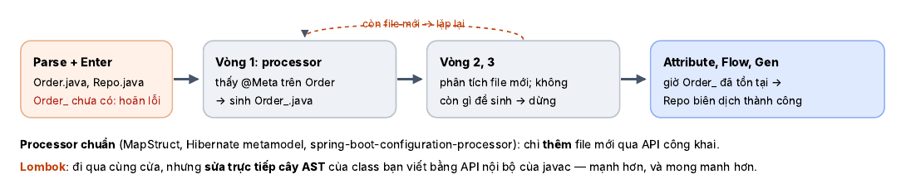

*Hình 2.12 — Các vòng annotation processing, dựng lại từ output `-XprintRounds` ở trên. `javac` lặp cho tới khi không processor nào sinh thêm file mới.*

> **KHI NÂNG JDK: HAI CÁI BẪY VỚI ANNOTATION PROCESSOR**
>
> **1. JDK 23 tắt annotation processing ngầm định.** Tới JDK 22, chỉ cần processor nằm trên classpath là `javac` tự chạy nó. JDK 21 đã bắt đầu cảnh báo — chạy thử trên máy thí nghiệm:
>
> ```text
> Note: Annotation processing is enabled because one or more processors were found
>   on the class path. A future release of javac may disable annotation processing
>   unless at least one processor is specified by name (-processor), or a search
>   path is specified (--processor-path, --processor-module-path), or annotation
>   processing is enabled explicitly (-proc:only, -proc:full).
> ```
>
> Từ JDK 23 điều đó thành hiện thực: mặc định tương đương `-proc:none`. Mô phỏng bằng `-proc:none` trên JDK 21 cho đúng kết quả bạn sẽ gặp: `error: cannot find symbol … Order_`. Với Lombok, triệu chứng là hàng loạt lỗi “cannot find symbol getXxx()”. Cách sửa: khai báo processor tường minh (Maven: `annotationProcessorPaths` trong `maven-compiler-plugin`; Gradle: cấu hình `annotationProcessor`) hoặc thêm `-proc:full`.
>
> **2. Lombok phụ thuộc vào nội tạng của javac.** Vì sửa AST qua API nội bộ, mỗi bản JDK mới có thể làm hỏng Lombok cũ, với lỗi khó hiểu (thường là `NoSuchFieldError` / `NoSuchMethodError` trong package `com.sun.tools.javac`). Khi nâng lên JDK 25, hãy nâng Lombok trước.

## 14 Verifier và StackMapTable

Class file có thể đến từ bất cứ đâu: `javac`, Kotlin, một thư viện sinh bytecode lúc chạy, một agent, hay một người cố tình sửa byte. JVM không tin bất kỳ ai. Trước khi một class được dùng, **verifier** chứng minh rằng bytecode an toàn kiểu: không lệnh nào lấy `int` làm con trỏ, stack không bao giờ tràn hay cạn, mọi lệnh nhảy rơi vào đầu một lệnh hợp lệ, object không được dùng trước khi khởi tạo. Nhờ chứng minh một lần lúc nạp, interpreter và JIT có thể bỏ qua mọi kiểm tra đó lúc chạy.

### Thí nghiệm: sửa đúng một byte

Trong Hình 2.1, byte ở offset 183 là `04` (`iconst_1`) trong method `inc()`. Đổi nó thành `01` (`aconst_null`) — giờ `iadd` sẽ cộng một int với `null`:

```text
$ python3 -c "b=bytearray(open('Counter.class','rb').read()); b[183]=1; \
             open('Counter.class','wb').write(b)"
$ java Main                  # in "Bắt đầu", rồi gọi new Counter().inc()
Bắt đầu
Exception in thread "main" java.lang.VerifyError: Bad type on operand stack
Exception Details:
  Location:
    Counter.inc()V @6: iadd
  Reason:
    Type null (current frame, stack[2]) is not assignable to integer
  Current Frame:
    bci: @6
    locals: { 'Counter' }
    stack: { 'Counter', integer, null }
$ java -Xverify:none Main                     # tắt verifier (đã deprecated từ JDK 13)
OpenJDK 64-Bit Server VM warning: Options -Xverify:none and -noverify were deprecated …
Bắt đầu
# A fatal error has been detected by the Java Runtime Environment:
#  Internal Error (macroAssembler_x86.cpp:830)
#  fatal error: DEBUG MESSAGE: illegal bytecode sequence - method not verified
```

Ba điều đáng chú ý. Verifier báo lỗi *chính xác tới từng lệnh* và in cả trạng thái kiểu của stack. Dòng “Bắt đầu” được in **trước** lỗi: verification xảy ra trong pha linking của `Counter`, lúc class lần đầu được dùng — đúng tính “lười” ở [Bài 01](01-buc-tranh-toan-canh-jvm.md). Và khi tắt verifier, JVM không “chạy sai một chút” mà sập hẳn: mọi phần khác của HotSpot đều giả định bytecode đã được kiểm chứng.

### StackMapTable: “lời giải” đính kèm để kiểm tra nhanh

Tại điểm hợp lưu của nhiều nhánh (đầu vòng lặp, đích của `if`), verifier cần biết kiểu của từng biến cục bộ và từng ô stack. Thay vì tự suy luận (chậm, phải lặp tới điểm bất động), từ Java 6 (class version 50, bắt buộc từ version 51 — Java 7) JVM yêu cầu trình biên dịch **ghi sẵn** các kiểu đó vào attribute `StackMapTable`; verifier chỉ việc kiểm tra trong một lượt duyệt tuyến tính.

```java
static int countPositive(int[] values) {
    int n = 0;
    for (int v : values) { if (v > 0) n++; }
    return n;
}
StackMapTable: number_of_entries = 3
  frame_type = 255 /* full_frame */  offset_delta = 10
    locals = [ class "[I", int, class "[I", int, int ]  stack = []
  frame_type = 19  /* same */
  frame_type = 248 /* chop */       offset_delta = 5
```

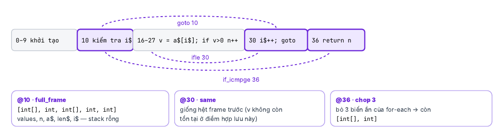

*Hình 2.13 — Ba điểm hợp lưu của `countPositive` và kiểu được ghi sẵn tại mỗi điểm. Bảng được nén: frame đầu ghi đầy đủ, các frame sau chỉ ghi phần khác biệt (offset tính theo `offset_delta` cộng dồn: 10, 10+19+1 = 30, 30+5+1 = 36).*

> **SPRING BOOT · KHI VERIFYERROR XUẤT HIỆN NGOÀI ĐỜI** — Bạn gần như không bao giờ gặp `VerifyError` từ code do `javac` sinh. Bạn gặp nó khi **một công cụ sửa bytecode** làm sai: agent APM/tracing cũ, công cụ đo coverage, thư viện proxy hay bytecode enhancement đời cũ chạy trên JDK mới hơn những gì nó hiểu. Thông báo điển hình là *“Expecting a stackmap frame at branch target …”* hoặc “Bad type on operand stack” trong một class bạn không hề sửa. Hướng xử lý gần như luôn là nâng phiên bản agent/thư viện (và ASM hay ByteBuddy bên trong nó) cho tương thích với class file version hiện tại — không phải tắt verifier.

## 15 Đọc bytecode ứng dụng Spring Boot của bạn

Mọi thứ trong bài đều áp dụng ngay được cho file `app.jar` mà bạn deploy hằng ngày. Fat jar của Spring Boot là một file zip với cấu trúc cố định: class của bạn trong `BOOT-INF/classes`, dependency trong `BOOT-INF/lib/*.jar`.

```bash
$ mkdir x && cd x && jar xf ../order-service.jar
# bytecode của một class
$ javap -c -p -cp BOOT-INF/classes com.acme.order.OrderService
# class được build cho Java bản nào?
$ javap -v -cp BOOT-INF/classes com.acme.order.OrderService | grep major
# Lombok đã sinh ra những gì?
$ javap -p -cp BOOT-INF/classes com.acme.order.OrderDto
# tên tham số có được giữ lại cho Spring MVC không?
$ javap -v -cp BOOT-INF/classes com.acme.order.OrderController | grep -c MethodParameters
```

Một kịch bản rất thường gặp khi nâng cấp: image chạy JDK 17, nhưng một dependency mới được build cho Java 21 — ứng dụng khởi động được, rồi chết với `UnsupportedClassVersionError` khi lần đầu chạm tới class đó (nhớ lại: nạp class là lười). Script nhỏ dưới đây đọc byte 6–7 của class đầu tiên trong mỗi jar, đúng như ta làm bằng tay ở mục 2:

```bash
#!/usr/bin/env bash
# classver.sh — in major version của class đầu tiên trong mỗi jar
for j in "${1:-BOOT-INF/lib}"/*.jar; do
  c=$(unzip -Z1 "$j" | grep '\.class$' | grep -v -e module-info -e '^META-INF/' | head -1)
  [ -z "$c" ] && continue
  v=$(unzip -p "$j" "$c" | od -An -j6 -N2 -tu1 | awk '{print $1*256+$2}')
  echo "$v (Java $((v-44)))  $(basename "$j")"
done | sort -n
```

```text
$ ./classver.sh BOOT-INF/lib           # chạy trên 3 jar thử nghiệm build với --release 8, 17, 21
52 (Java 8)  legacy-util-1.2.jar
61 (Java 17)  payment-client-3.0.jar
65 (Java 21)  shiny-lib-5.0.jar       ← sẽ nổ nếu runtime là JDK 17
```

*Script bỏ qua `META-INF/versions/` của multi-release jar, nơi một thư viện có thể chứa thêm bản class cho JDK mới hơn — những bản đó chỉ được dùng khi runtime đủ mới, nên không gây lỗi.*

### Bảng tra: lỗi lúc chạy → nhìn gì trong bytecode

| Lỗi | Nghĩa ở mức bytecode | Kiểm tra / xử lý |
|---|---|---|
| `UnsupportedClassVersionError` | Major version của class cao hơn JVM hỗ trợ | `javap -v \| grep major`, `classver.sh`; build với `--release` đúng |
| `NoSuchMethodError` / `NoSuchFieldError` | Không có method/field khớp *tên + descriptor* được ghi trong class gọi | So descriptor trong thông báo với `javap -s` của class thật trên classpath; `dependency:tree` |
| `IncompatibleClassChangeError: Found interface X, but class was expected` | Code được biên dịch với `invokevirtual` (X là class), nhưng giờ X là interface — hoặc ngược lại | Hai phiên bản thư viện không tương thích nhị phân; đồng bộ phiên bản |
| `AbstractMethodError` | Interface có method mới, class cài đặt (build trên bản cũ) không có | Nâng thư viện cài đặt cùng lúc với thư viện interface |
| `VerifyError` | Bytecode vi phạm kiểu — thường do công cụ sửa bytecode | Nâng agent / thư viện proxy; đọc dòng “Location” và “Reason” |
| `NullPointerException` ở dòng “không thể null” | Unboxing ẩn: `invokevirtual Long.longValue` trên null | `javap -c -l`, đối chiếu số dòng |
| Hằng số “không chịu đổi” | Giá trị đã nằm sẵn trong constant pool của class dùng nó | `javap -v \| grep` giá trị cũ; build lại module dùng hằng số |
| Spring không tìm thấy tên tham số | Thiếu attribute `MethodParameters` | Build với `-parameters` (plugin Spring Boot tự bật) |
| `error: code too large` | Method vượt 65.535 byte bytecode | Tách method; chuyển dữ liệu lớn ra file resource |

Bốn dòng đầu thuộc cùng một họ: **tương thích nhị phân** (JLS chương 13). Mã nguồn tương thích không có nghĩa là class file tương thích, vì class file ghi cứng tên, descriptor và loại lệnh invoke tại thời điểm biên dịch. Đó cũng là lý do Spring Boot quản lý phiên bản dependency qua BOM: để mọi jar trên classpath được build cùng nhau và “nói chung một ngôn ngữ nhị phân”.

## 16 Cheat sheet: đọc bytecode trong 1 trang

| Bạn thấy | Nghĩa là |
|---|---|
| `aload_0; getfield x` | `this.x` |
| `aload_0; dup; getfield; iconst_1; iadd; putfield` | `this.x++` — 3 bước, không nguyên tử |
| `iinc 3, 1` | `i++` trên biến cục bộ |
| `new T; dup; …; invokespecial T.<init>` | `new T(…)` |
| `aload_0; invokespecial Super.<init>` | `super(…)` — dòng đầu mọi constructor |
| `invokestatic Long.valueOf` | Autoboxing |
| `invokevirtual Long.longValue` | Unboxing — NPE nếu null |
| `if_acmpeq / if_acmpne` | `==` / `!=` trên tham chiếu |
| `checkcast T` | Ép kiểu — kể cả ép kiểu ẩn khi lấy phần tử từ collection generic |
| `arraylength` + 3 biến ẩn + `goto` | `for (x : array)` |
| `invokeinterface Iterator.hasNext / next` | `for (x : collection)` |
| `String.hashCode; lookupswitch; String.equals` | `switch` trên String |
| `invokedynamic makeConcatWithConstants` | Nối chuỗi bằng `+` |
| `invokedynamic` + `LambdaMetafactory` | Lambda, method reference |
| `monitorenter … monitorexit` + handler `any` | Khối `synchronized` |
| Cùng đoạn code lặp ở mọi lối ra + handler `any` | `finally` |
| `Throwable.addSuppressed` | try-with-resources |
| `athrow` | `throw` (hoặc ném lại trong finally) |

| Tiền tố / hậu tố | Nghĩa |
|---|---|
| `i l f d a` | int, long, float, double, tham chiếu |
| `b c s` (trong mảng) | byte/boolean, char, short |
| `…_0 … _3` | dạng 1 byte cho slot/hằng nhỏ |
| `x2y` | ép kiểu nguyên thuỷ |
| `if…` · `if_icmp…` | so với 0 · so hai int |

| Descriptor | Kiểu |
|---|---|
| `Z B C S I J F D V` | boolean byte char short int long float double void |
| `Lpkg/Name;` · `[T` | class · mảng |
| `(JLjava/lang/String;)V` | `void m(long, String)` |

| Hex | Opcode | Hex | Opcode |
|---|---|---|---|
| `2a` | aload_0 | `b6` | invokevirtual |
| `59` | dup | `b7` | invokespecial |
| `60` | iadd | `b8` | invokestatic |
| `b1` | return | `b9` | invokeinterface |
| `b4` | getfield | `ba` | invokedynamic |
| `b5` | putfield | `bb` | new |
| `bf` | athrow | `c0` | checkcast |
| `c2` | monitorenter | `c3` | monitorexit |

| javap | Dùng cho |
|---|---|
| `-c -p` | đọc bytecode, kể cả private |
| `-v` | version, constant pool, attribute |
| `-s` | descriptor (đối chiếu NoSuchMethodError) |
| `-l` | số dòng ↔ offset bytecode |

## 17 Hiểu lầm, bài tập, thuật ngữ, bài tiếp theo

### Hiểu lầm thường gặp

| Hiểu lầm | Thực tế |
|---|---|
| “`volatile` làm cho `count++` an toàn.” | `volatile` lo chuyện *nhìn thấy* giá trị, không lo chuyện *nguyên tử*. Ba bước đọc–tính–ghi vẫn là ba bước (mục 7). |
| “try/catch làm chậm code.” | Khi không có exception, try không tốn lệnh nào — chỉ có một dòng trong exception table (mục 8). Thứ đắt là *tạo* exception với stack trace ([Bài 24](24-exception-stack-trace.md)). |
| “Đổi hằng số trong thư viện rồi thay jar là đủ.” | Hằng số compile-time đã được chép vào class dùng nó; phải build lại (mục 11). |
| “Annotation nào cũng đọc được bằng reflection.” | Retention mặc định là `CLASS`: có trong class file nhưng reflection không thấy. `SOURCE` thì không có ở đâu cả (mục 12). |
| “Tên tham số luôn có sẵn lúc chạy.” | Chỉ khi build với `-parameters`; nếu không, reflection trả về `arg0`, `arg1` (mục 12). |
| “`switch` trên String so sánh `equals` với từng case.” | Nó switch trên `hashCode()` trước, chỉ gọi `equals` để loại trùng hash — và ném NPE nếu chuỗi là null (mục 9). |
| “Mã nguồn biên dịch được với thư viện mới thì chạy được với thư viện mới.” | Tương thích nguồn ≠ tương thích nhị phân: class đã biên dịch ghi cứng descriptor và loại lệnh invoke (mục 3, 15). |

### Bài tập tự làm

> **THỰC HÀNH**
>
> 1. **Mổ một record.** Viết `record Money(long amount, String currency)`, chạy `javap -c -p -v`. Tìm attribute `Record`, và xem `toString/equals/hashCode` dẫn tới bootstrap method nào.
> 2. **Đếm bản sao finally.** Viết method có 3 lệnh `return` trong try và một khối finally gọi `log()`. Đếm số lần `log` xuất hiện trong bytecode. Dự đoán trước khi chạy.
> 3. **Đẩy cache Integer.** Viết lại `BoxDemo` với `Integer` và giá trị 1000; chạy với và không với `-XX:AutoBoxCacheMax=2000`. Sau đó thử với `Long` — vì sao không có tác dụng?
> 4. **Mô phỏng JDK 23+.** Build service của bạn với `-proc:none` thêm vào compiler args. Nếu build vỡ, dự án đang dựa vào annotation processing ngầm định — sửa cấu hình trước khi nâng JDK.
> 5. **Kiểm tra fat jar thật.** Chạy `classver.sh` trên `BOOT-INF/lib` của một service ở công ty. Version cao nhất là bao nhiêu? Nó có khớp image runtime không?
> 6. **Tự gây VerifyError.** Dùng Hình 2.1 để tìm offset của `putfield` trong `inc()` và đổi nó thành `getfield`. Dự đoán thông báo của verifier trước khi chạy.

### Thuật ngữ của bài

| Thuật ngữ | Nghĩa ngắn gọn |
|---|---|
| Magic / major version | 4 byte `CAFEBABE` mở đầu class file / phiên bản định dạng (65 = Java 21, 69 = Java 25). |
| Constant pool | Bảng ký hiệu và hằng số của class; mọi lệnh tham chiếu vào nó bằng chỉ số. |
| Descriptor · internal name | Cách viết kiểu trong class file (`(J)V`) · tên class dùng `/` (`java/lang/String`). |
| Opcode | Mã 1 byte của một lệnh bytecode; có 202 opcode. |
| Exception table | Bảng (from, to, target, type) thay cho cú pháp try/catch/finally. |
| Attribute | Khối dữ liệu có tên gắn vào class/field/method: Code, Signature, MethodParameters… |
| Compile-time constant | `static final` nguyên thuỷ/String gán bằng biểu thức hằng — bị chép vào nơi dùng. |
| Verifier · StackMapTable | Bộ kiểm tra an toàn kiểu lúc linking · kiểu ghi sẵn tại các điểm hợp lưu để kiểm tra nhanh. |
| Annotation processor | Plugin chạy trong `javac`, sinh mã nguồn/resource theo annotation. |
| Tương thích nhị phân | Class đã biên dịch còn liên kết được với phiên bản mới của class khác hay không. |

> **BÀI TIẾP THEO · BÀI 03** — **Class loading chuyên sâu.** Ta đã biết class được nạp lười và verifier chạy trong pha linking. [Bài 03](03-class-loading.md) đi vào bên trong: `ClassLoader` tìm bytes ra sao, `<clinit>` chạy khi nào và khoá thế nào, module system thay đổi gì, class loader riêng của fat jar Spring Boot đọc jar lồng nhau ra sao — và vì sao rò rỉ class loader làm Metaspace phình to sau mỗi lần redeploy.

### Tài liệu tham khảo

- The Java Virtual Machine Specification, Java SE 25 — chương 4 (class file format, verification), chương 6 (tập lệnh). docs.oracle.com/javase/specs
- The Java Language Specification — chương 13 (Binary Compatibility); §5.1.7 (boxing conversion); §15.29 (constant expressions).
- JEP 181 — Nest-Based Access Control (JDK 11). openjdk.org/jeps/181
- JDK 23 Release Notes — thay đổi chính sách annotation processing mặc định. oracle.com/java/technologies/javase/23-relnote-issues.html
- Spring Framework Reference — yêu cầu cờ `-parameters` cho việc nhận diện tên tham số. docs.spring.io
