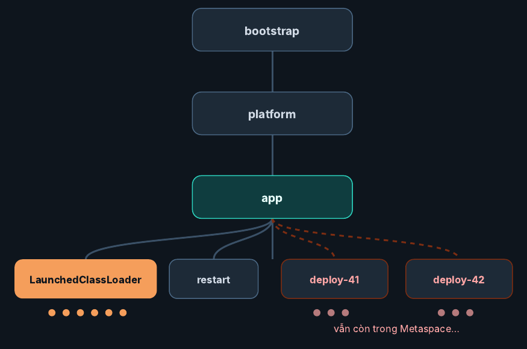
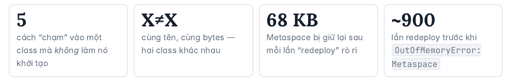
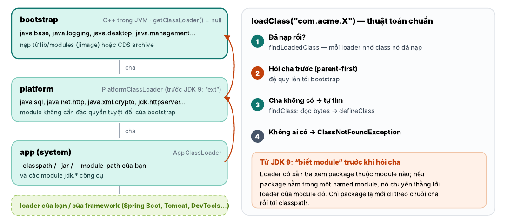
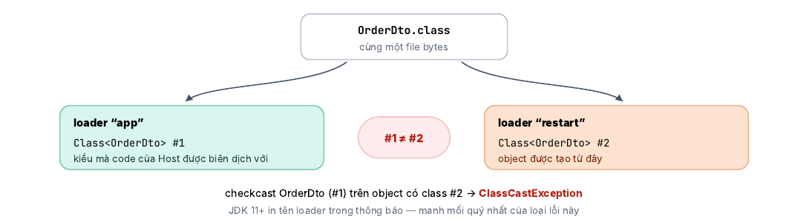
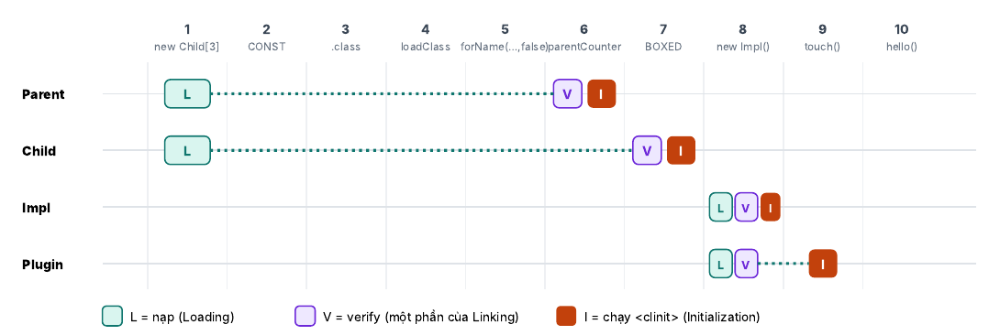
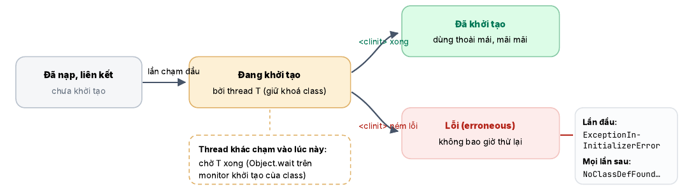
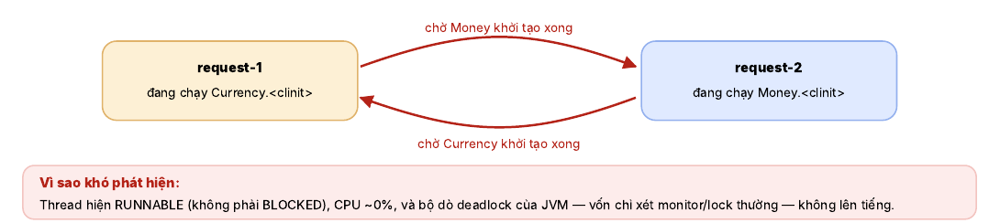
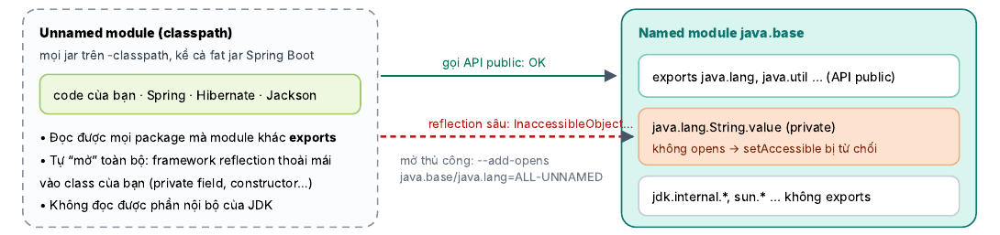
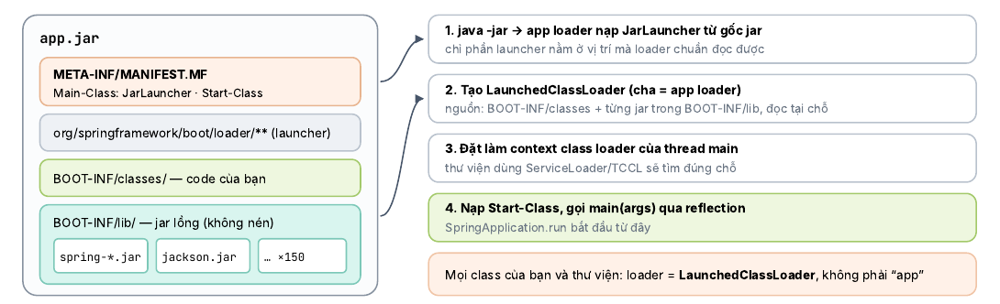
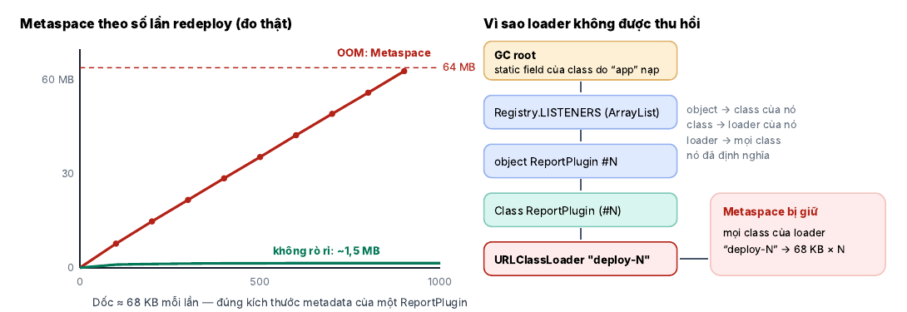

# Bài 03 — Class loading chuyên sâu



*ai nạp class của bạn, khi nào — và vì sao nó không chịu ra đi*

*Chặng I · Nền móng — ClassLoader · khởi tạo class · module · fat jar · Metaspace · Nền tảng: JDK 25 LTS / 27 · Thí nghiệm chạy thật trên OpenJDK 21*

[Bài 01](01-buc-tranh-toan-canh-jvm.md) nói class được nạp “lười”. [Bài 02](02-class-file-bytecode.md) cho thấy verifier chạy lúc linking. Bài này mở hẳn hộp đen **class loading**: ai nạp, nạp khi nào, khởi tạo theo luật gì — và những lỗi production sinh ra từ đó.

> **MÔI TRƯỜNG THÍ NGHIỆM** — OpenJDK 21.0.12, Linux x86-64. Có 9 chương trình mẫu, mỗi cái dưới 50 dòng; một trong số đó là bản “đồ chơi” của JarLauncher trong Spring Boot, đủ để chạy một fat jar có jar lồng bên trong. Spring Boot thật không có trong môi trường thí nghiệm, nên phần về nó dựa trên tài liệu chính thức và được ghi rõ.

> **SAU BÀI NÀY BẠN SẼ**
>
> - Dự đoán chính xác khi nào một class được nạp, được verify và được khởi tạo — và chứng minh bằng log.
> - Phân biệt và xử lý `ClassNotFoundException`, `NoClassDefFoundError`, “Could not initialize class”, “X cannot be cast to X”.
> - Nhận ra deadlock khởi tạo class trong thread dump, dù thread vẫn hiện `RUNNABLE`.
> - Hiểu fat jar Spring Boot nạp class thế nào, và vì sao CDS/AOT cache cần giải nén jar.
> - Tìm ra class loader bị rò rỉ khi Metaspace tăng mãi.

Mọi dòng code Java đều chạy bên trong một class, và mọi class đều đến từ một class loader. Hiểu cơ chế này là hiểu một nhóm lỗi production rất riêng: lỗi chỉ xuất hiện ở request thứ hai, ứng dụng treo lúc khởi động mà không có deadlock nào, và Metaspace phình to dù heap vẫn khoẻ.



## 1 Năm triệu chứng, một nguyên nhân gốc

Các triệu chứng dưới đây trông chẳng liên quan gì tới nhau, nhưng đều có chung một nguyên nhân gốc: class loading.

| Triệu chứng | Mục giải thích |
|---|---|
| Request đầu lỗi `ExceptionInInitializerError`, mọi request sau lỗi `NoClassDefFoundError: Could not initialize class` | Mục 5 — `<clinit>` thất bại một lần là hỏng vĩnh viễn |
| Ứng dụng treo khi khởi động, CPU 0%, thread dump không báo deadlock | Mục 6 — deadlock khởi tạo class |
| `ClassCastException: class OrderDto cannot be cast to class OrderDto` | Mục 3 — danh tính class gồm cả class loader |
| `InaccessibleObjectException … does not "opens java.lang"` sau khi nâng JDK | Mục 8 — module system |
| `OutOfMemoryError: Metaspace` sau nhiều lần redeploy/restart nóng | Mục 10 — class loader bị giữ lại |

## 2 Ba class loader của JDK và mô hình uỷ quyền

Một **class loader** là một object có nhiệm vụ biến tên class thành một object `Class`: tìm bytes ở đâu đó, đưa cho JVM để phân tích và định nghĩa. Từ JDK 9, JDK có sẵn ba loader. Chương trình sau in ra loader của vài class quen thuộc, cùng chuỗi loader cha của nó:

```text
$ java Who
java.lang.String           java.base     bootstrap (null)
java.util.logging.Logger   java.logging  bootstrap (null)
java.sql.Connection        java.sql      platform  PlatformClassLoader  ->  bootstrap
java.net.http.HttpClient   java.net.http platform  PlatformClassLoader  ->  bootstrap
Who (code của bạn)         (unnamed)     app  AppClassLoader  ->  platform  ->  bootstrap
context loader của main: app
```



*Hình 3.1 — Trái: ba loader có sẵn và module mà mỗi loader phụ trách — trong bản JDK 21 thí nghiệm: 23 module cho bootstrap, 25 cho platform, 21 (công cụ `jdk.*`) cho app. Phải: thuật toán `loadClass`. “Cha” ở đây là quan hệ uỷ quyền giữa các object loader, không phải kế thừa class.*

Mô hình “hỏi cha trước” có một mục đích an ninh rõ ràng: class lõi luôn đến từ nơi đáng tin. Bạn không thể tự viết `java.lang.String` và đặt lên classpath để thay thế bản thật, vì bootstrap sẽ trả lời trước. Thậm chí thêm class *mới* vào package `java.lang` cũng bị chặn ngay ở `defineClass`:

```text
$ java T            # URLClassLoader nạp out/java/lang/Hack.class
java.lang.SecurityException: Prohibited package name: java.lang
```

> **NGOẠI LỆ CÓ CHỦ ĐÍCH: LOADER “CON TRƯỚC”** — Một số loader cố ý đảo thứ tự, tự tìm trước rồi mới hỏi cha: class loader của web app trong Tomcat (để mỗi WAR dùng phiên bản thư viện riêng), loader của DevTools cho code đang phát triển, hệ thống plugin. Đảo thứ tự giúp cô lập, nhưng cũng là nguồn gốc của lỗi ở mục 3.

## 3 Danh tính của class: tên + class loader

Đây là quy tắc quan trọng nhất của bài: bên trong JVM, một class được xác định bởi **cặp (tên đầy đủ, loader đã định nghĩa nó)**. Cùng một file `.class` được hai loader định nghĩa sẽ trở thành hai class khác nhau, không thể dùng thay cho nhau. Thí nghiệm: hai `URLClassLoader` cùng đọc một thư mục, cha là platform (để không ai uỷ quyền cho app loader):

```text
$ java Host
cùng tên?      true
cùng class?    false
instanceof?    false
$ java Host2    # host có OrderDto riêng (loader app); plugin nạp bản khác (loader restart)
Exception in thread "main" java.lang.ClassCastException: class OrderDto cannot be cast to class OrderDto
  (OrderDto is in unnamed module of loader 'restart' @70dea4e; OrderDto is in unnamed module of loader 'app')
```



*Hình 3.2 — Một tên, hai class. Thông báo lỗi trông vô lý (“OrderDto cannot be cast to OrderDto”), nhưng phần trong ngoặc cho biết chính xác hai loader nào đang tranh nhau.*

> **SPRING BOOT DEVTOOLS** — Đây đúng là cơ chế restart nhanh của DevTools: class trong project của bạn được nạp bằng một *restart class loader* riêng, để khi bạn sửa code, Spring chỉ việc bỏ loader đó đi và tạo loader mới, giữ nguyên các thư viện trong loader nền. Nếu một thư viện ở loader nền giữ lại object hoặc `Class` từ lần restart trước (cache, deserialization, session), bạn sẽ thấy đúng lỗi “X cannot be cast to X” — chỉ trên máy dev, không bao giờ trên production. Tên loader trong thông báo lỗi sẽ chỉ rõ nó.

## 4 Nạp, liên kết, khởi tạo — ba thời điểm khác nhau

[Bài 01](01-buc-tranh-toan-canh-jvm.md) liệt kê ba pha Loading → Linking → Initialization. Điều mà ít người để ý: **chúng xảy ra vào những thời điểm khác nhau**, thường cách nhau rất xa. Để thấy rõ, ta dựng các class có khối `static` in ra màn hình, rồi “chạm” vào chúng theo mười cách khác nhau:

```java
class Parent { static { log("[clinit] Parent"); }  static int parentCounter = 1; }
class Child extends Parent {
    static final int     CONST = 42;     // hằng compile-time
    static final Integer BOXED = 7;      // KHÔNG phải hằng compile-time
    static { log("[clinit] Child"); }
    static void hello() {}
}
interface Plugin { String NAME = log("[clinit] Plugin"); static void touch() {} }
class Impl implements Plugin { static { log("[clinit] Impl"); } }
```

```text
$ java -Xlog:class+load,class+init InitDemo      # đã lọc, giữ lại dòng liên quan
1. Child[] arr = new Child[3]
[class,load] Parent
[class,load] Child
2. đọc Child.CONST
3. Child.class
4. ClassLoader.loadClass("Child")
5. Class.forName("Child", false, ...)
6. đọc Child.parentCounter (field kế thừa)
[class,init] Start class verification for: Parent
[class,init] End class verification for: Parent
[class,init] 328 Initializing 'Parent' by thread "main"
  [clinit] Parent
7. đọc Child.BOXED
[class,init] Start class verification for: Child
[class,init] End class verification for: Child
[class,init] 329 Initializing 'Child' by thread "main"
  [clinit] Child
8. new Impl()
[class,load] Plugin
[class,load] Impl
[class,init] … verification for: Plugin   … verification for: Impl
[class,init] 330 Initializing 'Impl' by thread "main"
  [clinit] Impl
9. Plugin.touch()
[class,init] 331 Initializing 'Plugin' by thread "main"
  [clinit] Plugin
10. Child.hello() lần nữa
```



*Hình 3.3 — Dòng thời gian dựng lại từ log thật. `Child` được nạp ở bước 1 nhưng tới bước 7 mới được verify và khởi tạo. Các bước 2–5 “chạm” vào `Child` mà không làm nó khởi tạo.*

Từ log, ta rút ra các quy tắc mà đặc tả JVMS §5.5 quy định:

| Hành động | Khởi tạo? | Vì sao / ghi chú |
|---|---|---|
| `new Child[3]` | Không | Chỉ cần *nạp* Child để biết kiểu phần tử. Nạp Child kéo theo nạp Parent (lớp cha phải có trước). |
| Đọc `Child.CONST` | Không | Hằng compile-time đã được “nướng” vào class gọi ([Bài 02](02-class-file-bytecode.md), mục 11) — bytecode không hề nhắc tới Child. |
| `Child.class`, `loader.loadClass(…)`, `Class.forName(n, false, l)` | Không | Có `Class` trong tay không có nghĩa class đã khởi tạo. |
| Đọc `Child.parentCounter` | **Chỉ Parent** | Field static được khai báo ở Parent — chỉ lớp khai báo field bị khởi tạo, dù bạn gọi qua tên Child. |
| Đọc `Child.BOXED`, `new`, gọi static method | Có | Lớp cha được khởi tạo trước (Parent đã xong ở bước 6). |
| `new Impl()` | Impl: có · Plugin: **không** | Khởi tạo class không kéo theo khởi tạo interface của nó (trừ interface có default method). Plugin chỉ được nạp và verify. |
| `Class.forName("Child")` (1 tham số) | Có | Đây là cách JDBC driver cũ “tự đăng ký”: `Class.forName("com.mysql.jdbc.Driver")` chạy khối static của driver. |

Hai quan sát nữa: **verification diễn ra ngay trước khi khởi tạo**, không phải lúc nạp — HotSpot trì hoãn linking tới phút cuối; và mỗi class chỉ khởi tạo **một lần** — bước 10 gọi lại `hello()` không in gì.

## 5 `<clinit>`: một lần, có khoá — và khi nó thất bại

`javac` gom mọi phép gán static và mọi khối `static {}` của một class (theo thứ tự xuất hiện trong mã nguồn) vào một method đặc biệt tên `<clinit>`. JVM đảm bảo nó chạy **đúng một lần**, kể cả khi nhiều thread cùng chạm vào class: mỗi class có một trạng thái khởi tạo và một khoá riêng.



*Hình 3.4 — Trạng thái khởi tạo của một class (rút gọn từ quy trình 12 bước trong JVMS §5.5). Trạng thái “lỗi” là vĩnh viễn trong suốt vòng đời của class loader đó.*

### Khi `<clinit>` thất bại

```java
class PriceConfig {
    static final Map<String, Integer> RATES = load();
    static Map<String, Integer> load() {
        String v = System.getenv("FX_USD");      // biến môi trường bị thiếu
        return Map.of("USD", Integer.parseInt(v));
    }
    static int rate(String c) { return RATES.get(c); }
}
// main: gọi PriceConfig.rate("USD") ba lần, bắt Throwable và in ra
```

```text
$ java Fail
request 1: java.lang.ExceptionInInitializerError
           cause: java.lang.NumberFormatException: Cannot parse null string
request 2: java.lang.NoClassDefFoundError: Could not initialize class PriceConfig
           cause: java.lang.ExceptionInInitializerError: Exception
                  java.lang.NumberFormatException: Cannot parse null string [in thread "main"]
request 3: java.lang.NoClassDefFoundError: Could not initialize class PriceConfig
           cause: …(như trên)
```

Chỉ lần đầu tiên nhận được exception gốc. Từ lần thứ hai, class đã ở trạng thái lỗi và JVM ném `NoClassDefFoundError` — một cái tên dễ khiến người ta đi tìm “jar bị thiếu”, trong khi class vẫn nằm ngay đó. Từ JDK 17, lỗi này có thêm `cause` trỏ về exception ban đầu (như output trên); với JDK cũ hơn, manh mối duy nhất là dòng log của lần đầu.

> **SPRING BOOT · ĐỪNG LÀM VIỆC THẬT TRONG STATIC** — Kịch bản này rất thật: một class tiện ích đọc biến môi trường, file cấu hình, hay gọi mạng trong khối `static`. Trên production, lỗi xảy ra ở request đầu tiên rồi bị chìm giữa hàng nghìn dòng log; mọi request sau đó báo `Could not initialize class` cho tới khi restart. Trong Spring, những việc như vậy thuộc về bean: `@ConfigurationProperties` có validation để lỗi cấu hình làm ứng dụng *không khởi động được* (fail fast), thay vì khởi động “thành công” rồi hỏng dần.

> **MẶT TỐT CỦA KHOÁ KHỞI TẠO: HOLDER IDIOM** — Vì JVM tự khoá và đảm bảo `<clinit>` chạy một lần, đoạn sau là singleton khởi tạo lười, an toàn đa luồng, không cần `synchronized` hay `volatile`: `class Registry { private static class Holder { static final Registry I = new Registry(); } static Registry get() { return Holder.I; } }`. `Holder` chỉ được khởi tạo khi `get()` chạy lần đầu.

## 6 Deadlock lúc khởi tạo class

Khoá khởi tạo là một khoá thật, nên nó có thể deadlock như mọi khoá khác. Điều kiện: hai class mà `<clinit>` của class này cần class kia, và hai thread bắt đầu từ hai đầu:

```java
class Currency {
    static final Currency USD = new Currency("USD");
    static final Money ZERO_USD;
    static { sleep(); ZERO_USD = Money.ZERO; }                          // cần Money
}
class Money {
    static final Money ZERO;
    static { Currency.sleep(); ZERO = new Money(0, Currency.USD); }   // cần Currency
}
// thread "request-1" đọc Currency.USD, thread "request-2" đọc Money.ZERO — cùng lúc
```

```text
$ java Deadlock &  sleep 2;  jcmd <pid> Thread.print
"request-1" #18 … in Object.wait()
   java.lang.Thread.State: RUNNABLE
        at Currency.<clinit>(Deadlock.java:4)
        - waiting on the Class initialization monitor for Money
"request-2" #19 … in Object.wait()
   java.lang.Thread.State: RUNNABLE
        at Money.<clinit>(Deadlock.java:10)
        - waiting on the Class initialization monitor for Currency
sau 3 giây: t1 RUNNABLE, t2 RUNNABLE
$ jcmd <pid> Thread.print | grep "Found one Java-level deadlock"
(không có dòng nào)
```



*Hình 3.5 — Vòng chờ giữa hai khoá khởi tạo class. Dấu hiệu nhận biết duy nhất trong thread dump là dòng “waiting on the Class initialization monitor for …” ngay dưới một frame `<clinit>`.*

Ngoài đời, vòng lặp này thường ẩn trong các class hằng số tham chiếu chéo nhau (enum dùng constant của class khác và ngược lại), và chỉ lộ ra khi nhiều thread khởi động song song — warm-up đa luồng, các consumer Kafka bắt đầu cùng lúc, hay khởi tạo bean ở chế độ nền. Vì phụ thuộc thời điểm, nó có thể xảy ra 1 lần trong 50 lần deploy. Cách phòng: tránh phụ thuộc vòng giữa các khối static, và giữ `<clinit>` thật đơn giản.

## 7 `ClassNotFoundException` và `NoClassDefFoundError`

Hai cái tên nghe như một, nhưng nói về hai tình huống rất khác nhau. Thí nghiệm: `Billing` dùng `StripeClient`; sau khi biên dịch, ta xoá `StripeClient.class` (giả lập thiếu jar lúc chạy).

```java
public static void main(String[] a) {
    System.out.println("khởi động OK");
    try { Class.forName("com.acme.PaypalClient"); } catch (ClassNotFoundException e) { … }
    try { System.out.println(Billing.charge()); }      catch (Throwable e) { … }
}
```

```text
$ rm StripeClient.class && java App
khởi động OK                    ← thiếu class không làm app chết lúc khởi động
1) java.lang.ClassNotFoundException: com.acme.PaypalClient
2) java.lang.NoClassDefFoundError: StripeClient
   cause: java.lang.ClassNotFoundException: StripeClient
```

| | `ClassNotFoundException` | `NoClassDefFoundError` |
|---|---|---|
| Loại | Exception *checked* | Error (không ai nên bắt) |
| Ai yêu cầu class | **Code của bạn**, theo tên dạng chuỗi: `Class.forName`, `loadClass`, ServiceLoader, deserialization | **JVM**, khi resolve một lệnh bytecode (`new`, `invoke*`, `getfield`…) trong code đã biên dịch |
| Nghĩa | “Không tìm thấy class tên này” — có thể là chuyện bình thường (kiểm tra thư viện tuỳ chọn có mặt không) | “Lúc biên dịch có, lúc chạy không dùng được” — luôn là lỗi cấu hình hoặc lỗi khởi tạo |
| Biến thể | — | (a) thiếu jar/xung đột phiên bản: cause là `ClassNotFoundException`; (b) `Could not initialize class X`: `<clinit>` từng thất bại (mục 5) |
| Khi nào lộ ra | Ngay lúc gọi | Lần đầu dòng code dùng class đó *được thực thi* — có thể sau vài giờ chạy |

> **SPRING BOOT · @CONDITIONALONCLASS** — Spring Boot auto-configuration dựa hẳn vào sự khác biệt này. `@ConditionalOnClass(DataSource.class)` phải kiểm tra một class có trên classpath hay không mà *không* được nạp nó qua bytecode (nếu không, chính việc kiểm tra sẽ gây `NoClassDefFoundError`). Spring đọc giá trị annotation dưới dạng chuỗi tên class bằng ASM ([Bài 02](02-class-file-bytecode.md), mục 12) rồi thử nạp theo tên một cách có kiểm soát. Đó là lý do bạn có thể có hàng trăm auto-configuration cho các thư viện không hề có mặt mà ứng dụng vẫn khởi động bình thường.

## 8 Module system: lớp kiểm soát thứ hai

Từ JDK 9, ngoài “class loader nào nạp class này”, còn câu hỏi “class này thuộc **module** nào, và module đó cho phép ai truy cập”. Một module khai báo nó *exports* package nào (cho phép dùng API public) và *opens* package nào (cho phép reflection sâu vào thành viên private):

```text
$ java --describe-module java.sql
java.sql@21.0.12.1
exports java.sql
exports javax.sql
requires java.xml transitive
requires java.base mandated
requires java.transaction.xa transitive
requires java.logging transitive
uses java.sql.Driver
```

Mặc định các module của JDK **không opens** package nội bộ cho ai. Hậu quả với reflection “sâu”:

```java
Field f = String.class.getDeclaredField("value");   // mảng byte bên trong String
f.setAccessible(true);
```

```text
$ java Peek
Unable to make field private final byte[] java.lang.String.value accessible:
module java.base does not "opens java.lang" to unnamed module @15db9742
$ java --add-opens java.base/java.lang=ALL-UNNAMED Peek
đọc được: 5 byte
```



*Hình 3.6 — Gần như mọi ứng dụng Spring Boot chạy trên classpath, tức là nằm trong unnamed module. Module system không làm phiền code của bạn; nó chỉ chặn việc thư viện chui vào ruột của chính JDK.*

> **SPRING BOOT · KHI NÂNG JDK** — Lỗi `InaccessibleObjectException` hay cảnh báo “illegal reflective access” sau khi nâng JDK gần như luôn đến từ một *thư viện* cũ (serializer, công cụ mock, agent) đang đọc trộm bên trong JDK — không phải từ Spring hay code của bạn. `--add-opens` là băng dán tạm thời; cách sửa bền vững là nâng thư viện đó lên phiên bản dùng API chính thức. Ghi lại mọi cờ `--add-opens` trong Dockerfile kèm lý do, để lần nâng sau biết có thể bỏ cái nào.

## 9 Bên trong fat jar của Spring Boot

Chuẩn jar của Java không hỗ trợ “jar nằm trong jar”: application class loader chỉ đọc class từ thư mục gốc của các jar trên classpath. Vậy mà `java -jar app.jar` của Spring Boot chạy được với hàng trăm thư viện nằm *bên trong* nó. Bí mật nằm ở manifest:

```text
Main-Class: org.springframework.boot.loader.launch.JarLauncher  ← JVM gọi cái này
Start-Class: com.mycompany.project.MyApplication                ← main() thật của bạn
```

`JarLauncher` (từ Spring Boot 3.2 nằm trong package `…loader.launch`) dựng một class loader biết đọc `BOOT-INF/classes` và các jar lồng trong `BOOT-INF/lib`, đặt nó làm context class loader, rồi gọi `main` của `Start-Class` qua reflection. Để thấy cơ chế này vận hành, ta viết phiên bản “đồ chơi” khoảng 40 dòng — `MiniLauncher` — đọc jar lồng nhau thẳng từ bộ nhớ, không giải nén ra đĩa:

```java
static class NestedJarClassLoader extends ClassLoader {
    private final Map<String, byte[]> classes = new HashMap<>();
    NestedJarClassLoader(Path fatJar, ClassLoader parent) throws IOException {
        super("nested-jar", parent);
        // BOOT-INF/classes/**.class → map
        // BOOT-INF/lib/*.jar → mở bằng JarInputStream, đọc từng .class vào map
    }
    @Override protected Class<?> findClass(String name) throws ClassNotFoundException {
        byte[] b = classes.get(name.replace('.', '/') + ".class");
        if (b == null) throw new ClassNotFoundException(name);
        return defineClass(name, b, 0, b.length);   // bytes → Class: từ đây là việc của JVM
    }
}
// main: đọc Start-Class, tạo loader, đặt làm TCCL, gọi main() qua reflection
```

```text
$ unzip -l shop.jar
META-INF/MANIFEST.MF
BOOT-INF/classes/com/acme/ShopApp.class
BOOT-INF/lib/pricing-1.0.jar                 ← jar nằm trong jar
MiniLauncher$NestedJarClassLoader.class
MiniLauncher.class
$ java -jar shop.jar
price      = 11000 (cents, đã gồm VAT)
ShopApp    <- nested-jar
Pricing    <- nested-jar                       ← class từ jar lồng
String     <- bootstrap
TCCL       =  nested-jar
parent     =  app
$ java -cp shop.jar com.acme.ShopApp          ← bỏ qua launcher
Error: Could not find or load main class com.acme.ShopApp
$ jcmd <pid> VM.classloaders show-classes
+-- <bootstrap>
      +-- "platform", jdk.internal.loader.ClassLoaders$PlatformClassLoader
            +-- "app", jdk.internal.loader.ClassLoaders$AppClassLoader
                  +-- "nested-jar", MiniLauncher$NestedJarClassLoader
                                        Classes: com.acme.ShopApp
                                                 com.acme.pricing.Pricing
```



*Hình 3.7 — Cấu trúc fat jar Spring Boot và bốn bước khởi động (theo tài liệu “Executable Jar” của Spring Boot). `MiniLauncher` ở trên làm đúng bốn bước này ở dạng tối giản; bản thật còn hỗ trợ đọc jar lồng ngẫu nhiên mà không nạp hết vào bộ nhớ, URL kiểu `jar:nested:`, signed jar, multi-release jar…*

### Hệ quả thực tế

- **Stack trace và thông báo lỗi** sẽ nhắc tới `LaunchedClassLoader`. Khi thấy “X cannot be cast to X”, đọc tên loader như mục 3.
- **Chạy dạng giải nén thì nhanh hơn và cần cho CDS/AOT cache.** CDS chỉ lưu được class do các loader có sẵn của JDK nạp từ jar/thư mục thông thường, nên tài liệu Spring Boot yêu cầu giải nén trước khi tạo archive: `java -Djarmode=tools -jar app.jar extract --destination application`, sau đó chạy `java -jar` trên jar đã giải nén (các thư viện nằm cạnh nó trên classpath thường). [Bài 09](09-khoi-dong-nhanh-cds-aot-native.md) sẽ đo hiệu quả.
- **Context class loader (TCCL)** là loader “ngầm” mà các thư viện kiểu plugin (JDBC `DriverManager`, `ServiceLoader`, JAXB, JNDI) dùng để tìm class của *bạn* từ code nằm ở loader cha. Một thread do thư viện tạo ra mà quên TCCL, hoặc giữ TCCL cũ, là nguồn gốc của cả lỗi “không tìm thấy class” lẫn rò rỉ ở mục 10.

## 10 Unload class và rò rỉ Metaspace

Mô tả của class (method, bytecode, constant pool, bảng vtable…) nằm trong **Metaspace**, ngoài heap. Một class chỉ được gỡ (unload) khi **class loader đã định nghĩa nó trở nên không ai tham chiếu** — và đi cùng nó là mọi class do loader đó định nghĩa. Không có cách unload từng class riêng lẻ. Class của bootstrap, platform và app loader thì không bao giờ được gỡ.

Để thấy điều đó, ta mô phỏng một máy chủ “redeploy” một plugin 3.000 lần. Mỗi lần: tạo `URLClassLoader` mới, nạp class `ReportPlugin` (27 KB bytecode, 300 method), chạy nó, rồi đóng loader và bỏ mọi tham chiếu. Phiên bản “rò rỉ” chỉ khác một dòng: constructor của plugin tự đăng ký vào một registry static của host.

```java
// ở host — loader "app"
public class Registry { public static final List<Object> LISTENERS = new ArrayList<>(); }

public ReportPlugin() {
    if (Boolean.getBoolean("leak")) Registry.LISTENERS.add(this);   // dòng khác biệt
}

for (int i = 1; i <= 3000; i++) {
    try (var loader = new URLClassLoader("deploy-" + i, cp, Redeploy.class.getClassLoader())) {
        Runnable p = (Runnable) loader.loadClass("ReportPlugin")
                                      .getDeclaredConstructor().newInstance();
        p.run();
    }   // "undeploy"
}
```

```text
$ java -XX:MaxMetaspaceSize=64m Redeploy                 # không rò rỉ
redeploy  500 | Metaspace used   1.4 MB | loaded now   971 | unloaded total   499
redeploy 1000 | Metaspace used   1.5 MB | loaded now   971 | unloaded total   999
redeploy 3000 | Metaspace used   1.5 MB | loaded now   973 | unloaded total  2999
$ java -Dleak=true -XX:MaxMetaspaceSize=64m Redeploy     # có rò rỉ
redeploy  100 | Metaspace used   7.7 MB | loaded now   944 | unloaded total     0
redeploy  500 | Metaspace used  35.4 MB | loaded now  1471 | unloaded total     0
redeploy  900 | Metaspace used  62.9 MB | loaded now  1871 | unloaded total     0
Exception in thread "main" java.lang.OutOfMemoryError: Metaspace
        at java.base/java.lang.ClassLoader.defineClass1(Native Method)
```



*Hình 3.8 — Trái: Metaspace của hai lần chạy, dựng lại từ output ở trên. Phải: chuỗi tham chiếu giữ loader sống. Chỉ cần một object bất kỳ của plugin còn được tham chiếu từ ngoài, toàn bộ loader và mọi class của nó ở lại.*

### Tìm loader bị rò rỉ

```text
$ jcmd <pid> VM.classloader_stats
ClassLoader         Parent              CLD*               Classes   ChunkSz   BlockSz  Type
0x00007fa03c04d308  0x00007fa03b068770  0x00007fa0b0749cb0       1     69632     68248  java.net.URLClassLoader
0x00007fa03c04d308  0x00007fa03b068770  0x00007fa0b06ff030       1     69632     68248  java.net.URLClassLoader
…                                                         (300 dòng URLClassLoader sau 300 lần redeploy)
Total = 303                                                   1265  25437184  21627264
$ jcmd <pid> GC.class_histogram | grep URLClassLoader
  15:           300          28800  java.net.URLClassLoader
```

> **HEAP THÌ NHỎ, METASPACE THÌ TO** — 300 object loader chỉ chiếm **28.800 byte** trên heap — gần như vô hình trong một heap dump nhiều GB — nhưng giữ lại hơn **20 MB** Metaspace. Vì vậy khi gặp `OutOfMemoryError: Metaspace`, đừng tìm “object to nhất”. Hãy tìm **số lượng class loader** bất thường (`VM.classloader_stats`, `VM.classloaders`), rồi trong heap dump (Eclipse MAT) chọn một loader thừa và xem “path to GC roots” để biết ai đang giữ nó — trong thí nghiệm, đường đi sẽ dừng ở `Registry.LISTENERS`.

| Nguồn rò rỉ phổ biến | Cơ chế giữ loader |
|---|---|
| Registry/cache static ở thư viện dùng chung | Thư viện ở loader cha giữ object của app (listener, cache key, `Class` làm khoá map) — đúng như thí nghiệm. |
| `ThreadLocal` trên thread của pool dùng chung | Thread của container sống lâu hơn app; giá trị `ThreadLocal` là object của app → giữ class → giữ loader. |
| Thread do app tạo mà không dừng | Thread là GC root; nó giữ `Runnable` của app và giữ TCCL là loader của app. |
| JDBC driver tự đăng ký vào `DriverManager` | `DriverManager` nằm ở loader của JDK, giữ object driver được nạp bởi loader của app. |
| MBean JMX, shutdown hook, logging appender | Đăng ký vào cấu trúc toàn cục của JVM mà không gỡ khi undeploy. |
| Sinh class động liên tục | Không cần redeploy: tạo proxy/class mới cho mỗi request (CGLIB/ByteBuddy cấu hình sai, script engine biên dịch lại mỗi lần) làm Metaspace tăng không ngừng. |

> **SPRING BOOT · KHI NÀO BẠN PHẢI LO CHUYỆN NÀY** — Với kiểu deploy phổ biến hiện nay — mỗi container một ứng dụng, deploy bằng cách thay container — loader của ứng dụng sống bằng tuổi tiến trình, nên rò rỉ do redeploy hầu như không xảy ra. Bạn vẫn cần quan tâm khi: dùng DevTools (restart loader mỗi lần sửa code — Metaspace tăng dần qua nhiều lần restart là dấu hiệu rò rỉ), deploy WAR vào Tomcat dùng chung, có hệ thống plugin, chạy script Groovy/JS động, hoặc thấy Metaspace tăng đều theo *số request* (dấu hiệu của sinh class động). Luôn đặt `-XX:MaxMetaspaceSize` để một lỗi như vậy kết thúc bằng một OOM rõ ràng thay vì để kernel giết container vì tổng bộ nhớ.

## 11 Bộ đồ nghề chẩn đoán class loading

| Lệnh | Trả lời câu hỏi |
|---|---|
| `-Xlog:class+load` | Class nào được nạp, lúc nào, từ đâu (CDS, jrt, file, jar, hidden class)? |
| `-Xlog:class+init` | Class nào được verify và khởi tạo, bởi thread nào, theo thứ tự nào? |
| `-Xlog:class+unload` | Class có thực sự được gỡ không? |
| `jcmd <pid> VM.classloaders [show-classes]` | Cây class loader hiện tại, và class nào thuộc loader nào. |
| `jcmd <pid> VM.classloader_stats` | Mỗi loader giữ bao nhiêu class và bao nhiêu Metaspace — tìm loader thừa. |
| `jcmd <pid> VM.metaspace` | Metaspace dùng bao nhiêu, phân mảnh ra sao ([Bài 04](04-runtime-data-areas.md)). |
| `jcmd <pid> GC.class_histogram` | Đếm instance theo class — số object loader, số proxy. |
| `jcmd <pid> Thread.print` | Tìm “waiting on the Class initialization monitor” (mục 6). |
| `java --describe-module m` · `jdeps` | Module exports/opens gì; jar của bạn phụ thuộc API nội bộ nào của JDK. |

## 12 Hiểu lầm, bài tập, thuật ngữ, bài tiếp theo

### Hiểu lầm thường gặp

| Hiểu lầm | Thực tế |
|---|---|
| “Nạp class là chạy khối static.” | Nạp, liên kết và khởi tạo là ba thời điểm khác nhau; có ít nhất năm cách có `Class` trong tay mà không chạy `<clinit>` (mục 4). |
| “`NoClassDefFoundError` nghĩa là thiếu jar.” | Một nửa số trường hợp là “Could not initialize class” — class có mặt, nhưng khối static từng thất bại (mục 5). |
| “Cùng tên class thì cast được.” | Danh tính class gồm cả loader (mục 3). |
| “Thread RUNNABLE nghĩa là đang chạy.” | Thread chờ khoá khởi tạo class vẫn hiện RUNNABLE, và bộ dò deadlock không thấy (mục 6). |
| “Đóng `URLClassLoader` là class được gỡ.” | `close()` chỉ đóng file. Class được gỡ khi loader không còn ai tham chiếu và GC chạy (mục 10). |
| “Metaspace leak sẽ thấy rõ trong heap dump.” | Object loader rất nhỏ trên heap; thứ to nằm ở Metaspace. Tìm theo số lượng loader (mục 10). |

### Bài tập tự làm

> **THỰC HÀNH**
>
> 1. **Dự đoán trước, chạy sau.** Thêm vào `InitDemo`: một enum có khối static, rồi gọi `MyEnum.values()`; một interface có `default` method được class cài đặt. Viết ra dự đoán thứ tự khởi tạo rồi kiểm chứng bằng `-Xlog:class+init`.
> 2. **Sửa deadlock**. Viết lại `Currency` / `Money` sao cho không còn phụ thuộc vòng trong khối static, mà vẫn giữ được hằng `ZERO_USD`.
> 3. **Đếm class của ứng dụng thật**. Chạy service Spring Boot của bạn với `-Xlog:class+load:file=cl.txt`. Bao nhiêu class được nạp? Bao nhiêu dòng có `source: jar:nested:` hoặc nhắc tới `BOOT-INF`? Bao nhiêu là hidden class (lambda, proxy)?
> 4. **Tìm “ăn trộm” nội bộ JDK**. Chạy `jdeps --jdk-internals` trên các jar trong `BOOT-INF/lib`. Thư viện nào còn dùng API nội bộ?
> 5. **Sửa rò rỉ**. Trong thí nghiệm Metaspace, thêm cơ chế “undeploy” gỡ plugin khỏi `Registry`. Kiểm chứng bằng `-Xlog:class+unload` và cột “unloaded total”.

### Thuật ngữ của bài

| Thuật ngữ | Nghĩa ngắn gọn |
|---|---|
| Class loader | Object biến tên class thành `Class`: tìm bytes và gọi `defineClass`. |
| Defining loader | Loader thực sự gọi `defineClass` cho một class; cùng với tên, nó tạo thành danh tính của class. |
| Parent delegation | Hỏi loader cha trước, chỉ tự tìm khi cha không có. |
| `<clinit>` | Method khởi tạo class do `javac` gom từ các phép gán static và khối static. |
| Erroneous state | Trạng thái vĩnh viễn của class có `<clinit>` từng thất bại. |
| TCCL | Thread context class loader — loader “gợi ý” gắn với mỗi thread, dùng cho SPI. |
| Unnamed module | Module ngầm chứa mọi thứ trên classpath. |
| exports / opens | Cho phép dùng API public / cho phép reflection sâu vào một package. |
| Class unloading | Gỡ toàn bộ class của một loader khi loader đó không còn được tham chiếu. |

> **BÀI TIẾP THEO · BÀI 04** — **Runtime Data Areas: stack, heap, Metaspace, code cache và phần “ngoài heap”.** Ta vừa thấy Metaspace có thể làm sập ứng dụng trong khi heap còn trống. [Bài 04](04-runtime-data-areas.md) đo từng vùng nhớ của một tiến trình JVM — frame và `StackOverflowError`, heap, Metaspace, code cache, stack của thread, direct buffer — và xây dựng công thức để đặt giới hạn bộ nhớ cho container Spring Boot mà không bị `OOMKilled`.

### Tài liệu tham khảo

- The Java Virtual Machine Specification, Java SE 25 — chương 5 (Loading, Linking, and Initializing), đặc biệt §5.3 và §5.5.
- The Java Language Specification — §12.4 (Initialization of Classes and Interfaces), §12.7 (Unloading).
- JEP 261 — Module System; `java --describe-module`, `jdeps`.
- Spring Boot Reference — “The Executable Jar Format” và “Launching Executable Jars”; “AOT Cache” / “Class Data Sharing”. docs.spring.io/spring-boot
