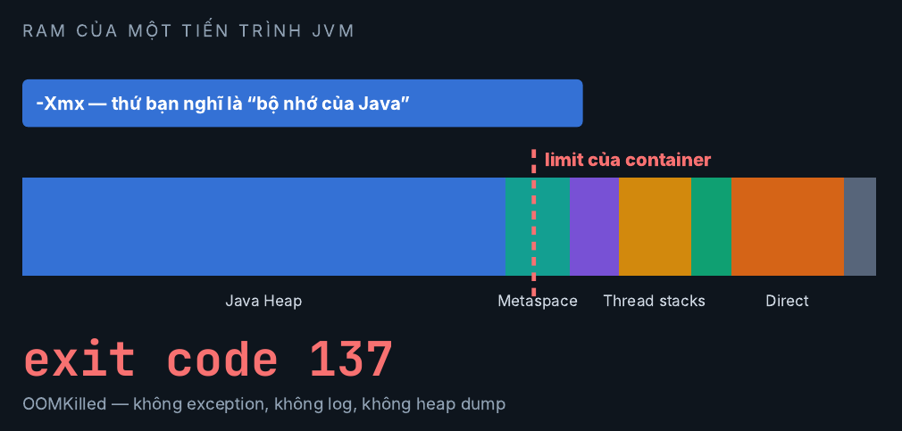
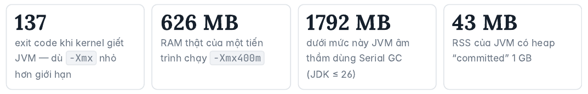
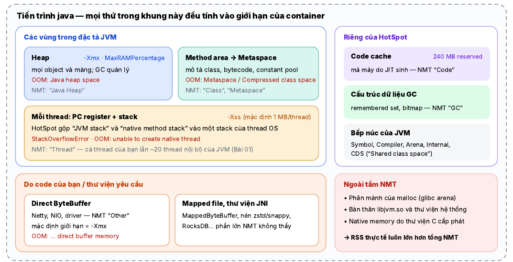
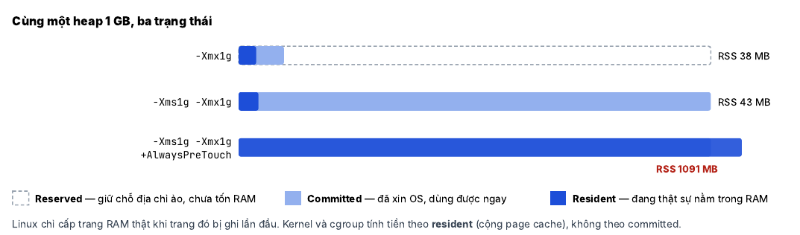
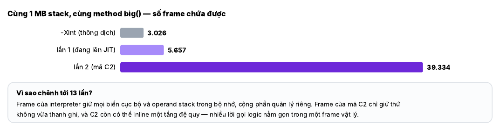
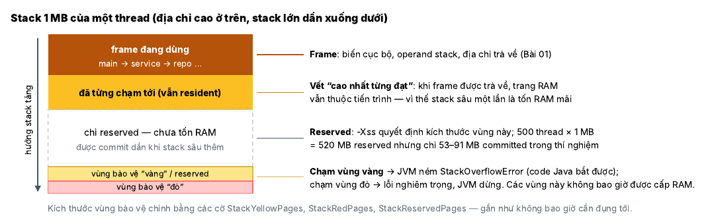
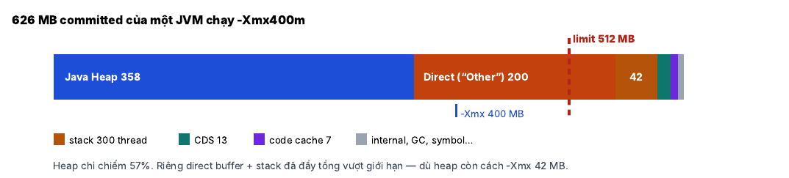
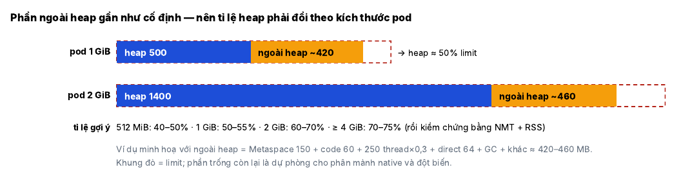

# Bài 04 — Runtime Data Areas



*Runtime Data Areas: JVM dùng RAM vào những đâu — và vì sao pod bị OOMKilled*

*Chặng I · Nền móng — Stack · heap · Metaspace · code cache · direct memory · container · Nền tảng: JDK 25 LTS / 27 · Thí nghiệm chạy thật trên OpenJDK 21*

Bài này trả lời câu hỏi mà mọi đội vận hành Spring Boot trên Kubernetes đều gặp: **tiến trình JVM thật sự dùng RAM vào những đâu**, và làm sao đặt giới hạn để không bị kernel giết.

> **MÔI TRƯỜNG THÍ NGHIỆM** — OpenJDK 21.0.12, Linux x86-64, 2 vCPU. Để tái hiện giới hạn bộ nhớ của container, các thí nghiệm chạy JVM bên trong một **memory cgroup** (cùng cơ chế mà Docker và Kubernetes dùng) với giới hạn 256 MB – 4 GB. Kernel thực sự giết tiến trình khi vượt giới hạn — các mã thoát 137 trong bài là thật.

> **SAU BÀI NÀY BẠN SẼ**
>
> - Kể tên mọi vùng nhớ của tiến trình JVM và đo được từng vùng bằng Native Memory Tracking.
> - Phân biệt reserved / committed / resident, và biết con số nào kernel dùng để giết container.
> - Biết JVM tự chọn GC và heap ra sao theo giới hạn container — kể cả khi nó chọn Serial GC mà bạn không hay biết.
> - Lập được ngân sách bộ nhớ cho một service Spring Boot và chọn cờ JVM phù hợp.

`-Xmx` chỉ là một phần của câu chuyện. Bài này đo từng vùng nhớ của một tiến trình JVM, tái hiện một vụ `OOMKilled` thật trong cgroup, và kết thúc bằng một công thức ngân sách bộ nhớ mà bạn áp dụng được ngay cho service Spring Boot của mình.



## 1 Tái hiện một vụ OOMKilled

Chương trình `MemHog` mô phỏng hình dạng bộ nhớ của một service thật: giữ một lượng dữ liệu trên heap (cache, session), chạy nhiều thread (giống pool của Tomcat), và cấp phát buffer ngoài heap (giống Netty hay driver dùng `ByteBuffer.allocateDirect`):

```java
public static void main(String[] args) {
    int heapMb = …, threads = …, directMb = …;
    for (int i = 0; i < heapMb * 4; i++) heapData.add(filled(new byte[256 << 10])); // heap
    for (int i = 0; i < threads; i++) startSleepingThread(() -> deep(2_000));  // stack
    for (int i = 0; i < directMb; i += 8)
        offHeap.add(touched(ByteBuffer.allocateDirect(8 << 20)));                // ngoài heap
}
```

Ta chạy nó trong một memory cgroup giới hạn **512 MB** — đúng như một pod có `resources.limits.memory: 512Mi` — với `-Xmx400m`, một cấu hình mà nhiều người sẽ cho là “an toàn, còn dư 112 MB”:

```text
$ echo $((512*1024*1024)) > /sys/fs/cgroup/memory/jvmlab/memory.limit_in_bytes
$ java -Xmx400m MemHog 300 300 200   # heap 300 MB, 300 thread, 200 MB direct
heap data   : 300 MB
threads     : 300
Killed
$ echo $?
137
$ grep oom_kill /sys/fs/cgroup/memory/jvmlab/memory.oom_control
oom_kill 1
```

Không có `OutOfMemoryError`, không stack trace, không heap dump, không dòng log nào từ ứng dụng. Kernel thấy tổng bộ nhớ của tiến trình vượt 512 MB và gửi SIGKILL (137 = 128 + 9). Heap lúc đó vẫn còn trống: 300 MB dữ liệu trong giới hạn 400 MB. Phần còn lại của bài giải thích bộ nhớ đã đi đâu.

## 2 Bản đồ bộ nhớ của một tiến trình JVM

Đặc tả JVM chỉ định nghĩa vài vùng nhớ trừu tượng: PC register, JVM stack, native method stack, heap, method area, runtime constant pool. HotSpot hiện thực chúng — và thêm rất nhiều vùng mà đặc tả không nhắc tới, nhưng kernel vẫn tính tiền.



*Hình 4.1 — Các vùng nhớ của tiến trình JVM, kèm cờ điều khiển, lỗi khi đầy, và tên hạng mục tương ứng trong Native Memory Tracking (NMT). Chỉ ô “Heap” chịu sự kiểm soát của `-Xmx`.*

## 3 Reserved, committed, resident — ba con số khác nhau

Trước khi đo, cần phân biệt ba mức mà một vùng nhớ có thể ở. Thí nghiệm: một chương trình chỉ ngủ 4 giây, chạy với ba cấu hình heap, đo RSS (bộ nhớ thật trong RAM) và heap committed:

```text
$ java -Xmx1g Idle                              → RSS   38 MB | heap total   98304K
$ java -Xms1g -Xmx1g Idle                        → RSS   43 MB | heap total 1048576K
$ java -Xms1g -Xmx1g -XX:+AlwaysPreTouch Idle    → RSS 1091 MB | heap total 1048576K
```



*Hình 4.2 — Ba mức của bộ nhớ, dựng từ số đo thật. `-Xms1g` chỉ commit 1 GB — RSS gần như không đổi; `AlwaysPreTouch` ghi vào mọi trang lúc khởi động nên RSS lên ngay 1 GB.*

- **NMT báo reserved và committed**, không báo resident. Committed là mức trần an toàn để lập ngân sách: phần committed nào chưa resident thì có thể trở thành resident bất cứ lúc nào.
- **Hệ quả cho container:** một JVM mới khởi động thường dùng rất ít RAM; RAM tăng dần khi heap được ghi tới, thread chạy sâu hơn, JIT biên dịch thêm. Bị OOMKilled sau vài giờ — chứ không phải lúc khởi động — là triệu chứng điển hình của ngân sách sai.
- **`-Xms = -Xmx` kèm `AlwaysPreTouch`** biến rủi ro thành thất bại ngay lúc khởi động: nếu heap không vừa container, pod chết ngay khi deploy thay vì lúc 3 giờ sáng. Cái giá là khởi động chậm hơn và chiếm RAM ngay từ đầu.

## 4 Stack: frame, độ sâu và StackOverflowError

Mỗi thread có một stack riêng; mỗi lời gọi method đẩy một **frame** (biến cục bộ, operand stack, địa chỉ trả về — [Bài 01](01-buc-tranh-toan-canh-jvm.md), Hình 1.5). Kích thước stack mặc định trên Linux x86-64 là 1 MB (`ThreadStackSize = 1024` KB), chỉnh bằng `-Xss`. Vậy một thread đi sâu được bao nhiêu tầng? Câu trả lời ít người đoán đúng:

```java
static void small() { depth++; small(); }
static void big(long a, long b, …, long h) {   // 8 tham số + 6 biến cục bộ long
    depth++; long x1 = a + b, …; big(x1, x2, x3, x4, x5, x6, a, b);
}
// đo 3 lần liên tiếp trong cùng một JVM: đệ quy tới khi StackOverflowError, đếm depth
```

```text
$ java -Xss1m Depth
lần 1: method nhỏ =  23,018 frame | method nhiều biến =   5,657 frame
lần 2: method nhỏ =  23,606 frame | method nhiều biến =  39,334 frame
lần 3: method nhỏ =  23,606 frame | method nhiều biến =  39,334 frame
$ java -Xint -Xss1m Depth            # chỉ interpreter
lần 1: method nhỏ =  10,729 frame | method nhiều biến =   3,026 frame
$ java -Xss256k Depth   →  lần 3:   3,946 |     985
$ java -Xss4m Depth     →  lần 3: 102,250 | 170,406
```



*Hình 4.3 — Độ sâu đệ quy không phải hằng số: nó phụ thuộc kích thước frame, mà kích thước frame phụ thuộc method đang chạy bằng interpreter hay bằng mã JIT. Đừng thiết kế thuật toán dựa vào “stack đủ sâu”.*

### Khi tràn stack: 1.024 frame và một vòng lặp vô hạn quen thuộc

Một ví dụ không có đệ quy “cố ý” nào — hai entity tham chiếu lẫn nhau với `toString()` kiểu Lombok `@Data` sinh ra:

```java
class Order {
    List<OrderItem> items;
    public String toString() { return "Order(id=" + id + ", items=" + items + ")"; }
}
class OrderItem {
    Order order;
    public String toString() { return "OrderItem(sku=" + sku + ", order=" + order + ")"; }
}
```

```text
$ java Bidi
java.lang.StackOverflowError — stack trace giữ 1024 frame
    at java.base/java.util.ArrayList$Itr.checkForComodification(ArrayList.java:1094)
    at java.base/java.util.ArrayList$Itr.next(ArrayList.java:1049)
    at java.base/java.util.AbstractCollection.toString(AbstractCollection.java:458)
    at java.base/java.lang.String.valueOf(String.java:4454)
    at Bidi$Order.toString(Bidi.java:5)
    …
```

Stack trace bị cắt ở 1.024 frame (`MaxJavaStackTraceDepth`), nên với lỗi đệ quy bạn chỉ thấy phần *đáy* — một mẫu lặp lại — chứ không thấy nơi vòng lặp bắt đầu. Cách đọc: tìm chu kỳ lặp (ở đây `Order.toString → AbstractCollection.toString → OrderItem.toString → Order.toString`), đó chính là cạnh vòng trong đồ thị object.

> **SPRING BOOT · THỦ PHẠM SỐ MỘT CỦA STACKOVERFLOWERROR** — Quan hệ JPA hai chiều (`@OneToMany` / `@ManyToOne`) cộng với bất kỳ thứ gì duyệt toàn bộ đồ thị object: `toString` / `equals` / `hashCode` do Lombok `@Data` sinh, Jackson serialize entity trực tiếp trong controller (lỗi “Infinite recursion”), hay logger in cả object. Cách sửa: trả DTO thay vì entity, `@ToString.Exclude` / `@EqualsAndHashCode.Exclude` ở phía “ngược”, hoặc `@JsonManagedReference` / `@JsonBackReference`. Tăng `-Xss` không bao giờ là cách sửa cho đệ quy vô hạn.

### Stack tốn bao nhiêu RAM?

```text
$ java -XX:NativeMemoryTracking=summary Threads 500 10     # 500 thread, đệ quy nông
Thread (reserved=520MB, committed=53MB)   | RSS  87 MB
$ java -XX:NativeMemoryTracking=summary Threads 500 5000   # đệ quy 5.000 tầng rồi ngủ
Thread (reserved=520MB, committed=91MB)   | RSS 124 MB
```

Mỗi thread *reserve* trọn 1 MB nhưng chỉ *commit* phần stack đã từng chạm tới. 500 thread không tốn 500 MB — nhưng cũng không miễn phí: stack đã sâu một lần sẽ giữ trang RAM đó, kể cả khi thread quay về trạng thái nghỉ. Với service Spring MVC có 200 thread Tomcat chạy qua chuỗi filter, AOP proxy, Hibernate, Jackson, mức vài trăm KB/thread là bình thường.



*Hình 4.4 — Giải phẫu stack của một thread. Ba con số NMT báo về “Thread” tương ứng ba vùng: reserved là cả cột, committed là phần đã chạm tới, và các trang bảo vệ ở đáy là cơ chế biến tràn stack thành một `StackOverflowError` thay vì làm hỏng bộ nhớ.*

## 5 Heap trong container: ergonomics quyết định gì

Nếu bạn không đặt `-Xmx`, JVM tự chọn dựa trên bộ nhớ nó “nhìn thấy” — và từ JDK 10, nó nhìn thấy giới hạn của cgroup thay vì RAM của máy chủ (`-XX:+UseContainerSupport`, mặc định bật). Đo thật trong cgroup với các giới hạn khác nhau, không truyền cờ nào:

```text
$ java -XshowSettings:system -version         # trong cgroup 300 MB
Operating System Metrics:
    Provider: cgroupv1
    Effective CPU Count: 2
    Memory Limit: 300.00M
```

| Giới hạn container | MaxHeapSize tự chọn | Tỉ lệ | GC tự chọn |
|---|---|---|---|
| 256 MB | 126 MB | 49% | Serial |
| 512 MB | 128 MB | 25% | Serial |
| 1024 MB | 256 MB | 25% | Serial |
| **1792 MB** | 448 MB | 25% | G1 |
| 2048 MB | 512 MB | 25% | G1 |
| 4096 MB | 1024 MB | 25% | G1 |

Ba điều rút ra từ bảng đo:

- **Mặc định chỉ dùng 25% giới hạn cho heap** (`MaxRAMPercentage=25`); với giới hạn rất nhỏ, JVM giữ một mức sàn khoảng 126–128 MB. Pod 1 GiB chỉ có heap 256 MB — đa số ứng dụng Spring Boot sẽ lãng phí 75% RAM, hoặc gặp `OutOfMemoryError` sớm hơn cần thiết.
- **Dưới 1.792 MB (hoặc dưới 2 CPU), JDK 21/25 chọn Serial GC** — một thread GC, dừng toàn bộ ứng dụng mỗi lần dọn. Rất nhiều pod Spring Boot 512 MiB – 1 GiB đang chạy Serial GC mà đội vận hành không hề biết. JDK 27 (JEP 523) đổi mặc định thành G1 ở mọi môi trường.
- **Đặt tỉ lệ thay vì số tuyệt đối:** `-XX:MaxRAMPercentage` tự co giãn theo `limits.memory` của pod — đo thật trong cgroup 1 GB: 25% → 256 MB, 50% → 512 MB, 75% → 768 MB. Con số đúng là bao nhiêu thì mục 10 sẽ tính.

## 6 Metaspace và compressed class space

Metaspace chứa mô tả của mọi class đã nạp: cấu trúc class, method, bytecode, constant pool, chú thích… ([Bài 03](03-class-loading.md) đã cho thấy nó có thể rò rỉ). Nó nằm ngoài heap, và **mặc định không có giới hạn**:

```text
$ java -XX:+PrintFlagsFinal -version | grep -E "MaxMetaspaceSize|CompressedClassSpaceSize"
   size_t CompressedClassSpaceSize = 1073741824              ← 1 GB reserved (chỉ địa chỉ ảo)
   size_t MaxMetaspaceSize         = 18446744073709551615    ← không giới hạn
$ jcmd <pid> VM.metaspace          # chương trình chạy javac bên trong (CodeHeavy)
Total Usage - 78 loaders, 3038 classes (1052 shared):
  Non-Class:  427 chunks,  12.62 MB capacity,  11.25 MB committed,  11.13 MB used
      Class:  151 chunks,   1.36 MB capacity,   1.36 MB committed,   1.29 MB used
       Both:  578 chunks,  13.99 MB capacity,  12.61 MB committed,  12.41 MB used
```

Metaspace chia làm hai phần: *Class* — cấu trúc `Klass` mà mỗi object trỏ tới bằng con trỏ nén 32 bit, nên phải nằm trong một vùng liên tục (compressed class space, 1 GB reserved); và *Non-Class* — mọi thứ khác (method, bytecode, constant pool). Trong thí nghiệm, 3.038 class tốn khoảng **4 KB mỗi class**. Một ứng dụng Spring Boot với Web, JPA, Security, Actuator thường nạp từ 15.000 đến hơn 30.000 class (cộng proxy và lambda) — tức Metaspace thường ở mức 80–200 MB. Bạn đã đo con số thật ở bài tập của [Bài 01](01-buc-tranh-toan-canh-jvm.md).

> **LUÔN ĐẶT TRẦN CHO METASPACE** — Không giới hạn nghĩa là một lỗi sinh class động ([Bài 03](03-class-loading.md), mục 10) sẽ ăn dần RAM cho tới khi kernel giết container — không có thông báo nào. Đặt `-XX:MaxMetaspaceSize` (ví dụ gấp đôi mức đo được lúc ổn định) để lỗi kết thúc bằng một `OutOfMemoryError: Metaspace` rõ ràng.

## 7 Code cache: khi JIT hết chỗ

Mã máy do JIT sinh ra ([Bài 01](01-buc-tranh-toan-canh-jvm.md), mục 8) nằm trong **code cache**. Từ JDK 9, nó chia làm ba vùng: mã nội bộ của JVM (interpreter, stub), mã C1 có thu profile (tầng 2–3), và mã đã tối ưu (tầng 1, 4). Đây là chương trình chạy `javac` 15 lần bên trong một JVM:

```text
$ java -XX:+PrintCodeCache CodeHeavy
15 lần biên dịch: 2291 ms
CodeHeap 'non-profiled nmethods': size=120036Kb used=1098Kb
CodeHeap 'profiled nmethods':     size=120032Kb used=7828Kb
CodeHeap 'non-nmethods':          size=5692Kb   used=1453Kb
CodeCache: size=245760Kb, used=10379Kb  total_blobs=4271, nmethods=3813
$ java -XX:ReservedCodeCacheSize=3m -XX:+PrintCodeCache CodeHeavy
[3.389s][warning][codecache] CodeCache is full. Compiler has been disabled.
[3.389s][warning][codecache] Try increasing the code cache size using …
15 lần biên dịch: 3274 ms
Compilation: disabled (not enough contiguous free space left), stopped_count=1
```

Khi code cache đầy, JVM **không ném exception** — nó chỉ in một cảnh báo rồi *tắt JIT*. Mọi method chưa kịp biên dịch sẽ chạy bằng interpreter mãi mãi (hoặc tới khi có chỗ trống). Ở đây chương trình chậm đi ~43%; với service có code nóng mới xuất hiện sau nhiều giờ (một luồng nghiệp vụ hiếm), triệu chứng là “ứng dụng chậm dần không rõ lý do”. Mặc định 240 MB là rộng rãi cho hầu hết ứng dụng; điều cần làm là **tìm cảnh báo này trong log** và theo dõi mức dùng (`jcmd <pid> Compiler.codecache`, JFR, hoặc metric `jvm.memory.used{area=nonheap,id=CodeHeap…}` của Micrometer).

## 8 Direct memory và bộ nhớ native

`ByteBuffer.allocateDirect` cấp phát bộ nhớ ngoài heap — dữ liệu không bị GC di chuyển, nên I/O có thể đọc ghi trực tiếp. Netty (nền của Spring WebFlux, Reactor Netty, nhiều client gRPC/Redis) dùng nó rất nhiều. Giới hạn mặc định:

```text
$ java -XX:+PrintFlagsFinal -version | grep MaxDirectMemorySize
 uint64_t MaxDirectMemorySize = 0                        ← 0 nghĩa là “bằng -Xmx”
$ java -Xmx256m Direct                     # cấp phát 16 MB mỗi lần, giữ lại
giữ được 256 MB direct → java.lang.OutOfMemoryError:
    Cannot reserve 16777216 bytes of direct buffer memory (allocated: 268435456, limit: 268435456)
$ java -Xmx256m -XX:MaxDirectMemorySize=64m Direct
giữ được  64 MB direct → java.lang.OutOfMemoryError: Cannot reserve … (limit: 67108864)
```

Đọc kỹ dòng đầu: **mặc định JVM cho phép direct memory lớn bằng cả heap**. Với `-Xmx400m`, tiến trình có thể hợp lệ dùng 400 MB heap *cộng* 400 MB direct — gấp đôi những gì bạn nghĩ. Trong NMT, direct buffer xuất hiện ở hạng mục “Other”.

> **NHỮNG THỨ NMT KHÔNG THẤY** — Thư viện native cấp phát bằng `malloc` của riêng nó (nén zstd/lz4/snappy, RocksDB, một số driver), file được map bằng `MappedByteBuffer`, và phân mảnh của bộ cấp phát glibc (mỗi thread có thể tạo một “arena” riêng) đều làm RSS cao hơn tổng NMT. Nếu RSS vượt xa NMT committed và tăng dần, đây là nơi cần nhìn; biến môi trường `MALLOC_ARENA_MAX=2` là cách giảm phân mảnh arena hay được dùng trong container.

## 9 Ghép lại: giải phẫu vụ OOMKilled

Giờ ta quay lại `MemHog` ở mục 1, nhưng nới giới hạn cgroup lên 1 GB để nó sống sót, bật NMT, rồi đo đúng lúc mọi thứ đã cấp phát xong:

```text
$ java -Xmx400m -XX:NativeMemoryTracking=summary MemHog 300 300 200     # trong cgroup 1 GB
$ grep VmRSS /proc/<pid>/status
VmRSS:    627628 kB
$ jcmd <pid> VM.native_memory summary scale=MB
Total: reserved=2265MB, committed=626MB
-                 Java Heap (reserved=400MB, committed=358MB)
-                    Thread (reserved=314MB, committed=42MB)
-                     Other (reserved=200MB, committed=200MB)        ← direct buffer
-        Shared class space (reserved=16MB, committed=13MB)
-                      Code (reserved=242MB, committed=7MB)
-                  Internal (reserved=2MB, committed=2MB)
-                        GC (reserved=1MB, committed=1MB)     ← Serial GC (1 GB < 1792 MB)
-                     Class (reserved=1024MB, committed=0MB)          …
```



*Hình 4.5 — Phân bổ bộ nhớ committed của `MemHog` theo NMT, so với giới hạn 512 MB của lần chạy bị giết. RSS đo được (613 MB) khớp với NMT committed, vì mọi vùng đều đã thật sự được ghi vào.*

### Bị giết hay nhận một OutOfMemoryError rõ ràng?

Một thí nghiệm nữa cho thấy vì sao *cách chia* quan trọng hơn tổng số. Cgroup 768 MB, workload cần 500 MB heap + 300 thread + 160 MB direct — nhiều hơn khả năng của container. Ta chỉ đổi `MaxRAMPercentage`:

```text
# heap tối đa 576 MB
$ java -XX:MaxRAMPercentage=75 -XX:+HeapDumpOnOutOfMemoryError MemHog 500 300 160
heap data   : 500 MB
threads     : 300
direct      : 64 MB
direct      : 128 MB
exit code = 137                                     ← kernel giết, không để lại gì
# heap tối đa 384 MB
$ java -XX:MaxRAMPercentage=50 -XX:+HeapDumpOnOutOfMemoryError MemHog 500 300 160
Dumping heap to /tmp/hd.hprof ...
Heap dump file created [390978328 bytes in 0.177 secs]
Exception in thread "main" java.lang.OutOfMemoryError: Java heap space
        at MemHog.main(MemHog.java:13)
exit code = 1
```

Với 75%, heap “vừa đủ” cho dữ liệu nên Java không hề báo lỗi — nhưng tổng tiến trình vượt container và bị giết trong im lặng. Với 50%, heap đầy *trước* khi tiến trình chạm giới hạn: JVM ném `OutOfMemoryError` có stack trace, ghi heap dump, và bạn có đủ dữ liệu để điều tra. **Mục tiêu của ngân sách bộ nhớ không phải là “không bao giờ hết bộ nhớ”, mà là “nếu hết thì hết ở chỗ JVM thấy được”.**

## 10 Công thức ngân sách bộ nhớ cho container Spring Boot

> **CÔNG THỨC** — `limit ≥ Heap_max + Metaspace_max + CodeCache_used + N_thread × stack_used + Direct_max + GC_overhead + Native khác + Dự phòng`

| Thành phần | Cách đo (NMT / công cụ) | Mức thường gặp với Spring MVC* | Cờ để chặn trên |
|---|---|---|---|
| Heap | “Java Heap” committed, log GC | tuỳ ứng dụng | `-XX:MaxRAMPercentage` |
| Metaspace | “Class” + “Metaspace”, `VM.metaspace` | 80–200 MB | `-XX:MaxMetaspaceSize` |
| Code cache | “Code”, `Compiler.codecache` | 30–80 MB đã dùng | `-XX:ReservedCodeCacheSize` |
| Stack thread | “Thread” | 200–300 thread × 0,2–0,5 MB | `-Xss`, số thread của pool |
| Direct | “Other”, metric `jvm.buffer.memory.used` | 10–100 MB (MVC); nhiều hơn với WebFlux/Netty | `-XX:MaxDirectMemorySize` |
| GC | “GC” | G1: vài % tới ~20% heap committed | chọn GC |
| Native khác | RSS − NMT committed; Symbol, Arena… | 30–100 MB | `MALLOC_ARENA_MAX` |

`*` Khoảng giá trị mang tính định hướng để bắt đầu, tổng hợp từ các phép đo trong series và kinh nghiệm phổ biến. Con số của bạn phải đến từ NMT của chính ứng dụng, đo sau khi đã nhận tải thật một thời gian.



*Hình 4.6 — Vì phần ngoài heap gần như không đổi theo kích thước pod, một con số `MaxRAMPercentage` “chuẩn” cho mọi pod là không tồn tại. Pod càng nhỏ, tỉ lệ heap càng phải thấp.*

```bash
# Điểm khởi đầu cho pod 1 GiB, JDK 21/25 — điều chỉnh theo số đo NMT của bạn
JAVA_TOOL_OPTIONS="
  -XX:MaxRAMPercentage=50
  -XX:+UseG1GC                       # pod < 1792 MB tự chọn Serial (JDK ≤ 26)
  -XX:MaxMetaspaceSize=256m          # chặn rò rỉ class thành OOM rõ ràng
  -XX:MaxDirectMemorySize=128m       # mặc định = heap, quá rộng
  -XX:+HeapDumpOnOutOfMemoryError -XX:HeapDumpPath=/dumps
  -XX:+ExitOnOutOfMemoryError        # OOM thì thoát để Kubernetes restart pod
  -XX:NativeMemoryTracking=summary   # bật ở staging để đo; chi phí nhỏ"
```

> **SPRING BOOT · BUILD-IMAGE ĐÃ LÀM PHÉP TÍNH NÀY** — Nếu bạn đóng image bằng `./mvnw spring-boot:build-image` (Cloud Native Buildpacks của Paketo), image đã chứa một “memory calculator” chạy lúc container khởi động: nó lấy giới hạn của container trừ đi ước lượng Metaspace (theo số class trong ứng dụng), code cache, direct memory, stack cho một số thread giả định (chỉnh bằng biến môi trường `BPL_JVM_THREAD_COUNT`) và phần dự phòng, rồi đặt `-Xmx` bằng phần còn lại. Hãy đọc dòng log nó in lúc khởi động — đó chính là công thức ở trên, áp dụng tự động. Nếu bạn tự viết Dockerfile, bạn tự chịu trách nhiệm phép tính này.

## 11 Bộ đồ nghề đo bộ nhớ

Công cụ hữu ích nhất cho câu hỏi “bộ nhớ đang tăng ở đâu” là NMT với *baseline* và *diff*. Ví dụ: một chương trình sau 2,5 giây tạo thêm 100 thread và 64 MB direct buffer:

```text
$ jcmd <pid> VM.native_memory baseline              # chụp mốc
$ jcmd <pid> VM.native_memory summary.diff scale=MB   # vài giây sau
Total: reserved=3094MB +165MB, committed=234MB +75MB
-                 Java Heap (reserved=1496MB, committed=96MB)
-                    Thread (reserved=118MB +100MB, committed=11MB +10MB)
-                     Other (reserved=64MB +64MB, committed=64MB +64MB)
```

| Công cụ | Dùng để |
|---|---|
| `-XX:NativeMemoryTracking=summary` + `jcmd VM.native_memory summary` | Phân bổ committed theo hạng mục (phải bật NMT từ lúc khởi động) |
| `VM.native_memory baseline` / `summary.diff` | Hạng mục nào đang tăng theo thời gian |
| `jcmd GC.heap_info` · `VM.metaspace` · `Compiler.codecache` | Chi tiết từng vùng |
| `java -XshowSettings:system -version` | JVM nhìn thấy giới hạn container nào |
| `-XX:+PrintFlagsFinal -version \| grep -E "MaxHeapSize\|Use.*GC"` | Ergonomics đã chọn heap và GC nào |
| `/proc/<pid>/status` (VmRSS) · `pmap -x` | RSS thật; so với NMT để tìm phần “ngoài tầm NMT” |
| Micrometer: `jvm.memory.used`, `jvm.buffer.memory.used`, `process.memory.rss`* | Theo dõi liên tục trên dashboard |
| cgroup: `memory.usage_in_bytes`, `memory.stat` · metric `container_memory_working_set_bytes` | Con số mà kernel/Kubernetes thực sự dùng — gồm cả page cache đang hoạt động |

`*` `process.memory.rss` cần thư viện bổ sung tuỳ môi trường; các metric `jvm.*` có sẵn trong Spring Boot Actuator.

## 12 Hiểu lầm, bài tập, thuật ngữ, bài tiếp theo

### Hiểu lầm thường gặp

| Hiểu lầm | Thực tế |
|---|---|
| “`-Xmx` là lượng RAM ứng dụng dùng.” | Chỉ là trần của heap. Trong thí nghiệm, `-Xmx400m` dùng 626 MB thật (mục 9). |
| “Heap còn trống thì không thể bị OOMKilled.” | Kernel tính tổng tiến trình; direct buffer và stack đủ đẩy tiến trình vượt giới hạn khi heap còn trống (mục 1, 9). |
| “Hết bộ nhớ thì JVM sẽ ném `OutOfMemoryError`.” | Chỉ khi một giới hạn của *JVM* bị chạm trước. Nếu giới hạn container bị chạm trước: SIGKILL, exit 137, không log (mục 9). |
| “Committed là RAM đang dùng.” | Committed ≠ resident: heap 1 GB committed chỉ tốn 43 MB RSS cho tới khi được ghi vào (mục 3). |
| “500 thread tốn 500 MB.” | Mỗi thread reserve 1 MB nhưng chỉ commit phần đã chạm tới: 53–91 MB cho 500 thread trong thí nghiệm (mục 4). |
| “Metaspace có giới hạn mặc định như PermGen ngày xưa.” | `MaxMetaspaceSize` mặc định không giới hạn (mục 6). |
| “Tăng `-Xss` là sửa được `StackOverflowError`.” | Với đệ quy vô hạn (quan hệ hai chiều, toString…), stack lớn hơn chỉ làm lỗi đến chậm hơn (mục 4). |
| “Pod nhỏ thì JVM vẫn dùng G1.” | Dưới 1.792 MB hoặc dưới 2 CPU, JDK 21/25 chọn Serial GC (mục 5). |

### Bài tập tự làm

> **THỰC HÀNH**
>
> 1. **Đo service thật.** Chạy service Spring Boot của bạn ở staging với `-XX:NativeMemoryTracking=summary`, cho nhận tải 30 phút, rồi lấy `VM.native_memory summary` và RSS. Điền bảng ở mục 10 bằng số của chính bạn.
> 2. **Kiểm tra ergonomics trong pod.** `kubectl exec` vào một pod và chạy `java -XX:+PrintFlagsFinal -version | grep -E "MaxHeapSize|UseSerialGC|UseG1GC"`. Pod đó đang dùng GC nào?
> 3. **Tái hiện OOMKilled trên máy bạn.** `docker run --memory=512m eclipse-temurin:21 …` với `MemHog`, rồi sửa cờ JVM sao cho lỗi biến thành `OutOfMemoryError` có heap dump.
> 4. **Tìm cảnh báo bị bỏ quên.** Tìm “CodeCache is full” trong log production 30 ngày qua của các service bạn phụ trách.
> 5. **So RSS với NMT.** Nếu RSS lớn hơn NMT committed hơn 100 MB, thử chạy với `MALLOC_ARENA_MAX=2` và so sánh sau cùng một khoảng thời gian tải.

### Thuật ngữ của bài

| Thuật ngữ | Nghĩa ngắn gọn |
|---|---|
| Runtime Data Areas | Các vùng nhớ JVM dùng khi chạy, theo đặc tả: PC register, stack, heap, method area, runtime constant pool. |
| Reserved / committed / resident | Giữ chỗ địa chỉ ảo / đã xin OS, dùng được / đang thật sự nằm trong RAM (RSS). |
| NMT | Native Memory Tracking — JVM tự kê khai bộ nhớ theo hạng mục. |
| Metaspace · compressed class space | Vùng native chứa metadata class · phần chứa cấu trúc Klass, đánh địa chỉ bằng con trỏ nén. |
| Code cache | Vùng chứa mã máy do JIT sinh; đầy thì JIT bị tắt. |
| Direct buffer | `ByteBuffer` ngoài heap; mặc định giới hạn bằng `-Xmx`. |
| Ergonomics | JVM tự chọn heap, GC, số thread theo CPU và bộ nhớ mà nó nhìn thấy (kể cả giới hạn container). |
| OOMKilled · exit 137 | Kernel giết tiến trình vượt giới hạn cgroup bằng SIGKILL (128 + 9). |

> **BÀI TIẾP THEO · BÀI 05** — **Một object Java thực sự nằm trong RAM như thế nào.** Ta đã thấy một `Order` hai field tốn 32 byte. [Bài 05](05-object-trong-ram.md) mở header của object ra — mark word, klass pointer, compressed oops, padding — đo bằng JOL, tính xem một `List<Long>` một triệu phần tử thật sự tốn bao nhiêu, và xem Compact Object Headers (JDK 25, mặc định ở JDK 27) cắt giảm được bao nhiêu heap cho ứng dụng Spring Boot.

### Tài liệu tham khảo

- The Java Virtual Machine Specification, Java SE 25 — §2.5 (Run-Time Data Areas).
- JDK Documentation — Native Memory Tracking (Troubleshooting Guide); `jcmd` manual.
- JEP 523 — Make G1 the Default Garbage Collector in All Environments (JDK 27).
- Linux kernel documentation — Memory Resource Controller (cgroup v1) và cgroup v2 memory controller.
- Paketo Buildpacks — Java memory calculator (dùng bởi `spring-boot:build-image`).
