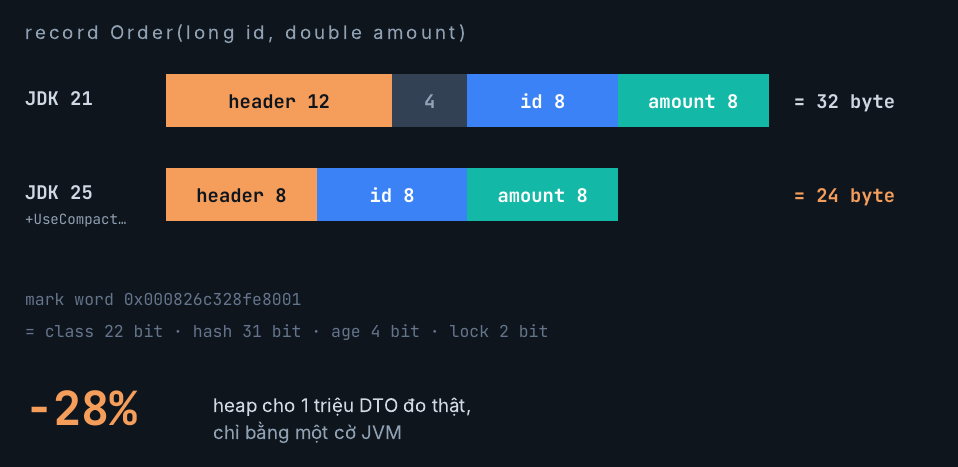
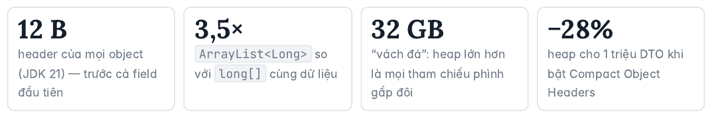
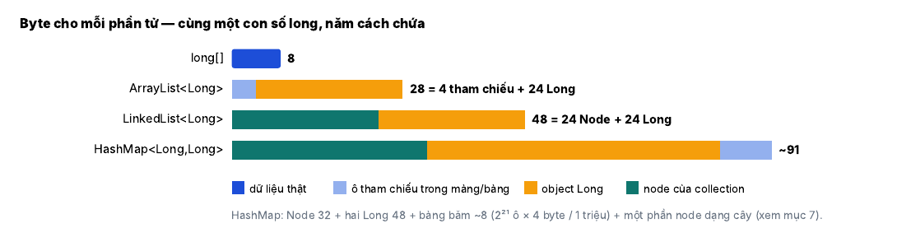
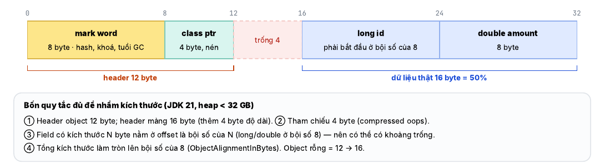
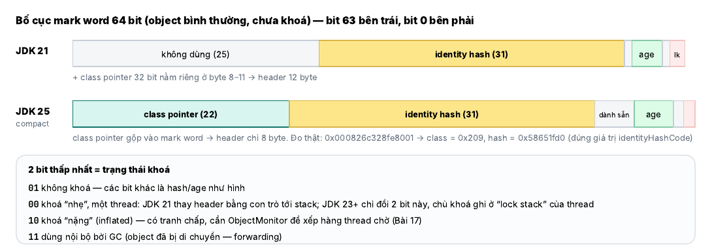
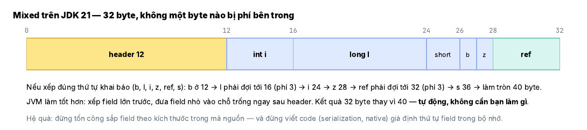
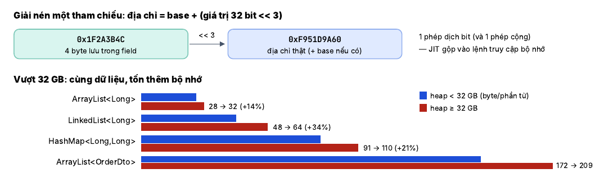
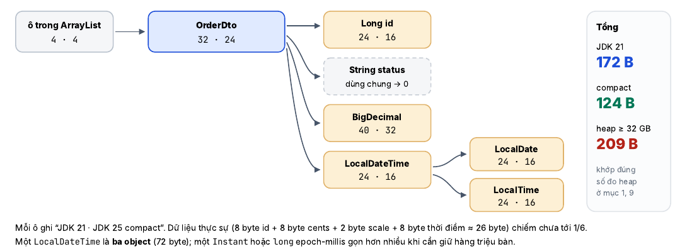
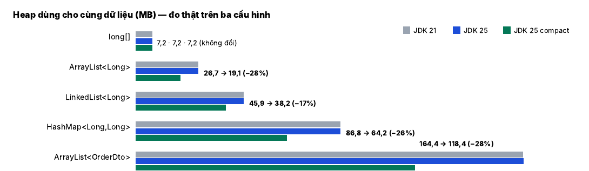

# Bài 05 — Object layout



*Một object Java thực sự nằm trong RAM như thế nào*

*Chặng I · Header · mark word · compressed oops · compact headers · Nền tảng: JDK 25 LTS / 27 · Thí nghiệm: JDK 21 & JDK 25*

[Bài 01](01-buc-tranh-toan-canh-jvm.md) nói một `Order` hai field tốn 32 byte. Bài này mở object ra tới từng bit: header chứa gì, field được xếp ra sao, con trỏ được nén thế nào — và một cờ JVM của JDK 25 cắt được bao nhiêu heap.

> **MÔI TRƯỜNG THÍ NGHIỆM** — Lần đầu tiên trong series, các thí nghiệm chạy trên **hai JVM**: OpenJDK 21.0.12 và **Temurin 25.0.2 LTS** (runtime lấy từ gói `jdk4py` trên PyPI), để so sánh trực tiếp header truyền thống với Compact Object Headers. Công cụ JOL không tải được trong môi trường này, nên bài dùng một “JOL tí hon” tự viết (~60 dòng) dựa trên đúng các API mà JOL dùng.

> **SAU BÀI NÀY BẠN SẼ**
>
> - Tính nhẩm được kích thước của object, mảng, wrapper và collection — sai số vài byte.
> - Đọc được mark word: hash, trạng thái khoá, tuổi GC nằm ở đâu.
> - Biết vì sao heap 33 GB có thể chứa *ít* dữ liệu hơn heap 31 GB.
> - Đánh giá được lợi ích của Compact Object Headers cho ứng dụng của bạn.

Heap của một service Spring Boot là hàng chục triệu object nhỏ: String, entry của HashMap, DTO, entity, Long. Kích thước của từng object nhân lên thành hàng trăm MB — và tần suất GC. Hiểu bố cục object là cách rẻ nhất để biết heap của bạn đang đi đâu.



## 1 Một triệu `Long` tốn bao nhiêu RAM?

Một `long` là 8 byte, nên một triệu giá trị là 8 MB. Câu trả lời đó chỉ đúng với một kiểu chứa dữ liệu. Đo thật bằng cách so heap trước và sau khi tạo cấu trúc (có gọi GC để loại rác), với các giá trị `0, 1000, 2000…`:

```text
$ java -XX:+UseSerialGC Footprint                          # JDK 21, heap < 32 GB
long[1_000_000]                         7.2 MB  (  7.5 byte/phần tử)
ArrayList<Long> 1 triệu                26.7 MB  ( 28.0 byte/phần tử)
LinkedList<Long> 1 triệu               45.9 MB  ( 48.1 byte/phần tử)
HashMap<Long,Long> 1 triệu             86.8 MB  ( 91.0 byte/phần tử)
ArrayList<OrderDto> 1 triệu           164.3 MB  (172.3 byte/phần tử)
```



*Hình 5.1 — Phân tích từng byte cho mỗi phần tử, khớp với số đo ở trên. Dữ liệu thật (8 byte) chỉ chiếm 9–29% trong các cấu trúc dùng `Long`; phần còn lại là header, tham chiếu và căn lề — đúng những thứ bài này giải thích.*

## 2 Công cụ: tự đo bố cục object

Công cụ chuẩn là **JOL** (Java Object Layout, thuộc dự án OpenJDK): `ClassLayout.parseInstance(obj).toPrintable()` in bố cục, `GraphLayout.parseInstance(obj).totalSize()` tính tổng cả đồ thị object. Không có JOL trong môi trường thí nghiệm, ta viết bản rút gọn dựa trên hai API mà chính JOL dùng:

```java
// Layout.java — đóng gói thành java agent (Premain-Class: Layout)
public static void premain(String a, Instrumentation i) { inst = i; }  // JVM trao Instrumentation
long size   = inst.getObjectSize(o);                         // kích thước thật
long offset = Unsafe.getUnsafe().objectFieldOffset(field);   // vị trí từng field
long mark   = Unsafe.getUnsafe().getLong(o, 0L);            // 8 byte đầu: mark word
// sắp field theo offset, in khoảng trống giữa chúng = căn lề / padding
```

```bash
$ java --add-exports java.base/jdk.internal.misc=ALL-UNNAMED \
       -javaagent:layout.jar -cp .:layout.jar Shapes
```

Cờ `--add-exports` cần thiết vì `jdk.internal.misc.Unsafe` là API nội bộ của JDK ([Bài 03](03-class-loading.md), mục 8) — đúng loại thứ chỉ nên dùng trong công cụ chẩn đoán, không bao giờ trong code nghiệp vụ.

## 3 Giải phẫu một object: header, field, padding

```text
$ java … Shapes full                # JDK 21
Shapes$Order — 32 byte                // record Order(long id, double amount)
  OFF   SZ  TYPE                   FIELD
    0   12                         (header: mark word + class pointer)
   12    4                         (khoảng trống căn lề)
   16    8  long                   Order.id
   24    8  double                 Order.amount
java.lang.Object — 16 byte
    0   12                         (header: mark word + class pointer)
   12    4                         (padding tới bội số của 8)
```



*Hình 5.2 — 32 byte của `Order`, đúng như số đo. Hai field `long` / `double` không thể chen vào 4 byte trống sau header, nên 4 byte đó bị bỏ phí. Cùng quy tắc: `Integer` = 12 + 4 = 16 byte (không phí gì), `Long` = 12 + 4 trống + 8 = 24 byte.*

## 4 Mark word: 64 bit thay đổi theo vòng đời object

8 byte đầu tiên của mọi object không cố định: JVM ghi vào đó hash code khi bạn gọi `hashCode()` lần đầu, trạng thái khoá khi bạn `synchronized`, và tuổi của object sau mỗi lần GC. Đọc thẳng 8 byte đó qua các giai đoạn (đã lược bớt):

```text
$ java -XX:+UseSerialGC -Xmn16m … MarkDemo                             # JDK 21
mới tạo                        0x0000000000000001  lock=01
sau identityHashCode=0x4769b07b 0x0000004769b07b01  lock=01           ← hash được ghi vào header (bit 8–38)
trong synchronized (1 thread)  0x00007fc553bfe918  lock=00           ← trỏ tới “lock record” trên stack
ra khỏi synchronized           0x0000004769b07b01  lock=01           ← hash được trả lại
đang bị tranh chấp             0x00007fc4bc000fe2  lock=10           ← con trỏ tới ObjectMonitor (khoá “nặng”)
sau tranh chấp                 0x00007fc4bc000fe2  lock=10           ← vẫn “phồng”, dọn sau
— một object khác, sống sót qua nhiều lần young GC —
sau đợt rác thứ 1              0x0000000000000061  lock=01 age=12    ← mỗi đợt ~128 MB rác = hơn chục lần young GC
sau đợt rác thứ 2              0x0000000000000079  lock=01 age=15    ← tối đa 4 bit = 15 → được đưa lên Old
$ java25 -XX:+UseSerialGC … MarkDemo                                  # Temurin 25
sau identityHashCode=0x735b5592 0x0000039adaac9001  lock=01           ← hash ở bit 11–41 (bố cục mới)
trong synchronized (1 thread)  0x0000039adaac9000  lock=00           ← lightweight: header giữ nguyên
đang bị tranh chấp             0x00007fbfdc000f32  lock=10
```



*Hình 5.3 — Mark word trên JDK 21 và JDK 25 với Compact Object Headers, đối chiếu với giá trị đọc thật. Trường `age` chỉ có 4 bit — đó là lý do `MaxTenuringThreshold` không thể vượt 15.*

- **Hash là lười:** object mới tạo không có hash. Lần gọi `System.identityHashCode` (hoặc `Object.hashCode()` mặc định) đầu tiên sinh ngẫu nhiên một giá trị rồi ghi vào header — từ đó nó không bao giờ đổi, kể cả khi GC di chuyển object.
- **Khoá để lại dấu vết trong header:** trên JDK 21, khoá nhẹ thay cả mark word bằng một con trỏ; JDK 25 dùng *lightweight locking* nên header gần như không đổi. Khi có tranh chấp, khoá “phồng” thành ObjectMonitor — và ở nguyên trạng thái đó cho tới khi *Monitor Deflation Thread* (một trong 20 thread ở [Bài 01](01-buc-tranh-toan-canh-jvm.md)) thu hồi.
- **Tuổi GC** tăng mỗi lần object sống sót qua young GC; chạm ngưỡng thì được chuyển lên Old. [Bài 10](10-nen-tang-gc.md) sẽ dùng chính trường này.

## 5 JVM tự sắp xếp lại field của bạn

Thứ tự khai báo field trong mã nguồn **không** phải thứ tự trong bộ nhớ. JVM xếp lại để lấp chỗ trống và giảm padding:

```java
class Mixed { byte b; long l; int i; boolean z; Object ref; short s; }   // thứ tự khai báo
```

```text
$ java … Shapes full                       $ java25 -XX:+UseCompactObjectHeaders …
Shapes$Mixed — 32 byte                       Shapes$Mixed — 32 byte
    0   12  (header)                             0    8  (header)
   12    4  int      Mixed.i   ← lấp chỗ trống   8    8  long     Mixed.l
   16    8  long     Mixed.l                    16    4  int      Mixed.i
   24    2  short    Mixed.s                    20    2  short    Mixed.s
   26    1  byte     Mixed.b                    22    1  byte     Mixed.b
   27    1  boolean  Mixed.z                    23    1  boolean  Mixed.z
   28    4  Object   Mixed.ref                  24    4  Object   Mixed.ref
                                                28    4  (padding)
```



*Hình 5.4 — Field layout thật của `Mixed` trên JDK 21. Với lớp con, từ JDK 15 field của lớp con cũng được nhét vào khoảng trống của lớp cha: `class B extends A` (A có `byte a`, B có `byte b; int x`) đặt `B.b` ngay sau `A.a` ở offset 13.*

## 6 Compressed oops và vách đá 32 GB

Trên máy 64 bit, một con trỏ “tự nhiên” dài 8 byte. HotSpot lưu tham chiếu chỉ bằng **4 byte** (compressed oops — *ordinary object pointers*) nhờ một mẹo: mọi object đều bắt đầu ở địa chỉ chia hết cho 8, nên 3 bit thấp của địa chỉ luôn bằng 0 và không cần lưu. 32 bit × 8 = 2³⁵ byte = **32 GB** địa chỉ có thể biểu diễn.

```text
$ java -Xmx2g  -Xlog:gc+init -version | grep Oops  →  Compressed Oops: Enabled (32-bit)
$ java -Xmx26g -Xlog:gc+init -version | grep Oops  →  Compressed Oops: Enabled (Zero based)
$ java -Xmx31g -Xlog:gc+init -version | grep Oops  →  Compressed Oops: Enabled (Non-zero disjoint base)
$ java -Xmx32g -XX:+PrintFlagsFinal -version | grep UseCompressedOops   →  false
$ java -Xmx33g -XX:+UseSerialGC Footprint                 # cùng chương trình ở mục 1
ArrayList<Long> 1 triệu                30.5 MB  ( 32.0 byte/phần tử)       ← từ 28.0
LinkedList<Long> 1 triệu               61.4 MB  ( 64.3 byte/phần tử)       ← từ 48.1
HashMap<Long,Long> 1 triệu            105.0 MB  (110.1 byte/phần tử)       ← từ 91.0
ArrayList<OrderDto> 1 triệu           199.1 MB  (208.7 byte/phần tử)       ← từ 172.3
```



*Hình 5.5 — Trên: cơ chế nén con trỏ. Dưới: số đo thật với `-Xmx33g` — mọi tham chiếu thành 8 byte. Header vẫn 12 byte vì class pointer được nén độc lập (`UseCompressedClassPointers`).*

> **HEAP 33 GB CHỨA ĐƯỢC ÍT HƠN HEAP 31 GB** — Với dữ liệu nhiều tham chiếu, mất compressed oops làm footprint tăng 15–35%: một heap 33 GB có thể chứa *ít* object hơn một heap 31 GB, lại tốn thêm băng thông bộ nhớ và cache CPU. Nếu thật sự cần heap lớn hơn, hoặc nhảy hẳn lên khoảng 48 GB trở lên, hoặc dùng `-XX:ObjectAlignmentInBytes=16` (nén được tới 64 GB, đổi lại mỗi object làm tròn lên bội số 16). Với service Spring Boot thông thường, heap vài GB nằm thoải mái trong vùng tốt nhất — chế độ “32-bit”, không cần cả phép dịch bit.

## 7 Wrapper và collection: cái giá của sự tiện lợi

| Object | JDK 21 | JDK 25 + compact | Vì sao |
|---|---|---|---|
| `new Object()` | 16 | **8** | chỉ có header (+ padding) |
| `Integer`, `Float` | 16 | 16 | header + 4 byte, làm tròn 16 |
| `Long`, `Double` | 24 | **16** | long phải ở offset 16 khi header 12 |
| `byte[0]` | 16 | 16 | header mảng (mark + class + length) |
| `int[10]` · `Object[10]` | 56 · 56 | 56 · 56 | 16 + 40 (JDK 21) · 12 + 40 + 4 padding (compact) |
| `String` (object, chưa tính mảng byte) | 24 | 24 | hash, coder, hashIsZero, value |
| `ArrayList` mỗi phần tử · `HashMap.Node` | 4 · 32 | 4 · 24 | ô tham chiếu · hash + 3 tham chiếu |

Ba bài học thực dụng:

- **Boxing nhân ba bộ nhớ**. Một `Long` 24 byte để chứa 8 byte dữ liệu, cộng 4 byte ô tham chiếu ở nơi chứa nó. Ở vùng nóng về bộ nhớ (cache trong ứng dụng, tính toán lô lớn), mảng nguyên thuỷ hoặc thư viện collection cho kiểu nguyên thuỷ (fastutil, Eclipse Collections, HPPC) tiết kiệm 3–10 lần.
- **`LinkedList` gần như không bao giờ đáng.** Mỗi phần tử thêm một Node 24 byte và phá vỡ tính liền mạch trong cache CPU.
- **Hash kém làm `HashMap` phình thêm**. Đếm class trong heap của chương trình `HashMap<Long,Long>` ở mục 1 cho thấy một điều bất ngờ:

```text
$ jcmd <pid> GC.class_histogram | head
 num     #instances         #bytes  class name (module)
   1:       2000127       48003048  java.lang.Long
   2:        922869       29531808  java.util.HashMap$Node
   3:           264        8412736  [Ljava.util.HashMap$Node;
   4:         78147        4376232  java.util.HashMap$TreeNode      ← 56 byte mỗi cái
```

Khoá là `0, 1000, 2000…`. Mô phỏng lại đúng hàm băm của `HashMap` (`h ^ (h >>> 16)`, bảng 2²¹ ô) cho thấy chúng chỉ rơi vào **12% số bucket** — trung bình 4 phần tử mỗi bucket, có bucket tới 20. Bucket dài từ 8 phần tử trở lên bị chuyển thành cây đỏ-đen với node 56 byte. Hash code phân bố kém vừa chậm vừa tốn RAM.

## 8 Một DTO thật tốn bao nhiêu

Đây là kiểu object mà ứng dụng Spring Boot tạo ra hàng triệu lần — một DTO với các kiểu “chuẩn mực”:

```java
record OrderDto(Long id, String status, BigDecimal amount, LocalDateTime createdAt) {}
// status lấy từ 3 hằng chuỗi dùng chung; amount = BigDecimal.valueOf(cents, 2)
```



*Hình 5.6 — Đồ thị object của một `OrderDto`, kích thước đo bằng công cụ ở mục 2. 4 + 32 + 24 + 40 + 24 + 24 + 24 = **172 byte** — trùng khớp với con số 172,3 byte/phần tử đo bằng heap ở mục 1.*

> **SPRING BOOT · KHI BẠN NẠP 1 TRIỆU DÒNG** — Một truy vấn trả về 1 triệu DTO như trên cần ~165 MB heap chỉ cho dữ liệu, chưa kể bản sao trung gian khi Jackson tuần tự hoá thành JSON. Nếu nạp *entity* qua JPA, chi phí còn cao hơn: Hibernate giữ trong persistence context một bản “ảnh chụp” trạng thái của mỗi entity để dirty checking, cộng các map nội bộ để quản lý danh tính. Những kỹ thuật giảm nhẹ: phân trang hoặc stream (`Stream<T>` / `Slice`, `fetchSize`), projection thẳng ra DTO, giao dịch `@Transactional(readOnly = true)` để Hibernate bỏ dirty checking, và với dữ liệu chỉ để tính toán — dùng kiểu nguyên thuỷ.

## 9 Compact Object Headers (JDK 25)

Header 12 byte xuất hiện ở *mọi* object, và object trong ứng dụng Java điển hình rất nhỏ (thường 32–64 byte) — nên header chiếm một phần đáng kể của heap. Dự án Lilliput của OpenJDK thu header xuống **8 byte** bằng cách nén class pointer còn 22 bit và nhét nó vào chính mark word (Hình 5.3). Tính năng xuất hiện dạng thử nghiệm ở JDK 24 (JEP 450), thành tính năng chính thức ở **JDK 25** (JEP 519, bật bằng `-XX:+UseCompactObjectHeaders`), và trở thành mặc định ở **JDK 27** (JEP 534).

```text
# trái: java25 -XX:+UseSerialGC Footprint · phải: thêm -XX:+UseCompactObjectHeaders
long[1_000_000]                  7.2 MB               long[1_000_000]                  7.2 MB
ArrayList<Long> 1 triệu         26.7 MB               ArrayList<Long> 1 triệu        19.1 MB
LinkedList<Long> 1 triệu        45.9 MB               LinkedList<Long> 1 triệu       38.2 MB
HashMap<Long,Long> 1 triệu      86.8 MB               HashMap<Long,Long> 1 triệu     64.2 MB
ArrayList<OrderDto> 1 triệu    164.4 MB               ArrayList<OrderDto> 1 triệu   118.4 MB
```



*Hình 5.7 — JDK 21 và JDK 25 mặc định cho kết quả gần như giống hệt; chỉ cờ Compact Object Headers tạo khác biệt. Mảng nguyên thuỷ không được lợi gì (một header cho một triệu phần tử); cấu trúc nhiều object nhỏ được lợi nhiều nhất.*

Bảng đếm class xác nhận nguồn gốc của khoản tiết kiệm — cùng số object, mỗi object nhỏ hơn:

```text
$ jcmd <pid> GC.class_histogram      # HashMap 1 triệu phần tử
              #instances    #bytes JDK 21    #bytes JDK 25 compact
java.lang.Long          2000127        48003048         32002032      24 → 16 byte/object
java.util.HashMap$Node   ~922000        29531808         22138464      32 → 24 byte/object
java.util.HashMap$TreeNode 78147         4376232          4376232      56 → 56
```

### Đánh đổi và giới hạn

- **Không phải object nào cũng nhỏ đi**. Tiết kiệm 4 byte chỉ có ý nghĩa khi nó vượt qua một mốc làm tròn 8 byte: `Integer` (16), `String` (24), `TreeNode` (56) giữ nguyên kích thước; `Long` (24 → 16), `Object` (16 → 8), `Node` (32 → 24) nhỏ đi.
- **Kết quả công bố** (theo JEP 519 và bài tổng hợp của InfoQ): trên SPECjbb2015, heap giảm 22% và thời gian chạy giảm 8%; GC chạy ít hơn khoảng 15% với G1 và Parallel; một số dịch vụ production của Amazon ghi nhận CPU giảm tới 30%. Heap nhỏ hơn nghĩa là GC ít việc hơn và cache CPU chứa được nhiều object hơn.
- **Điều kiện:** chỉ có trên x64 và AArch64; không dùng chung với cờ đã lỗi thời `-XX:-UseCompressedClassPointers` hay legacy stack locking. Class pointer 22 bit giới hạn khoảng 4 triệu class — vô hại với gần như mọi ứng dụng. Vì class pointer giờ nằm trong mark word, khi object bị khoá nặng, monitor được tra qua một bảng riêng thay vì ghi đè header (thí nghiệm ở mục 4 cho thấy header giữ nguyên hash khi lock bit = 10).

> **SPRING BOOT · CÓ NÊN BẬT NGAY?** — Heap của một ứng dụng Spring Boot là “thiên đường” của object nhỏ: `String`, entry của `HashMap` / `ConcurrentHashMap`, DTO, entity, `Long` / `Integer`, node cây JSON, metadata của bean. Đây đúng là loại heap được lợi nhiều nhất. Nếu bạn đã chạy JDK 25: bật `-XX:+UseCompactObjectHeaders` ở staging, so sánh heap sau GC, tần suất GC, p99 latency trên cùng tải — rồi quyết định bằng số liệu. Nếu bạn lên thẳng JDK 27, nó đã bật sẵn; nhớ tính lại ngân sách bộ nhớ của [Bài 04](04-runtime-data-areas.md), vì heap thực dùng có thể giảm đáng kể.

## 10 Bộ đồ nghề và quy tắc nhẩm nhanh

| Công cụ | Dùng để |
|---|---|
| JOL: `ClassLayout.parseClass(X.class).toPrintable()` | Bố cục field của một class, như output ở mục 3, 5 |
| JOL: `GraphLayout.parseInstance(obj).toFootprint()` | Tổng kích thước cả đồ thị object (như Hình 5.6), theo từng class |
| `jcmd <pid> GC.class_histogram` | Class nào chiếm nhiều heap nhất trong ứng dụng đang chạy — không cần heap dump |
| Heap dump + Eclipse MAT | Shallow size (chính object) và retained size (mọi thứ sẽ được giải phóng nếu object này mất) — [Bài 14](14-log-gc-memory-leak.md) |
| `-Xlog:gc+init` · `-XX:+PrintFlagsFinal` | Chế độ compressed oops, cờ `UseCompactObjectHeaders` đang bật hay tắt |

> **QUY TẮC NHẨM (JDK 21–26 MẶC ĐỊNH, HEAP < 32 GB)**
>
> - Object = 12 + tổng field, làm tròn lên bội số 8 (cộng khoảng trống nếu có `long` / `double` mà header chưa thẳng hàng 8). Tham chiếu = 4.
> - Mảng = 16 + n × kích thước phần tử, làm tròn 8.
> - `Long` / `Double` 24 · `Integer` 16 · `String` 24 + (16 + độ dài, nếu toàn ký tự Latin-1) · `HashMap` ~32 byte/entry + bảng + key + value · `LocalDateTime` 72 (3 object) · `BigDecimal` nhỏ 40.
> - Với Compact Object Headers: trừ 4 byte ở header mỗi object rồi làm tròn lại.

## 11 Hiểu lầm, bài tập, thuật ngữ, bài tiếp theo

### Hiểu lầm thường gặp

| Hiểu lầm | Thực tế |
|---|---|
| “Một triệu `Long` tốn 8 MB.” | 8 MB chỉ với `long[]`. `ArrayList<Long>` tốn 26,7 MB, `HashMap<Long,Long>` 86,8 MB (mục 1). |
| “Object rỗng tốn 0 byte.” | 16 byte (JDK 21) — 12 byte header cộng padding; 8 byte với Compact Object Headers (mục 3, 9). |
| “Field nằm trong bộ nhớ theo thứ tự khai báo.” | JVM tự xếp lại để lấp chỗ trống (mục 5). |
| “Heap càng lớn càng chứa được nhiều.” | Vượt 32 GB mất compressed oops; footprint tăng 15–35% (mục 6). |
| “Hash code là địa chỉ của object.” | Identity hash là số ngẫu nhiên, sinh lần đầu khi được hỏi rồi ghi vào header; GC di chuyển object nhưng hash không đổi (mục 4). |
| “Compact Object Headers giảm đều 4 byte mỗi object.” | Chỉ có lợi khi vượt mốc làm tròn 8 byte: `Long` 24 → 16 nhưng `Integer`, `String` giữ nguyên (mục 9). |

### Bài tập tự làm

> **THỰC HÀNH**
>
> 1. **Đo entity của bạn.** Thêm `org.openjdk.jol:jol-core` vào một test, in `ClassLayout` cho entity/DTO lớn nhất trong service, rồi `GraphLayout.parseInstance(list).totalSize()` cho một trang kết quả 1.000 dòng. Nhân lên với số dòng lớn nhất mà API của bạn từng trả về.
> 2. **Đọc histogram production.** Chạy `jcmd <pid> GC.class_histogram | head -20` trên một pod staging đang có tải. Top 5 class là gì? Có `HashMap$TreeNode` không — nếu có, key nào có hash kém?
> 3. **Thử Compact Object Headers.** Trên JDK 25, chạy service với và không với `-XX:+UseCompactObjectHeaders` dưới cùng một bài tải. So heap sau full GC, số lần GC mỗi phút, p99 latency.
> 4. **Dự đoán trước, đo sau.** Nhẩm kích thước của `record Point(int x, int y)`, `record Pair(Long a, Long b)` và `Optional<Long>` trên JDK 21 và với compact header, rồi kiểm chứng bằng JOL.

### Thuật ngữ của bài

| Thuật ngữ | Nghĩa ngắn gọn |
|---|---|
| Object header | Phần đầu mọi object: mark word + class pointer (+ độ dài với mảng). |
| Mark word | 64 bit chứa identity hash, trạng thái khoá, tuổi GC (và class pointer với compact header). |
| Class pointer (klass) | Con trỏ tới cấu trúc mô tả class trong Metaspace; nén 32 bit, hoặc 22 bit với compact header. |
| Compressed oops | Tham chiếu 4 byte = địa chỉ ÷ 8; hoạt động với heap tới 32 GB. |
| Padding / căn lề | Byte bỏ trống để field và object nằm ở địa chỉ thẳng hàng. |
| Shallow / retained size | Kích thước của riêng object / của mọi thứ sẽ được giải phóng cùng nó. |
| Compact Object Headers | Header 8 byte (JEP 519, JDK 25; mặc định từ JDK 27 — JEP 534). |
| Lightweight locking | Khoá nhẹ không ghi đè header; chủ khoá được ghi trong “lock stack” của thread (mặc định từ JDK 23). |

> **KẾT THÚC CHẶNG I · BÀI TIẾP THEO · BÀI 06** — Năm bài đầu đã đưa ta đi hết “phần cứng” của JVM: class file, class loading, các vùng nhớ, object. **Chặng II** chuyển sang việc chạy code. **[Bài 06](06-interpreter-goi-method.md) — Interpreter & cơ chế gọi method**: template interpreter thực thi bytecode thế nào, vtable/itable hoạt động ra sao, và gọi qua interface có thật sự chậm hơn gọi qua class — đo bằng benchmark chứ không đoán.

### Tài liệu tham khảo

- JEP 450 (Compact Object Headers, thử nghiệm — JDK 24), JEP 519 (chính thức — JDK 25), JEP 534 (mặc định — JDK 27). openjdk.org/jeps
- InfoQ — “Java 25 Compact Object Headers” (tổng hợp kết quả đo của JEP 519).
- OpenJDK — mã nguồn `markWord.hpp`; dự án JOL (Java Object Layout) và Project Lilliput.
- The Java Virtual Machine Specification — §2.7 (Representation of Objects: đặc tả không quy định bố cục, đây là lựa chọn của HotSpot).
