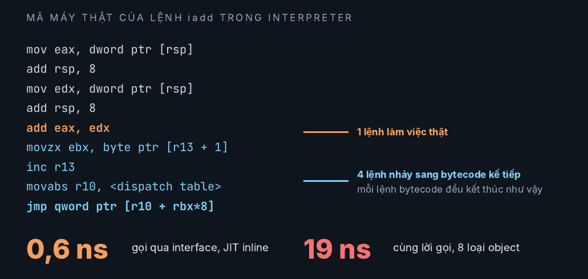
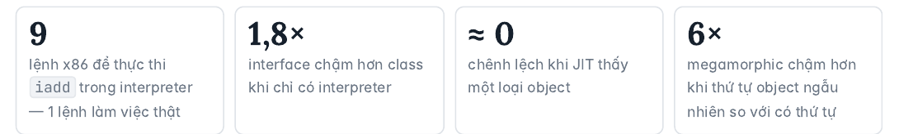
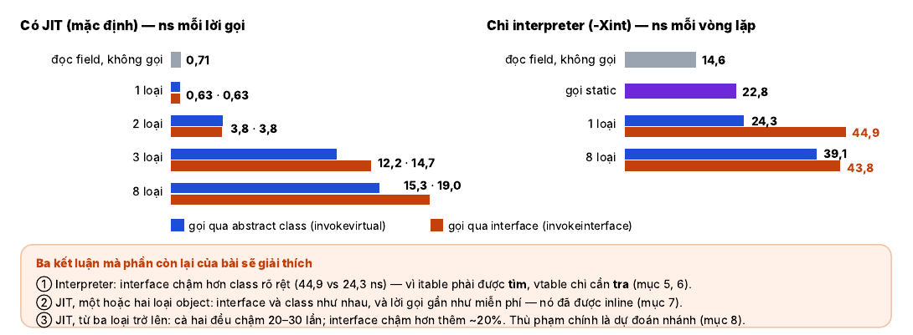
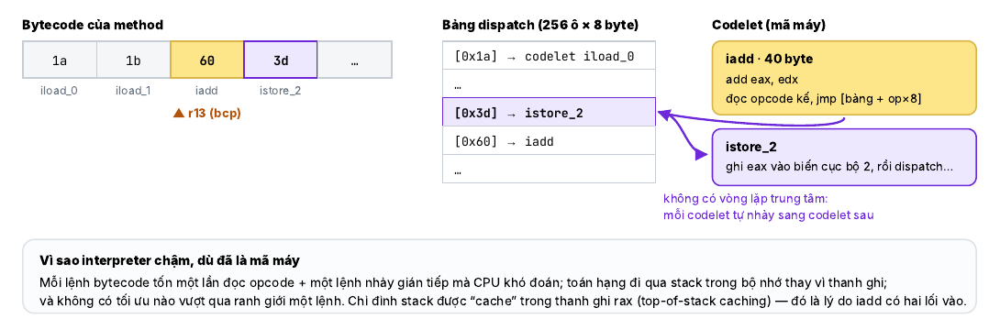
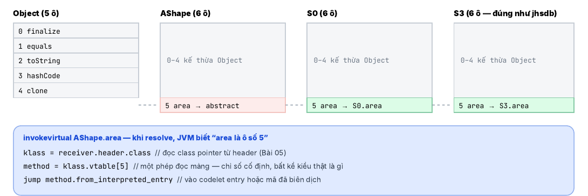
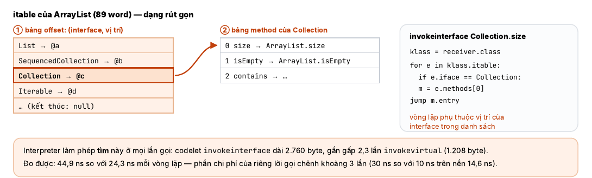
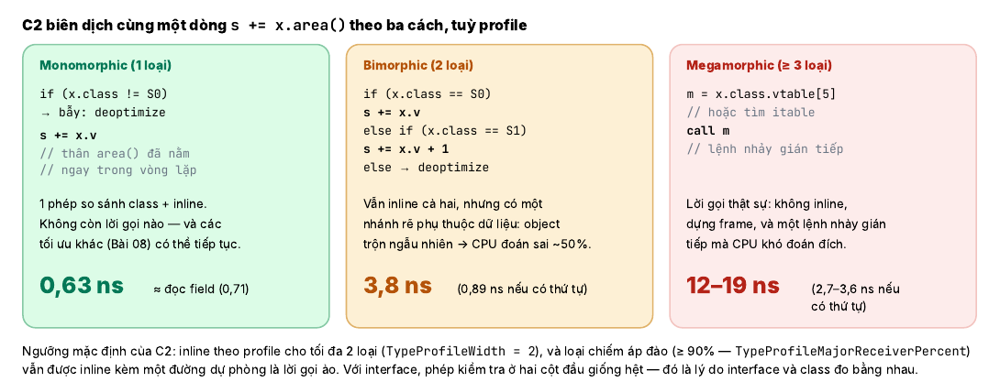
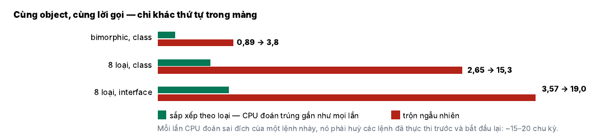
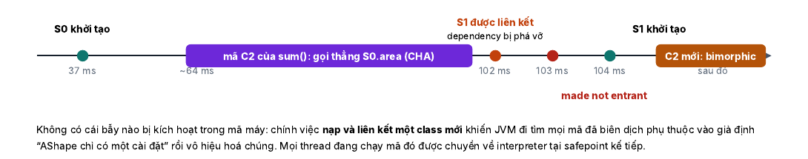
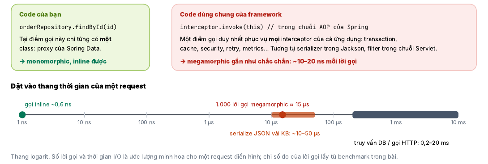

# Bài 06 — Interpreter & cơ chế gọi method



*gọi qua interface có chậm hơn không?*

*Chặng II · Template interpreter · vtable · itable · inline cache · megamorphic · Nền tảng: JDK 25 LTS / 27 · Thí nghiệm: OpenJDK 21*

Chặng II bàn về việc *chạy* code. Bài mở đầu đi từ tầng thấp nhất — mã máy mà interpreter thực thi cho từng lệnh bytecode — tới câu hỏi mà nhiều đội tranh luận: **gọi method qua interface có chậm hơn qua class không?** Câu trả lời đo được thú vị hơn “có” hoặc “không”.

> **MÔI TRƯỜNG & PHƯƠNG PHÁP ĐO** — OpenJDK 21.0.12, Linux x86-64, 2 vCPU. Mã máy của interpreter được lấy bằng `-XX:+PrintInterpreter` rồi dịch ngược bằng thư viện Capstone (môi trường không có hsdis). Cấu trúc nội bộ class đọc bằng `jhsdb clhsdb`. Benchmark là harness tự viết: mỗi kịch bản chạy trong một JVM riêng (fork), 5 vòng warm-up, lấy trung vị 10 vòng, lặp lại 3 fork với các kịch bản có JIT — kết quả giữa các fork lệch dưới 5%. JMH, công cụ chuẩn cho việc này, sẽ được giới thiệu ở [Bài 08](08-toi-uu-jit.md).

> **SAU BÀI NÀY BẠN SẼ**
>
> - Hiểu interpreter thực thi một lệnh bytecode ra sao — ở mức lệnh x86.
> - Giải thích được vtable, itable và vì sao gọi qua interface đắt hơn *khi chưa có JIT*.
> - Đọc được output `-XX:+PrintInlining`: monomorphic, bimorphic, megamorphic, TypeProfile.
> - Biết khi nào kiểu thiết kế nhiều interface/proxy thực sự tốn hiệu năng — và khi nào không.

[Bài 01](01-buc-tranh-toan-canh-jvm.md) cho thấy interpreter chậm hơn JIT khoảng 6,5 lần. Bài này mở interpreter ra tới từng lệnh máy, đi qua cách JVM chọn method để gọi (vtable, itable), rồi xem JIT xoá chi phí đó ra sao — và trường hợp nó không xoá được.



## 1 Câu trả lời trước, giải thích sau

Benchmark: một mảng 16.384 object, mỗi object trả về một số nguyên qua method `area()`; ta cộng dồn kết quả. Cùng một hệ class được gọi theo hai cách — qua kiểu `interface Shape` hoặc qua `abstract class AShape` — và với số loại object khác nhau trong mảng (trộn ngẫu nhiên):

```java
interface Shape { int area(); }
abstract class AShape implements Shape { public abstract int area(); }
final class S0 extends AShape { final int v; public int area() { return v; } }  // …S7

static int viaInterface(Shape[] a) { int s = 0; for (Shape x : a)  s += x.area(); return s; }
static int viaClass(AShape[] a)    { int s = 0; for (AShape x : a) s += x.area(); return s; }
```



*Hình 6.1 — Kết quả đo: có JIT là trung vị của 3 fork; `-Xint` là 1 fork (chạy rất chậm). Hai biểu đồ dùng thang đo khác nhau: với interpreter, mỗi vòng lặp tốn hàng chục ns dù không gọi gì, nên ta so phần chênh so với dòng “đọc field”.*

## 2 Template interpreter: mã máy viết sẵn cho từng opcode

Interpreter của HotSpot không phải một vòng `switch` viết bằng C++. Lúc JVM khởi động, nó **sinh ra mã máy** cho từng opcode — mỗi đoạn gọi là một *codelet* — dựa trên các “template” viết sẵn cho từng kiến trúc CPU. Cờ chẩn đoán `-XX:+PrintInterpreter` in toàn bộ:

```text
$ java -XX:+UnlockDiagnosticVMOptions -XX:+PrintInterpreter -version
Interpreter
code size        =     99K bytes
# of codelets    =    275
avg codelet size =    368 bytes
…
iadd             96 iadd             [0x…492c0, 0x…492e8]    40 bytes
getfield        180 getfield         [0x…4fdc0, 0x…4ffe8]   552 bytes
invokevirtual   182 invokevirtual    [0x…50d20, 0x…511d8]  1208 bytes
invokeinterface 185 invokeinterface  [0x…51780, 0x…52248]  2760 bytes
method entry point (kind = zerolocals)                    976 bytes
method entry point (kind = java_lang_math_sqrt)            16 bytes     ← intrinsic: vài lệnh máy
```

99 KB mã máy cho toàn bộ interpreter. Môi trường không có thư viện hsdis để HotSpot tự dịch ngược, nên ta lấy các byte mã máy từ output trên và dịch bằng thư viện Capstone. Đây là toàn bộ codelet của `iadd`:

```asm
=== iadd  96 iadd  [0x00007f7bd7d492c0, 0x00007f7bd7d492e8]  40 bytes
  +0   mov    eax, dword ptr [rsp]        // lấy toán hạng 1 từ đỉnh stack
  +3   add    rsp, 8                      //   (lối vào khi stack chưa có gì trong thanh ghi)
  +7   mov    edx, dword ptr [rsp]        // lấy toán hạng 2   ← lối vào khi eax đã giữ đỉnh stack
  +10  add    rsp, 8
  +14  add    eax, edx                    // ← việc thật duy nhất của iadd
  +16  movzx  ebx, byte ptr [r13 + 1]     // đọc opcode KẾ TIẾP (r13 = con trỏ bytecode)
  +21  inc    r13                         // tiến con trỏ bytecode
  +24  movabs r10, 0x7f7bef74ed20         // địa chỉ bảng dispatch
  +34  jmp    qword ptr [r10 + rbx*8]     // nhảy thẳng tới codelet của opcode kế tiếp
```



*Hình 6.2 — Cơ chế threaded dispatch của template interpreter. Thanh ghi `r13` luôn trỏ vào bytecode đang chạy; cuối mỗi codelet là đoạn mã nhảy thẳng sang codelet của opcode kế tiếp qua bảng 256 ô.*

## 3 Interpreter tự sửa bytecode: quickening

Dịch ngược codelet của `aload_0` (đẩy `this`) cho một bất ngờ — nó dài 136 byte và có một lệnh **ghi vào chính bytecode**:

```asm
=== aload_0  42 aload_0  136 bytes   (rút gọn)
  +42  movzx  ebx, byte ptr [r13 + 1]     // nhìn trước opcode kế tiếp
  +47  cmp    ebx, 0xb4                   // getfield chưa resolve? → giữ nguyên, lần sau xét lại
  +59  cmp    ebx, 0xd0                   // _fast_igetfield   → ecx = 0xdd (_fast_iaccess_0)
  +72  cmp    ebx, 0xcb                   // _fast_agetfield   → ecx = 0xde (_fast_aaccess_0)
  +85  cmp    ebx, 0xcf                   // _fast_fgetfield   → ecx = 0xdf (_fast_faccess_0)
  +98  mov    ecx, 0xdc                   // còn lại          → _fast_aload_0
  +103 mov    byte ptr [r13], cl          // ← GHI ĐÈ opcode aload_0 trong bytecode của method
```

Đây là kỹ thuật **quickening** (bytecode rewriting). Lần đầu một lệnh như `getfield #7` chạy, interpreter phải resolve tham chiếu ký hiệu ([Bài 02](02-class-file-bytecode.md): chuỗi `#7 → #8.#9 → "count":"I"`) để biết field nằm ở offset nào. Sau khi resolve xong, nó ghi kết quả vào *constant pool cache* và thay opcode bằng một phiên bản “nhanh” nội bộ (`_fast_igetfield`, mã 0xd0) — lần sau không phải kiểm tra gì nữa. Cặp phổ biến `aload_0; getfield` (đọc field của `this` — [Bài 02](02-class-file-bytecode.md) cho thấy đây là cặp lệnh nhiều nhất trong `java.util`) còn được gộp thành một opcode duy nhất `_fast_iaccess_0`.

> **BYTECODE TRONG BỘ NHỚ ≠ FILE .CLASS** — Các opcode 0xcb–0xe4 không tồn tại trong đặc tả JVM; chúng chỉ sống trong bản sao bytecode mà HotSpot giữ trong Metaspace. `javap` đọc file `.class` nên không bao giờ thấy chúng; công cụ đọc bộ nhớ JVM (như `jhsdb`) thì có. Bytecode bạn biên dịch ra là “bản gốc”, còn thứ interpreter thực sự chạy là bản đã được tinh chỉnh dần trong lúc chạy.

## 4 Một lời gọi method trong interpreter

[Bài 02](02-class-file-bytecode.md) đã liệt kê năm lệnh `invoke*`. Với interpreter, mỗi lời gọi gồm bốn việc: **resolve** (chỉ lần đầu — đổi `#7` thành con trỏ tới `Method`, lưu vào constant pool cache), **chọn method** thực sự cần chạy theo kiểu của receiver (dispatch), **dựng frame mới** trên stack, rồi nhảy tới *entry point* của method đó. Entry point phụ thuộc loại method — `-XX:+PrintInterpreter` liệt kê sẵn:

```text
$ java -XX:+UnlockDiagnosticVMOptions -XX:+PrintInterpreter -version | grep "entry point (kind"
method entry point (kind = zerolocals)                 976 bytes   ← method Java thông thường
method entry point (kind = zerolocals_synchronized)   1224 bytes   ← thêm monitorenter khi vào
method entry point (kind = abstract)                   192 bytes   ← chỉ để ném AbstractMethodError
method entry point (kind = java_lang_math_sqrt)         16 bytes   ← intrinsic: không dựng frame
native method entry point (kind = native)             2928 bytes   ← gọi JNI: đổi trạng thái thread
```

Mỗi `Method` trong Metaspace giữ hai con trỏ: *from_interpreted_entry* và *from_compiled_entry*. Khi JIT biên dịch xong một method, JVM chỉ cần trỏ hai con trỏ này sang mã máy mới — mọi lời gọi sau, từ interpreter hay từ mã đã biên dịch, tự động đi vào bản nhanh. Nhờ vậy một stack có thể trộn frame thông dịch và frame biên dịch, như `jhsdb jstack` cho thấy khi chạy benchmark:

```text
$ jhsdb jstack --pid <pid>
"main" #1 prio=5 tid=0x00007ff2d4019630 nid=2152 runnable
   JavaThread state: _thread_in_java
 - Dispatch$S1.area() @bci=0, line=8 (Compiled frame; information may be imprecise)
 - Dispatch.viaInterface(Dispatch$Shape[]) @bci=25, line=23 (Compiled frame)
 - Dispatch.main(java.lang.String[]) @bci=292, line=42 (Interpreted frame)
```

*`main` chỉ được gọi một lần và phần lớn thời gian nằm trong method con, nên nó vẫn chạy bằng interpreter — trong khi hai method nóng bên dưới đã là mã C2.*

## 5 vtable: dispatch qua class bằng một phép tra mảng

Với `invokevirtual`, method thực sự phụ thuộc kiểu thật của object lúc chạy. HotSpot giải quyết bằng **vtable** (virtual method table): mỗi class có một mảng con trỏ tới method, gắn ngay sau cấu trúc `Klass` trong Metaspace. Quy tắc then chốt: **một method luôn giữ cùng chỉ số ở lớp cha và mọi lớp con**. Lớp con override thì ghi đè ô đó; thêm method mới thì nối vào cuối. Đọc bằng `jhsdb clhsdb` trên JVM đang chạy:

```text
$ jhsdb clhsdb --pid <pid>
hsdb> class Dispatch$S3
Dispatch$S3 @0x00007f2df0001450
hsdb> inspect 0x00007f2df0001450
Klass* Klass::_super: Klass @ 0x00007f6c14000c08         ← AShape
int Klass::_vtable_len: 6
int InstanceKlass::_itable_len: 5
…
# làm tương tự cho vài class khác:
java.lang.Object      _vtable_len: 5    _itable_len: 2
java.lang.String      _vtable_len: 5    _itable_len: 20
java.util.HashMap     _vtable_len: 39   _itable_len: 29
java.util.ArrayList   _vtable_len: 55   _itable_len: 89
```



*Hình 6.3 — vtable của hệ class trong benchmark. Mọi lớp trong cây đều đặt `area` ở ô 5, nên chỉ số được tính một lần lúc resolve. Hai lần đọc bộ nhớ và một lệnh nhảy — dispatch qua class rất rẻ. (Object có 5 ô: các method public/protected không final, không static của nó.)*

## 6 itable: vì sao interface khó hơn

Mẹo “cùng chỉ số trong cả cây” không áp dụng được cho interface: một class có thể cài đặt nhiều interface, và cùng một interface được cài đặt bởi những class không hề liên quan, với vtable khác nhau hoàn toàn. Vì thế mỗi class còn có một **itable**: danh sách các interface mà nó cài đặt, mỗi interface trỏ tới một bảng method con.



*Hình 6.4 — Cấu trúc itable và thuật toán tìm (đơn giản hoá từ HotSpot). Với class thật, danh sách interface gồm cả interface kế thừa gián tiếp — `ArrayList` có 89 word itable. Ngoài phần dispatch, cả hai codelet còn chứa mã cập nhật type profile — dữ liệu mà JIT dùng ở mục 7.*

Kết luận cho interpreter là rõ ràng: **gọi qua interface đắt hơn gọi qua class**. Nhưng code nóng chỉ ở trong interpreter vài mili-giây ([Bài 01](01-buc-tranh-toan-canh-jvm.md)). Câu hỏi thật sự là: sau khi JIT vào cuộc thì sao?

## 7 JIT xoá gần hết chi phí: type profile và inline cache

Trong lúc chạy ở interpreter và ở tầng C1 có profile (tầng 3 — [Bài 01](01-buc-tranh-toan-canh-jvm.md)), JVM ghi lại tại *mỗi điểm gọi* (call site) những class nào đã từng là receiver và bao nhiêu lần. Khi C2 biên dịch, nó đọc **type profile** đó và đoán. Cờ `-XX:+PrintInlining` cho thấy quyết định của C2 tại điểm gọi `x.area()` (bci 25) trong `viaClass`:

```text
$ java -XX:+UnlockDiagnosticVMOptions -XX:+PrintInlining Dispatch class 1     # 1 loại
    @ 25   Dispatch$S0::area (5 bytes)   inline
$ java … -XX:+PrintInlining -XX:+PrintCompilation Dispatch class 2           # 2 loại
50   32       4       Dispatch::viaClass (38 bytes)
                              @ 25   Dispatch$S1::area (7 bytes)   inline (hot)
                              @ 25   Dispatch$S0::area (5 bytes)   accessor
                               \-> TypeProfile (281466/565356 counts) = Dispatch$S0
$ java … -XX:+PrintInlining Dispatch class 3                                 # 3 loại
    @ 25   Dispatch$AShape::area (0 bytes)   no static binding
    @ 25   Dispatch$AShape::area (0 bytes)   virtual call
```



*Hình 6.5 — Mã giả của những gì C2 sinh ra cho từng trường hợp (minh hoạ, không phải mã máy thật). “Deoptimize” là cái bẫy: nếu một loại mới xuất hiện, mã máy bị bỏ và thread quay về interpreter (Bài 01, mục 8).*

Đây là câu trả lời chính của bài: **khi một điểm gọi chỉ thấy một hoặc hai loại object, JIT biến lời gọi qua interface thành một phép so sánh class rồi chèn thẳng thân method vào**. Kết quả 0,63 ns — bằng đúng chi phí đọc một field. Interface hay class, ở đây không còn khác biệt nào để đo.

## 8 Megamorphic: kẻ thù thật sự là dự đoán nhánh

Từ ba loại trở lên, C2 từ bỏ inline và sinh lời gọi ảo thật — và thời gian nhảy lên 12–19 ns. Nhưng phần lớn chi phí đó *không* nằm ở phép tra vtable/itable. Thí nghiệm đối chứng: giữ nguyên các object, chỉ **sắp xếp mảng theo loại** (mọi S0 trước, rồi S1…):

```text
$ java Dispatch class 8 400 sorted      →  2.65 ns/call       # ngẫu nhiên: 15.3
$ java Dispatch interface 8 400 sorted  →  3.57 ns/call       # ngẫu nhiên: 19.0
$ java Dispatch class 2 400 sorted      →  0.89 ns/call       # ngẫu nhiên: 3.8
```



*Hình 6.6 — Đo thật, ns mỗi lời gọi. Khi đích của lệnh nhảy lặp lại theo mẫu, bộ dự đoán nhánh của CPU học được và lời gọi ảo chỉ còn ~3 ns. Khi đích ngẫu nhiên, phần lớn thời gian là thời gian CPU “vấp”.*

Hai bài học:

- **Đa hình không đắt; đa hình khó đoán mới đắt.** Phép tra vtable hay itable chỉ góp phần nhỏ. Điều khiến megamorphic chậm là C2 không thể inline (mất luôn các tối ưu sau đó) cộng với lệnh nhảy gián tiếp mà CPU đoán sai.
- **Giữa class và interface, chênh lệch chỉ thực sự hiện ra ở trường hợp megamorphic**: 15,3 so với 19,0 ns ngẫu nhiên — phần tìm itable cộng thêm vài ns. Đó là khác biệt ở mức nano-giây trên một lời gọi vốn đã là trường hợp xấu nhất.

## 9 CHA: khi nạp một class làm vô hiệu mã đã biên dịch

JIT còn một mẹo mạnh hơn type profile: **Class Hierarchy Analysis (CHA)**. Nếu tại thời điểm biên dịch, trong toàn bộ JVM chỉ có *một* lớp con đã được liên kết (linked) cài đặt method đó, C2 có thể gọi thẳng — không cần cả phép so sánh class — và ghi lại một *dependency*: “mã này chỉ đúng khi chưa có lớp con nào khác”. Thí nghiệm: chạy vòng lặp với toàn object S0, rồi đưa S1 vào giữa chừng.

```text
$ java Deopt
pha 1.1: chỉ S0 (monomorphic)            2.32 ns/call       ← đang lên JIT
pha 1.2: chỉ S0 (monomorphic)            0.64 ns/call
pha 1.3: chỉ S0 (monomorphic)            0.67 ns/call
>>> thêm S1 vào nửa mảng
pha 2.1: S0 + S1                         3.08 ns/call
pha 2.2: S0 + S1                         2.96 ns/call
>>> thêm S2..S7
pha 3.1: 8 loại (megamorphic)           15.76 ns/call
$ java -XX:+PrintCompilation -Xlog:class+init:stdout:uptimemillis Deopt | grep …
[37ms] Initializing 'Dispatch$S0'
>>> thêm S1 vào nửa mảng
[102ms] Start class verification for: Dispatch$S1                  ← S1 được liên kết
103   95 %     4       Deopt::sum @ 10 (38 bytes)   made not entrant   ← mã C2 bị vô hiệu ngay
103   96       4       Deopt::sum (38 bytes)   made not entrant
[104ms] Initializing 'Dispatch$S1'                                 ← trước cả khi có object S1 nào
```



*Hình 6.7 — Dòng thời gian dựng lại từ log thật. CHA cho phép tối ưu “lạc quan” mạnh hơn cả type profile, đổi lại là phải biên dịch lại khi hệ class thay đổi.*

> **VÌ SAO ĐIỀU NÀY QUAN TRỌNG** — CHA và deoptimization là lý do Java có thể vừa “mọi method đều ảo theo mặc định” vừa nhanh: JIT tối ưu cho những gì *đang thực sự xảy ra*, và tự sửa khi thực tế thay đổi. Mặt trái: một ứng dụng nạp class muộn (plugin, proxy sinh lúc chạy, lazy init) có thể làm mã nóng bị vô hiệu và biên dịch lại — một nguồn gây giật latency ngắn mà ta sẽ đo ở [Bài 07](07-jit-tiered-compilation.md).

## 10 Điều này có ý nghĩa gì với Spring Boot

Ứng dụng Spring Boot dày đặc interface và lời gọi gián tiếp: repository là interface, service được bọc proxy, mọi request đi qua chuỗi filter và interceptor. Với kết quả đo ở trên, ta có thể trả lời một cách có cơ sở.



*Hình 6.8 — Điểm gọi trong code của bạn thường monomorphic; điểm gọi trong code dùng chung của framework thường megamorphic. Nhưng ngay cả hàng nghìn lời gọi megamorphic vẫn nhỏ hơn một lần truy cập cơ sở dữ liệu cỡ hai bậc độ lớn.*

- **Đừng bỏ interface “vì hiệu năng”.** Thiết kế `OrderService` + `OrderServiceImpl`, hay inject theo interface, không tạo ra chi phí đo được khi chỉ có một cài đặt: điểm gọi monomorphic được inline như gọi trực tiếp (mục 7).
- **Đừng thêm `final` để “giúp JIT”.** CHA đã biết method không bị override (mục 9). `final` có giá trị về thiết kế, không phải tốc độ — và với class bị Spring bọc bằng CGLIB, `final` trên method còn khiến proxy *không chặn được* lời gọi đó (mất `@Transactional`, `@Cacheable` — [Bài 23](23-reflection-proxy.md)).
- **Megamorphic trong framework là bình thường và rẻ so với I/O.** Chi phí proxy thật sự nằm ở *việc* các interceptor làm (mở transaction, kiểm tra quyền), không nằm ở dispatch.
- **Nơi đáng để ý là vòng lặp nóng của chính bạn** xử lý hàng triệu phần tử đa hình: tính giá cho từng dòng đơn hàng qua `PricingRule` có 10 cài đặt, xử lý event theo loại trong batch job. Ở đó, nhóm phần tử theo loại trước khi xử lý (như phiên bản “sorted” ở mục 8) hoặc tách vòng lặp theo loại có thể giảm thời gian vài lần.
- **Profile pollution với lambda và stream**: các điểm gọi bên trong thư viện chuẩn như `Function.apply` trong pipeline của `Stream` được *mọi* lambda trong ứng dụng dùng chung, nên thường megamorphic. Đó là lý do một stream có thể nhanh trong microbenchmark đứng riêng nhưng chậm hơn khi nằm trong ứng dụng thật — và là lý do benchmark phải đo trong bối cảnh gần thật ([Bài 08](08-toi-uu-jit.md)).

## 11 Hiểu lầm, bài tập, thuật ngữ, bài tiếp theo

### Hiểu lầm thường gặp

| Hiểu lầm | Thực tế |
|---|---|
| “Gọi qua interface luôn chậm hơn gọi qua class.” | Chỉ đúng trong interpreter và ở trường hợp megamorphic (vài ns). Khi điểm gọi thấy 1–2 loại, cả hai được inline như nhau (mục 1, 7). |
| “Interpreter là một vòng `switch` lớn.” | HotSpot sinh mã máy cho từng opcode lúc khởi động; mỗi codelet tự nhảy sang codelet kế tiếp (mục 2). |
| “Bytecode chạy y nguyên như trong file .class.” | Interpreter tự ghi đè opcode bằng các phiên bản nhanh nội bộ sau khi resolve (mục 3). |
| “Đánh dấu `final` giúp JIT inline.” | CHA đã biết method có bị override hay không, dựa trên các class đã nạp (mục 9). |
| “Megamorphic chậm vì phải tra bảng.” | Tra bảng rẻ; thứ đắt là mất inline và CPU đoán sai đích nhảy — cùng lời gọi nhanh gấp 4–6 lần khi dữ liệu có thứ tự (mục 8). |
| “Mã đã biên dịch thì giữ nguyên mãi.” | Nạp thêm một class có thể vô hiệu hoá mã đã biên dịch ngay lập tức (mục 9). |

### Bài tập tự làm

> **THỰC HÀNH**
>
> 1. **Tìm ngưỡng.** Chạy benchmark với phân bố lệch: 95% S0, 5% S1, S2, S3. C2 có inline S0 không (gợi ý: `TypeProfileMajorReceiverPercent`)? Đo và kiểm chứng bằng `-XX:+PrintInlining`.
> 2. **Xem interpreter của bạn.** Cài hsdis (hoặc dùng Capstone như trong bài) rồi dịch ngược codelet `getfield` và `invokestatic`. Tìm lệnh đọc constant pool cache.
> 3. **CHA trong thực tế.** Trong ví dụ `Deopt`, nạp S1 bằng `Class.forName("Dispatch$S1")` mà không tạo object nào. Mã của `sum` có bị vô hiệu không? Vì sao?
> 4. **Điểm gọi trong ứng dụng của bạn.** Chạy service ở staging với `-XX:+UnlockDiagnosticVMOptions -XX:+PrintInlining` (log rất dài — ghi ra file), tìm các dòng “virtual call” trong package của bạn. Có vòng lặp nóng nào đa hình không?

### Thuật ngữ của bài

| Thuật ngữ | Nghĩa ngắn gọn |
|---|---|
| Template interpreter | Interpreter gồm các đoạn mã máy (codelet) sinh lúc khởi động cho từng opcode. |
| Dispatch | Chọn đoạn mã sẽ chạy tiếp: opcode kế tiếp (interpreter) hoặc method thực sự cho một lời gọi ảo. |
| Quickening | Thay opcode bằng phiên bản nhanh nội bộ sau khi đã resolve. |
| vtable · itable | Bảng method ảo theo chỉ số cố định trong cây class · bảng method theo từng interface, phải tìm. |
| Call site · type profile | Một vị trí gọi trong bytecode · thống kê các class receiver đã gặp tại đó. |
| Mono/bi/megamorphic | Điểm gọi thấy 1 / 2 / từ 3 loại receiver trở lên. |
| CHA | Class Hierarchy Analysis — tối ưu dựa trên các class đang được nạp, kèm dependency để vô hiệu khi hệ class đổi. |
| Profile pollution | Một điểm gọi dùng chung bởi nhiều nơi nên profile trộn lẫn và trở nên megamorphic. |

> **BÀI TIẾP THEO · BÀI 07** — **JIT & tiered compilation.** Ta đã thấy C2 dùng profile để inline. [Bài 07](07-jit-tiered-compilation.md) theo dõi toàn bộ hành trình: ngưỡng nào kích hoạt từng tầng, hàng đợi biên dịch hoạt động ra sao, OSR và deoptimization ảnh hưởng latency thế nào — và đo hiện tượng “service chậm trong vài phút đầu sau deploy” trên một ứng dụng HTTP thật, cùng các cách warm-up.

### Tài liệu tham khảo

- The Java Virtual Machine Specification — §6.5 (`invokevirtual`, `invokeinterface`: quy tắc chọn method).
- OpenJDK HotSpot — `templateTable_x86.cpp`, `klassVtable.hpp` (vtable/itable), `bytecodes.hpp` (các opcode `_fast_*` nội bộ).
- HotSpot runtime flags: `TypeProfileWidth`, `TypeProfileMajorReceiverPercent`, `PrintInlining`, `PrintInterpreter`.
- Capstone disassembly framework — capstone-engine.org.
