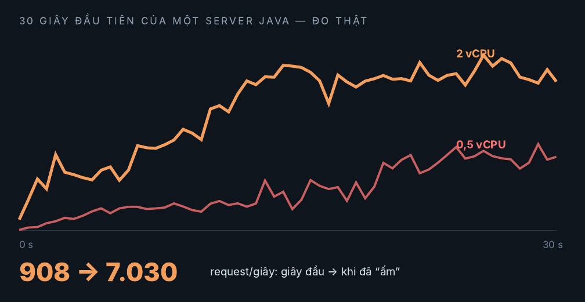
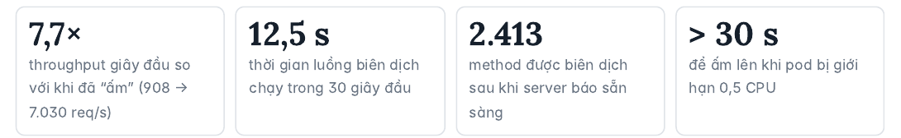
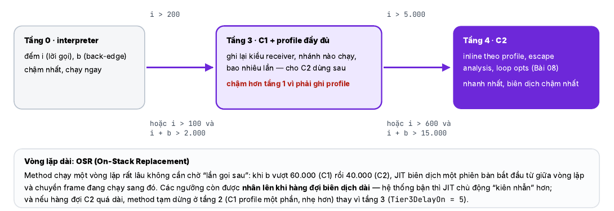
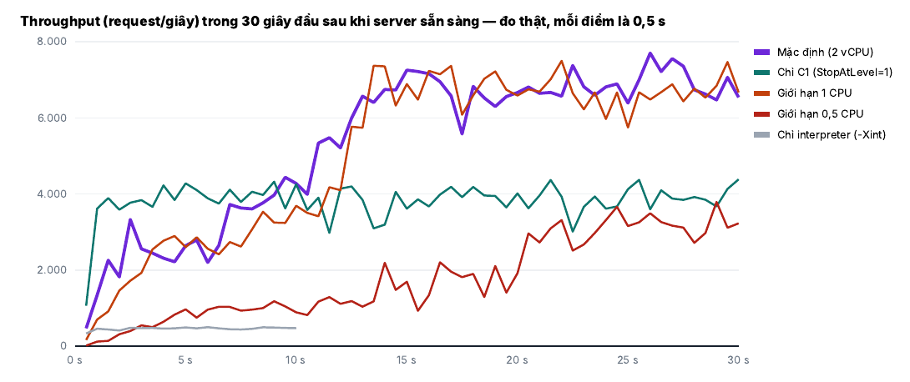
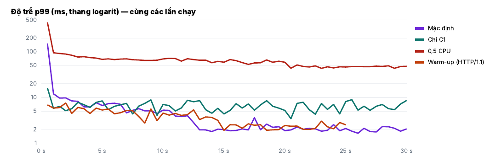
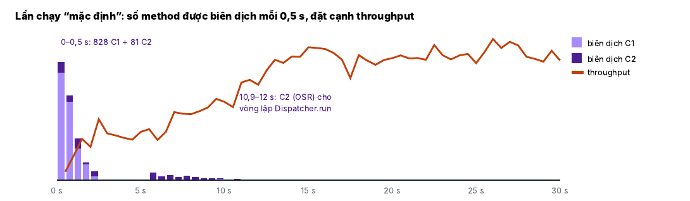
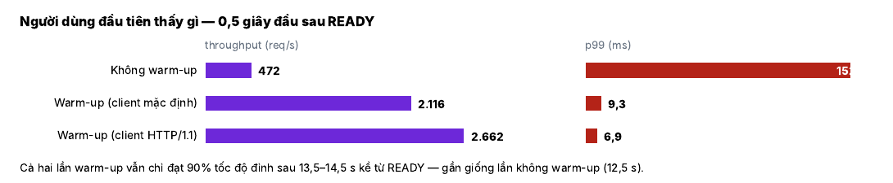
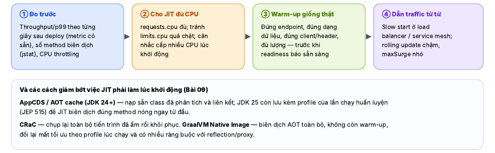

# Bài 07 — JIT & tiered compilation



*JIT & tiered compilation: vì sao service chậm ngay sau khi deploy*

*Chặng II — 5 tầng biên dịch · warm-up · OSR · CPU limit · readiness · Nền tảng: JDK 25 LTS / 27 · Thí nghiệm: OpenJDK 21*

[Bài 06](06-interpreter-goi-method.md) cho thấy JIT có thể biến lời gọi interface thành một phép so sánh. Bài này hỏi: **mất bao lâu để tới được đó**, và người dùng thấy gì trong khoảng thời gian ấy. Ta dựng một HTTP server thật, bắn tải vào nó ngay khi khởi động, và đo từng nửa giây.

> **MÔI TRƯỜNG & PHƯƠNG PHÁP** — OpenJDK 21.0.12, 2 vCPU. Server dùng `com.sun.net.httpserver` có sẵn trong JDK, xử lý một endpoint kiểu REST điển hình (validate bằng regex, tạo 20 DTO với `BigDecimal` / `LocalDateTime`, stream, serialize JSON ~5 KB). Bộ sinh tải viết bằng **Go** — biên dịch sẵn, không có JIT — để mọi hiện tượng warm-up đo được là của server Java, không lẫn với client. 4 kết nối gửi liên tục (closed-loop), thống kê mỗi 0,5 giây. Giới hạn CPU dùng cgroup `cpu.cfs_quota_us` — đúng cơ chế của `resources.limits.cpu` trong Kubernetes.

> **SAU BÀI NÀY BẠN SẼ**
>
> - Biết các ngưỡng đưa một method lên từng tầng, và đọc được log biên dịch.
> - Giải thích được đường cong warm-up của service mình, và vì sao giới hạn CPU làm nó tệ hơn nhiều.
> - Thiết kế warm-up và readiness cho Spring Boot trên Kubernetes dựa trên số đo, không dựa vào cảm giác.

Một JVM vừa khởi động không chạy chậm vì “Java chậm”, mà vì nó chưa biết code nào đáng tối ưu. Bài này đo chính xác quá trình nó học điều đó — và cái giá mà người dùng đầu tiên phải trả.



## 1 Triệu chứng: “vừa deploy xong thì chậm”

Mọi đội vận hành service Java đều từng thấy biểu đồ này: ngay sau một lần deploy hoặc khi autoscaler thêm pod mới, latency p99 vọt lên, error rate do timeout nhích lên, rồi vài phút sau mọi thứ trở lại bình thường mà không ai làm gì. Nguyên nhân thường được đổ cho “cache chưa đầy” hay “connection pool chưa mở” — đôi khi đúng. Nhưng có một nguyên nhân luôn hiện diện: **code đang chạy bằng interpreter và C1, và JIT đang dùng CPU để biên dịch**. [Bài 01](01-buc-tranh-toan-canh-jvm.md) đã thấy nó trong 260 ms của một chương trình nhỏ; một service thật có hàng chục nghìn method nóng cần biên dịch.

## 2 Năm tầng biên dịch và các ngưỡng

[Bài 01](01-buc-tranh-toan-canh-jvm.md) đã giới thiệu 5 tầng (0: interpreter; 1–3: C1; 4: C2). Câu hỏi bây giờ là chính sách: khi nào một method được đẩy lên tầng tiếp theo? HotSpot giữ hai bộ đếm cho mỗi method — *i*: số lần được gọi, *b*: số lần vòng lặp bên trong quay ngược (back-edge) — và so với các ngưỡng:

```text
$ java -XX:+PrintFlagsFinal -version | grep -E "Tier[34].*Threshold|CICompilerCount"
     intx CICompilerCount             = 2         ← 2 vCPU: 1 luồng C1 + 1 luồng C2
     intx Tier3InvocationThreshold    = 200
     intx Tier3MinInvocationThreshold = 100
     intx Tier3CompileThreshold       = 2000
     intx Tier3BackEdgeThreshold      = 60000
     intx Tier4InvocationThreshold    = 5000
     intx Tier4MinInvocationThreshold = 600
     intx Tier4CompileThreshold       = 15000
     intx Tier4BackEdgeThreshold      = 40000
```



*Hình 7.1 — Chính sách tầng của HotSpot (rút gọn, với giá trị mặc định thật của JDK 21). Ngưỡng là cho từng method, nên hàng nghìn method của một service đi qua các tầng vào những thời điểm khác nhau — warm-up là một quá trình rải rác, không phải một sự kiện.*

> **BIÊN DỊCH CHẠY SONG SONG, KHÔNG CHẶN REQUEST** — Khi một method vượt ngưỡng, nó được đưa vào **hàng đợi** của C1 hoặc C2 rồi tiếp tục chạy ở tầng hiện tại; luồng biên dịch (“C1 CompilerThread0”, “C2 CompilerThread0” — [Bài 01](01-buc-tranh-toan-canh-jvm.md), mục 10) làm việc ở nền (`BackgroundCompilation = true`). Request không bị chặn để chờ biên dịch — nhưng luồng biên dịch tiêu thụ CPU mà request đang cần. Số luồng do ergonomics quyết định theo số CPU: 2 vCPU chỉ có 1 luồng C1 và 1 luồng C2.

## 3 Thí nghiệm: 30 giây đầu của một server

Server khởi động, in “READY”, và ngay lập tức bộ sinh tải bắt đầu bắn request. Kịch bản mặc định — không cờ nào, 2 vCPU dùng chung với bộ sinh tải:

```text
$ ./run.sh A_default 0 30           # tên, % CPU (0 = không giới hạn), số giây
t_ms,rps,p50_ms,p99_ms,max_ms
500,472,5.19,151.97,152.47           ← nửa giây đầu: 472 req/s, p99 152 ms
1000,1344,2.30,12.00,19.39
1500,2260,1.10,9.70,27.32
…
5000,2644,1.03,6.66,11.35            ← “bình nguyên” 2.200–3.300 req/s trong vài giây
…
12000,5214,0.61,3.98,8.82
15000,7258,0.45,1.97,5.65            ← tốc độ ổn định ~6.500–7.500 req/s, p99 ~2 ms
30000,6544,0.50,2.05,4.11
$ jstat -compiler <pid>          # chạy ngay trước khi dừng server
Compiled Failed Invalid   Time   FailedType FailedMethod
    2423      0       0   12.52          0
```



*Hình 7.2 — Throughput trong 30 giây đầu với năm cấu hình JVM/CPU khác nhau, cùng server, cùng tải. Đường tím (mặc định) mất ~12,5 giây để đạt 90% tốc độ ổn định. Đường xanh (chỉ C1) nhanh ngay từ giây đầu nhưng dừng ở ~4.000. Đường xám (chỉ interpreter) cho thấy khoảng cách mà JIT phải lấp: gấp ~15 lần.*



*Hình 7.3 — Độ trễ p99 cùng các lần chạy. Ở giây đầu, p99 của cấu hình mặc định là 152 ms — gấp 75 lần lúc đã ấm. Với 0,5 CPU, p99 không bao giờ xuống dưới ~45 ms trong 30 giây; mục 6 giải thích vì sao.*

## 4 Giây đầu tiên: interpreter, profiling và hàng đợi biên dịch

Đếm các dòng `-XX:+PrintCompilation` theo từng nửa giây kể từ lúc server sẵn sàng cho thấy JIT bận rộn tới mức nào:



*Hình 7.4 — Số method được biên dịch mỗi 0,5 s (cột) và throughput (đường cam), lần chạy mặc định. Nửa giây đầu tiên có 909 lần biên dịch; tổng cộng 2.413 sau khi READY. Đợt C2 thứ hai (6–10 s) và các phiên bản OSR muộn (10,9–12 s) trùng với các bước tăng throughput.*

Trong giây đầu, ba thứ cùng kéo tốc độ xuống:

- **Phần lớn code còn chạy bằng interpreter** — chậm gấp ~15 lần (đường xám ở Hình 7.2).
- **Code đã lên C1 lại đang chạy ở tầng 3**, tầng có cài mã ghi profile cho C2 — nhanh hơn interpreter nhiều nhưng chậm hơn hẳn C1 “thuần” (tầng 1).
- **Hai luồng biên dịch giành CPU** với các luồng xử lý request. `jstat` cho biết: 12,5 giây thời gian biên dịch trong 30 giây đầu, phần lớn dồn vào vài giây đầu tiên — trên một máy chỉ có 2 vCPU, chia với cả bộ sinh tải.

## 5 C1 nhanh sớm, C2 nhanh muộn

Đường xanh ở Hình 7.2 (`-XX:TieredStopAtLevel=1`: chỉ dùng C1, không profile, không C2) là một đối chứng thú vị:

| Cấu hình | 0,5 s đầu | p99 0,5 s đầu | Tổng request 10 s đầu | Tổng 30 s | Ổn định |
|---|---|---|---|---|---|
| Mặc định (tiered) | 472 req/s | 152 ms | 28.245 | **160.270** | **~7.000 req/s**, p99 2 ms |
| Chỉ C1 (tầng 1) | **1.064 req/s** | **16 ms** | **37.846** | 114.706 | ~4.000 req/s, p99 6,6 ms |
| Chỉ interpreter | 334 req/s | 127 ms | 4.625 | — | ~470 req/s, p99 19 ms |

Chỉ dùng C1 thắng trong 10 giây đầu — không phải trả phí profile, không chờ C2 — nhưng thua xa khi chạy lâu: không có inline theo profile, escape analysis hay tối ưu vòng lặp của C2 ([Bài 08](08-toi-uu-jit.md)), tốc độ tối đa thấp hơn 43%. Tiered compilation là thoả hiệp giữa hai đầu: hy sinh một chút ở giai đoạn đầu (tầng 3 ghi profile) để đổi lấy mã C2 tốt nhất về lâu dài. Với service chạy hàng giờ hay hàng ngày, đó gần như luôn là lựa chọn đúng; với tác vụ ngắn hạn (CLI, job chạy vài giây, function serverless), `TieredStopAtLevel=1` đáng để đo thử.

## 6 Giới hạn CPU kéo dài warm-up — và còn hơn thế

Cùng thí nghiệm, nhưng đặt server vào cgroup với quota 1 CPU, rồi 0,5 CPU — tương đương `limits.cpu: "1"` và `"500m"`:

| Giới hạn | 0,5 s đầu | p99 0,5 s đầu | Đạt 90% tốc độ đỉnh | Thời gian biên dịch (jstat) | p99 lúc ổn định |
|---|---|---|---|---|---|
| Không giới hạn (2 vCPU chung) | 472 req/s | 152 ms | 12,5 s | 12,5 s | 2,0 ms |
| 1 CPU | 166 req/s | 199 ms | 13,5 s | 13,5 s | 2,0 ms |
| 0,5 CPU | **18 req/s** | **443 ms** | chưa đạt sau 30 s | 22,3 s | **~48 ms** |

Hai hiệu ứng chồng lên nhau:

- **JIT bị bỏ đói.** Cùng khoảng 2.400 lần biên dịch phải xảy ra; với ít CPU hơn, chúng kéo dài ra — và mỗi giây chúng chiếm, request mất giây đó. Ở 0,5 CPU, nửa giây đầu chỉ phục vụ được 18 request.
- **Throttling của CFS.** Quota 0,5 CPU nghĩa là trong mỗi chu kỳ 100 ms, cả tiến trình chỉ được chạy tổng cộng 50 ms CPU. Hết quota — dù có 8 luồng đang chờ — mọi luồng bị đóng băng tới chu kỳ sau. Một request xui xẻo rơi vào lúc bị đóng băng phải chờ tới ~50 ms. Đó là lý do p99 kẹt ở ~48 ms ngay cả khi mọi thứ đã ấm, trong khi p50 vẫn 0,5 ms. ([Bài 13](13-gc-cho-container.md) sẽ quay lại throttling khi chọn GC cho container.)

> **SPRING BOOT · CPU LIMIT NHỎ LÀ BẪY KÉP** — Pod `limits.cpu: 500m` rất phổ biến cho service “nhỏ”. Nhưng một ứng dụng Spring Boot khởi động cần biên dịch hàng chục nghìn method của Spring, Hibernate, Jackson, Tomcat — nhiều hơn nhiều so với server trong thí nghiệm này. Với nửa CPU, giai đoạn warm-up có thể kéo dài nhiều phút, và readiness probe đã báo “sẵn sàng” từ lâu. Thêm nữa, với 0,5 CPU, JVM nhìn thấy “1 CPU” (đo trong cgroup: `Effective CPU Count: 1`) nên chọn Serial GC ([Bài 04](04-runtime-data-areas.md)), trong khi vẫn giữ 2 luồng biên dịch tranh nhau đúng nửa CPU đó. Các lựa chọn: đặt `requests.cpu` vừa đủ và bỏ hoặc nới `limits.cpu` để pod tận dụng CPU dư lúc khởi động; dùng in-place pod resize của Kubernetes (tính năng mới, kiểm tra phiên bản cluster) để cấp nhiều CPU lúc khởi động rồi thu lại; hoặc giảm lượng việc JIT phải làm lúc khởi động (AOT — [Bài 09](09-khoi-dong-nhanh-cds-aot-native.md)).

## 7 Vòng lặp sống mãi và OSR

Server có những method không bao giờ return: vòng lặp của luồng dispatcher (`ServerImpl$Dispatcher.run`, nhận kết nối và chia việc) và vòng lặp của từng luồng worker (`ThreadPoolExecutor.runWorker`). Bộ đếm lời gọi của chúng mãi mãi bằng 1, nên cách duy nhất để chúng lên C2 là OSR — khi bộ đếm back-edge vượt ngưỡng. Lọc log của lần chạy mặc định:

```text
$ grep -E "Dispatcher::run|runWorker" out_A_default.srv | grep " 4 "     # thời gian tính từ lúc READY
t=+10856 ms  2544 % !   4   sun.net.httpserver.ServerImpl$Dispatcher::run @ 196 (619 bytes)
t=+11193 ms  2545 % !   4   sun.net.httpserver.ServerImpl$Dispatcher::run @ 80 (619 bytes)
t=+11579 ms  2547 % !   4   sun.net.httpserver.ServerImpl$Dispatcher::run @ 115 (619 bytes)
t=+11950 ms  2548 % !   4   sun.net.httpserver.ServerImpl$Dispatcher::run @ 0 (619 bytes)
t=+21558 ms  2567 % !   4   java.util.concurrent.ThreadPoolExecutor::runWorker @ 21 (187 bytes)
```

Vòng lặp dispatcher — thứ mà *mọi* request phải đi qua — chỉ có mã C2 sau gần 11 giây và khoảng 30.000 request, với bốn phiên bản OSR khác nhau cho bốn điểm vào vòng lặp (`@ 196`, `@ 80`…). Bước nhảy throughput từ ~4.000 lên ~6.500 req/s ở giây 12–13 xảy ra ngay sau đó. Bài học khái quát: **vòng lặp “sống mãi” — event loop, consumer poll loop, scheduler — là những thứ được tối ưu cuối cùng**, và chúng thường nằm trên đường đi của mọi request.

> **MỘT LỜI THÚ NHẬN VỀ ĐO LƯỜNG** — Ở hai trong số các lần chạy có warm-up (mục 8), bước nhảy cuối cùng đến muộn hơn thời điểm các vòng lặp trên được biên dịch, và log JIT không chỉ ra một sự kiện biên dịch nào trùng khớp. Warm-up là tổng của nhiều cơ chế — JIT, profile, cache của CPU, các cấu trúc dữ liệu tự điều chỉnh kích thước — và không phải bước nào cũng quy được về một dòng log. Khi bạn điều tra warm-up của service thật, hãy kỳ vọng điều tương tự.

## 8 Warm-up có chủ đích: giúp nhiều, nhưng không phải phép màu

Cách xử lý phổ biến nhất: trước khi báo sẵn sàng, tự gửi cho mình một lượng request. Server được sửa để làm đúng điều đó với `-Dwarmup=20000`: dùng `java.net.http.HttpClient` bắn 20.000 request vào chính nó, rồi mới in READY.

```text
$ ./run.sh F_warm 0 30 -Dwarmup=20000
WARMUP 20000 requests in 15931 ms
READY 16105 ms                                     ← sẵn sàng muộn 16 giây
500,2116,1.33,9.27,48.38                         ← nhưng 0,5 s đầu: 2.116 req/s, p99 9 ms
…
9000,2416,1.25,6.44,12.02
15000,6372,0.53,2.05,4.28                          ← tốc độ đỉnh vẫn đến muộn
```



*Hình 7.5 — Warm-up loại bỏ phần tệ nhất (p99 152 ms → 7–9 ms, throughput ×4,5–5,6 ngay giây đầu) nhưng không đưa server tới tốc độ đỉnh ngay lập tức.*

Vì sao 20.000 request warm-up chưa đủ? Ba lý do, cả ba đều kiểm chứng được:

- **Traffic warm-up không giống traffic thật.** Bắt gói tin cho thấy `HttpClient` của JDK mặc định gửi kèm `Connection: Upgrade, HTTP2-Settings` và `Upgrade: h2c` để thử nâng cấp lên HTTP/2, còn client Go gửi một request HTTP/1.1 đơn giản. Server đi những nhánh code khác nhau, và profile mà C2 dùng phản ánh traffic *warm-up*. Ép client warm-up về HTTP/1.1 cải thiện giây đầu từ 2.116 lên 2.662 req/s.

```text
$ nc -l 9777 &  java HC.java              # request đầu tiên của java.net.http.HttpClient
GET /orders?x=1 HTTP/1.1
Connection: Upgrade, HTTP2-Settings
HTTP2-Settings: AAEAAEAAAAIAAAAAAAMAAAAAAAQBAAAAAAUAAEAAAAYABgAA
Upgrade: h2c
User-Agent: Java-http-client/21.0.12.1
$ nc -l 9778 &  ./loadgen …              # request của client Go
GET /orders?customer=cust-99&page=14 HTTP/1.1
User-Agent: Go-http-client/1.1
```

- **Không đủ lượng cho các ngưỡng lớn.** Ngưỡng OSR của C2 là 40.000 back-edge; vòng lặp dispatcher và worker chạy một vòng cho mỗi sự kiện/request. 20.000 request chưa đưa chúng qua ngưỡng — chúng chỉ được biên dịch 1–6 giây sau READY trong các lần warm-up.
- **Chạy warm-up trong cùng tiến trình tốn CPU cho chính client** (JIT cũng phải biên dịch code của `HttpClient`), và phần profile đó không có ích gì cho traffic thật.

## 9 Chiến lược cho Spring Boot trên Kubernetes

Ghép các số đo lại, ta có một khung quyết định thay vì một công thức chung:



*Hình 7.6 — Bốn đòn bẩy, theo thứ tự nên thử. Thí nghiệm ở mục 6 cho thấy đòn bẩy ② thường bị bỏ quên nhưng có tác động lớn nhất với pod nhỏ.*

### Warm-up trước khi Kubernetes gửi traffic

Spring Boot coi ứng dụng là sẵn sàng nhận traffic (`ReadinessState.ACCEPTING_TRAFFIC`, phản ánh qua `/actuator/health/readiness`) khi các `ApplicationRunner` / `CommandLineRunner` đã chạy xong. Web server đã lắng nghe từ trước đó, nên một runner có thể tự gọi HTTP vào chính ứng dụng — đi qua toàn bộ filter, interceptor, Jackson — trong khi probe vẫn báo “chưa sẵn sàng”:

```java
@Component
class HttpWarmup implements ApplicationRunner {
    private final RestClient.Builder builder;
    private final Environment env;
    HttpWarmup(RestClient.Builder builder, Environment env) {
        this.builder = builder; this.env = env;
    }

    @Override public void run(ApplicationArguments args) {
        String port = env.getProperty("local.server.port");  // server đã chạy
        RestClient client = builder.baseUrl("http://localhost:" + port).build();
        // dùng mẫu request thật (đã ẩn dữ liệu nhạy cảm), song song, đủ lượng
        for (int i = 0; i < 5_000; i++) {
            client.get().uri("/orders?customer=warm-{n}&page={p}", i % 997, i % 50)
                  .retrieve().toBodilessEntity();
        }
    }   // trả về → readiness = ACCEPTING_TRAFFIC
}
```

Những điều thí nghiệm dạy ta về warm-up này:

- **Đi qua đúng đường đi thật.** Gọi qua HTTP thay vì gọi thẳng service method, để filter, message converter, exception handler cũng được biên dịch. Dùng dữ liệu đại diện — chuỗi rỗng, giá trị null, nhánh lỗi 400 cũng là profile.
- **Tránh side effect.** Chỉ gọi endpoint đọc; endpoint ghi cần một chế độ “dry-run” hoặc dữ liệu riêng cho warm-up.
- **Đặt giới hạn thời gian** và kiểm tra lại `startupProbe` / `readinessProbe` để warm-up không khiến pod bị giết vì khởi động quá lâu.
- **Đo, đừng đoán.** Warm-up 20.000 request đã cải thiện giây đầu 4,5–5,6 lần nhưng không loại bỏ hết quá trình ấm lên (mục 8). Kết hợp với slow start ở load balancer (AWS ALB, Envoy/Istio đều có tuỳ chọn tăng dần lượng traffic cho endpoint mới) để phần còn lại diễn ra dưới tải nhẹ.

## 10 Bộ đồ nghề quan sát JIT

| Công cụ | Cho biết |
|---|---|
| `-XX:+PrintCompilation` | Mỗi lần biên dịch: thời điểm, tầng, OSR (`%`), synchronized (`s`), có exception handler (`!`), `made not entrant` |
| `-Xlog:jit+compilation=debug` | Cùng thông tin, qua unified logging (ghi file, thêm timestamp) |
| `jstat -compiler <pid>` | Tổng số method đã biên dịch, thất bại, tổng thời gian biên dịch |
| `jcmd <pid> Compiler.queue` | Hàng đợi biên dịch hiện tại — dài nghĩa là JIT đang bị bỏ đói |
| `jcmd <pid> Compiler.codecache` | Mức dùng code cache ([Bài 04](04-runtime-data-areas.md)) |
| `-XX:+UnlockDiagnosticVMOptions -XX:+PrintInlining` | Quyết định inline từng điểm gọi ([Bài 06](06-interpreter-goi-method.md)) |
| JFR: `jdk.Compilation`, `jdk.Deoptimization`, `jdk.CompilerStatistics` | Biên dịch và deoptimization trong production với chi phí thấp — [Bài 25](25-bo-do-nghe-chan-doan.md) |
| Metric của Micrometer: `jvm.compilation.time` | Theo dõi thời gian biên dịch tích luỹ trên dashboard, so với thời điểm deploy |

## 11 Hiểu lầm, bài tập, thuật ngữ, bài tiếp theo

### Hiểu lầm thường gặp

| Hiểu lầm | Thực tế |
|---|---|
| “JIT biên dịch xong trong vài trăm mili-giây đầu.” | Server thí nghiệm có 2.413 lần biên dịch sau READY, kéo dài hơn 10 giây; tốc độ đỉnh đến sau ~12,5 giây (mục 3, 4). |
| “Biên dịch làm request phải chờ.” | Biên dịch chạy nền; request không chờ — nhưng nó lấy CPU của request (mục 2, 6). |
| “Tắt C2 / chỉ dùng C1 cho khởi động nhanh là tốt hơn.” | Nhanh hơn trong ~10 giây đầu, nhưng tốc độ đỉnh thấp hơn 43% (mục 5). |
| “Pod nhỏ chỉ chạy chậm hơn một chút.” | 0,5 CPU: giây đầu chậm 26 lần, warm-up hơn 30 giây, và p99 kẹt ~48 ms vì throttling (mục 6). |
| “Gọi vài request warm-up là đủ.” | Các ngưỡng tính bằng nghìn đến chục nghìn; profile của warm-up phải giống traffic thật (mục 8). |

### Bài tập tự làm

> **THỰC HÀNH**
>
> 1. **Đường cong warm-up của bạn.** Lấy metric throughput và p99 theo từng 10 giây trong 5 phút sau lần deploy gần nhất của một service. Ước lượng thời gian tới 90% tốc độ ổn định.
> 2. **Đếm việc của JIT.** Chạy service ở staging, dùng `jstat -compiler` mỗi 10 giây trong 5 phút đầu dưới tải. Bao nhiêu method được biên dịch, tốn bao nhiêu giây CPU?
> 3. **Đo throttling.** Với pod có `limits.cpu`, đọc `cpu.stat` của cgroup (`nr_throttled`, `throttled_time`, hay metric `container_cpu_cfs_throttled_periods_total`) trong lúc khởi động và lúc tải đỉnh.
> 4. **Thử warm-up có chủ đích** bằng một `ApplicationRunner` như mục 9, rồi so sánh p99 của phút đầu tiên trước và sau.

### Thuật ngữ của bài

| Thuật ngữ | Nghĩa ngắn gọn |
|---|---|
| Tiered compilation | Đi qua các tầng interpreter → C1 (có profile) → C2 theo ngưỡng số lần gọi và back-edge. |
| Back-edge | Lần nhảy ngược về đầu vòng lặp; bộ đếm của nó kích hoạt OSR. |
| OSR | Biên dịch và chuyển một vòng lặp đang chạy sang mã máy mà không cần method return. |
| Compile queue | Hàng đợi method chờ C1/C2; ngưỡng tự tăng khi hàng đợi dài. |
| Warm-up | Giai đoạn từ khi tiến trình nhận traffic tới khi đạt tốc độ ổn định. |
| CFS throttling | Linux tạm đóng băng mọi luồng của cgroup khi dùng hết CPU quota của chu kỳ. |
| Slow start | Load balancer tăng dần lượng traffic cho một instance mới. |

> **BÀI TIẾP THEO · BÀI 08** — **Những phép tối ưu của JIT.** Ta đã thấy C2 nhanh hơn C1 43%. [Bài 08](08-toi-uu-jit.md) mở hộp đen đó: inlining, escape analysis và scalar replacement (khi `new` trong vòng lặp không cấp phát gì), loại bỏ khoá, tách vòng lặp, intrinsic và vector hoá — và cách dùng JMH để đo đúng mà không bị chính JIT đánh lừa.

### Tài liệu tham khảo

- OpenJDK HotSpot — `compilationPolicy.cpp` (chính sách tiered), các cờ `Tier*Threshold`, `Tier3DelayOn`, `Tier3/4LoadFeedback`.
- Spring Boot Reference — “Application Availability” và Kubernetes probes (`/actuator/health/readiness`).
- Linux kernel documentation — CFS Bandwidth Control (`cpu.cfs_quota_us`, `cpu.cfs_period_us`).
- JEP 483, 514, 515 — Ahead-of-Time Class Loading & Linking, Command-Line Ergonomics, Method Profiling.
