# Bài 08 — Những phép tối ưu của JIT

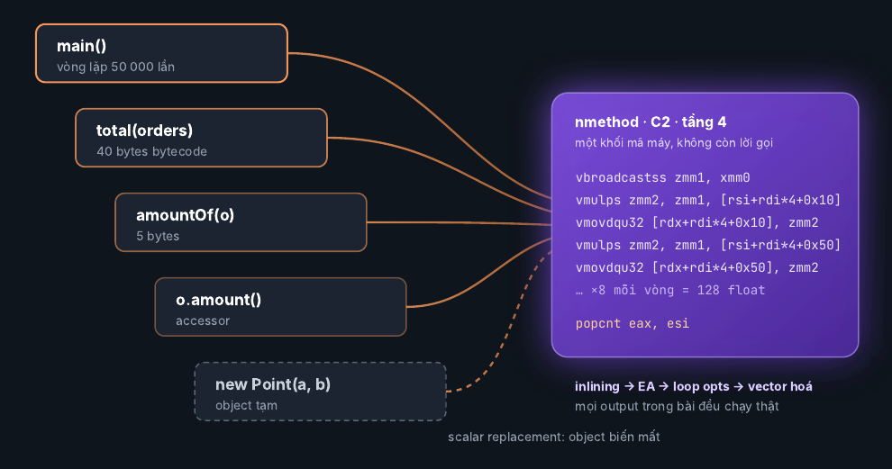

*Inlining, escape analysis, khoá, vector hoá*

*Chặng II · Execution engine — kèm cách đo đúng bằng JMH · Nền tảng: JDK 25 LTS / 27 · Thí nghiệm chạy thật trên OpenJDK 21*

Bài 08 thuộc **Chặng II — Execution engine**. [Bài 01](01-buc-tranh-toan-canh-jvm.md) đã cho thấy JIT biên dịch code nóng thành mã máy; bài này mở chiếc hộp đó ra: C2 *làm gì* với code của bạn, khi nào nó bỏ cuộc, và làm sao đo được hiệu quả mà không tự lừa mình.

> **VỀ CÁC CON SỐ TRONG BÀI** — Mọi output (log inlining, log deoptimization, mã máy x86-64, số lần GC, kết quả JMH) đều lấy từ việc **chạy thật** trên OpenJDK 21.0.12, Linux x86-64, 2 vCPU có AVX-512. Mã máy được lấy bằng `-XX:+PrintAssembly` rồi giải mã bằng `objdump`; JMH 1.37 được build từ mã nguồn. Máy bạn sẽ ra số khác — điều quan trọng là *hình dạng* của kết quả và *tỉ lệ* giữa các phương án. Phần lý thuyết bám theo JDK 25 LTS và JDK 27; chỗ nào hành vi khác giữa các phiên bản đều được ghi chú.

> **ĐỌC TRƯỚC GÌ?** — Bài này dựa trên mục 8 của [Bài 01](01-buc-tranh-toan-canh-jvm.md) (interpreter, C1/C2, tiered compilation, OSR, deoptimization). Những khái niệm cần từ [Bài 06](06-interpreter-goi-method.md) (vtable/itable, `invokeinterface`) và [Bài 07](07-jit-tiered-compilation.md) (profile, tầng biên dịch) được nhắc lại ngắn gọn trong các khung **NHẮC LẠI** ngay chỗ cần dùng.

Inlining, escape analysis, loại bỏ khoá, vòng lặp và vector hoá, intrinsics — xem từng phép biến đổi bằng log và mã máy thật, rồi học cách đo chúng bằng JMH mà không tự lừa mình.

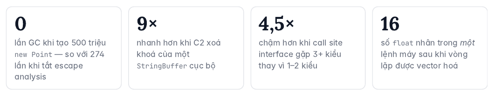

*Bốn con số trên đều đo được trong bài. Đến cuối bài, bạn sẽ giải thích được từng con số — và biết khi nào chúng không xảy ra.*

## 1 Vì sao một dev Spring Boot nên quan tâm

Bạn hiếm khi viết vòng lặp nhân ma trận. Nhưng bạn viết những thứ này mỗi ngày, và mỗi thứ đều kéo theo một câu hỏi mà câu trả lời nằm trong JIT:

- **“Tách thành nhiều method nhỏ cho dễ đọc có làm chậm không?”** — gần như không, nhờ inlining; nhưng có những ngưỡng cụ thể khiến nó thất bại (mục 3).
- **“Strategy pattern với 5 bean implement cùng một interface có chậm hơn `switch` không?”** — tuỳ call site thấy bao nhiêu kiểu; chênh lệch có thể là 4 lần (mục 4).
- **“Tạo DTO, `Optional`, iterator trong vòng lặp có tạo rác cho GC không?”** — đôi khi không tạo gì cả (mục 5).
- **“Có nên đổi hết `StringBuffer` sang `StringBuilder`, hay viết pool object cho đỡ GC?”** — mục 5 và 6 cho thấy JIT đã làm gì trước khi bạn kịp tối ưu tay.
- **“Benchmark của em cho thấy cách A nhanh hơn cách B 1000 lần.”** — gần như chắc chắn là đo sai; mục 10 chỉ ra vì sao và cách đo đúng.

Mục tiêu của bài không phải là để bạn tối ưu vi mô từng dòng code. Ngược lại: hiểu JIT làm được gì giúp bạn **viết code rõ ràng một cách tự tin**, và nhận ra số ít trường hợp thật sự cần can thiệp — thường là những trường hợp bạn vô tình chặn đường JIT.

## 2 C2 nhìn code của bạn như thế nào

> **NHẮC LẠI · BÀI 01, MỤC 8** — Method bắt đầu chạy bằng interpreter. Ở tầng 3, C1 biên dịch nhanh kèm bộ đếm để thu thập **profile**: call site nào gặp kiểu gì, nhánh nào chạy bao nhiêu lần, vòng lặp quay bao nhiêu vòng. Khi đủ nóng, method được gửi cho **C2** (tầng 4) — trình biên dịch tối ưu mạnh, dùng chính profile đó.

Ba ý tưởng chi phối mọi thứ C2 làm, và bạn sẽ gặp lại chúng trong từng mục:

**1. Đơn vị biên dịch là một method gốc cộng với mọi thứ được inline vào nó.** C2 không tối ưu “từng method” — nó tối ưu một vùng code. Một object chỉ có thể được chứng minh là “không thoát” nếu mọi chỗ dùng nó nằm trong vùng đó; một khoá chỉ bị xoá nếu C2 thấy toàn bộ vòng đời của nó. Vì vậy inlining đứng đầu danh sách: nó quyết định C2 *nhìn thấy* được bao nhiêu.

**2. C2 tối ưu một cách lạc quan (speculation).** Nó không cần chứng minh “điều này luôn đúng” — chỉ cần profile cho thấy “điều này luôn đã đúng”. Nhánh chưa từng chạy bị cắt bỏ; call site chỉ gặp một kiểu được gọi thẳng như thể không có đa hình. Mỗi giả định được canh bằng một phép kiểm tra rẻ (*guard*). Nếu guard thất bại, thread rơi vào một **uncommon trap**: mã máy bị huỷ (deoptimization), frame được dựng lại cho interpreter, và method sẽ được biên dịch lại với profile mới.

**3. Phần lớn tối ưu là các phép biến đổi trên một đồ thị.** C2 dịch bytecode sang một biểu diễn trung gian dạng đồ thị (“Sea of Nodes”), nơi dữ liệu và luồng điều khiển đều là cạnh. Các phép như gấp hằng số, khử biểu thức trùng lặp, xoá code chết chạy đi chạy lại nhiều lần trên đồ thị đó, xen giữa các phép lớn hơn.

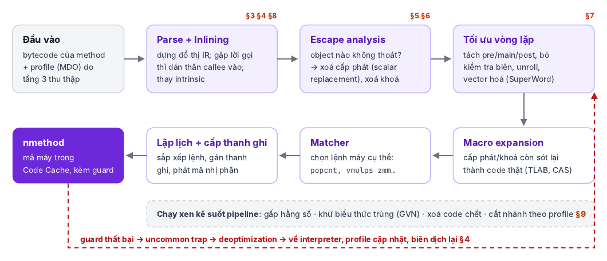

*Hình 8.1 — Bản đồ của bài: các giai đoạn chính khi C2 biên dịch một method. Thứ tự đã được giản lược (inlining còn tiếp tục “gia tăng” sau khi parse; GVN chạy nhiều lượt), nhưng quan hệ phụ thuộc là thật: escape analysis chỉ thấy những gì đã được inline, và vector hoá chỉ áp dụng cho vòng lặp đã được làm sạch kiểm tra biên.*

## 3 Inlining: phép tối ưu mở đường cho mọi phép khác

Inlining là thay một lời gọi method bằng chính thân method đó. Cái lợi trực tiếp — bỏ chi phí gọi (dựng frame, truyền tham số, nhảy, trả về) — thực ra là phần nhỏ. Cái lợi lớn là **mở rộng tầm nhìn**: sau khi thân callee nằm trong caller, mọi phép tối ưu khác được áp dụng trên một vùng lớn hơn. Hằng số từ caller lan vào callee, object tạo ở callee được nhìn thấy trọn vòng đời, khoá lấy ở callee và trả ở caller được ghép cặp.

### Thí nghiệm: xem cây inline

Chương trình mẫu là phiên bản rút gọn của `OrderApp` từ [Bài 01](01-buc-tranh-toan-canh-jvm.md), cố tình thêm một tầng method trung gian:

```java
public class Inlining {
    record Order(long id, double amount) {}

    static double amountOf(Order o) { return o.amount(); }   // 5 byte bytecode

    static double total(Order[] orders) {                     // 40 byte bytecode
        double sum = 0;
        for (Order o : orders) sum += amountOf(o);          // total → amountOf → amount()
        return sum;
    }
    public static void main(String[] args) {               // 50 000 lô × 1 000 Order
        ...  grand += total(batch);  ...
    }
}
```

Cờ `-XX:+PrintInlining` (cần `-XX:+UnlockDiagnosticVMOptions`) in ra quyết định inline cho từng call site. Để thấy riêng C2, tắt tiered compilation:

```text
$ java -XX:-TieredCompilation -XX:+UnlockDiagnosticVMOptions -XX:+PrintInlining Inlining
  bci  method được gọi                       quyết định
  @ 47   Inlining$Order::<init> (15 bytes)     inline (hot)
    @ 1   java.lang.Record::<init> (5 bytes)   inline (hot)
      @ 1   java.lang.Object::<init> (1 bytes) inline (hot)
  @ 60   Inlining::total (40 bytes)           inline (hot)
    @ 27   Inlining::amountOf (5 bytes)       inline (hot)
      @ 1   Inlining$Order::amount (5 bytes)  accessor
```

Thụt lề chính là cây gọi. Bốn tầng `main → total → amountOf → amount()` trở thành *một* khối mã máy; lời gọi `o.amount()` sau cùng chỉ còn là một lệnh đọc field ở offset cố định. Con số sau `@` là vị trí bytecode (bci) của lệnh gọi trong method chứa nó — bạn có thể đối chiếu với `javap -c`.

Chạy lại với tiered compilation mặc định, bạn sẽ thấy thêm những dòng của C1, trong đó có một dòng đáng chú ý:

```text
$ java -XX:+UnlockDiagnosticVMOptions -XX:+PrintInlining Inlining
  @ 27   Inlining::amountOf (5 bytes)   inline
  @ 60   Inlining::total (40 bytes)     callee is too large      ← C1, tầng 3
  ...
  @ 60   Inlining::total (40 bytes)     inline (hot)             ← C2, tầng 4
```

C1 không có profile để biết call site nào nóng, nên nó áp một giới hạn chặt: callee tối đa `MaxInlineSize` = 35 byte bytecode. `total` có 40 byte nên bị từ chối. C2 thì biết call site này chạy 50 000 lần, coi nó là “hot” và nâng giới hạn lên `FreqInlineSize` = 325 byte.

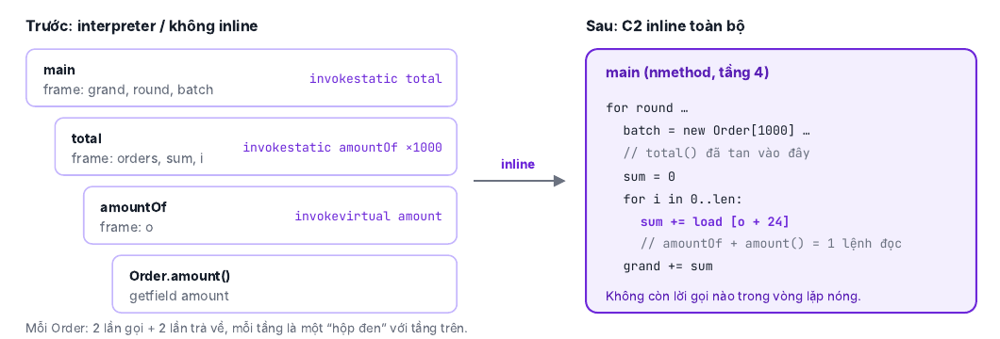

*Hình 8.2 — Inlining gộp bốn tầng gọi thành một vùng code. Đây là tiền đề cho các mục sau: khi mọi thứ nằm trong một vùng, C2 có thể chứng minh object không thoát (mục 5), xoá khoá (mục 6), và tối ưu vòng lặp như một khối (mục 7). Offset `+24` minh hoạ vị trí field `amount` trong object.*

### Khi nào C2 từ chối inline

Inline không miễn phí: mỗi lần dán thân callee là mã máy phình ra, thời gian biên dịch tăng, và Code Cache đầy nhanh hơn. C2 cân nhắc bằng một chuỗi ngưỡng. Hình 8.3 tóm tắt chúng với giá trị mặc định đo được trên JDK 21 x86-64 (`java -XX:+PrintFlagsFinal`):

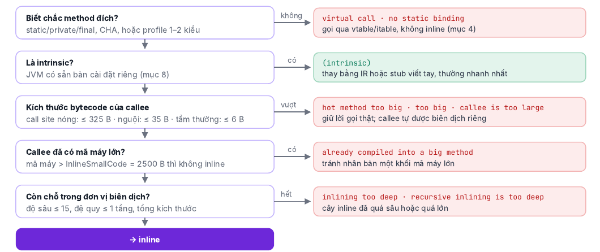

*Hình 8.3 — Các bước C2 xét trước khi inline một call site, với chuỗi thông báo tương ứng trong `-XX:+PrintInlining`. Các ngưỡng là cờ JVM: `MaxInlineSize`, `FreqInlineSize`, `MaxTrivialSize`, `InlineSmallCode`, `MaxInlineLevel`, `MaxRecursiveInlineLevel`. Giá trị `MaxInlineLevel` được nâng từ 9 lên 15 ở JDK 14.*

Hai điều rút ra cho code hằng ngày. Thứ nhất, giới hạn tính theo **bytecode**, không theo số dòng: một dòng Java có lambda, nối chuỗi hay autoboxing có thể sinh vài chục byte. Thứ hai, method nhỏ được lợi gấp đôi — chúng vừa dễ được inline, vừa không làm phình caller. Tách method để code dễ đọc gần như luôn an toàn; một method “thần thánh” 500 dòng thì ngược lại.

> **CÁI BẪY ÍT NGƯỜI BIẾT: METHOD TRÊN 8000 BYTE** — Một method có bytecode dài hơn 8000 byte (`HugeMethodLimit`) **không bao giờ được JIT biên dịch** khi `DontCompileHugeMethods` bật (mặc định) — nó chạy bằng interpreter suốt đời tiến trình. Thủ phạm thường gặp: code sinh tự động (mapper, parser, máy trạng thái), một `switch` khổng lồ, hay một method khởi tạo dữ liệu tĩnh. Thí nghiệm với một method sinh tự động dài 12 203 byte: mặc định nó không bao giờ xuất hiện trong `-XX:+PrintCompilation`, và 2 triệu lần gọi mất **17,2 giây**. Thêm `-XX:-DontCompileHugeMethods`, C2 biên dịch nó ở mili-giây thứ 44 và cùng khối lượng việc chỉ còn **2,0 giây** — chênh 8,5 lần. Cách sửa đúng là tách method (hoặc cấu hình code generator), không phải tắt cờ trong production.

## 4 Gọi qua interface: mono-, bi-, megamorphic và deoptimization

> **NHẮC LẠI · BÀI 06** — Lời gọi `d.apply(p)` qua interface được biên dịch thành `invokeinterface`. Interpreter phải tìm method đích lúc chạy qua bảng method của class (vtable cho class, itable cho interface) — vài lần đọc bộ nhớ và một lần nhảy gián tiếp. Bản thân việc tra bảng không đắt; cái đắt là **sau lời gọi gián tiếp, C2 không biết code nào sẽ chạy, nên không inline được**.

C2 giải bài toán này bằng profile. Ở tầng 3, mỗi call site ảo có một **type profile** ghi lại tối đa `TypeProfileWidth` = 2 kiểu receiver kèm số lần gặp, và một bộ đếm “kiểu khác”. Dựa vào đó, C2 sinh một trong ba dạng code:

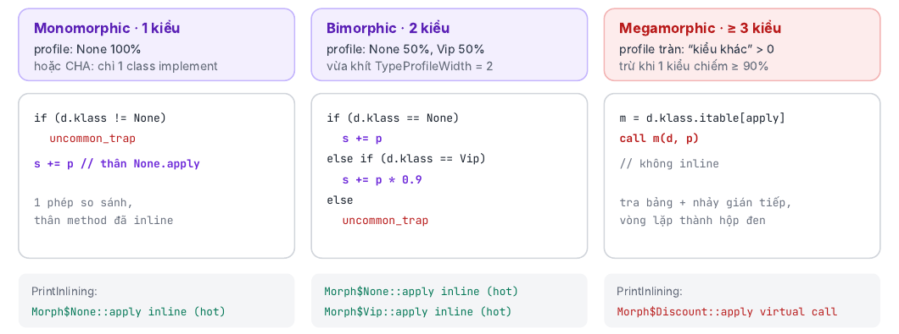

*Hình 8.4 — Ba dạng code C2 sinh ra cho cùng một dòng `s += d.apply(p)`, tuỳ profile của call site. Hàng cuối là log `-XX:+PrintInlining` thật của chương trình `Morph` chạy với 1, 2 và 4 loại `Discount`. Guard dạng “so sánh con trỏ class” rẻ đến mức gần như miễn phí.*

Hai biến thể đáng biết. **Class Hierarchy Analysis (CHA)**: nếu tại thời điểm biên dịch chỉ có một class được nạp implement method đó, C2 inline luôn mà không cần guard — đổi lại, nó đăng ký một “phụ thuộc”: khi một class con mới được nạp, mọi nmethod dựa vào giả định này bị huỷ. Và khi call site megamorphic nhưng **một kiểu chiếm ít nhất 90%** (`TypeProfileMajorReceiverPercent`), C2 vẫn inline kiểu đó với một guard, phần còn lại đi đường gọi ảo.

### Đo bằng JMH

Benchmark gọi `apply` trên một mảng 1024 phần tử, xen kẽ 1 đến 4 loại `Discount` (2 fork × 5 lần đo):

```text
$ java -jar benchmarks.jar MorphBench
Benchmark            (kinds)  Mode  Cnt  Score    Error  Units
MorphBench.checkout        1  avgt   10  0.713 ±  0.027  us/op
MorphBench.checkout        2  avgt   10  0.758 ±  0.059  us/op
MorphBench.checkout        3  avgt   10  3.181 ±  0.215  us/op
MorphBench.checkout        4  avgt   10  3.310 ±  0.226  us/op
```

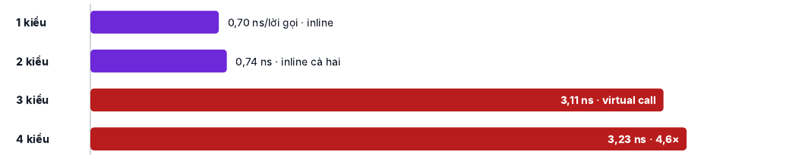

*Hình 8.5 — Thời gian cho một lời gọi `apply` (điểm JMH chia cho 1024). Bước nhảy nằm giữa 2 và 3 kiểu — đúng chỗ type profile tràn. Thân method ở đây chỉ là một phép nhân, nên chi phí gọi ảo chiếm gần hết; với một thân method thật (truy vấn DB, gọi HTTP), chênh lệch vài nano-giây này biến mất trong nhiễu.*

### Khi giả định sai: deoptimization

Điều gì xảy ra nếu C2 đã biên dịch với giả định “chỉ có `None`”, rồi một `Vip` xuất hiện? Chương trình `Deopt` chạy 2000 vòng chỉ với `None`, sau đó chuyển sang `Vip`. Ghép `-XX:+PrintCompilation` với log deoptimization:

```text
$ java -XX:+PrintCompilation -Xlog:deoptimization=debug Deopt
ms  id  tầng  method
33  10    4   Deopt::price (10 bytes)                      ← C2, giả định: d luôn là None
37  14    4   Deopt::phase (33 bytes)
>>> bắt đầu dùng Vip
[0.067s] cid=10 level=4 Deopt.price(...) trap_bci=2 class_check maybe_recompile
66  10    4   Deopt::price (10 bytes)   made not entrant
67  20    4   Deopt::price (10 bytes)                      ← biên dịch lại, giờ là bimorphic
```

Đọc từng phần: `trap_bci=2` trỏ đúng vào lệnh `invokeinterface` trong `price`; lý do `class_check` nghĩa là guard so sánh class đã thất bại; hành động `maybe_recompile` báo JVM rằng profile đã thay đổi. Toàn bộ chu trình — trap, huỷ mã máy, quay về interpreter, biên dịch lại — diễn ra trong khoảng một mili-giây.

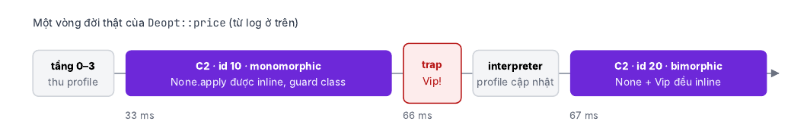

*Hình 8.6 — Deoptimization không phải lỗi, mà là cơ chế cho phép C2 tối ưu lạc quan. Cái giá là một khoảng ngắn chạy chậm (interpreter) và một lần biên dịch lại. Nó chỉ trở thành vấn đề khi lặp đi lặp lại — JVM giới hạn số lần recompile cho mỗi method và sẽ chuyển sang dạng code thận trọng hơn.*

### Profile bị “nhiễm”

Một chi tiết hay bị bỏ qua: profile được ghi **theo vị trí bytecode trong method**, không theo người gọi. Một method tiện ích dùng chung — `mapper.apply(x)` trong một helper, hay một vòng `for (Rule r : rules)` trong lớp cơ sở — gom kiểu từ mọi nơi gọi nó. Kể cả khi mỗi nơi gọi chỉ dùng một kiểu, call site bên trong helper vẫn thấy tất cả và trở thành megamorphic. Ở mục 10 bạn sẽ thấy hiện tượng này làm một benchmark cho ra ba kết quả khác nhau.

> **SPRING BOOT: INTERFACE Ở KHẮP NƠI — CÓ ĐÁNG LO?** — Phần lớn code framework (resolver tham số, converter, chuỗi interceptor của AOP, serializer của Jackson) là megamorphic, và điều đó **không sao**: vài nano-giây mỗi lời gọi so với hàng mili-giây I/O. Chỉ đáng để ý khi chính code của bạn có **vòng lặp nóng với thân method rất nhỏ** đi qua nhiều implementation — ví dụ một engine tính giá duyệt hàng triệu dòng qua `List<PricingRule>`. Khi đó, cân nhắc gom phần tử theo kiểu để mỗi vòng lặp chỉ gặp một kiểu, rồi đo lại bằng JMH với *đúng phân bố kiểu thực tế*.
>
> Một hệ quả khác: sau deploy, đường code hiếm (một feature flag, một loại đơn hàng lạ) xuất hiện lần đầu sẽ gây deoptimization đúng lúc hệ thống đang nóng. Đó là một nguồn của những gợn latency nhỏ “không rõ nguyên nhân” trong vài phút đầu — JFR ghi lại chúng bằng sự kiện `jdk.Deoptimization` (mục 11).

## 5 Escape analysis: khi `new` không cấp phát gì

Đây là câu hỏi của bài trong lộ trình series: *vì sao `new` một object trong vòng lặp nóng đôi khi không cấp phát gì cả?* Câu trả lời có hai bước. **Escape analysis** (EA) là phép phân tích: với mỗi object được tạo trong đơn vị biên dịch, C2 xác định nó có “thoát” ra ngoài hay không. **Scalar replacement** là phép biến đổi dựa trên kết quả đó: nếu object không thoát, C2 xoá hẳn việc cấp phát và thay các field của nó bằng những biến cục bộ bình thường — nằm trong thanh ghi.

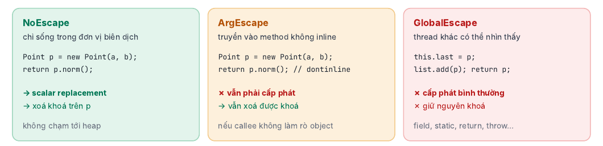

*Hình 8.7 — Ba mức “thoát” mà C2 gán cho mỗi object. Lưu ý chữ đơn vị biên dịch: “return ra khỏi method” không có nghĩa là thoát nếu method đó đã được inline vào caller — khi ấy object vẫn nằm trong cùng một vùng code.*

### Thí nghiệm: 500 triệu object, 0 lần GC

```java
static double work(double a, double b) {
    Point p = new Point(a, b);   // 12 B header + 2 × 8 B field → 32 B sau căn lề
    return p.norm();             // p không đi đâu khác
}
// main: gọi work() 500 000 000 lần, heap tối đa 256 MB
```

Nếu mọi object đều thật sự được cấp phát, chương trình sẽ tạo 500 triệu × 32 byte = **16 GB** rác. Đếm số lần GC với `-Xlog:gc`:

| Cấu hình | Số lần GC | Thời gian | Giải thích |
|---|---:|---:|---|
| Mặc định | **0** | 5,9 s | Point không thoát, bị scalar-replace |
| `-XX:-DoEscapeAnalysis` | 274 | 7,3 s | mỗi vòng thật sự cấp phát 32 B |
| Cấm inline `Point::norm` ¹ | 274 | 7,1 s | EA vẫn bật, nhưng `p` phải được truyền vào `norm()` thật → ArgEscape |
| Hai nhánh `new` gộp vào một biến ² | 274 | — | JDK 21 không scalar-replace được |

¹ `-XX:CompileCommand=dontinline,Escape$Point::norm` · ² `Point p = flip ? new Point(b, a) : new Point(a, b);`

Dòng thứ ba là bằng chứng gọn nhất cho ý tưởng ở mục 2: **EA chỉ mạnh bằng inlining**. Chỉ cần cấm inline một method nhỏ 23 byte, toàn bộ lợi ích biến mất. JMH với GC profiler (`-prof gc`) cho cùng kết luận, đo theo từng phép:

```text
$ java -jar benchmarks.jar EscapeBench -prof gc
Benchmark                               Mode  Cnt  Score     Error  Units
EscapeBench.ea_on                       avgt   10  2.179 ±   0.037  ns/op
EscapeBench.ea_on:gc.alloc.rate.norm    avgt   10  ≈ 10⁻⁵            B/op
EscapeBench.ea_off                      avgt   10  5.930 ±   0.287  ns/op
EscapeBench.ea_off:gc.alloc.rate.norm   avgt   10  32.000 ±   0.001  B/op
```

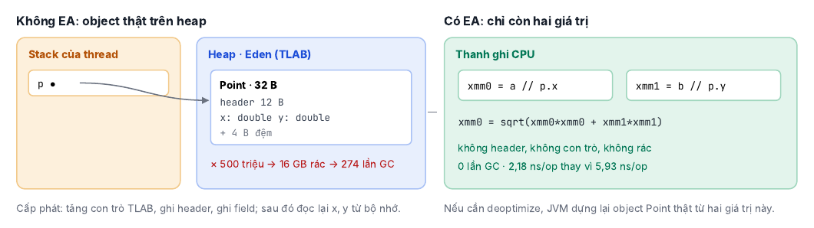

*Hình 8.8 — Scalar replacement không phải “cấp phát trên stack” (HotSpot không làm điều đó): object biến mất hoàn toàn, các field trở thành biến cục bộ. Thông tin để dựng lại object được giữ trong metadata của nmethod, phòng khi deoptimization xảy ra giữa chừng.*

### Những gì làm EA thất bại

- **Không inline được nơi dùng object** — method quá lớn, call site megamorphic, hoặc đơn vị biên dịch đã đầy (mục 3, 4).
- **Object bị lưu ra ngoài**: gán vào field, static, phần tử của một mảng/collection không bị scalar-replace; bị `return` ra khỏi đơn vị biên dịch; bị ném làm exception.
- **Gộp nhánh**: hai lệnh `new` khác nhau đổ vào cùng một biến. Các bản JDK sau 21 bắt đầu xử lý được một phần trường hợp này; trên JDK 21, nó chặn EA như đã đo.
- **Mảng** chỉ được scalar-replace khi kích thước là hằng số nhỏ (≤ 64 phần tử, `EliminateAllocationArraySizeLimit`) và mọi truy cập dùng chỉ số xác định lúc biên dịch.
- **Code chưa tới C2**: interpreter và C1 không làm EA, nên trong giai đoạn warm-up mọi `new` đều là cấp phát thật.

> **SPRING BOOT: ĐỪNG VIẾT OBJECT POOL** — Những object tạm như DTO trung gian, `Optional`, iterator của `for-each`, lambda bắt biến, hay `record` làm khoá ghép thường **không tồn tại** trên đường nóng — với điều kiện chuỗi gọi được inline. Pool object chủ động phá mọi điều đó: object trong pool là GlobalEscape theo định nghĩa, sống lâu, bị đẩy lên Old Gen, và còn cần đồng bộ hoá. Muốn biết chỗ nào thật sự cấp phát, đừng đoán: dùng JFR (`jdk.ObjectAllocationSample`) hoặc async-profiler ở chế độ `alloc` trên ứng dụng thật, hoặc `-prof gc` trong JMH ([Bài 25](25-bo-do-nghe-chan-doan.md)).
>
> Ngoại lệ hay gặp: Stream API dài với lambda lớn. Cả pipeline phải inline được thì các object trung gian mới biến mất, và đó là thứ dễ vượt ngưỡng kích thước nhất. Đừng vì thế mà bỏ Stream — chỉ cần biết rằng ở vòng lặp nóng nhất, một vòng `for` thường cho EA cơ hội tốt hơn.

## 6 Loại bỏ và gộp khoá

Mỗi khối `synchronized` chưa bị tranh chấp vẫn có giá: ít nhất một lệnh nguyên tử (CAS) khi vào và ra, kèm rào cản bộ nhớ ngăn CPU sắp xếp lại lệnh. Biased locking — cơ chế từng làm khoá không tranh chấp gần như miễn phí — đã bị gỡ bỏ ở JDK 18, nên phần việc giảm chi phí khoá giờ dồn cả lên JIT. C2 có hai vũ khí:

- **Lock elision** (loại bỏ khoá): nếu EA chứng minh object bị khoá không thể bị thread khác nhìn thấy, khoá vô nghĩa và bị xoá.
- **Lock coarsening** (gộp khoá): nhiều khối `synchronized` liên tiếp trên *cùng* một object được gộp thành một — kể cả khi object đó có thể dùng chung giữa các thread.

```java
static int work(int a, int b) {
    StringBuffer sb = new StringBuffer();   // mọi method public đều synchronized
    sb.append(a); sb.append('-'); sb.append(b);  // 3 lần khoá/mở
    return sb.length();                       // lần thứ 4
}   // main gọi work() 200 triệu lần
```

Tắt lần lượt từng cơ chế (mỗi cấu hình chạy hai lần, lấy kết quả ổn định):

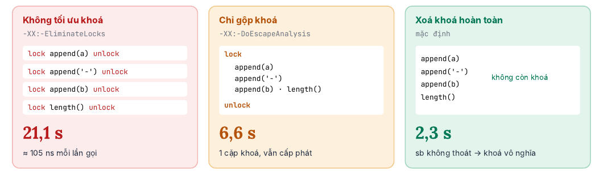

*Hình 8.9 — Ba mức tối ưu khoá trên cùng chương trình (200 triệu lần gọi). Tắt cả `-XX:-DoEscapeAnalysis` lẫn `-XX:-EliminateLocks` cho 21,3 s — gần như trùng cột đầu, xác nhận phần chênh giữa cột 1 và 2 đến từ việc gộp khoá, thứ không cần EA. JMH đo riêng cột đầu được 102,9 ns/op, khớp với 105 ns ở đây.*

Cùng benchmark đo bằng JMH còn cho thấy một điều thú vị: `StringBuilder` (không có khoá) chạy 13,8 ns/op, trong khi `StringBuffer` đã được xoá khoá có lúc chỉ **8 ns/op** — nhanh hơn — nhưng có lúc lại 16 ns hay thậm chí 108 ns. Vì sao cùng một code lại có ba kết quả là chủ đề của mục 10.

> **LIÊN HỆ BÀI 17** — Lock elision chỉ áp dụng khi C2 chứng minh được object không bị chia sẻ. Với khoá thật sự dùng chung (một `synchronized` service method, một cache), chi phí phụ thuộc vào cơ chế khoá của HotSpot: stack-locking truyền thống ở JDK 21, cơ chế lightweight locking mới là mặc định từ JDK 23, và từ JDK 24 (JEP 491) virtual thread không còn bị “ghim” khi nằm trong `synchronized`. [Bài 17](17-synchronized-monitor.md) sẽ mổ xẻ từng trạng thái khoá trong mark word.

## 7 Vòng lặp: unrolling, bỏ kiểm tra biên, vector hoá

Vòng lặp là nơi chương trình dành phần lớn thời gian, nên C2 đầu tư vào đó nhiều nhất. Lấy một vòng lặp đơn giản nhất có thể:

```java
static void scale(float[] a, float[] b, float k) {
    for (int i = 0; i < a.length; i++) b[i] = a[i] * k;
}   // mảng 8192 phần tử, gọi 5 triệu lần
```

Theo đặc tả Java, mỗi vòng phải: kiểm tra `i < a.length`, kiểm tra `a` và `b` khác null, kiểm tra `i` nằm trong biên của *cả hai* mảng (để ném `ArrayIndexOutOfBoundsException` đúng chỗ), đọc, nhân, ghi, tăng `i`. Phần lớn số đó là kiểm tra. C2 tái cấu trúc vòng lặp thành nhiều phần để dồn các kiểm tra ra ngoài:

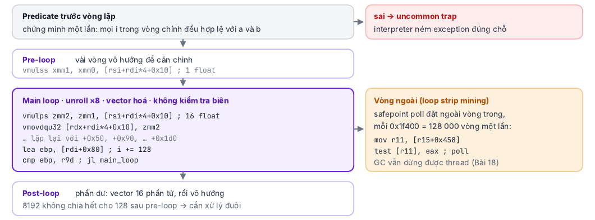

*Hình 8.10 — Cấu trúc thật của `scale()` sau khi C2 biên dịch, đọc từ mã máy (`-XX:+PrintAssembly` + `objdump`). `+0x10` là kích thước header của mảng (16 byte) — phần tử `a[0]` bắt đầu ngay sau đó. Ngưỡng 128 000 vòng giữa hai lần poll là để vòng lặp dài không giữ GC chờ quá lâu.*

Ba phép biến đổi phối hợp ở đây. **Range check elimination**: thay vì kiểm tra biên mỗi vòng, C2 tính trước khoảng chỉ số an toàn và kiểm tra một lần ở predicate; vòng chính không còn lệnh so sánh nào với độ dài mảng. **Loop unrolling**: thân vòng được nhân bản (ở đây 8 lần) để giảm chi phí tăng biến đếm và nhảy, đồng thời cho CPU nhiều lệnh độc lập để chạy song song. **Vector hoá** (C2 gọi là *SuperWord*): các bản sao cạnh nhau làm cùng một phép trên các phần tử liền kề được gộp thành một lệnh SIMD.

### Vector hoá: 16 phép nhân trong một lệnh

CPU của máy thử nghiệm hỗ trợ AVX-512 (`UseAVX=3`, `MaxVectorSize=64`): một thanh ghi `zmm` rộng 512 bit chứa được 16 `float`. Hình 8.11 so sánh hai cách dùng thanh ghi; ngay sau đó là mã máy thật của vòng chính trong hai trường hợp.

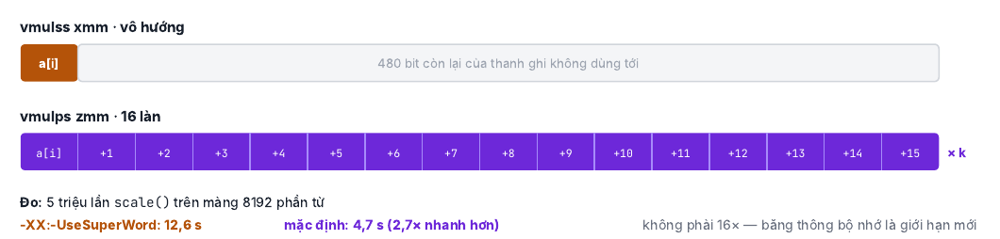

*Hình 8.11 — Cùng một lệnh nhân, nhưng một bên dùng 1 làn, một bên dùng 16 làn của thanh ghi 512 bit. Tốc độ không tăng 16 lần vì vòng lặp giờ bị giới hạn bởi tốc độ đọc/ghi mảng (2 × 32 KB mỗi lần gọi), không còn bởi phép nhân.*

```text
$ java -XX:-UseSuperWord ...   # vòng chính khi KHÔNG vector hoá: unroll ×8, mỗi lệnh 1 float
  vmulss xmm2,xmm0,DWORD PTR [rsi+r10*4+0x10]
  vmovss DWORD PTR [rdx+r10*4+0x10],xmm2
  vmulss xmm1,xmm0,DWORD PTR [rsi+r10*4+0x14]      ← bước 4 byte = 1 float
  ...   (8 cặp, tới +0x2c)

$ java ...                     # mặc định: unroll ×8, mỗi lệnh 16 float
  vbroadcastss zmm1,xmm0                              ← chép k ra 16 làn
  vmulps zmm2,zmm1,ZMMWORD PTR [rsi+rdi*4+0x10]
  vmovdqu32 ZMMWORD PTR [rdx+rdi*4+0x10],zmm2
  vmulps zmm2,zmm1,ZMMWORD PTR [rsi+rdi*4+0x50]   ← bước 64 byte = 16 float
  ...   (8 cặp, tới +0x1d0) → 128 float mỗi vòng
```

### Khi nào vòng lặp không được vector hoá

SuperWord là phép biến đổi khá kén. Trên JDK 21, những thứ sau thường khiến nó bỏ cuộc:

- **Cộng dồn số thực** (`s += a[i]` với `float` / `double`): Java yêu cầu cộng đúng thứ tự từ trái sang phải, mà đổi thứ tự cộng số thực thì đổi kết quả làm tròn. Mã máy thật của vòng `sumF` chỉ có 18 lệnh `vaddss` vô hướng. Đáng ngạc nhiên hơn, vòng `sumI` cộng dồn `int` — vốn không có ràng buộc này — trên máy thử nghiệm cũng chỉ được unroll 16 lần với lệnh `add` thường: C2 của JDK 21 đánh giá một vòng lặp *chỉ* có phép cộng dồn là không đáng vector hoá. Hỗ trợ reduction được cải thiện liên tục ở các bản JDK sau, nên hãy kiểm tra trên đúng phiên bản bạn chạy.
- **Phụ thuộc giữa các vòng**: `a[i] = a[i-1] + x` — vòng sau cần kết quả vòng trước.
- **Rẽ nhánh trong thân vòng**, lời gọi method không inline được, truy cập không liền kề (`a[idx[i]]`).
- **Dữ liệu không nằm liền nhau**: `List<Integer>` là mảng các con trỏ tới object `Integer` rải rác trên heap — không có gì để nạp 16 phần tử một lúc. Vector hoá chỉ có ý nghĩa với mảng kiểu nguyên thuỷ.

Khi cần vector hoá chắc chắn thay vì trông chờ vào trình biên dịch, Java có **Vector API** (`jdk.incubator.vector`) để viết tường minh các phép SIMD. Nó vẫn ở trạng thái incubator qua nhiều phiên bản liên tiếp (lần thứ 10 ở JDK 25), chờ Project Valhalla trước khi chính thức hoá — dùng được, nhưng phải bật `--add-modules jdk.incubator.vector` và chấp nhận API có thể đổi.

## 8 Intrinsics: khi JVM “gian lận” có chủ đích

Một số method của JDK được JVM nhận diện theo tên và **không bao giờ chạy bằng bytecode của chính nó** khi đã biên dịch. Thay vào đó, C2 (và cả C1, interpreter với một số method) dùng một bản cài đặt viết sẵn: một nút IR đặc biệt ánh xạ thẳng xuống lệnh máy, hoặc một đoạn mã máy viết tay (stub) tận dụng phần mở rộng của CPU. Những method này gọi là **intrinsic**.

```text
$ java -XX:+UnlockDiagnosticVMOptions -XX:+PrintIntrinsics Intrinsics
  @ 24   java.lang.Integer::bitCount (53 bytes)   (intrinsic)
  @ 34   java.lang.Math::sqrt (5 bytes)           (intrinsic)
```

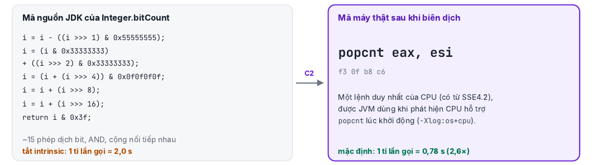

*Hình 8.12 — Bytecode của `Integer.bitCount` vẫn tồn tại (interpreter có thể chạy nó), nhưng C2 bỏ qua hoàn toàn và phát một lệnh `popcnt`. Mã máy lấy từ method `pop(int)` được cấm inline để dễ cô lập; thời gian đo với `-XX:DisableIntrinsic=_bitCount_i`.*

Danh sách intrinsic có vài trăm mục và thay đổi theo từng phiên bản JDK lẫn từng loại CPU. Những nhóm có ảnh hưởng thật tới ứng dụng web:

| Nhóm | Method tiêu biểu | Bạn gặp ở đâu |
|---|---|---|
| Sao chép, so sánh mảng | `System.arraycopy`, `Arrays.copyOf`, `Arrays.equals` / `mismatch` | `ArrayList` tăng kích thước, buffer I/O |
| Chuỗi | `String.equals`, `compareTo`, `indexOf`; `hashCode` vector hoá (từ JDK 21) | key của `HashMap`, parse JSON, routing URL |
| Mật mã & băm | AES (AES-NI), AES-GCM, SHA-1/2 (SHA-NI), MD5 | TLS, ký JWT (HMAC-SHA256), băm mật khẩu |
| Mã kiểm tra, mã hoá | `CRC32`, `CRC32C`, `Base64` | Kafka record batch (CRC32C), JWT, payload nhị phân |
| Toán, bit | `Math.sqrt` / `fma` / `abs`, `bitCount`, `numberOfLeadingZeros` | tính toán, cấu trúc dữ liệu bitmap |
| Nội bộ runtime | `Unsafe` / `VarHandle` CAS, `Thread.currentThread`, `Object.getClass` | mọi thứ trong `java.util.concurrent` |

> **SPRING BOOT: HIỆU NĂNG MIỄN PHÍ KHI NÂNG JDK** — Phần lớn intrinsic mới đi kèm một phiên bản JDK mới, không cần sửa dòng code nào. Một service làm TLS, ký JWT, đọc Kafka và parse JSON được hưởng lợi trực tiếp — đó là một lý do thực tế để không “đóng băng” ở JDK cũ. Hai hệ quả ngược lại cũng đáng nhớ: **đừng tự viết lại** thứ JDK đã có (một vòng `for` copy mảng hay một hàm `bitCount` “tối ưu” tự chế sẽ mất intrinsic), và **cùng một image có thể chạy khác nhau** trên hai loại máy chủ trong cùng cluster nếu tập lệnh CPU khác nhau. `java -Xlog:os+cpu -version` trong pod cho biết JVM thấy những gì.

## 9 Những phép tối ưu thầm lặng khác

Ngoài các phép lớn ở trên, C2 chạy liên tục một loạt phép nhỏ. Riêng lẻ thì không có gì ấn tượng; cộng lại, chúng là phần “dọn dẹp” khiến các phép lớn có hiệu lực.

| Phép tối ưu | Ý tưởng | Ví dụ thực tế |
|---|---|---|
| **Gấp hằng số** | Tính trước lúc biên dịch những gì phụ thuộc toàn hằng số; lan hằng số qua inlining. | `static final boolean DEBUG = false;` → mọi `if (DEBUG)` biến mất khỏi mã máy. |
| **Khử biểu thức trùng** (GVN) | Hai phép tính giống hệt nhau trên cùng đầu vào chỉ tính một lần. | `p.x * p.x + p.y * p.y` chỉ đọc mỗi field từ bộ nhớ một lần. |
| **Xoá code chết** | Kết quả không ai dùng và không có tác dụng phụ → bỏ. | Chính là cái bẫy làm benchmark sai ở mục 10. |
| **Cắt nhánh theo profile** | Nhánh chưa từng chạy được thay bằng uncommon trap (lý do `unstable_if`). | Nhánh xử lý lỗi hiếm không làm phình mã máy của đường chính. |
| **Null check ngầm** | Không phát lệnh kiểm tra null; nếu truy cập vào trang nhớ số 0, tín hiệu `SIGSEGV` được JVM chuyển thành `NullPointerException`. | Đọc field gần như không tốn thêm gì. Nếu NPE xảy ra thường xuyên, C2 biên dịch lại với kiểm tra tường minh. |
| **Đưa bất biến ra khỏi vòng lặp** | Phép tính không đổi giữa các vòng được dời lên trước vòng. | `vbroadcastss` trong Hình 8.10 nằm ngoài vòng chính. |
| **Khử boxing** | `Integer.valueOf` rồi `intValue` ngay sau đó được rút gọn (`EliminateAutoBox`). | Code generic dùng `Integer` trên đường nóng ít tốn hơn bạn nghĩ — khi được inline. |

> **FIELD `FINAL` KHÔNG PHẢI LÚC NÀO CŨNG LÀ HẰNG SỐ** — C2 chỉ tin tuyệt đối vào field `static final`. Field *instance* `final` bình thường thì không (`TrustFinalNonStaticFields = false`), vì reflection và deserialization vẫn có thể ghi đè chúng. Ngoại lệ là field của `record` và hidden class, vốn được JVM tin cậy. Vì vậy cấu hình đọc một lần lúc khởi động mà muốn được gấp hằng số thì nên nằm ở `static final` — còn bean `@ConfigurationProperties` thì không hưởng phép này, và điều đó hoàn toàn bình thường.

## 10 Đo đúng bằng JMH

Mọi thứ ở các mục trước đều là lý do khiến việc tự đo hiệu năng bằng một vòng `for` và `System.nanoTime()` gần như luôn sai: JIT thay đổi code trong lúc bạn đo, xoá những gì không ai dùng, gấp sẵn những gì tính trước được, và quyết định khác nhau giữa các lần chạy. Hãy xem một “benchmark” điển hình:

```java
static int mix(int h) {                                   // 16 vòng trộn bit: ~48 phép tính
    for (int i = 0; i < 16; i++) { h ^= h >>> 13; h *= 0x5bd1e995; h ^= h >>> 15; }
    return h;
}
// "benchmark" tự viết
long t0 = System.nanoTime();
for (int i = 0; i < 100_000_000; i++) mix(x);              // vứt kết quả
System.out.printf("%.3f ns/op%n", (System.nanoTime() - t0) / 1e8);
```

```text
$ java Naive
lần 1: 0.079 ns/op
lần 2: 0.075 ns/op
lần 3: 0.000 ns/op
lần 4: 0.000 ns/op
lần 5: 0.000 ns/op
```

0,079 ns là chưa tới một phần năm chu kỳ CPU — không thể có thật với 48 phép tính nối tiếp nhau. Ở hai lần đầu, gần như toàn bộ 7,9 ms là thời gian chờ JIT: ngay khi vòng lặp được biên dịch bằng OSR (mục 8 [Bài 01](01-buc-tranh-toan-canh-jvm.md)), `mix` — với kết quả không ai dùng — bị xoá, rồi vòng lặp trống bị xoá theo. Từ lần 3, không còn gì để chạy. Kết luận “`mix` miễn phí” là kết luận về trình biên dịch, không phải về code của bạn.

### JMH làm gì khác

**JMH** (Java Microbenchmark Harness) do chính nhóm phát triển HotSpot viết, để chống lại đúng những hiện tượng này. Bạn viết method có `@Benchmark`; JMH sinh code bao quanh nó và điều phối việc chạy:

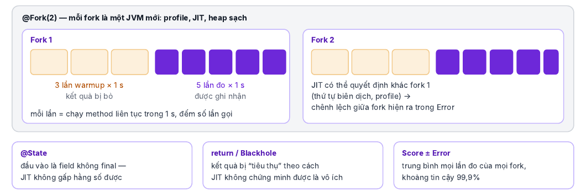

*Hình 8.13 — Cấu trúc một lần chạy JMH với cấu hình dùng trong bài. Fork tách biệt các benchmark khỏi nhau (profile của benchmark này không “nhiễm” sang benchmark kia) và cho thấy độ dao động giữa các JVM — thứ mà một lần chạy duy nhất che giấu hoàn toàn.*

### Thí nghiệm: ba cách sai, hai cách đúng

```java
@State(Scope.Thread)
public class Pitfalls2 {
    int x = 0x12345;                      // field thường: JIT phải đọc lúc chạy
    static final int C = 0x12345;         // hằng số: JIT biết giá trị lúc biên dịch

    @Benchmark public void baseline() { }
    @Benchmark public void wrong_deadCode()  { mix(x); }               // vứt kết quả
    @Benchmark public int  wrong_constFold() { return mix(C); }        // đầu vào là hằng
    @Benchmark public int  right_return()    { return mix(x); }
    @Benchmark public void right_blackhole(Blackhole bh) { bh.consume(mix(x)); }
}
```

```text
$ java -jar benchmarks.jar Pitfalls2
Benchmark                  Mode  Cnt   Score   Error  Units
Pitfalls2.baseline         avgt   10   0.384 ± 0.042  ns/op
Pitfalls2.wrong_deadCode   avgt   10   0.401 ± 0.059  ns/op
Pitfalls2.wrong_constFold  avgt   10   0.413 ± 0.083  ns/op
Pitfalls2.right_return     avgt   10  15.262 ± 1.899  ns/op
Pitfalls2.right_blackhole  avgt   10  15.078 ± 0.735  ns/op
```

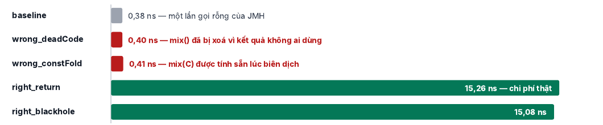

*Hình 8.14 — Hai benchmark “sai” đo được đúng bằng một lần gọi rỗng: chúng đo cái khung của JMH chứ không phải `mix()`. Ngay cả JMH cũng không cứu được bạn nếu bạn tự tay vứt kết quả hoặc đưa hằng số vào.*

> **MỘT VÍ DỤ KINH ĐIỂN KHÔNG CÒN ĐÚNG** — Mẫu JMH nổi tiếng về dead code dùng `Math.log(x)`. Trên OpenJDK 21 x86-64 trong bài, phiên bản “vứt kết quả” của nó vẫn tốn 7,8 ns — bằng phiên bản đúng — vì `Math.log` được cài bằng một stub mã máy mà C2 không coi là xoá được. Đó là may mắn, không phải bảo đảm: một JDK khác, CPU khác có thể xoá nó. Bài học không phải là “cái gì bị xoá”, mà là **luôn so với baseline** — nếu kết quả gần bằng một lần gọi rỗng, bạn đang đo khoảng không.

### Một benchmark, ba kết quả

Quay lại `LockBench.buffer_elided` ở mục 6. Lần chạy đầu tiên (2 fork) cho `57.9 ± 79.4 ns/op` — sai số lớn hơn cả giá trị. Nhìn từng fork: fork 1 ổn định quanh 8 ns, fork 2 bắt đầu ở 23 ns rồi nhảy lên 107 ns ngay lần warmup thứ hai. Chạy lại 16 fork với `-XX:+LogCompilation` và so sánh lần biên dịch C2 cuối cùng của mỗi fork:

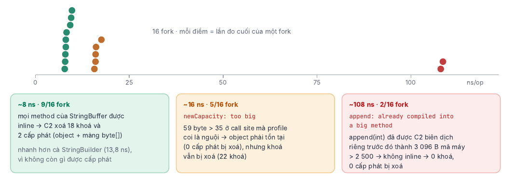

*Hình 8.15 — Cùng một mã nguồn, cùng một JVM, ba mức hiệu năng chênh nhau 13 lần. Nguyên nhân đọc được trực tiếp từ `-XX:+LogCompilation`: các quyết định inline phụ thuộc vào thời điểm từng method trở nên nóng và vào profile của `AbstractStringBuilder` — thứ bị mọi đoạn code khác trong JVM (kể cả của JMH) dùng chung.*

Không có fork nào “sai”: cả ba đều là hành vi hợp lệ của C2. Nếu chỉ chạy một lần, bạn sẽ công bố 8 ns hoặc 108 ns với cùng sự tự tin. Đây là lý do JMH mặc định chạy 5 fork, và vì sao cột `Error` lớn là tín hiệu cần đọc từng fork chứ không phải nhiễu cần bỏ qua.

### Quy tắc khi viết benchmark

- **Luôn dùng kết quả**: `return` nó, hoặc đưa vào `Blackhole.consume` nếu có nhiều giá trị.
- **Đầu vào từ `@State`**, là field không `final`; khởi tạo dữ liệu trong `@Setup`, không trong method đo.
- **Không tự viết vòng lặp** bên trong `@Benchmark` để “cho đủ lâu” — JMH đã làm, và vòng lặp của bạn sẽ bị unroll, vector hoá, gộp kết quả.
- **Ít nhất 2–3 fork**, đủ warmup; đọc cột `Error`, và khi nó lớn, xem kết quả từng fork.
- **Có baseline** và dùng `@Param` cho kích thước dữ liệu — hành vi ở 10 phần tử và 10 000 phần tử thường khác hẳn.
- **Dùng profiler của JMH** để biết *vì sao*: `-prof gc` (byte cấp phát mỗi phép), `-prof perfasm` (mã máy nóng nhất, cần `perf` và hsdis), `-prof jfr`.

```bash
# Tạo project (Maven) và chạy
$ mvn archetype:generate -DarchetypeGroupId=org.openjdk.jmh \
      -DarchetypeArtifactId=jmh-java-benchmark-archetype -DarchetypeVersion=1.37
$ mvn package && java -jar target/benchmarks.jar MorphBench -f 3 -prof gc
# Gradle: plugin me.champeau.jmh, chạy ./gradlew jmh
```

> **SPRING BOOT: JMH ĐO CÁI GÌ, KHÔNG ĐO CÁI GÌ** — JMH dành cho **đoạn code nóng, nhỏ, tách được**: một mapper, một validator, cấu hình `ObjectMapper`, một regex, cách xây cache key. Nó không dành cho latency của một endpoint — việc đó cần load test (Gatling, k6, wrk) trên ứng dụng đang chạy, đọc percentile. Nếu buộc phải đo một bean thật, dựng `ApplicationContext` trong `@Setup(Level.Trial)` và lấy bean ra, đừng đưa việc khởi động context vào phép đo.
>
> Và hiện tượng ở Hình 8.15 không chỉ xảy ra trong benchmark: hai pod chạy cùng một image có thể có mã máy khác nhau cho cùng một method, vì thứ tự request khác nhau lúc warm-up. Nếu một pod “chậm bí ẩn” và restart thì hết, đây là một ứng viên — kiểm chứng bằng JFR (mục 11) trước khi kết luận.

## 11 Quan sát JIT trong ứng dụng thật

Các cờ dùng trong bài phần lớn là cờ chẩn đoán: an toàn, nhưng in ra rất nhiều và chủ yếu hợp cho thí nghiệm. Với ứng dụng thật, JFR là đường chính:

| Muốn biết | Trong thí nghiệm | Trên production |
|---|---|---|
| Method nào được biên dịch, khi nào | `-XX:+PrintCompilation` | JFR `jdk.Compilation`; `jcmd <pid> Compiler.queue` |
| Quyết định inline | `-XX:+UnlockDiagnosticVMOptions -XX:+PrintInlining` | JFR `jdk.CompilerInlining` (tắt mặc định — rất nhiều sự kiện) |
| Deoptimization | `-Xlog:deoptimization=debug` | JFR `jdk.Deoptimization` |
| Mã máy | `-XX:+PrintAssembly` + thư viện hsdis; JMH `-prof perfasm` | async-profiler, chế độ hiển thị assembly |
| Toàn bộ quá trình | `-XX:+LogCompilation` → mở bằng JITWatch | — |
| Code cache | `-XX:+PrintCodeCache` | `jcmd <pid> Compiler.codecache`; JFR `jdk.CodeCacheFull` |
| Ép hành vi để thử | `-XX:CompileCommand=dontinline\|inline\|exclude\|print,Class::method` | ″ |

Ví dụ: ghi JFR với cấu hình `profile` cho chương trình `Deopt` ở mục 4, rồi in sự kiện deoptimization:

```text
$ java -XX:StartFlightRecording:filename=deopt.jfr,settings=profile Deopt
$ jfr print --events jdk.Deoptimization deopt.jfr
jdk.Deoptimization {
  compiler = "c2"
  method = Deopt.price(Deopt$Discount, double)
  lineNumber = 7
  bci = 2
  instruction = "invokeinterface"
  reason = "class_check"
  action = "maybe_recompile"
  stackTrace = [
    Deopt.price(Deopt$Discount, double) line: 7
    Deopt.phase(Deopt$Discount, int) line: 10
    Deopt.main(String[]) line: 16
  ]
}
```

Cùng một thông tin như log ở mục 4, nhưng kèm stack trace và lấy được từ một tiến trình đang chạy mà không cần khởi động lại với cờ chẩn đoán. Trên một service thật, đếm sự kiện này theo method trong 10 phút đầu sau deploy cho bạn biết JIT đang “đổi ý” ở đâu. [Bài 25](25-bo-do-nghe-chan-doan.md) sẽ dựng quy trình đầy đủ với JFR và async-profiler.

## 12 Ghép lại: một trang để nhớ cả bài

Mỗi phép tối ưu, điều kiện để nó xảy ra, thứ phá nó, cách nhìn thấy nó, và con số đo được trong bài:

| Phép tối ưu | Cần gì | Bị phá bởi | Quan sát | Đo trong bài |
|---|---|---|---|---|
| Inlining | đích gọi xác định; callee ≤ 325 B (nóng) / 35 B (nguội) | method lớn, > 8000 B không biên dịch; mã máy callee > 2500 B | `PrintInlining` | 4 tầng gọi → 1; method 12 KB: 8,5× chậm |
| Đa hình | call site gặp 1–2 kiểu, hoặc 1 kiểu ≥ 90% | ≥ 3 kiểu; profile nhiễm từ helper dùng chung | `virtual call`; JFR | 0,70 → 3,2 ns/lời gọi (4,6×) |
| Deopt | — | giả định sai: kiểu mới, nhánh mới, class mới | `jdk.Deoptimization` | trap → biên dịch lại trong ~1 ms |
| Escape analysis | object không thoát khỏi vùng đã inline | không inline được; lưu ra field; gộp nhánh | `-prof gc`, đếm GC | 0 vs 274 GC; 0 vs 32 B/op |
| Khoá | object không thoát (xoá); khoá liền kề (gộp) | object dùng chung; callee không inline | thời gian, LogCompilation | 21,1 s → 6,6 s → 2,3 s |
| Vòng lặp | mảng nguyên thuỷ, thân vòng đơn giản | phụ thuộc giữa vòng, rẽ nhánh, cộng dồn số thực | `PrintAssembly` | 12,6 s → 4,7 s; 16 float/lệnh |
| Intrinsic | dùng đúng API của JDK; CPU hỗ trợ | tự viết lại; CPU cũ | `PrintIntrinsics`, `os+cpu` | `bitCount` → `popcnt`: 2,6× |
| Đo lường | JMH, nhiều fork, có baseline | vứt kết quả; đầu vào hằng; 1 lần chạy | so với baseline, xem từng fork | 0,000 ns (sai) vs 15,3 ns; 8/16/108 ns |

Và nếu cần tóm cả bài trong một đoạn: C2 tối ưu một vùng code chứ không phải một method, nên **inlining** quyết định mọi thứ khác nhìn thấy được bao nhiêu. Nó tối ưu một cách lạc quan theo profile, canh mỗi giả định bằng một guard rẻ và sẵn sàng **deoptimize** khi sai. Trong vùng đã inline, object không thoát bị **scalar-replace** thay vì cấp phát, khoá trên object đó bị **xoá**, vòng lặp được dỡ bỏ kiểm tra biên, **unroll** và **vector hoá**, còn những method quen thuộc của JDK được thay bằng **intrinsic**. Tất cả những điều đó khiến đo hiệu năng bằng tay gần như luôn sai — và khiến JMH với nhiều fork, có baseline, là điểm khởi đầu tối thiểu.

## 13 Hiểu lầm thường gặp, bài tập, bài tiếp theo

### Hiểu lầm thường gặp

| Hiểu lầm | Thực tế |
|---|---|
| “Tách nhiều method nhỏ làm chậm vì chi phí gọi.” | Method nhỏ là thứ dễ inline nhất; sau inline, lời gọi không còn tồn tại (mục 3). Method khổng lồ mới là vấn đề. |
| “Gọi qua interface luôn chậm hơn gọi trực tiếp.” | Với 1–2 kiểu, C2 inline như gọi trực tiếp. Chỉ call site gặp ≥ 3 kiểu mới phải gọi ảo — và chỉ đáng kể khi thân method rất nhỏ trong vòng lặp nóng (mục 4). |
| “`new` trong vòng lặp luôn tạo rác, nên dùng object pool.” | Object không thoát thường không được cấp phát (0 GC cho 500 triệu object). Pool biến chúng thành object sống lâu, dùng chung — tệ hơn cho GC (mục 5). |
| “JVM cấp phát object trên stack.” | HotSpot không làm vậy. Nó xoá hẳn object (scalar replacement) và giữ field trong thanh ghi; nếu không xoá được thì cấp phát trên heap bình thường. |
| “`StringBuffer` luôn chậm hơn `StringBuilder` vì có khoá.” | Khi object cục bộ và được inline, khoá bị xoá hoàn toàn. Vẫn nên dùng `StringBuilder` — vì nó nói đúng ý định, và vì “khi được inline” không phải lúc nào cũng đúng (Hình 8.15). |
| “Đo bằng `System.nanoTime()` quanh một vòng `for` là đủ.” | JIT có thể xoá chính thứ bạn đo: 0,000 ns/op cho 48 phép tính (mục 10). |
| “Chạy benchmark một lần là có con số.” | Cùng code có thể cho 8, 16 hoặc 108 ns tuỳ quyết định của JIT trong từng JVM. Cần nhiều fork và đọc `Error`. |
| “Field `final` được JIT coi là hằng số.” | Chỉ `static final` (và field của `record`, hidden class). Field instance `final` thông thường thì không. |
| “Java không tận dụng được SIMD.” | C2 tự vector hoá vòng lặp trên mảng nguyên thuỷ (16 `float`/lệnh với AVX-512); Vector API cho phép viết tường minh. |

### Bài tập tự làm (khoảng 45 phút)

> **THỰC HÀNH**
>
> 1. **Ép inlining thất bại.** Chạy `Inlining` với `-XX:FreqInlineSize=30`, rồi với `-XX:MaxInlineLevel=1`. Thông báo nào xuất hiện trong `PrintInlining`? Thời gian chạy thay đổi bao nhiêu?
> 2. **Escape một phần.** Trong `Escape.work()`, thêm `if ((i & 0xFFFFF) == 0) last = p;` (với `last` là field static) — tức là chỉ một trên một triệu object thoát. Số lần GC là bao nhiêu? Vì sao? (Gợi ý: C2 làm phân tích theo kiểu “tất cả hoặc không”; trình biên dịch Graal có *partial escape analysis* cho đúng trường hợp này.)
> 3. **Ngưỡng 90%.** Sửa `MorphBench` để một kiểu chiếm 95% phần tử, ba kiểu còn lại chia 5%. Kết quả gần với 1 kiểu hay 4 kiểu? Đối chiếu với `TypeProfileMajorReceiverPercent`.
> 4. **Benchmark của chính bạn.** Viết JMH so sánh ba cách tạo cache key trong service của bạn (`String.format`, nối chuỗi `+`, `record` làm key) với `-prof gc` và 3 fork. Có fork nào lệch hẳn không?
> 5. **Tìm method khổng lồ** (bài tập quan trọng nhất). Chạy `javap -c` trên các class trong jar của service và tìm method có offset lệnh cuối vượt 8000. Thường gặp ở đâu — code sinh tự động, mapper, hay chính code của bạn?

### Thuật ngữ của bài

| Thuật ngữ | Nghĩa ngắn gọn |
|---|---|
| Inlining | Thay lời gọi method bằng thân method; mở rộng vùng C2 tối ưu được. |
| Call site | Một vị trí lệnh gọi cụ thể trong bytecode; profile được ghi theo từng call site. |
| Type profile | Thống kê kiểu receiver tại một call site ảo, tối đa 2 kiểu + bộ đếm “khác”. |
| Mono/bi/megamorphic | Call site gặp 1 / 2 / ≥ 3 kiểu receiver. |
| CHA | Class Hierarchy Analysis — suy ra đích gọi duy nhất từ các class đã nạp. |
| Uncommon trap | Lối thoát khỏi mã máy khi giả định lạc quan bị vi phạm; dẫn tới deoptimization. |
| Escape analysis | Phân tích xem object có ra khỏi đơn vị biên dịch / thread hiện tại hay không. |
| Scalar replacement | Xoá cấp phát, thay object bằng các biến cục bộ cho từng field. |
| Lock elision / coarsening | Xoá khoá trên object không chia sẻ / gộp các khoá liền kề trên cùng object. |
| Range check elimination | Dời kiểm tra biên mảng ra khỏi vòng lặp, kiểm tra một lần. |
| SuperWord | Phép vector hoá tự động của C2: gộp các phép giống nhau trên phần tử liền kề thành lệnh SIMD. |
| Intrinsic | Method JDK mà JVM thay bằng bản cài đặt riêng (lệnh máy hoặc stub viết tay). |
| Blackhole | Đối tượng của JMH “tiêu thụ” giá trị để JIT không xoá được phép tính. |
| Fork (JMH) | Một JVM riêng cho một lượt chạy benchmark. |

> **BÀI TIẾP THEO · BÀI 09** — **Khởi động nhanh: CDS, AOT cache (Project Leyden), CRaC, GraalVM Native Image.** Mọi thứ trong bài này cần thời gian: profile phải được thu thập, C2 phải biên dịch, và mỗi lần khởi động lại là làm lại từ đầu. [Bài 09](09-khoi-dong-nhanh-cds-aot-native.md) xem các cách “mang theo” kết quả đó qua lần khởi động — từ AppCDS, AOT cache của JDK 24–25 (JEP 483, 514, 515 — cái cuối cùng lưu luôn profile của method), tới chụp ảnh tiến trình với CRaC và biên dịch trước hoàn toàn với Native Image — và đo xem mỗi cách đánh đổi gì với một service Spring Boot.

### Tài liệu tham khảo

- Mã nguồn HotSpot (OpenJDK): `src/hotspot/share/opto/` — `bytecodeInfo.cpp` (quyết định inline), `escape.cpp`, `macro.cpp`, `superword.cpp`, `loopTransform.cpp`; `classfile/vmIntrinsics.hpp` (danh sách intrinsic). github.com/openjdk/jdk
- JMH — mã nguồn và bộ mẫu `jmh-samples` (đặc biệt các mẫu về dead code, constant folding, forking). github.com/openjdk/jmh
- Aleksey Shipilëv — loạt bài “JVM Anatomy Quarks” về scalar replacement, lock elision, intrinsic. shipilev.net
- JEP 374 (vô hiệu hoá biased locking), JEP 491 (synchronized với virtual thread), JEP 508 (Vector API, incubator lần 10), JEP 483/514/515 (AOT cache). openjdk.org/jeps
- JITWatch — công cụ đọc `LogCompilation`. github.com/AdoptOpenJDK/jitwatch
