# Bài 09 — Khởi động nhanh

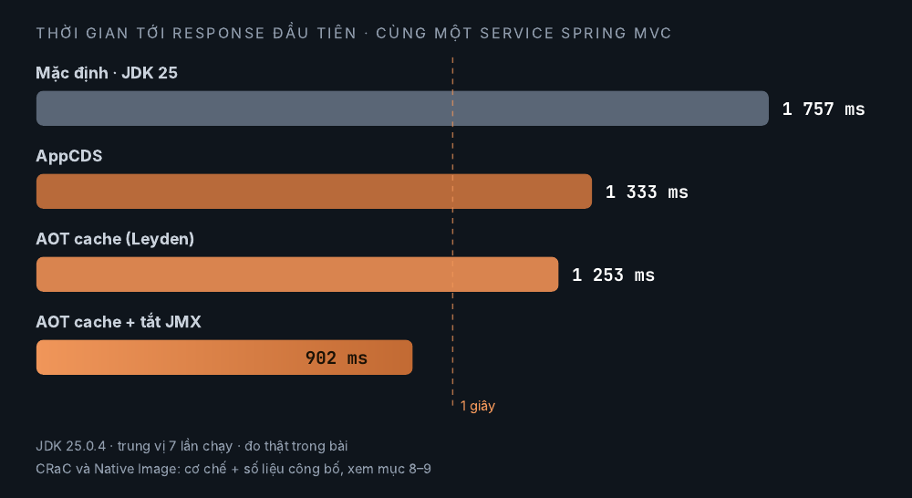

*CDS, AOT cache, CRaC, Native Image*

*Chặng II · Execution engine — từ vài giây xuống dưới một giây · Nền tảng: JDK 25 LTS / 27 · Thí nghiệm chạy thật trên OpenJDK 21*

Bài 09 khép lại **Chặng II — Execution engine**. [Bài 07](07-jit-tiered-compilation.md)–[08](08-toi-uu-jit.md) cho thấy JVM cần thời gian để nạp class, chạy thông dịch rồi mới biên dịch thành mã máy tối ưu. Bài này hỏi câu ngược lại: *có thể mang sẵn bao nhiêu phần việc đó qua mỗi lần khởi động* — và mỗi cách mang theo phải trả giá bằng gì.

> **VỀ CÁC CON SỐ TRONG BÀI — ĐỌC TRƯỚC**
>
> **Đo thật:** mọi số liệu về CDS, AppCDS, AOT cache và JFR được đo trên OpenJDK 21.0.12 và 25.0.4 (Linux x86-64, 2 vCPU), mỗi cấu hình 7 lần, lấy trung vị. Môi trường thử nghiệm không tải được Spring Boot (kho Maven Central bị chặn), nên service mẫu là một ứng dụng **Spring MVC thật** dựng tay theo đúng cách Spring Boot khởi động: Spring Framework 4.3.30 + Tomcat 9.0.118 nhúng + Jackson 2.14, lấy từ kho gói Ubuntu, 60 bean, REST/JSON. Service hiện đại nạp nhiều class hơn (PetClinic: khoảng 21 000 so với 4 700 ở đây), nên số tuyệt đối của bạn sẽ lớn hơn — cơ chế và tỉ lệ thì cùng loại. (Bản Spring của Ubuntu có lỗi đóng gói CGLIB; bài vá bằng một class 3 dòng, không ảnh hưởng phép đo.)
>
> **Không chạy được ở đây:** CRaC (cần JDK có CRaC và CRIU) và GraalVM Native Image (không có bản phân phối trong môi trường). Mục 8–9 trình bày cơ chế và **số liệu công bố**, ghi rõ nguồn, và được đánh dấu **tham khảo**.

CDS, AppCDS, AOT cache của Project Leyden, CRaC và GraalVM Native Image — đo xem mỗi cách xoá được phần nào của thời gian khởi động, phần nào không, và cái giá phải trả.

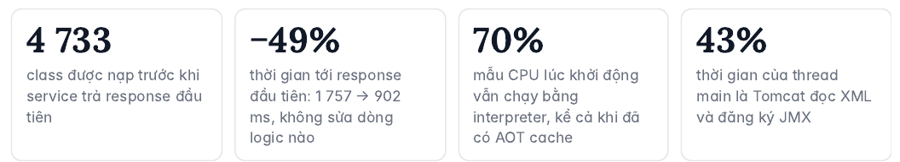

*Các con số đều đo trên service mẫu của bài, JDK 25. Đến cuối bài, bạn sẽ biết con số nào cache được, con số nào phải sửa ở tầng framework.*

## 1 Vì sao một dev Spring Boot nên quan tâm

Thời gian khởi động từng là chuyện của desktop app. Trong hệ thống chạy trên container, nó quay lại dưới nhiều dạng:

- **Rolling deploy và autoscale**: một pod mới chỉ nhận tải khi đã sẵn sàng. Khởi động 20 giây nhân với 30 pod là 10 phút mỗi lần deploy, và một đợt tăng tải đột ngột phải chờ chừng ấy mới có thêm sức chứa.
- **Scale-to-zero, serverless, job ngắn**: khi tiến trình chỉ sống vài giây, khởi động *là* phần lớn chi phí.
- **Warm-up sau khởi động** ([Bài 07](07-jit-tiered-compilation.md)): “READY” chưa phải là nhanh. Vài chục giây đầu, code chạy bằng interpreter và C1 — p99 latency xấu đúng lúc pod vừa nhận tải.
- **Vòng lặp phát triển**: test tích hợp dựng `ApplicationContext` hàng trăm lần mỗi ngày trên máy bạn và trên CI.

Có năm cách tiếp cận lớn, xếp theo mức độ “đóng băng” tăng dần: **CDS/AppCDS** lưu class đã phân tích; **AOT cache** lưu thêm class đã liên kết, object và profile; **Spring AOT** chuyển phần việc của framework sang lúc build; **CRaC** chụp cả tiến trình đã ấm; **Native Image** biên dịch toàn bộ thành một file thực thi. Càng đóng băng nhiều, khởi động càng nhanh — và ứng dụng càng mất đi tính động mà Java vốn có.

## 2 Giải phẫu một lần khởi động: thời gian thật sự đi đâu

Trước khi tối ưu, cần biết tối ưu cái gì. Service mẫu `OrderService` khởi động như một ứng dụng Spring Boot: tạo Tomcat nhúng, đăng ký `DispatcherServlet`, Spring quét package, tạo 60 bean (trong đó có 30 bean `PricingRule` được tiêm dưới dạng `List`), cấu hình Jackson. Chỉ số chính của bài là **thời gian tới response đầu tiên**: tính từ lúc tạo tiến trình tới khi nhận xong response HTTP 200 đầu tiên cho `GET /orders/42`.

```text
$ python3 bench.py "25|mặc định" 7 -- java -cp ... app.App
{"name": "25|mặc định", "ready_ms": 1629, "first_ms": 1757, "rss_mb": 118, "cpu_ms": 3200}

$ java -Xlog:class+load:file=cl.txt ... && wc -l cl.txt
4733 cl.txt                              # 1387 trong số đó lấy từ archive CDS của JDK
```

Hai con số đầu đáng chú ý: tiến trình tiêu **3,2 giây CPU** trong 1,76 giây đồng hồ — gần gấp đôi, vì các thread JIT và GC chạy song song với thread main trên 2 vCPU. Để biết thread main bận gì, lấy mẫu bằng JFR mỗi mili-giây trong lúc khởi động, rồi phân loại từng mẫu theo stack:

```text
$ java -XX:FlightRecorderOptions:stackdepth=1024 \
       -XX:StartFlightRecording:filename=s.jfr,settings=profile,\
       jdk.ExecutionSample#period=1ms ...
$ jfr print --json --events jdk.ExecutionSample s.jfr | python3 jfrcat.py
mẫu trên thread main: 1582 (3 lần chạy), khung trên cùng chạy bằng interpreter: 64%
   42.7%  Tomcat: JMX, XML, cấu hình
   23.8%  Spring: tạo bean, reflection, annotation
   16.6%  Nạp class (tìm trong jar, parse, define, link)
   11.9%  CGLIB của Spring (sinh class proxy)
    4.0%  Spring đọc class bằng ASM (quét annotation)
```

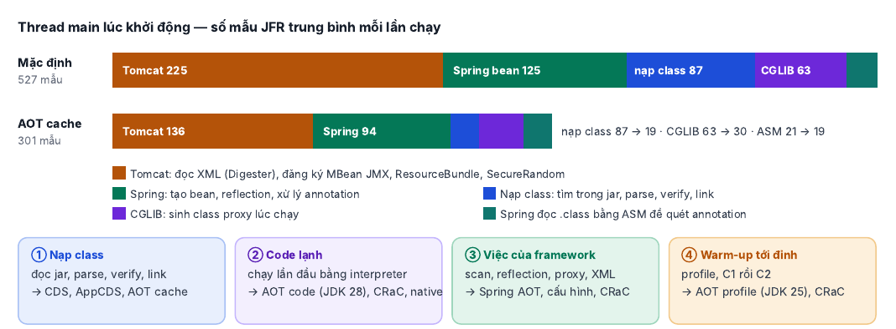

*Hình 9.1 — Trên: phân loại mẫu JFR của thread main, có và không có AOT cache (trung bình 3 lần chạy). Phần nạp class giảm từ 87 xuống 19 mẫu, nhưng Tomcat và Spring vẫn chiếm phần lớn. Dưới: bốn loại chi phí khởi động, kèm những kỹ thuật nhắm vào từng loại — khung sườn cho cả bài.*

Hình 9.1 là bản đồ của bài. Nạp class (①) chỉ là một phần, và là phần dễ cache nhất. Phần lớn thời gian còn lại là **code thật sự chạy** — Tomcat phân tích XML mô tả MBean, Spring dựng bean bằng reflection — và phần lớn số code đó chạy **lần đầu tiên**, nên chạy bằng interpreter (②). Không cache nào loại được ③ nếu framework vẫn phải làm việc đó; chỉ có thể đưa nó sang lúc build, hoặc chụp lại kết quả sau khi đã làm xong.

## 3 CDS: chia sẻ class đã phân tích sẵn

> **NHẮC LẠI · BÀI 01, MỤC 5** — Từ JDK 12, JDK kèm sẵn một **CDS archive** (`lib/server/classes.jsa`) chứa khoảng 1 300–1 400 class lõi đã được phân tích. JVM ánh xạ (mmap) file này vào bộ nhớ thay vì đọc và phân tích từng class. Ở [Bài 01](01-buc-tranh-toan-canh-jvm.md), chương trình Hello World khởi động trong 35 ms với CDS và 74 ms khi tắt bằng `-Xshare:off`.

Nạp một class từ jar là một chuỗi việc: mở jar (định dạng zip), giải nén mục `.class`, phân tích cấu trúc class file, kiểm tra bytecode (verify), dựng cấu trúc `InstanceKlass` trong Metaspace, rồi liên kết (link) khi class được dùng. CDS làm sẵn phần lớn chuỗi đó một lần, ghi kết quả — chính là các cấu trúc Metaspace — ra file, và lần sau chỉ cần ánh xạ file vào bộ nhớ.

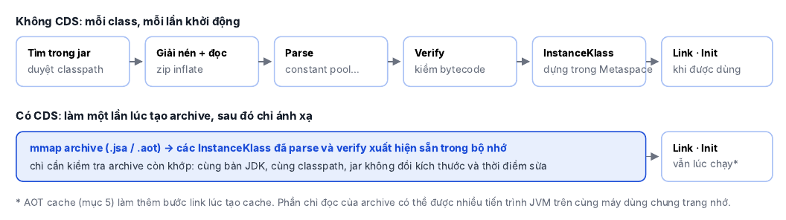

*Hình 9.2 — CDS đổi một chuỗi việc lặp lại ở mỗi lần khởi động thành một lần ánh xạ file. Cái giá là sự cứng nhắc: archive chỉ dùng được khi môi trường lúc chạy khớp với lúc tạo nó.*

Archive mặc định của JDK chỉ chứa class của JDK. Với service mẫu, nó giúp được rất ít:

| Cấu hình | JDK 21 | JDK 25 | Ghi chú |
|---|---|---|---|
| `-Xshare:off` | 1 945 ms | 1 891 ms | không dùng archive nào |
| Mặc định (CDS của JDK) | 1 894 ms | 1 757 ms | 1 387 / 4 733 class từ archive |

Chênh 50–130 ms — đúng cỡ [Bài 01](01-buc-tranh-toan-canh-jvm.md) đo được với Hello World, vì cả hai chương trình đều dùng chung chừng ấy class JDK. 3 300 class còn lại đến từ các jar của Spring, Tomcat, Jackson và ứng dụng, và vẫn phải đi qua toàn bộ chuỗi trong Hình 9.2.

## 4 AppCDS: đưa class của ứng dụng vào archive

**AppCDS** mở rộng CDS cho class của ứng dụng, tức là class trong các jar trên classpath. Có ba cách tạo archive, ra đời qua các phiên bản:

| Cách | Từ JDK | Lệnh |
|---|---|---|
| Tĩnh, hai bước | 10 (JEP 310) | `-XX:DumpLoadedClassList=app.lst`, rồi `-Xshare:dump -XX:SharedClassListFile=app.lst -XX:SharedArchiveFile=app.jsa` |
| Động, một lượt chạy | 13 (JEP 350) | `-XX:ArchiveClassesAtExit=app.jsa` — ghi archive khi JVM thoát |
| Tự động | 19 | `-XX:+AutoCreateSharedArchive -XX:SharedArchiveFile=app.jsa` — tự tạo lại khi archive không khớp |

Cách thứ hai là cách Spring Boot dùng. Service mẫu có cờ `-Dapp.exit=onReady` để thoát ngay sau khi sẵn sàng, tương đương `-Dspring.context.exit=onRefresh` của Spring Boot. Lượt chạy đó là **lượt huấn luyện** (training run):

```text
$ java -XX:ArchiveClassesAtExit=app25.jsa -Dapp.exit=onReady -cp ... app.App
READY in 1674 ms (main), beans=60
[1.956s][warning][cds] Preload Warning: Verification failed for org.springframework.web.servlet.view.velocity.VelocityView
[1.961s][warning][cds] Skipping jdk/proxy2/$Proxy29: Unsupported location
[1.962s][warning][cds] Skipping jdk/proxy1/$Proxy3: Unsupported location
  ...
$ ls -la app25.jsa
-r--r--r-- 1 root root 23711744 app25.jsa                # 23,7 MB

$ java -XX:SharedArchiveFile=app25.jsa -cp ... app.App
# 4 587 trong 4 681 class được nạp từ archive (98%)
```

Các cảnh báo cho biết thứ **không** vào được archive: proxy động của JDK (`jdk.proxy*.$Proxy`, sinh lúc chạy cho annotation và interface), và các class không verify được vì thiếu thư viện phụ thuộc (Velocity, Tiles — Spring có tham chiếu nhưng service không dùng). Kết quả:

| Cấu hình | Tới response đầu | CPU tiêu tốn | RSS |
|---|---|---|---|
| JDK 21 mặc định | 1 894 ms | 3 340 ms | 132 MB |
| JDK 21 + AppCDS | **1 369 ms** (−28%) | 2 450 ms | 130 MB |
| JDK 25 mặc định | 1 757 ms | 3 200 ms | 118 MB |
| JDK 25 + AppCDS | **1 333 ms** (−24%) | 2 420 ms | 141 MB |

Khoảng 25% nhanh hơn và tiết kiệm gần 1 giây CPU, chỉ bằng một file 24 MB. RSS có thể tăng vì các trang của archive được ánh xạ vào tiến trình; đổi lại, các trang chỉ đọc đó dùng chung được giữa nhiều JVM trên cùng một máy.

> **SPRING BOOT 3.3+: CDS CÓ QUY TRÌNH SẴN**
>
> Từ Spring Boot 3.3, quy trình trên được chuẩn hoá. Fat jar phải được giải nén thành bố cục jar thường, vì CDS không đọc được class trong jar lồng nhau:
>
> ```bash
> java -Djarmode=tools -jar my-app.jar extract --destination application
> cd application
> java -XX:ArchiveClassesAtExit=application.jsa \
>      -Dspring.context.exit=onRefresh -jar my-app.jar
> java -XX:SharedArchiveFile=application.jsa -jar my-app.jar
> ```
>
> Với Cloud Native Buildpacks, đặt `BP_JVM_CDS_ENABLED=true` là buildpack tự chạy lượt huấn luyện trong lúc build image. Lưu ý `spring.context.exit=onRefresh` dừng ngay sau khi context refresh — các bean `@Lazy` hay code chỉ chạy khi có request sẽ không vào archive.

## 5 AOT cache của Project Leyden (JDK 24–26)

**Project Leyden** là dự án của OpenJDK nhằm cải thiện thời gian khởi động, thời gian tới hiệu năng đỉnh và mức dùng bộ nhớ bằng cách dời bớt việc từ lúc chạy sang một *lượt huấn luyện* trước đó. Thay vì làm tất cả cùng lúc như Native Image, Leyden tiến từng bước qua các JEP, mỗi JEP thêm một loại dữ liệu vào cùng một file: **AOT cache**.

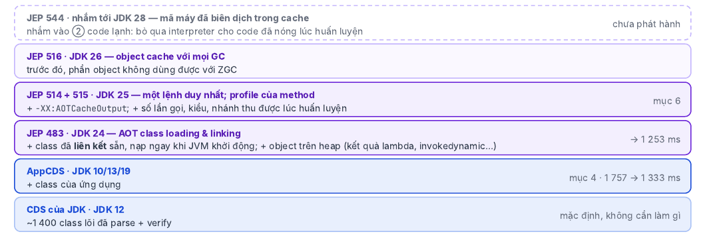

*Hình 9.3 — Mỗi tầng thêm một loại dữ liệu vào cùng một cơ chế archive. Đọc từ dưới lên theo thời gian. Số mili-giây là kết quả đo trên service mẫu (JDK 25). JEP 544 đã ở trạng thái “Targeted to JDK 28” vào tháng 10/2026 — không có trong JDK 26 hay 27.*

Điểm khác biệt lớn nhất so với AppCDS nằm ở chữ **linking**. Với CDS, class đã được phân tích nhưng vẫn phải liên kết lúc chạy: phân giải các tham chiếu trong constant pool, chạy bootstrap method của `invokedynamic`, dựng lambda. AOT cache làm sẵn các việc đó và lưu luôn kết quả — gồm cả một số object trên heap — nên khi JVM khởi động, các class này xuất hiện ở trạng thái “đã nạp và đã liên kết”.

### Tạo cache: hai bước (JDK 24) hoặc một bước (JDK 25)

```text
# JEP 483 (JDK 24+): ghi cấu hình, rồi tạo cache
$ java -XX:AOTMode=record -XX:AOTConfiguration=app.aotconf -Dapp.exit=onReady -cp ... app.App
$ java -XX:AOTMode=create -XX:AOTConfiguration=app.aotconf -XX:AOTCache=app.aot -cp ...
AOTCache creation is complete: arc/app-2step.aot 43008000 bytes            # 1,4 s

# JEP 514 (JDK 25+): một lệnh — JVM tự chạy bước tạo cache khi thoát
$ java -XX:AOTCacheOutput=load.aot -Dapp.exit=after:3000 -cp ... app.App
READY in 1852 ms (main), beans=60
TRAINED 3000 requests
Temporary AOTConfiguration recorded: arc/load.aot.config
Launching child process /usr/lib/jvm/java-25-openjdk-amd64/bin/java to assemble AOT cache ...
AOTCache creation is complete: arc/load.aot 48345088 bytes
Removed temporary AOT configuration file arc/load.aot.config

# Chạy thật
$ java -XX:AOTCache=load.aot -cp ... app.App
```

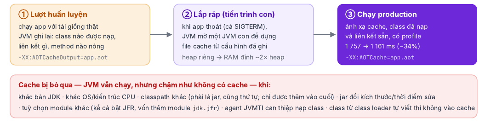

*Hình 9.4 — Quy trình ba giai đoạn của AOT cache với JEP 514. Lượt huấn luyện có thể kết thúc bằng `System.exit` hoặc bằng SIGTERM — đã kiểm chứng trong bài: `kill -TERM` sau 15 giây chạy tải, file cache 44 MB vẫn được tạo đầy đủ.*

### Kết quả

| JDK 25 | Tới response đầu | READY → response | CPU | Cache |
|---|---|---|---|---|
| Mặc định | 1 757 ms | 128 ms | 3 200 ms | — |
| AppCDS | 1 333 ms | 130 ms | 2 420 ms | 24 MB |
| AOT cache, huấn luyện tới READY | 1 253 ms | 124 ms | 2 350 ms | 43 MB |
| AOT cache, huấn luyện + 3 000 request | **1 161 ms** | **35 ms** | 2 170 ms | 48 MB |

Cột “READY → response” cho thấy giá trị của một lượt huấn luyện có tải: khi cache chỉ ghi lại giai đoạn khởi động, request đầu tiên vẫn mất hơn 120 ms để nạp và liên kết toàn bộ đường xử lý HTTP → Spring MVC → Jackson. Khi lượt huấn luyện đã đi qua đường đó, request đầu chỉ còn 35 ms. Để so sánh, JEP 483 công bố Spring PetClinic (khoảng 21 000 class) giảm từ 4,486 s xuống 2,604 s (−42%) với cache 130 MB — ứng dụng càng nhiều class, tỉ lệ càng cao.

### Ba cái bẫy gặp phải trong lúc làm bài

```text
# 1. Rebuild app.jar nhưng quên tạo lại cache
[0.020s][warning][aot] This file is not the one used while building the AOT cache: 'app.jar', timestamp has changed, size has changed
[0.021s][error  ][aot] shared class paths mismatch (hint: enable -Xlog:class+path=info to diagnose the failure)
[0.022s][error  ][aot] Unable to map shared spaces
READY in 1779 ms (main), beans=60                    ← vẫn chạy, nhưng mất toàn bộ lợi ích

# 2. Bật JFR để đo, trong khi lúc huấn luyện không bật
[0.018s][error][aot] Mismatched values for property jdk.module.addmods: jdk.jfr specified during runtime but not during dump time
[0.018s][error][aot] AOT cache has aot-linked classes. It cannot be used when archived full module graph is not used.

# 3. Muốn thất bại ồn ào thay vì âm thầm: -XX:AOTMode=on
[0.020s][error  ][aot] shared class paths mismatch ...
[0.020s][error  ][aot] unrecoverable error               ← JVM dừng
```

Chế độ mặc định `-XX:AOTMode=auto` ưu tiên *chạy được*: cache không khớp thì bỏ qua và chỉ ghi một cảnh báo. Trên production, điều đó có nghĩa là bạn có thể mất toàn bộ lợi ích sau một lần đổi base image mà không ai biết. Hai cách phòng: dùng `-XX:AOTMode=on` ở môi trường staging để lỗi lộ ra ngay, hoặc giữ `-Xlog:aot` ở mức `warning` trong log khởi động và cảnh báo khi thấy dòng “Unable to map”.

Cache cũng có giới hạn giống AppCDS: 53 class bị bỏ qua trong lượt huấn luyện, phần lớn là proxy động và class do CGLIB của Spring sinh lúc chạy:

```text
[warning][aot] class app/WebConfig$$EnhancerBySpringCGLIB$$2ec80688
    cannot be archived because it was not defined from .../app.jar as claimed
[warning][aot] Skipping jdk/proxy2/$Proxy29: Unsupported location          # 38 proxy như vậy
```

Đây là lý do Spring AOT (mục 7) sinh sẵn các class proxy lúc build: khi chúng trở thành class bình thường nằm trong jar, cache lưu được chúng như mọi class khác.

> **SPRING BOOT 3.5 / 4.X TRÊN JAVA 25+**
>
> Tài liệu Spring Boot hướng dẫn dùng AOT cache thay cho CDS khi chạy Java 25 trở lên. Bước giải nén giữ nguyên, chỉ đổi cờ:
>
> ```bash
> # huấn luyện
> java -XX:AOTCacheOutput=app.aot -Dspring.context.exit=onRefresh -jar my-app.jar
> # chạy
> java -XX:AOTCache=app.aot -jar my-app.jar
> ```
>
> Buildpacks dùng `BP_JVM_AOTCACHE_ENABLED=true`. Tài liệu của Spring Framework lưu ý: trên Java 25, huấn luyện bằng một tải thực tế thay vì dừng ở `onRefresh` giúp cache ghi được profile của method — mục 6 đo xem điều đó đáng bao nhiêu.

## 6 Profile trong cache: warm-up có nhanh hơn?

Khởi động xong chưa phải là nhanh. [Bài 07](07-jit-tiered-compilation.md)–[08](08-toi-uu-jit.md) cho thấy C2 chỉ biên dịch một method sau khi C1 đã thu thập đủ profile — số lần gọi, kiểu receiver ở từng call site, nhánh nào chạy. **JEP 515** (JDK 25) lưu luôn profile đó vào AOT cache, để lần chạy sau C2 có thể làm việc sớm hơn thay vì chờ thu thập lại từ đầu. JEP này không thêm cờ nào: cache được tạo bằng `-XX:AOTCacheOutput` sẽ tự chứa profile của những method đã chạy trong lượt huấn luyện. Phần cache tăng từ 43 MB (huấn luyện tới READY) lên 48 MB (huấn luyện kèm 3 000 request) phần lớn chính là profile.

Để đo, mỗi cấu hình được khởi động, rồi bắn tải liên tục bằng `wrk` (4 kết nối) và ghi throughput từng giây trong 25 giây; trung vị của 3 lần chạy. Bốn cấu hình khác nhau ở **lượt huấn luyện** tạo ra cache:

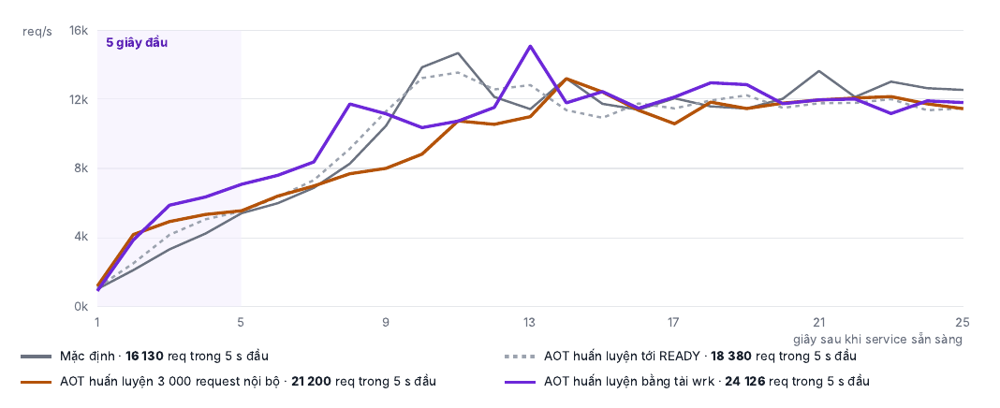

*Hình 9.5 — Throughput theo từng giây sau khi service sẵn sàng (JDK 25, đã tắt JMX của Tomcat). Cả bốn đều tới cùng mức ổn định khoảng 12 000 req/s sau khoảng 10–13 giây — profile không làm mã máy cuối cùng tốt hơn, chỉ làm C2 tới sớm hơn. Cache huấn luyện bằng đúng loại tải mà service sẽ gặp trên production phục vụ thêm 50% request trong 5 giây đầu.*

Ba điều đọc ra từ Hình 9.5:

- **Huấn luyện tới READY gần như không giúp warm-up** (+14% trong 5 giây đầu): lúc đó chưa có request nào, nên cache không có profile của đường xử lý request.
- **Huấn luyện bằng tải giống thật giúp rõ**: 24 126 so với 16 130 request trong 5 giây đầu (+50%), sau đó trùng với mặc định.
- **Huấn luyện bằng tải “gần giống” có thể phản tác dụng**: cache huấn luyện bằng 3 000 request do chính tiến trình tự gửi (qua `HttpURLConnection`, xen thêm endpoint danh sách) nhanh hơn ở 3 giây đầu nhưng chậm hơn 18% ở giây 6–12, và dao động mạnh giữa các lần chạy.

Đếm sự kiện JIT trong 12 giây chạy tải (`-XX:+PrintCompilation -Xlog:deoptimization=debug`, 2 lần chạy mỗi cấu hình) cho manh mối về nguyên nhân:

| Cấu hình | Biên dịch C2 | Mã máy bị loại (made not entrant) | Uncommon trap |
|---|---|---|---|
| Mặc định | 1 084–1 127 | 1 691–1 706 | 93–108 |
| AOT, huấn luyện nội bộ | 904–1 076 | 1 185–1 436 | 71–73 |
| AOT, huấn luyện bằng wrk | 698–766 | **689–777** | **10** |

Khi profile trong cache khớp với tải thật, các giả định lạc quan của C2 ([Bài 08](08-toi-uu-jit.md), mục 2) đúng ngay từ đầu: số lần deoptimization giảm gần 10 lần và số lần biên dịch lại giảm một nửa. Khi profile lệch — kiểu receiver khác, nhánh khác, có cả code của HTTP client nằm chung tiến trình — C2 vẫn biên dịch sớm nhưng dựa trên giả định sai, rồi phải huỷ và làm lại. Đó là giả thuyết phù hợp nhất với số liệu; bài không cô lập được chính xác method nào gây ra đoạn chậm ở giây 6–12.

> **SPRING BOOT: LƯỢT HUẤN LUYỆN LÀ MỘT PHẦN CỦA HỆ THỐNG** — Với CDS, dừng ở `spring.context.exit=onRefresh` là đủ. Với AOT cache có profile, chất lượng của lượt huấn luyện quyết định kết quả. Cách thực tế: trong bước build image, khởi động service với `-XX:AOTCacheOutput`, chạy một bộ request đại diện (bộ smoke test, hoặc một bản ghi lại tải thật đã ẩn dữ liệu nhạy cảm), rồi dừng bằng SIGTERM. Tránh huấn luyện bằng một kịch bản chỉ đi qua đường lỗi hay một endpoint ít dùng — nó dạy C2 những điều sai về chính ứng dụng của bạn.

## 7 Phần cache không xoá được: code của framework

Quay lại Hình 9.1. Với AOT cache, nạp class chỉ còn 6% số mẫu — nhưng thread main vẫn bận gần 0,9 giây, và **70% số mẫu có khung trên cùng chạy bằng interpreter**. Phần còn lại là code thật sự phải chạy: Tomcat chiếm 45%, Spring tạo bean 31%, CGLIB 10%. Không cache nào bỏ qua được việc đó nếu chương trình vẫn yêu cầu làm.

Đào sâu vào nhóm Tomcat (697 mẫu, không lẫn mẫu nạp class hay Spring) cho thấy nó không hề “khởi động server”:

```text
Khung Tomcat gần đỉnh stack nhất, 3 lần chạy mặc định
  165  org.apache.tomcat.util.digester.Digester.parse            ← đọc XML mô tả MBean
  130  org.apache.tomcat.util.modeler.Registry.getMBeanServer   ← khởi tạo JMX
   68  org.apache.tomcat.util.res.StringManager.<init>           ← nạp ResourceBundle
   47  org.apache.tomcat.util.IntrospectionUtils.setProperty
   29  org.apache.catalina.util.SessionIdGeneratorBase.<clinit>  ← khởi tạo SecureRandom
   14  org.apache.tomcat.util.modeler.Registry.loadDescriptors
```

Tomcat mặc định đăng ký mọi thành phần của nó làm MBean JMX — để đọc mô tả MBean, nó phân tích các file `mbeans-descriptors.xml`. Một service Spring Boot không bao giờ có chi phí này, vì Spring Boot gọi sẵn `Registry.disableRegistry()` (thuộc tính `server.tomcat.mbeanregistry.enabled` mặc định là `false`). Thêm đúng dòng đó vào service mẫu:

```java
if (Boolean.getBoolean("app.noJmx")) {
    org.apache.tomcat.util.modeler.Registry.disableRegistry();   // Spring Boot làm sẵn
}
```

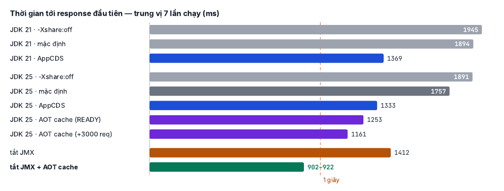

*Hình 9.6 — Toàn bộ kết quả khởi động đo trong bài. Riêng việc tắt JMX của Tomcat đã nhanh hơn 20% (1 757 → 1 412 ms) — gần bằng AppCDS. Kết hợp với AOT cache, service vượt mốc dưới 1 giây và chỉ còn tiêu 1,69 giây CPU thay vì 3,2 giây. Hai cách cộng dồn được vì chúng nhắm vào hai loại chi phí khác nhau trong Hình 9.1.*

Bài học không nằm ở JMX. Nó nằm ở chỗ: **trước khi cache, hãy xem chương trình đang làm gì lúc khởi động**. Một profile JFR 10 giây cho thấy những việc không cần làm — cấu hình mặc định của thư viện, một bean khởi tạo kết nối đồng bộ, một lần quét classpath thừa — và bỏ chúng thường rẻ hơn mọi kỹ thuật trong bài.

### Spring AOT: dời việc của framework sang lúc build

Phần “Spring tạo bean” còn lại phần lớn là việc lặp lại y hệt ở mỗi lần khởi động: đọc annotation, đánh giá `@Conditional`, suy luận kiểu, tìm constructor bằng reflection, sinh proxy CGLIB. **Spring AOT** (Spring Framework 6 / Spring Boot 3 trở lên) chạy các bước đó một lần lúc build và sinh ra mã Java tương đương:

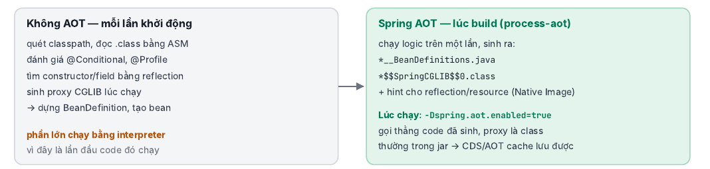

*Hình 9.7 — Spring AOT không biên dịch gì thành mã máy; nó biến việc khám phá cấu hình lúc chạy thành mã Java tĩnh. Đổi lại là giả định “thế giới đóng”: classpath và tập bean cố định lúc build, `@Profile` bị hạn chế, `@ConditionalOnProperty` được quyết định lúc build. tham khảo — không chạy được trên service mẫu (Spring 4.3 chưa có AOT).*

Theo các bài viết của nhóm Spring, Spring AOT riêng lẻ nhanh hơn khoảng 15% trên JVM; CDS cộng Spring AOT cho khởi động nhanh khoảng 2 lần và tiết kiệm khoảng 27% bộ nhớ so với cấu hình mặc định. Cả hai số đều là **tham khảo**, đo trên ứng dụng của Spring, không phải trong bài.

Phần cuối cùng — code chạy lần đầu bằng interpreter (②) — là việc của JEP 544, nhắm tới JDK 28: lưu luôn mã máy đã biên dịch của những method nóng lúc huấn luyện vào cache. Cho đến khi có nó, cách duy nhất để bỏ hẳn ② trên HotSpot là không khởi động lại từ đầu: chụp lại một tiến trình đã chạy xong mọi thứ — chính là CRaC.

## 8 CRaC: chụp ảnh tiến trình đã ấm (tham khảo)

Mọi kỹ thuật ở trên vẫn khởi động JVM từ đầu, chỉ là với ít việc hơn. **CRaC** (Coordinated Restore at Checkpoint) đi theo hướng khác hẳn: để ứng dụng khởi động bình thường, chạy cho tới khi nóng, rồi **chụp toàn bộ tiến trình** — heap, class đã nạp, mã máy JIT đã biên dịch, trạng thái thread — xuống đĩa. Lần sau, thay vì khởi động, ta khôi phục ảnh đó.

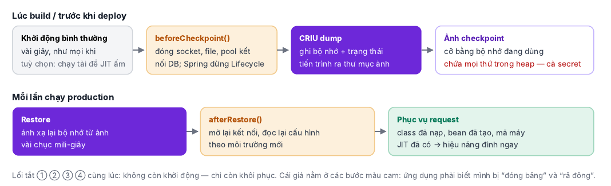

*Hình 9.8 — Vòng đời checkpoint/restore. CRaC không chụp được tài nguyên của hệ điều hành như socket đang mở hay file đang đọc, nên JVM yêu cầu ứng dụng đóng chúng trước khi chụp (API `org.crac.Resource`); nếu còn sót, checkpoint thất bại với `CheckpointException`.*

**Trong Spring Boot (từ 3.2)**: thêm phụ thuộc `org.crac:crac`, chạy trên một JDK có CRaC, và Spring tự dừng/khởi động lại các bean `Lifecycle` (Tomcat connector, pool kết nối…) quanh checkpoint:

```bash
# Checkpoint tự động ngay sau khi context refresh
$ java -Dspring.context.checkpoint=onRefresh -XX:CRaCCheckpointTo=/opt/crac -jar app.jar
# Hoặc chạy tải cho JIT ấm, rồi chụp theo yêu cầu
$ jcmd app.jar JDK.checkpoint
# Production
$ java -XX:CRaCRestoreFrom=/opt/crac
```

**Số liệu công bố** **tham khảo**: Spring PetClinic trên Azul Zulu 21 khôi phục trong khoảng 75 ms (foojay.io); tài liệu Spring nói “vài chục mili-giây”. So với 2–4 giây khởi động thường, đó là một bậc độ lớn khác hẳn — và quan trọng hơn, tiến trình khôi phục ở hiệu năng *đã ấm*, điều mà không kỹ thuật nào khác trong bài làm được.

> **CÁI GIÁ CỦA CRAC**
>
> - **Không có trong OpenJDK chính thức**: CRaC là một dự án của OpenJDK nhưng không có JEP; bạn cần bản phân phối có CRaC (Azul Zulu, BellSoft Liberica).
> - **Quyền hệ điều hành**: engine CRIU cần quyền root hoặc capability `CHECKPOINT_RESTORE` và `SYS_PTRACE` trong container — thứ mà nhiều cluster cấm. Azul có engine “Warp” không cần quyền đặc biệt.
> - **Bí mật bị đóng băng**: ảnh chứa toàn bộ heap — mật khẩu DB, token, khoá. Ảnh phải được bảo vệ như chính secret.
> - **Trạng thái “duy nhất” bị nhân bản**: mọi pod khôi phục từ cùng một ảnh có cùng nội dung heap — ID sinh sẵn, seed ngẫu nhiên, cache theo hostname. Code phải làm mới chúng trong `afterRestore`.
> - **Tương thích**: ảnh gắn với bản JDK và có thể với loại CPU tạo ra nó.

> **AWS LAMBDA SNAPSTART** — SnapStart cho Java dùng cùng ý tưởng nhưng chụp cả microVM Firecracker thay vì dùng CRIU, và gọi hook qua chính API `org.crac`. Nếu bạn chạy Spring trên Lambda, đó là con đường thực tế nhất để có “CRaC” mà không phải tự lo quyền và bản phân phối JDK.

## 9 GraalVM Native Image: biên dịch trước toàn bộ (tham khảo)

Đầu kia của phổ là **Native Image**: biên dịch cả ứng dụng lẫn phần runtime cần thiết thành **một file thực thi gốc** — không có JVM, không có bytecode, không có JIT lúc chạy.

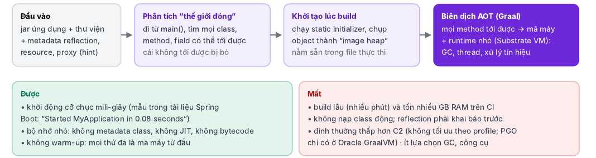

*Hình 9.9 — Native Image dời ①②③④ sang lúc build bằng cách đặt một giả định mạnh: mọi code có thể chạy đều được biết trước. Bài 08 cho thấy C2 mạnh nhờ tối ưu lạc quan theo profile thật — thứ mà một trình biên dịch chạy lúc build không có, trừ khi được nạp profile từ một lượt chạy thử (PGO).*

**Với Spring Boot**, Spring AOT (mục 7) sinh luôn metadata cho Native Image. Lệnh build: `mvn -Pnative native:compile`, hoặc `mvn -Pnative spring-boot:build-image` để ra container image; với Gradle là plugin `org.graalvm.buildtools.native` và `gradle nativeCompile`. Spring Boot 4 yêu cầu GraalVM 25 trở lên cho native image.

> **BỐI CẢNH 2025–2026: GRAALVM VÀ LỘ TRÌNH CỦA JAVA** — Tháng 9/2025, Oracle công bố tách GraalVM khỏi lộ trình phát hành Java SE: GraalVM for JDK 24 là bản cuối thuộc các sản phẩm Java SE của Oracle, Native Image không còn nằm trong gói Java SE subscription, và trọng tâm Java AOT của Oracle chuyển sang Project Leyden. GraalVM Community Edition vẫn tiếp tục: GraalVM 25 phát hành 16/09/2025, theo sau là các bản tính năng 25.1–25.4 tới tháng 9/2026. Với một dự án mới, đây là lý do để coi AOT cache của Leyden là hướng mặc định trên JVM, và chỉ chọn Native Image khi thật sự cần mức khởi động và bộ nhớ của nó.

## 10 So sánh và chọn cách nào

Hình 9.10 là một cách chọn; bảng ngay sau đó đặt các kỹ thuật cạnh nhau theo bốn loại chi phí của Hình 9.1, với cột “Khởi động” ghi rõ số nào đo trong bài, số nào là số liệu công bố.

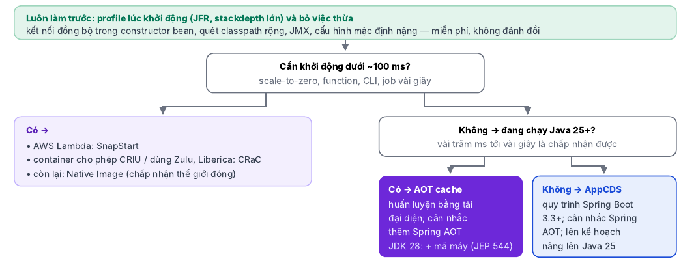

*Hình 9.10 — Một cách chọn hợp lý cho service Spring Boot năm 2026. Các nhánh không loại trừ nhau: AOT cache, Spring AOT và việc bỏ cấu hình thừa cộng dồn được (mục 7 đo được điều đó với AOT cache và JMX).*

| Kỹ thuật | Cần | Nhắm vào | Khởi động | Warm-up / đỉnh | Đánh đổi chính |
|---|---|---|---|---|---|
| **Bỏ việc thừa** | profile JFR | ③ | −20% **đo** | — | phải biết framework làm gì |
| **AppCDS** | JDK 13+; Boot 3.3+ | ① | −24% **đo** | không đổi | jar giải nén; archive theo bản JDK |
| **AOT cache** | JDK 24+; Boot 3.5/4 trên Java 25 | ①④ | −29% đến −34% **đo** | +50% trong 5 s đầu nếu huấn luyện tốt **đo** | lượt huấn luyện; cache 40–130 MB; mất âm thầm khi lệch môi trường |
| **Spring AOT** | Boot 3+ | ③ | ≈ −15% **tham khảo** | không đổi | thế giới đóng một phần: bean, profile cố định lúc build |
| **CRaC** | Zulu/Liberica CRaC; CRIU | ①②③④ | ≈ 75 ms khôi phục **tham khảo** | đã ấm ngay | quyền hệ điều hành; secret trong ảnh; trạng thái bị nhân bản |
| **Native Image** | GraalVM 25+ | ①②③④ lúc build | ≈ 80 ms **tham khảo** | không warm-up; đỉnh thường thấp hơn C2 | build lâu; thế giới đóng; metadata reflection; ít công cụ |

## 11 Đưa vào Spring Boot trên Kubernetes

Mọi archive và cache trong bài có cùng một điểm yếu: chúng chỉ đúng với **chính xác** môi trường đã tạo ra chúng. Vì vậy, cách an toàn nhất là tạo cache **bên trong image cuối cùng**, sau khi jar đã được chép vào và không bao giờ bị sửa nữa:

```dockerfile
FROM eclipse-temurin:25-jdk AS build
WORKDIR /src
COPY . .
RUN ./mvnw -q package -DskipTests \
 && java -Djarmode=tools -jar target/app.jar extract --destination /app

FROM eclipse-temurin:25-jre                     # cùng bản JDK với lúc chạy
WORKDIR /app
COPY --from=build /app/ ./
# Lượt huấn luyện ngay trong image cuối. Context không được đòi DB thật lúc build:
# dùng profile "training" hoặc tắt các auto-config cần kết nối ngoài.
RUN java -XX:AOTCacheOutput=app.aot -Dspring.profiles.active=training \
         -Dspring.context.exit=onRefresh -jar app.jar
ENTRYPOINT ["java", "-XX:AOTCache=app.aot", "-Xlog:aot=warning", "-jar", "app.jar"]
```

- **Muốn có profile** (mục 6): thay `spring.context.exit=onRefresh` bằng một script khởi động service, chạy bộ request đại diện, rồi gửi SIGTERM. Đó là lý do lượt huấn luyện thường nằm trong CI chứ không trong một dòng `RUN` đơn giản.
- **Buildpacks** làm sẵn cả quy trình: `BP_JVM_AOTCACHE_ENABLED=true` (Java 25+) hoặc `BP_JVM_CDS_ENABLED=true`; các tuỳ chọn chỉ dành cho lượt huấn luyện đặt trong `TRAINING_RUN_JAVA_TOOL_OPTIONS`.
- **Tuỳ chọn JVM phải giống nhau** giữa huấn luyện và chạy thật — kể cả những thứ trông vô hại như bật JFR hay thêm một `-javaagent` giám sát (mục 5). Cờ chỉ dành cho bước tạo cache dùng biến môi trường `JDK_AOT_VM_OPTIONS`.
- **Giám sát việc cache có được dùng không**: giữ `-Xlog:aot=warning` và đặt cảnh báo trên dòng “Unable to map shared spaces”; ở staging, chạy với `-XX:AOTMode=on` để lỗi lộ ra ngay.
- **Tính lại probe**: khi khởi động nhanh hơn, `startupProbe` có thể chặt hơn — nhưng nhớ rằng warm-up (Hình 9.5) vẫn kéo dài vài giây sau khi probe đã xanh.
- **Chi phí**: image nặng thêm 40–130 MB, build lâu thêm vài giây tới vài chục giây, và bước tạo cache cần bộ nhớ khoảng gấp đôi heap (JEP 514). Trên CI có giới hạn RAM, đó là chỗ hay hỏng đầu tiên.

## 12 Ghép lại: một trang để nhớ cả bài

| Kỹ thuật | Lệnh chính | Lưu gì | Mất tác dụng khi | Đo trong bài |
|---|---|---|---|---|
| **CDS (JDK)** | mặc định; tắt bằng `-Xshare:off` | ~1 400 class lõi đã parse | — | 1 891 → 1 757 ms |
| **AppCDS** | `-XX:ArchiveClassesAtExit` → `-XX:SharedArchiveFile` | + class ứng dụng (98% số class) | đổi JDK, classpath, jar | 1 757 → 1 333 ms; 24 MB |
| **AOT cache** | `-XX:AOTCacheOutput` → `-XX:AOTCache` | + class đã liên kết, object, profile | như trên + module, agent; mặc định chỉ cảnh báo | → 1 161 ms; 48 MB; +50% 5 s đầu |
| **Cấu hình** | profile JFR, bỏ việc thừa | — | — | tắt JMX: −20%; + AOT: 902 ms |
| **Spring AOT** | `process-aot`; `-Dspring.aot.enabled=true` | bean definition, proxy sinh sẵn | cần cấu hình động lúc chạy | **tham khảo** ≈ −15% |
| **CRaC** | `-XX:CRaCCheckpointTo` / `CRaCRestoreFrom` | cả tiến trình, kể cả mã JIT | khác JDK/CPU; quyền CRIU | **tham khảo** ≈ 75 ms |
| **Native Image** | `native:compile` | mọi thứ, lúc build | code cần nạp động | **tham khảo** ≈ 80 ms |

Tóm cả bài trong một đoạn: Khởi động của một service Spring gồm bốn loại chi phí — **nạp class**, **code chạy lần đầu** bằng interpreter, **việc của framework**, và **warm-up** tới khi C2 biên dịch xong. **CDS/AppCDS** và **AOT cache** chỉ cache được loại thứ nhất, cộng thêm (từ JDK 25) một phần loại thứ tư qua profile — với điều kiện lượt huấn luyện giống tải thật và môi trường chạy khớp tuyệt đối với lúc tạo cache. Việc của framework phải được bỏ đi hoặc dời sang lúc build (**Spring AOT**). Muốn xoá cả bốn cùng lúc, hoặc chụp lại tiến trình đã ấm (**CRaC**), hoặc biên dịch trước toàn bộ (**Native Image**) — và trả giá bằng tính động của Java.

## 13 Hiểu lầm thường gặp, bài tập, bài tiếp theo

### Hiểu lầm thường gặp

| Hiểu lầm | Thực tế |
|---|---|
| “Spring Boot khởi động chậm vì phải nạp quá nhiều class.” | Nạp class chỉ chiếm 17% số mẫu của thread main trong service mẫu. Phần lớn là code thật sự chạy — và chạy lần đầu, bằng interpreter (mục 2, 7). |
| “CDS có sẵn trong JDK rồi, không cần làm gì thêm.” | Archive mặc định chỉ chứa class của JDK: 1 387 trên 4 733 class, tiết kiệm 50–130 ms. Class của ứng dụng cần AppCDS hoặc AOT cache. |
| “AOT cache nghĩa là đã biên dịch AOT ra mã máy.” | Tới JDK 27, cache chứa class đã liên kết, object và profile — không chứa mã máy. Mã máy trong cache là JEP 544, nhắm tới JDK 28. |
| “Nếu cache không dùng được, JVM sẽ báo lỗi.” | Với `AOTMode=auto` (mặc định), JVM chỉ ghi cảnh báo rồi chạy như không có cache. Rebuild jar hay bật JFR là đủ để mất toàn bộ lợi ích (mục 5). |
| “Huấn luyện càng nhiều request càng tốt.” | Tải huấn luyện phải *giống* tải thật. Tải lệch cho kết quả chậm hơn mặc định 18% ở giây 6–12 (mục 6). |
| “Native Image nhanh hơn JVM.” | Khởi động và bộ nhớ: đúng. Throughput đỉnh: thường thấp hơn C2, vì không có tối ưu theo profile lúc chạy (PGO chỉ có ở Oracle GraalVM). |
| “CRaC là tính năng của OpenJDK.” | CRaC là một dự án của OpenJDK nhưng không có JEP và không có trong JDK chính thức; cần bản phân phối riêng và quyền CRIU. |
| “Bật lazy initialization là xong.” | `spring.main.lazy-initialization=true` không xoá chi phí — nó dời chi phí sang request đầu tiên của từng bean, đúng lúc service vừa nhận tải. |

### Bài tập tự làm (khoảng 60 phút)

> **THỰC HÀNH**
>
> 1. **Giải phẫu service của bạn** (bài tập quan trọng nhất). Đo thời gian tới response đầu tiên, đếm class bằng `-Xlog:class+load`, rồi lấy profile JFR lúc khởi động với `-XX:FlightRecorderOptions:stackdepth=1024`. Ba nhóm công việc lớn nhất là gì? Có nhóm nào bỏ được không cần cache?
> 2. **AppCDS theo quy trình Spring Boot**: giải nén bằng `-Djarmode=tools`, huấn luyện với `-Dspring.context.exit=onRefresh`, so sánh với chạy fat jar thường.
> 3. **Hai lượt huấn luyện trên JDK 25**: một cache dừng ở `onRefresh`, một cache chạy bộ smoke test rồi dừng bằng SIGTERM. So sánh số request phục vụ được trong 5 giây đầu bằng `wrk` hoặc `hey`.
> 4. **Làm hỏng cache có chủ đích**: rebuild jar mà không tạo lại cache; thêm `-XX:StartFlightRecording`. Đọc dòng log nào xuất hiện, rồi thử lại với `-XX:AOTMode=on`.
> 5. **Đếm thứ không vào được cache**: lọc các dòng `Skipping` và `cannot be archived` trong log huấn luyện. Bật Spring AOT (`-Dspring.aot.enabled=true`) — các class CGLIB có còn trong danh sách không?

### Thuật ngữ của bài

| Thuật ngữ | Nghĩa ngắn gọn |
|---|---|
| CDS / AppCDS | Class Data Sharing — archive chứa class đã parse sẵn; AppCDS mở rộng cho class ứng dụng. |
| Archive (.jsa) | File CDS được JVM ánh xạ vào bộ nhớ lúc khởi động. |
| Project Leyden | Dự án OpenJDK dời việc từ lúc chạy sang lượt huấn luyện để khởi động và warm-up nhanh hơn. |
| AOT cache (.aot) | Thế hệ tiếp theo của CDS (JDK 24+): class đã nạp và liên kết, object trên heap, profile. |
| Lượt huấn luyện | Một lần chạy ứng dụng để JVM ghi lại những gì cần đưa vào archive/cache. |
| AOT-linked class | Class được liên kết sẵn lúc tạo cache, xuất hiện ở trạng thái đã liên kết khi JVM khởi động. |
| Spring AOT | Bước build của Spring sinh mã Java cho bean definition và proxy, thay cho việc khám phá lúc chạy. |
| CRaC / CRIU | Checkpoint/restore tiến trình Java; CRIU là công cụ Linux thực hiện việc chụp và khôi phục. |
| Native Image | Công cụ GraalVM biên dịch ứng dụng thành file thực thi gốc theo giả định thế giới đóng. |
| Thế giới đóng | Giả định mọi class/method có thể chạy đều được biết lúc build. |
| PGO | Profile-Guided Optimization — biên dịch AOT dùng profile thu từ một lượt chạy thử. |

> **BÀI TIẾP THEO · BÀI 10 — MỞ ĐẦU CHẶNG III** — **Nền tảng GC: GC biết object nào là “rác” bằng cách nào?** Rời execution engine để sang bộ nhớ: reachability và GC roots, mark–sweep–compact và copying, giả thuyết thế hệ, TLAB, write barrier, card table và safepoint — đủ để đọc hiểu từng dòng log GC ở các bài 11–15. Câu hỏi của bài: *GC biết object nào là rác bằng cách nào khi có vòng tham chiếu?*

### Tài liệu tham khảo

- JEP 310 (AppCDS), 341 (CDS mặc định), 350 (dynamic CDS), 483 (AOT class loading & linking), 514 (AOT command-line ergonomics), 515 (AOT method profiling), 516 (AOT object caching với mọi GC), 544 (AOT code compilation). openjdk.org/jeps
- Spring Boot Reference — Class Data Sharing, AOT Cache, Checkpoint and Restore, GraalVM Native Images. docs.spring.io/spring-boot
- Spring Blog — “Spring Boot CDS support and Project Leyden anticipation” (08/2024); “Runtime efficiency with Spring” (10/2023). spring.io/blog
- Oracle — “Detaching GraalVM from the Java Ecosystem Train” (09/2025). blogs.oracle.com/java; GraalVM release notes. graalvm.org
- Project CRaC. openjdk.org/projects/crac; Azul — CRaC engines. docs.azul.com; AWS Lambda SnapStart. docs.aws.amazon.com/lambda
- foojay.io — “Spring Boot 3.2 and CRaC” (số liệu khôi phục PetClinic).
