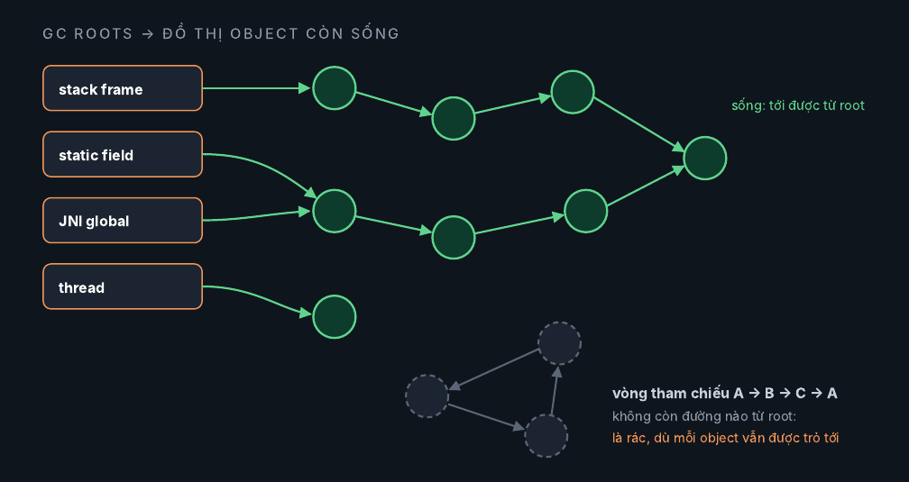
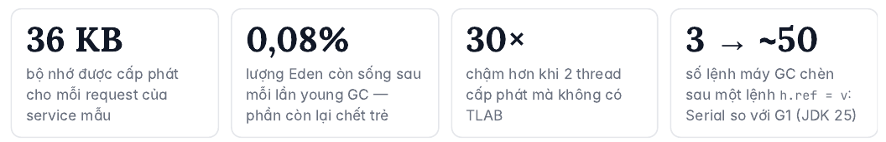
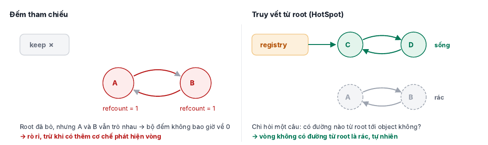
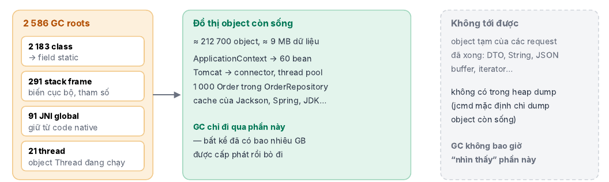
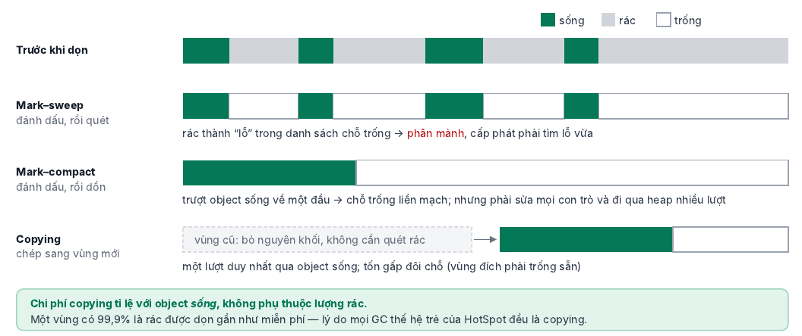
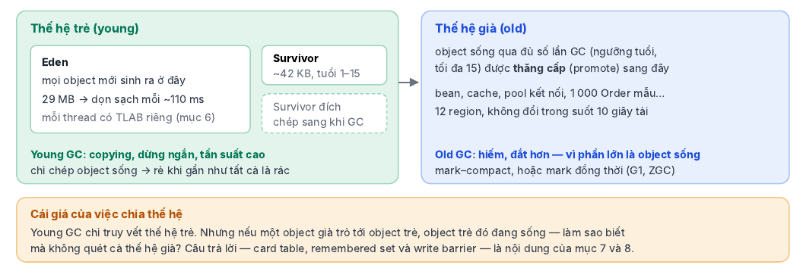
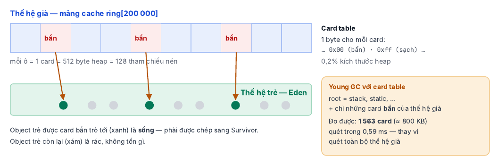
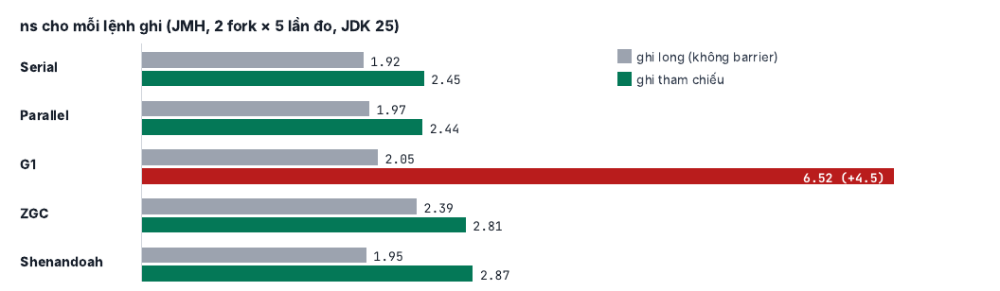
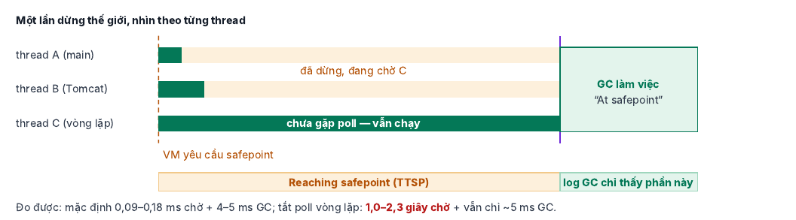

# Bài 10 — Nền tảng GC



*GC biết object nào là “rác” bằng cách nào?*

*Chặng III · Bộ nhớ & GC — roots, thế hệ, barrier, safepoint · Nền tảng: JDK 25 LTS / 27 · Thí nghiệm chạy thật trên OpenJDK 25*

Bài 10 mở đầu **Chặng III — Bộ nhớ & GC**. Trước khi đọc được log G1 ([Bài 11](11-mo-xe-g1.md)), chọn được giữa G1 và ZGC (Bài 12–13) hay săn được memory leak ([Bài 14](14-log-gc-memory-leak.md)), cần một mô hình chung: GC tìm rác bằng cách nào, dọn bằng cách nào, và vì sao mỗi lệnh gán tham chiếu trong code của bạn cũng là một phần của GC.

> **VỀ CÁC CON SỐ TRONG BÀI** — Mọi output (log GC, bảng tuổi object, heap dump, mã máy của write barrier, kết quả JMH, log safepoint) đều lấy từ việc **chạy thật** trên OpenJDK 25.0.4, Linux x86-64, 2 vCPU. Service dùng để đo dưới tải là `OrderService` của [Bài 09](09-khoi-dong-nhanh-cds-aot-native.md) (Spring MVC + Tomcat nhúng + Jackson, 60 bean), bắn tải bằng `wrk`. Heap dump được phân tích bằng một script đọc định dạng HPROF viết riêng cho bài. Chỗ nào hành vi khác ở JDK 26–27 (barrier mới của G1, G1 mặc định ở mọi nơi, compact object headers) đều được ghi chú.

GC biết object nào là “rác” bằng cách nào — kể cả khi các object trỏ vòng vào nhau? Và vì sao một service Spring cấp phát hàng GB mỗi phút mà chỉ dừng vài mili-giây cho GC?



*Bốn con số trên đều đo được trong bài. Đến cuối bài, bạn sẽ giải thích được từng con số — và biết vì sao chúng là thiết kế có chủ đích chứ không phải tình cờ.*

## 1 Vì sao một dev Spring Boot nên quan tâm

Với Java, bạn không giải phóng bộ nhớ — nhưng bạn vẫn quyết định GC phải làm bao nhiêu việc. Các câu hỏi quen thuộc đều có câu trả lời nằm ở nền tảng của bài này:

- **“Service có `Map` trỏ vòng giữa các entity, có leak không?”** — không, nếu không còn đường nào từ root tới chúng (mục 2). Leak thật sự là khi còn một đường — thường qua một `static` hay một `ThreadLocal` (mục 3).
- **“Tạo object tạm trong mỗi request có tốn GC không?”** — gần như không: chúng chết trước khi GC chạy, và GC thế hệ trẻ không tốn gì cho object đã chết (mục 4, 5).
- **“Cache trong bộ nhớ làm young GC chậm hơn?”** — có, theo một cơ chế cụ thể: tham chiếu từ thế hệ già sang thế hệ trẻ (mục 7).
- **“Pause GC chỉ 2 ms nhưng p99 latency nhảy 50 ms?”** — có thể là thời gian chờ mọi thread tới safepoint, không phải GC (mục 9).
- **“Nên chọn GC nào?”** — cần biết mỗi GC trả giá ở đâu: thời gian dừng, CPU chạy song song, hay chi phí trên từng lệnh gán (mục 8, 10).

## 2 “Rác” nghĩa là gì: truy vết thay vì đếm tham chiếu

Có hai cách tự nhiên để định nghĩa rác. Cách thứ nhất — **đếm tham chiếu** (reference counting, dùng trong CPython, Swift, `shared_ptr` của C++): mỗi object đếm xem có bao nhiêu con trỏ đang trỏ tới nó, về 0 thì giải phóng. Cách thứ hai — **truy vết** (tracing): bắt đầu từ một tập điểm xuất phát gọi là **GC roots**, đi theo mọi tham chiếu; object nào đi tới được là **sống** (reachable), còn lại là rác. Mọi GC của HotSpot đều dùng cách thứ hai.



*Hình 10.1 — Cùng một vòng A ⇄ B. Đếm tham chiếu nhìn từng object riêng lẻ nên không thấy vòng đã bị bỏ rơi; truy vết nhìn cả đồ thị từ root nên vòng không được tiếp cận tự động là rác. Đổi lại, truy vết phải đi qua toàn bộ object còn sống.*

### Thí nghiệm: một triệu vòng tham chiếu

```java
static final class Node { Node next; final byte[] payload = new byte[48]; }

Node[] keep = new Node[1_000_000];
for (...) { Node a = new Node(), b = new Node(); a.next = b; b.next = a; keep[i] = a; }
// ↑ 1 triệu vòng A ⇄ B
// "camera" theo dõi một object
WeakReference<Node> probe = new WeakReference<>(keep[0].next);
for (int i = 0; i < 1000; i++) registry.put(i, keep[i]);  // map static giữ 1000 vòng
keep = null;   ...   registry.clear();
```

```text
$ java -Xmx1g -Xlog:gc Cycles
ban đầu:                         1 MB
[0.392s][info][gc] GC(19) Pause Full (System.gc()) 177M->173M(381M) 116.876ms
giữ 1 triệu vòng (root = keep):  173 MB
[0.404s][info][gc] GC(20) Pause Full (System.gc()) 173M->1M(10M) 4.410ms
keep = null, map giữ 1000 vòng:  1 MB, probe còn sống? true
[0.414s][info][gc] GC(21) Pause Full (System.gc()) 2M->1M(8M) 3.247ms
registry.clear():                1 MB, probe còn sống? false
```

Ba điều đọc ra. Một: ngay khi mảng `keep` không còn được trỏ tới, cả triệu vòng biến mất — 173 MB xuống 1 MB — dù mỗi object trong vòng vẫn đang được object kia trỏ tới. Hai: 1 000 vòng còn được `registry` (một `HashMap` static) giữ thì vẫn sống; `probe` chỉ trả về `null` sau khi map được xoá. Đó chính là hình dạng của mọi memory leak trong Java: không phải “quên giải phóng”, mà là **vẫn còn một đường đi từ root**.

Ba — và đây là điều quan trọng nhất của cả bài: lần GC đầu, với 173 MB object còn sống, mất **116,9 ms**; lần GC thứ hai, khi chính 173 MB đó đã là rác, chỉ mất **4,4 ms**. Truy vết chỉ chạm vào object sống. Chi phí của GC tỉ lệ với lượng dữ liệu *còn sống*, không tỉ lệ với lượng rác — mọi thiết kế ở các mục sau đều xoay quanh hệ quả này.

## 3 GC roots: điểm xuất phát của mọi lần truy vết

GC roots là những tham chiếu mà JVM coi là “chắc chắn còn dùng” mà không cần hỏi ai trỏ tới chúng. Danh sách đầy đủ phụ thuộc vào cài đặt, nhưng với HotSpot có thể nhóm thành:

- **Biến cục bộ và tham số** trong mọi frame trên stack của mọi thread đang chạy ([Bài 01](01-buc-tranh-toan-canh-jvm.md), mục 7).
- **Class đã nạp** — và qua `java.lang.Class` của chúng, mọi **field static**. Class của bootstrap loader không bao giờ bị dỡ; class của loader khác sống chừng nào loader của nó còn sống.
- **Tham chiếu từ code native** (JNI global/local), object đang được dùng làm monitor của `synchronized`, và bản thân các object `Thread`.
- **Cấu trúc nội bộ của JVM**: bảng chuỗi intern, các object được cache sẵn, hàng đợi của `Reference`.

### Thí nghiệm: đếm root trong một service thật

Chạy `OrderService`, bắn tải 5 giây, chụp heap dump bằng `jcmd`, rồi đọc file HPROF bằng một script nhỏ đếm các bản ghi root theo loại:

```text
$ jcmd <pid> GC.heap_dump /tmp/os.hprof
Heap dump file created [20398415 bytes in 0.097 secs]
$ python3 hprof_roots.py /tmp/os.hprof
GC roots theo loại:
  STICKY_CLASS      2183        ← class của bootstrap loader: không bao giờ bị dỡ
  JAVA_FRAME         291        ← biến cục bộ trên stack của 21 thread Java
  JNI_GLOBAL          91        ← tham chiếu giữ từ code native của JVM/JDK
  THREAD_OBJECT       21
  TỔNG              2586
Object trong dump:
  instance        145280       4.1 MB (dữ liệu)
  object[]         17929       1.8 MB (dữ liệu)
  primitive[]      49466       3.1 MB (dữ liệu)
  class             5039
```



*Hình 10.2 — Bức tranh heap của `OrderService` lúc đang chạy tải. Định dạng HPROF của HotSpot không ghi field static thành root riêng: chúng nằm trong object `Class`, và object `Class` được giữ bởi class loader của nó — đó là lý do một class loader không được giải phóng (Bài 03) kéo theo toàn bộ dữ liệu static của mọi class nó đã nạp.*

> **SPRING BOOT: BA ĐƯỜNG DẪN TỪ ROOT HAY GÂY LEAK** — **Field static và singleton**: mọi bean singleton được `ApplicationContext` giữ suốt đời ứng dụng, nên một `Map` làm cache trong bean mà không có giới hạn hay thời hạn là một leak có chủ đích. **ThreadLocal trên thread pool**: thread của Tomcat không bao giờ chết, nên giá trị đặt vào `ThreadLocal` mà không `remove()` sống mãi qua stack root của thread đó. **Listener và callback** đăng ký vào một đối tượng sống lâu (event bus, scheduler) mà không huỷ đăng ký. Cả ba đều có cùng một hình dạng: không phải “GC không dọn”, mà là “vẫn còn đường đi từ root”. [Bài 14](14-log-gc-memory-leak.md) sẽ lần theo đường đi đó bằng Eclipse MAT.

## 4 Ba cách dọn: mark–sweep, mark–compact, copying

Biết object nào sống mới là nửa việc. Nửa còn lại là **lấy lại** chỗ của rác để cấp phát tiếp. Có ba kỹ thuật cơ bản, và mọi GC của HotSpot là sự phối hợp giữa chúng:



*Hình 10.3 — Cùng một vùng nhớ, ba cách lấy lại chỗ. Thực tế các GC kết hợp: Serial và Parallel dùng copying cho thế hệ trẻ và mark–compact cho thế hệ già; G1 “sơ tán” (evacuate — một dạng copying) theo từng region; ZGC và Shenandoah sao chép đồng thời trong khi ứng dụng vẫn chạy (Bài 12).*

Mục 2 đã đo được hệ quả: full GC (mark–compact) trên 173 MB object sống mất 116,9 ms, trên 173 MB rác chỉ mất 4,4 ms. Nếu có cách để mỗi lần dọn chỉ nhìn vào một vùng mà phần lớn đã là rác, GC sẽ rất rẻ. Đó là ý tưởng của thu gom theo thế hệ.

## 5 Giả thuyết thế hệ: phần lớn object chết trẻ

**Giả thuyết thế hệ yếu** (weak generational hypothesis) phát biểu rằng phần lớn object chết rất sớm sau khi được tạo, và số ít sống sót qua vài lần GC thường sống rất lâu. Với ứng dụng web, điều này gần như hiển nhiên: object của một request — DTO, chuỗi JSON, iterator, buffer — chết khi request kết thúc; bean, cache, pool kết nối sống cả đời ứng dụng. Nhưng “gần như hiển nhiên” thì nên đo.

### Thí nghiệm: tuổi của object trong một service thật

Chạy `OrderService` với G1, heap tối đa 256 MB, bật log bảng tuổi (`gc+age=trace`), rồi bắn tải 10 giây:

```text
$ java -Xmx256m -Xlog:gc,gc+age=trace,gc+heap=debug ... app.App   # + wrk -c4 -d10s
  66911 requests in 10.02s
[info ][gc     ] GC(93) Pause Young (Normal) (G1 Evacuation Pause) 40M->11M(51M) 1.009ms
[debug][gc,age ] GC(93) Desired survivor size 2097152 bytes, new threshold 15 (max threshold 15)
[trace][gc,age ] GC(93) Age table:
[trace][gc,age ] GC(93) - age   1:      41920 bytes,      41920 total
[trace][gc,age ] GC(93) - age   2:        352 bytes,      42272 total
[trace][gc,age ] GC(93) - age   5:         24 bytes,      42296 total
  ...
[info ][gc,heap] GC(93) Eden regions: 29->0(29)
[info ][gc,heap] GC(93) Survivor regions: 1->1(4)
[info ][gc,heap] GC(93) Old regions: 12->12
```

Đọc dòng này: G1 dọn 29 region Eden (mỗi region 1 MB), và chỉ 41 920 byte — chưa tới 42 KB — sống sót tới tuổi 1. Gộp cả 91 lần young GC trong 10 giây tải:

| Chỉ số (91 lần young GC, 66 911 request) | Giá trị |
|---|---:|
| Tổng cấp phát (cộng Eden trước mỗi GC) | ≈ 2,47 GB |
| Cấp phát cho mỗi request | **≈ 36 KB** |
| Sống sót tới tuổi 1, trung vị mỗi lần GC | 19,2 KB — **0,08%** Eden |
| Thời gian dừng: trung vị / p90 / lớn nhất | 1,49 / 3,57 / 16,1 ms |
| Tần suất young GC | ≈ 9 lần mỗi giây |

99,92% những gì service cấp phát là rác ngay lần GC đầu tiên — và với copying, rác không tốn gì. Đó là lý do một service cấp phát 250 MB mỗi giây vẫn chỉ dừng khoảng 1,5 ms mỗi lần GC.



*Hình 10.4 — Bố cục thế hệ, với số liệu của `OrderService` dưới tải. G1 chia heap thành các region cùng cỡ (ở đây 1 MB) và gán vai trò Eden/Survivor/Old cho từng region; Serial và Parallel dùng các vùng liền mạch — mô hình khái niệm giống nhau.*

## 6 TLAB: vì sao `new` gần như miễn phí

Copying để lại phía sau một vùng trống liền mạch. Cấp phát trong vùng trống liền mạch chỉ là **tăng một con trỏ** (bump-the-pointer): object mới nằm ở địa chỉ `top`, rồi `top += size`. Nhưng nếu nhiều thread cùng tăng một con trỏ chung, mỗi lần cấp phát phải dùng một lệnh nguyên tử (CAS) và tranh nhau cùng một dòng cache.

**TLAB** (Thread-Local Allocation Buffer) giải quyết điều đó: mỗi thread xin một mẩu Eden riêng — vài chục KB tới vài trăm KB — và cấp phát trong đó mà không cần đồng bộ. Chỉ khi TLAB đầy, thread mới quay lại lấy mẩu mới từ Eden chung.

```java
static final class Point { final long x, y; ... }
// mỗi thread: 50 triệu lần new Point;
// cứ 1024 object ghi một vào field volatile để escape analysis không xoá được
```

| Cấp phát `new Point` | Có TLAB (mặc định) | `-XX:-UseTLAB` | Chênh |
|---|---:|---:|---:|
| 1 thread | 7,57 ns | 49,90 ns | 6,6× |
| 2 thread (tính trên tổng số object) | **3,55 ns** | **106,99 ns** | **30×** |

Với TLAB, hai thread cấp phát nhanh gấp đôi một thread — đúng như kỳ vọng với 2 vCPU. Không có TLAB, thêm thread làm mọi thứ *chậm đi*: hai lõi tranh nhau cùng một con trỏ `top` của Eden. JVM cũng ghi lại TLAB đã được dùng thế nào ở mỗi lần GC:

```text
$ java -Xlog:gc,gc+tlab=debug Tlab 2
[debug][gc,tlab] GC(0) TLAB totals: thrds: 4  refills: 498 max: 263 slow allocs: 0 max 0 waste: 0.5% ...
[info ][gc     ] GC(0) Pause Young (Normal) (G1 Evacuation Pause) 250M->1M(264M) 2.029ms
```

250 MB được cấp phát qua chưa tới 500 lần lấy TLAB mới — trung bình khoảng 500 KB mỗi TLAB — và chỉ 0,5% bị lãng phí ở phần đuôi TLAB còn thừa khi GC xảy ra. Mọi thứ ở giữa là những lệnh tăng con trỏ mà C2 đã sinh thẳng vào mã máy ([Bài 08](08-toi-uu-jit.md), Hình 8.1: “macro expansion”).

> **SPRING BOOT: OBJECT TẠM RẺ, OBJECT SỐNG LÂU MỚI ĐẮT** — Ghép mục 4–6 lại: cấp phát là vài nano-giây, object chết trong Eden không tốn gì cho GC. Thứ thật sự tốn là object **sống** — mỗi object sống sót bị chép qua Survivor nhiều lần rồi được thăng cấp, và làm thế hệ già lớn dần. Vì vậy: đừng tái sử dụng DTO hay viết pool object để “giảm GC” ([Bài 08](08-toi-uu-jit.md) mục 5 đã cho thấy chúng còn có thể không được cấp phát); hãy để ý những thứ *giữ* object lâu hơn cần thiết — cache không giới hạn, session phình to, collection gom kết quả của cả batch trong bộ nhớ. Số liệu đáng theo dõi trên production là **tốc độ cấp phát** (MB/s) và **tốc độ thăng cấp** sang thế hệ già, cả hai đều đọc được từ log GC hoặc JFR.

## 7 Tham chiếu từ già sang trẻ: card table và remembered set

Young GC chỉ truy vết thế hệ trẻ. Nhưng root của nó không chỉ là stack và static: **mọi object già đang trỏ vào thế hệ trẻ** cũng là root. Quét cả thế hệ già để tìm chúng thì mất hết ý nghĩa của việc chia thế hệ. Giải pháp là ghi nhớ trước — mỗi khi ứng dụng gán một tham chiếu vào object già, đánh dấu lại chỗ đó.

- **Card table**: chia heap thành các “card” 512 byte (từ JDK 18 đổi được bằng `-XX:GCCardSizeInBytes`). Mỗi card ứng với 1 byte trong một mảng. Gán tham chiếu vào object nằm trong card nào thì đánh dấu card đó là “bẩn”. Young GC chỉ cần quét các card bẩn.
- **Remembered set** (G1): vì G1 thu gom theo từng region, mỗi region còn có một tập ghi nhớ “những card nào ở region khác đang trỏ vào tôi”. Các thread nền (refinement) xử lý card bẩn để cập nhật tập này.



*Hình 10.5 — Card table biến câu hỏi “object già nào đang trỏ vào thế hệ trẻ?” thành “card nào đang bẩn?”. Con số 1 563 card là của thí nghiệm dưới đây: 200 000 tham chiếu nén × 4 byte = 800 KB = 1 563 card 512 byte — tức là mọi card của mảng cache đều bẩn ở mỗi lần young GC.*

### Thí nghiệm: một cache ở thế hệ già

Chương trình `OldToYoung` tạo object liên tục trong 8 giây. Ở chế độ `cache`, mỗi object mới được ghi đè vào một mảng vòng 200 000 phần tử đã nằm ở thế hệ già — mô hình của một cache trong bộ nhớ với tỉ lệ thay mới cao. Ở chế độ đối chứng, object chỉ được ghi vào một field `volatile` (để escape analysis không xoá được việc cấp phát, [Bài 08](08-toi-uu-jit.md) mục 5):

```text
$ java -XX:+UseG1GC -Xmx512m -Xmn64m -Xlog:gc,gc+phases=debug OldToYoung cache
Dirty Cards:          Min: 651, Avg: 781.5, Max: 912, Sum: 1563
Scan Heap Roots (ms): Min: 0.58, Avg: 0.60, Max: 0.62, Sum: 1.20
Scanned Cards:        Min: 768, Avg: 781.5, Max: 795, Sum: 1563
Object Copy (ms):     Min: 7.42, Avg: 7.44, Max: 7.46, Sum: 14.88
```

| 8 giây, G1, Eden 64 MB | Không cache | Cache 200 000 entry |
|---|---:|---:|
| Object được tạo | 353 triệu | 270 triệu |
| Young GC / pause trung vị | 385 / 0,86 ms | 272 / **8,51 ms** |
| Card phải quét mỗi lần | 1 | 1 563 |
| Scan Heap Roots / Object Copy (mỗi worker) | ≈ 0 / ≈ 0 ms | 0,59 / 6,99 ms |

Card table làm đúng việc của nó: tìm ra 200 000 tham chiếu già → trẻ chỉ trong 0,6 ms. Phần đắt là hệ quả: các object đó đang **sống**, nên mỗi lần young GC phải chép chúng — khoảng 14 MB — sang Survivor, rồi lần sau chúng bị cache ghi đè và chết. Đây là kiểu object tệ nhất cho GC thế hệ: không chết đủ sớm để miễn phí, không sống đủ lâu để yên ổn ở thế hệ già. Pause tăng 10 lần.

## 8 Write barrier: cái giá của mỗi lệnh gán tham chiếu

Ai đánh dấu card bẩn? Chính code của bạn. Mỗi lệnh gán tham chiếu vào một field hoặc phần tử mảng, khi được JIT biên dịch, đi kèm vài lệnh máy do GC yêu cầu chèn vào — gọi là **write barrier**. Mỗi GC có barrier khác nhau, vì mỗi GC cần biết những điều khác nhau. Để thấy tận mắt, biên dịch một method chỉ có một lệnh gán và in mã máy (cách làm của [Bài 08](08-toi-uu-jit.md) mục 7):

```java
// in mã máy: -XX:CompileCommand=print,Barrier::set
static void set(Holder h, Object v) { h.ref = v; }
```

```asm
# Serial / Parallel — barrier: 3 lệnh, không rẽ nhánh
  mov    DWORD PTR [rsi+0xc],r10d            ← lệnh gán thật (tham chiếu nén, 4 byte)
  mov    r10,rsi
  shr    r10,0x9                         ← địa chỉ object / 512 = số thứ tự card
  movabs r11,0x7fdbc5e00000                  ← địa chỉ card table
  mov    BYTE PTR [r11+r10*1],r12b       ← card = 0 (“bẩn”), r12 luôn bằng 0
```

```asm
# G1 (JDK 25) — đường nhanh nằm ngay trong method
  cmp    BYTE PTR [r15+0x48],0x0             ← ① SATB: đang có marking đồng thời không?
  jne    pre_barrier_slow                       có → ghi lại giá trị CŨ vào hàng đợi SATB
  mov    DWORD PTR [r11],r8d                 ← lệnh gán thật
  xor    r10,rdx ; shr r10,0x14 ; je done      ← ② cùng region 1 MB? → bỏ qua
  cmp    rdx,0x0 ; je done                   ← ③ gán null? → bỏ qua
  shr    r10,0x9 ; add r10,card_table
  cmp    BYTE PTR [r10],0x2 ; jne post_slow ← ④ card thuộc region trẻ? → bỏ qua
# G1 — đường chậm (post_slow)
  lock add DWORD PTR [rsp-0x40],0x0         ← ⑤ memory fence: đồng bộ với thread refinement
  cmp    BYTE PTR [r10],0x0 ; je done        ← card đã bẩn? → xong
  mov    BYTE PTR [r10],0x0                  ← đánh dấu bẩn
  ... đẩy địa chỉ card vào hàng đợi dirty-card của thread, đầy thì gọi runtime
```

Đếm cả nhánh nhanh lẫn nhánh chậm, G1 trên JDK 25 chèn khoảng 50 lệnh quanh một lệnh gán — đúng con số JEP 522 mô tả. Các phép lọc ②③④ tồn tại để phần lớn lệnh gán thoát sớm: gán trong cùng region, gán null, hay gán vào object còn trẻ đều không cần ghi nhớ gì. ZGC có triết lý khác hẳn: tham chiếu không nén (8 byte, field nằm ở offset `0x18` thay vì `0xc`) và mang “màu” trong các bit cao; barrier của nó kiểm tra màu của con trỏ cũ (`test [rsi+0x18],0xeae0`) rồi tô màu cho con trỏ mới (`shl 0xd; or 0x1510`) trước khi ghi.

### Đo bằng JMH

Benchmark ghi một tham chiếu vào field của object đã ở thế hệ già (65 536 object, đẩy lên thế hệ già bằng `System.gc()` trong `@Setup`), so với ghi một số `long` vào cùng object. Mọi lệnh ghi tham chiếu đều vượt region và trỏ vào object già — **trường hợp xấu nhất** cho G1:



*Hình 10.6 — Barrier của Serial và Parallel thêm khoảng 0,5 ns; của ZGC 0,4 ns; Shenandoah 0,9 ns. G1 thêm 4,5 ns vì trong benchmark này lệnh ghi nào cũng rơi vào đường chậm có `lock add` — một memory fence tốn vài chục chu kỳ. Ứng dụng thật hiếm khi tệ như vậy: phần lớn lệnh gán bị lọc ở ②③④. JEP 522 ước tính barrier cũ làm mất 5–15% throughput ở ứng dụng ghi tham chiếu nhiều.*

> **JDK 26: BARRIER MỚI CỦA G1 (JEP 522)** — Memory fence ở bước ⑤ tồn tại vì thread ứng dụng và thread refinement cùng đọc/ghi một card table. JEP 522 (JDK 26) cho G1 **hai card table**: ứng dụng ghi vào một bảng mà không cần đồng bộ, thread refinement làm việc trên bảng kia, và G1 hoán đổi hai bảng khi cần bằng handshake với từng thread. Barrier trên x64 rút từ khoảng 50 xuống **12 lệnh**, không còn fence; JEP công bố throughput tăng tới 5–15% với ứng dụng ghi tham chiếu nhiều, tới 5% với ứng dụng khác, đổi lại thêm 0,2% heap cho bảng thứ hai. Không cần đổi cờ nào. Nếu chạy lại Hình 10.6 trên JDK 26+, cột đỏ sẽ ngắn đi đáng kể — đó là bài tập 3 ở cuối bài.

## 9 Safepoint: khi nào GC được phép dừng thế giới

Nhiều pha của GC cần mọi thread Java đứng yên: không ai được di chuyển con trỏ trong lúc GC đang chép object. JVM không thể dừng thread ở một lệnh máy bất kỳ — giữa chừng một lệnh gán, thanh ghi có thể đang giữ con trỏ mà GC không biết. Nó chỉ dừng ở các **safepoint**: những điểm mà JIT đã ghi lại chính xác thanh ghi và ô stack nào đang chứa con trỏ. Code đã biên dịch kiểm tra định kỳ một ô nhớ đặc biệt (poll) — ở lối ra của method và ở cuối các vòng lặp; [Bài 08](08-toi-uu-jit.md) đã thấy lệnh poll `test [r11],eax` nằm ở vòng ngoài của một vòng lặp được “strip-mine”.

Thời gian một lần “dừng thế giới” do đó gồm hai phần: **thời gian để mọi thread tới safepoint** (time-to-safepoint, TTSP) và **thời gian ở safepoint** — phần việc thật của GC. Log GC chỉ ghi phần sau.

```java
// một thread chạy vòng lặp đếm dài, không gọi method nào; main gọi System.gc() 3 lần
static long spin(int n) {
    long s = 0;
    for (int i = 0; i < n; i++) { s += i * (long) i ^ (s >>> 3); }
    return s;
}
```

```text
$ java -Xlog:safepoint Ttsp                          # mặc định: LoopStripMiningIter=1000
Safepoint "G1CollectFull", ... Reaching safepoint: 181043 ns, At safepoint: 4404564 ns, ...
Total: 4598117 ns
System.gc() #0 mất 8.7 ms

$ java -XX:-UseCountedLoopSafepoints -Xlog:safepoint Ttsp   # bỏ poll trong vòng lặp đếm
Safepoint "G1CollectFull", ... Reaching safepoint: 2261765208 ns, At safepoint: 5933180 ns, ...
Total: 2267719774 ns
System.gc() #1 mất 2267.9 ms
```



*Hình 10.7 — Trong lúc chờ thread chậm nhất, mọi thread khác đã dừng và không phục vụ request nào. Đó là cách “pause GC 5 ms” biến thành một lần treo 2 giây mà log GC không hề ghi lại.*

Từ JDK 10, C2 “strip-mine” các vòng lặp đếm (`LoopStripMiningIter` = 1000): chia vòng lặp thành vòng trong không có poll và vòng ngoài có poll, nên trường hợp trên khó xảy ra với cấu hình mặc định — cờ `-XX:-UseCountedLoopSafepoints` ở đây chỉ để tái hiện nó. Trong thực tế, TTSP dài thường đến từ: thao tác trên mảng rất lớn chạy trong một stub không có poll, lỗi trang (page fault) khi đọc file ánh xạ bộ nhớ hay khi máy bị swap, hoặc code JNI giữ vùng “critical”. Thread đang chạy code native không chặn safepoint — nó được coi là đã an toàn, và chỉ bị chặn lại nếu cố quay về Java.

> **SPRING BOOT: ĐỌC ĐÚNG LOG KHI P99 NHẢY** — Khi latency có những gai mà log GC không giải thích được, bật `-Xlog:safepoint` (rẻ, dùng được trên production) hoặc xem sự kiện `jdk.SafepointBegin` trong JFR, và so sánh “Reaching safepoint” với “At safepoint”. Safepoint không chỉ dành cho GC: deoptimization ([Bài 08](08-toi-uu-jit.md)), một số lệnh `jcmd`, chụp thread dump cũng cần nó. [Bài 18](18-thread-safepoint.md) sẽ đi sâu vào cơ chế poll, handshake theo từng thread và cách săn TTSP dài.

## 10 Bốn GC trên cùng một service

Ghép mọi khái niệm lại bằng cách chạy `OrderService` với cùng tải (`wrk`, 4 kết nối, 10 giây, heap 256 MB) dưới bốn GC. Mỗi GC là một cách phối hợp khác nhau giữa các kỹ thuật trong bài:

| GC | Kỹ thuật chính | req/s | Số pause | Pause trung vị | Pause dài nhất |
|---|---|---:|---:|---:|---:|
| **Serial** | copying (trẻ) + mark–compact (già), 1 thread | 6 323 | 90 | 0,83 ms | 36,6 ms |
| **Parallel** | như Serial, nhiều thread | 5 882 | 37 | 0,84 ms | 51,6 ms |
| **G1** | region, sơ tán theo region, mark đồng thời, remembered set | 5 891 | 83 | 1,53 ms | 13,2 ms |
| **ZGC** | đánh dấu và di chuyển đồng thời, con trỏ màu, thế hệ | 5 073 | 41 | **0,010 ms** | **0,019 ms** |

Mỗi dòng là một lần chạy — đủ để thấy hình dạng, không đủ để xếp hạng chính xác, nhất là khi `wrk` chạy chung 2 vCPU với service. Hình dạng thì rõ: Serial có throughput cao nhất trên máy nhỏ vì không tốn CPU cho thread GC chạy song song, nhưng pause dài nhất tới 37 ms; ZGC gần như không dừng — tổng cộng 0,4 ms dừng trong 10 giây — nhưng các thread GC đồng thời tranh 2 vCPU với ứng dụng, throughput thấp hơn khoảng 20%. Không có GC “tốt nhất”, chỉ có GC trả giá ở chỗ bạn chịu được.

> **MẶC ĐỊNH ĐANG THAY ĐỔI** — Tới JDK 26, JVM tự chọn Serial khi máy có 1 CPU hoặc dưới 1 792 MB RAM — tức là phần lớn pod nhỏ trên Kubernetes — và G1 trong các trường hợp còn lại. Từ **JDK 27** (JEP 523), G1 là mặc định ở mọi môi trường; cũng từ JDK 27 (JEP 534), compact object headers được bật mặc định, header object giảm từ 12 xuống 8 byte. [Bài 13](13-gc-cho-container.md) sẽ quay lại câu hỏi “pod 1 vCPU của bạn đang chạy GC nào” với cả hai thay đổi này.

## 11 Ghép lại: một trang để nhớ cả bài

| Khái niệm | Ý tưởng | Quan sát bằng | Đo trong bài |
|---|---|---|---|
| Reachability | sống = đi tới được từ root; vòng tham chiếu không có ngoại lệ | `WeakReference`, heap dump | 1 triệu vòng: 173 MB → 1 MB |
| GC roots | stack, class/static, JNI, thread, cấu trúc JVM | `jcmd GC.heap_dump`, MAT | 2 586 root → ~212 700 object |
| Copying | chi phí theo object sống, không theo rác | `-Xlog:gc` | full GC: 116,9 ms (sống) vs 4,4 ms (rác) |
| Thế hệ | phần lớn object chết trẻ; young GC thường xuyên và rẻ | `-Xlog:gc+age=trace` | 36 KB/request; 0,08% sống sót |
| TLAB | mẩu Eden riêng cho từng thread, cấp phát bằng tăng con trỏ | `-Xlog:gc+tlab=debug` | 3,6 vs 107 ns (2 thread) |
| Card table | ghi nhớ chỗ già trỏ sang trẻ, mỗi card 512 byte | `-Xlog:gc+phases=debug` | 1 563 card quét trong 0,6 ms |
| Write barrier | lệnh JIT chèn sau mỗi lệnh gán tham chiếu | `-XX:+PrintAssembly`, JMH | Serial +0,5 ns; G1 (JDK 25) +4,5 ns |
| Safepoint | dừng thế giới = chờ mọi thread + việc của GC | `-Xlog:safepoint`, JFR | chờ 0,1 ms; tắt poll: 2,3 s |

Và nếu cần tóm cả bài trong một đoạn: GC của HotSpot không đếm tham chiếu mà **truy vết từ root** — stack, class, JNI, thread — nên vòng tham chiếu bị bỏ rơi tự nhiên là rác, còn leak luôn là một đường đi còn sót lại từ root. Truy vết và **copying** chỉ tốn công cho object sống, và vì **phần lớn object chết trẻ**, heap được chia thế hệ để young GC dọn một vùng gần như toàn rác với giá rất rẻ, trong khi **TLAB** làm cho việc cấp phát chỉ còn là tăng một con trỏ. Cái giá của việc chia thế hệ được trả bằng **write barrier** trên mỗi lệnh gán tham chiếu, để **card table** ghi nhớ chỗ thế hệ già trỏ sang thế hệ trẻ. Mỗi lần dừng thế giới bắt đầu bằng việc chờ mọi thread tới **safepoint** — phần thời gian mà log GC không ghi.

## 12 Hiểu lầm thường gặp, bài tập, bài tiếp theo

### Hiểu lầm thường gặp

| Hiểu lầm | Thực tế |
|---|---|
| “Vòng tham chiếu giữa các object gây memory leak.” | Không với GC truy vết. Vòng không có đường từ root là rác (mục 2). Leak là khi còn đường — qua static, singleton, ThreadLocal, listener. |
| “Set biến về `null` giúp GC chạy nhanh hơn.” | Hiếm khi cần: biến cục bộ hết phạm vi là hết là root (JIT còn biết biến nào không dùng nữa). Chỉ có ý nghĩa với field của object sống lâu đang giữ dữ liệu lớn. |
| “GC tốn công theo lượng rác.” | Ngược lại: truy vết và copying tốn công theo lượng object *sống*. 173 MB rác dọn trong 4,4 ms; 173 MB sống mất 116,9 ms. |
| “Cấp phát object là thao tác đắt.” | Với TLAB, vài nano-giây — tăng một con trỏ. Cái đắt là object sống lâu hơn cần thiết. |
| “`System.gc()` giúp giải phóng bộ nhớ.” | Nó kích hoạt full GC dừng cả ứng dụng (với G1 mặc định); bộ nhớ của rác vẫn sẽ được lấy lại ở lần GC tự nhiên tiếp theo. |
| “Ghi một tham chiếu chỉ là một lệnh `mov`.” | Kèm theo là write barrier: 3 lệnh với Serial, khoảng 50 với G1 trên JDK 25 (12 từ JDK 26), và một memory fence ở đường chậm. |
| “Log GC ghi pause 5 ms nghĩa là ứng dụng chỉ dừng 5 ms.” | Chưa tính thời gian chờ các thread tới safepoint — có thể dài hơn nhiều lần (mục 9). |
| “Object trong cache không ảnh hưởng tới young GC.” | Cache ở thế hệ già trỏ tới object mới làm young GC phải quét card bẩn và chép các object đó: pause tăng 10 lần trong thí nghiệm mục 7. |

### Bài tập tự làm (khoảng 45 phút)

> **THỰC HÀNH**
>
> 1. **Đo service của bạn** (bài tập quan trọng nhất). Bật `-Xlog:gc,gc+age=trace`, chạy tải 1 phút, rồi tính: tốc độ cấp phát (MB/s), cấp phát cho mỗi request, tỉ lệ sống sót sau young GC, và lượng thăng cấp sang thế hệ già mỗi phút. Ghi lại — [Bài 11](11-mo-xe-g1.md) và 13 sẽ dùng chúng.
> 2. **Đếm root của chính bạn**: chụp heap dump bằng `jcmd <pid> GC.heap_dump`, mở bằng Eclipse MAT, chọn “GC Roots”. Loại nào nhiều nhất? Có `ThreadLocal` nào giữ object lớn trên thread của Tomcat không?
> 3. **Barrier trên JDK 26+**: nếu có JDK 26 hoặc 27, chạy lại `StoreBench` với `-XX:+UseG1GC` và in mã máy của `Barrier::set`. Còn `lock add` không? Đếm số lệnh của barrier.
> 4. **Escape analysis gặp GC**: bỏ dòng `else last = e;` trong `OldToYoung`, chạy chế độ `nocache` với `-Xlog:gc`. Có bao nhiêu lần GC? Vì sao? (Gợi ý: [Bài 08](08-toi-uu-jit.md), mục 5.)
> 5. **Card nhỏ hơn, card lớn hơn**: chạy `OldToYoung cache` với `-XX:GCCardSizeInBytes=128` rồi `1024`. “Scanned Cards” và “Scan Heap Roots” thay đổi thế nào?

### Thuật ngữ của bài

| Thuật ngữ | Nghĩa ngắn gọn |
|---|---|
| Reachability | Object sống khi tồn tại một chuỗi tham chiếu từ một GC root tới nó. |
| GC root | Tham chiếu mà JVM coi là chắc chắn còn dùng: stack, class/static, JNI, thread… |
| Mark–sweep / mark–compact | Đánh dấu object sống, rồi quét rác thành chỗ trống / dồn object sống về một đầu. |
| Copying / evacuation | Chép object sống sang vùng mới, bỏ nguyên vùng cũ. |
| Giả thuyết thế hệ | Phần lớn object chết trẻ; số ít sống sót thường sống rất lâu. |
| Eden / Survivor / Old | Nơi object sinh ra / nơi object trẻ sống sót chờ / thế hệ già. |
| Tenuring / promotion | Object sống qua đủ số lần young GC được thăng cấp sang thế hệ già. |
| TLAB | Thread-Local Allocation Buffer — mẩu Eden riêng của mỗi thread. |
| Card table | Mảng 1 byte cho mỗi 512 byte heap, đánh dấu vùng có thể chứa tham chiếu già → trẻ. |
| Remembered set | Với G1: tập card ở region khác đang trỏ vào một region. |
| Write barrier | Đoạn code JIT chèn quanh mỗi lệnh gán tham chiếu để GC ghi nhận thay đổi. |
| SATB | Snapshot-At-The-Beginning — barrier ghi lại giá trị cũ trong lúc marking đồng thời. |
| Safepoint / TTSP | Điểm thread có thể dừng an toàn / thời gian để mọi thread tới đó. |

> **BÀI TIẾP THEO · BÀI 11** — **Mổ xẻ G1.** Region và humongous object, young GC và mixed GC, chu kỳ marking đồng thời với SATB, remembered set và refinement, cách G1 chọn bao nhiêu region để giữ mục tiêu pause — và đọc từng dòng log G1 của chính service mẫu. Câu hỏi của bài: `MaxGCPauseMillis=200` *thực sự hứa hẹn điều gì?*

### Tài liệu tham khảo

- Richard Jones, Antony Hosking, Eliot Moss — *The Garbage Collection Handbook*, 2nd ed. (2023): truy vết, copying, thế hệ, barrier.
- HotSpot Virtual Machine Garbage Collection Tuning Guide (JDK 25). docs.oracle.com/en/java/javase/25/gctuning
- JEP 522 (G1: giảm đồng thời hoá, JDK 26), JEP 523 (G1 mặc định mọi môi trường, JDK 27), JEP 534 (compact object headers mặc định, JDK 27), JEP 474 (ZGC thế hệ mặc định, JDK 23). openjdk.org/jeps
- Mã nguồn HotSpot: `src/hotspot/share/gc/` — `g1/g1BarrierSet`, `shared/cardTable`, `shared/threadLocalAllocBuffer`. github.com/openjdk/jdk
- Aleksey Shipilëv — “JVM Anatomy Quarks” (TLAB, card marking, safepoint polls). shipilev.net
