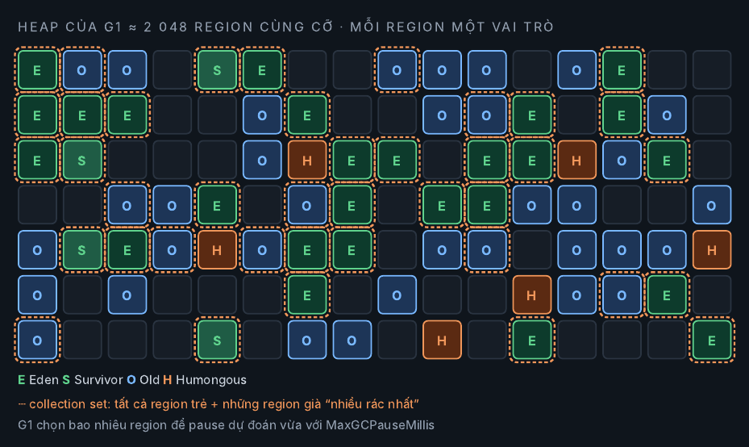
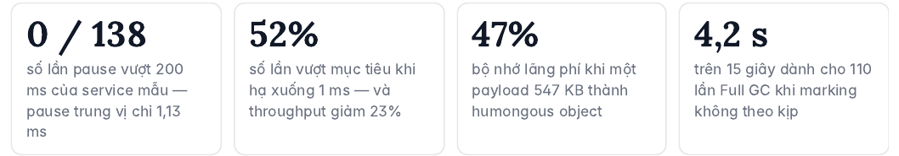
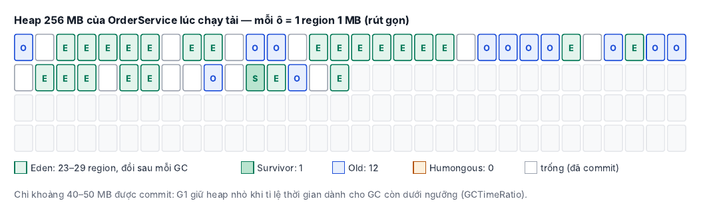
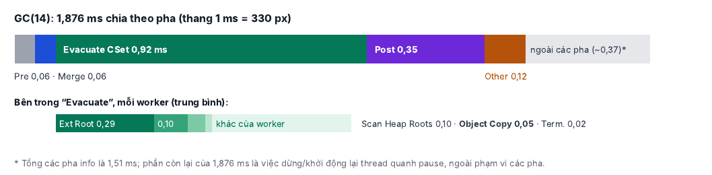
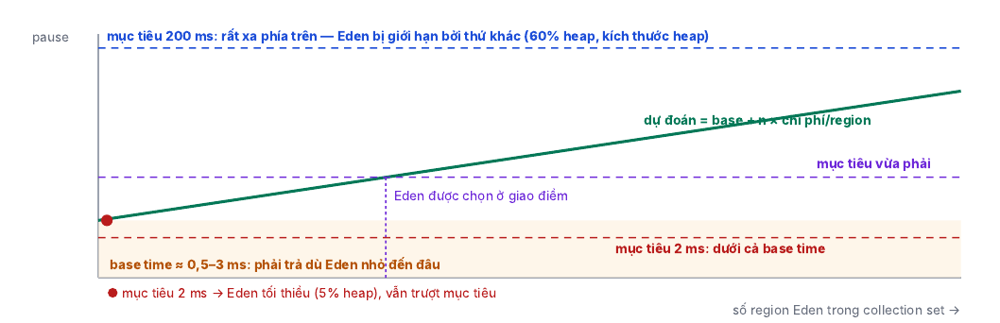
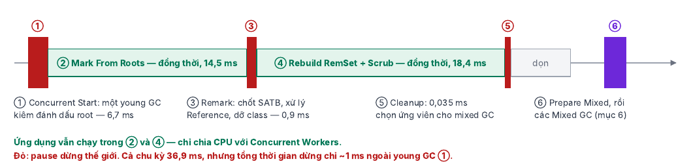

# Bài 11 — Mổ xẻ G1



*MaxGCPauseMillis=200 hứa hẹn điều gì?*

*Chặng III · Bộ nhớ & GC — region, dự đoán pause, mixed GC · Nền tảng: JDK 25 LTS / 27 · Thí nghiệm chạy thật trên OpenJDK 25*

[Bài 10](10-nen-tang-gc.md) dựng mô hình chung: truy vết từ root, copying, thế hệ, card table, safepoint. Bài 11 đặt mô hình đó vào GC mà phần lớn service Java đang chạy — và từ JDK 27 là GC mặc định ở *mọi* môi trường: **G1**. Mục tiêu là đọc được từng dòng log G1 và hiểu từng con số G1 tự quyết định.

> **VỀ CÁC CON SỐ TRONG BÀI** — Mọi log, bảng và con số đều lấy từ việc **chạy thật** trên OpenJDK 25.0.4 với G1, Linux x86-64, 2 vCPU. Ba “đối tượng thí nghiệm”: `OrderService` của [Bài 09](09-khoi-dong-nhanh-cds-aot-native.md) dưới tải `wrk` (heap 256 MB); `OldChurn` — giữ khoảng 98 MB session sống lâu và thay mới liên tục; `Humongous` — payload tạm có kích thước quanh ngưỡng nửa region. Mỗi cấu hình chạy một lần trừ khi ghi khác: đủ để thấy cơ chế, không đủ để xếp hạng chính xác. Thay đổi của G1 ở JDK 26–27 được ghi chú tại chỗ.

`MaxGCPauseMillis=200` thực sự hứa hẹn điều gì? Câu trả lời ngắn: không hứa gì cả — đó là một *mục tiêu* mà G1 dùng để tự chọn kích thước thế hệ trẻ và số region già dọn mỗi lần. Câu trả lời dài là cả bài này.



*Bốn con số trên đều đo được trong bài. Đến cuối bài, bạn sẽ biết G1 quyết định từng con số đó dựa vào đâu.*

## 1 Vì sao một dev Spring Boot nên quan tâm

- **G1 là GC bạn đang chạy** — trên mọi máy có từ 2 CPU và khoảng 2 GB RAM, và từ JDK 27 (JEP 523) trên cả pod 1 vCPU. Mọi tinh chỉnh GC bạn từng thấy trên Internet đều là tinh chỉnh G1.
- **“Hạ `MaxGCPauseMillis` xuống 50 cho latency tốt hơn”** là lời khuyên phổ biến nhất — và mục 4 cho thấy khi nào nó không làm gì, khi nào nó làm hại.
- **Payload lớn** — body JSON vài trăm KB, file upload, buffer của Jackson hay của driver — có thể trở thành humongous object với hành vi rất khác (mục 7).
- **“Full GC” trong log production** là tín hiệu G1 đã thất bại, không phải chuyện thường ngày; mục 8 tái hiện cách nó xảy ra.
- **Pod bị `OOMKilled`**: G1 tốn hàng chục MB bộ nhớ ngoài heap cho chính nó (mục 2) — một phần của bài toán ở [Bài 04](04-runtime-data-areas.md).

## 2 Heap chia thành region

Serial và Parallel chia heap thành vài vùng lớn liền mạch: Eden, hai Survivor, Old. G1 (Garbage-First) chia heap thành nhiều **region cùng kích thước** — mục tiêu khoảng 2 048 region — và gán vai trò cho từng region một cách động: Eden, Survivor, Old, Humongous, hoặc trống. Thế hệ trẻ không còn là một vùng cố định mà là “tập các region đang mang vai trò Eden/Survivor”, nên G1 có thể co giãn nó sau mỗi lần GC.

```text
$ for x in 256m 2g 8g 32g 64g; do java -XX:+UseG1GC -Xmx$x -Xlog:gc+init -version; done
-Xmx256m: Heap Region Size: 1M    -Xmx2g:  1M    -Xmx8g: 4M    -Xmx32g: 16M    -Xmx64g: 32M

$ java -XX:+UseG1GC -Xmx256m -Xlog:gc+init -version
CardTable entry size: 512
Compressed Oops: Enabled (32-bit)
Heap Region Size: 1M
Heap Min Capacity: 8M     Heap Initial Capacity: 94M     Heap Max Capacity: 256M
Parallel Workers: 2       Concurrent Workers: 1          Concurrent Refinement Workers: 2
```

Kích thước region là luỹ thừa của 2 từ 1 MB tới 32 MB khi để JVM tự chọn (có thể đặt tới 512 MB bằng `-XX:G1HeapRegionSize`). Ba nhóm thread đáng nhớ: **Parallel Workers** làm việc trong pause, **Concurrent Workers** đánh dấu đồng thời với ứng dụng, **Refinement Workers** xử lý card bẩn ([Bài 10](10-nen-tang-gc.md), mục 7).



*Hình 11.1 — Bố cục region của service mẫu, theo số liệu `Eden regions: 23->0`, `Survivor regions: 1->1`, `Old regions: 12->12` trong log. Vai trò là của region, không phải của địa chỉ: region Eden vừa được dọn sạch có thể trở thành region Old ở lần GC sau.*

### Cái giá ngoài heap

Remembered set cho từng region, card table, bitmap đánh dấu cho marking đồng thời (một bitmap từ JDK 20, trước đó là hai) — tất cả nằm ngoài heap. Native Memory Tracking ([Bài 01](01-buc-tranh-toan-canh-jvm.md), mục 7) cho thấy G1 tốn nhiều hơn rõ rệt so với Parallel trên cùng service:

| NMT, mục “GC” (committed), sau 3 giây tải | Heap 256 MB | Heap 2 GB |
|---|---:|---:|
| Parallel | 11 MB | 45 MB |
| **G1** | **42 MB** | **78 MB** |
| ZGC (để tham khảo) | 3 MB | 6 MB |

Với heap nhỏ, cấu trúc của G1 có thể bằng 16% chính heap. Đó là một dòng phải cộng vào khi tính `limits.memory` của pod. (ZGC hạch toán bộ nhớ khác — phần lớn dữ liệu của nó nằm trong chính heap — nên con số đó không có nghĩa là ZGC “rẻ hơn” về tổng thể.)

## 3 Một lần young GC, đọc từng dòng

Bật `-Xlog:gc*` cho `OrderService` dưới tải và chọn lần GC có thời gian gần trung vị nhất (1,88 ms) trong 39 lần:

```text
[info][gc,start ] GC(14) Pause Young (Normal) (G1 Evacuation Pause)                       ①
[info][gc,task  ] GC(14) Using 2 workers of 2 for evacuation
[info][gc,phases] GC(14)   Pre Evacuate Collection Set: 0.06ms                          ②
[info][gc,phases] GC(14)   Merge Heap Roots: 0.06ms                                     ③
[info][gc,phases] GC(14)   Evacuate Collection Set: 0.92ms                               ④
[debug]           GC(14)     Ext Root Scanning (ms):  Min: 0.28, Avg: 0.29, Max: 0.29
[debug]           GC(14)     Scan Heap Roots (ms):    Min: 0.09, Avg: 0.10, Max: 0.12
[debug]           GC(14)     Object Copy (ms):        Min: 0.04, Avg: 0.05, Max: 0.07
[debug]           GC(14)     Termination (ms):        Min: 0.00, Avg: 0.02, Max: 0.03
[info][gc,phases] GC(14)   Post Evacuate Collection Set: 0.35ms                         ⑤
[info][gc,phases] GC(14)   Other: 0.12ms
[info][gc,heap  ] GC(14) Eden regions: 23->0(23)                                      ⑥
[info][gc,heap  ] GC(14) Survivor regions: 1->1(3)
[info][gc,heap  ] GC(14) Old regions: 12->12
[info][gc,heap  ] GC(14) Humongous regions: 0->0
[info][gc       ] GC(14) Pause Young (Normal) (G1 Evacuation Pause) 34M->11M(40M) 1.876ms    ⑦
[info][gc,cpu   ] GC(14) User=0.00s Sys=0.00s Real=0.00s
```

① loại pause và nguyên nhân · ② chuẩn bị, chọn collection set · ③ gộp remembered set và card bẩn thành root · ④ việc chính: quét root ngoài heap (stack, class, JNI), quét card bẩn, chép object sống, chờ nhau cân tải · ⑤ dọn dẹp, trả region về danh sách trống · ⑥ trước → sau (mục tiêu cho lần sau) · ⑦ dòng tóm tắt: heap trước → sau (đã commit), thời gian.



*Hình 11.2 — Trong một young GC điển hình của service web, chép object sống (Object Copy) chỉ chiếm 0,05 ms — vì gần như mọi thứ là rác (Bài 10, mục 5). Phần lớn thời gian là quét root ngoài heap: stack của các thread, class, mã máy JIT. Đây là phần chi phí cố định mà mục 4 sẽ gặp lại dưới tên “base time”.*

Hai cách đọc nhanh. Dòng ⑦ là thứ nên đưa lên dashboard: loại pause, heap trước → sau (kích thước commit), thời gian. Dòng ⑥ cho biết thế hệ trẻ lần sau sẽ lớn bao nhiêu — số trong ngoặc là mục tiêu G1 vừa tính lại. Khi pause dài bất thường, nhìn vào pha lớn nhất: Object Copy lớn nghĩa là nhiều object sống sót ([Bài 10](10-nen-tang-gc.md) mục 7: cache); Scan Heap Roots lớn nghĩa là nhiều tham chiếu già → trẻ; Ext Root Scanning lớn thường là nhiều thread hoặc stack sâu.

> **MỘT PAUSE “LẠ” TRONG CÙNG LOG** — Lần GC(47) của cùng lần chạy mất 5,2 ms, trong đó “Pre Evacuate Collection Set” chiếm 4,03 ms — trong khi trung vị của pha này là 0,08 ms. Trên máy 2 vCPU mà `wrk` cũng đang chạy, worker của GC phải chờ được hệ điều hành cho chạy. Bài học: một pause đơn lẻ dài chưa chắc là lỗi của GC; nhìn phân bố (p90 của cả lần chạy là 4,08 ms) và các chỉ số CPU của container trước khi tinh chỉnh.

## 4 MaxGCPauseMillis: G1 dự đoán rồi co giãn thế hệ trẻ

G1 không thể biết trước một lần GC sẽ mất bao lâu, nhưng nó đo mọi lần GC đã qua và dựng một mô hình dự đoán. Ở mức đơn giản nhất:

**pause dự đoán** ≈ **base time** (chi phí cố định: quét root, gộp remset và card bẩn, mã máy, phần “Other”) + **số region trong collection set × chi phí mỗi region**

Mỗi thành phần là một trung bình có suy giảm theo thời gian, cộng thêm một biên độ an toàn. Sau mỗi lần GC, G1 giải ngược bài toán: *với mục tiêu `MaxGCPauseMillis`, thế hệ trẻ lần sau được phép có bao nhiêu region Eden?* Kết quả bị kẹp trong khoảng `G1NewSizePercent` = 5% đến `G1MaxNewSizePercent` = 60% heap, và còn chịu thêm ràng buộc MMU: trong mỗi cửa sổ `GCPauseIntervalMillis` = 201 ms, GC không được chiếm quá 200 ms.

### Thí nghiệm: cùng một service, năm mục tiêu

`OrderService`, heap 256 MB, làm nóng 5 giây rồi đo 10 giây tải `wrk`:

| MaxGCPauseMillis | req/s | Young GC | Eden (trung vị) | Pause trung vị / p90 / max | Vượt mục tiêu |
|---:|---:|---:|---:|---:|---:|
| 200 (mặc định) | 12 094 | 138 | 30 MB | 1,13 / 1,77 / 4,94 ms | 0 |
| 50 | 12 235 | 153 | 29 MB | 1,20 / 1,83 / 5,18 ms | 0 |
| 10 | 11 368 | 146 | 27 MB | 1,16 / 1,83 / 7,69 ms | 0 |
| 2 | 11 498 | 177 | **5 MB** | 1,06 / 1,61 / 6,34 ms | 13 (7%) |
| 1 | **9 347** | **406** | 9 MB | 1,01 / 2,61 / 7,98 ms | **213 (52%)** |

Từ 200 xuống 10 ms: **không có gì thay đổi**. Pause thật của service đã ở mức 1 ms; Eden không lớn hơn 30 MB không phải vì mục tiêu pause, mà vì G1 cũng giữ heap nhỏ khi tỉ lệ thời gian GC còn thấp. Mục tiêu chỉ bắt đầu “cắn” khi xuống dưới chi phí cố định của chính GC. Log ở mức `trace` cho thấy G1 lập luận thế nào với mục tiêu 2 ms:

```text
$ java -XX:MaxGCPauseMillis=2 -Xlog:gc*=trace ...
[trace][gc,ergo,heap] GC(87) Predicted total base time: total 2.815960 base_time 2.815960 ...
[trace][gc,ergo,heap] GC(87) Young desired length 6 surv 1 ... absolute min young length 6 absolute max young length 73
                             desired eden length by mmu 1 desired eden length by pause 5
[info ][gc          ] GC(87) Pause Young (Normal) (G1 Evacuation Pause) 16M->11M(123M) 3.315ms
```

Chỉ riêng phần cố định đã được dự đoán là 2,8 ms — vượt mục tiêu 2 ms trước khi chép một byte nào. G1 làm điều duy nhất có thể: thu thế hệ trẻ về mức tối thiểu (6 region = 5% của heap 123 MB lúc đó) và chấp nhận trượt mục tiêu. Kết quả: GC dày hơn, mỗi lần không ngắn hơn, throughput giảm.



*Hình 11.3 — Mô hình mà G1 dùng để biến một mục tiêu thời gian thành kích thước thế hệ trẻ (minh hoạ định tính; base time và độ dốc là các trung bình G1 tự đo). Hạ mục tiêu chỉ có tác dụng trong khoảng giữa: phía trên, các giới hạn khác quyết định; phía dưới, không có Eden nào đủ nhỏ.*

> **VẬY MAXGCPAUSEMILLIS=200 HỨA HẸN ĐIỀU GÌ?** — **Không hứa gì cả.** Nó là đầu vào cho mô hình dự đoán: G1 dùng nó để chọn kích thước thế hệ trẻ và số region già dọn mỗi lần mixed GC (mục 6). Nó không bao trùm Full GC (mục 8), thời gian chờ tới safepoint ([Bài 10](10-nen-tang-gc.md), mục 9), hay những khoảng trễ do CPU bị tranh. Với một service Spring Boot điển hình, pause đã ở mức vài mili-giây, nên **hạ con số này thường không làm gì** — hoặc, nếu hạ dưới chi phí cố định của GC, làm GC dày hơn và throughput giảm như dòng 1 ms ở trên. Trước khi chỉnh, đo phân bố pause thật; nếu p99 đã thấp hơn yêu cầu nhiều lần, hãy để yên mặc định.

## 5 Chu kỳ marking đồng thời

Young GC chỉ lấy lại chỗ của thế hệ trẻ. Thế hệ già lớn dần theo những object được thăng cấp, và một lúc nào đó phải biết trong đó có gì còn sống. Làm việc đó bằng một lần truy vết dừng cả ứng dụng sẽ mất hàng trăm mili-giây; G1 làm nó **đồng thời** với ứng dụng.

Để có kết quả kịp lúc, G1 bắt đầu marking khi thế hệ già chạm ngưỡng **IHOP** (Initiating Heap Occupancy Percent, mặc định 45% heap). Với **adaptive IHOP** (bật mặc định), G1 tự chỉnh ngưỡng dựa trên tốc độ thăng cấp và thời gian một chu kỳ marking, sao cho marking xong trước khi heap đầy. Thí nghiệm `OldChurn` giữ khoảng 98 MB session sống lâu và thay mới 30 000 session mỗi giây (khoảng 30 MB/s rác ở thế hệ già) trong heap 256 MB:

```text
$ java -Xmx256m -Xlog:gc,gc+marking,gc+ihop=debug,gc+ergo+cset=debug \
       OldChurn 100000 1000 20 30000
[4.667s][gc]         GC(16) Pause Young (Concurrent Start) 188M->182M(224M) 6.673ms
[4.667s][gc]         GC(17) Concurrent Mark Cycle
[4.683s][gc,marking] GC(17) Concurrent Mark From Roots 14.459ms
[4.684s][gc,ergo,cset] GC(17) Pruned 38 regions out of 152,
                        leaving 11706456 bytes waste (allowed 11744051)
[4.685s][gc]         GC(17) Pause Remark 183M->183M(256M) 0.903ms
[4.703s][gc,marking] GC(17) Concurrent Rebuild Remembered Sets and Scrub Regions 18.389ms
[4.703s][gc]         GC(17) Pause Cleanup 184M->184M(256M) 0.035ms
[4.704s][gc]         GC(17) Concurrent Mark Cycle 36.932ms
[5.056s][gc,ihop]    GC(18) Adaptive IHOP information ..., threshold: 120795955B (52.94), ...
```



*Hình 11.4 — Một chu kỳ marking thật của `OldChurn`, các khối vẽ theo thứ tự chứ không theo tỉ lệ thời gian. Trong lúc marking, mọi lệnh gán tham chiếu kích hoạt nhánh SATB của write barrier (Bài 10, mục 8, bước ①): giá trị cũ được ghi lại, nên object nào sống ở thời điểm bắt đầu sẽ được coi là sống — kể cả khi ứng dụng vừa xoá tham chiếu cuối cùng tới nó. Object cấp phát mới trong chu kỳ mặc nhiên là sống.*

Hai dòng log đáng giá nhất của chu kỳ này.

`Pruned 38 regions out of 152 … (allowed 11744051)`: sau marking, G1 biết chính xác mỗi region già có bao nhiêu byte sống; nó xếp chúng theo hiệu quả (nhiều rác, ít việc chép) và bỏ bớt những region đuôi cho tới khi lượng rác còn bỏ lại vừa bằng `G1HeapWastePercent` = 5% heap — 11,7 MB. Lấy lại nốt 5% đó không đáng công chép. Và `threshold … (52.94)`: adaptive IHOP đã nâng ngưỡng từ 45% lên 52,9% sau khi thấy marking hoàn thành nhanh hơn tốc độ heap đầy — bắt đầu muộn hơn, đỡ tốn CPU hơn.

## 6 Mixed GC: dọn dần thế hệ già

Sau chu kỳ marking, G1 không dọn thế hệ già một lần — điều đó sẽ tạo một pause dài. Nó trộn một phần region già vào các lần young GC kế tiếp: đó là **mixed GC**. Mỗi lần, G1 lại dùng mô hình của mục 4: thêm region già vào collection set chừng nào pause dự đoán còn trong mục tiêu, giữa một mức tối thiểu và tối đa.

```text
[gc,ergo,cset] GC(19) Start adding marking candidates to collection set.
               Min 15 regions, max 26 regions, available 114 regions (21 groups),
               time remaining 191.14ms, optional threshold 38.23ms
[gc,ergo,cset] GC(19) Finish adding marking candidates to collection set. Initial: 30 regions (4 groups),
               optional: 0 regions (0 groups), predicted initial time: 11.12ms, ...
[gc,heap]      GC(19) Old regions: 191->182
[gc]           GC(19) Pause Young (Mixed) (G1 Evacuation Pause) 216M->186M(256M) 10.798ms
[gc,heap]      GC(20) Old regions: 182->176      [gc] GC(20) Pause Young (Mixed) ... 9.640ms
[gc,heap]      GC(21) Old regions: 176->172      [gc] GC(21) Pause Young (Mixed) ... 9.134ms
```

Đối chiếu từng con số với các cờ mặc định:

| Trong log | Đến từ đâu |
|---|---|
| `Min 15 regions` | 114 ứng viên ÷ `G1MixedGCCountTarget` = 8 lần mixed GC → ít nhất 15 region mỗi lần, để dọn xong trong khoảng 8 lần. |
| `max 26 regions` | `G1OldCSetRegionThresholdPercent` = 10% của 256 region heap. |
| `time remaining 191.14ms` | Mục tiêu 200 ms trừ phần dự đoán cho region trẻ — ngân sách cho region già. |
| `predicted initial time: 11.12ms` | Dự đoán cho phần region già; pause thật cả lần GC: 10,8 ms. Mô hình khớp tới mili-giây. |
| `21 groups` | Ứng viên được gom thành nhóm dùng chung một remembered set — cách các bản JDK gần đây tiết kiệm bộ nhớ cho remset. |
| Chỉ xét region sống < 85% | `G1MixedGCLiveThresholdPercent` = 85: region gần đầy object sống không đáng chép. |

Kết quả qua 20 giây: 6 chu kỳ marking, 23 lần mixed GC, **0 Full GC**; số region già đi xuống sau mỗi lần mixed (191 → 182 → 176 → 172…) rồi lại tăng dần tới chu kỳ sau. Đây là trạng thái “khoẻ mạnh” của G1: thế hệ già được dọn từng ít một, mỗi lần dưới 11 ms, trong khi mục tiêu 200 ms còn dư rất xa.

## 7 Humongous object

Object nào lớn từ **nửa region** trở lên là **humongous**. G1 không đặt nó vào Eden mà cấp cho nó một hoặc nhiều region liền nhau, thẳng ở thế hệ già. Phần còn thừa của region cuối bị bỏ trống. Với region 1 MB, ngưỡng là 524 288 byte — một body JSON 600 KB, một mảng `byte[]` đọc cả file upload, hay mảng nội bộ của một `ArrayList` vài trăm nghìn phần tử đều vượt qua dễ dàng.

Thí nghiệm `Humongous` mô phỏng payload tạm: liên tục tạo mảng `byte[size]`, giữ 64 mảng gần nhất như các request đang xử lý. Heap 512 MB, region 1 MB, 8 giây mỗi cấu hình:

| Payload | Loại | Số GC | Nguyên nhân GC chiếm đa số | Humongous trước → sau GC |
|---|---|---:|---|---:|
| 391 KB | object thường | 577 | G1 Evacuation Pause | 0 → 0 |
| 547 KB | humongous, 1 region, **lãng phí 47%** | 626 | **G1 Humongous Allocation** (624, đều là Concurrent Start) | 228 → 64 |
| 1 074 KB | humongous, 2 region, lãng phí 48% | 1 454 | G1 Humongous Allocation (1 452) | 228 → 128 |
| 547 KB, region 2 MB | object thường | 719 | G1 Evacuation Pause | 0 → 0 |

Ba điều đọc ra. **Lãng phí**: 64 payload 547 KB đang sống chiếm 64 region — 64 MB cho 35 MB dữ liệu. **Mỗi lần cấp phát humongous là một lần kiểm tra IHOP**: vì object đi thẳng vào thế hệ già, gần như mọi GC trong hai cấu hình giữa đều là “Concurrent Start” — 624 chu kỳ marking trong 8 giây, mỗi chu kỳ tốn CPU của Concurrent Workers. **Nhưng G1 dọn chúng rất nhanh**: cơ chế *eager reclaim* giải phóng humongous object đã chết ngay trong young GC mà không cần chờ marking — 228 region còn 64, đúng bằng số payload còn đang dùng.

Tăng region lên 2 MB biến payload 547 KB thành object thường, và các GC trở về nhịp bình thường. Nhưng đó không phải bữa trưa miễn phí: object thường còn sống thì *bị chép* qua Survivor rồi sang thế hệ già, còn humongous object thì không bao giờ bị chép. Trong lần chạy này, số payload xử lý được trong 8 giây giảm từ 103 104 xuống 48 710 khi đổi sang region 2 MB — một lần chạy, nhưng đủ để thấy rằng “loại bỏ humongous” không tự động là cải thiện.

> **SPRING BOOT: PAYLOAD LỚN** — Dấu hiệu nhận biết: nhiều dòng `(G1 Humongous Allocation)` trong log, hoặc sự kiện `jdk.ObjectAllocationOutsideTLAB` với kích thước lớn trong JFR. Thủ phạm hay gặp: đọc cả body request/response vào một `byte[]` hay `String` (thay vì stream), `ObjectMapper.writeValueAsBytes` cho danh sách lớn, buffer của client HTTP hay driver được cấu hình quá to, `ArrayList` / `HashMap` phình tới hàng trăm nghìn phần tử. Cách xử lý ưu tiên là ở code — stream thay vì gom, phân trang thay vì trả cả danh sách; chỉnh `G1HeapRegionSize` là lựa chọn sau cùng, và cần đo lại như trên.

## 8 Khi G1 thất bại: evacuation failure và Full GC

Mọi cơ chế ở trên đều dựa vào một giả định: luôn còn region trống để chép object sống sang, và marking kết thúc trước khi heap đầy. Bỏ giới hạn tốc độ trong `OldChurn` — thay mới session nhanh nhất có thể, khoảng 1,26 GB mỗi giây — và giả định đó sụp đổ:

```text
$ java -Xmx256m -Xlog:gc,gc+marking OldChurn 100000 1000 15
[0.258s][gc] GC(20) Pause Young (Normal) (G1 Evacuation Pause) 233M->230M(256M) 4.357ms
[0.264s][gc] GC(21) Pause Young (Normal) (G1 Evacuation Pause) 240M->238M(256M) 3.594ms
[0.272s][gc] GC(22) Pause Young (Normal) (G1 Evacuation Pause) (Evacuation Failure: Allocation) 248M->255M(256M) 2.753ms
[0.274s][gc] GC(23) Pause Young (Normal) (G1 Evacuation Pause) (Evacuation Failure: Allocation) 256M->256M(256M) 1.548ms
[0.313s][gc] GC(24) Pause Full (G1 Compaction Pause) 256M->101M(256M) 39.373ms
[0.313s][gc,marking] GC(10) Concurrent Mark Abort
[0.313s][gc] GC(10) Concurrent Mark Cycle 145.548ms
```

Đọc theo thứ tự: heap đầy dần dù đang có marking (GC(10)); một young GC không tìm được region trống để chép object sống sang — **evacuation failure**: những object chưa chép được bị giữ nguyên tại chỗ, nên heap *sau* GC còn đầy hơn trước (248M → 255M). Lần thứ hai cũng vậy. G1 hết cách và rơi về **Full GC**: một lần mark–compact song song toàn heap, dừng thế giới, huỷ luôn chu kỳ marking đang dở. Trong 15 giây:

| Không giới hạn tốc độ thay mới (15 s) | Giá trị |
|---|---:|
| Evacuation failure | 201 lần |
| Full GC | 110 lần — trung vị 37,2 ms, lớn nhất 60,0 ms |
| Tổng thời gian trong Full GC | **4,17 s / 15 s** (28%) |

Pause 37 ms thoạt nhìn không đáng sợ — vì heap ở đây chỉ 256 MB. Full GC tỉ lệ với lượng object sống ([Bài 10](10-nen-tang-gc.md), mục 2): với heap 8 GB chứa 5 GB dữ liệu sống, cùng chuỗi sự kiện này cho pause hàng giây. Các nguyên nhân thường gặp, theo thứ tự nên kiểm tra: heap quá nhỏ so với dữ liệu sống (nhìn “heap sau GC” của các lần mixed); tốc độ thăng cấp vượt khả năng marking (tăng heap, hoặc tăng `ConcGCThreads` nếu còn CPU); quá nhiều humongous object gây phân mảnh; và rò rỉ bộ nhớ — khi “heap sau GC” tăng dần mãi ([Bài 14](14-log-gc-memory-leak.md)).

## 9 Đọc log G1 trên production

Log GC rẻ tới mức nên bật thường trực. Một cấu hình hợp lý cho service Spring Boot trong container:

```text
-Xlog:gc*,gc+ref=debug,gc+age=trace,safepoint\
      :file=/var/log/app/gc-%p.log:time,uptime,level,tags:filecount=5,filesize=20M
```

| Thấy trong log | Nghĩa là | Làm gì |
|---|---|---|
| `Pause Young (Normal)` đều đặn, vài ms | trạng thái bình thường | không làm gì |
| `Eden regions: … (n)` với n rất nhỏ, GC rất dày | mục tiêu pause thấp hơn chi phí cố định (mục 4) | nâng `MaxGCPauseMillis` về mặc định |
| Nhiều `Concurrent Start` và `Mixed` | thế hệ già chịu áp lực thăng cấp | xem tốc độ thăng cấp, kích thước dữ liệu sống |
| Nhiều `(G1 Humongous Allocation)` | payload lớn (mục 7) | stream thay vì gom; cân nhắc region lớn hơn |
| `Pause Remark` dài | nhiều `Reference`/finalizer, dỡ nhiều class | bật `gc+ref=debug`; xem [Bài 15](15-reference-off-heap.md) |
| `Evacuation Failure`, `Pause Full`, `Concurrent Mark Abort` | G1 đã thất bại (mục 8) | cảnh báo ngay; tăng heap hoặc tìm leak |
| Heap sau mỗi lần mixed tăng dần qua nhiều giờ | dữ liệu sống tăng: cache hoặc leak | heap dump, Eclipse MAT ([Bài 14](14-log-gc-memory-leak.md)) |

> **SPRING BOOT ACTUATOR: NHỮNG SỐ ĐO ĐÃ CÓ SẴN** — Micrometer (qua Actuator) xuất sẵn các chỉ số GC cho Prometheus: `jvm.gc.pause` (timer, gắn nhãn `action` và `cause` — tách được “end of minor GC” với “end of major GC”), `jvm.gc.memory.allocated` và `jvm.gc.memory.promoted` (tốc độ cấp phát và thăng cấp của [Bài 10](10-nen-tang-gc.md)), `jvm.gc.live.data.size` (thế hệ già sau GC), `jvm.gc.concurrent.phase.time`. Ba cảnh báo đáng có: bất kỳ pause nào có `cause` chứa “Full”; `live.data.size` vượt khoảng 70% heap; và p99 của `jvm.gc.pause` vượt yêu cầu latency của bạn — chỉ khi đó mới bắt đầu nghĩ tới tinh chỉnh.

## 10 Ghép lại: một trang để nhớ cả bài

| Cơ chế | Ý tưởng | Cờ / log | Đo trong bài |
|---|---|---|---|
| Region | ~2 048 region cùng cỡ, vai trò gán động | `G1HeapRegionSize`, `gc+init` | 1 MB (256 MB heap) … 32 MB (64 GB) |
| Chi phí native | remset, card table, bitmap ngoài heap | NMT “GC” | 42 MB vs 11 MB của Parallel |
| Young GC | sơ tán toàn bộ region trẻ | `gc+phases` | 1,88 ms; Object Copy 0,05 ms |
| Mục tiêu pause | dự đoán base + n × chi phí → chọn Eden | `MaxGCPauseMillis`, `gc+ergo*=trace` | 200→10 ms: không đổi; 1 ms: 52% trượt, −23% req/s |
| Marking | đồng thời, SATB, kích hoạt bởi IHOP | `gc+marking`, `gc+ihop` | chu kỳ 36,9 ms; Remark 0,9 ms; IHOP 45→52,9% |
| Mixed GC | dọn dần region già nhiều rác nhất | `gc+ergo+cset` | 15–26 region/lần; dự đoán 11,1 vs thật 10,8 ms |
| Humongous | ≥ nửa region, cấp nguyên region | `(G1 Humongous Allocation)` | lãng phí 47%; 624 chu kỳ marking / 8 s |
| Thất bại | hết chỗ sơ tán → Full GC | `Evacuation Failure`, `Pause Full` | 110 Full GC, 4,17 s / 15 s |

Tóm cả bài trong một đoạn: *G1 chia heap thành region và gán vai trò động, nên có thể chọn dọn bao nhiêu mỗi lần. Lựa chọn đó dựa trên một mô hình dự đoán: chi phí cố định cộng chi phí theo từng region, giải ngược từ `MaxGCPauseMillis` ra số region Eden và số region già cho mỗi lần dọn. Thế hệ già được đánh dấu đồng thời khi chạm IHOP, rồi được dọn dần qua các mixed GC theo thứ tự region nhiều rác nhất trước — đúng nghĩa cái tên Garbage-First. `MaxGCPauseMillis` là một mục tiêu cho mô hình đó, không phải một lời hứa: nó vô tác dụng khi pause đã nhỏ, có hại khi đặt dưới chi phí cố định, và không bao trùm humongous, safepoint hay Full GC — thứ chỉ xảy ra khi G1 đã thất bại.*

## 11 Hiểu lầm thường gặp, bài tập, bài tiếp theo

### Hiểu lầm thường gặp

| Hiểu lầm | Thực tế |
|---|---|
| “`MaxGCPauseMillis` là thời gian pause tối đa.” | Là mục tiêu cho mô hình dự đoán. Có thể bị vượt; không áp dụng cho Full GC hay thời gian chờ safepoint. |
| “Hạ `MaxGCPauseMillis` luôn làm latency tốt hơn.” | Từ 200 xuống 10 ms không đổi gì; xuống 1 ms làm GC dày gấp 3, 52% vẫn trượt và throughput giảm 23% (mục 4). |
| “Đặt `-Xmn` để young gen ổn định là tốt.” | Cố định thế hệ trẻ tắt luôn khả năng co giãn để giữ mục tiêu pause của G1. Chỉ làm khi có lý do đo được. |
| “G1 dọn thế hệ già bằng một lần GC lớn.” | Marking đồng thời, rồi nhiều mixed GC nhỏ — mỗi lần dưới 11 ms trong thí nghiệm. Lần dọn lớn toàn heap là Full GC, tức là thất bại. |
| “Humongous object luôn xấu.” | Lãng phí bộ nhớ và kích hoạt marking, nhưng không bị chép và được dọn sớm bằng eager reclaim. Đổi region lớn hơn có thể làm chậm hơn (mục 7). |
| “Heap của G1 là tất cả bộ nhớ GC dùng.” | Cấu trúc của G1 ngoài heap: 42 MB ở heap 256 MB, 78 MB ở heap 2 GB. |
| “Full GC thỉnh thoảng là bình thường.” | Với G1, Full GC nghĩa là cơ chế bình thường đã không theo kịp. Nên có cảnh báo cho nó. |

### Bài tập tự làm (khoảng 45 phút)

> **THỰC HÀNH**
>
> 1. **Mục tiêu pause của bạn** (bài tập quan trọng nhất). Lấy phân bố `jvm.gc.pause` của service thật (p50, p99, max) trong một tuần. Nó cách 200 ms bao xa? Có ai từng hạ `MaxGCPauseMillis` mà không đo trước không?
> 2. **Đọc một chu kỳ**: bật `-Xlog:gc,gc+marking,gc+ihop=debug` trên môi trường staging, tìm một chu kỳ “Concurrent Start → Remark → Cleanup → Prepare Mixed → Mixed”. Ngưỡng IHOP thích nghi đang là bao nhiêu phần trăm?
> 3. **Tìm humongous**: đếm số dòng `G1 Humongous Allocation` trong một giờ log. Dùng JFR (`jdk.ObjectAllocationOutsideTLAB`) để biết stack nào cấp phát chúng.
> 4. **Ép G1 thất bại**: chạy `OldChurn 100000 1000 15` với `-Xmx256m`, rồi `-Xmx512m` và `-Xmx1g`. Ở heap nào Full GC biến mất?
> 5. **Chi phí ngoài heap**: so NMT mục “GC” của service bạn với G1 và với `-XX:+UseParallelGC`. Con số đó đã nằm trong cách bạn tính `limits.memory` chưa?

### Thuật ngữ của bài

| Thuật ngữ | Nghĩa ngắn gọn |
|---|---|
| Region | Đơn vị quản lý heap của G1, cùng kích thước (1–32 MB), vai trò gán động. |
| Collection set (CSet) | Tập region được sơ tán trong một lần pause. |
| Evacuation | Chép object sống ra khỏi các region trong collection set. |
| Base time | Phần chi phí của một lần GC không phụ thuộc số region được sơ tán. |
| MMU | Minimum Mutator Utilization — tỉ lệ thời gian tối thiểu dành cho ứng dụng trong một cửa sổ. |
| IHOP | Ngưỡng chiếm dụng heap bắt đầu chu kỳ marking; có thể tự thích nghi. |
| SATB | Snapshot-At-The-Beginning — coi mọi object sống lúc bắt đầu marking là sống. |
| Remark / Cleanup | Hai pause ngắn kết thúc marking và chọn ứng viên cho mixed GC. |
| Mixed GC | Young GC kèm thêm một phần region già. |
| Humongous object | Object ≥ nửa region, được cấp nguyên region ở thế hệ già. |
| Eager reclaim | Giải phóng humongous object đã chết ngay trong young GC. |
| Evacuation failure | Không còn chỗ để chép object sống; dẫn tới Full GC nếu lặp lại. |

> **BÀI TIẾP THEO · BÀI 12** — **ZGC và Shenandoah.** Con trỏ màu và load barrier, di chuyển object trong khi ứng dụng vẫn chạy, ZGC thế hệ (mặc định từ JDK 23, bản không thế hệ bị gỡ ở JDK 24) và Shenandoah thế hệ (chính thức ở JDK 25). [Bài 10](10-nen-tang-gc.md) đã thấy ZGC dừng 0,01 ms nhưng throughput thấp hơn 20% trên 2 vCPU — [Bài 12](12-zgc-shenandoah.md) đo xem khoảng chênh đó đến từ đâu. Câu hỏi của bài: *pause dưới 1 ms đổi lấy cái giá nào?*

### Tài liệu tham khảo

- HotSpot Virtual Machine Garbage Collection Tuning Guide (JDK 25) — chương “Garbage-First (G1) Garbage Collector”. docs.oracle.com/en/java/javase/25/gctuning
- Detlefs, Flood, Heller, Printezis — “Garbage-First Garbage Collection”, ISMM 2004.
- Thomas Schatzl — blog về các thay đổi của G1 qua từng phiên bản JDK. tschatzl.github.io
- JEP 307 (Full GC song song cho G1, JDK 10), JEP 522 (barrier mới, JDK 26), JEP 523 (G1 mặc định mọi môi trường, JDK 27). openjdk.org/jeps
- Micrometer — `JvmGcMetrics`. docs.micrometer.io
