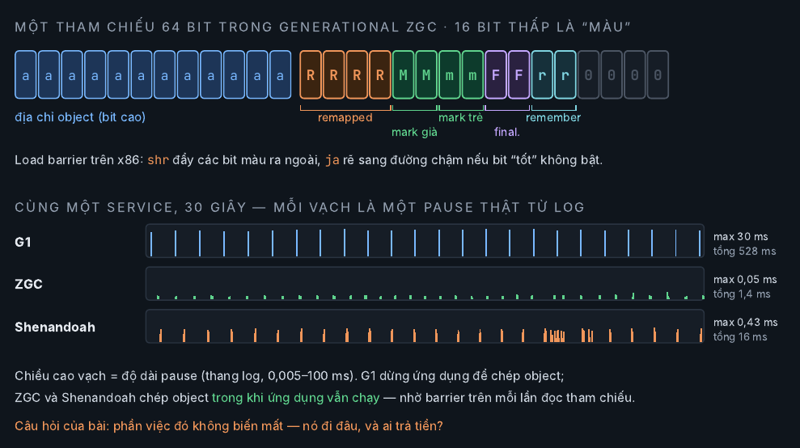
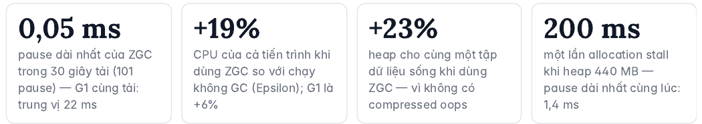
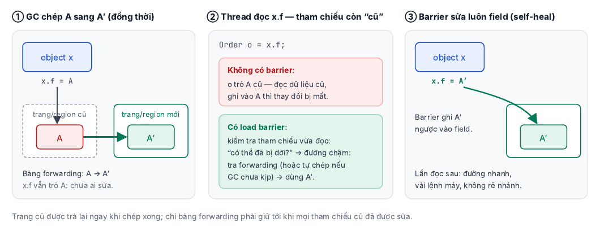
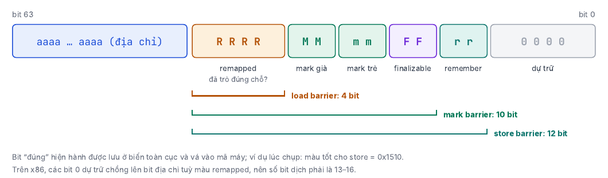
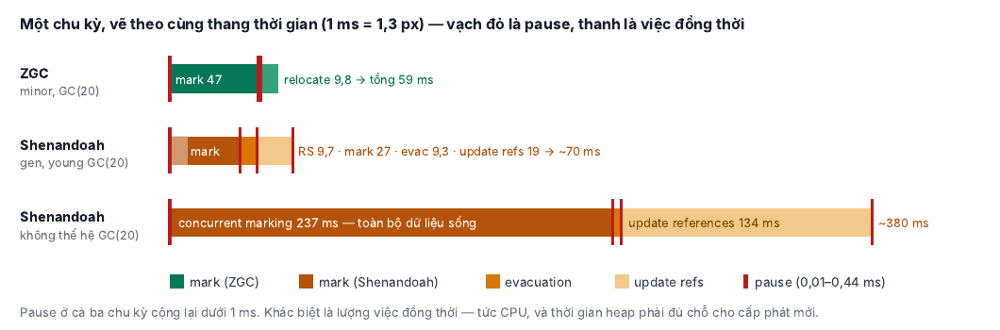
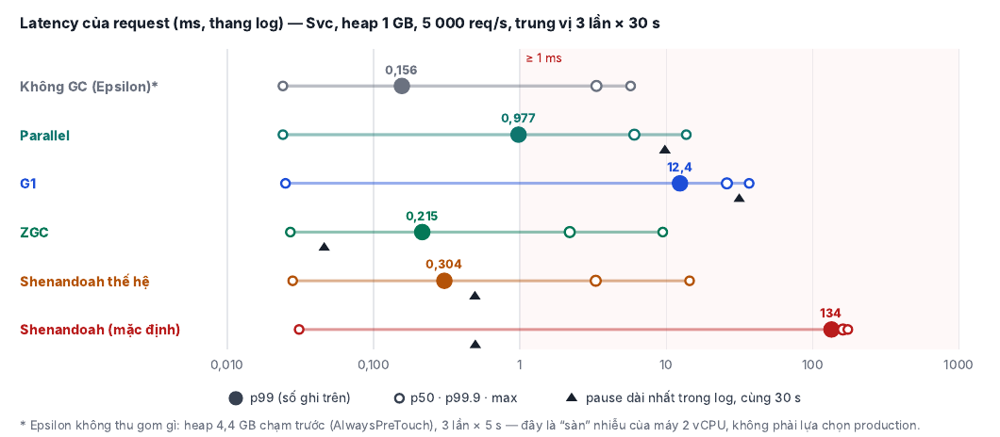
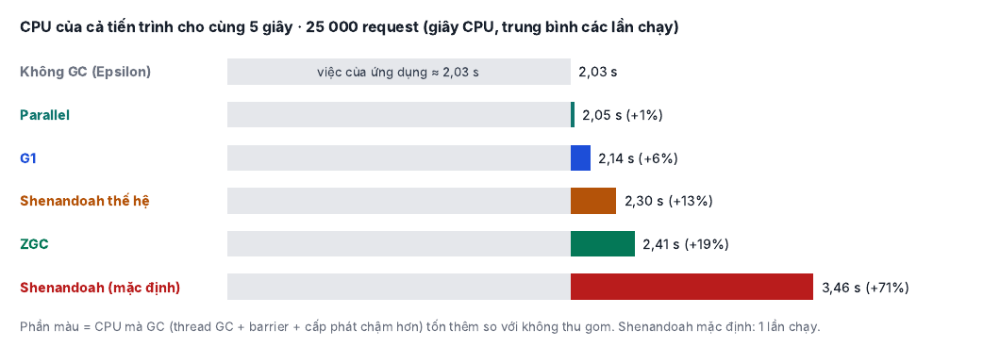
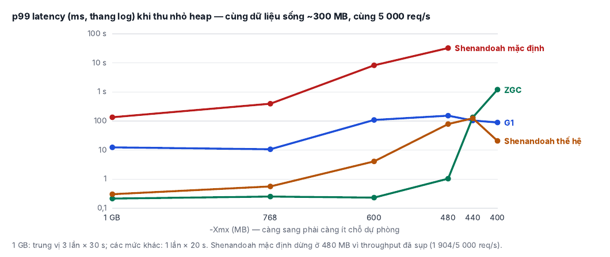

# Bài 12 — ZGC & Shenandoah



*Pause dưới 1 ms đổi lấy cái giá nào?*

*Chặng III · Bộ nhớ & GC — colored pointer, load barrier, relocation đồng thời · Nền tảng: JDK 25 LTS / 27 · Thí nghiệm chạy thật trên OpenJDK 25*

[Bài 11](11-mo-xe-g1.md) cho thấy G1 vẫn phải dừng ứng dụng để chép object sống — pause của nó tỉ lệ với lượng object sống trong collection set. Bài 12 mổ xẻ hai GC dời được cả việc chép object ra khỏi pause: **ZGC** và **Shenandoah**. Pause rơi xuống dưới 1 ms thật — nhưng phần việc không biến mất. Bài này đo xem nó đi đâu.

> **VỀ CÁC CON SỐ TRONG BÀI** — Mọi log, mã máy, bảng và con số đều lấy từ việc **chạy thật** trên OpenJDK 25.0.4 (và 21.0.12 cho phép so sánh ZGC cũ/mới), Linux x86-64, **2 vCPU**, 8 GB RAM. Đối tượng thí nghiệm chính là `Svc` — một service giả lập: cache khoảng 300 MB session sống lâu, mỗi request cấp phát ~90 KB rác và thay một session; 5 000 request/giây được lên lịch cố định (open-loop), latency tính từ thời điểm request *lẽ ra* bắt đầu. Máy 2 vCPU là môi trường khắc nghiệt cho GC đồng thời — vốn cần CPU rảnh — nên các con số phóng đại cái giá so với máy nhiều lõi. Mỗi cấu hình chạy 1–3 lần như ghi chú; đủ để thấy cơ chế và chiều hướng, không đủ để xếp hạng chính xác.

Pause dưới 1 ms đổi lấy cái giá nào? Câu trả lời ngắn: **CPU, bộ nhớ dự phòng, và một kiểu chờ mới không nằm trong “pause”**. Khi đủ cả ba, chúng cho latency gần như không có GC. Khi thiếu một, ứng dụng vẫn bị chặn — chỉ là log pause không còn cho bạn thấy.



*Bốn con số trên đều đo được trong bài. Pause nhỏ là thật; ba con số sau là phần “hoá đơn”.*

## 1 Vì sao một dev Spring Boot nên quan tâm

- **“Chuyển sang ZGC cho hết pause”** là lời khuyên ngày càng phổ biến — và thường đúng với service có heap lớn, nhiều dữ liệu sống, SLA chặt ở p99. Nhưng với pod 2 vCPU, heap chật, nó có thể làm p99 *tệ hơn* G1 (mục 9).
- **Dashboard `jvm.gc.pause` toàn màu xanh** không có nghĩa GC không làm chậm request. Với ZGC/Shenandoah, thứ cần nhìn là allocation stall và pacing — hai chỉ số mặc định không có trên dashboard (mục 10).
- **Pod bị `OOMKilled` sau khi đổi GC**: cùng dữ liệu, ZGC cần heap lớn hơn và RSS cao hơn (mục 8).
- **Hoá đơn cloud**: GC đồng thời ăn CPU thật, liên tục, kể cả khi bạn không thấy pause nào (mục 7).
- **Phiên bản JDK quyết định bạn có gì**: ZGC thế hệ là mặc định từ JDK 23 và là chế độ duy nhất từ JDK 24; Shenandoah thế hệ chính thức từ JDK 25 và (theo JEP 535) sẽ là mặc định ở JDK 28. Chạy JDK 21 với `-XX:+UseZGC` là đang dùng bản *không* phân thế hệ (mục 6).

## 2 Bài toán: dời object khi ứng dụng vẫn chạy

[Bài 10](10-nen-tang-gc.md) và 11 đã có đủ mảnh ghép để đánh dấu đồng thời: SATB barrier ghi lại tham chiếu bị ghi đè, nên GC có thể truy vết trong khi ứng dụng vẫn chạy. G1 làm vậy cho thế hệ già. Phần còn lại của G1 thì không đồng thời: **chép object sống sang region mới (evacuation) và sửa mọi tham chiếu trỏ tới chúng** — làm trong pause, nên pause tỉ lệ với số object sống phải chép.

Muốn chép trong khi ứng dụng chạy, phải trả lời một câu hỏi khó: nếu GC vừa chép object A sang chỗ mới A′, mà một thread của ứng dụng đang cầm (hoặc sắp đọc từ một field) tham chiếu tới A cũ thì sao? Nếu thread đó ghi vào A cũ, thay đổi sẽ mất; nếu đọc, nó có thể thấy dữ liệu cũ. Cả ZGC lẫn Shenandoah giải bằng cùng một ý: đặt một đoạn mã nhỏ — **barrier** — vào *mỗi lần đọc một tham chiếu từ heap*, để không thread nào cầm được tham chiếu tới bản cũ.



*Hình 12.1 — Ý tưởng chung của relocation đồng thời. Barrier nằm trên đường đọc tham chiếu: mọi thread của ứng dụng đều trở thành “trợ lý” của GC — tự sửa tham chiếu cũ khi gặp, thậm chí tự chép object nếu tới trước GC. Phần lớn lần đọc đi đường nhanh; đường chậm chỉ chạy trong một khoảng ngắn sau mỗi đợt dời.*

Hai thiết kế khác nhau ở chỗ “làm sao biết tham chiếu này có thể đã cũ”. ZGC giấu thông tin đó **trong chính con trỏ** (colored pointer). Shenandoah giữ con trỏ bình thường và đặt **địa chỉ mới vào header của object cũ**. Cả hai đều trả cùng một loại giá: một đoạn mã thêm trên mỗi lần đọc tham chiếu, chạy suốt đời ứng dụng — không chỉ trong lúc GC.

| | G1 (Bài 11) | ZGC | Shenandoah |
|---|---|---|---|
| Đánh dấu | đồng thời (thế hệ già) | đồng thời | đồng thời |
| Chép object sống | **trong pause** | đồng thời | đồng thời |
| Sửa tham chiếu | trong pause | lười: barrier tự sửa, phần còn lại gộp vào lần đánh dấu sau | một pha riêng đồng thời: *update references* |
| Pause tỉ lệ với | số object sống phải chép, root | gần như hằng số — cả stack của thread cũng được quét đồng thời (JEP 376, JDK 16) | gần như hằng số — stack quét đồng thời (pha *Concurrent thread roots*) |
| Barrier chính | ghi (card, SATB) | đọc (load) + ghi (store) | đọc (LRB) + ghi (SATB, card ở chế độ thế hệ) |
| Compressed oops | có | **không** | có |

## 3 ZGC: colored pointer và load barrier

ZGC dùng con trỏ 64 bit, trong khi địa chỉ thật của heap chỉ cần vài chục bit. Generational ZGC (JDK 21+) đặt **16 bit thấp** của mỗi tham chiếu nằm trong heap làm “màu”: trạng thái của chính tham chiếu đó so với chu kỳ GC hiện tại — đã được dời/sửa chưa, đã đánh dấu chưa (riêng cho thế hệ trẻ và già), đã được ghi vào remembered set chưa. Bố cục lấy nguyên từ mã nguồn JDK 25 (`zAddress.hpp`):



*Hình 12.2 — Một tham chiếu trong heap của Generational ZGC. Ở mỗi thời điểm có đúng một tổ hợp bit được coi là “tốt”; khi GC chuyển pha (ví dụ bắt đầu dời object), nó đổi định nghĩa “tốt” chỉ bằng một biến toàn cục — mọi tham chiếu trong heap lập tức thành “xấu” mà không phải chạm vào chúng. Barrier sẽ sửa từng cái khi gặp.*

### Load barrier: hai lệnh máy

Để xem barrier thật, biên dịch một hàm đọc field bằng C2 và in mã máy (cách dùng `PrintAssembly` không cần hsdis như [Bài 08](08-toi-uu-jit.md)):

```text
$ java -XX:+UseZGC -XX:-TieredCompilation -XX:CompileCommand=print,Asm::load ... Asm
# static Object load(Holder h) { return h.f; }   — C2, objdump từ mã máy in ra
  cmpl   $0x1510,0x68(%r15)     # nmethod entry barrier: so màu “tốt” hiện tại (0x1510)
  jne    ...
  test   %rsi,%rsi              # h == null?
  je     ...
  mov    0x10(%rsi),%rax        # đọc h.f: con trỏ 64 bit CÓ MÀU (không compressed oops)
  shr    $0xd,%rax              # bỏ 13 bit thấp: màu ra ngoài, địa chỉ thật ở lại
  ja     slow_path              # CF=0 và kết quả ≠ 0  →  màu xấu
  add    $0x10,%rsp ... ret
slow_path:
  call   ZBarrierSetRuntime::load_barrier_on_oop_field_preloaded   # tra forwarding, tự sửa field

# cùng hàm với G1 — không có barrier đọc:
  mov    0xc(%rsi),%r11d        # đọc h.f: compressed oop 32 bit
```

Mẹo nằm ở lệnh `shr`: dịch phải (13 bit lúc chụp; từ 13 tới 16 tuỳ màu hiện hành) vừa **bỏ màu** (con trỏ còn lại là địa chỉ thật, dùng được ngay) vừa đẩy bit cuối cùng bị dịch ra vào cờ Carry. Số bit dịch được *vá trực tiếp vào mã máy* mỗi khi GC đổi màu “tốt”, sao cho bit bị đẩy ra cuối cùng đúng là bit remapped tốt. `ja` (nhảy nếu Carry = 0 và kết quả ≠ 0) nghĩa là: tham chiếu khác null mà màu không tốt → đường chậm. Trường hợp thường gặp nhất tốn đúng hai lệnh và một rẽ nhánh hầu như luôn đoán đúng.

Generational ZGC còn có **store barrier** trên mỗi lần ghi tham chiếu: nó tô màu cho con trỏ trước khi ghi, ghi field vào remembered set khi cần (thay cho card table của G1 — chính xác tới từng field) và hỗ trợ đánh dấu SATB. Bản không phân thế hệ (JDK 11–23) chỉ có load barrier, nhưng phải đánh dấu toàn bộ heap mỗi chu kỳ — mục 6 đo sự khác biệt đó.

```text
# static void store(Holder h, Object o) { h.f = o; }  — ZGC, C2
  testl  $0xeae0,0x10(%rsi)     # giá trị CŨ trong field có màu “store-good” chưa?
  jne    medium_path            # chưa → ghi (địa chỉ field, giá trị cũ) vào buffer của thread
  mov    %rdx,%r10
  shl    $0xd,%r10              # chừa chỗ cho màu
  or     $0x1510,%r10           # tô màu “tốt” hiện hành
  mov    %r10,0x10(%rsi)        # ghi con trỏ có màu vào h.f
```

## 4 Shenandoah: forwarding trong header và LRB

Shenandoah (do Red Hat phát triển, chính thức từ JDK 15) giải cùng bài toán nhưng không đụng vào con trỏ — nhờ vậy nó **giữ được compressed oops**. Khi GC chép object A sang A′, nó ghi địa chỉ của A′ vào **mark word** (header, [Bài 05](05-object-trong-ram.md)) của bản cũ và đặt 2 bit thấp thành `11` nghĩa là “đã bị dời”. Mỗi lần đọc tham chiếu, **load-reference barrier (LRB)** đảm bảo thread chỉ bao giờ thấy bản mới: nếu object nằm trong vùng đang dời và đã có bản mới thì lấy bản mới; nếu chưa, thread tự chép rồi mới dùng.

Câu hỏi “có cần kiểm tra không?” được trả lời bằng một byte trạng thái riêng của mỗi thread — `gc_state` — mà GC bật/tắt ở các pause ngắn:

| Bit của `gc_state` (JDK 25) | Bật khi | Barrier nào phải chạy |
|---|---|---|
| `HAS_FORWARDED` = 1 | heap có thể chứa object đã bị dời | LRB trên mỗi lần đọc tham chiếu |
| `MARKING` = 2 | đang đánh dấu đồng thời | SATB trên mỗi lần ghi tham chiếu (như G1) |
| `EVACUATION` = 4 | đang chép object | LRB có thể phải tự chép |
| `UPDATE_REFS` = 8 | đang sửa tham chiếu toàn heap | không thêm |
| `YOUNG_/OLD_MARKING` = 32/64 | chế độ thế hệ | SATB cho thế hệ tương ứng |

Mã máy C2 sinh ra cho cùng hàm đọc field:

```text
$ java -XX:+UseShenandoahGC -XX:-TieredCompilation -XX:CompileCommand=print,Asm::load ... Asm
  add    $0xc,%rsi
  mov    (%rsi),%r11d           # đọc h.f: compressed oop 32 bit — giữ được nhờ không “tô màu” con trỏ
  mov    %r11,%rax
  testb  $0x1,0x38(%r15)        # gc_state của thread hiện tại có HAS_FORWARDED?
  jne    mid_path               # GC rảnh: không bao giờ nhảy
  add    $0x10,%rsp ... ret
mid_path:
  mov    %rax,%r10
  shr    $0x13,%r10             # địa chỉ → số region (region 512 KB = 2^19)
  cmpb   $0x0,0x1000(%r10)      # region này có trong collection set không?
  je     back                   # không → tham chiếu chắc chắn đúng, dùng luôn
  call   ShenandoahRuntime::load_reference_barrier_strong_narrow   # lấy (hoặc tạo) bản mới
```

Khác ZGC: barrier của Shenandoah **tắt hẳn** khi GC rảnh — đường nhanh chỉ là một lệnh `test` lên byte trạng thái (luôn nằm trong cache L1) và một rẽ nhánh không bao giờ nhảy. Đổi lại, vì tham chiếu cũ không tự “đổi màu”, Shenandoah phải có một pha riêng đi khắp heap sửa mọi tham chiếu trỏ vào vùng đã dời: **update references**. Pha này tỉ lệ với *toàn bộ* heap đang dùng, không chỉ với phần được dọn — mục 5 cho thấy nó dài gần bằng pha đánh dấu.

> **LỊCH SỬ NGẮN, ĐỂ ĐỌC TÀI LIỆU CŨ KHÔNG BỊ LẠC** — **ZGC**: thử nghiệm ở JDK 11 → chính thức JDK 15 → quét stack đồng thời JDK 16 (JEP 376) → **Generational ZGC** JDK 21 (JEP 439, bật bằng `-XX:+ZGenerational`) → mặc định JDK 23 (JEP 474) → **bản không thế hệ bị gỡ** ở JDK 24 (JEP 490). Tài liệu nói về “multi-mapping”, RSS gấp ba heap, hay giới hạn 4 TB/16 TB là nói về bản cũ.
>
> **Shenandoah**: thử nghiệm JDK 12 → chính thức JDK 15. Từ JDK 13, “Brooks pointer” (một word thêm trên mỗi object) được thay bằng forwarding trong mark word và LRB. Chế độ thế hệ thử nghiệm JDK 24 (JEP 404) → **chính thức JDK 25** (JEP 521) nhưng chưa mặc định → **JEP 535** (đã targeted cho JDK 28) đưa nó thành mặc định. Lưu ý: không phải bản build nào cũng có Shenandoah — các bản của Oracle từ trước tới nay không kèm nó; kiểm tra bằng `java -XX:+UseShenandoahGC -version`.

## 5 Đọc một chu kỳ ZGC và Shenandoah, từng dòng

Chạy `Svc` (heap 1 GB, 5 000 request/s) với `-Xlog:gc*` và chọn một chu kỳ ở trạng thái ổn định. Với ZGC, hầu hết chu kỳ là **Minor Collection** — chỉ thu dọn thế hệ trẻ:

```text
GC(20) Minor Collection (Allocation Rate)                                    ①
GC(20) y: Pause Mark Start 0.015ms                                           ②
GC(20) y: Concurrent Mark 47.003ms                                           ③
GC(20) y: Pause Mark End 0.012ms
GC(20) y: Concurrent Select Relocation Set 1.439ms                           ④
GC(20) y: Pause Relocate Start 0.011ms
GC(20) y: Concurrent Relocate 9.774ms                                        ⑤
GC(20) y: Allocation Stalls:     0     0     0     0                         ⑥
GC(20) y: MMU: 2ms/98.2%, 5ms/99.3%, 10ms/99.6%, 20ms/99.7%, ...             ⑦
GC(20) y:               Candidates  Selected  In-Place   Size  Empty  Relocated
GC(20) y: Small Pages:         255       242         0   510M     0M         4M  ⑧
GC(20) y: Eden    Live 3M (0%)   Garbage 482M (47%)
GC(20) y:  Free:  110M (11%)   84M (8%)   82M (8%)   560M (55%) ...  low 80M  ⑨
GC(20) Minor Collection (Allocation Rate) 914M(89%)->464M(45%) 0.059s          ⑩
```

*Bảng nhiều cột của ZGC được rút gọn khoảng trắng; giá trị giữ nguyên. Bốn cột ở ⑥ và ⑨ là bốn mốc: Mark Start, Mark End, Relocate Start, Relocate End.*

① nguyên nhân: tốc độ cấp phát dự báo sẽ làm đầy heap · ② ba pause, mỗi cái ~0,01 ms: chỉ để đồng bộ trạng thái, đổi màu “tốt” · ③ đánh dấu thế hệ trẻ đồng thời, 1 worker · ④ chọn trang đáng dọn · ⑤ chép object sống đồng thời · ⑥ số lần thread phải *chờ* vì hết bộ nhớ, theo từng pha — dòng quan trọng nhất (mục 9) · ⑦ MMU: trong mọi cửa sổ 2 ms, ứng dụng được chạy ít nhất 98,2% · ⑧ 255 trang nhỏ (2 MB) ứng viên, chọn 242 — nhưng chỉ phải chép **4 MB** · ⑨ heap trống: 11% lúc bắt đầu, thấp nhất 8%, 55% lúc xong · ⑩ toàn chu kỳ 59 ms, ứng dụng bị dừng tổng cộng 0,038 ms.

Shenandoah ở chế độ mặc định (không thế hệ) mỗi chu kỳ phải đi qua **toàn bộ heap**:

```text
Trigger: Average GC time (372.67 ms) is above the time for average allocation rate (450 MB/s)
         to deplete free headroom (167M) (margin of error = 1.96)
GC(20) Pause Init Mark (unload classes) 0.064ms
GC(20) Concurrent marking (unload classes) 236.984ms               ← đánh dấu cả ~290 MB dữ liệu sống
GC(20) Pause Final Mark (unload classes) 0.438ms
GC(20) Collectable Garbage: 414M (89%), ... CSet: 414M (89%), 835 regions
GC(20) Evacuation Targets: YOUNG: 3292K, PROMOTE: 0B, OLD: 0B, TOTAL: 3292K     ← chỉ 3,2 MB phải chép
GC(20) Concurrent evacuation 4.759ms
GC(20) Pause Init Update Refs 0.019ms
GC(20) Concurrent update references 134.473ms                         ← sửa tham chiếu khắp heap
GC(20) Pause Final Update Refs 0.145ms
GC(20) Concurrent cleanup (unload classes) 921M->504M(1024M) 0.129ms
GC(20) Pacer for Update Refs. Used: 868M, Free: 107M, ... Alloc Tax Rate: 9.9x
```

Dòng *Trigger* là heuristic “adaptive” nói bằng lời: một chu kỳ trung bình mất 373 ms, ứng dụng cấp phát 450 MB/s, nên 167 MB trống sẽ cạn trước khi chu kỳ kịp xong — phải bắt đầu ngay. Đây là phép tính mà mọi GC đồng thời phải làm: **bắt đầu đủ sớm để dọn xong trước khi heap đầy**. Chế độ thế hệ (`-XX:ShenandoahGCMode=generational`) cùng tải: phần lớn chu kỳ là `(Young)` — marking 27 ms (cộng 9,7 ms quét remembered set), evacuation 9,3 ms, update references 19 ms; tổng khoảng 70 ms thay vì khoảng 380 ms.



*Hình 12.3 — Ba chu kỳ thật từ log. Phân thế hệ là lý do lớn nhất khiến ZGC và Shenandoah đời mới rẻ hơn hẳn đời cũ: thu dọn thế hệ trẻ chỉ phải đi qua phần nhỏ của heap. Shenandoah không thế hệ đánh dấu 290 MB dữ liệu sống và sửa tham chiếu khắp heap chỉ để chép 3,2 MB.*

Chú ý dòng cuối của log Shenandoah: **Alloc Tax Rate 9.9x**. Trong pha update references, heap chỉ còn 107 MB trống trong khi GC còn phải đi qua 868 MB. Shenandoah tính “thuế cấp phát”: mỗi MB một thread muốn cấp phát phải được “trả” bằng 9,9 MB việc GC đã xong — nếu chưa, thread đó **bị bắt chờ**. Đó là *pacing*, và nó không xuất hiện trong bất kỳ con số pause nào. Mục 6 cho thấy nó tác động thế nào lên latency.

## 6 Cùng một service, năm GC

Giờ đặt cả năm collector vào cùng một bài kiểm tra: `Svc`, heap cố định 1 GB (`-Xms1g -Xmx1g -XX:+AlwaysPreTouch`), ~300 MB dữ liệu sống, 5 000 request/s — tương đương ~450 MB/s rác (con số chính Shenandoah đo được ở mục 5). Mỗi GC chạy 3 lần × 30 giây; bảng lấy trung vị:

| GC | pause dài nhất | tổng pause / 30 s | p50 | p99 | p99.9 | max | CPU | RSS |
|---|---:|---:|---:|---:|---:|---:|---:|---:|
| Parallel | 9,8 ms | 234 ms | 0,024 | 0,98 | 6,0 | 13,7 | 0,39 | 1 090 MB |
| G1 | 31,5 ms | 528 ms | 0,025 | 12,4 | 25,9 | 36,8 | 0,41 | 1 105 MB |
| **ZGC** | **0,046 ms** | **1,4 ms** | 0,027 | **0,22** | **2,2** | 9,5 | 0,50 | 1 224 MB |
| Shenandoah thế hệ | 0,49 ms | 17 ms | 0,028 | 0,30 | 3,3 | 14,4 | 0,49 | 1 173 MB |
| Shenandoah mặc định | 0,50 ms | 19 ms | 0,031 | **134,5** | 161 | 174 | 0,76 | 1 119 MB |

*Latency tính bằng ms, đo từ thời điểm request lẽ ra bắt đầu. CPU = số lõi trung bình cả tiến trình dùng. Pause đếm trong đúng 30 giây đo. Khoảng dao động giữa 3 lần: p99 của ZGC 0,15–0,27 ms; của G1 10,5–16 ms.*



*Hình 12.4 — Cùng tải, cùng heap. ZGC và Shenandoah thế hệ kéo p99 xuống sát “sàn” của máy (đường Epsilon). Nhưng hai điều cần để ý: max của ZGC vẫn gần 10 ms dù pause dài nhất chỉ 0,046 ms; và Shenandoah mặc định có pause nhỏ ngang Shenandoah thế hệ mà p99 lại tệ nhất bảng.*

### Bốn điều bảng này dạy

**1. Pause ≠ latency, theo cả hai chiều.** Max latency của ZGC 9,5 ms không đến từ pause. Trên máy 2 vCPU, thread GC đồng thời giành CPU với 2 worker của ứng dụng; hệ điều hành chia lượt, và một request rơi vào lúc bị “hết lượt” sẽ chờ vài ms. Epsilon — không có GC nào — vẫn có max 5,7 ms vì cùng lý do. Pause chỉ là một nguồn của độ trễ.

**2. p99 là bài toán “bao nhiêu phần trăm thời gian bị dừng”.** Parallel có pause 4,5 ms trung vị, 51 lần — ứng dụng bị dừng khoảng 0,8% thời gian, nên chưa tới 1% request gặp pause: p99 dưới 1 ms. G1 chọn Eden 572 MB (mục tiêu 200 ms của [Bài 11](11-mo-xe-g1.md) cho phép), pause ít hơn nhưng dài ~22 ms, tổng 1,8% thời gian: p99 rơi đúng vào pause.

**3. Shenandoah mặc định: pause nhỏ, latency tệ — vì pacing.** Mỗi chu kỳ không thế hệ dài ~380 ms (mục 5) và gần như nối đuôi nhau: 34 chu kỳ chiếm 13,4 giây trong 30 giây. Pacer liên tục bắt thread cấp phát chờ; `-Xlog:gc+stats` ghi tổng cộng **14,6 giây** thread bị pacing trong lần chạy 36 giây. Chứng minh trực tiếp bằng cách tắt nó:

```text
$ java -XX:+UseShenandoahGC ...                                          # pacing bật (mặc định)
latency_ms p50=0.027 p90=65.758 p99=130.644 p99.9=149.063 max=159.363
$ java -XX:+UseShenandoahGC -XX:+UnlockExperimentalVMOptions -XX:-ShenandoahPacing ...
latency_ms p50=0.024 p90=0.036  p99=0.282   p99.9=2.487   max=13.710
```

Tắt pacing ở đây “chữa” được vì heap 1 GB vẫn còn đủ chỗ; pacer bảo vệ ứng dụng khỏi điều tệ hơn (mục 9) khi heap thật sự sắp cạn. Cách chữa đúng là chế độ thế hệ: chu kỳ ngắn lại 5 lần, p99 còn 0,30 ms.

**4. Phân thế hệ là bước nhảy lớn nhất — với cả ZGC.** Cùng tải trên JDK 21, nơi còn cả hai chế độ ZGC:

| JDK 21.0.12, ZGC, cùng tải 30 s | heap | p99 | CPU | chu kỳ bận / 30 s | stall | VmHWM |
|---|---:|---:|---:|---:|---:|---:|
| không thế hệ (`-XX:-ZGenerational`, mặc định ở JDK 21) | 1 GB | 0,25 ms | **0,97 lõi** | 17,2 s | 0 | 3,2 GB* |
| thế hệ (`-XX:+ZGenerational`) | 1 GB | 0,35 ms | 0,52 lõi | 3,2 s | 0 | 1,26 GB |
| không thế hệ | 600 MB | **4 172 ms** | 1,09 lõi | 32,2 s | 230 | 1,9 GB* |
| thế hệ | 600 MB | 0,29 ms | 0,59 lõi | 5,9 s | 0 | 0,80 GB |

`*` ZGC không thế hệ ánh xạ cùng một vùng nhớ vật lý ở ba địa chỉ ảo (multi-mapping), nên RSS mà `ps` / `/proc` báo bị đếm gấp ba — một nguồn báo động giả kinh điển. Bản thế hệ bỏ cách làm đó.

Cùng p99 khi heap rộng, nhưng bản không thế hệ đốt gần gấp đôi CPU — mỗi chu kỳ phải đánh dấu toàn bộ 300 MB dữ liệu sống, nên GC bận 17 trên 30 giây. Khi heap còn 600 MB, nó không theo kịp nữa: 230 lần stall, p99 hơn 4 giây. Bản thế hệ ở cùng heap vẫn 0,29 ms. Đây là lý do JDK 23 chuyển mặc định và JDK 24 gỡ hẳn bản cũ.

## 7 Cái giá thứ nhất: CPU

[Bài 10](10-nen-tang-gc.md) đã thấy ZGC cho throughput thấp hơn khoảng 20% trên máy 2 vCPU; mục này tìm xem phần chênh đó đi đâu. Việc GC đồng thời không biến mất — nó được làm trên các lõi khác, trong lúc ứng dụng chạy. Để thấy hoá đơn, cần một mốc “không GC”: **Epsilon** (`-XX:+UseEpsilonGC`, JEP 318) cấp phát mà không bao giờ thu gom. Với heap 4,4 GB đủ chứa toàn bộ rác của 7 giây chạy và được chạm trước (`-XX:+AlwaysPreTouch`), nó cho biết riêng phần việc của ứng dụng tốn bao nhiêu CPU:



*Hình 12.5 — Cùng 25 000 request trong 5 giây. Parallel gần như không tốn thêm gì; G1 thêm 6%; ZGC thêm 19% — trên một service mà phần việc của ứng dụng rất nhẹ (~0,4 lõi). Với chạy dài 30 giây, ZGC dùng 0,50 lõi so với 0,41 của G1 (+22%).*

> **BẪY KHI ĐO: EPSILON KHÔNG CHẠM TRƯỚC** — Lần đầu chạy Epsilon không có `AlwaysPreTouch`, nó dùng **0,65 lõi** — nhiều hơn mọi GC — và p50 chậm gấp 2,5 lần. Lý do: mỗi TLAB mới là bộ nhớ chưa từng chạm, kéo theo page fault của hệ điều hành và cache miss. GC thật thì tái sử dụng cùng vùng Eden “nóng” trong cache. Thu gom rác không chỉ là chi phí: nó giữ cho vùng cấp phát nhỏ và nóng.

CPU thêm đến từ ba nguồn:

- **Thread GC đồng thời.** Với 2 vCPU, cả ZGC lẫn Shenandoah chỉ dùng 1 thread đồng thời (`ConcGCThreads=1`). Ở Shenandoah mặc định, thread đó bận 13,4/30 giây; ở ZGC, ~33 chu kỳ minor × ~60 ms cộng một chu kỳ major.
- **Barrier** trên mỗi lần đọc/ghi tham chiếu (mục 3–4) — chạy cả khi GC rảnh (với ZGC) và kể cả trong code không cấp phát gì.
- **Đường chậm**: thread ứng dụng tự sửa tham chiếu, tự chép object, ghi vào buffer của store barrier.

Đo riêng barrier bằng JMH ([Bài 08](08-toi-uu-jit.md)): 64K node, nằm gọn trong cache, đo ns cho mỗi thao tác:

| ns / thao tác (JMH, 3 fork × 5 lần đo) | Parallel | G1 | ZGC | Shen. | Shen. thế hệ |
|---|---:|---:|---:|---:|---:|
| `loadArray`: đọc `a[i]` rồi `.val` | 0,54 | 0,57 | 0,67 (+24%) | 0,86 (+59%) | 0,86 |
| `loadChase`: duyệt danh sách liên kết ngẫu nhiên | 12,2 | 12,5 | 11,5 | 12,0 | 12,5 |
| `storeArray`: ghi tham chiếu vào mảng | 0,69 | **1,31** | 0,80 | 0,92 | 1,25 |
| `storeInt`: ghi số nguyên (đối chứng, không barrier) | 0,75 | 0,72 | 0,90 | 0,81 | 0,78 |

Ba điều rút ra. **Barrier đọc có giá thật** trong vòng lặp chặt toàn tham chiếu: +24% với ZGC, +59% với Shenandoah (phép `testb` trên mỗi phần tử cản C2 tối ưu vòng lặp). **Nhưng nó biến mất khi bộ nhớ là nút thắt**: duyệt danh sách liên kết tốn ~12 ns mỗi bước vì cache miss, và mọi GC như nhau — code nghiệp vụ thật nằm gần trường hợp này hơn. **Barrier ghi đắt nhất lại là của G1** (1,31 ns, gần gấp đôi Parallel) — đúng thứ JEP 522 ở JDK 26 rút từ khoảng 50 xuống 12 lệnh ([Bài 11](11-mo-xe-g1.md)). Khác biệt dưới ~0,1 ns nằm trong nhiễu (xem dòng đối chứng).

## 8 Cái giá thứ hai: bộ nhớ

### Cùng dữ liệu, heap lớn hơn: không có compressed oops

Colored pointer cần 64 bit, nên ZGC không dùng được compressed oops ([Bài 05](05-object-trong-ram.md)): mọi tham chiếu trong heap dài 8 byte thay vì 4. Nạp đúng 449 389 session của `Svc` (mỗi session 13 object, phần lớn là tham chiếu), gọi `System.gc()` ba lần rồi đọc heap đã dùng:

| Cấu hình (JDK 25) | Heap sau GC | Byte / session | so với G1 |
|---|---:|---:|---:|
| G1 (compressed oops bật) | 290,1 MB | 677 | — |
| Shenandoah (compressed oops bật) | 302,6 MB | 706 | +4% |
| G1 `-XX:-UseCompressedOops` | 317,4 MB | 741 | +9% |
| **ZGC** (không thể bật) | **358,0 MB** | **835** | **+23%** |
| G1 + `-XX:+UseCompactObjectHeaders` | 285,8 MB | 667 | −1% |
| ZGC + `-XX:+UseCompactObjectHeaders` | 346,0 MB | 807 | +19% |

Khoảng 40% chênh lệch (27 trên 68 MB) là con trỏ dài hơn — đúng bằng mức tăng của G1 khi tắt compressed oops; phần còn lại đến từ cách ZGC xếp object vào trang (2 MB, 32 MB) và tính “đã dùng” theo trang. Compact object headers (mặc định từ JDK 27, JEP 534) giảm được một ít cho mọi GC nhưng không xoá khoảng cách. Hệ quả thực tế: **service đang chạy ổn với G1 ở `-Xmx` nào đó, chuyển sang ZGC với cùng `-Xmx` là đang lấy đi một phần tư chỗ dự phòng**.

### Bộ nhớ ngoài heap và RSS

Cùng `-Xmx1g`, 15 giây tải, đọc NMT và `/proc/self/status` lúc kết thúc:

| | NMT “GC” (lần chạy 5 s) | VmRSS | RssAnon | RssShmem |
|---|---:|---:|---:|---:|
| G1 | 56,9 MB | 1 106 MB | 1 084 MB | 0 |
| ZGC | 25,5 MB | 1 130 MB | 84 MB | **1 024 MB** |
| Shenandoah | 34,0 MB | — | — | — |

Cấu trúc riêng của ZGC nhỏ hơn của G1 trong lần đo này. RSS gần tương đương; qua các lần chạy ZGC cao hơn G1 từ 25 đến 120 MB. Một chi tiết hay gây nhầm: heap của ZGC được cấp bằng bộ nhớ chia sẻ (memfd), nên trong `/proc` nó hiện ở `RssShmem` chứ không phải `RssAnon` — công cụ giám sát chỉ cộng “anonymous memory” sẽ thấy JVM dùng có 84 MB. Kết luận của mục này vẫn là: **cái giá bộ nhớ lớn của ZGC nằm trong heap** (dữ liệu sống phình to và cần chỗ dự phòng), không nằm ở cấu trúc ngoài heap.

### Chỗ dự phòng: thứ GC đồng thời thật sự cần

GC đồng thời dọn heap *trong lúc* ứng dụng vẫn cấp phát. Chu kỳ phải xong trước khi phần trống bị lấp đầy — dòng *Trigger* của Shenandoah ở mục 5 nói đúng điều đó. Ít chỗ trống hơn nghĩa là phải bắt đầu sớm hơn, chạy liên tục hơn, và đến một ngưỡng thì không kịp nữa. Thu nhỏ `-Xmx` từng bước với cùng tải:



*Hình 12.6 — ZGC giữ p99 dưới 0,3 ms tới 600 MB (1,7 lần dữ liệu sống của nó), còn 1 ms ở 480 MB, rồi rơi xuống vực: 134 ms ở 440 MB, 1,2 giây ở 400 MB. G1 xấu đi sớm hơn (một Full GC 240 ms từ 600 MB) nhưng không sụp. Shenandoah thế hệ xuống cấp từ từ hơn. Shenandoah mặc định cần nhiều chỗ nhất vì mỗi chu kỳ phải đi hết heap.*

## 9 Cái giá thứ ba: khi GC không theo kịp

G1 khi hết chỗ thì dừng ứng dụng (evacuation failure, Full GC — [Bài 11](11-mo-xe-g1.md) mục 8): xấu, nhưng hiện rõ trong log pause. ZGC và Shenandoah có cơ chế riêng, và điểm chung đáng sợ: **log pause vẫn đẹp**.

### ZGC: allocation stall

Khi một thread cần cấp phát mà không còn trang trống, ZGC không dừng cả JVM — nó bắt *riêng thread đó* chờ tới khi chu kỳ GC đang chạy giải phóng được bộ nhớ. Heap 440 MB, giữa lần chạy:

```text
# log gc*, heap 440 MB — rút gọn tag và khoảng trắng
[16.312s] GC(680) Minor Collection (Allocation Rate) 428M(97%)->418M(95%) 0.005s
[16.331s] GC(681) Minor Collection (Allocation Rate) 426M(97%)->428M(97%) 0.008s   ← không giải phóng gì
[16.339s] GC(682) Minor Collection (Allocation Rate) 428M(97%)->424M(96%) 0.007s
  ...
[16.453s] Allocation Stall (worker-0) 0.625ms
[16.493s] Allocation Stall (worker-0) 5.930ms
GC(695) y:   Free:   0M (0%)   0M (0%)   0M (0%)   0M (0%)                      ← hết sạch
GC(695) Minor Collection (Allocation Stall) 440M(100%)->440M(100%) 0.006s
[16.728s] Allocation Stall (worker-1) 199.263ms          ← chờ chu kỳ major
[16.734s] Allocation Stall (worker-0) 199.325ms
[16.752s] GC(678) Major Collection (Allocation Rate) 424M(96%)->414M(94%) 0.484s
```

Rác ở đây nằm trong thế hệ già (session cũ bị thay), nên chỉ chu kỳ *major* — dài ~0,5 s với 1 thread — mới lấy lại được. Minor chạy liên tục mà vô ích; cả hai worker cùng bị chặn ~200 ms. Trong 20 giây đo: **423 lần stall, cộng lại 3,7 giây**, trong khi pause dài nhất là 1,4 ms. Ở 400 MB: 1 625 lần stall, cộng lại 28 giây trên 2 thread — service gần như đứng, p50 latency 183 ms — mà dashboard `jvm.gc.pause` vẫn chỉ thấy pause tối đa 0,13 ms.

### Shenandoah: ba bậc xuống cấp

| Bậc | Khi nào | Ứng dụng chịu gì | Trong thí nghiệm |
|---|---|---|---|
| **1. Pacing** | chu kỳ đang chạy, heap trống đang cạn nhanh hơn GC dọn | thread cấp phát bị chờ từng chút (tối đa 10 ms mỗi lần, `ShenandoahPacingMaxDelay`) | mặc định, 1 GB: p99 134 ms; 480 MB: throughput còn 1 904/5 000 req/s |
| **2. Degenerated GC** | cấp phát thất bại giữa chu kỳ | dừng cả JVM, làm nốt chu kỳ *đang dở* (không làm lại từ đầu) | thế hệ, 440 MB: 2 lần (10 và 31 ms), cộng pacing với “thuế” lên tới 157×; p99 124 ms |
| **3. Full GC** | degenerated không giải phóng đủ | dừng cả JVM, nén toàn heap | không xảy ra trong các lần chạy này |

```text
GC(200) Cancel marking: Young
GC(200) Pause Degenerated GC (Young) (Roots) 435M->357M(440M) 10.408ms
GC(224) Pause Degenerated GC (Young) (Outside of Cycle) 435M->355M(440M) 31.128ms
```

Khác với ZGC, degenerated GC *là* pause nên vẫn hiện trong `jvm.gc.pause` — chỉ cần biết tìm. Pacing thì không.

> **CÙNG 440 MB, BA GC — KHÔNG AI “THẮNG”** — G1: p99 104 ms (1 Full GC 236 ms). ZGC: p99 134 ms (stall). Shenandoah thế hệ: p99 124 ms (pacing + degenerated). Khi heap không đủ, không có GC nào cứu được latency — chỉ khác nhau ở *cách* nó đổ vỡ và việc nó hiện lên ở đâu trong log. Pause dưới 1 ms là lời hứa có điều kiện: **điều kiện là đủ CPU và đủ chỗ dự phòng**.

## 10 Trong Spring Boot: chọn, bật và quan sát

### Chọn

| Tình huống | Ứng viên | Lý do (từ các mục trên) |
|---|---|---|
| Pod 1–2 vCPU, heap ≤ 1–2 GB, service CRUD thông thường | **G1** (mặc định) | CPU dư ít; pause G1 với dữ liệu sống nhỏ đã vài ms ([Bài 11](11-mo-xe-g1.md)). ZGC tốn thêm ~20% CPU và ~25% heap. |
| Batch, job nền, chỉ cần throughput | **Parallel** | Rẻ nhất về CPU (+1% so với không GC); pause không quan trọng. |
| SLA chặt ở p99/p99.9; dữ liệu sống lớn (cache, session, Hibernate L2) khiến pause G1 tăng | **ZGC** | Pause không phụ thuộc dữ liệu sống. Điều kiện: dư CPU và heap ≥ ~1,7 lần dữ liệu sống *đo bằng ZGC* (mục 8). |
| Như trên nhưng heap vừa phải, cần compressed oops, bản JDK có Shenandoah | **Shenandoah thế hệ** (JDK 25+) | p99 gần ZGC, ít tốn heap hơn, xuống cấp từ từ hơn khi chật. Dùng `ShenandoahGCMode=generational` — đừng dùng chế độ mặc định cũ. |
| Vẫn ở JDK 21 | ZGC *có* `-XX:+ZGenerational` | Không có cờ này là đang chạy ZGC không thế hệ (mục 6). |

### Bật

```text
# Dockerfile / manifest — biến môi trường JVM đọc khi khởi động
JAVA_TOOL_OPTIONS="-XX:+UseZGC -Xmx3g \
  -Xlog:gc*,safepoint:file=/var/log/app/gc.log:time,uptime,level,tags:filecount=5,filesize=20m"
# hoặc Shenandoah thế hệ (JDK 25+)
JAVA_TOOL_OPTIONS="-XX:+UseShenandoahGC -XX:ShenandoahGCMode=generational -Xmx3g ..."

$ java -Xlog:gc -XX:+UseZGC -version | head -1         # kiểm tra đã bật thật
[0.017s][info][gc] Using The Z Garbage Collector
```

Câu hỏi bạn đã có câu trả lời: *giữ nguyên `-Xmx` khi chuyển từ G1 sang ZGC có ổn không?* — Không chắc. Đo lại dữ liệu sống bằng ZGC (heap sau một major collection) và giữ chỗ dự phòng. Cách tính `-Xmx` theo giới hạn container là chủ đề của [Bài 13](13-gc-cho-container.md).

### Quan sát: dashboard cũ không đủ

Micrometer (mà Spring Boot Actuator dùng) chia notification của GC theo tên “bean”. Mã nguồn `JvmMemory.isConcurrentPhase` hiện tại:

```java
return "No GC".equals(cause)
    || "Shenandoah Cycles".equals(name)                         // Shenandoah
    || (name.startsWith("ZGC") && name.endsWith("Cycles"))     // ZGC
    ...
```

| Bean (đọc từ `GarbageCollectorMXBean` trong thí nghiệm) | Micrometer ghi vào | Nghĩa thực |
|---|---|---|
| `ZGC Minor Pauses`, `ZGC Major Pauses`, `Shenandoah Pauses` | `jvm.gc.pause` | pause thật — luôn nhỏ, kể cả khi service đang nghẹt |
| `ZGC Minor Cycles`, `ZGC Major Cycles`, `Shenandoah Cycles` | `jvm.gc.concurrent.phase.time` | thời gian (wall-clock) một chu kỳ đồng thời chạy |
| — (allocation stall, pacing) | **không có** | thời gian thread của bạn bị chặn |

Hai tín hiệu nên thêm. **(1) Tỉ lệ thời gian GC đồng thời bận**: `rate(jvm_gc_concurrent_phase_time_seconds_sum[1m])` — gần 1 nghĩa là chu kỳ nối đuôi chu kỳ (Shenandoah mặc định ở mục 6: 0,45; ZGC ở 440 MB: ~1). **(2) Allocation stall** của ZGC có sẵn dưới dạng sự kiện JFR `jdk.ZAllocationStall`, bật mặc định trong `default.jfc`, kèm stack trace:

```text
$ java -Xmx440m -XX:+UseZGC -XX:StartFlightRecording=filename=zgc440.jfr,settings=default ... Svc ...
$ jfr summary zgc440.jfr | grep -E 'ZAllocationStall|ZYoung|ZOld'
 jdk.ZYoungGarbageCollection              1317         21504
 jdk.ZAllocationStall                      654         12571
 jdk.ZOldGarbageCollection                  49           797
$ jfr print --events jdk.ZAllocationStall --stack-depth 6 zgc440.jfr
jdk.ZAllocationStall {
  duration = 200 ms
  type = "Small"
  size = 2.0 MB                                   ← xin một trang nhỏ 2 MB cho TLAB mới
  eventThread = "worker-0" (javaThreadId = 31)
  stackTrace = [
    Svc.lambda$main$1(...) line: 82               ← new ArrayList<>() đầu mỗi request
    java.lang.Thread.run() line: 1474
  ]
}
```

Bộ nghe JFR trong tiến trình (đoạn mã trong hộp dưới, bản không Spring) đếm được đúng **654 sự kiện, tổng 6 413 ms, dài nhất 200,4 ms** — khớp với 654 dòng `Allocation Stall` trong log (tổng 6 416 ms) của cùng lần chạy.

> **SPRING BOOT · ĐƯA ALLOCATION STALL LÊN ACTUATOR** — JFR event streaming (JDK 14+) cho phép đọc sự kiện ngay trong tiến trình. Một bean nhỏ chuyển `jdk.ZAllocationStall` thành timer Micrometer, rồi đặt cảnh báo trên `jvm_gc_allocation_stall_seconds_max` cạnh `jvm_gc_pause_seconds_max`:
>
> ```java
> @Component
> class ZgcStallMetrics implements SmartLifecycle {
>   private final Timer stalls;
>   private RecordingStream rs;
>   ZgcStallMetrics(MeterRegistry reg) {
>     stalls = Timer.builder("jvm.gc.allocation.stall").register(reg);
>   }
>   public void start() {
>     rs = new RecordingStream();
>     rs.enable("jdk.ZAllocationStall").withoutStackTrace();
>     rs.onEvent("jdk.ZAllocationStall", e -> stalls.record(e.getDuration()));
>     rs.startAsync();
>   }
>   public void stop()         { rs.close(); }
>   public boolean isRunning() { return rs != null; }
> }
> ```
>
> Phần JFR của đoạn mã đã chạy thử với `Svc` ở heap 440 MB (kết quả ở trên). Với Shenandoah, không có sự kiện JFR tương đương cho pacing; dùng `-Xlog:gc+stats` (in tổng thời gian “Pacing” sau mỗi chu kỳ) và theo dõi số dòng `Pause Degenerated GC` trong log.

> **THAY ĐỔI THEO PHIÊN BẢN CẦN BIẾT** — **JDK 26** — AOT cache của Leyden ([Bài 09](09-khoi-dong-nhanh-cds-aot-native.md)) giờ hoạt động với mọi GC, kể cả ZGC (JEP 516): khởi động nhanh và pause nhỏ không còn loại trừ nhau. **JDK 27** — sự kiện JFR `jdk.OldObjectSample` (công cụ săn memory leak, [Bài 14](14-log-gc-memory-leak.md)) bị tắt khi dùng Generational ZGC vì có thể gây allocation stall nặng; compact object headers bật mặc định (JEP 534); Shenandoah cải thiện việc chép object thế hệ già. **JDK 28** — JEP 535 đưa chế độ thế hệ thành mặc định cho Shenandoah.

## 11 Ghép lại: một trang để nhớ cả bài

| Cơ chế | Ý tưởng | Cờ / log | Đo trong bài |
|---|---|---|---|
| Relocation đồng thời | chép object khi ứng dụng chạy; barrier đọc chặn tham chiếu cũ | `Concurrent Relocate`, `Concurrent evacuation` | pause dài nhất 0,046 ms (ZGC) vs 31,5 ms (G1) |
| Colored pointer | 16 bit thấp của tham chiếu ghi trạng thái; đổi màu “tốt” toàn cục | `shr $0xd; ja` trong mã C2 | 2 lệnh trên đường nhanh |
| LRB (Shenandoah) | forwarding trong mark word; barrier chỉ bật khi `gc_state` báo | `testb $0x1,0x38(%r15)` | giữ compressed oops |
| Phân thế hệ | dọn thế hệ trẻ thường xuyên, khỏi đi cả heap | `Minor/Major Collection`, `(Young)` | chu kỳ Shenandoah 380 → 70 ms; xem mục 6 cho ZGC JDK 21 |
| CPU | việc GC chuyển sang lõi khác + barrier | so với `-XX:+UseEpsilonGC` | +6% G1, +13% Shen. thế hệ, +19% ZGC, +71% Shen. cũ |
| Bộ nhớ | không compressed oops (ZGC); cần chỗ dự phòng | heap sau major GC; RSS | +23% heap cho cùng dữ liệu; vực ở ~1,2× dữ liệu sống |
| Stall / pacing | chặn từng thread thay vì dừng JVM | `Allocation Stall`, `jdk.ZAllocationStall`, `gc+stats` | 423 stall, 3,7 s / 20 s; pause vẫn ≤ 1,4 ms |
| Degenerated | Shenandoah làm nốt chu kỳ trong pause | `Pause Degenerated GC` | 2 lần (10 và 31 ms) ở 440 MB, cộng pacing |

Tóm cả bài trong một đoạn: *ZGC và Shenandoah dời được cả việc chép object ra khỏi pause bằng cách đặt barrier trên mỗi lần đọc tham chiếu — ZGC giấu trạng thái trong 16 bit thấp của con trỏ, Shenandoah trong header của object cũ. Pause còn lại chỉ để đồng bộ, nên dưới 1 ms bất kể heap lớn bao nhiêu. Cái giá là CPU (thread GC chạy song song cùng barrier chạy mãi), bộ nhớ (ZGC mất compressed oops; mọi GC đồng thời cần chỗ trống để ứng dụng tiếp tục cấp phát trong khi dọn) và một kiểu chờ mới — allocation stall, pacing — không hiện trong số liệu pause. Đủ CPU và chỗ dự phòng: latency gần như không có GC. Thiếu: ứng dụng vẫn bị chặn, chỉ là ở chỗ dashboard không nhìn.*

## 12 Hiểu lầm thường gặp, bài tập, bài tiếp theo

### Hiểu lầm thường gặp

| Hiểu lầm | Thực tế |
|---|---|
| “ZGC không có pause.” | Có ba pause mỗi chu kỳ, mỗi cái ~0,01 ms — chỉ để đồng bộ trạng thái (mục 5). |
| “Pause dưới 1 ms nghĩa là GC không làm chậm request.” | Allocation stall và pacing chặn thread mà không phải pause: 3,7 s stall trong 20 s với pause ≤ 1,4 ms (mục 9). |
| “Chuyển sang ZGC là miễn phí.” | +19% CPU so với không GC (G1: +6%), +23% heap cho cùng dữ liệu (mục 7–8). |
| “Giữ nguyên `-Xmx` khi đổi GC.” | Dữ liệu sống tính bằng ZGC lớn hơn; ở 440 MB, ZGC sụp trong khi cùng heap đó G1 vẫn chạy (mục 8). |
| “Shenandoah thì cứ `-XX:+UseShenandoahGC` là xong.” | Ở JDK 25–27, chế độ mặc định vẫn không phân thế hệ: p99 134 ms vì pacing. Thêm `ShenandoahGCMode=generational` → 0,30 ms (mục 6). |
| “ZGC trên JDK 21 cũng như JDK 25.” | JDK 21 mặc định là ZGC không thế hệ; phải tự bật `-XX:+ZGenerational`. |
| “GC tốt nhất là không GC.” | Epsilon không chạm trước còn tốn CPU hơn mọi GC — vùng cấp phát mới luôn lạnh (mục 7). |

### Bài tập tự làm (khoảng 60 phút)

> **THỰC HÀNH**
>
> 1. **Đo dữ liệu sống của bạn** (bài tập quan trọng nhất). Với service thật trên staging, chạy G1 rồi ZGC; lấy heap sau GC già/major (log `Pause Remark` / `Major Collection ... -> X`). Tỉ lệ ZGC/G1 là bao nhiêu? `-Xmx` hiện tại còn bao nhiêu lần dữ liệu sống?
> 2. **Hai lệnh của barrier**: chạy `Asm.java` với `-XX:CompileCommand=print,Asm::load` lần lượt với G1, ZGC, Shenandoah. Tìm `shr` / `ja` và `testb ...(%r15)`. Store barrier của ZGC trông thế nào?
> 3. **Tìm vực**: chạy `Svc 300 5000 20 64 2` với ZGC ở `-Xmx` 600m, 480m, 440m. Đếm dòng `Allocation Stall`. Rồi thử thêm `-XX:ConcGCThreads=2` ở 440m: stall giảm hay CPU cho ứng dụng giảm?
> 4. **Pacing bằng mắt**: Shenandoah mặc định với `-Xlog:gc+stats`, so tổng “Pacing” với tổng pause. Rồi lặp lại với `ShenandoahGCMode=generational`.
> 5. **Dashboard**: thêm bean `ZgcStallMetrics` vào một service Spring Boot thử nghiệm, tạo áp lực cấp phát và xem `jvm.gc.allocation.stall` trên `/actuator/metrics`.

### Thuật ngữ của bài

| Thuật ngữ | Nghĩa ngắn gọn |
|---|---|
| Relocation / evacuation đồng thời | Chép object sống sang chỗ mới trong khi ứng dụng vẫn chạy. |
| Load barrier | Đoạn mã chạy sau mỗi lần đọc tham chiếu từ heap, đảm bảo nó trỏ đúng chỗ. |
| Colored pointer | Tham chiếu 64 bit mang bit trạng thái (màu) của ZGC. |
| Self-healing | Barrier ghi tham chiếu đã sửa ngược vào field, lần đọc sau khỏi đi đường chậm. |
| Forwarding | Ghi nhận “object này đã chuyển tới địa chỉ mới”: bảng riêng (ZGC) hoặc mark word (Shenandoah). |
| LRB | Load-reference barrier của Shenandoah. |
| Update references | Pha Shenandoah đi khắp heap sửa tham chiếu trỏ vào vùng đã dời. |
| Minor / Major collection | Chu kỳ ZGC chỉ thế hệ trẻ / cả hai thế hệ. |
| Allocation stall | Thread chờ vì không còn bộ nhớ trống trong khi GC đang dọn (ZGC). |
| Pacing | Shenandoah làm chậm thread cấp phát theo tiến độ GC. |
| Degenerated GC | Shenandoah dừng JVM để làm nốt chu kỳ đang dở. |
| Epsilon | “GC” không thu gom gì (JEP 318) — dùng làm mốc đo. |

> **BÀI TIẾP THEO · BÀI 13** — **Chọn và tinh chỉnh GC cho container.** Serial, Parallel, G1, ZGC trong pod có giới hạn CPU và RAM; `MaxRAMPercentage`, cách JVM đếm CPU từ cgroup, và ergonomics chọn GC thế nào — cùng JEP 523 khiến G1 thành mặc định ở mọi môi trường từ JDK 27. Bài 12 đã cho thấy ZGC cần CPU và heap dư; [Bài 13](13-gc-cho-container.md) tính xem pod của bạn có những thứ đó không. Câu hỏi của bài: *pod 1 vCPU của bạn đang chạy GC nào?*

### Tài liệu tham khảo

- JEP 333, 377 (ZGC), 376 (quét stack đồng thời), 439 (Generational ZGC), 474 (thế hệ mặc định), 490 (gỡ bản không thế hệ). openjdk.org/jeps
- JEP 189, 379 (Shenandoah), 404 (Generational Shenandoah thử nghiệm), 521 (chính thức, JDK 25), 535 (mặc định, JDK 28). openjdk.org/jeps
- Mã nguồn JDK 25: `gc/z/zAddress.hpp` (bố cục màu), `cpu/x86/gc/z/z_x86_64.ad`, `gc/shenandoah/shenandoahHeap.hpp` (`gc_state`). github.com/openjdk/jdk
- HotSpot Virtual Machine Garbage Collection Tuning Guide (JDK 25) — chương “The Z Garbage Collector”. docs.oracle.com/en/java/javase/25/gctuning
- Inside.java — “JDK 27 Runtime Updates”, “Performance Improvements in JDK 27” (9/2026); Oracle JDK 26 Release Notes (JEP 516).
- Micrometer — `JvmGcMetrics`, `JvmMemory.isConcurrentPhase`. github.com/micrometer-metrics/micrometer
