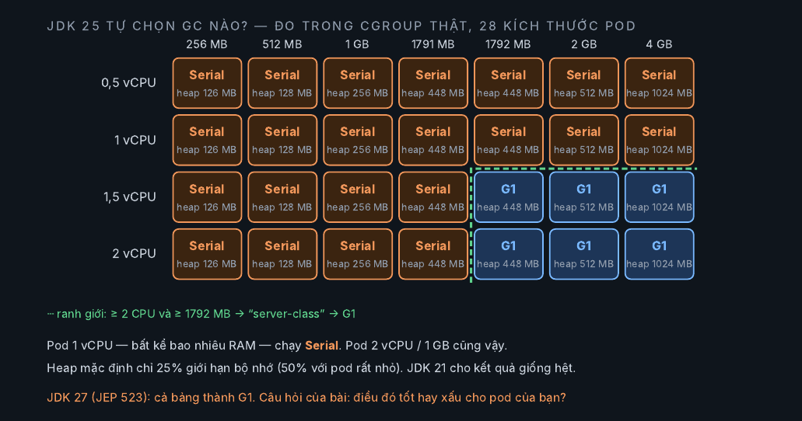
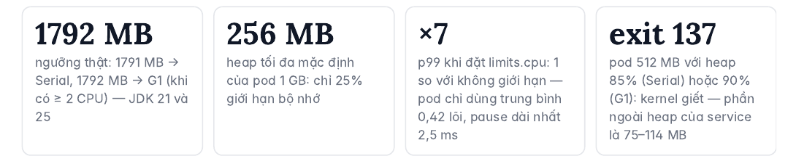
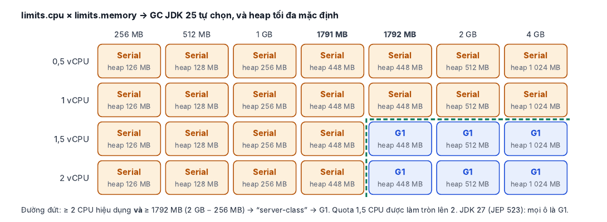
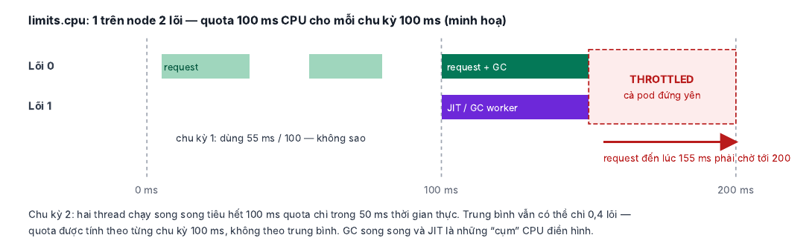
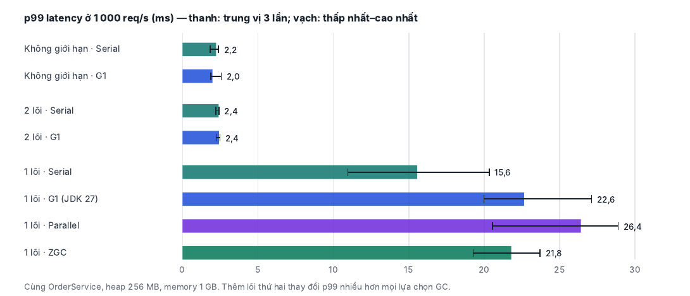
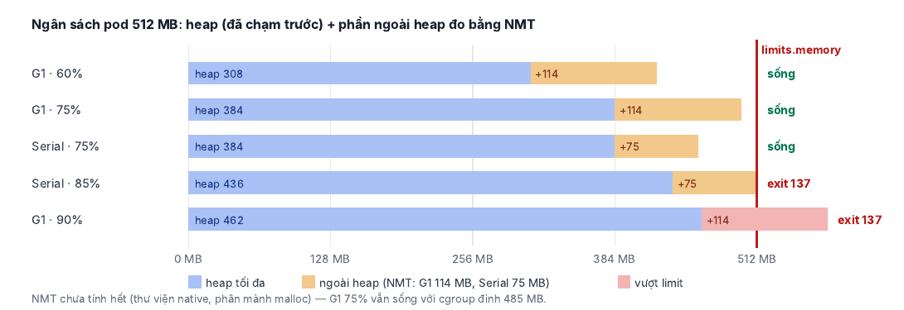

# Bài 13 — GC cho container



*Pod 1 vCPU của bạn đang chạy GC nào?*

*Chặng III · Bộ nhớ & GC — cgroup, ergonomics, CPU throttling, MaxRAMPercentage · Nền tảng: JDK 25 LTS / 27 · Thí nghiệm chạy thật trong cgroup*

Ba bài vừa qua mổ xẻ G1, ZGC và Shenandoah trên một máy “trần”. Nhưng service Spring Boot của bạn không chạy trên máy trần — nó chạy trong một pod có `limits.cpu` và `limits.memory`. Bài 13 đặt JVM vào cgroup thật và hỏi: JVM nhìn thấy gì, tự chọn gì, và những lựa chọn đó làm gì với latency và bộ nhớ của bạn.

> **VỀ CÁC CON SỐ TRONG BÀI** — Mọi output và con số đều lấy từ việc **chạy thật** trên OpenJDK 25.0.4 và 21.0.12, Linux x86-64, máy 2 vCPU. “Pod” ở đây là một **cgroup thật** (v1) do chúng tôi tạo bằng tay với `cpu.cfs_quota_us` và `memory.limit_in_bytes` — đúng hai cơ chế Kubernetes dùng cho `limits.cpu` và `limits.memory`; JVM tự đọc chúng như trong pod thật. Kubernetes hiện đại thường dùng cgroup v2 (tên file khác: `cpu.max`, `memory.max`), JVM hỗ trợ cả hai và cho cùng kết quả. Service thử nghiệm là `OrderService` của [Bài 09](09-khoi-dong-nhanh-cds-aot-native.md) (Spring + Tomcat + Jackson), bị tải bởi một client nhịp cố định chạy *ngoài* pod. JDK 27 không có trên máy; hành vi của nó (JEP 523) được mô phỏng bằng cách chỉ định G1 tường minh và ghi rõ như vậy. Mỗi cấu hình chạy 3 lần, bảng lấy trung vị trừ khi ghi khác.

Pod 1 vCPU của bạn đang chạy GC nào? Câu trả lời ngắn: **Serial** — với mọi phiên bản tới JDK 26, dù bạn cho pod bao nhiêu RAM. Và pod 2 vCPU, 1 GB cũng vậy. Nhưng câu hỏi “GC nào” hoá ra ít quan trọng hơn hai câu hỏi đi kèm: heap được bao nhiêu, và CPU limit làm gì với latency.



*Bốn con số trên đều đo được trong bài, trong cgroup thật.*

## 1 Vì sao một dev Spring Boot nên quan tâm

- **Mọi tinh chỉnh G1 bạn đọc được có thể không áp dụng**: pod 1 vCPU (hoặc dưới ~1,75 GB RAM) chạy Serial, không phải G1 — tới hết JDK 26. JDK 27 đổi điều đó (JEP 523).
- **Heap nhỏ hơn bạn nghĩ**: pod 1 GB mặc định chỉ có heap 256 MB. Phần lớn RAM bạn trả tiền nằm không.
- **p99 xấu không do GC**: CPU limit gây throttling — ứng dụng bị “đóng băng” vài chục ms mỗi chu kỳ 100 ms — trông y như pause GC trên dashboard latency.
- **`OOMKilled` (exit 137) không phải `OutOfMemoryError`**: một cái do kernel giết, một cái do JVM ném. Đặt heap quá sát limit biến cái thứ hai thành cái thứ nhất (mục 8).
- **Pod không đặt CPU limit** (chỉ có request) nhìn thấy toàn bộ lõi của node — 64 lõi nghĩa là 43 thread GC song song (mục 5).

## 2 JVM nhìn container như thế nào

Container không phải máy ảo: tiến trình Java chạy thẳng trên kernel của node, chỉ bị giới hạn bởi **cgroup**. Từ JDK 10 (và 8u191), JVM đọc cgroup để biết “máy” của mình lớn bao nhiêu (`-XX:+UseContainerSupport`, bật mặc định); cgroup v2 được hỗ trợ từ JDK 15 (và 11.0.16, 8u372). Ba thứ trong manifest Kubernetes biến thành ba file:

| Manifest | cgroup v1 / v2 | JVM dùng thế nào |
|---|---|---|
| `limits.cpu: 1` | `cpu.cfs_quota_us` / `cpu.max` | Số CPU “hiệu dụng” = quota ÷ chu kỳ, **làm tròn lên**: 1,5 → 2 |
| `requests.cpu: 500m` | `cpu.shares` / `cpu.weight` | **Bỏ qua** từ JDK 19 (JDK-8281181); cờ `UseContainerCpuShares` đã bị gỡ — JDK 21 và 25 đều báo “Unrecognized” |
| `limits.memory: 1Gi` | `memory.limit_in_bytes` / `memory.max` | Coi như “RAM vật lý” để tính heap và chọn GC |

Cách nhanh nhất để biết JVM thấy gì là `-XshowSettings:system` cùng `-Xlog:gc+init`. Trong pod `cpu=1, memory=1Gi` của chúng tôi:

```text
$ java -XshowSettings:system -Xlog:gc,gc+init -version
[info][gc     ] Using Serial
[info][gc,init] CPUs: 2 total, 1 available                 ← node có 2 lõi, quota cho 1
[info][gc,init] Memory: 1024M                             ← giới hạn của cgroup, không phải RAM của node
[info][gc,init] Heap Initial Capacity: 16M
[info][gc,init] Heap Max Capacity: 256M
Operating System Metrics:
    Provider: cgroupv1
    Effective CPU Count: 1
    CPU Period: 100000us
    CPU Quota: 100000us
    CPU Shares: -1
    Memory Limit: 1.00G
```

Thử riêng `cpu.shares=512` (tương đương `requests.cpu: 500m`) mà không có quota: cả JDK 21 lẫn 25 đều báo `Effective CPU Count: 2` — request không làm JVM “nhỏ lại”. Chỉ **limit** mới có tác dụng.

## 3 Ergonomics chọn GC: quy tắc “server-class”

Khi bạn không chỉ định GC, HotSpot (từ JDK 9, JEP 248) hỏi một câu: máy này có phải “server-class” không? Định nghĩa trong mã nguồn: **ít nhất 2 CPU hiệu dụng và ít nhất 2 GB trừ 256 MB bộ nhớ** (để chịu được những máy “2 GB” mà kernel giữ lại một ít). Có → G1. Không → Serial. Chạy `java -version` trong 28 kích thước pod với JDK 25 và JDK 21:



*Hình 13.1 — GC được chọn và heap tối đa mặc định, đo trong cgroup thật. JDK 21 cho kết quả giống từng ô. Ranh giới sắc nét: `memory.limit = 1791 MB` → Serial, `1792 MB` → G1. Một pod `limits.cpu: 1` — kích thước rất phổ biến cho service nhỏ — luôn chạy Serial.*

JDK 27 bỏ quy tắc này: **JEP 523** làm G1 thành GC mặc định ở mọi môi trường, với lập luận rằng G1 giờ đã cạnh tranh được với Serial ở mọi kích thước heap (JEP 522 giảm chi phí barrier, bộ nhớ native thấp hơn). JDK 26 đã chuẩn bị bằng cách deprecate hai cờ ép kết quả của phép thử: `AlwaysActAsServerClassMachine` và `NeverActAsServerClassMachine` (JDK-8370843) — lời khuyên chính thức là *chỉ định GC tường minh*. Nâng cấp lên JDK 27 mà không đặt GC nghĩa là pod 1 vCPU của bạn đổi từ Serial sang G1 — mục 7 đo xem điều đó có ý nghĩa gì.

## 4 Heap mặc định: 25% và những ngoại lệ

Heap tối đa mặc định = `MaxRAMPercentage` (25%) × bộ nhớ JVM thấy. Với bộ nhớ rất nhỏ, JVM dùng `MinRAMPercentage` (50%) để heap không quá bé. Heap ban đầu = `InitialRAMPercentage` (1,5625%, tức 1/64):

| Giới hạn bộ nhớ của pod | 256 MB | 512 MB | 1 GB | 2 GB | 4 GB |
|---|---:|---:|---:|---:|---:|
| Heap tối đa (JDK 21 = JDK 25) | 126 MB (~50%) | 128 MB | 256 MB | 512 MB | 1 024 MB |
| Heap ban đầu | 8 MB | 8 MB | 16 MB | 32 MB | 64 MB |
| Phần còn lại cho mọi thứ khác | 130 MB | 384 MB | 768 MB | 1 536 MB | 3 072 MB |

25% là một mặc định thận trọng từ thời JVM chạy chung máy với nhiều tiến trình khác. Trong container, JVM thường là tiến trình duy nhất — nên đa số service đặt `-XX:MaxRAMPercentage` trong khoảng 60–75% hoặc `-Xmx` tường minh. Bao nhiêu là quá nhiều là chủ đề của mục 8.

**Heap ban đầu nhỏ cũng có giá.** Cùng `-Xmx256m` và Serial, cùng tải 1 000 request/s: khi JVM thấy 5 979 MB (không giới hạn), heap khởi đầu 94 MB và có 43 lần GC trong 30 giây; trong pod 1 GB, heap khởi đầu 16 MB và có 158 lần GC — Serial nới heap rất chậm. JDK 26 còn đi xa hơn: bỏ giá trị mặc định của `InitialRAMPercentage`, heap ban đầu bằng `MinHeapSize` (JDK-8371986), và deprecate `MaxRAM` (JDK-8369346). Với service, đặt `-Xms` (hoặc `InitialRAMPercentage`) bằng heap tối đa là lựa chọn an toàn: bộ nhớ đó đằng nào cũng phải có trong limit.

## 5 Số thread: GC, JIT và cái bẫy “không đặt CPU limit”

Số CPU hiệu dụng quyết định số thread của GC và JIT. Đo bằng `-XX:ActiveProcessorCount=N -XX:+PrintFlagsFinal`, JDK 25:

| CPU JVM thấy | 1 | 2 | 4 | 8 | 16 | 32 | 64 |
|---|---:|---:|---:|---:|---:|---:|---:|
| G1 `ParallelGCThreads` (làm việc trong pause) | 1 | 2 | 4 | 8 | 13 | 23 | **43** |
| G1 `ConcGCThreads` (marking đồng thời) | 1 | 1 | 1 | 2 | 3 | 6 | 11 |
| G1 refinement thread | 1 | 2 | 4 | 8 | 13 | 23 | 43 |
| ZGC `ConcGCThreads` | 1 | 1 | 1 | 2 | 4 | 8 | 16 |
| JIT `CICompilerCount` | 2 | 2 | 3 | 4 | 12 | 15 | 18 |

Nhiều đội Kubernetes chủ động **bỏ CPU limit**, chỉ đặt request, để tránh throttling (mục 6). Hệ quả với JVM: không có quota thì JVM thấy *toàn bộ* lõi của node. Pod “500m” trên node 64 lõi sẽ có 43 thread GC song song, 18 thread biên dịch, `ForkJoinPool.commonPool()` 63 thread — tất cả tranh nhau nửa lõi mà scheduler dành cho pod. Khi bỏ limit, hãy nói thẳng cho JVM: `-XX:ActiveProcessorCount=2` (hoặc số lõi bạn thật sự kỳ vọng).

## 6 CPU limit là throttling, không phải “1 lõi”

`limits.cpu: 1` nghe như “pod có 1 lõi”. Thực tế Linux (CFS) cho pod một **quota**: 100 ms thời gian CPU trong mỗi chu kỳ 100 ms — dùng trên bao nhiêu lõi tuỳ ý. Pod nhiều thread có thể chạy song song trên 2, 4, 16 lõi của node và đốt hết quota trong vài chục ms đầu chu kỳ; phần còn lại của chu kỳ, *mọi* thread của pod bị đóng băng.



*Hình 13.2 — Cơ chế CFS quota (sơ đồ minh hoạ, không phải số đo). Đây là lý do một pod dùng trung bình chưa tới nửa lõi vẫn có thể bị throttle thường xuyên.*

Đo thật: `OrderService`, Serial, heap 256 MB, tải đều 1 000 request/s (khoảng 8% công suất tối đa), chỉ thay giới hạn CPU. `cpu.stat` của cgroup cho biết bao nhiêu chu kỳ bị throttle:

| Pod (memory 1 GB) | CPU trung bình | chu kỳ bị throttle | p50 | p99 | p99.9 | max | pause dài nhất |
|---|---:|---:|---:|---:|---:|---:|---:|
| không giới hạn CPU (node 2 lõi) | 0,38 | — | 0,40 | 2,23 | 11,8 | 32,1 | 1,56 |
| `limits.cpu: 2` | 0,37 | 0% | 0,42 | 2,40 | 8,44 | 20,7 | 2,11 |
| `limits.cpu: 1` | 0,42 | **21%** | 0,43 | **15,6** | 31,1 | 44,0 | 2,47 |
| `limits.cpu: 500m` | 0,50 | 100% | 43,6 | **890** | 1 320 | 1 461 | 74,58 |

Latency (ms) đo từ phía client, nhịp cố định, tính từ thời điểm request lẽ ra được gửi. CPU: số lõi trung bình pod dùng (cpuacct). Trung vị 3 lần × 30 giây.

Ba điều rút ra:

- **Ở 1 lõi, p99 tăng gần 7 lần so với không giới hạn** — trong khi pod chỉ dùng trung bình 0,42 lõi và pause dài nhất chỉ 2,47 ms. Thủ phạm không phải GC mà là các “cụm” CPU: Tomcat xử lý nhiều request cùng lúc, JIT biên dịch, GC chạy — đủ để đốt quota sớm trong 21% số chu kỳ.
- **Ở 2 lõi, throttling biến mất** và p99 về như không giới hạn. Khoảng cách giữa 1 và 2 lõi lớn hơn bất kỳ khác biệt nào giữa các GC ở mục 7.
- **Ở 500m, service gần như bão hoà**: 1 000 request/s cần ~0,50 lõi khi tính cả JIT và GC, sát quota; hàng đợi hình thành, p50 đã 43,6 ms.

> **ĐỌC THROTTLING Ở ĐÂU** — Trong cgroup: `cpu.stat` (`nr_throttled`, `throttled_time` ở v1; `nr_throttled`, `throttled_usec` ở v2). Trên Kubernetes với cAdvisor: `container_cpu_cfs_throttled_periods_total / container_cpu_cfs_periods_total`. Nếu tỉ lệ này vượt vài phần trăm trong khi `jvm.gc.pause` nhỏ, p99 của bạn đang bị quota cắt — không GC nào cứu được.

## 7 Bốn GC trong pod nhỏ

Giữ nguyên pod `limits.cpu: 1, limits.memory: 1Gi` (heap mặc định 256 MB) và đổi GC. G1 ở đây cũng chính là thứ JDK 27 sẽ tự chọn theo JEP 523. Thêm hai pod 2 lõi để đối chiếu:

| Pod · GC | p99 | p99.9 | max | pause max | pause / 30 s | throttle | công suất | RSS |
|---|---:|---:|---:|---:|---:|---:|---:|---:|
| 1 lõi · **Serial** (mặc định) | 15,6 | 31,1 | 44,0 | 2,47 | 158 | 21% | 12 150 | 160 |
| 1 lõi · **G1** (JDK 27) | 22,6 | 39,5 | 63,2 | 7,12 | 70 | 23% | 12 014 | 194 |
| 1 lõi · G1, ép 2 CPU* | 24,8 | 38,6 | 50,2 | 5,48 | 44 | 25% | 12 406 | 207 |
| 1 lõi · Parallel | 26,4 | 41,5 | 61,5 | 2,14 | 32 | 27% | 13 078 | 236 |
| 1 lõi · ZGC | 21,8 | 36,3 | 50,6 | 0,02 | 21 | 22% | 11 314 | **389** |
| 2 lõi/1 GB · Serial (mặc định) | 2,40 | 8,44 | 20,7 | 2,11 | 149 | 0% | 16 181 | 163 |
| 2 lõi/1 GB · G1 | 2,42 | 8,30 | 17,3 | 2,78 | 46 | 0% | 16 931 | 205 |
| 2 lõi/2 GB · G1 | 2,15 | 6,48 | 23,8 | 2,99 | 33 | 0% | 18 536 | 228 |

Latency ms ở 1 000 req/s; “công suất” = request/s tối đa khi tải bão hoà bằng `wrk` 8 kết nối; RSS = đỉnh của tiến trình Java (MB). * `-XX:ActiveProcessorCount=2`: mô phỏng JDK cũ không đọc quota, hoặc người dùng tự ép. Trung vị 3 lần.



*Hình 13.3 — Hai cụm rõ rệt: có đủ CPU (không giới hạn hoặc 2 lõi) thì p99 ~2 ms bất kể GC; ở 1 lõi thì 16–26 ms bất kể GC.*

Đọc bảng theo ba lớp:

- **Trong pod 1 lõi, GC xếp sau throttling.** Bốn GC cho p99 từ 15,6 đến 26,4 ms, khoảng dao động giữa các lần chạy chồng lên nhau (Serial 11,0–20,3, G1 20,0–27,1); cả bốn đều bị throttle 21–27% số chu kỳ. Serial nhỉnh hơn một chút: không có thread GC nền, không có barrier đắt. Trung vị của pause dài nhất ở mọi GC đều dưới 8 ms — không đủ giải thích p99 ~20 ms. Thêm lõi thứ hai thì mọi GC về ~2,4 ms.
- **JDK 27 đổi Serial → G1 cho pod này: chênh lệch nhỏ, nhưng không miễn phí.** p99 tương đương (trong nhiễu), công suất tối đa như nhau, RSS cao hơn 34 MB (bộ nhớ native của G1, mục 8). Đúng như JEP 523 lập luận — “cạnh tranh”, không phải “tốt hơn”. Một bài đo độc lập trên JDK 27 (pod 1 vCPU, 1 GB, Spring Boot 4.1) còn thấy RSS của G1 *thấp* hơn Serial nhờ các thay đổi khác của JDK 27 — tức là kết quả phụ thuộc workload. Hãy đo service của bạn trước khi nâng cấp.
- **ZGC trong pod nhỏ là lựa chọn sai**: p99 không tốt hơn (throttling vẫn là nút thắt), công suất thấp nhất, RSS 389 MB — gấp 2,4 lần Serial với cùng heap 256 MB.

Chi tiết đáng chú ý: Serial có ~158 pause trong 30 giây, gấp đôi G1. Heap ban đầu chỉ 16 MB (mục 4) và Serial nới thế hệ trẻ chậm, nên GC dày hơn — vẫn rẻ vì mỗi lần dưới 3 ms. Ép JVM tin là có 2 lõi (`ActiveProcessorCount=2`) trong pod 1 lõi không giúp gì: 2 thread GC song song chỉ làm cụm CPU dày hơn.

## 8 Memory limit: heap không phải là tất cả

Nếu 25% quá ít, sao không 90%? Vì `limits.memory` giới hạn **toàn bộ tiến trình**, không chỉ heap. Đo phần ngoài heap của `OrderService` sau 20 giây tải bằng Native Memory Tracking (`-XX:NativeMemoryTracking=summary`, rồi `jcmd <pid> VM.native_memory summary`):

| NMT, committed (MB) | Serial | G1 | Là gì |
|---|---:|---:|---|
| Metaspace + Class + CDS archive | 35,4 | 35,5 | metadata của 5 055 class đã nạp — Spring, Tomcat, Jackson ([Bài 03](03-class-loading.md)–[04](04-runtime-data-areas.md)) |
| Code cache | 20,0 | 19,7 | mã máy JIT ([Bài 07](07-jit-tiered-compilation.md)) |
| **GC** | **1,3** | **38,8** | card table, remembered set, bitmap ([Bài 11](11-mo-xe-g1.md)) |
| Arena + Symbol + Thread + khác | 18,7 | 20,0 | bộ nhớ tạm của JIT, bảng symbol, stack đã chạm |
| **Tổng ngoài heap** | **75,4** | **114,0** | chưa gồm phần NMT không thấy: thư viện native, phân mảnh malloc |

Giờ đặt service vào pod 512 MB, 1 lõi, chỉnh `MaxRAMPercentage` và cho `InitialRAMPercentage` bằng nó cùng `-XX:+AlwaysPreTouch` — tức là heap được dùng hết ngay từ đầu, như sau vài ngày chạy thật:

| Pod 512 MB · GC · heap | heap tối đa | bộ nhớ cgroup cao nhất | Kết quả sau 20 s tải |
|---|---:|---:|---|
| G1 · 60% | 308 MB | 403 MB | sống, dư 109 MB |
| G1 · 75% | 384 MB | 485 MB | sống, dư 27 MB |
| Serial · 75% | 384 MB | 496 MB | sống, dư 16 MB |
| Serial · 85% | 436 MB | 512 MB | **exit 137** — bị kernel giết ~2 s sau khi nhận tải |
| G1 · 90% | 462 MB | 512 MB | **exit 137** — chết trước khi kịp READY |
| G1 · 90%, *không* chạm trước | 462 MB | 283 MB | sống — vì heap chưa dùng hết. Quả bom hẹn giờ. |



*Hình 13.4 — Cùng một service, cùng pod 512 MB: chỉ khác phần trăm heap và GC. Ranh giới giữa “sống” và “bị giết” nằm ở chỗ heap + phần ngoài heap chạm limit.*

```text
$ dmesg | grep -i killed
Memory cgroup out of memory: Killed process 15283 (java) total-vm:3066480kB, anon-rss:522564kB, file-rss:22872kB ...
$ echo $?            # mã thoát của JVM bị giết: 128 + 9 (SIGKILL)
137
```

> **OUTOFMEMORYERROR (JVM)** — Heap không đủ cho dữ liệu sống. JVM ném exception, có stack trace, có thể ghi heap dump (`-XX:+HeapDumpOnOutOfMemoryError`). Thí nghiệm: heap 25% = 128 MB, dữ liệu sống 200 MB → `java.lang.OutOfMemoryError: Java heap space`, exit 1.

> **OOMKILLED (KERNEL)** — Cả tiến trình vượt `limits.memory`. Kernel giết bằng SIGKILL: không log Java, không heap dump, exit 137; Kubernetes ghi `OOMKilled`. Thường do heap đặt quá sát limit, hoặc bộ nhớ ngoài heap tăng (thread, direct buffer — [Bài 15](15-reference-off-heap.md)).

Quy tắc rút ra cho service nhỏ: **đo phần ngoài heap của chính service, cộng 20–30% dự phòng, phần còn lại mới là heap**. Với service này: 512 MB − 114 MB (G1) − dự phòng ≈ 360 MB → khoảng 70%. Với limit 1–2 GB, phần ngoài heap gần như cố định nên phần trăm có thể cao hơn; với pod 256–512 MB thì ngược lại. Chú ý cột G1: chọn GC cũng là chọn ngân sách bộ nhớ — 37 MB chênh lệch là 7% của pod 512 MB.

## 9 Trong Spring Boot: công thức cấu hình và quan sát

### Năm quyết định, theo thứ tự

1. **CPU trước GC.** Service nhạy latency: `limits.cpu` ≥ 2, hoặc bỏ limit nhưng đặt `-XX:ActiveProcessorCount` (mục 5–6). Ở 1 lõi, throttling quyết định p99 nhiều hơn GC.
2. **Chỉ định GC tường minh.** Đừng để ergonomics chọn: nó đổi theo kích thước pod (mục 3) và đổi theo phiên bản (JDK 27). Pod ≤ 1 lõi, heap nhỏ: Serial hoặc G1 đều được — hãy đo. Pod ≥ 2 lõi: G1. ZGC chỉ khi có dư CPU và RAM ([Bài 12](12-zgc-shenandoah.md)).
3. **Heap theo phần trăm, có chỗ cho phần ngoài heap.** `-XX:MaxRAMPercentage` khoảng 60–75%, sau khi đã đo RSS ngoài heap của chính service (mục 8). Đặt `-XX:InitialRAMPercentage` bằng giá trị đó để khỏi trả giá heap khởi đầu nhỏ.
4. **Ghi lại JVM đã thấy gì** lúc khởi động: `-Xlog:gc+init` (một khối log, chi phí bằng 0).
5. **Theo dõi ba thứ cạnh nhau**: pause GC, tỉ lệ chu kỳ bị throttle, và RSS so với limit.

```yaml
# deployment.yaml (rút gọn)
resources:
  requests: { cpu: "1",  memory: "1Gi" }
  limits:   { cpu: "2",  memory: "1Gi" }
env:
- name: JAVA_TOOL_OPTIONS
  value: >-
    -XX:+UseG1GC
    -XX:MaxRAMPercentage=70 -XX:InitialRAMPercentage=70
    -Xlog:gc+init -Xlog:gc*:file=/tmp/gc.log:time,uptime,level,tags:filecount=5,filesize=10m
    -XX:+ExitOnOutOfMemoryError
```

`-XX:+ExitOnOutOfMemoryError` biến một `OutOfMemoryError` — sau đó JVM thường sống dở chết dở — thành một lần thoát rõ ràng để Kubernetes khởi động lại pod.

> **SPRING BOOT · ACTUATOR CHO BẠN BIẾT JVM ĐÃ THẤY GÌ** — Không cần vào pod: ba metric Micrometer có sẵn trả lời ba câu hỏi của bài.
>
> | Câu hỏi | Metric | Ghi chú |
> |---|---|---|
> | JVM thấy mấy CPU? | `system.cpu.count` | chính là `Runtime.availableProcessors()` — đã tính quota |
> | Heap tối đa là bao nhiêu? | `jvm.memory.max{area="heap"}` | cộng các pool; so với `limits.memory` |
> | Đang chạy GC nào? | tag `gc` của `jvm.gc.pause` | `Copy` / `MarkSweepCompact` = Serial; `G1 Young Generation` = G1; `PS Scavenge` = Parallel |
>
> Nếu dashboard của service 1 lõi hiện `gc="Copy"`, bạn đang chạy Serial — và mọi bài viết “tinh chỉnh G1” không áp dụng cho bạn.

> **NẾU IMAGE ĐƯỢC BUILD BẰNG `SPRING-BOOT:BUILD-IMAGE` (PAKETO)** — Buildpack Java của Paketo có “memory calculator” riêng: nó tự đặt `-Xmx` = giới hạn bộ nhớ − (số thread × kích thước stack + code cache + direct memory + metaspace ước lượng + headroom), với mặc định 250 thread (`BPL_JVM_THREAD_COUNT`) và code cache 240 MB. Vì `-Xmx` tường minh thắng `MaxRAMPercentage`, tinh chỉnh phần trăm có thể không có tác dụng; hãy chỉnh qua các biến `BPL_JVM_*` và kiểm tra lại bằng `-Xlog:gc+init`. Theo ví dụ trong một hướng dẫn về Paketo, pod 1 GB của Spring Boot + Hibernate có thể chỉ còn 350–450 MB heap vì các khoản dự trữ này.

> **THAY ĐỔI THEO PHIÊN BẢN CẦN BIẾT** — **JDK 19** — bỏ qua `cpu.shares` khi đếm CPU (JDK-8281181). **JDK 26** — heap ban đầu mặc định bằng `MinHeapSize` thay vì 1/64 bộ nhớ (JDK-8371986); deprecate `MaxRAM` (JDK-8369346) và hai cờ `Always/NeverActAsServerClassMachine` (JDK-8370843); G1 hỗ trợ `UseGCOverheadLimit`. **JDK 27** — G1 là mặc định ở mọi môi trường (JEP 523); giá trị mặc định của `MinHeapFreeRatio` / `MaxHeapFreeRatio` đổi thành 0/100, nên G1 gần như không còn co/giãn heap theo hai ngưỡng này (JDK-8238686); compact object headers bật mặc định (JEP 534).

## 10 Ghép lại: một trang để nhớ cả bài

| Cơ chế | Quy tắc | Cờ / chỗ xem | Đo trong bài |
|---|---|---|---|
| CPU limit | quota ÷ chu kỳ, làm tròn lên; request (shares) bị bỏ qua | `-XshowSettings:system`, `system.cpu.count` | 1,5 → 2 CPU; shares 512 → vẫn 2 |
| Chọn GC | ≥ 2 CPU và ≥ 1792 MB → G1, còn lại Serial; JDK 27: luôn G1 | `-Xlog:gc+init`, tag `gc` | 1791 MB → Serial, 1792 MB → G1 |
| Heap | 25% bộ nhớ (50% khi rất nhỏ); ban đầu 1/64 | `MaxRAMPercentage`, `InitialRAMPercentage` | pod 1 GB → heap 256 MB, khởi đầu 16 MB |
| Thread | theo số CPU hiệu dụng; không limit = thấy cả node | `ActiveProcessorCount` | 64 CPU → 43 thread GC, 18 thread JIT |
| Throttling | quota tính theo chu kỳ 100 ms; cụm CPU đốt quota sớm | `cpu.stat`, `container_cpu_cfs_throttled_*` | 1 lõi: p99 ×7 ở 0,42 lõi trung bình |
| GC ở 1 lõi | khác biệt nhỏ hơn throttling; Serial nhỉnh, ZGC tệ | so p99 và RSS | p99 16–26 ms; G1 RSS +34 MB; ZGC 389 MB |
| Memory limit | heap + ngoài heap + dự phòng ≤ limit | NMT, `dmesg`, exit 137 | ngoài heap 75 (Serial) / 114 MB (G1); 85–90% → OOMKilled |

Tóm cả bài trong một đoạn: *Trong container, JVM tự đo “máy” của nó qua cgroup: CPU limit thành số CPU (làm tròn lên, request bị bỏ qua), memory limit thành RAM. Từ hai con số đó, ergonomics chọn GC — Serial nếu dưới 2 CPU hoặc dưới 1792 MB, G1 nếu không, và từ JDK 27 luôn là G1 — cùng heap mặc định chỉ 25% và số thread GC/JIT. Nhưng hai thứ ảnh hưởng mạnh nhất lại không phải lựa chọn GC: CPU quota biến các cụm CPU thành những lần đóng băng vài chục ms, nâng p99 lên gấp 7 dù pod dùng chưa tới nửa lõi; và memory limit tính cả phần ngoài heap, nên heap đặt quá tay sẽ biến `OutOfMemoryError` thành `OOMKilled`. Hãy chọn CPU trước, chỉ định GC tường minh, và tính heap từ phần còn lại sau khi đã đo phần ngoài heap.*

## 11 Hiểu lầm thường gặp, bài tập, bài tiếp theo

### Hiểu lầm thường gặp

| Hiểu lầm | Thực tế |
|---|---|
| “Service Java nào cũng chạy G1.” | Tới JDK 26, pod dưới 2 CPU hoặc dưới 1792 MB chạy Serial — kể cả pod 2 CPU, 1 GB (mục 3). |
| “JVM không biết mình chạy trong container.” | Biết từ JDK 10 / 8u191, cgroup v2 từ JDK 15. Chỉ cần đọc `-XshowSettings:system`. |
| “`requests.cpu` quyết định số CPU JVM thấy.” | Bỏ qua từ JDK 19. Chỉ `limits.cpu` có tác dụng; không có limit thì JVM thấy cả node. |
| “`limits.cpu: 1` nghĩa là có 1 lõi.” | Nghĩa là 100 ms CPU mỗi 100 ms trên bao nhiêu lõi cũng được — rồi bị đóng băng. p99 ×7 ở tải thấp (mục 6). |
| “p99 cao thì đổi GC.” | Ở 1 lõi, mọi GC cho p99 16–26 ms; thêm lõi thứ hai đưa tất cả về 2,4 ms (mục 7). |
| “Heap = limit cho tận dụng.” | Phần ngoài heap 75–114 MB với một service nhỏ; 85–90% của 512 MB là OOMKilled (mục 8). |
| “OOMKilled là do heap đầy.” | Heap đầy cho `OutOfMemoryError`. OOMKilled là cả tiến trình vượt limit — thường do heap đặt sát limit hoặc bộ nhớ ngoài heap. |

### Bài tập tự làm (khoảng 45 phút)

> **THỰC HÀNH**
>
> 1. **Pod của bạn đang chạy GC nào?** (bài tập quan trọng nhất). `kubectl exec` vào một pod và chạy `java -Xlog:gc+init -XshowSettings:system -version`, hoặc xem tag `gc` của `jvm.gc.pause`. Ghi lại: CPU hiệu dụng, GC, heap tối đa.
> 2. **Throttling**: lấy `container_cpu_cfs_throttled_periods_total / container_cpu_cfs_periods_total` của service trong một ngày. Đặt cạnh p99 latency. Có tương quan không?
> 3. **Ngân sách bộ nhớ**: bật `-XX:NativeMemoryTracking=summary` trên staging, chạy tải, `jcmd <pid> VM.native_memory summary`. Phần ngoài heap là bao nhiêu? `MaxRAMPercentage` hiện tại có chừa đủ không?
> 4. **Tái hiện ở máy bạn**: `docker run --cpus=1 --memory=1g eclipse-temurin:25 java -Xlog:gc+init -version`, rồi `--cpus=2 --memory=1792m` và `1791m`.
> 5. **Trước khi lên JDK 27**: chạy service 1 lõi với `-XX:+UseSerialGC` rồi `-XX:+UseG1GC`, so p99 và RSS — đó là thay đổi JEP 523 sẽ mang lại.

### Thuật ngữ của bài

| Thuật ngữ | Nghĩa ngắn gọn |
|---|---|
| cgroup | Cơ chế kernel Linux giới hạn CPU, bộ nhớ của một nhóm tiến trình — nền của container. |
| CFS quota / period | Lượng thời gian CPU được dùng trong mỗi chu kỳ (mặc định 100 ms); `limits.cpu`. |
| CPU shares / weight | Trọng số chia CPU khi tranh chấp; `requests.cpu`. JVM bỏ qua. |
| Throttling | Cgroup bị dừng tới hết chu kỳ vì đã dùng hết quota. |
| Ergonomics | Cơ chế JVM tự chọn GC, heap, số thread theo phần cứng nó thấy. |
| Server-class machine | ≥ 2 CPU và ≥ 1792 MB; quyết định Serial hay G1 tới JDK 26. |
| MaxRAMPercentage | Heap tối đa tính bằng phần trăm bộ nhớ JVM thấy; mặc định 25. |
| ActiveProcessorCount | Cờ ép số CPU JVM dùng cho ergonomics. |
| NMT | Native Memory Tracking — thống kê bộ nhớ JVM dùng ngoài heap. |
| OOMKilled / exit 137 | Tiến trình bị kernel giết (SIGKILL) vì cgroup vượt giới hạn bộ nhớ. |

> **BÀI TIẾP THEO · BÀI 14** — **Đọc log GC & săn memory leak.** Unified logging đầy đủ, heap dump, Eclipse MAT, dominator tree và retained size, qua một case study rò rỉ thật trong ứng dụng Spring Boot. Bài 13 dạy cách đặt ngân sách bộ nhớ; [Bài 14](14-log-gc-memory-leak.md) tìm thứ đang ăn dần ngân sách đó. Câu hỏi của bài: *heap tăng dần qua nhiều ngày — leak thật hay chỉ là cache?*

### Tài liệu tham khảo

- JEP 523: Make G1 the Default Garbage Collector in All Environments (JDK 27); JEP 248 (G1 mặc định cho server, JDK 9). openjdk.org/jeps
- JDK-8146115 (container detection, JDK 10), JDK-8230305 (cgroup v2, JDK 15), JDK-8281181 (bỏ CPU shares, JDK 19). bugs.openjdk.org
- Oracle JDK 26 Release Notes (JDK-8371986, JDK-8369346, JDK-8370843); JDK 27 Release Notes (JEP 523, JDK-8238686).
- Kubernetes — “About cgroup v2”; “Resource Management for Pods and Containers”. kubernetes.io/docs
- “JDK 27 Compact Object Headers and G1 Default: Measured on Spring Boot 4.1”. ankurm.com
- Paketo Buildpacks — Java memory calculator (`BPL_JVM_THREAD_COUNT`, `BPL_JVM_HEAD_ROOM`). paketo.io
