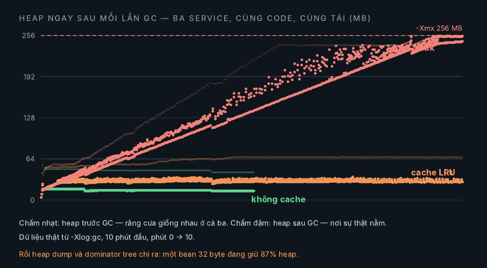
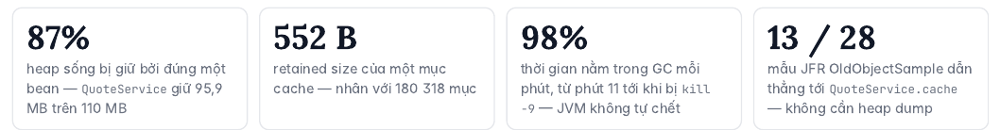
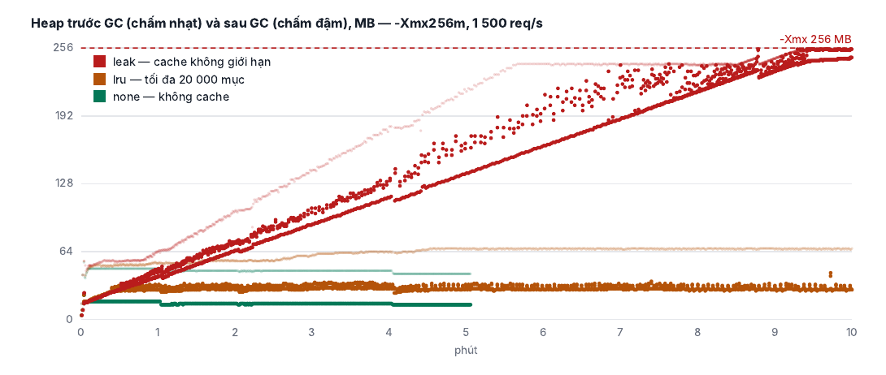
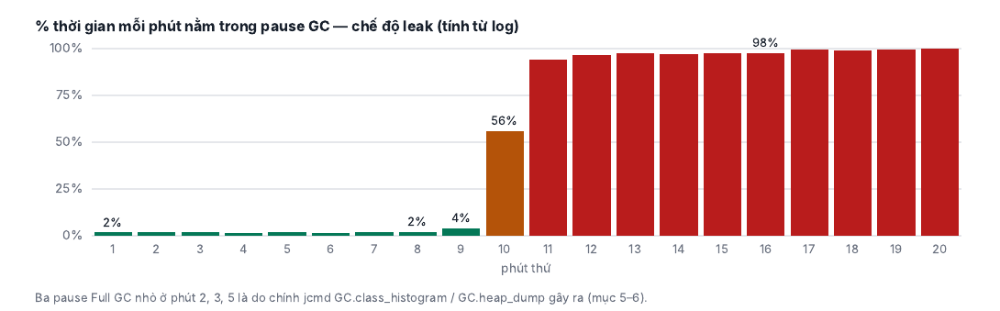
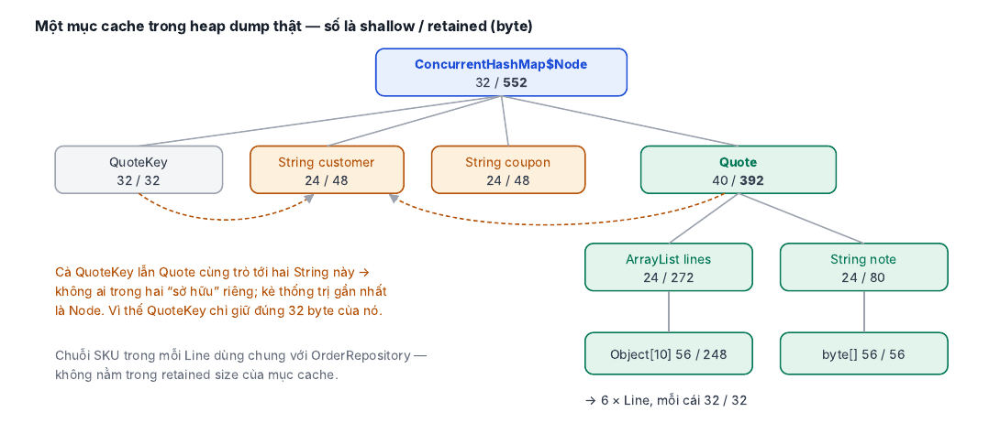

# Bài 14 — Đọc log GC & săn memory leak



*Leak thật hay chỉ là cache?*

*Chặng III · Bộ nhớ & GC — unified logging, heap dump, dominator tree, JFR · Nền tảng: JDK 25 LTS / 27 · Thí nghiệm chạy thật trên OpenJDK 25*

Bốn bài vừa qua dạy GC *làm* gì. Bài 14 dạy cách *điều tra*: đọc log GC để biết heap đang khoẻ hay đang chết dần, rồi lần từ “heap tăng” tới đúng dòng code giữ bộ nhớ — bằng histogram, heap dump, dominator tree và JFR. Case study là một lỗi rò rỉ thật, cấy vào `OrderService` của [Bài 09](09-khoi-dong-nhanh-cds-aot-native.md), và chạy tới khi nó giết service.

> **VỀ CÁC CON SỐ VÀ CÔNG CỤ TRONG BÀI** — Mọi log, histogram và con số đều lấy từ việc **chạy thật** trên OpenJDK 25.0.4, G1, `-Xmx256m`, máy 2 vCPU. Service là `OrderService` (Spring + Tomcat + Jackson) thêm một endpoint `/quotes` có “cache”, chạy ở ba chế độ: **leak** (cache không giới hạn, khoá vô tình chứa timestamp), **lru** (tối đa 20 000 mục), **none** (không cache); tải đều 1 500 request/s, một nửa là `/quotes`. “Nhiều ngày” được nén thành vài phút bằng tốc độ cấp phát cao. Eclipse MAT không cài được trong môi trường này (máy chủ tải về bị chặn), nên các phép tính của MAT — histogram, shallow/retained size, dominator tree, đường tới GC root — được làm lại bằng một bộ phân tích HPROF nhỏ viết bằng Python, kiểm chứng chéo với `jcmd GC.class_histogram` và bằng hai thuật toán dominator độc lập (mục 7). Mỗi chế độ chạy một lần.
>
> *Script đi kèm nằm trong repo: sources/under-hood/src/hprof_analyzer_bai14.py.*

Heap tăng dần qua nhiều ngày — leak thật hay chỉ là cache? Câu trả lời ngắn: **đừng nhìn heap đang dùng, hãy nhìn heap ngay sau GC**. Đường đó phẳng là khoẻ; tăng rồi chững lại là cache; tăng mãi là leak. Rồi một heap dump cho biết *ai* đang giữ bộ nhớ, và JFR cho biết dòng code nào đã cấp phát nó.



*Bốn con số trên đều đo được trong bài.*

## 1 Vì sao một dev Spring Boot nên quan tâm

- **Biểu đồ “heap used” trên Grafana luôn có hình răng cưa đi lên** — kể cả khi service hoàn toàn khoẻ (mục 3). Hiểu sai nó dẫn tới hai lỗi ngược nhau: báo động giả, và bỏ sót leak thật.
- **Leak trong Spring hiếm khi trông như “quên đóng”**: nó là một `Map` trong singleton bean, một `@Cacheable` không giới hạn, một khoá cache chứa thứ thay đổi mỗi request. Code review khó thấy; heap dump thấy ngay.
- **Khi OOM tới, service không chết gọn**: trong thí nghiệm, JVM sống thêm hơn 10 phút với 94–100% thời gian nằm trong GC (mục 4) — health check có thể vẫn xanh.
- **Heap dump chứa mọi thứ trong bộ nhớ**: token, mật khẩu, dữ liệu khách hàng. Lấy và lưu nó là một quyết định bảo mật (mục 6).

## 2 Unified logging: một cú pháp cho mọi log của JVM

Từ JDK 9 (JEP 158, 271), mọi log của HotSpot — GC, safepoint, class loading, JIT, container — đi qua một cơ chế: **unified logging**. Các cờ cũ chỉ còn là cái bóng: trên JDK 25, `-XX:+PrintGCDetails` và `-Xloggc` in cảnh báo “deprecated” rồi tự đổi thành `-Xlog:gc*`, còn `-XX:+PrintGCDateStamps` làm JVM **không khởi động được** (“Unrecognized VM option”) — một bẫy khi nâng cấp từ Java 8. Mọi thứ giờ là `-Xlog`:

```text
-Xlog:gc*,safepoint:file=/var/log/app/gc.log:time,uptime,level,tags:filecount=5,filesize=20m
      └── chọn gì ───────┘ └─ ghi vào đâu ──────────┘ └─ trang trí mỗi dòng ─┘ └─ xoay vòng file ─┘
```

| Phần | Ý nghĩa | Ví dụ |
|---|---|---|
| tag (+ tag) | chủ đề; `gc+heap` = dòng có *đúng cả hai* tag; `gc*` = mọi tập tag bắt đầu bằng `gc` | `gc`, `gc+heap`, `gc*`, `safepoint` |
| level | off, error, warning, info (mặc định), debug, trace | `gc+ergo*=debug` |
| output | `stdout`, `stderr`, `file=` (`%p` = pid, `%t` = thời điểm khởi động) | `file=gc-%p.log` |
| decorator | tiền tố mỗi dòng | `time`, `uptime`, `pid`, `tid`, `level`, `tags` |
| output options | xoay vòng file; `-Xlog:async` ghi qua thread riêng | `filecount=5,filesize=20m` |

Không cần khởi động lại để bật thêm log. `jcmd <pid> VM.log` đọc và đổi cấu hình lúc đang chạy — ví dụ trên một JVM đang chạy với `-Xlog:gc:file=a.log`:

```text
$ jcmd 2445 VM.log list
Log output configuration:
 #0: stdout all=warning uptime,level,tags foldmultilines=false            ← mặc định: chỉ warning trở lên ra stdout
 #2: file=/tmp/vmlog_a.log all=off,gc=info uptime,level,tags ... filecount=5,filesize=20480K,async=false
$ jcmd 2445 VM.log output=/tmp/vmlog_b.log what=gc*=debug,safepoint decorators=uptime,tags
Command executed successfully
 #3: file=/tmp/vmlog_b.log all=off,gc*=debug,safepoint=info uptime,tags ... (reconfigured)
$ jcmd 2445 VM.log rotate                                                   ← xoay file ngay
```

Hai chi tiết đáng nhớ từ output thật: khi có `file=`, JVM **tự xoay vòng mặc định 5 file × 20 MB**; và mặc định không có log GC nào ra stdout — nếu container của bạn chỉ thu stdout, bạn đang không có log GC.

> **CẤU HÌNH LOG GC CHO SERVICE PRODUCTION**
>
> ```text
> -Xlog:gc*,gc+heap=debug,safepoint:file=/var/log/app/gc-%p.log:time,uptime,level,tags:filecount=10,filesize=20m
> -Xlog:async
> ```
>
> Đo trong thí nghiệm: khoảng 1,5–1,8 KB cho mỗi lần GC; với ~2,5 GC mỗi giây là 11–13 MB mỗi giờ — 10 file × 20 MB giữ được khoảng 15 giờ gần nhất. `gc*` cho đủ pha ([Bài 11](11-mo-xe-g1.md), [12](12-zgc-shenandoah.md)); `gc+heap=debug` thêm số region theo vai trò trước/sau mỗi GC; `safepoint` cho thời gian dừng ngoài GC ([Bài 18](18-thread-safepoint.md)). `-Xlog:async` đảm bảo ghi log không bao giờ chặn thread của ứng dụng khi đĩa chậm. Nếu chỉ thu được stdout, dùng `-Xlog:gc:stdout` và chấp nhận ít chi tiết hơn.

## 3 Ba service, ba đường cong heap

Cùng code, cùng tải, chỉ khác chế độ “cache” của `/quotes`. Lỗi cấy vào rất đời thường — một khoá cache vô tình chứa thời điểm gửi request:

```java
@Service
public class QuoteService {
  static final class QuoteKey { String customer; String coupon; long requestedAt; ... } // equals gồm cả nó
  private final Map<QuoteKey, Quote> cache = new ConcurrentHashMap<>();      // không giới hạn

  public Quote quote(String customer, String coupon, long requestedAt) {
    return cache.computeIfAbsent(new QuoteKey(customer, coupon, requestedAt), k -> compute(customer, coupon));
  }
}
```

Mỗi request có `requestedAt` khác nhau, nên cache không bao giờ trúng — nó chỉ lớn lên. Ở chế độ **lru**, cùng map được thay bằng `LinkedHashMap` có `removeEldestEntry` giữ tối đa 20 000 mục. Đọc `-Xlog:gc` của cả ba và vẽ hai con số trên mỗi dòng `Pause ... 181M->113M(194M)`: heap *trước* GC và heap *sau* GC.



*Hình 14.1 — Mỗi chấm nhạt là heap trước một lần GC, mỗi chấm đậm là heap ngay sau GC (dữ liệu từ log thật, 10 phút đầu). Hình răng cưa của “heap đang dùng” trông giống nhau ở cả ba; khác biệt chỉ lộ ra ở đáy răng cưa.*

Ba câu chuyện, đọc từ đáy răng cưa:

- **none**: heap sau GC nằm yên ở **14–15 MB** suốt 5 phút. Hai histogram cách nhau 3 phút: 14,9 → 14,1 MB.
- **lru**: tăng trong phút đầu (750 báo giá/giây lấp đầy 20 000 mục sau ~27 giây) rồi **chững ở 24–29 MB** suốt 10 phút. Histogram: 25,8 → 24,6 MB; đúng 20 000 object `Quote` ở cả hai thời điểm.
- **leak**: tăng tuyến tính khoảng **25 MB mỗi phút**, không có dấu hiệu chững: 39 → 63 → 90 → 111 → 138 → 164 → 190 → 215 MB.

Còn đỉnh răng cưa — heap trước GC — thì cả ba đều chạm 100–190 MB thường xuyên: G1 để Eden lớn khi heap còn trống ([Bài 11](11-mo-xe-g1.md)). Một dashboard vẽ “heap used” sẽ thấy ba service gần như giống nhau trong vài phút đầu.

> **ĐỪNG CẢNH BÁO TRÊN “HEAP USED”** — Với G1 ([Bài 11](11-mo-xe-g1.md)), thế hệ già chỉ được dọn sau một chu kỳ marking; giữa hai chu kỳ, “heap used” leo lên rất cao kể cả khi không có gì rò rỉ. Cảnh báo trên `jvm.memory.used` sẽ kêu cả ngày. Thứ cần theo dõi là heap *sau* GC — trong Micrometer là `jvm.gc.live.data.size` (kích thước vùng nhớ sống lâu sau lần thu gom gần nhất) — và xu hướng của nó qua nhiều ngày.

## 4 Log GC của một service đang chết

Để chế độ **leak** chạy tiếp. Heap sau GC tăng đều khoảng **25 MB mỗi phút** — 63 → 90 → 111 → 138 → 164 → 190 → 215 MB ở các phút 2 tới 8. Rồi, quanh phút thứ 9, log đổi giọng:

```text
[526.788s] GC(1007) Pause Young (Normal) (G1 Evacuation Pause) (Evacuation Failure: Allocation) 252M->248M(256M) 31.313ms
[526.915s] GC(1008) Pause Young (Normal) (G1 Evacuation Pause) (Evacuation Failure: Allocation) 255M->254M(256M) 29.751ms
[527.626s] GC(1010) Pause Full (G1 Compaction Pause) 255M->228M(256M) 686.390ms
[557.929s] GC(1175) Pause Full (G1 Compaction Pause) 255M->240M(256M) 378.719ms
  ...
[623.886s] GC(1540) Pause Full (G1 Compaction Pause) 254M->250M(256M) 269.538ms        ← Full GC không lấy lại được gì
# app.out
Exception in thread "http-nio-8080-exec-14" java.lang.OutOfMemoryError: Java heap space
```

Ba dấu hiệu theo thứ tự xuất hiện, đáng đặt cảnh báo: **(1)** heap sau GC tiến gần `-Xmx`; **(2)** `Evacuation Failure` — G1 không còn chỗ để chép object ([Bài 11](11-mo-xe-g1.md), mục 8); **(3)** `Pause Full` với “sau” gần bằng “trước”. Tỉ lệ thời gian nằm trong pause, tính từ chính log:



*Hình 14.2 — Phần trăm thời gian mỗi phút nằm trong pause GC, chế độ leak. Tám phút đầu: 1–2%, như một service khoẻ. Phút 9: 56%. Từ phút 10 trở đi: 94–100% — 4 183 lần Full GC liên tiếp.*

Điều đáng sợ nhất không nằm trong hình: JVM **không chết**. `OutOfMemoryError` được ném trong thread xử lý request, Tomcat bắt và trả lỗi 500, thread khác lại thử. Tiến trình sống thêm hơn 20 phút trong trạng thái **98–100% GC**, và **bỏ qua cả SIGTERM** — chúng tôi phải dùng `kill -9` (trên Kubernetes, việc này xảy ra sau `terminationGracePeriodSeconds`). Hai cờ biến cái chết dài thành cái chết nhanh, có bằng chứng:

- `-XX:+ExitOnOutOfMemoryError` (hoặc `CrashOnOutOfMemoryError`) — thoát ngay ở lần OOME đầu tiên để orchestrator khởi động lại.
- `-XX:+HeapDumpOnOutOfMemoryError -XX:HeapDumpPath=/dumps/` — ghi heap dump đúng lúc đó, trước khi thoát.

JDK 26 bổ sung một lưới an toàn: G1 hỗ trợ `UseGCOverheadLimit` — ném `OutOfMemoryError` khi thời gian GC vượt ngưỡng (Parallel đã có từ lâu), nên trạng thái “98% GC” ở trên sẽ kết thúc sớm hơn trên JDK 26+.

## 5 Bước 1 — histogram: cái gì đang tăng?

Công cụ rẻ nhất: `jcmd <pid> GC.class_histogram` — số object và tổng byte theo class, của các object *còn sống*. Một bản chụp đơn lẻ ít giá trị (byte[] và String luôn đứng đầu); giá trị nằm ở **hiệu giữa hai lần chụp**. Chế độ leak, phút 1 so với phút 4:

```text
$ python3 histodiff.py histo_60.txt histo_240.txt
total 39.3 MB -> 110.4 MB
  Δ instances    Δ bytes      instances   bytes   class
  +806,064    +24.6 MB    1,079,466    32.9 MB  app.QuoteService$Line
  +399,827    +13.1 MB      589,815    22.9 MB  [B
  +400,065     +9.2 MB      587,327    13.4 MB  java.lang.String
  +133,887     +7.2 MB      187,813    10.1 MB  [Ljava.lang.Object;
  +134,344     +5.1 MB      179,911     6.9 MB  app.QuoteService$Quote
  +134,344     +4.1 MB      179,911     5.5 MB  app.QuoteService$QuoteKey
  +133,643     +4.1 MB      197,747     6.0 MB  java.util.concurrent.ConcurrentHashMap$Node
  +134,040     +3.1 MB      184,468     4.2 MB  java.util.ArrayList
```

Đọc như một thám tử: `Quote`, `QuoteKey` và `ConcurrentHashMap$Node` tăng *cùng một số lượng* (~134 nghìn) — dấu vân tay của một map mà mỗi entry giữ một `Quote`. `Line` tăng gấp 6 (mỗi báo giá 6 dòng). Ta đã biết *cái gì* tăng, chưa biết *ai* giữ nó.

> **CHI PHÍ CỦA HISTOGRAM** — Để chỉ đếm object sống, `GC.class_histogram` chạy một Full GC trước — log ghi rõ `Pause Full (Heap Inspection Initiated GC) 159M->111M(194M) 188.244ms`. Trên heap vài GB, đó là pause vài giây. `jcmd <pid> GC.class_histogram -all` bỏ qua Full GC nhưng đếm cả rác.

## 6 Bước 2 — heap dump: chụp lại toàn bộ heap

Heap dump (định dạng HPROF) ghi *mọi* object sống: class, giá trị từng field, mọi tham chiếu, và danh sách GC root. Ba cách lấy:

| Cách | Khi nào |
|---|---|
| `jcmd <pid> GC.heap_dump /dumps/h.hprof` | chủ động, khi thấy heap sau GC tăng bất thường |
| `-XX:+HeapDumpOnOutOfMemoryError` | tự động, đúng lúc OOM — nên bật mặc định |
| Spring Boot Actuator `/actuator/heapdump` | qua HTTP; mặc định **không** mở ra web |

Heap dump không miễn phí. Đo trên chế độ leak ở phút thứ 3 (81 MB object sống), với `-Xlog:safepoint`:

```text
$ jcmd 6702 GC.heap_dump /dumps/h.hprof
Heap dump file created [127811615 bytes in 0.442 secs]
[gc       ] GC(433) Pause Full (Heap Dump Initiated GC) 129M->81M(150M) 153.818ms
[safepoint] Safepoint "HeapDumper", ... At safepoint: 373130085 ns ...           ← ứng dụng đứng 0,37 s
$ jcmd 6702 GC.heap_dump -gz=1 /dumps/h.hprof.gz
Heap dump file created [30569534 bytes in 1.056 secs]                               ← nhỏ 4 lần, dừng 1,04 s
```

File lớn hơn heap sống ~1,6 lần (mọi tham chiếu được ghi 8 byte, cộng metadata của class); toàn bộ thời gian ghi, ứng dụng đứng yên trong một safepoint. Tỉ lệ đó giữ nguyên khi heap lớn: 8 GB dữ liệu sống sẽ cho file hơn 10 GB và pause tính bằng giây đến chục giây. Vì vậy: dump trên một instance đã rút khỏi load balancer nếu được, ghi vào ổ đủ chỗ (dump trên ổ đầy làm hỏng file), và cân nhắc `-gz` khi phải chuyển file qua mạng.

> **HEAP DUMP LÀ DỮ LIỆU NHẠY CẢM** — Heap dump chứa mọi chuỗi đang nằm trong bộ nhớ: JWT, mật khẩu kết nối DB, API key, thông tin cá nhân của khách trong request đang xử lý. Đối xử với nó như bản sao database production: lưu ở nơi có kiểm soát truy cập, mã hoá, xoá khi xong. Endpoint `/actuator/heapdump` mở ra internet là một lỗ hổng nghiêm trọng đã được khai thác ngoài thực tế — chỉ mở trên cổng quản trị nội bộ, có xác thực.

## 7 Shallow, retained và dominator tree

Ba khái niệm là toàn bộ nền tảng của Eclipse MAT (và của các công cụ cùng loại trong IntelliJ, VisualVM, YourKit):

- **Shallow size** — kích thước của chính object: header + các field. Một `Quote` là 40 byte, dù nó “trỏ tới” cả trăm byte khác.
- **Retained size** — lượng bộ nhớ sẽ được giải phóng nếu object này biến mất: chính nó cộng mọi object *chỉ* còn sống nhờ nó.
- **Dominator** — X thống trị Y nếu *mọi* đường từ GC root tới Y đều đi qua X. Nối mỗi object với “kẻ thống trị gần nhất” được một cây — **dominator tree**; retained size của X là tổng shallow size của cây con dưới X.



*Hình 14.3 — Dominator tree của một mục cache, lấy nguyên từ heap dump phút thứ 4. Đường liền: quan hệ thống trị; đường đứt: tham chiếu dùng chung. 552 byte × 180 318 mục ≈ 95 MB — đúng con số retained của `QuoteService` ở mục 8.*

> **VÌ MAT KHÔNG CÓ: TỰ LÀM VÀ TỰ KIỂM CHỨNG** — Máy thí nghiệm không tải được Eclipse MAT, nên chúng tôi viết một bộ đọc HPROF (~300 dòng Python + numpy): đọc bản ghi `CLASS DUMP`, `INSTANCE DUMP`, `OBJ/PRIM ARRAY DUMP` và các `ROOT`; tính shallow size theo layout HotSpot (header 12 byte, tham chiếu 4 byte nhờ compressed oops, căn 8 byte — cùng giả định MAT dùng); dựng đồ thị tham chiếu; tính dominator tree. Hai phép kiểm chứng:
>
> - **Histogram** khớp `jcmd GC.class_histogram` chụp cùng lúc: 48 000 `Line` = 1 536 000 byte, 68 747 `String`, 71 218 `byte[]` — trùng từng object. Tổng lệch 3% chỉ ở cách tính kích thước `java.lang.Class`.
> - **Dominator tree** tính bằng hai thuật toán độc lập — Cooper–Harvey–Kennedy (lặp tới hội tụ) và Lengauer–Tarjan — cho kết quả **trùng khít trên 344 290 object** đến được. CHK cần 100 vòng lặp (31,7 s) vì heap đầy chu trình dài; Lengauer–Tarjan làm một lượt (1,4 s). Heap dump 110 MB, 3,3 triệu object: đọc 3,6 s, dựng đồ thị 3,9 s, dominator 20 s, 2,1 GB RAM.
>
> MAT làm đúng những việc này, nhanh hơn và có giao diện; điểm của phần này là để thấy *không có phép màu* nào trong “Leak Suspects”.

## 8 Bước 3 — ai đang giữ? Dominator tree và đường tới GC root

Heap dump lấy ở phút thứ 4 của chế độ leak (file 173,5 MB, 110 MB object sống, 3 329 275 object). Con trực tiếp của gốc trong dominator tree, xếp theo retained size:

```text
$ python3 hprof.py heap_240.hprof --path 'app.QuoteService$Quote'
## DOMINATOR TREE — con trực tiếp của gốc, theo retained size
     96.5 MB retained     java.util.concurrent.ConcurrentHashMap @0xf05fb6e8
      0.4 MB retained     class java.beans.ThreadGroupContext
      0.3 MB retained     jdk.internal.loader.ClassLoaders$AppClassLoader
      0.3 MB retained     org.springframework.beans.factory.support.DefaultListableBeanFactory
      ...
## ĐÀO XUỐNG nhánh lớn nhất (mỗi bước: con giữ nhiều nhất)
96.5 MB  java.util.concurrent.ConcurrentHashMap                  ← singletonObjects của Spring
  96.5 MB  [Ljava.util.concurrent.ConcurrentHashMap$Node;
    95.9 MB  app.QuoteService                                 ← một bean giữ 87% heap
      95.9 MB  java.util.concurrent.ConcurrentHashMap
        95.9 MB  [Ljava.util.concurrent.ConcurrentHashMap$Node;
          ... 129,285 con trực tiếp, lớn nhất 0.0 MB (ConcurrentHashMap$Node)
```

Hai mẫu hình cần nhận ra, vì chúng là chữ ký của gần như mọi leak:

- **Một object nhỏ, retained khổng lồ**: `QuoteService` có shallow size 32 byte, retained 95,9 MB. MAT gọi đây là “leak suspect”.
- **Rất nhiều con nhỏ giống nhau**: 129 285 node, mỗi node chỉ vài trăm byte — không có object nào “to”; bộ nhớ chết vì số lượng. (Không phải 180 318, vì node đầu mỗi chuỗi va chạm băm thống trị các node sau nó.) Đây là lý do nhìn object lớn nhất trong histogram không tìm ra leak.

Còn câu hỏi “vì sao `QuoteService` không bị thu gom?” — đường ngắn nhất từ một GC root tới một `Quote` bất kỳ:

```text
## PATH TO GC ROOTS cho một app.QuoteService$Quote (có 180,318 object)
  AnnotationConfigWebApplicationContext .applicationEventMulticaster     ← root: biến cục bộ của thread main
  SimpleApplicationEventMulticaster .retrievalMutex
  java.util.concurrent.ConcurrentHashMap .table                           ← chính singletonObjects
  [Ljava.util.concurrent.ConcurrentHashMap$Node; .[132]
  java.util.concurrent.ConcurrentHashMap$Node .next
  java.util.concurrent.ConcurrentHashMap$Node .val
  app.QuoteService .cache
  java.util.concurrent.ConcurrentHashMap .table
  [Ljava.util.concurrent.ConcurrentHashMap$Node; .[167007]
  java.util.concurrent.ConcurrentHashMap$Node .val
  app.QuoteService$Quote
```

Đọc từ dưới lên: `Quote` nằm trong `QuoteService.cache`; `QuoteService` là singleton nằm trong `singletonObjects` của Spring; context Spring được thread `main` giữ suốt đời ứng dụng. Leak trong ứng dụng Spring gần như luôn có hình dạng này: **một singleton bean sống mãi, giữ một collection lớn dần**. Chi tiết thú vị: đường ngắn nhất đi qua `retrievalMutex` — Spring 4.3 dùng chính map `singletonObjects` làm khoá đồng bộ cho event multicaster — chứ không qua `beanFactory.singletonObjects` như ta tưởng. Đường tới GC root là *một* đường; dominator tree mới cho biết ai thật sự “sở hữu”.

## 9 JFR OldObjectSample: tìm leak không cần heap dump

Heap dump to, chậm, và nhạy cảm. JDK có một công cụ nhẹ hơn chạy thường trực: sự kiện `jdk.OldObjectSample` của Flight Recorder (JDK 11+, JEP 328). JFR lấy mẫu một số ít lần cấp phát, ghi lại stack trace, và theo dõi xem object nào *vẫn còn sống* lâu sau đó. Khi dump recording với `path-to-gc-roots=true`, nó tính luôn đường tới GC root cho từng mẫu:

```text
$ java -XX:StartFlightRecording=settings=profile ...           # profile.jfc: OldObjectSample có stack trace
$ jcmd <pid> JFR.dump name=1 filename=leak.jfr path-to-gc-roots=true
$ jfr print --events jdk.OldObjectSample --stack-depth 8 leak.jfr
jdk.OldObjectSample {
  allocationTime = 14:23:05.446
  objectSize = 56 bytes
  objectAge = 24.4 s
  lastKnownHeapUsage = 117.9 MB
  object = [
    java.lang.Object[10]
    elementData : java.util.ArrayList Size: 6
    lines : app.QuoteService$Quote
    val : java.util.concurrent.ConcurrentHashMap$Node
    [126853] : java.util.concurrent.ConcurrentHashMap$Node[262144]
    table : java.util.concurrent.ConcurrentHashMap
    cache : app.QuoteService
    ...
    applicationEventMulticaster : org.springframework.web.context.support.AnnotationConfigWebApplicationContext
  ]
  root = { description = "Thread Name: main"  system = "Threads"  type = "Stack Variable" }
  stackTrace = [
    java.util.ArrayList.add(Object) line: 497
    app.QuoteService.compute(String, String) line: 43
    app.QuoteService.lambda$quote$0(...) line: 35
    java.util.concurrent.ConcurrentHashMap.computeIfAbsent(Object, Function) line: 1756
    app.QuoteService.quote(String, String, long) line: 35
  ]
}
```

Recording 243 giây chứa 28 mẫu OldObjectSample; **13 mẫu** có đường tới root đi qua `cache : app.QuoteService`, và stack trace chỉ thẳng dòng code. Cùng kết luận như heap dump, với một file 19,5 MB — nhỏ hơn nhiều và gần như không chứa dữ liệu nghiệp vụ. Hai lưu ý: `default.jfc` bật sự kiện này nhưng **không** kèm stack trace (dùng `profile.jfc` hoặc đặt `jdk.OldObjectSample#stackTrace=true`); và từ JDK 27 sự kiện bị tắt khi dùng Generational ZGC ([Bài 12](12-zgc-shenandoah.md)).

## 10 Leak hay cache? Trong Spring Boot

Trở lại câu hỏi của bài. Với ba chế độ đã chạy, câu trả lời nằm trong dữ liệu chứ không trong cảm giác:

| Quan sát | Leak | Cache có giới hạn | Không có gì |
|---|---|---|---|
| Heap sau GC theo thời gian | tăng tuyến tính, không chững | tăng rồi chững ở một mức | phẳng |
| Restart rồi chờ | lặp lại cùng độ dốc | lặp lại cùng mức trần | như cũ |
| Histogram hai thời điểm | vài class tăng mãi, cùng nhịp | tăng tới trần rồi đứng | dao động quanh một mức |
| Dominator tree | một object nhỏ giữ phần lớn heap, rất nhiều con | cache giữ một lượng cố định | không có “ông lớn” |
| Kết thúc | Full GC liên tiếp → OOM | chạy mãi | chạy mãi |

Và một câu hỏi mà bảng trên không hỏi: **cache có trúng không?** Cache LRU của chúng tôi giữ bộ nhớ an toàn — nhưng vì khoá vẫn chứa timestamp và mỗi request mang một `ts` khác nhau, tỉ lệ trúng là 0% theo đúng cấu tạo. Nó là 20 000 mục rác được giữ có trật tự. Giới hạn kích thước sửa triệu chứng; sửa khoá mới sửa bệnh.

> **SPRING BOOT · BA THÓI QUEN CHẶN LEAK KIỂU NÀY**
>
> 1. **Không dùng cache mặc định cho dữ liệu thật.** Khi không có thư viện cache nào trên classpath, `@EnableCaching` dùng `ConcurrentMapCacheManager` — **không giới hạn, không hết hạn**, đúng bản sao của lỗi trong bài. Dùng Caffeine với `spring.cache.caffeine.spec=maximumSize=20000,expireAfterWrite=10m`.
> 2. **Bật số liệu cache.** Với Caffeine (`recordStats`), Actuator xuất `cache.size`, `cache.gets{result=hit|miss}`, `cache.evictions`. Tỉ lệ trúng gần 0% là dấu hiệu khoá sai — trước khi heap kịp đầy.
> 3. **Theo dõi heap sau GC, không phải heap đang dùng**: `jvm.gc.live.data.size` so với `jvm.gc.max.data.size`. Cảnh báo khi đường này tăng đều qua nhiều ngày, và bật sẵn `-XX:+HeapDumpOnOutOfMemoryError -XX:+ExitOnOutOfMemoryError`.

## 11 Ghép lại: một trang để nhớ cả bài

| Việc | Công cụ | Nhìn vào đâu | Trong bài |
|---|---|---|---|
| Ghi log | `-Xlog:gc*:file=...:time,uptime,level,tags:filecount,filesize`; `jcmd VM.log` | mặc định: 5 file × 20 MB, không ra stdout | đổi cấu hình lúc chạy, không restart |
| Phát hiện | log GC, `jvm.gc.live.data.size` | heap **sau** GC theo thời gian | leak +25 MB/phút; LRU chững ở ~25 MB; none ~14 MB |
| Giai đoạn cuối | log GC | `Evacuation Failure`, `Pause Full` “sau ≈ trước” | 94–100% thời gian trong GC, JVM sống dở 20+ phút |
| Khoanh vùng | `jcmd GC.class_histogram` × 2 | class tăng cùng nhịp | Quote, QuoteKey, Node +134 nghìn |
| Chụp | `jcmd GC.heap_dump`, `HeapDumpOnOutOfMemoryError` | Full GC + ghi file; dữ liệu nhạy cảm | 81 MB sống → file 128 MB, dừng 0,37 s; `-gz=1`: 31 MB, dừng 1,04 s |
| Ai giữ | dominator tree, retained size | object nhỏ, retained lớn, nhiều con | `QuoteService` 32 B giữ 95,9 MB (87%) |
| Vì sao sống | path to GC roots | singleton bean ← context ← thread main | đi qua `retrievalMutex` |
| Không dump | JFR `OldObjectSample` + `path-to-gc-roots=true` | stack cấp phát + đường tới root | 13/28 mẫu → `QuoteService.compute` dòng 43 |

Tóm cả bài trong một đoạn: *Heap đang dùng luôn có hình răng cưa đi lên; thứ nói lên sức khoẻ là heap ngay sau GC. Đường đó phẳng là khoẻ, chững lại là cache, tăng mãi là leak — và khi nó chạm trần, log GC đổi giọng: Evacuation Failure, rồi Full GC không lấy lại được gì, rồi OutOfMemoryError trong một JVM không chịu chết. Để tìm thủ phạm: so hai histogram để biết cái gì tăng, heap dump + dominator tree để biết ai giữ (một object nhỏ với retained size khổng lồ và rất nhiều con), đường tới GC root để biết vì sao nó không được thu gom, và JFR OldObjectSample để biết dòng code nào đã cấp phát — không cần dump. Trong Spring, thủ phạm thường là một singleton bean giữ một collection lớn dần; câu hỏi “leak hay cache” được trả lời bằng đường heap sau GC và tỉ lệ cache trúng.*

## 12 Hiểu lầm thường gặp, bài tập, bài tiếp theo

### Hiểu lầm thường gặp

| Hiểu lầm | Thực tế |
|---|---|
| “Heap used tăng đều là có leak.” | Răng cưa đi lên là bình thường với G1; nhìn heap *sau* GC (mục 3). |
| “Java có GC nên không leak.” | GC chỉ dọn thứ không ai tham chiếu. Một map trong singleton bean được tham chiếu mãi mãi (mục 8). |
| “Object lớn nhất trong histogram là thủ phạm.” | Leak thường là triệu object nhỏ; `byte[]` và `String` luôn đứng đầu. So hai thời điểm, rồi nhìn retained size. |
| “OOM thì JVM chết và pod tự khởi động lại.” | JVM sống dở hơn 20 phút ở 98–100% GC, bỏ qua SIGTERM (mục 4). Cần `ExitOnOutOfMemoryError`. |
| “Thêm giới hạn cho cache là xong.” | Giới hạn chặn OOM nhưng nếu khoá sai, tỉ lệ trúng vẫn 0% (mục 10). |
| “Heap dump chỉ là dữ liệu kỹ thuật.” | Nó chứa token, mật khẩu, dữ liệu khách hàng. `/actuator/heapdump` mở công khai là lỗ hổng. |
| “Lấy histogram thì vô hại.” | `GC.class_histogram` chạy Full GC trước khi đếm (188 ms ở heap 194 MB trong bài). |

### Bài tập tự làm (khoảng 60 phút)

> **THỰC HÀNH**
>
> 1. **Đường heap sau GC của bạn** (bài tập quan trọng nhất). Lấy `jvm.gc.live.data.size` của một service production trong 14 ngày. Phẳng, chững hay tăng? Các lần deploy cắt đường đó ở đâu?
> 2. **Log production**: kiểm tra service đang có `-Xlog:gc*` ra file với rotation chưa. Nếu container chỉ thu stdout, log GC của bạn đang ở đâu?
> 3. **Hai histogram**: trên staging, chụp `jcmd <pid> GC.class_histogram` cách nhau một giờ tải. Ba class tăng nhiều nhất là gì, có tăng cùng nhịp không?
> 4. **Dominator tree**: lấy một heap dump staging, mở bằng Eclipse MAT, chạy “Leak Suspects” rồi “Dominator Tree”. Bean nào có retained size lớn nhất? Có phải một cache?
> 5. **JFR thường trực**: chạy service với `-XX:StartFlightRecording=settings=profile,maxage=1h`, sau một giờ `JFR.dump path-to-gc-roots=true`, đọc các mẫu `OldObjectSample` có tuổi lớn nhất.

### Thuật ngữ của bài

| Thuật ngữ | Nghĩa ngắn gọn |
|---|---|
| Unified logging | Cơ chế log chung của HotSpot từ JDK 9: `-Xlog:tag=level:output:decorators:options`. |
| Live set / heap sau GC | Lượng heap còn lại ngay sau một lần thu gom — xấp xỉ dữ liệu thật sự còn sống. |
| Class histogram | Số object và tổng byte theo class của các object sống. |
| Heap dump (HPROF) | Ảnh chụp toàn bộ object sống, field, tham chiếu và GC root. |
| Shallow size | Kích thước của riêng object: header + field. |
| Retained size | Bộ nhớ được giải phóng nếu object biến mất. |
| Dominator / dominator tree | X thống trị Y nếu mọi đường từ root tới Y qua X; cây nối mỗi object với kẻ thống trị gần nhất. |
| GC root | Điểm bắt đầu truy vết: biến cục bộ trên stack, field static, JNI handle, thread. |
| Path to GC roots | Một chuỗi tham chiếu từ root tới object — trả lời “vì sao nó còn sống”. |
| OldObjectSample | Sự kiện JFR lấy mẫu object sống lâu, kèm stack cấp phát và đường tới root. |

> **BÀI TIẾP THEO · BÀI 15** — **Reference & bộ nhớ ngoài heap.** Soft, Weak, Phantom reference và `Cleaner`; vì sao finalization bị loại bỏ dần; rò rỉ `ThreadLocal`; `DirectByteBuffer` và Foreign Function & Memory API. Bài 14 săn leak *trong* heap; [Bài 15](15-reference-off-heap.md) săn thứ mà heap dump không thấy. Câu hỏi của bài: *vì sao Netty/Kafka client dùng RAM vượt xa `-Xmx`?*

### Tài liệu tham khảo

- JEP 158: Unified JVM Logging; JEP 271: Unified GC Logging (JDK 9); JEP 328: Flight Recorder (JDK 11). openjdk.org/jeps
- The `java` command, mục “Enable Logging with the JVM Unified Logging Framework”; `jcmd` (`VM.log`, `GC.class_histogram`, `GC.heap_dump`, `JFR.dump`). docs.oracle.com/en/java/javase/25
- HPROF binary format — `src/hotspot/share/services/heapDumper.cpp` trong mã nguồn OpenJDK.
- T. Lengauer, R. E. Tarjan — “A Fast Algorithm for Finding Dominators in a Flowgraph”, TOPLAS 1979; K. Cooper, T. Harvey, K. Kennedy — “A Simple, Fast Dominance Algorithm”, 2001.
- Eclipse Memory Analyzer — tài liệu “Dominator Tree”, “Shallow vs. Retained Heap”, “Leak Suspects”. eclipse.dev/mat
- Spring Framework — Cache Abstraction; Spring Boot — Caching, Actuator `heapdump` endpoint; Micrometer `JvmGcMetrics`, `CaffeineCacheMetrics`.
- Oracle JDK 26 Release Notes — G1 hỗ trợ `UseGCOverheadLimit` (JDK-8212084).
