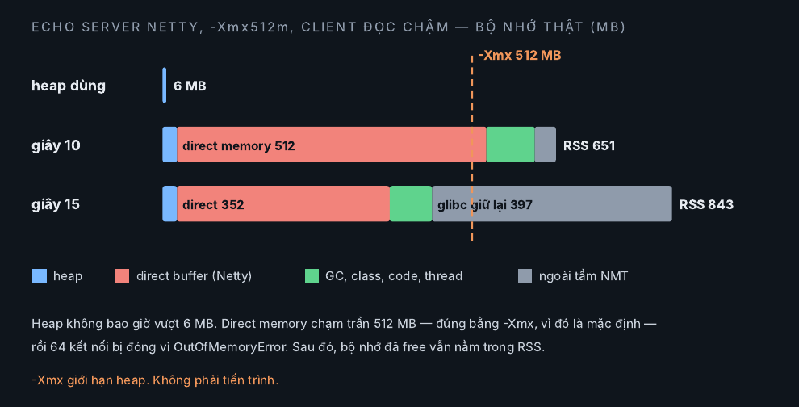
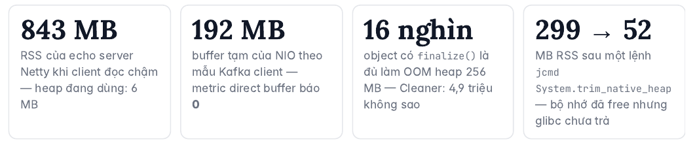
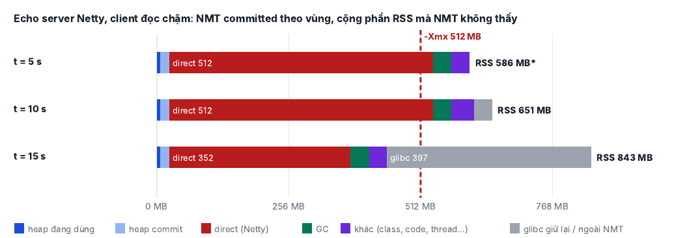

# Bài 15 — Reference & bộ nhớ ngoài heap



*Vì sao Netty/Kafka dùng RAM vượt -Xmx?*

*Chặng III · Bộ nhớ & GC — soft/weak/phantom, Cleaner, ThreadLocal, direct buffer, FFM · Nền tảng: JDK 25 LTS / 27 · Thí nghiệm chạy thật trên OpenJDK 25*

[Bài 14](14-log-gc-memory-leak.md) săn leak bên trong heap — nơi heap dump nhìn thấy mọi thứ. Bài 15 đi ra hai vùng mà heap dump bỏ sót: **các loại tham chiếu đặc biệt** mà GC đối xử khác thường (soft, weak, phantom, finalizer, ThreadLocal), và **bộ nhớ ngoài heap** (direct buffer, buffer tạm của NIO, arena của Netty, FFM API, bộ cấp phát của glibc). Đó là nơi những service “chỉ dùng 6 MB heap” bị kill vì vượt 800 MB.

> **VỀ CÁC CON SỐ VÀ CÔNG CỤ TRONG BÀI** — Mọi output đều lấy từ việc **chạy thật** trên OpenJDK 25.0.4 (G1), Linux x86-64, glibc 2.39, máy 2 vCPU. Mỗi chương trình tự in một dòng số liệu: heap (MXBean), *direct buffer pool* (`BufferPoolMXBean` — chính là metric `jvm.buffer.memory.used` của Micrometer), Native Memory Tracking (chương trình gọi `jcmd` lên chính nó) và RSS từ `/proc`. Netty là bản **4.1.48** từ kho Ubuntu (bản mới hơn không tải được trong môi trường này) — cơ chế arena giống các bản 4.1 sau, khác ở kích thước chunk (mục 9). Không có Kafka client; mục 8 tái hiện đúng mẫu I/O mà Kafka client dùng bằng NIO thuần và ghi rõ như vậy. Mỗi cấu hình chạy một lần.

Vì sao Netty/Kafka client dùng RAM vượt xa `-Xmx`? Câu trả lời ngắn: **vì `-Xmx` chỉ giới hạn heap**. Buffer I/O của Netty nằm trong direct memory (mặc định được phép lớn *bằng* heap), buffer tạm của NIO mà Kafka client gây ra không bị giới hạn bởi cờ nào, và bộ nhớ đã trả lại cho glibc chưa chắc đã trả lại cho hệ điều hành. Ba khoản đó cộng lại có thể lớn hơn heap nhiều lần.



*Bốn con số trên đều đo được trong bài.*

## 1 Vì sao một dev Spring Boot nên quan tâm

- **Spring WebFlux chạy trên Reactor Netty; Lettuce (Redis), gRPC-Java, nhiều HTTP client cũng dùng Netty.** Service “reactive” của bạn có một vùng nhớ lớn mà heap dump và `jvm.memory.used` không thấy (mục 9).
- **Kafka client** (Spring Kafka) đọc/ghi socket bằng buffer heap — và JDK lặng lẽ tạo buffer native cùng cỡ cho mỗi thread (mục 8).
- **Pod OOMKilled trong khi dashboard heap xanh**: [Bài 13](13-gc-cho-container.md) đã đo phần ngoài heap của một service nhỏ là 75–114 MB; bài này cho thấy nó có thể là hàng trăm MB.
- **Cache bằng `SoftReference`, buffer trong `ThreadLocal`, class có `finalize()`** — ba mẫu code cũ vẫn còn trong nhiều codebase và thư viện, mỗi mẫu có một cách làm hỏng bộ nhớ riêng (mục 4–6).

## 2 Bản đồ bộ nhớ của một tiến trình Java

RSS của tiến trình Java là tổng của nhiều vùng, chỉ một vùng bị `-Xmx` giới hạn:

| Vùng | Giới hạn bởi | Ai thấy nó |
|---|---|---|
| Java heap | `-Xmx` | heap dump, `jvm.memory.used`, NMT “Java Heap” |
| Metaspace, code cache | `MaxMetaspaceSize`, `ReservedCodeCacheSize` | NMT, `jvm.memory.used{area=nonheap}` |
| Stack của thread | `-Xss` × số thread | NMT “Thread” |
| Cấu trúc của GC | chọn GC ([Bài 11](11-mo-xe-g1.md)–13) | NMT “GC” |
| `ByteBuffer.allocateDirect` | `MaxDirectMemorySize` (mặc định = `-Xmx`) | NMT “Other”, `jvm.buffer.memory.used` |
| Buffer tạm của NIO, `Arena.ofConfined/ofShared`, `Unsafe.allocateMemory` | **không gì cả** | chỉ NMT “Other” |
| Thư viện native (JNI, zlib, TLS…) | không gì cả | chỉ RSS |
| Bộ nhớ đã `free()` nhưng glibc giữ lại | không gì cả | chỉ RSS |



*Hình 15.1 — Echo server Netty, `-Xmx512m`, 64 client gửi liên tục nhưng không đọc phản hồi (mục 9). Heap gần như trống; gần như mọi thứ khác thì không. Ở giây thứ 15, NMT chỉ còn thấy 446 MB nhưng RSS là 843 MB: gần 400 MB là bộ nhớ đã giải phóng mà glibc chưa trả cho hệ điều hành (mục 7). ∗ Ở giây thứ 5, RSS nhỏ hơn tổng NMT vì một phần bộ nhớ đã commit chưa được chạm tới.*

## 3 Bốn loại tham chiếu, nhìn bằng log GC

[Bài 10](10-nen-tang-gc.md) định nghĩa “sống” là “đến được từ GC root qua các tham chiếu thường”. `java.lang.ref` thêm ba mức yếu hơn, cho phép code nói với GC: *tôi muốn biết về object này nhưng đừng giữ nó vì tôi.*

| Loại | GC xoá khi | Dùng cho |
|---|---|---|
| **Strong** | không bao giờ, khi còn đến được | mọi thứ bình thường |
| **Soft** | khi heap “cần chỗ” — theo chính sách của GC | cache nhạy bộ nhớ (mục 4: thường là ý tồi) |
| **Weak** | ở lần GC đầu tiên thấy nó chỉ còn weak | `WeakHashMap`, khoá của `ThreadLocalMap`, listener |
| **Phantom** | sau khi object đã chết — chỉ để *báo tin*, `get()` luôn null | `Cleaner`: giải phóng tài nguyên native |

Thí nghiệm (`-Xmx256m`): giữ 40 MB chỉ bằng `SoftReference`, 20 MB bằng `WeakReference`, 20 MB bằng `PhantomReference` kèm một `Cleaner`; rồi gọi GC; rồi dồn heap tới OOM:

```text
$ java -Xmx256m -Xlog:gc,gc+phases+ref*=trace:file=gc.log Refs
trước GC:          soft 40/40  weak 20/20  phantom enqueued  0  cleaner ran  0   heapUsed=163M
sau System.gc():   soft 40/40  weak  0/20  phantom enqueued 20  cleaner ran 20   heapUsed= 83M
giữ thêm 60 MB mạnh: soft 40/40   ← heap còn chỗ: soft chưa bị đụng
ngay trước OOME:   soft  0/40  (đã giữ mạnh 126 MB rồi mới hết heap)

# gc.log
GC(4)  Pause Full (System.gc()) 164M->83M(168M) 6.918ms
GC(4)    WeakReference Discovered: 54, Dropped: 0, Processed: 54
GC(4)    PhantomReference Discovered: 41, Dropped: 1, Processed: 40
GC(8)  Pause Full (G1 Compaction Pause) 251M->251M(256M) 5.683ms   ← soft vẫn giữ
GC(12) Pause Full (G1 Compaction Pause) 253M->253M(256M) 5.326ms
GC(13) Pause Full (G1 Compaction Pause) 253M->173M(256M) 25.424ms  ← lần vét cuối
GC(13)   SoftReference Discovered: 65, Dropped: 4, Processed: 61
```

Ba hành vi đáng nhớ, đều thấy trong log: weak bị xoá ngay lần GC đầu tiên; phantom được *xếp hàng* sau khi object chết và `Cleaner` chạy hành động dọn dẹp; còn soft sống sót qua cả hai Full GC thường và chỉ bị xoá hàng loạt trong lần “vét” cuối cùng — ngay trước khi JVM chịu ném `OutOfMemoryError`. Chính sách mặc định (`-XX:SoftRefLRUPolicyMSPerMB=1000`) giữ một soft reference khoảng 1 giây cho mỗi MB heap còn trống tính từ lần cuối nó được đọc; với heap lớn, đó là rất lâu.

## 4 Cache bằng SoftReference: để GC quyết định hộ

“Cache tự co giãn theo bộ nhớ” nghe hấp dẫn. Cùng một tải — 50 000 thao tác/giây, mỗi lần trượt cache tạo một giá trị 8 KB, khoá phân bố lệch về một vùng “nóng” — so sánh `Map<K, SoftReference<V>>` với một LRU giới hạn 5 000 mục, heap 256 MB, 30 giây:

| | tỉ lệ trúng | số GC | Full GC | pause dài nhất | tổng thời gian GC |
|---|---:|---:|---:|---:|---:|
| LRU 5 000 mục (40 MB) | 18,5% | 458 | 0 | 15,4 ms | 2,7 s |
| SoftReference không giới hạn | **68,3%** | 661 | **17** | **42,9 ms** | 2,7 s |

Soft cache trúng nhiều hơn — vì nó dùng mọi chỗ trống trong heap làm cache. Cái giá: heap luôn gần đầy, và việc “đuổi” mục khỏi cache được làm theo lô trong 17 lần Full GC, mỗi lần xoá hàng loạt thay vì từng mục cũ nhất. Kích thước cache giờ phụ thuộc vào kích thước heap, lượng rác của request khác và chính sách nội bộ của GC — không còn là thứ bạn cấu hình hay dự đoán được. Một cache có `maximumSize` rõ ràng (Caffeine, [Bài 14](14-log-gc-memory-leak.md)) to hơn chút là lựa chọn kiểm soát được hơn.

## 5 Finalization và Cleaner

`Object.finalize()` chạy trước khi object bị thu hồi — nghe như destructor, nhưng cơ chế bên trong rất đắt: object có `finalize()` được đăng ký với một `FinalReference` ngay khi tạo; khi nó chết, GC phải **giữ nó sống lại** (cùng mọi thứ nó tham chiếu) cho tới khi thread Finalizer duy nhất chạy xong `finalize()`; chỉ lần GC *sau đó* mới thu hồi được. `Cleaner` (JDK 9) dùng phantom reference: object chết là chết, chỉ một hành động dọn dẹp nhỏ — không được tham chiếu tới object — đợi trong hàng.

Thí nghiệm: tạo liên tục object giữ 16 KB, hành động dọn dẹp tốn ~20 µs (giả lập đóng file); heap 256 MB:

| Cách dọn | tạo được | đã dọn | Kết cục |
|---|---:|---:|---|
| không cần dọn | 9 771 000 | — | chạy hết 20 s, 0 Full GC |
| `Cleaner` | 4 951 000 | 100 160 | chạy hết 20 s; hàng đợi 4,85 triệu hành động nhỏ, 19 Full GC |
| `finalize()` | **16 000** | 1 621 | **OutOfMemoryError sau 0,4 s** — 14 379 object 16 KB bị giữ chờ Finalizer |
| `finalize()` + `--finalization=disabled` | 5 817 000 | 0 | chạy hết; `finalize()` không bao giờ được gọi |

Cả hai cách đều không theo kịp tốc độ tạo object (một thread dọn dẹp, 20 µs mỗi lần). Khác biệt là *cái gì phải chờ*: với Cleaner là hành động dọn dẹp vài chục byte; với finalize là toàn bộ object 16 KB. Finalization bị đánh dấu sẽ gỡ bỏ từ JDK 18 (JEP 421); cờ `--finalization=disabled` cho phép thử ngay hôm nay xem ứng dụng có phụ thuộc vào nó không. JDK 27 tiếp tục dọn dẹp: gỡ hẳn `ThreadPoolExecutor.finalize()` (vốn rỗng từ JDK 11) — code gọi `super.finalize()` từ lớp con có thể không biên dịch được nữa.

> **THỨ TỰ ƯU TIÊN ĐỂ GIẢI PHÓNG TÀI NGUYÊN** — **1.** `try-with-resources` / `close()` tường minh — xác định, ngay lập tức. **2.** `Cleaner` như lưới an toàn khi người dùng quên `close()`. **3.** Không bao giờ `finalize()`. Với bean Spring: `@PreDestroy` hoặc `DisposableBean` cho tài nguyên sống cùng context.

## 6 ThreadLocal trong thread pool

`ThreadLocal` lưu giá trị trong một map gắn với *thread*. Khoá của map là weak reference tới đối tượng `ThreadLocal`; giá trị là strong reference. Trong một thread pool — Tomcat mặc định 200 thread — thread sống mãi, nên giá trị sống mãi. 20 000 task, 200 thread, mỗi task dùng một buffer 256 KB “tái sử dụng theo thread”, heap 1 GB, đo heap sống sau khi mọi task đã xong và pool vẫn chạy:

| Cách làm | heap còn giữ | thời gian | Ghi chú |
|---|---:|---:|---|
| `SCRATCH.set(buf)`, không `remove()` | **51 MB** | 590 ms | 200 thread × 256 KB — “rò rỉ” có trần, đôi khi là chủ ý |
| `set` rồi `remove()` cuối task | 1 MB | 1 198 ms | sạch, nhưng mỗi task cấp phát lại buffer |
| mỗi task một `new ThreadLocal()` | **OOM** | 237 s | 27 644 Full GC, heap sống 768 MB rồi OutOfMemoryError |
| virtual thread mỗi task | 1 MB | 1 243 ms | thread chết cùng task, giá trị chết theo |

Dòng thứ ba là cái bẫy kinh điển. Khi đối tượng `ThreadLocal` không còn ai giữ, khoá weak bị xoá nhưng **giá trị vẫn được map giữ mạnh** — một “mục cũ” chỉ được dọn khi thread tình cờ thao tác trên đúng vùng đó của map. Thread pool tạo mục cũ nhanh hơn tốc độ dọn: heap bị giữ 768 MB, JVM thrash 4 phút trong Full GC rồi chết. Quy tắc: `ThreadLocal` là `static final`, và luôn `remove()` trong `finally`. Với virtual thread ([Bài 19](19-virtual-threads.md)), mỗi task có thread riêng nên không rò — nhưng cũng mất luôn lợi ích “tái sử dụng buffer theo thread”, đó là lý do JDK có `ScopedValue`.

## 7 DirectByteBuffer: bộ nhớ native được dọn bởi GC

`ByteBuffer.allocateDirect(n)` xin *n* byte ngoài heap (qua `malloc`), để I/O có thể chuyển thẳng cho kernel mà không chép. Trên heap chỉ còn một object `DirectByteBuffer` vài chục byte kèm một `Cleaner`. Vấn đề: bộ nhớ native chỉ được trả khi **GC phát hiện object nhỏ đó đã chết** — và một object nhỏ thì không làm heap đầy, nên GC có thể rất lâu mới chạy. Thí nghiệm: cấp phát rồi bỏ 2 000 buffer 1 MB, gần như không tạo rác trên heap:

| Cấu hình | heap dùng | direct đỉnh | RSS đỉnh | Chuyện gì xảy ra |
|---|---:|---:|---:|---|
| `-Xmx256m` | 1–4 MB | 256 MB | 303 MB | chạm giới hạn → JDK tự gọi `System.gc()` (8 lần) → chạy tiếp |
| `-Xmx256m -XX:+DisableExplicitGC` | 4 MB | 256 MB | 309 MB | `OutOfMemoryError: Cannot reserve 1048576 bytes of direct buffer memory (allocated: 268435456, limit: 268435456)` |
| `-Xmx2g` | 4 MB | **2 000 MB** | **2 054 MB** | không GC nào trong suốt quá trình; RSS gấp 500 lần heap đang dùng |
| `-Xmx2g -XX:MaxDirectMemorySize=128m` | 1 MB | 128 MB | 168 MB | 16 lần `System.gc()`, RSS được kìm |

Ba bài học. **(1)** `MaxDirectMemorySize` mặc định **bằng `-Xmx`** — đặt heap 2 GB là ngầm cho phép thêm 2 GB native. **(2)** Cơ chế an toàn của JDK khi chạm giới hạn là gọi `System.gc()` rồi chờ; `-XX:+DisableExplicitGC` — một cờ “tối ưu” hay được chép từ blog — tắt luôn cơ chế đó và biến chuyện bình thường thành OOM. **(3)** Hãy đặt `-XX:MaxDirectMemorySize` tường minh khi chạy trong container.

### Free rồi mà RSS không giảm

Sau khi mọi buffer được giải phóng (NMT “Other” về 0), RSS vẫn ở 299 MB với `-Xmx256m` và 355 MB với `-Xmx2g`. Bộ nhớ đã `free()` về glibc nhưng glibc giữ lại trong arena của nó để dùng tiếp. JVM có thể yêu cầu glibc trả lại (đo trên JDK 25):

```text
$ jcmd <pid> System.trim_native_heap
Trim native heap: RSS+Swap: 299M->54144K (-246M)
# hoặc định kỳ, tự động:
-XX:TrimNativeHeapInterval=60000          # ms; mặc định 0 = tắt (JDK 21.0.12 và 25 đều có)
```

Đây là lý do “RSS lớn hơn tổng NMT” thường gặp ở service nhiều thread làm I/O. Một biện pháp khác ở tầng hệ điều hành là giảm số arena của glibc (`MALLOC_ARENA_MAX=2`), đánh đổi bằng tranh chấp khoá khi nhiều thread cùng `malloc`.

## 8 Thứ không metric nào đếm: buffer tạm của NIO (mẫu Kafka)

Kafka client cố ý dùng buffer *trên heap*: producer gom record vào một vùng 32 MB (`buffer.memory`), consumer đọc phản hồi fetch vào `ByteBuffer` heap (tối đa `fetch.max.bytes`, mặc định 50 MB). Nhưng kernel chỉ đọc/ghi được bộ nhớ không di chuyển. Nên khi bạn gọi `SocketChannel.write(heapBuffer)`, JDK lấy một buffer native tạm **cùng cỡ**, chép sang, ghi, rồi **cất buffer tạm vào cache của thread** để lần sau dùng lại. Mã nguồn JDK 25, `sun.nio.ch.Util`:

```java
public static ByteBuffer getTemporaryDirectBuffer(int size) {
    ...
    BufferCache cache = bufferCache.get();          // ThreadLocal: mỗi thread một cache
    ByteBuffer buf = cache.get(size);
    if (buf != null) return buf;
    ...
    long addr = unsafe.allocateMemory(size);       // không bị MaxDirectMemorySize chặn
    return NIO_ACCESS.newDirectByteBuffer(addr, size);
}
```

Tái hiện mẫu I/O đó (không phải Kafka client thật): 8 thread gửi “record batch” heap 8 MB qua socket, 8 thread nhận đọc vào buffer heap 16 MB, `-Xmx512m`:

```text
                              heapUsed  directPool        NMT other
khi 8 sender còn sống          212M      0buf/0M       192M      ← 8 × 8 MB (gửi) + 8 × 16 MB (nhận)
sender đã xong                 212M      0buf/0M       128M      ← reader vẫn đang chờ trong read()
# cùng chương trình, -Djdk.nio.maxCachedBufferSize=262144
khi 8 sender còn sống          211M      0buf/0M       128M
sender đã xong                 211M      0buf/0M       0M
```

192 MB bộ nhớ native mà `jvm.buffer.memory.used` báo **0** và `MaxDirectMemorySize` không chặn — chỉ NMT thấy. Hai đặc điểm làm nó nguy hiểm trong production: kích thước tỉ lệ với *buffer lớn nhất từng được dùng × số thread*; và một thread đang chặn trong `read()` vào buffer heap lớn giữ nguyên buffer native cùng cỡ trong suốt thời gian chờ. `-Djdk.nio.maxCachedBufferSize` (JDK 9+) ngăn cache giữ buffer lớn, nhưng không làm buffer đang dùng nhỏ đi. Một ví dụ thật được ghi nhận: Kafka client cấu hình `PLAINTEXT` trỏ vào cổng SSL đọc nhầm byte TLS thành độ dài message khổng lồ — stack trace của `OutOfMemoryError: Direct buffer memory` đi qua đúng `Util.getTemporaryDirectBuffer` trong `PlaintextTransportLayer.read`.

## 9 Netty: arena, chunk và client đọc chậm

Netty không chờ GC: nó tự quản lý direct memory bằng `PooledByteBufAllocator` — chia bộ nhớ thành các **chunk** lớn (16 MB ở 4.1.48; 4 MB ở các bản 4.1 mới hơn, từ khoảng 4.1.76), gom vào vài **arena** (mặc định 2 × số lõi, bị giảm nếu `MaxDirectMemorySize` nhỏ), cấp phát từng trang 8 KB bên trong chunk và trả về pool khi `release()`. Echo server, `-Xmx512m`, 4 event loop, 128 client gửi-nhận message 256 KB với ~4 GB/s:

```text
READY allocator=PooledByteBufAllocator directByDefault=true hasUnsafe=true eventLoops=4
t=10s  heapUsed=15M  directPool=5buf/64M  rss=148M | NMT other=64M | nettyPooledDirect=64M arenas=4 chunk=16M
```

Khoẻ mạnh: 4 arena × 1 chunk 16 MB, ổn định suốt 20 giây. Giờ đổi client: 64 kết nối gửi liên tục message 64 KB nhưng **không bao giờ đọc phản hồi** — một consumer chậm, một client treo, một mạng nghẽn. Server vẫn `ctx.write()` phản hồi; Netty xếp chúng vào `ChannelOutboundBuffer` của từng kết nối, bằng direct memory:

```text
t=5s   heapUsed=6M  heapCommitted=24M  directPool=33buf/512M  rss=586M | NMT total=607M other=512M
t=10s  heapUsed=6M  heapCommitted=24M  directPool=33buf/512M  rss=651M | NMT total=616M other=512M  errors=62
t=15s  heapUsed=6M  heapCommitted=24M  directPool=23buf/352M  rss=843M | NMT total=446M other=352M  errors=64
first error: java.lang.OutOfMemoryError: Cannot reserve 16777216 bytes of direct buffer memory
             (allocated: 536870913, limit: 536870912)
```

Direct memory chạm trần 512 MB trong 5 giây; Netty không xin được chunk mới, cả 64 kết nối bị đóng vì lỗi. Heap chưa từng vượt 6 MB. Sửa đúng là **backpressure**: tôn trọng `Channel.isWritable()` — khi outbound buffer vượt `WRITE_BUFFER_WATER_MARK` (mặc định 32–64 KB), ngừng đọc từ kết nối đó (`setAutoRead(false)`) cho tới khi `channelWritabilityChanged` báo ghi được tiếp:

```text
# cùng client đọc chậm, server có backpressure
t=10s  heapUsed=13M  directPool=6buf/64M  rss=134M | NMT other=64M  errors=0
t=20s  heapUsed=13M  directPool=6buf/64M  rss=135M | NMT other=64M  errors=0
```

Reactor Netty (Spring WebFlux) và các client dựa trên Netty đã có backpressure ở tầng Reactive Streams; rủi ro nằm ở handler tự viết, ở chỗ `subscribe()` với nhu cầu vô hạn, và ở client giữ kết nối lâu với phía bên kia chậm. Hai chi tiết phiên bản: Netty cần `sun.misc.Unsafe` để giải phóng direct buffer ngay mà không chờ GC; từ JDK 24, JDK cảnh báo khi các hàm truy cập bộ nhớ của `Unsafe` được dùng (JEP 498), và Netty 4.2 bổ sung đường cấp phát qua FFM API (`MemorySegment`) để thay thế.

## 10 FFM API: bộ nhớ native có vòng đời rõ ràng

Foreign Function & Memory API (chính thức từ JDK 22, JEP 454) thay mô hình “GC sẽ dọn khi nào đó” bằng **Arena**: mọi đoạn bộ nhớ thuộc về một arena, và đóng arena là giải phóng tất cả — ngay lập tức, xác định.

```text
$ java -Xmx256m Ffm confined-hold 1000          # Arena.ofConfined(), 1000 × 1 MB
holding 1000 MB (arena open)  heapUsed=4M  directPool=0buf/0M  rss=1055M | NMT other=1000M
after arena.close()           heapUsed=4M  directPool=0buf/0M  rss=301M  | NMT other=0M
$ java -Xmx256m Ffm auto 1000                   # 1000 × Arena.ofAuto(), bỏ ngay
after 1000 x ofAuto (dropped) directPool=232buf/232M | NMT other=232M      ← 4 lần System.gc()
```

Kết quả bất ngờ đầu tiên: arena `ofConfined` cấp phát **1 000 MB với `-Xmx256m`**, vượt xa `MaxDirectMemorySize`, và metric direct pool báo 0. Mã nguồn giải thích — chỉ arena “ngầm định” mới bị tính vào giới hạn:

```java
// jdk/internal/foreign/ArenaImpl.java (JDK 25)
shouldReserveMemory = session instanceof ImplicitSession;   // chỉ Arena.ofAuto()
```

| Arena | Giải phóng khi | Tính vào `MaxDirectMemorySize` / direct pool |
|---|---|---|
| `ofConfined()`, `ofShared()` | `close()` — ngay lập tức | **không** — chỉ NMT thấy |
| `ofAuto()` | GC thấy arena không còn ai giữ (như DirectByteBuffer) | có |
| `global()` | không bao giờ | không |

FFM giải quyết đúng bệnh của DirectByteBuffer — giải phóng không còn phụ thuộc GC — nhưng chuyển trách nhiệm “đặt trần” sang người viết code. Thư viện dùng FFM (Netty 4.2, các driver mới) cần tự giới hạn, và đội vận hành cần nhìn NMT chứ không chỉ `jvm.buffer.memory.used`.

## 11 Trong Spring Boot: ngân sách và quan sát

Gom các mục lại thành một phép cộng cho `limits.memory` (tiếp nối [Bài 13](13-gc-cho-container.md)):

```text
limits.memory ≥  heap (-Xmx)
               + metaspace + code cache + stack thread + cấu trúc GC      ← NMT (Bài 13)
               + direct memory           (≤ MaxDirectMemorySize — mặc định = -Xmx)
               + buffer tạm NIO          (≈ buffer heap lớn nhất × số thread I/O — không có trần)
               + arena FFM confined/shared, thư viện native
               + phần glibc giữ lại      (trim được)
               + dự phòng
```

> **SPRING BOOT · NĂM THIẾT LẬP CHO SERVICE DÙNG NETTY HOẶC KAFKA**
>
> 1. `-XX:MaxDirectMemorySize` **tường minh** (ví dụ 128–256 MB) — đừng để nó bằng heap. Với Netty có thể đặt riêng `-Dio.netty.maxDirectMemory`.
> 2. **Không** dùng `-XX:+DisableExplicitGC` khi có direct buffer (mục 7). Nếu lo về `System.gc()` từ thư viện, dùng `-XX:+ExplicitGCInvokesConcurrent` với G1.
> 3. Kafka: `-Djdk.nio.maxCachedBufferSize=262144`; giữ `fetch.max.bytes` / `max.partition.fetch.bytes` ở mức cần thiết — chúng quyết định cỡ buffer native tạm.
> 4. Bật `-XX:NativeMemoryTracking=summary` trên staging (có chi phí hiệu năng, nhỏ nhưng khác 0) và so `jcmd VM.native_memory summary` với RSS; khoảng chênh lớn là glibc hoặc thư viện native. Cân nhắc `-XX:TrimNativeHeapInterval`.
> 5. Dashboard: đặt cạnh nhau `jvm.memory.used`, `jvm.buffer.memory.used{id=direct}` và RSS của container. Nhớ rằng metric direct buffer **không** thấy buffer tạm NIO hay arena FFM — chỉ RSS và NMT thấy.

> **THAY ĐỔI THEO PHIÊN BẢN CẦN BIẾT** — **JDK 9** — `Cleaner`; `jdk.nio.maxCachedBufferSize`. **JDK 18** — finalization bị đánh dấu gỡ bỏ, có `--finalization=disabled` (JEP 421). **JDK 22** — FFM API chính thức (JEP 454). **JDK 24** — cảnh báo khi dùng các hàm truy cập bộ nhớ của `sun.misc.Unsafe` (JEP 498); ảnh hưởng Netty 4.1. **JDK 27** — gỡ `ThreadPoolExecutor.finalize()`. Netty 4.2 thêm đường cấp phát bằng `MemorySegment` để thoát khỏi `Unsafe`.

## 12 Ghép lại: một trang để nhớ cả bài

| Cơ chế | Bản chất | Cờ / chỗ xem | Đo trong bài |
|---|---|---|---|
| Soft | xoá khi GC “cần chỗ” — thực tế: lần vét trước OOM | `SoftRefLRUPolicyMSPerMB`, `gc+phases+ref` | sống qua 2 Full GC; cache soft: 17 Full GC |
| Weak / Phantom | xoá ở GC đầu tiên / báo tin sau khi chết | `Cleaner` | 20/20 xoá, 20 cleaner chạy |
| finalize() | giữ cả object sống tới khi Finalizer chạy | `--finalization=disabled` | OOM sau 16 nghìn object; Cleaner: 4,9 triệu |
| ThreadLocal | giá trị sống theo thread; khoá weak, giá trị strong | `remove()` trong `finally` | 200 × 256 KB = 51 MB; `new ThreadLocal`/task → OOM |
| Direct buffer | native, trả khi GC thấy object nhỏ chết | `MaxDirectMemorySize` (= `-Xmx`) | 2 000 MB native với 4 MB heap |
| Buffer tạm NIO | buffer heap → bản sao native cùng cỡ, cache theo thread | `jdk.nio.maxCachedBufferSize` | 192 MB, direct pool báo 0 |
| Netty pooled | arena × chunk; outbound buffer theo kết nối | `isWritable()`, water mark | đọc chậm: 512 MB → OOM; backpressure: 64 MB |
| FFM Arena | `close()` giải phóng ngay | `ofConfined` không bị giới hạn | 1 000 MB với `-Xmx256m` |
| glibc | free() chưa phải trả cho OS | `System.trim_native_heap` | RSS 299 → 52 MB |

Tóm cả bài trong một đoạn: *`-Xmx` chỉ giới hạn heap. Quanh heap là một vùng bộ nhớ mà GC chỉ quản lý gián tiếp: direct buffer được trả khi GC tình cờ phát hiện object nhỏ đại diện cho nó đã chết, và mặc định được phép lớn bằng cả heap; buffer tạm của NIO — thứ Kafka client gây ra khi ghi buffer heap vào socket — không có trần và không có metric; arena của Netty tăng theo số kết nối đang ứ dữ liệu; arena FFM tự quản lý không chịu giới hạn nào; và glibc có thể giữ lại hàng trăm MB đã free. Trong heap, bốn loại tham chiếu đặc biệt cho GC những quy tắc khác thường: soft giữ tới phút cuối, finalize() kéo dài đời object, ThreadLocal sống theo thread. Muốn RSS dự đoán được: đặt trần tường minh cho direct memory, giữ backpressure, dọn tài nguyên bằng close() thay vì GC, và đo bằng NMT cạnh RSS.*

## 13 Hiểu lầm thường gặp, bài tập, bài tiếp theo

### Hiểu lầm thường gặp

| Hiểu lầm | Thực tế |
|---|---|
| “`-Xmx` là trần bộ nhớ của JVM.” | Là trần của heap. Direct memory mặc định thêm một lượng bằng `-Xmx`; buffer NIO tạm và arena FFM không có trần (mục 7–10). |
| “`jvm.buffer.memory.used` cho biết hết bộ nhớ native.” | Báo 0 khi NIO đang giữ 192 MB buffer tạm và khi arena FFM giữ 1 000 MB. |
| “SoftReference là cache thông minh.” | Giữ tới lần GC vét cuối; đuổi theo lô trong Full GC; kích thước không kiểm soát được (mục 3–4). |
| “`finalize()` giống destructor.” | Kéo dài đời object qua ít nhất hai lần GC, một thread duy nhất xử lý; 16 nghìn object là OOM (mục 5). |
| “ThreadLocal tự dọn vì khoá là weak.” | Khoá weak, giá trị strong; mục cũ chỉ được dọn tình cờ. `new ThreadLocal` mỗi request → OOM (mục 6). |
| “`-XX:+DisableExplicitGC` là tối ưu vô hại.” | Tắt lưới an toàn của direct buffer → `OutOfMemoryError: Cannot reserve ... direct buffer memory`. |
| “Free rồi thì RSS giảm.” | glibc giữ lại; 299 MB RSS với 0 MB native đang dùng cho tới khi trim. |

### Bài tập tự làm (khoảng 60 phút)

> **THỰC HÀNH**
>
> 1. **Khoảng chênh của bạn** (bài tập quan trọng nhất). Trên một pod production: RSS của container trừ `jvm.memory.used` (heap + non-heap) là bao nhiêu? Bật NMT trên staging để chia khoảng đó ra từng vùng.
> 2. **Direct memory**: service của bạn có đặt `MaxDirectMemorySize` không? Có `DisableExplicitGC` không? Tính trường hợp xấu nhất: `-Xmx` + direct.
> 3. **Kafka**: với số consumer thread và `fetch.max.bytes` hiện tại, buffer tạm NIO tối đa là bao nhiêu? Thử `-Djdk.nio.maxCachedBufferSize` và so NMT “Other”.
> 4. **ThreadLocal**: tìm mọi `new ThreadLocal` trong codebase. Cái nào không phải `static`? Cái nào thiếu `remove()`?
> 5. **Netty / WebFlux**: dựng một client đọc chậm (như mục 9) bắn vào service staging. Direct memory có tăng không giới hạn không?

### Thuật ngữ của bài

| Thuật ngữ | Nghĩa ngắn gọn |
|---|---|
| Soft / Weak / Phantom reference | Tham chiếu không giữ object sống, với mức độ GC tôn trọng khác nhau. |
| Cleaner | Cơ chế chạy hành động dọn dẹp khi object không còn đến được (dựa trên phantom reference). |
| Finalization | Cơ chế cũ gọi `finalize()` trước khi thu hồi; đang bị gỡ bỏ (JEP 421). |
| Direct buffer | `ByteBuffer` có dữ liệu nằm ngoài heap; giải phóng qua Cleaner khi object chết. |
| MaxDirectMemorySize | Trần cho direct buffer (và `Arena.ofAuto`); mặc định bằng heap tối đa. |
| Temporary direct buffer | Bản sao native mà NIO tạo khi I/O với buffer heap; cache theo thread. |
| Arena (Netty) | Vùng quản lý chunk của `PooledByteBufAllocator`. |
| Arena (FFM) | Phạm vi sở hữu bộ nhớ native; đóng là giải phóng. |
| Backpressure | Ngừng nhận khi không gửi đi kịp, để bộ đệm không phình vô hạn. |
| Native heap trim | Yêu cầu glibc trả bộ nhớ đã free cho hệ điều hành. |

> **BÀI TIẾP THEO · BÀI 16 — MỞ ĐẦU CHẶNG IV: CONCURRENCY** — **Java Memory Model.** Compiler và CPU sắp xếp lại lệnh; happens-before; `volatile`, `final` và safe publication — đo bằng thí nghiệm nhiều thread và mã máy thật. Sau sáu bài về *bộ nhớ chứa gì*, Chặng IV hỏi *các thread nhìn thấy bộ nhớ đó thế nào*. Câu hỏi của bài: *vì sao double-checked locking thiếu `volatile` lại hỏng?*

### Tài liệu tham khảo

- Javadoc `java.lang.ref` (JDK 25): `SoftReference`, `WeakReference`, `PhantomReference`, `Cleaner`.
- JEP 421: Deprecate Finalization for Removal (JDK 18); JEP 454: Foreign Function & Memory API (JDK 22); JEP 498: Warn upon Use of Memory-Access Methods in sun.misc.Unsafe (JDK 24). openjdk.org/jeps
- Inside.java — “Quality Outreach Heads-up – JDK 27: Removal of ThreadPoolExecutor.finalize()” (2/2026).
- Mã nguồn JDK 25: `sun/nio/ch/Util.java` (`getTemporaryDirectBuffer`), `jdk/internal/foreign/ArenaImpl.java`, `SegmentFactories.java`. github.com/openjdk/jdk
- JDK-8147468 — `jdk.nio.maxCachedBufferSize`; thảo luận nio-dev “sun.nio.ch.Util: Don't cache an unlimited amount of memory” (2015).
- Netty wiki — “Java 24 and sun.misc.Unsafe”; Netty `PooledByteBufAllocator`, `WriteBufferWaterMark`. netty.io
- Ververica KB — “Direct buffer OutOfMemoryError when using Kafka connector in Flink”.
