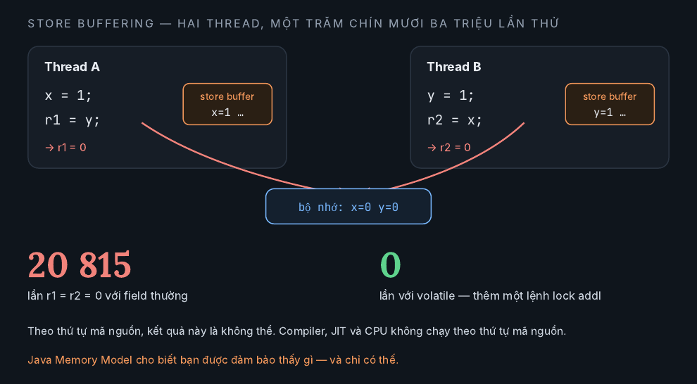
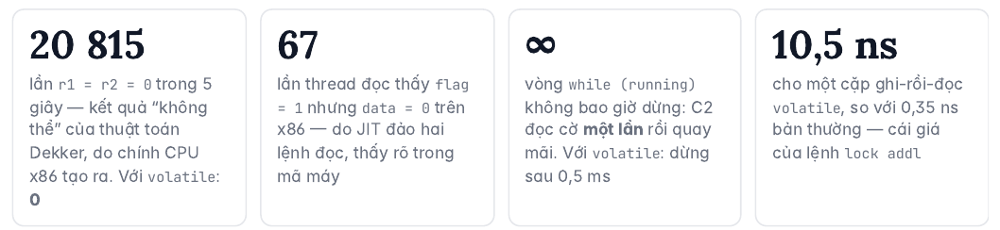
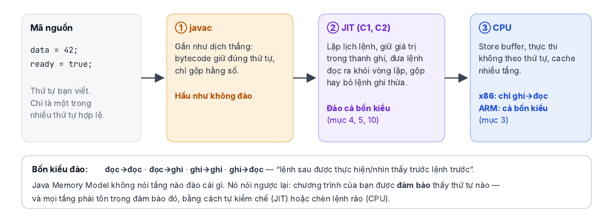
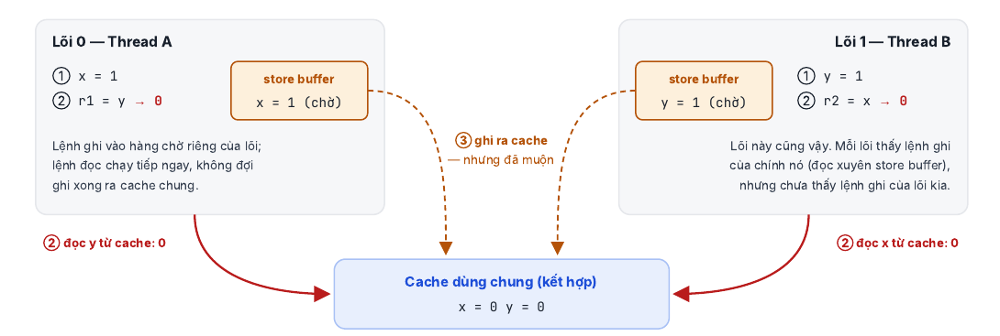
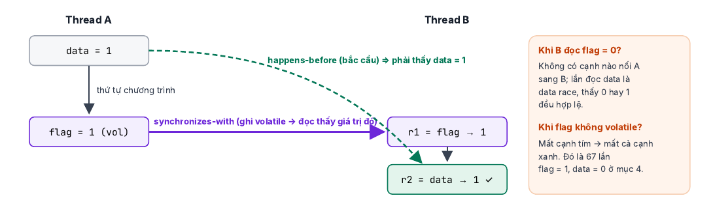
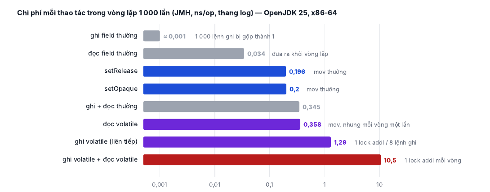
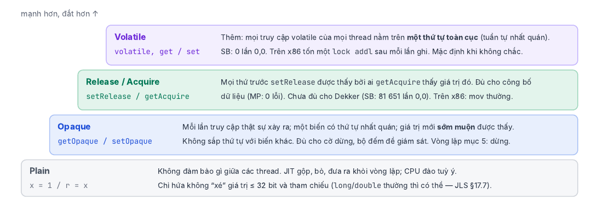
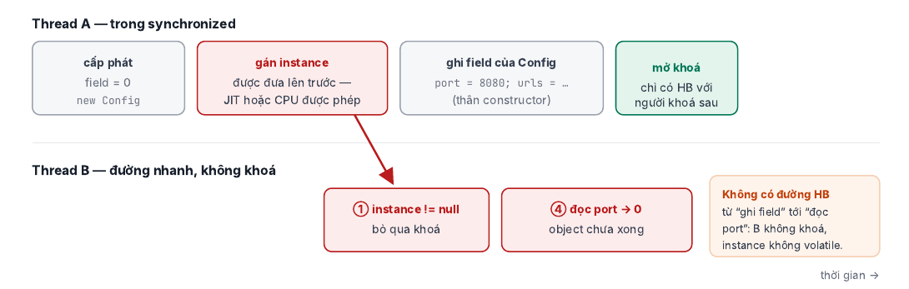
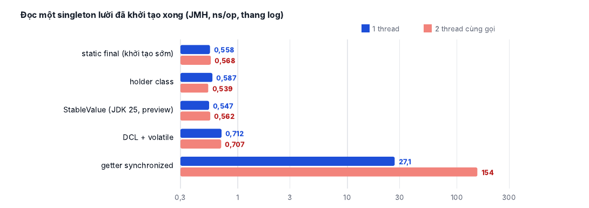
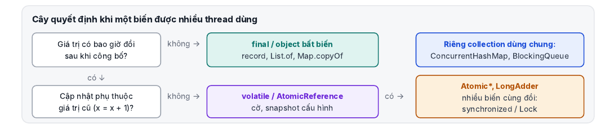

# Bài 16 — Java Memory Model



*Vì sao double-checked locking thiếu volatile lại hỏng?*

*Chặng IV · Concurrency nhìn từ JVM — reordering, happens-before, volatile, final, safe publication · Nền tảng: JDK 25 LTS / 27 · Thí nghiệm chạy thật trên OpenJDK 25*

Sáu bài vừa qua hỏi **bộ nhớ chứa gì**: object nằm đâu, ai dọn, cái gì ngoài heap. Chặng IV hỏi một câu khác: **khi hai thread cùng nhìn vào một ô nhớ, mỗi thread thấy gì?** Câu trả lời không nằm ở GC hay heap mà ở ba tầng có quyền sắp xếp lại lệnh của bạn — compiler, JIT và CPU — và ở bản hợp đồng giới hạn quyền đó: Java Memory Model.

> **VỀ CÁC CON SỐ VÀ CÔNG CỤ TRONG BÀI** — Mọi output lấy từ việc **chạy thật** trên OpenJDK 25.0.4 (một số đối chiếu trên 21.0.12), Linux x86-64, Intel Xeon 2 vCPU. Công cụ chuẩn cho loại thí nghiệm này là **jcstress** của OpenJDK; môi trường viết bài không cài được nó, nên chúng tôi viết một bộ chạy nhỏ theo đúng nguyên lý của jcstress: tạo hàng chục nghìn object “trạng thái” mới, cho hai thread cùng chạy qua mảng đó — thread A làm việc của nó, thread B làm việc của nó trên *cùng* object thứ *i* gần như cùng lúc — rồi đếm mọi kết quả. Mỗi test chạy trong JVM riêng, 5–6 giây, hàng trăm triệu lần thử. Mã máy lấy bằng `-XX:CompileCommand=print` và `objdump`; đo chi phí bằng JMH 1.37. Những kết quả **không** tái hiện được trên máy này được nói rõ, kèm số liệu đã công bố của jcstress trên x86 và AArch64.

*Mã nguồn lab nằm trong repo: sources/under-hood/src/bai16-litmus-src.zip.*

Vì sao double-checked locking thiếu `volatile` lại hỏng? Câu trả lời ngắn: **vì “gán xong field rồi mới công bố object” chỉ là thứ tự trong mã nguồn của bạn**. Compiler, JIT và CPU đều được phép đổi thứ tự hai thao tác ghi không liên quan đến nhau, miễn là *thread đang chạy* không phân biệt được. Thread thứ hai thì phân biệt được: nó có thể thấy tham chiếu khác null trước khi thấy các field. `volatile` là cách nói với cả ba tầng: ở chỗ này, đừng đảo.



*Bốn con số trên đều đo được trong bài.*

## 1 Vì sao một dev Spring Boot nên quan tâm

- **Mọi request trong Spring MVC chạy trên một thread khác nhau** (200 thread Tomcat, hay hàng nghìn virtual thread). Một field trong bean singleton được thread này ghi, thread kia đọc, là bài toán của JMM — dù bạn chưa bao giờ tự `new Thread()`.
- **Cấu hình “nóng”**: một `@Scheduled` nạp lại danh sách giá, feature flag, khoá công khai JWKS rồi gán vào field — các thread request có thấy giá trị mới không, và có thấy một object *nửa vời* không (mục 9, 11)?
- **Cờ dừng, lazy init, cache tự viết**: ba mẫu code đơn giản nhất cũng là ba chỗ hay hỏng nhất (mục 5, 10). Lỗi kiểu này không lộ ra trong unit test, hiếm khi lộ ra trên laptop, và không để lại stack trace.
- **Hiểu JMM là nền cho cả chặng**: `synchronized` ([Bài 17](17-synchronized-monitor.md)), safepoint ([Bài 18](18-thread-safepoint.md)), virtual thread ([Bài 19](19-virtual-threads.md)) và `java.util.concurrent` ([Bài 20](20-java-util-concurrent.md)) đều được định nghĩa bằng các quan hệ happens-before của bài này.

## 2 Ba tầng có quyền sắp xếp lại lệnh của bạn

[Bài 05](05-object-trong-ram.md)–07 cho thấy JIT biến bytecode thành mã máy khác hẳn mã nguồn: inline, bỏ lệnh thừa, đưa lệnh ra khỏi vòng lặp. Tất cả các tối ưu đó dựa trên một giả định: **chỉ có một thread**. Quy tắc mà mọi tầng tuân theo là *as-if-serial* — kết quả mà thread đang chạy quan sát được phải giống như chạy tuần tự. Hai lệnh ghi vào hai field khác nhau thì thread đó không phân biệt được thứ tự, nên mọi tầng đều được tự do đổi chỗ.



*Hình 16.1 — Từ dòng code tới lúc giá trị xuất hiện trong bộ nhớ, ba tầng có quyền đổi thứ tự. JMM là bản hợp đồng duy nhất bạn có thể dựa vào: viết theo JMM thì đúng trên mọi CPU và mọi JIT; dựa vào “x86 không đảo cái này” thì đúng tới ngày JIT đổi ý.*

Một điểm quan trọng: JMM cố ý **không** mô tả phần cứng. JLS chương 17 định nghĩa một tập quy tắc trừu tượng — *happens-before* (mục 6) — và mọi bản cài đặt JVM trên mọi CPU phải đảm bảo những gì quy tắc hứa. Những gì quy tắc không hứa, JVM được tự do, và những tự do đó thay đổi theo kiến trúc CPU, theo phiên bản JIT, thậm chí theo cách JIT quyết định unroll vòng lặp hôm nay. Phần còn lại của bài lần lượt bắt quả tang từng tầng.

## 3 Store buffer: khi chính CPU x86 đảo lệnh

Thí nghiệm kinh điển nhất của memory model, gọi là **store buffering** (SB) — lõi của thuật toán khoá Dekker. Mỗi thread ghi biến của mình rồi đọc biến của thread kia:

```java
class State { int x, y; int r1, r2; }      // mỗi lần thử: một State mới, x = y = 0

// Thread A                       // Thread B
x = 1;                            y = 1;
r1 = y;                           r2 = x;
```

Xét mọi cách xen kẽ bốn lệnh: luôn có một lệnh ghi xảy ra trước cả hai lệnh đọc, nên ít nhất một trong hai thread phải đọc được 1. `r1 = r2 = 0` là *không thể* — nếu máy chạy đúng thứ tự. Kết quả đếm được:

| Biến thể | số lần thử | `r1=0, r2=0` | JMM nói gì |
|---|---:|---:|---|
| field thường (JDK 25) | 193 019 904 | **20 815** | cho phép — có data race |
| field thường (JDK 21) | 198 459 392 | **10 680** | cho phép |
| `setRelease` / `getAcquire` | 179 126 272 | **81 651** | cho phép (mục 8) |
| `volatile int x, y` | 111 902 720 | 0 | **cấm** |
| field thường + `VarHandle.fullFence()` giữa ghi và đọc | 104 726 528 | 0 | cấm (theo đặc tả của fence) |

Hai mươi nghìn lần “không thể”. Thủ phạm ở đây không phải JIT — mã máy của hai thread giữ đúng thứ tự ghi rồi đọc — mà là **store buffer** của CPU:



*Hình 16.2 — Store buffer cho phép một lệnh đọc “vượt” lệnh ghi đứng trước nó. Nhìn từ bên ngoài, mỗi lõi như thể đã chạy `r = …` trước `… = 1`. Đây là kiểu đảo duy nhất mà x86 cho phép (ghi→đọc); các CPU ARM, POWER, RISC-V cho phép cả bốn kiểu.*

Mô hình bộ nhớ của x86 có tên **TSO** (Total Store Order): các lệnh ghi của một lõi ra ngoài theo đúng thứ tự, các lệnh đọc cũng vậy, chỉ riêng “ghi rồi đọc ô khác” là có thể bị đảo. Vì vậy trên x86, `volatile` chỉ cần thêm **một** lệnh: một lệnh có tiền tố `lock` ngay sau mỗi lần ghi volatile, buộc store buffer xả hết trước khi lõi đọc tiếp (mục 7). `setRelease` / `getAcquire` không có lệnh đó — và JMM cũng không đòi hỏi, nên 81 651 lần `(0, 0)` là kết quả hợp lệ.

> **ĐỌC TẦN SUẤT CHO ĐÚNG** — 20 815 trên 193 triệu là khoảng 1 trên 9 000 lần. Bộ chạy của chúng tôi đồng bộ hai thread kém hơn jcstress, nên tần suất thật trong một hệ thống có thể cao hơn hoặc thấp hơn nhiều. Điều đáng kể không phải tần suất mà là **con số khác 0**: một service xử lý 5 000 request/giây chạm vào một khe như vậy vài lần mỗi phút.

## 4 JIT đảo lệnh: bắt quả tang trong mã máy

Thí nghiệm thứ hai, **message passing** (MP), là mẫu mà hầu như ai cũng từng viết: chuẩn bị dữ liệu, rồi bật cờ báo “xong rồi”.

```java
class MP { int data; int flag; int r1, r2; }

// Thread A (người gửi)              // Thread B (người nhận)
data = 1;                            r1 = flag;
flag = 1;                            r2 = data;     // thấy flag = 1 thì chắc data = 1?
```

Trên x86, phần cứng không đảo ghi→ghi cũng không đảo đọc→đọc, nên theo lý thuyết phần cứng, `flag = 1, data = 0` không thể xảy ra. Thực tế:

| Biến thể | số lần thử | `flag=1, data=0` | JMM nói gì |
|---|---:|---:|---|
| field thường (JDK 25) | 175 849 472 | **67** | cho phép |
| field thường (JDK 25, lần chạy thứ hai) | 184 336 384 | **41** | cho phép |
| field thường (JDK 21) | 193 855 488 | **24** | cho phép |
| `volatile int flag` (data vẫn thường) | 130 105 344 | 0 | **cấm** — mục 6 |
| `setRelease(flag)` / `getAcquire(flag)` | 168 837 120 | 0 | **cấm** — mục 8 |

Nếu không phải CPU, thì là JIT. Thread B chạy vòng `for` qua mảng object; C2 biên dịch vòng đó, **unroll** thành hai lần lặp mỗi vòng, rồi lập lịch lại các lệnh. Mã máy thật (offset của field kiểm tra bằng `Unsafe.objectFieldOffset`: `data` = `0xc`, `flag` = `0x10`, `r1` = `0x18`, `r2` = `0x1c`):

```asm
; C2, lab16.Litmus::lambda$run$0 (OSR) — vòng lặp của thread B sau khi inline actor2 và unroll ×2
...c79:  mov  0xc(%rax),%r9d      ; đọc data   ← object thứ i: data được đọc TRƯỚC
...c7d:  mov  %r9d,0x1c(%rax)     ; r2 = data
...c81:  mov  0x10(%rax),%r9d     ; đọc flag   ← flag được đọc SAU
...c85:  mov  %r9d,0x18(%rax)     ; r1 = flag
         ...                      ; (kiểm tra kiểu object thứ i+1)
...ca5:  mov  0x10(%rax),%r9d     ; đọc flag   ← object thứ i+1: đúng thứ tự mã nguồn
...ca9:  mov  %r9d,0x18(%rax)
...cad:  mov  0xc(%rax),%r9d      ; đọc data
...cb1:  mov  %r9d,0x1c(%rax)
```

Cùng một dòng mã nguồn, hai bản sao trong một vòng lặp, hai thứ tự khác nhau. Ở bản sao thứ nhất, `data` được đọc trước `flag`: nếu thread A chạy xong cả hai lệnh ghi đúng vào khoảng giữa hai lệnh đọc này, B thấy `data` cũ và `flag` mới. Đây là một tối ưu hoàn toàn hợp lệ — với một thread, đọc hai field độc lập theo thứ tự nào cũng như nhau. Khi `flag` là `volatile`, C2 không được đưa lệnh đọc nào sau nó lên trước nó, và con số về 0.

> **“CODE CỦA TÔI CHẠY TRÊN X86 NÊN AN TOÀN”** — Thí nghiệm này là câu trả lời. Phần cứng x86 không đảo hai lệnh đọc, nhưng JIT thì có, và JIT quyết định dựa trên những thứ bạn không kiểm soát: vòng lặp có được unroll không, thanh ghi nào đang rảnh, profile lúc chạy. Cùng code đó trên AArch64 (Graviton, Apple Silicon) còn bị phần cứng đảo thêm. Đúng theo JMM là đúng ở mọi nơi; đúng “vì x86” là đúng tới lần build sau.

## 5 Vòng lặp không bao giờ dừng

Lỗi đồng thời phổ biến nhất trong thực tế không phải là đọc sai thứ tự, mà là **không bao giờ đọc lại**:

```java
static boolean running = true;
// worker:  while (running) { i++; }
// main, sau 1 giây:  running = false;  worker.join(5000);
```

| Biến thể | Kết quả | Vì sao |
|---|---|---|
| field thường — JDK 25 và JDK 21 | **KHÔNG DỪNG** (vẫn chạy sau 5 s) | C2 đưa lệnh đọc ra khỏi vòng lặp |
| field thường, `-Xint` (chỉ interpreter) | dừng sau 0,39 ms | interpreter đọc lại mỗi vòng |
| field thường, `-XX:TieredStopAtLevel=1` (chỉ C1) | dừng sau 0,54 ms | C1 không tối ưu mạnh tới vậy |
| `volatile boolean running` | dừng sau 0,50 ms | được đảm bảo (mục 6) |
| đọc bằng `VarHandle.getOpaque` | dừng sau 1,52 ms | được đảm bảo “thấy được sau cùng” (mục 8) |
| thêm `Thread.sleep(0)`, `print`, `synchronized` rỗng hoặc `Thread.onSpinWait()` vào thân vòng lặp | dừng sau 0,4–1,1 ms | **may mắn** — xem bên dưới |

Mã máy của hai phiên bản chính, cùng do C2 sinh ra (OSR, tức biên dịch giữa chừng vòng lặp — [Bài 06](06-interpreter-goi-method.md)), chỉ khác đúng một chỗ:

```asm
; field thường
movabs $0xa851ec68,%r10    ; Class Loop
movzbl 0x88(%r10),%r11d    ; đọc running MỘT lần
test   %r11d,%r11d
je     thoát
L: mov    0x30(%r15),%r10
   inc    %rbx              ; i++
   test   %eax,(%r10)       ; safepoint poll
   jmp    L                 ; quay mãi
```

```asm
; volatile
movabs $0xa851ec78,%r10
jmp    K
L: mov    0x30(%r15),%r11
   inc    %rbx
   test   %eax,(%r11)       ; safepoint poll
K: movzbl 0x89(%r10),%r8d ; đọc lại MỖI vòng
   test   %r8d,%r8d
   jne    L
```

Bên trái là đúng phép biến đổi `while (running) {…}` → `if (running) while (true) {…}`: với một thread, không ai ghi `running` trong vòng lặp, nên đọc một lần là đủ. Log biên dịch cho thấy C2 hoàn thành bản OSR chỉ **43 ms** sau khi JVM khởi động — từ đó trở đi, cờ không bao giờ được đọc lại. Vòng lặp vẫn có *safepoint poll* (`test %eax,(%r10)`), nên GC vẫn dừng được thread này ([Bài 18](18-thread-safepoint.md)), nhưng chính chương trình thì không.

> **“THÊM DÒNG LOG VÀO LÀ HẾT LỖI”** — Bốn biến thể cuối của bảng dừng được vì JIT không nhìn xuyên qua lời gọi `print`, `sleep` hay khoá `synchronized`, nên phải giả định bộ nhớ có thể đã đổi và đọc lại. Đó là giới hạn của trình tối ưu, không phải lời hứa: JLS §17.3 nói rõ `Thread.sleep` và `Thread.yield` **không** có ngữ nghĩa đồng bộ, và đưa ví dụ đúng vòng lặp này. Một bản JIT thông minh hơn — hay chỉ cần inline sâu hơn — sẽ làm lỗi quay lại. Cách sửa duy nhất là `volatile` (hoặc `AtomicBoolean`, hoặc ngắt thread bằng `interrupt()`).

## 6 Happens-before: hợp đồng giữa bạn và JVM

Ba mục trước cho thấy “thứ tự” là khái niệm lỏng lẻo tới mức nào. JLS chương 17 không cố liệt kê tầng nào được đảo cái gì; nó định nghĩa một quan hệ duy nhất, **happens-before** (HB), và một lời hứa: *nếu thao tác ghi W happens-before thao tác đọc R của cùng biến, R chắc chắn thấy W (hoặc một lần ghi sau W)*. Quan hệ HB được dựng từ một danh sách cạnh ngắn (JLS §17.4.4–17.4.5), rồi nối bắc cầu:

| Cạnh happens-before | Ý nghĩa thực tế |
|---|---|
| **Thứ tự trong chương trình** — trong cùng một thread | Thread luôn thấy việc của chính nó theo thứ tự mã nguồn (as-if-serial). |
| **Ghi** `volatile` → mọi lần **đọc sau đó** của cùng biến | Cạnh “công bố” rẻ nhất — mục 7. |
| **Mở khoá** monitor → mọi lần **khoá sau đó** của cùng monitor | Mọi thứ trước `}` của `synchronized` được thấy bởi người vào sau ([Bài 17](17-synchronized-monitor.md)). |
| `Thread.start()` → mọi thao tác của thread mới | Dữ liệu chuẩn bị trước `start()` không cần đồng bộ thêm. |
| Mọi thao tác của thread → thread khác `join()` xong nó | Đọc kết quả sau `join()` là an toàn. |
| `interrupt()` → lúc thread bị ngắt phát hiện ra | Cơ chế dừng thread chính thống. |
| Ghi giá trị mặc định (0, `null`) → mọi thao tác của mọi thread | Không bao giờ thấy “rác” trong bộ nhớ, chỉ thấy 0. |
| Các lớp `java.util.concurrent` — mục “Memory consistency effects” trong Javadoc | `put` → `take` của `BlockingQueue`; `submit` → task chạy; task xong → `Future.get()`; `countDown` → `await`; `ConcurrentHashMap.put` → `get` thấy giá trị đó. |



*Hình 16.3 — Vì sao chỉ cần `flag` là `volatile` mà `data` thì không: `data = 1` đứng trước `flag = 1` trong thread A, lần đọc thấy `flag = 1` đứng trước `r2 = data` trong thread B, và cạnh tím nối hai thread. Nối ba cạnh lại là một đường happens-before từ lần ghi `data` tới lần đọc nó.*

Hai khái niệm đi kèm. **Data race**: hai thao tác trên cùng một biến, ít nhất một là ghi, không được nối bởi HB. **Chương trình đồng bộ đúng** là chương trình không có data race trong mọi lần chạy tuần tự hoá được; với nó, JLS đảm bảo mọi lần chạy đều *trông như tuần tự* (sequentially consistent) — gọi tắt là **DRF-SC**. Đây là ý quan trọng nhất của cả bài: **bạn không cần biết store buffer hay JIT làm gì, chỉ cần không có data race**. Ba mục trước là chuyện xảy ra khi có race.

> **HAPPENS-BEFORE KHÔNG PHẢI “XẢY RA TRƯỚC THEO ĐỒNG HỒ”** — “W happens-before R” không có nghĩa W chạy trước R theo thời gian thực, và hai thao tác chạy trước-sau theo đồng hồ chưa chắc có HB. Đó là quan hệ *về tầm nhìn*: nó chỉ nói lần đọc được phép thấy những lần ghi nào. Đó là lý do “tôi đã sleep 1 giây rồi mới đọc” không chứng minh được gì (mục 5).

## 7 volatile bên trong: mã máy và cái giá

Cùng một chương trình nhỏ, mỗi kiểu truy cập nằm trong một method riêng, biên dịch bằng C2 và in mã máy:

| Mã Java | Mã máy C2 trên x86-64 | Ghi chú |
|---|---|---|
| `p = x` (thường), `setOpaque`, `setRelease` | `mov %edx,0xc(%rsi)` | giống hệt nhau |
| `v = x` (`volatile`) | `mov %edx,0x10(%rsi)`<br>`lock addl $0x0,-0x40(%rsp)` | rào ghi→đọc (StoreLoad) |
| đọc thường, `getAcquire`, đọc `volatile` | `mov 0xc(%rsi),%eax` | giống hệt nhau |
| `VarHandle.fullFence()` | `lock addl $0x0,-0x40(%rsp)` | cùng lệnh rào |
| `AtomicInteger.incrementAndGet()` | `lock xadd %eax,0xc(%rdx)` | đọc-sửa-ghi nguyên tử |

`lock addl $0, -0x40(%rsp)` cộng 0 vào một ô trên stack của chính thread — vô nghĩa về dữ liệu; thứ JIT cần là tiền tố `lock`, buộc store buffer xả hết trước khi lệnh tiếp theo được đọc bộ nhớ. Mã nguồn HotSpot (`x86_64.ad`) cho thấy rào *StoreStore* và *Release* trên x86 có “encoding rỗng” — TSO đã đảm bảo sẵn. Trên AArch64, C2 dùng các lệnh có ngữ nghĩa sẵn: `ldar` cho đọc volatile và `stlr` cho ghi volatile.

### volatile không làm `count++` thành nguyên tử

Hai thread, mỗi thread tăng một bộ đếm chung 50 triệu lần; đúng phải là 100 000 000:

| Bộ đếm | kết quả | bị mất | thời gian |
|---|---:|---:|---:|
| `int` thường | 55 741 203 | 44 258 797 | 13 ms |
| `volatile int` | 64 964 861 | 35 035 139 | 2 354 ms |
| `synchronized` | 100 000 000 | 0 | 4 854 ms |
| `AtomicInteger` | 100 000 000 | 0 | 1 695 ms |
| `LongAdder` | 100 000 000 | 0 | 724 ms |

`v++` là ba bước: đọc, cộng, ghi. `volatile` làm mỗi bước nhìn thấy được ngay, nhưng không ngăn thread kia chen vào giữa. Dòng đầu còn tệ hơn theo một cách đáng học: 13 ms cho 100 triệu lần tăng là không thể — C2 đã biến cả vòng lặp thành “đọc một lần, cộng 50 triệu, ghi một lần”, nên công của gần trọn một thread bị ghi đè (lần chạy thứ hai: 50 038 008). Cần nguyên tử thì dùng `Atomic*` (lệnh `lock xadd`) hoặc `LongAdder` khi nhiều thread cùng tăng; `synchronized` ở đây chậm nhất vì hai thread tranh nhau một khoá 100 triệu lần (lần chạy thứ hai: 9 064 ms) — [Bài 17](17-synchronized-monitor.md) mổ xẻ.

### Cái giá của volatile

Còn `volatile` thì đắt bao nhiêu? Đo bằng JMH, mỗi phép đo là một vòng 1 000 lần truy cập:



*Hình 16.4 — Cái giá thật của `volatile` trên x86 nằm ở hai chỗ. (1) Lệnh `lock addl` khi một lần ghi volatile bị theo sau bởi lần đọc: 10,5 ns, gấp 30 lần bản thường. (2) Tối ưu bị mất: 1 000 lần ghi field thường bị C2 gộp thành một lệnh `movl $0x3e7` (999 — giá trị cuối), 1 000 lần đọc thường thành một lần đọc; volatile thì từng lần một. Sai số JMH ±5–15%; một lần fork.*

Có một chi tiết thú vị trong cột “ghi volatile liên tiếp”: 1,29 ns là quá rẻ cho một lệnh `lock`. Mã máy giải thích — C2 unroll vòng lặp 8 lần và chỉ đặt **một** rào sau 8 lệnh ghi:

```asm
; C2, vòng for (i...) v = i;  — v là volatile, offset 0xc. 8 lệnh ghi volatile, rồi 1 rào:
mov  %r11d,0xc(%rsi)   mov %r9d,0xc(%rsi)   mov %r9d,0xc(%rsi)   mov %r9d,0xc(%rsi)
mov  %r9d,0xc(%rsi)    mov %r9d,0xc(%rsi)   mov %r8d,0xc(%rsi)   mov %r10d,0xc(%rsi)
lock addl $0x0,-0x40(%rsp)
```

Hợp lệ: rào StoreLoad chỉ cần có trước lần *đọc* kế tiếp, mà giữa các lệnh ghi không có lần đọc nào; HotSpot bỏ rào thừa khi thấy một rào khác đứng sau (`Matcher::post_store_load_barrier`). Đây cũng là lý do không nên tin vào micro-benchmark “volatile chỉ tốn 1 ns”.

## 8 Bốn mức truy cập của VarHandle

Từ JDK 9 (JEP 193), `VarHandle` cho phép chọn mức đảm bảo cho *từng lần truy cập* thay vì cho cả field. Bốn mức, từ yếu tới mạnh — mỗi mức có mọi đảm bảo của mức dưới:



*Hình 16.5 — Thang bốn mức truy cập (theo Doug Lea, “Using JDK 9 Memory Order Modes”). Các số SB/MP lấy từ mục 3–5. Trên x86, ba mức dưới sinh ra cùng một lệnh `mov`; khác biệt nằm ở việc JIT được phép làm gì với lệnh đó. Trên ARM, khác biệt nằm cả ở lệnh máy.*

Trong code ứng dụng, gần như không bao giờ cần xuống dưới `volatile`; các mức yếu hơn là công cụ của người viết thư viện (`java.util.concurrent`, Netty, Disruptor) khi từng nano giây có giá. Nhưng hiểu chúng giúp đọc đúng Javadoc: khi tài liệu của `AtomicInteger.lazySet` nói “có tác dụng như `setRelease`”, giờ bạn biết nó hứa gì và không hứa gì.

## 9 final và safe publication

Mục 6 nói: muốn thread B thấy dữ liệu của thread A, phải có đường happens-before. `final` là ngoại lệ được thiết kế riêng, vì object bất biến được chia sẻ ở khắp nơi — kể cả qua data race. JLS §17.5: *một thread chỉ thấy tham chiếu tới object* **sau khi constructor chạy xong** *thì chắc chắn thấy đúng giá trị của các field `final` — và của mọi thứ đến được qua chúng (mảng, object con) tính tới thời điểm đó*. Không cần `volatile`, không cần khoá. Điều kiện duy nhất: `this` không được lọt ra ngoài trong lúc constructor đang chạy (đăng ký listener, gán vào static, khởi động thread từ constructor).

HotSpot cài đặt lời hứa này bằng một rào ở cuối constructor. Mã nguồn C2 (`parse1.cpp`, JDK 25):

```cpp
// 1. The constructor wrote a final or a @Stable field. All these initializations must be ordered
//    before any code after the constructor publishes the reference to the newly constructed object.
//    Rather than wait for the publication, we simply block the writes here. Rather than put a barrier
//    on only those writes which are required to complete, we force all writes to complete.
if (method()->is_object_initializer() && (wrote_final() || wrote_stable() || ...)) {
  _exits.insert_mem_bar(UseStoreStoreForCtor ? Op_MemBarStoreStore : Op_MemBarRelease, ...);
```

Trên x86, `MemBarStoreStore` không sinh lệnh nào (TSO đã giữ thứ tự ghi) nhưng vẫn cấm JIT dời lệnh ghi qua nó; trên AArch64 nó là lệnh `dmb ishst`. Để ý câu “we force all writes to complete”: nếu constructor có *một* field `final`, HotSpot thực tế cũng chặn luôn các field thường — một chi tiết cài đặt, JLS không hứa.

### Thử công bố object qua data race

Thread A: `s.o = new Obj(v)` với `Obj(v) { x1 = v; x2 = x1 + v; x3 = x2 + v; x4 = x3 + v; }` — đúng hình dạng test `BasicJMM_08_Finals` của jcstress. Thread B đọc `s.o` và, nếu khác null, đọc bốn field; kết quả “thiếu” là thấy object với ít nhất một field bằng 0.

| Biến thể | số lần thử | thấy object thiếu |
|---|---:|---:|
| field thường, công bố thường — 13 cấu hình biên dịch (mặc định; `StressGCM/LCM/IGVN` 6 seed; chỉ C2; chỉ C1; không TLAB; không inline…) | ≈ 1,55 tỷ | **0** |
| bốn field `final` | 211 386 368 | 0 |
| tham chiếu `volatile` | 174 112 768 | 0 |
| **Số liệu jcstress công bố** (trong mã nguồn test, máy của tác giả): | | |
| x86_64, field thường | ≈ 219 triệu | **18 306** |
| x86_64, công bố bằng `setOpaque` / `getOpaque` | ≈ 318 triệu | 0 |
| AArch64, field thường | ≈ 600 triệu | **10 345** |
| AArch64, công bố bằng opaque | ≈ 650 triệu | **3 658** |
| x86_64 và AArch64, field `final` | ≈ 295 triệu | 0 |

Trên máy của chúng tôi, với JDK 25.0.4, HotSpot giữ đúng thứ tự trong 1,55 tỷ lần thử. Nhưng đó là **quan sát về một bản cài đặt**, không phải đảm bảo: jcstress ghi nhận object thiếu field trên chính x86_64 — và việc chuyển sang opaque (cấm JIT dời lệnh, không thêm rào phần cứng) xoá được lỗi trên x86 nhưng *không* xoá được trên AArch64, tức là trên x86 thủ phạm là JIT, còn trên ARM là cả phần cứng. Cách duy nhất để không phụ thuộc vào máy, vào JIT, vào bản JDK là đi theo JLS.

> **BỐN CÁCH CÔNG BỐ AN TOÀN (SAFE PUBLICATION)** — **1.** Khởi tạo trong `static` initializer (khoá khởi tạo class, JLS §12.4.2). **2.** Lưu tham chiếu vào field `volatile` hoặc `AtomicReference`. **3.** Lưu vào field `final` của một object được khởi tạo đúng cách. **4.** Lưu vào field được bảo vệ bởi khoá — hoặc đưa qua một cấu trúc của `java.util.concurrent` (`ConcurrentHashMap`, `BlockingQueue`…). Object **bất biến** (mọi field `final`, không lọt `this`) thì an toàn kể cả khi bị công bố qua data race.

> **JDK 26: “FINAL” SẮP THẬT SỰ LÀ FINAL (JEP 500)** — Từ trước tới nay, reflection sâu (`setAccessible(true)` rồi `Field.set`) vẫn sửa được field `final`, nên JIT phải dè dặt khi coi chúng là hằng số. JDK 26 bắt đầu siết: lần đầu một module sửa field final bằng reflection, JVM in cảnh báo; tuỳ chọn `--illegal-final-field-mutation=allow|warn|debug|deny` (mặc định `warn`) và `--enable-final-field-mutation=<module>` để cho phép có chủ đích; JFR có sự kiện `jdk.FinalFieldMutation`. Một bản JDK tương lai sẽ chuyển mặc định sang `deny`. Thư viện serialization, mock và DI “tiêm vào field final” cần được cập nhật.

## 10 Double-checked locking: giải phẫu một lỗi kinh điển

Giờ có đủ mảnh để trả lời câu hỏi của bài. Đây là phiên bản mà rất nhiều codebase từng có:

```java
class Registry {
  private static Config instance;                     // ← thiếu volatile
  static Config get() {
    if (instance == null) {                           // ① kiểm tra lần 1 — KHÔNG có khoá
      synchronized (Registry.class) {
        if (instance == null)                         // ② kiểm tra lần 2 — có khoá
          instance = new Config();                    // ③ cấp phát + constructor + gán
      }
    }
    return instance;                                  // ④ dùng
  }
}
```

Ý tưởng hợp lý: khoá chỉ cần khi chưa khởi tạo; sau đó mọi thread đi đường nhanh ①→④ không tốn khoá. Lỗi nằm ở chỗ dòng ③ không phải một thao tác mà là một chuỗi lệnh ghi, và đường nhanh **không bao giờ chạm vào khoá**:



*Hình 16.6 — Hai lệnh ghi “gán instance” và “ghi field” chạm vào hai ô nhớ khác nhau, nên với thread A thứ tự giữa chúng không quan trọng — JIT được lập lịch lại (mục 4), CPU yếu được ghi ra theo thứ tự khác. Khoá không giúp được B, vì cạnh happens-before của khoá chỉ nối lần mở khoá với lần khoá tiếp theo.*

Có `volatile`, lệnh gán ③ trở thành một lần ghi volatile: mọi lệnh ghi đứng trước nó (cả thân constructor) không được dời ra sau, và lần đọc ① nào thấy giá trị khác null đều có đường happens-before từ constructor tới nó (đúng Hình 16.3, với `instance` trong vai `flag`). Đó là lý do bản sửa chính thức chỉ có từ Java 5 — khi JSR-133 định nghĩa lại `volatile` có ngữ nghĩa này; trước đó, như “The Double-Checked Locking is Broken Declaration” (2000–2001) kết luận, không có cách sửa nào dùng được.

### Bắt quả tang JIT dời lệnh ghi qua lệnh công bố

Phiên bản `Config` có field thường không lộ lỗi trên máy này (DCL thường: 0 lỗi trong 44 triệu lần; với object bốn field: 0 trong 57 triệu) — đúng như mục 9. Nhưng có thể *thấy* JIT dời lệnh ghi qua lệnh công bố bằng một biến thể mà nhiều codebase có thật: gán instance trước rồi mới nạp cấu hình.

```java
if (c == null) { c = new Cfg(); o = c; c.load(); }     // load() { port = 8080; }
```

```asm
; o thường (o @0x14, port @0xc)
movq $0x1,(%rbx)          ; header
movl $0x1040cc0,0x8(%rbx) ; class
movl $0x1f90,0xc(%rbx)    ; port=8080 ↑
lea  0x14(%rbp),%r11
mov  %r8d,(%r11)          ; o = c
...                       ; G1 barrier
; port=8080 đã bị dời LÊN trước o = c
```

```asm
; o volatile
movq $0x1,(%rbx)
movl $0x1040cc0,0x8(%rbx)
mov  %r12d,0xc(%rbx)      ; port=0
lea  0x14(%rbp),%r11
mov  %r8d,(%r11)          ; o = c
...                       ; G1 barrier
lock addl $0x0,-0x40(%rsp)
movl $0x1f90,0xc(%rbx)    ; port=8080
```

| DCL “gán rồi mới load()” | số lần thử | thread thấy `port = 0` |
|---|---:|---:|
| `Cfg o` thường | 43 892 736 | 38 |
| `volatile Cfg o` | 37 240 832 | **138 098** |

Hai bài học trong một bảng. Thứ nhất: ở bản thường, C2 đã **dời lệnh ghi `port = 8080` lên trước lệnh công bố** — gộp nó vào bước khởi tạo object — dù trong mã nguồn nó đứng sau. Lần này phép dời vô tình che lỗi (38 lần còn sót có lẽ rơi vào giai đoạn trước khi C2 vào cuộc). Nhưng quyền dời lệnh ghi qua lệnh công bố là đối xứng: JMM cho phép đúng phép biến đổi đó theo chiều ngược lại với thân constructor, và đó chính là lỗi DCL. Thứ hai: `volatile` giữ đúng thứ tự mã nguồn — nên lỗi logic “công bố trước khi khởi tạo xong” lộ ra 138 nghìn lần. `volatile` chỉ công bố những gì đã ghi **trước** nó; nó không sửa được thứ tự sai do chính bạn viết.

### Lazy init đúng cách, và cái giá của từng cách



*Hình 16.7 — Đọc một singleton đã khởi tạo xong, JMH trên JDK 25. Khoá `synchronized` mỗi lần đọc: 27 ns khi một thread, 154 ns khi hai thread tranh nhau — chính là lý do DCL ra đời. Mọi cách đúng còn lại đều quanh 0,5–0,7 ns, ngang với đọc một field `static final`.*

| Cách | Khi nào dùng |
|---|---|
| **Holder class** `static class H { static final Config I = new Config(); }` | Singleton `static`. JVM khoá việc khởi tạo class (JLS §12.4.2) và sau đó JIT coi `I` như hằng số. Ngắn và nhanh nhất. |
| **DCL +** `volatile` **+ biến cục bộ** | Lazy init cho field *instance* trên JDK cũ. Đọc `volatile` một lần vào biến cục bộ như trong mã ở trên. |
| `LazyConstant` (preview) | JDK 25 có `StableValue` (JEP 502); JDK 26 đổi tên và đơn giản hoá thành `LazyConstant.of(supplier)` (JEP 526), JDK 27 là preview lần ba (JEP 531). Hàm khởi tạo chạy đúng một lần, kết quả được công bố an toàn, JIT gập thành hằng số khi nằm trong `static final`. Cần `--enable-preview`. |
| **Một bean Spring** | Trong ứng dụng Spring, “singleton lười” thường chỉ nên là một `@Bean` (có `@Lazy` nếu cần) — container đã làm phần đồng bộ (mục 11). |

> **TRẢ LỜI CÂU HỎI CỦA BÀI** — **Vì sao double-checked locking thiếu `volatile` lại hỏng?** Vì đường nhanh đọc `instance` mà không có quan hệ happens-before nào với constructor: khoá chỉ đồng bộ những ai cũng khoá, còn field thường thì không tạo cạnh nào. Khi đó JIT (mục 4, mục 10) và CPU yếu (ARM) được phép làm cho lệnh gán tham chiếu hiện ra trước các lệnh ghi field, và thread khác dùng một object chưa khởi tạo xong. `volatile` trên `instance` tạo đúng cạnh còn thiếu. Trên x86 + HotSpot hiện nay lỗi hiếm tới mức chúng tôi không bắt được trong 1,5 tỷ lần thử — đó chính là lý do nó nguy hiểm: nó chờ bạn tới lúc chuyển sang Graviton, hay tới bản JIT kế tiếp.

## 11 Trong Spring Boot: bean, cấu hình nóng và cờ dừng

**Bean singleton được công bố an toàn — nếu bạn không sửa chúng sau khi khởi động.** `DefaultSingletonBeanRegistry` tạo singleton dưới một khoá chung (`singletonLock`, một `ReentrantLock`; Spring 6.2 thêm cơ chế “lenient locking” cho thread khởi tạo nền) và lưu chúng trong `ConcurrentHashMap singletonObjects`. Spring Boot chỉ mở connector nhận request sau khi các singleton không-lazy đã tạo xong, và thread request được khởi động sau đó. Đường happens-before đi qua khoá, qua `ConcurrentHashMap` và qua `Thread.start()` — nên mọi field được gán trong constructor hay lúc inject đều được thấy đúng, kể cả khi không `final`. Rắc rối bắt đầu khi field đổi giá trị *trong lúc* service chạy:

```java
@Service class PricingService {
  // SAI: HashMap sửa tại chỗ trong khi 200 thread đang đọc
  private final Map<String, Price> prices = new HashMap<>();
  @Scheduled(fixedRate = 60_000) void reload() { prices.clear(); prices.putAll(repo.loadAll()); }

  // ĐÚNG: snapshot bất biến + tham chiếu volatile — đổi cả bảng trong một lần ghi
  private volatile Map<String, Price> table = Map.of();
  @Scheduled(fixedRate = 60_000) void reload2() { table = Map.copyOf(repo.loadAll()); }
  Price price(String sku) { return table.get(sku); }
}
```

Bản sai có ba lỗi chồng lên nhau: reader thấy bảng trống giữa `clear()` và `putAll()`; không có happens-before nên có thể thấy một `HashMap` sửa dở ([Bài 04](04-runtime-data-areas.md): bảng băm đang `resize`); và nếu field không `final`, thậm chí không chắc thấy object map mới. Bản đúng dựa trên hai mảnh của bài: object bất biến (`Map.copyOf`, record với field final) cộng một lần ghi `volatile` (hoặc `AtomicReference`) để công bố.

> **SPRING BOOT · NĂM QUY TẮC**
>
> 1. **Constructor injection với field `final`** — vừa tài liệu hoá “không đổi”, vừa an toàn với mọi cách công bố. Tránh inject vào field rồi sửa sau.
> 2. **Bean singleton nên không có trạng thái thay đổi.** Nếu phải có (cấu hình nóng, cache tự viết, bộ đếm): snapshot bất biến + `volatile` / `AtomicReference`, hoặc `ConcurrentHashMap`, `LongAdder`.
> 3. **Cờ dừng** trong `SmartLifecycle`, vòng poll, consumer tự viết: `volatile boolean` hoặc `AtomicBoolean` — tốt hơn nữa là `ExecutorService.shutdown()` + `interrupt()`.
> 4. **Không tự viết DCL** trên `HashMap` cho cache: `ConcurrentHashMap.computeIfAbsent` hay Caffeine đã đúng sẵn.
> 5. **Dữ liệu qua `@Async`, `CompletableFuture`, `BlockingQueue`** đi kèm happens-before của `java.util.concurrent` — nhưng chỉ cho những gì ghi *trước* khi giao việc. Sửa một object sau khi đã gửi nó cho thread khác là data race.

> **THAY ĐỔI THEO PHIÊN BẢN CẦN BIẾT** — **Java 5 (2004)** — JSR-133 định nghĩa lại JMM: happens-before, ngữ nghĩa mới của `volatile` (DCL + volatile đúng từ đây) và của `final`. Đặc tả trong JLS chương 17 về cơ bản vẫn là bản này; JEP 188 (2014) đề xuất cập nhật nhưng không đi tới đích. **JDK 9** — `VarHandle` và các mức opaque/acquire/release (JEP 193), mô tả trong Javadoc chứ không nằm trong JLS. **JDK 25** — `StableValue` (preview, JEP 502). **JDK 26** — cảnh báo khi sửa field final bằng reflection (JEP 500); `LazyConstant` preview lần hai (JEP 526). **JDK 27** — `LazyConstant` preview lần ba (JEP 531). Trên mọi phiên bản: code đúng theo JLS ch.17 thì vẫn đúng.

## 12 Ghép lại: một trang để nhớ cả bài

| Công cụ | Đảm bảo | x86 / AArch64 | Đo trong bài |
|---|---|---|---|
| field thường | chỉ trong một thread; giữa các thread: không gì cả | `mov` / `ldr`, `str` | SB 20 815 lần (0,0); MP 67 lần; vòng lặp không dừng |
| opaque | mỗi lần truy cập thật sự xảy ra, sớm muộn thấy được | `mov` / `ldr`, `str` | vòng lặp dừng sau 1,5 ms |
| release / acquire | công bố: mọi thứ trước release được thấy sau acquire | `mov` / `stlr`, `ldar` * | MP 0; SB vẫn 81 651 |
| volatile | như trên + một thứ tự toàn cục | `mov` + `lock addl` / `stlr`, `ldar` | SB 0, MP 0; ghi+đọc 10,5 ns |
| synchronized | mở khoá → khoá sau; loại trừ lẫn nhau | CAS ([Bài 17](17-synchronized-monitor.md)) | đếm đúng 100 triệu; 27 ns/lần đọc |
| Atomic*, LongAdder | đọc-sửa-ghi nguyên tử + ngữ nghĩa volatile | `lock xadd`, `lock cmpxchg` | 100 triệu, 1,7 s / 0,7 s |
| final | thấy đúng giá trị nếu constructor xong trước khi công bố, kể cả qua race | rào StoreStore cuối constructor | 0 object thiếu (cả jcstress) |

`*` acquire/release trên AArch64: C2 có thể dùng `ldar` / `stlr` hoặc lệnh thường kèm `dmb`, tuỳ ngữ cảnh (`aarch64.ad`).



*Hình 16.8 — Bốn câu hỏi cho phần lớn tình huống trong code ứng dụng. Các mức opaque/acquire/release dành cho người viết thư viện.*

Tóm cả bài trong một đoạn: *Compiler, JIT và CPU được phép đảo thứ tự mọi thao tác bộ nhớ mà thread đang chạy không phân biệt được — và chúng làm thật: store buffer của x86 cho kết quả Dekker “không thể” 20 nghìn lần, C2 đọc hai field ngược thứ tự trong một vòng lặp unroll, đọc một cờ đúng một lần rồi quay mãi, gộp nghìn lần ghi thành một, dời lệnh ghi qua lệnh công bố. Java Memory Model không cấm những điều đó; nó cho bạn một hợp đồng: không có data race thì mọi thứ trông như tuần tự. Các cạnh happens-before — volatile, khoá, `start` / `join`, `java.util.concurrent` — và ngữ nghĩa của final là cách duy nhất để thread này chắc chắn thấy việc của thread kia. Double-checked locking thiếu `volatile` hỏng vì đường nhanh của nó không có cạnh nào cả.*

## 13 Hiểu lầm thường gặp, bài tập, bài tiếp theo

### Hiểu lầm thường gặp

| Hiểu lầm | Thực tế |
|---|---|
| “x86 có memory model mạnh nên không cần lo.” | x86 vẫn đảo ghi→đọc (SB: 20 815 lần); và JIT đảo mọi thứ khác bất kể CPU (MP: 67 lần, vòng lặp không dừng). |
| “`volatile` nghĩa là đọc thẳng từ RAM, bỏ qua cache.” | Cache của các lõi được phần cứng giữ nhất quán (giao thức coherence); trên x86, đọc volatile là một lệnh `mov` bình thường. `volatile` là về **thứ tự** và việc cấm JIT bỏ lệnh, không phải về cache. |
| “`volatile` làm `count++` an toàn.” | Vẫn mất 35 triệu trên 100 triệu lần tăng. Cần `AtomicInteger` / `LongAdder`. |
| “Thêm `println` / `sleep` là thấy giá trị mới.” | Chỉ vì JIT không nhìn xuyên lời gọi. JLS §17.3 nói rõ `sleep` không có ngữ nghĩa đồng bộ. |
| “`synchronized` ở phía ghi là đủ.” | Khoá chỉ tạo cạnh HB với người **cũng khoá**. Người đọc không khoá (đường nhanh DCL) không được gì. |
| “DCL thiếu volatile chạy cả năm không lỗi, vậy là ổn.” | Trên x86 + HotSpot hiện tại lỗi cực hiếm (0 trong 1,5 tỷ lần thử ở đây); jcstress ghi nhận được trên cả x86 và AArch64. Không lỗi hôm nay ≠ đúng. |
| “Đã `volatile` thì DCL nào cũng đúng.” | Chỉ công bố những gì ghi **trước** lần gán. “Gán rồi mới load()” sai 138 nghìn lần (mục 10). |

### Bài tập tự làm (khoảng 60 phút)

> **THỰC HÀNH**
>
> 1. **Săn field có thể đổi** (bài tập quan trọng nhất). Trong các bean `@Service` / `@Component` của bạn, tìm mọi field *không* `final` được gán ngoài constructor — trong `@Scheduled`, listener, setter. Mỗi field: ai ghi, ai đọc, cạnh happens-before nằm ở đâu?
> 2. **DCL trong codebase**: `grep` mẫu `if (… == null) { synchronized`. Field có `volatile` không? Có gán trước khi khởi tạo xong không? Có thay được bằng holder class hay một bean không?
> 3. **Vòng lặp chờ cờ**: tái hiện mục 5 trên máy bạn (JDK 21+). Thêm `-XX:TieredStopAtLevel=1` rồi bỏ đi — thấy JIT nào gây ra lỗi.
> 4. **jcstress**: nếu môi trường của bạn có Maven, tạo project từ archetype `jcstress-java-test-archetype` và chạy các mẫu `BasicJMM_*`. So kết quả trên máy x86 và trên một máy ARM (Graviton, Apple Silicon).
> 5. **Mã máy**: dùng `-XX:+UnlockDiagnosticVMOptions -XX:CompileCommand=print,…` (cần hsdis để đọc trực tiếp) cho một setter `volatile` của bạn. Tìm lệnh `lock addl`.

### Thuật ngữ của bài

| Thuật ngữ | Nghĩa ngắn gọn |
|---|---|
| Java Memory Model (JMM) | JLS chương 17: quy tắc cho biết một lần đọc được phép thấy những lần ghi nào. |
| As-if-serial | Mọi tối ưu phải giữ nguyên kết quả mà *chính thread đó* quan sát được. |
| Happens-before | Quan hệ thứ tự về tầm nhìn: W happens-before R thì R thấy W. |
| Data race | Hai truy cập cùng biến, ít nhất một là ghi, không có happens-before giữa chúng. |
| DRF-SC | Không có data race thì mọi lần chạy trông như tuần tự nhất quán. |
| Store buffer / TSO | Hàng chờ ghi riêng của mỗi lõi; mô hình của x86, chỉ cho đảo ghi→đọc. |
| Memory barrier / fence | Lệnh cấm đảo thứ tự qua nó (x86: `lock addl`; ARM: `dmb`). |
| Safe publication | Công bố object sao cho thread khác thấy nó đã khởi tạo xong. |
| Litmus test | Chương trình nhỏ nhiều thread dùng để kiểm tra một kết quả có xảy ra không (SB, MP…). |
| Hoisting | JIT đưa lệnh ra khỏi vòng lặp vì cho rằng giá trị không đổi. |

> **BÀI TIẾP THEO · BÀI 17** — **`synchronized` và monitor bên trong HotSpot.** Mark word và các trạng thái khoá, CAS, khi nào khoá “phình” thành monitor nặng, vì sao biased locking bị gỡ bỏ, và lightweight locking mới. So với `ReentrantLock` bằng JMH và mã máy. Bài này đo được 27 ns cho một lần khoá không tranh chấp và 154 ns khi hai thread tranh nhau — [Bài 17](17-synchronized-monitor.md) mở hộp để xem từng nano giây đi đâu. Câu hỏi của bài: *`synchronized` có thật sự chậm không?*

### Tài liệu tham khảo

- The Java Language Specification, Java SE 25 — chương 17 “Threads and Locks” (§17.3, §17.4.4–17.4.5, §17.5, §17.7) và §12.4.2. docs.oracle.com/javase/specs
- JSR-133: Java Memory Model and Thread Specification (2004); Jeremy Manson, Brian Goetz — “JSR 133 (Java Memory Model) FAQ”.
- D. Bacon, J. Bloch, J. Bogda, … W. Pugh — “The ‘Double-Checked Locking is Broken’ Declaration”. cs.umd.edu/~pugh/java/memoryModel
- Doug Lea — “Using JDK 9 Memory Order Modes”. gee.cs.oswego.edu/dl/html/j9mm.html
- JEP 193: Variable Handles; JEP 188: Java Memory Model Update; JEP 502: Stable Values; JEP 526 / 531: Lazy Constants; JEP 500: Prepare to Make Final Mean Final. openjdk.org/jeps; Javadoc `java.lang.LazyConstant` (JDK 27).
- OpenJDK jcstress — `jcstress-samples/…/jmm/basic/BasicJMM_08_Finals.java` (số liệu x86_64/AArch64 trích trong mục 9). github.com/openjdk/jcstress
- Aleksey Shipilёv — “Java Memory Model Pragmatics”; “Close Encounters of The Java Memory Model Kind”. shipilev.net
- Mã nguồn HotSpot JDK 25: `opto/parse1.cpp` (rào cuối constructor), `opto/matcher.cpp` (`post_store_load_barrier`), `cpu/x86/x86_64.ad` (`membar_volatile`). github.com/openjdk/jdk
- Spring Framework — `DefaultSingletonBeanRegistry` (`singletonLock`, lenient locking từ 6.2). github.com/spring-projects/spring-framework
- Brian Goetz và cộng sự — *Java Concurrency in Practice*, chương 3 “Sharing Objects” và chương 16 “The Java Memory Model”.
