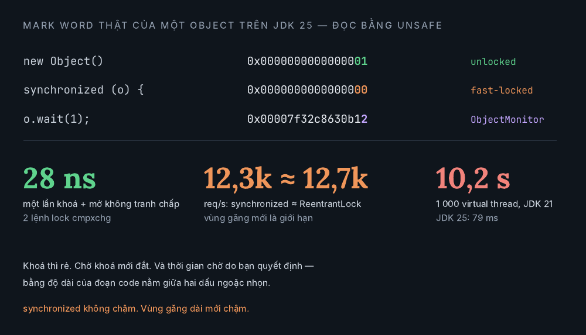
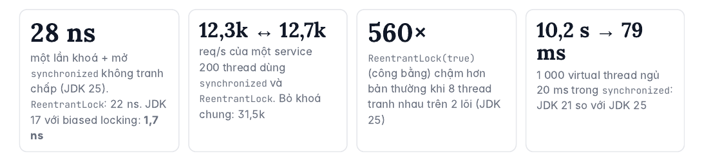
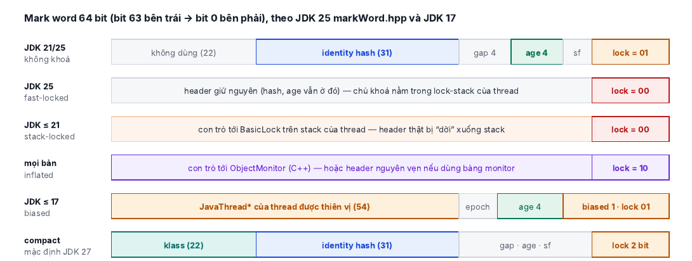
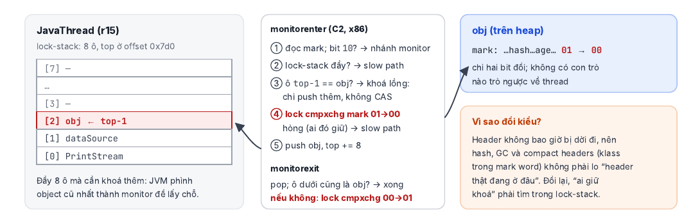
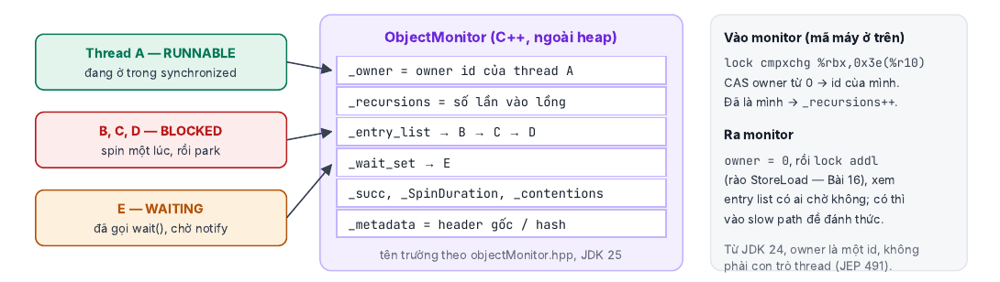
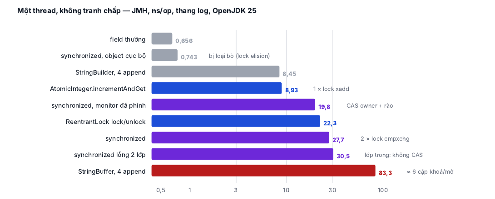
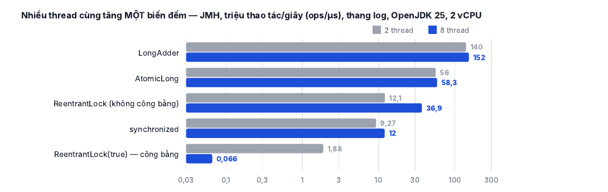
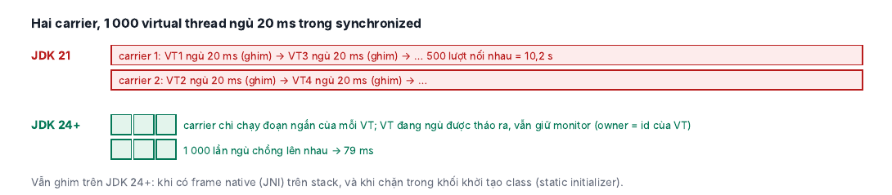
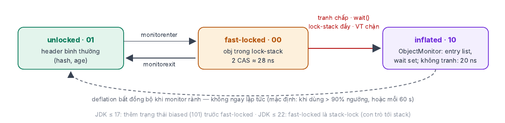

# Bài 17 — synchronized & monitor



*synchronized có thật sự chậm không?*

*Chặng IV · Concurrency nhìn từ JVM — mark word, lock-stack, ObjectMonitor, biased locking, pinning · Nền tảng: JDK 25 LTS / 27 · Thí nghiệm chạy thật trên OpenJDK 17 · 21 · 25*

[Bài 16](16-java-memory-model.md) kết thúc bằng hai con số: một lần đọc qua getter `synchronized` tốn 27 ns, và 154 ns khi hai thread tranh nhau. Bài 17 mở hộp để xem từng nano giây đó đi đâu: 64 bit đầu tiên của mỗi object, một ngăn xếp tám ô gắn với mỗi thread, một lệnh `lock cmpxchg`, và một cấu trúc C++ tên `ObjectMonitor` chỉ xuất hiện khi thật sự cần.

> **VỀ CÁC CON SỐ VÀ CÔNG CỤ TRONG BÀI** — Mọi output lấy từ việc **chạy thật** trên ba bản OpenJDK: **17.0.20** (để thấy biased locking), **21.0.12** và **25.0.4**, Linux x86-64, Intel Xeon 2 vCPU. Mark word được đọc trực tiếp bằng `Unsafe.getLongVolatile(obj, 0)` từ bên trong chương trình; mã máy lấy bằng `-XX:CompileCommand=print` và `objdump`; chi phí đo bằng JMH 1.37 (JDK 21, 25) và một vòng lặp đo tay chạy giống hệt nhau trên cả ba bản (vì bản JMH có sẵn không chạy được trên JDK 17). Hành vi của JDK 26 và 27 được kiểm tra trong **mã nguồn** tag `jdk-26-ga` và `jdk-27-ga` trên GitHub OpenJDK, không chạy thử. Máy chỉ có 2 vCPU: các số tranh chấp với 8 thread là tình huống “nhiều thread hơn lõi”, đúng như một pod Kubernetes nhỏ.

`synchronized` có thật sự chậm không? Câu trả lời ngắn: **khoá thì rẻ, chờ khoá mới đắt.** Khi không ai tranh, một lần khoá và mở trên JDK 25 là hai lệnh `lock cmpxchg` — khoảng 28 ns, ngang `ReentrantLock`. Khi có tranh chấp, cả hai đều phải cho thread ngủ rồi đánh thức, và thông lượng do độ dài vùng găng quyết định, không phải do loại khoá. Có một ngoại lệ đáng giá cả bài: virtual thread trên JDK 21–23.



*Bốn con số trên đều đo được trong bài.*

## 1 Vì sao một dev Spring Boot nên quan tâm

- **Bạn dùng `synchronized` nhiều hơn bạn nghĩ**: `StringBuffer`, `Hashtable`, `Collections.synchronizedMap`, `PrintStream` của `System.out`, nhiều JDBC driver và connection pool cũ, logger, và mọi singleton lười tự viết.
- **Lời khuyên lỗi thời vẫn lưu hành**: “synchronized chậm, dùng ReentrantLock”, “bật `-XX:+UseBiasedLocking`”. Cờ đó làm JVM 21+ **không khởi động được** (mục 6).
- **Virtual thread**: `spring.threads.virtual.enabled=true` trên JDK 21 cộng một driver dùng `synchronized` quanh I/O có thể biến 1 000 virtual thread thành 2 thread (mục 10).
- **Chẩn đoán**: khi service chậm vì khoá, thread dump cho thấy `BLOCKED` với `synchronized` nhưng `WAITING` với `ReentrantLock`; JFR có sẵn view cho cả hai (mục 9).

## 2 Mark word: 64 bit trên đầu mỗi object

Mỗi object trên heap bắt đầu bằng một header: 8 byte **mark word** rồi tới con trỏ class. Mark word là chỗ JVM cất trạng thái “sống” của object — tuổi GC (số lần sống sót qua GC trẻ, Chặng III), identity hash, và **trạng thái khoá**. Hai bit cuối cùng là bit khoá; ý nghĩa của 62 bit còn lại phụ thuộc vào hai bit đó và vào phiên bản JDK:



*Hình 17.1 — Cùng 64 bit, năm cách đọc. “sf” là bit self-forwarded dùng cho GC (JDK 25). Trên JDK 21, hash nằm từ bit 8; trên JDK 25 từ bit 11 — đo được ở mục 3. Với compact object headers (JEP 519 ở JDK 25, mặc định từ JDK 27 theo JEP 534), con trỏ class chui vào mark word để header chỉ còn 8 byte; monitor khi đó luôn được tra qua một bảng băm riêng thay vì con trỏ trong header.*

Điều quan trọng nhất trong hình: **JDK 25 không còn đặt con trỏ vào mark word khi khoá nhanh**. Từ JDK 21 trở về trước, khoá nhanh (“stack-locking”) chép header ra stack của thread rồi ghi con trỏ tới bản chép đó vào mark word — header thật bị “dời chỗ”. Kiểu mới (“lightweight locking”) chỉ lật hai bit cuối thành `00` và ghi nhớ “tôi đang giữ object này” trong một mảng nhỏ của thread. Hệ quả nhìn thấy được ngay ở mục kế tiếp.

## 3 Xem tận mắt: một khoá đi qua các trạng thái

Chương trình nhỏ đọc 8 byte đầu của object bằng `Unsafe.getLongVolatile(o, 0)` ở từng bước — ngay bên trong khối `synchronized`. Output thật trên JDK 25 (lược bớt vài dòng, rút gọn nhãn; giá trị giữ nguyên):

```text
$ java --add-exports java.base/jdk.internal.misc=ALL-UNNAMED lab17.MarkWord
[1] object mới, khoá rồi mở
  new Object()                                 0x0000000000000001  unlocked
  trong synchronized(o)                        0x0000000000000000  LOCKED (fast-lock)
  sau khi ra khỏi synchronized                 0x0000000000000001  unlocked
[2] hashCode rồi mới khoá
  identityHashCode() →                         0x000002a28e1d4001  hash=0x5451c3a8, từ bit 11
  trong synchronized(h)                        0x000002a28e1d4000  LOCKED (fast-lock) ← hash vẫn đó
[3] khoá rồi gọi hashCode bên trong
  trong synchronized(k)                        0x0000000000000000  LOCKED (fast-lock)
    … sau identityHashCode(k)                  0x000002d03f434000  LOCKED (fast-lock) ← vẫn khoá nhanh
[4] khoá lồng nhau (re-entrant)
  trong synchronized(r){ synchronized(r) }     0x0000000000000000  LOCKED (fast-lock)
[5] wait() bên trong synchronized
  sau w.wait(1), vẫn giữ khoá                  0x00007f32c8630b12  INFLATED → ObjectMonitor
[6] thread thứ hai tranh khoá
  main đang giữ c                              0x0000000000000000  LOCKED (fast-lock)
  T đang chờ (BLOCKED)                         0x00007f3270068422  INFLATED → ObjectMonitor
  cả hai đã ra, 1,5 giây sau                   0x00007f3270068422  INFLATED → ObjectMonitor ← chưa xẹp
```

Chạy cùng chương trình trên JDK 21 (stack-locking mặc định) cho thấy một thế giới khác ở đúng những dòng đáng chú ý:

| Tình huống | JDK 25 (lightweight) | JDK 21 (stack-locking) | Vì sao khác |
|---|---|---|---|
| đang giữ khoá | `0x…0000` | `0x00007f61617fe8f8` | JDK 21 ghi địa chỉ một ô trên stack |
| hash rồi khoá | `0x…2a28e1d4000` | `0x00007f61617fe8f8` | JDK 21: hash bị dời xuống stack |
| `hashCode()` khi đang giữ khoá | vẫn fast-lock | **INFLATED** | JDK 21 không còn chỗ cho hash → phải tạo monitor |
| khoá lồng nhau | vẫn fast-lock | stack-lock (bản chép thứ hai = 0) | JDK 21 + `LockingMode=2` thử nghiệm: **INFLATED** — khoá lồng nhau kiểu mới chỉ có từ JDK 23 |
| `wait()`, thread thứ hai tranh | INFLATED ở cả hai | | cần hàng đợi thật |

Một chi tiết nhỏ nhưng đáng giá: identity hash nằm từ bit 8 trên JDK 21 và từ bit 11 trên JDK 25 — đúng như comment trong `markWord.hpp`. Đừng bao giờ viết code dựa vào bố cục mark word; nó đổi ngay cả giữa hai bản LTS liên tiếp.

## 4 Fast path: một CAS và một ngăn xếp tám ô

Lightweight locking (JDK 21 thử nghiệm, mặc định từ JDK 23) dựa trên hai thứ: hai bit cuối của mark word và một **lock-stack** — mảng 8 ô nằm ngay trong cấu trúc `JavaThread`, ghi những object mà thread đang giữ khoá nhanh.



*Hình 17.2 — Lightweight locking. Khoá không tranh chấp cần một `lock cmpxchg` để vào và một để ra; khoá lồng nhau trên cùng object không cần lệnh atomic nào. Sức chứa 8 ô là hằng số `LockStack::CAPACITY`; với 10 khoá lồng trên 10 object khác nhau, chúng tôi đo được 3 object đầu bị phình và 7 object sau vẫn là khoá nhanh.*

Mã máy C2 thật của `synchronized (lock) { return ++counter; }` trên JDK 25 — phần vào và ra khoá nhanh:

```asm
; r11 = lock object, r15 = JavaThread, 0x7d0(%r15) = lock-stack top
mov    (%r11),%r10                ; ① đọc mark word
mov    0x7d0(%r15),%ebx           ;   đọc top của lock-stack
test   $0x2,%r10b                 ;   bit monitor (10)?
jne    nhánh_monitor
cmp    $0x81f,%ebx                ; ② lock-stack đầy?
jg     slow_path
cmp    -0x8(%r15,%rbx,1),%r11     ; ③ ô trên cùng là chính obj? (khoá lồng)
je     push
mov    %r10,%rax ; or $0x1,%rax ; and $0xfffffffffffffffe,%r10
lock cmpxchg %r10,(%r11)          ; ④ mark: …01 → …00
jne    slow_path
push: mov %r11,(%r15,%rbx,1) ; addl $0x8,0x7d0(%r15)   ; ⑤ push obj
mov    0xc(%rbp),%ebx ; inc %ebx ; mov %ebx,0xc(%rbp)      ; ++counter — thân khối synchronized
...    ; ra: kiểm tra ô top-1, subl $0x8,0x7d0(%r15), rồi:
lock cmpxchg %r10,(%r11)          ; mark: …00 → …01
```

Hai lệnh `lock cmpxchg` — mỗi lệnh khoảng 9 ns trên máy này (bằng chi phí một `AtomicInteger.incrementAndGet`, đo ở mục 7) — chính là phần lớn của 28 ns. Không có lời gọi hàm, không có system call, không có cấp phát.

## 5 Khi khoá phình thành monitor

Khoá nhanh không có chỗ để xếp hàng hay để `wait()`. Khi cần những thứ đó, JVM cấp một `ObjectMonitor` — một struct C++ ngoài heap — và chuyển bit khoá sang `10`. Những gì gây phình, theo thí nghiệm ở mục 3–4 và mã nguồn JDK 25:

| Nguyên nhân | Ghi chú |
|---|---|
| Thread khác tranh khoá | Thử CAS lại với khoảng chờ tăng dần (`LightweightFastLockingSpins = 13` lần) rồi mới phình. |
| `wait()` / `notify()` | Cần *wait set*. Gọi `wait()` là chắc chắn phình. |
| Lock-stack đầy (> 8 khoá nhanh lồng nhau) | Phình object cũ nhất (`ensure_lock_stack_space`). |
| `hashCode()` khi đang giữ khoá — **chỉ JDK ≤ 21** | Lightweight locking xoá được nguyên nhân này. |
| Thread ảo bị chặn trong `synchronized` — JDK 24+ | Cần monitor để thread ảo có thể nhả carrier (mục 10). |

Monitor đã phình có fast path riêng — một CAS trên trường `_owner` — nên một monitor *không tranh chấp* vẫn rẻ: 20 ns trên JDK 25, thậm chí 12 ns trên JDK 21 (mục 7). Monitor **không xẹp ngay** khi hết tranh chấp: ở mục 3, object vẫn ở trạng thái `10` sau 1,5 giây. Việc thu hồi (deflation) được làm bất đồng bộ từ JDK 15 — nay bởi thread nền `MonitorDeflationThread`: mỗi 250 ms nó kiểm tra số monitor đang dùng, và chỉ dọn khi vượt 90% ngưỡng ước tính, hoặc định kỳ mỗi 60 giây. Ép chu kỳ xuống 500 ms bằng một cờ chẩn đoán thì thấy ngay:

```text
$ java -XX:+UnlockDiagnosticVMOptions -XX:GuaranteedAsyncDeflationInterval=500 -Xlog:monitorinflation=debug
...
[0.524s][info ][monitorinflation] Async deflation needed: guaranteed interval (500 ms) is greater than …
[0.525s][debug][monitorinflation] begin deflating: in_use_list stats: ceiling=11264, count=6, max=6
[0.525s][debug][monitorinflation] deflated_count=4, {unlinked,deleted}_count=4 monitors in 0.0000083 secs
  cả hai đã ra, 1,5 giây sau                   0x0000000000000001  unlocked   ← lần này đã xẹp
```



*Hình 17.3 — Một monitor đã phình. Thread chờ vào khoá nằm trong entry list với trạng thái `BLOCKED`; thread gọi `wait()` nằm trong wait set với trạng thái `WAITING`. Trước khi park, thread tranh khoá **spin thích ứng**: thời gian spin tăng nếu lần trước spin thành công, giảm nếu không (`Knob_SpinLimit = 5000`).*

> **BẢNG MONITOR VÀ COMPACT HEADERS (JDK 25 TUỲ CHỌN, JDK 27 MẶC ĐỊNH)** — Khi con trỏ class đã chiếm phần đầu mark word (compact headers), không còn chỗ cho con trỏ monitor. JDK 24 thêm `UseObjectMonitorTable`: mark word giữ nguyên header với bit `10`, còn monitor được tra trong một bảng băm đồng thời, khoá theo **identity hash** của object — nên phình khoá luôn kèm việc cài hash (mã nguồn: “Inflating requires a hash code”), và C2 có một cache nhỏ theo thread để khỏi tra bảng mỗi lần. Đo trên JDK 25 với `-XX:+UseCompactObjectHeaders`: object đã phình có mark word `0x0017241df2777802` — 22 bit klass ở đầu, hash ở giữa, `10` ở cuối. Trong mã nguồn tag `jdk-27-ga`, cả `UseCompactObjectHeaders` lẫn `UseObjectMonitorTable` đều mặc định `true`.

## 6 Lịch sử: biased locking và stack-locking

Muốn hiểu vì sao có lời đồn “synchronized chậm” và vì sao nó lại sai, cần nhìn lại thiết kế cũ. Từ Java 6 tới Java 14, HotSpot bật mặc định một tầng nữa trên cả khoá nhanh: **biased locking**. Ý tưởng: hầu hết object có khoá chỉ bao giờ được *một* thread khoá (một `StringBuffer` cục bộ, một `Vector` trong một request). Vậy lần đầu thread A khoá object, JVM ghi luôn con trỏ của A vào mark word — object “thiên vị” A — và từ đó A khoá/mở mà **không cần lệnh atomic nào**. Mark word thật trên JDK 17 với `-XX:+UseBiasedLocking`:

```text
$ java17 -XX:+UseBiasedLocking -XX:BiasedLockingStartupDelay=0 ... lab17.MarkWord
  new Object()                                 0x0000000000000005  biasable (chưa thiên vị ai)    ← 101
  trong synchronized(o)                        0x00007f3dd401a005  BIASED → thread 0x7f3dd401a000
  sau khi ra khỏi synchronized                 0x00007f3dd401a005  BIASED → thread 0x7f3dd401a000 ← vẫn thiên vị A
  identityHashCode() rồi khoá                  0x00007f3ddc3fe918  LOCKED (stack-lock)       ← có hash thì hết chỗ cho thread
  thread T2 khoá object đang thiên vị main     0x00007f3dbc8fd920  LOCKED (stack-lock)       ← bị thu hồi (revoke)
  sau T2                                       0x0000000000000001  unlocked
```

Và đây là fast path biased trong mã máy C2 của JDK 17: đọc mark word, lấy “prototype header” của class, OR với con trỏ thread hiện tại (`%r15`), so sánh — khớp là vào thẳng thân khối, không `lock`, không ghi gì vào bộ nhớ:

```asm
and    $0x7,%r10 ; cmp $0x5,%r10 ; jne  không_biased     ; mark có đuôi 101?
mov    0xb8(%r10),%r10                                  ; prototype header của class (epoch)
or     %r15,%r11 ; xor %rax,%r9                          ; | thread hiện tại, so với mark
test   $0xffffffffffffff87,%r9 ; jne  revoke_hoặc_rebias ; khác → slow path
inc    %r13d ; mov %r13d,0xc(%r10)                       ; ++counter — đã ở trong khoá
```

Cùng một vòng lặp khoá/mở 50 triệu lần, đo tay, giống hệt nhau trên mọi bản (trung bình 2 lần chạy × 8 vòng đo):

| Cấu hình | ns mỗi lần khoá + mở | Cơ chế |
|---|---:|---|
| JDK 17, `-XX:+UseBiasedLocking` | **2,5** (tốt nhất 1,7) | biased: không lệnh atomic |
| JDK 17 mặc định | 32,0 | stack-locking |
| JDK 21 mặc định | 33,0 | stack-locking |
| JDK 21, `-XX:LockingMode=2` (thử nghiệm) | 29,7 | lightweight |
| JDK 25 mặc định | 30,7 | lightweight |
| JDK 25, `-XX:+UseCompactObjectHeaders` | 29,4 | lightweight + header 8 byte |

Biased locking nhanh hơn **12 lần** trong vòng lặp này. Vậy tại sao bỏ? Cái giá nằm ở lúc thread *khác* chạm vào: thu hồi bias phải dừng thread đang được thiên vị (handshake hoặc safepoint — [Bài 18](18-thread-safepoint.md)) để sửa header an toàn; khi một class bị thu hồi quá nhiều, JVM thu hồi/thiên vị lại hàng loạt ở safepoint. Thử mẫu “giao việc” — thread A tạo 200 000 `StringBuffer`, thread B dùng lại chúng:

| Cấu hình | thread A | thread B khoá lại object của A | Safepoint vì bias |
|---|---:|---:|---|
| JDK 17, biased | 26,7–28,0 ms | 3,5–3,8 ms | 3 × `BulkRevokeBias`, tổng 0,32 ms |
| JDK 17, không biased | 30,3–30,5 ms | 6,5–6,7 ms | — |
| JDK 25 | 30,0–30,5 ms | 7,3–8,3 ms | — |

Kết quả trung thực: heuristic “thiên vị lại hàng loạt” của JDK 17 thích nghi rất nhanh, và trong mẫu này biased vẫn thắng. Nên lý do gỡ bỏ không phải “biased chậm”. JEP 374 (JDK 15) nêu ba lý do: lợi ích chủ yếu rơi vào code cũ dùng collection đồng bộ hoá ở mọi thao tác (`Vector`, `Hashtable`, `StringBuffer`) — code mới dùng `ArrayList`, `HashMap`, `java.util.concurrent`; ứng dụng kiểu thread pool + hàng đợi thường chạy tốt hơn khi tắt; và quan trọng nhất, biased locking là một khối mã phức tạp, xâm lấn nhiều phần của HotSpot, cản trở việc thiết kế lại hệ thống đồng bộ hoá. Gỡ nó đi dọn đường cho những thay đổi lớn sau đó: lightweight locking, compact headers, và virtual thread sở hữu monitor (mục 10).

> **JAVA_OPTS CŨ CÓ THỂ LÀM JVM KHÔNG KHỞI ĐỘNG** — JDK 15 tắt biased locking mặc định và đánh dấu deprecated; JDK 18 gỡ bỏ. Trên JDK 21 và 25, chúng tôi chạy `java -XX:+UseBiasedLocking -version` và nhận: `Unrecognized VM option 'UseBiasedLocking'` / `Error: Could not create the Java Virtual Machine.` Tương tự với `-XX:LockingMode`: deprecated ở JDK 24, bị bỏ qua ở JDK 26 và hết hạn ở JDK 27 (bảng cờ trong `arguments.cpp`). Rà Dockerfile, Helm chart và `JAVA_TOOL_OPTIONS` trước khi nâng JDK.

## 7 Không tranh chấp: synchronized tốn bao nhiêu?



*Hình 17.4 — JMH 1.37, 1 fork, 5 lần đo × 1 s; sai số ±10–40% (máy 2 vCPU dùng chung). Tím: `synchronized`; xanh: `java.util.concurrent`; đỏ: `StringBuffer`.*

| ns/op | JDK 25 | JDK 21 | Đọc thế nào |
|---|---:|---:|---|
| `synchronized` | 27,7 | 28,7 | hai CAS dù là stack-lock hay lightweight |
| `synchronized` lồng 2 lớp | 30,5 | 42,2 | JDK 25: lớp trong chỉ push lock-stack |
| monitor đã phình, không tranh chấp | 19,8 | 12,3 | một CAS vào, một lệnh ghi + rào ra |
| `ReentrantLock` | 22,3 | 22,4 | CAS trên `state` của AQS |
| `AtomicInteger` | 8,9 | 9,6 | một `lock xadd` |
| `synchronized` trên object cục bộ | 0,74 | 0,64 | bị xoá; với `-XX:-EliminateLocks`: 29,1 |
| `StringBuffer` / `StringBuilder` | 83,3 / 8,5 | 95,2 / 14,5 | ~6 cặp khoá trong 4 lần `append` |

Ba kết luận. **Một:** `synchronized` và `ReentrantLock` cùng một hạng cân khi không tranh chấp — vài ns chênh lệch nằm trong sai số đo, và cả hai đều vào khoảng hai, ba lệnh atomic. **Hai:** JIT xoá hẳn khoá trên object không thoát khỏi method (escape analysis — [Bài 08](08-toi-uu-jit.md)), nên `synchronized` “thừa” trên biến cục bộ là miễn phí; tắt `EliminateLocks` thì nó tốn đủ 29 ns. **Ba:** cái thật sự đắt là khoá *lặp lại* trong code nóng: `StringBuffer` chậm gấp 10 lần `StringBuilder` chỉ vì mỗi method của nó là một cặp khoá/mở. Đó cũng chính là loại code mà biased locking từng cứu.

## 8 Có tranh chấp: khi thread phải xếp hàng

Trường hợp xấu nhất: nhiều thread làm đúng một việc là tăng một biến đếm chung — vùng găng chỉ vài ns, gần như toàn bộ thời gian là tranh khoá.



*Hình 17.5 — Số càng lớn càng tốt. 8 thread trên 2 vCPU là tình huống “nhiều thread hơn lõi” điển hình của container nhỏ. JDK 21 cho kết quả cùng hình dạng (8 thread: `synchronized` 15,8; `ReentrantLock` 43,1; công bằng 0,056).*

Hai điều đáng chú ý. `ReentrantLock` mặc định nhanh hơn `synchronized` khoảng 3 lần trong bài test cực đoan này. Cả hai đều **không công bằng** và cho phép “chen ngang” (barging): thread vừa mở khoá có thể lấy lại ngay khi chưa hết lượt CPU, không ai phải đánh thức ai. Khác biệt nằm ở đường chậm: của AQS là code Java mà JIT tối ưu được, còn của monitor đi vào runtime C++ của VM (spin thích ứng, entry list, park/unpark). Và `ReentrantLock(true)` sụp đổ: **chậm hơn 560 lần** với 8 thread. Khoá công bằng bắt mỗi lần lấy khoá phải trao cho thread đứng đầu hàng — thread đó đang ngủ, nên mỗi thao tác tốn một lần đánh thức và chuyển ngữ cảnh, vài micro giây. Còn `AtomicLong` và `LongAdder` không khoá gì cả: `LongAdder` chia biến đếm thành nhiều ô để các thread không đụng nhau, và cộng lại khi đọc.

> **ĐỪNG MANG MICRO-BENCHMARK NÀY VÀO CODE THẬT** — “ReentrantLock nhanh gấp 3” chỉ đúng khi vùng găng dài vài nano giây và thread chẳng làm gì khác. Mục tiếp theo đặt khoá vào một service có I/O và tính toán thật — và chênh lệch biến mất.

## 9 Trong một service: vùng găng mới là thứ đắt

Mô phỏng gần với đời thực hơn: 200 thread (như thread pool của Tomcat), mỗi “request” chờ I/O 2 ms (giả lập gọi DB) rồi chạy một đoạn tính toán 50 µs trong vùng găng — kiểu một cache tự viết hay một bộ định dạng dùng chung được bọc khoá. Đổi kiểu khoá, đo trong 8 giây trên JDK 25:

| Khoá quanh đoạn 50 µs | req/s | thời gian vùng găng TB (gồm chờ) | Trạng thái 200 thread giữa chừng |
|---|---:|---:|---|
| không khoá (đoạn code an toàn khi chạy song song) | **31 519** | 172 µs | 197 đang “I/O”, 3 RUNNABLE |
| `synchronized` một khoá chung | 12 316 | 14 171 µs | **181 BLOCKED**, 18 I/O, 1 RUNNABLE |
| `ReentrantLock` một khoá chung | 12 705 | 13 694 µs | **174 WAITING (parking)**, 25 I/O, 1 RUNNABLE |
| `ReentrantLock(true)` | 11 566 | 15 165 µs | 184 WAITING (parking) |
| `synchronized` chia 16 khoá theo khoá dữ liệu | **30 586** | 1 553 µs | 61 BLOCKED, 131 I/O, 8 RUNNABLE |

Đây là câu trả lời thật cho câu hỏi của bài. `synchronized` và `ReentrantLock` cho thông lượng như nhau (chênh 3%, trong sai số giữa các lần chạy — 4 lần chạy lại `synchronized` cho 12 000–13 000 req/s). Cái giới hạn hệ thống là **chỉ một thread được ở trong vùng găng**: tối đa 1 / 50 µs = 20 000 req/s, và thực tế còn ~12 500 vì mỗi lần trao khoá phải đánh thức một thread đang ngủ. Định luật Little kiểm chứng ngay: 200 thread / (2 ms I/O + 14,2 ms trong và trước vùng găng) ≈ 12 300 req/s. Bỏ khoá chung — hoặc chia nhỏ thành 16 khoá — thì giới hạn chuyển sang CPU (2 lõi / 50 µs ≈ 40 000), và thông lượng tăng 2,5 lần mà không đổi một dòng logic nào.

### Nhìn thấy tranh chấp: thread dump và JFR

Ba thread dump `jcmd <pid> Thread.print` cách nhau 0,7 s ở chế độ `synchronized`: 186, 176, 169 thread `BLOCKED (on object monitor)` — trên cả JDK 21 lẫn 25. Cùng tình huống với `ReentrantLock` hiện ra khác hẳn: `WAITING (parking)`, “parking to wait for <0x…> (a ReentrantLock$NonfairSync)”. Script cảnh báo “quá nhiều thread BLOCKED” sẽ không thấy gì nếu code dùng `ReentrantLock`. JFR đo thẳng thời gian chờ:

```text
$ java -XX:StartFlightRecording:filename=sync.jfr,jdk.JavaMonitorEnter#threshold=1ms ... lab17.ServiceSim sync
$ jfr view contention-by-site sync.jfr
StackTrace                                                                Count    Avg.    Max.
lab17.ServiceSim.lambda$main$0(int, String, long, LongAdder, LongAdder)  42,890 24.8 ms 49.1 ms
$ jfr view contention-by-address sync.jfr
Monitor Address Class              Threads Max Duration
0x7F25E4007DA0  java.lang.Object       200      49.1 ms
# bản ReentrantLock: không có JavaMonitorEnter; thay vào đó 109 079 sự kiện jdk.ThreadPark (ngưỡng 1 ms)
```

`jdk.JavaMonitorEnter` bật sẵn trong cấu hình JFR mặc định với ngưỡng 20 ms; hạ ngưỡng ngay trên dòng lệnh như trên (JDK 17+) khi cần thấy cả những lần chờ ngắn. Một view, một dòng, chỉ ra đúng vị trí code và đúng object khoá mà 200 thread đang xếp hàng.

> **MỘT LẦN CHỤP KHÔNG ĐỦ** — Trong một lần chạy (trên 6), ảnh chụp trạng thái qua `ThreadMXBean` cho thấy phần lớn thread là RUNNABLE thay vì BLOCKED; chúng tôi không tái hiện được. Trạng thái thread là ảnh chụp tức thời của một hệ thống đang chuyển động — luôn lấy vài dump cách nhau vài giây, hoặc dùng JFR, thứ ghi lại *thời lượng* chờ thay vì trạng thái tại một thời điểm.

## 10 Virtual thread và synchronized: trước và sau JDK 24

Virtual thread ([Bài 19](19-virtual-threads.md)) chạy trên vài *carrier thread* — mặc định bằng số lõi, ở đây là 2. Khi virtual thread chặn (ngủ, chờ socket), nó được “tháo” khỏi carrier để carrier chạy virtual thread khác. Trên JDK 21–23 có một ngoại lệ: monitor ghi chủ sở hữu là *platform thread*, nên virtual thread chặn **bên trong `synchronized`** không thể bị tháo ra — nó **ghim** (pin) carrier. Thí nghiệm: 1 000 virtual thread, mỗi thread có khoá riêng (không ai tranh với ai), ngủ 20 ms khi đang giữ khoá — y như một JDBC driver gọi socket trong một method `synchronized`:

| 1 000 task × 20 ms | JDK 21 | JDK 25 |
|---|---:|---:|
| `synchronized (lock) { sleep(20) }` | **10 201 ms** — song song ≈ 2 | **79 ms** — song song ≈ 254 |
| `lock.lock(); try { sleep(20) } finally { unlock }` | 80 ms | 102 ms |
| JFR `jdk.VirtualThreadPinned` (200 task, cấu hình *profile*) | 191 sự kiện | 0 |



*Hình 17.6 — JEP 491 (JDK 24) đổi chủ sở hữu monitor từ con trỏ platform thread sang một id — chính là trường `_owner` ở Hình 17.3 — nên virtual thread có thể nhả carrier khi chặn trong `synchronized`. JDK 25 LTS là bản LTS đầu tiên có thay đổi này.*

```text
$ jfr view pinned-threads pin21.jfr          # JDK 21
Method                 Pinned Count Longest Pinning Total Time Pinned
lab17.VtPin.sleep(long)         191         22.5 ms            3.86 s
```

Hệ quả cho các service đã bật virtual thread trên JDK 21: lời khuyên “thay `synchronized` bằng `ReentrantLock`” là có thật và có lý do — các driver đã làm vậy: pgjdbc 42.6.0 (“replace the usages of synchronized with ReentrantLock”), MySQL Connector/J 9.0.0 (“Synchronized blocks … were replaced with ReentrantLocks … making Connector/J virtual-thread friendly”). Từ JDK 24, lý do đó biến mất; thuộc tính `-Djdk.tracePinnedThreads` của JDK 21 cũng bị gỡ, chỉ còn sự kiện JFR.

## 11 synchronized hay ReentrantLock — và Spring Boot

| Tiêu chí | `synchronized` | `ReentrantLock` |
|---|---|---|
| Chi phí không tranh chấp | ngang nhau: 20–30 ns (mục 7) | |
| Thông lượng khi tranh chấp trong service | ngang nhau — do vùng găng quyết định (mục 9) | |
| Mở khoá | tự động, kể cả khi có exception | phải `unlock()` trong `finally` — quên là treo cả hệ thống |
| Chờ có giới hạn, huỷ được | không | `tryLock(timeout)`, `lockInterruptibly()` |
| Nhiều điều kiện chờ | một wait set | nhiều `Condition` |
| Khoá đọc/ghi, công bằng | không | `ReentrantReadWriteLock`, `new ReentrantLock(true)` (mục 8: cẩn thận) |
| Chẩn đoán | `BLOCKED`; dump ghi rõ “waiting to lock / locked”; JFR `JavaMonitorEnter` | `WAITING (parking)`; cần `Thread.print -l` để thấy chủ; JFR `ThreadPark` |
| Virtual thread | ghim carrier trên JDK 21–23; ổn từ 24 | ổn trên mọi bản |

Nguyên tắc rút ra: **mặc định `synchronized`** vì nó đơn giản và không thể quên mở khoá; chuyển sang `ReentrantLock` khi cần một tính năng nó có (timeout, ngắt, nhiều điều kiện) hoặc khi chạy virtual thread trên JDK 21–23. Đổi loại khoá để “tăng tốc” hầu như không bao giờ là câu trả lời.

> **SPRING BOOT · SÁU VIỆC NÊN LÀM**
>
> 1. **Tìm tranh chấp bằng dữ liệu**: bật JFR liên tục trên production (chi phí thấp), dùng `jfr view contention-by-site`; hoặc ba thread dump cách nhau vài giây, đếm `BLOCKED` và `parking to wait for`.
> 2. **Thu ngắn vùng găng**: không gọi DB, HTTP, ghi log nặng bên trong `synchronized`. Chuẩn bị dữ liệu ngoài khoá, chỉ khoá đoạn cập nhật trạng thái.
> 3. **Chia nhỏ hoặc bỏ khoá**: `ConcurrentHashMap.compute*` thay cho map + khoá chung; `LongAdder` cho bộ đếm, metric; object bất biến + `volatile` ([Bài 16](16-java-memory-model.md)) cho cấu hình.
> 4. **`spring.threads.virtual.enabled=true` trên JDK 21**: kiểm tra JFR `jdk.VirtualThreadPinned` dưới tải; nâng pgjdbc ≥ 42.6.0, Connector/J ≥ 9.0.0 — hoặc tốt hơn, chạy JDK 25 LTS.
> 5. **Không dùng `ReentrantLock(true)`** trừ khi có yêu cầu nghiệp vụ về thứ tự; cái giá là 560 lần trong trường hợp xấu.
> 6. **Dọn cờ JVM cũ**: `UseBiasedLocking`, `BiasedLockingStartupDelay`, `LockingMode`, `UseHeavyMonitors` — trên JDK hiện đại, chúng là cảnh báo hoặc lỗi khởi động.

> **THAY ĐỔI THEO PHIÊN BẢN CẦN BIẾT** — **Java 6** — biased locking bật mặc định. **JDK 15** — tắt và deprecated biased locking (JEP 374); thu hồi monitor bất đồng bộ. **JDK 18** — gỡ biased locking. **JDK 21** — virtual thread (ghim carrier khi chặn trong `synchronized`); lightweight locking thử nghiệm (`-XX:LockingMode=2`). **JDK 23** — lightweight locking mặc định, hỗ trợ khoá lồng. **JDK 24** — JEP 491: virtual thread sở hữu monitor, hết ghim; `LockingMode` deprecated; bảng monitor `UseObjectMonitorTable`; compact headers thử nghiệm (JEP 450). **JDK 25** — compact headers chính thức (JEP 519). **JDK 26** — chỉ còn lightweight locking; `LockingMode` bị bỏ qua. **JDK 27** — compact headers mặc định (JEP 534), bảng monitor mặc định; `LockingMode` hết hạn (theo bảng cờ trong mã nguồn tag `jdk-26-ga`, `jdk-27-ga`).

## 12 Ghép lại: một trang để nhớ cả bài



*Hình 17.7 — Vòng đời một khoá trên JDK 25. Hầu hết object chỉ đi qua lại giữa hai ô bên trái.*

| Câu hỏi | Trả lời | Bằng chứng trong bài |
|---|---|---|
| Khoá không tranh chấp tốn bao nhiêu? | 2 lệnh `lock cmpxchg`, ~28 ns; ngang `ReentrantLock` | mã máy C2; JMH 27,7 / 22,3 ns |
| Có tranh chấp thì sao? | chi phí là xếp hàng + đánh thức; loại khoá ít quan trọng | service: 12,3k vs 12,7k req/s |
| Làm sao nhanh hơn? | vùng găng ngắn hơn, chia khoá, bỏ khoá | 16 khoá: 30,6k req/s (×2,5) |
| Biased locking đâu rồi? | gỡ ở JDK 18; nhanh hơn 12× nhưng phức tạp | 2,5 vs 30,7 ns; cờ cũ làm JVM không khởi động |
| Virtual thread? | JDK 21–23: ghim carrier; JDK 24+: hết | 10 201 ms → 79 ms |
| Khoá công bằng? | chỉ khi bắt buộc | 560× chậm hơn với 8 thread |
| Thấy tranh chấp ở đâu? | JFR `contention-by-site`; dump: BLOCKED / parking | 42 890 lần chờ, TB 24,8 ms, một dòng code |

Tóm cả bài trong một đoạn: *Mỗi object có hai bit khoá trong mark word. Trên JDK 25, khoá không tranh chấp chỉ lật hai bit đó bằng một CAS và ghi object vào lock-stack tám ô của thread; mở khoá là một CAS nữa — khoảng 28 ns, ngang `ReentrantLock`. Khi có tranh chấp, `wait()`, hay lock-stack đầy, khoá phình thành `ObjectMonitor` có hàng đợi, spin thích ứng rồi park; nó chỉ xẹp lại khi thread nền dọn dẹp. Biased locking từng làm khoá một-thread gần như miễn phí, nhưng bị gỡ vì độ phức tạp; lời khuyên “synchronized chậm” là di sản của thời trước nữa. Trong một service thật, thứ quyết định thông lượng là độ dài vùng găng, không phải loại khoá — trừ virtual thread trên JDK 21–23, nơi `synchronized` quanh I/O ghim carrier.*

## 13 Hiểu lầm thường gặp, bài tập, bài tiếp theo

### Hiểu lầm thường gặp

| Hiểu lầm | Thực tế |
|---|---|
| “`synchronized` chậm, `ReentrantLock` nhanh.” | Không tranh chấp: 27,7 vs 22,3 ns. Trong service: 12,3k vs 12,7k req/s. Chỉ trong micro-benchmark tranh chấp cực đoan mới chênh 3×. |
| “Mỗi `synchronized` là một system call / mutex của hệ điều hành.” | Chỉ khi phải park. Đường nhanh là một lệnh CAS trong user space; khoá trên object cục bộ bị JIT xoá hẳn. |
| “Bật `-XX:+UseBiasedLocking` cho nhanh.” | JDK 18+ không còn; JDK 21/25: `Unrecognized VM option`, JVM không khởi động. |
| “Monitor phình rồi thì thôi, chậm mãi.” | Monitor không tranh chấp vẫn chỉ 12–20 ns; thread nền sẽ thu hồi khi rảnh. |
| “Khoá công bằng an toàn hơn.” | Chậm hơn 560× khi nhiều thread hơn lõi; chỉ dùng khi thứ tự là yêu cầu nghiệp vụ. |
| “Bật virtual thread thì code `synchronized` tự scale.” | JDK 21–23: chặn trong `synchronized` ghim carrier — 1 000 task thành song song 2. JDK 24+ mới hết. |
| “Nhiều thread BLOCKED nghĩa là cần thêm thread.” | Ngược lại: chúng đang xếp hàng trước một khoá. Thêm thread chỉ làm hàng dài thêm (Little). |

### Bài tập tự làm (khoảng 60 phút)

> **THỰC HÀNH**
>
> 1. **Tìm khoá nóng** (bài tập quan trọng nhất). Ghi JFR 5 phút trên staging dưới tải (`jcmd <pid> JFR.start duration=5m settings=profile`), rồi `jfr view contention-by-site`. Vị trí đứng đầu là code của bạn hay của thư viện?
> 2. **Ba thread dump**: lấy 3 dump cách nhau 5 giây khi service chậm; đếm `BLOCKED` và `parking to wait for`; nhóm theo object khoá.
> 3. **Cờ JVM cũ**: grep `UseBiasedLocking|LockingMode|UseHeavyMonitors|BiasedLocking` trong Dockerfile, Helm, `JAVA_TOOL_OPTIONS`.
> 4. **Virtual thread**: nếu đang chạy JDK 21 với `spring.threads.virtual.enabled=true`, chạy tải với JFR và `jfr view pinned-threads`. Kiểm tra phiên bản JDBC driver.
> 5. **Mark word**: chạy lại `MarkWord.java` trong file đính kèm trên JDK của bạn, thêm `-XX:+UseCompactObjectHeaders`. Tìm 22 bit klass.

### Thuật ngữ của bài

| Thuật ngữ | Nghĩa ngắn gọn |
|---|---|
| Mark word | 8 byte đầu header object: bit khoá, tuổi GC, identity hash (và klass nếu compact). |
| Lightweight / fast locking | Khoá không tranh chấp: CAS hai bit cuối 01→00, ghi object vào lock-stack. |
| Lock-stack | Mảng 8 ô trong mỗi JavaThread chứa các object đang khoá nhanh. |
| Stack-locking | Cách cũ (≤ JDK 22): chép header ra stack, mark word trỏ tới bản chép. |
| Inflation / ObjectMonitor | Chuyển khoá thành struct C++ có owner, entry list, wait set. |
| Deflation | Thu hồi monitor rảnh, trả object về trạng thái thường; làm bất đồng bộ. |
| Biased locking / revocation | Thiên vị object cho một thread để khỏi CAS; thu hồi khi thread khác chạm vào. Đã gỡ. |
| Barging / fairness | Cho phép thread mới chen ngang hàng đợi / bắt buộc theo thứ tự đến. |
| Pinning | Virtual thread không thể nhả carrier khi đang chặn. |
| Lock elision | JIT xoá khoá trên object không thoát khỏi method. |

> **BÀI TIẾP THEO · BÀI 18** — **Thread, safepoint & stop-the-world.** Bài này đã chạm vào safepoint hai lần: thu hồi biased locking phải dừng thread, và vòng lặp ở [Bài 16](16-java-memory-model.md) vẫn có “safepoint poll”. [Bài 18](18-thread-safepoint.md) đi vào cơ chế đó: JVM dừng mọi thread thế nào, vì sao một thread chạy vòng lặp dài có thể bắt cả JVM chờ, handshake khác safepoint ra sao, và đọc `-Xlog:safepoint`. Câu hỏi của bài: *Pause dài nhưng log GC lại ngắn — thời gian đi đâu?*

### Tài liệu tham khảo

- Mã nguồn HotSpot (jdk-25+36, jdk-26-ga, jdk-27-ga): `oops/markWord.hpp`, `runtime/lockStack.hpp`, `runtime/lightweightSynchronizer.cpp`, `runtime/objectMonitor.hpp/.cpp`, `runtime/globals.hpp`, `runtime/arguments.cpp`, `cpu/x86/c2_MacroAssembler_x86.cpp`. github.com/openjdk/jdk
- JEP 374: Deprecate and Disable Biased Locking (JDK 15); JEP 491: Synchronize Virtual Threads without Pinning (JDK 24); JEP 450 / 519 / 534: Compact Object Headers. openjdk.org/jeps
- JDK-8319797 (khoá lồng kiểu lightweight), JDK-8315884 (bảng ObjectMonitor), JDK-8334299 (deprecate `LockingMode`), JDK-8153224 (thu hồi monitor bất đồng bộ).
- Heinz Kabutz — The Java Specialists' Newsletter, Issue 282 (biased locking và JDK 15).
- InfoQ — “Virtual Threads after JDK 24” (pinning còn lại, `jdk.tracePinnedThreads` bị gỡ).
- pgjdbc 42.6.0 release notes; MySQL Connector/J 9.0.0 release notes (thay `synchronized` bằng `ReentrantLock`).
- Dave Dice và cộng sự — các bài về adaptive spinning và biased locking (được trích trong `objectMonitor.cpp`).
- Javadoc `java.util.concurrent.locks.ReentrantLock`, `LongAdder`; JDK Flight Recorder: `jdk.JavaMonitorEnter`, `jdk.ThreadPark`, `jdk.VirtualThreadPinned`, `jfr view`.
