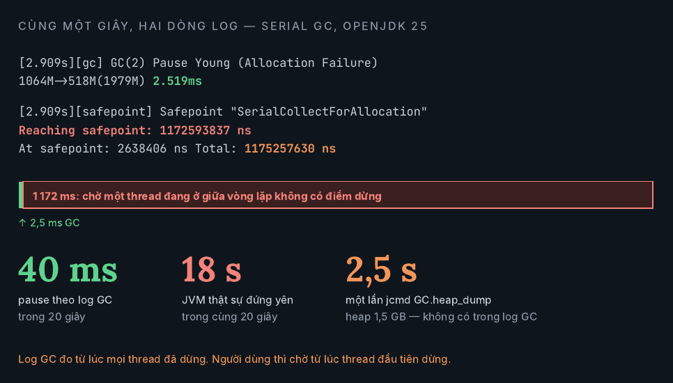
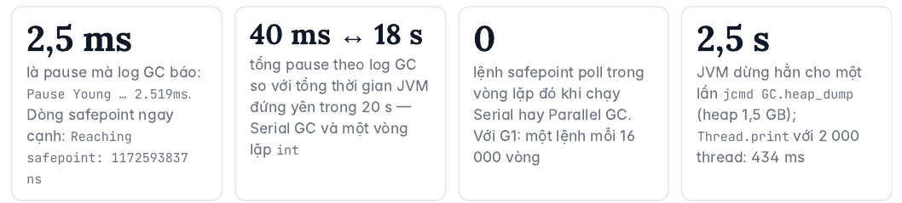
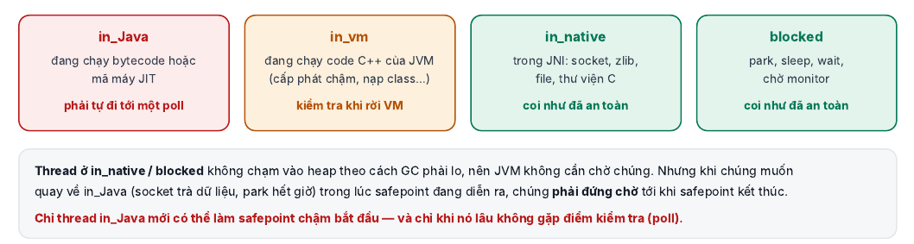
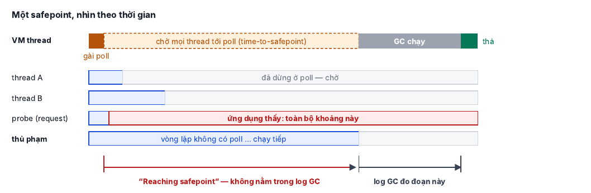
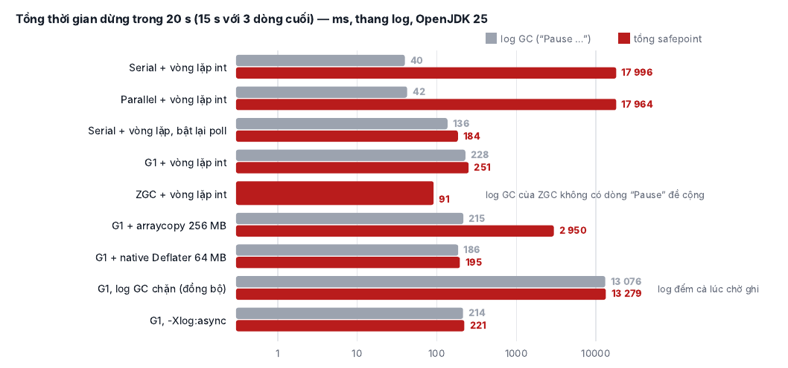
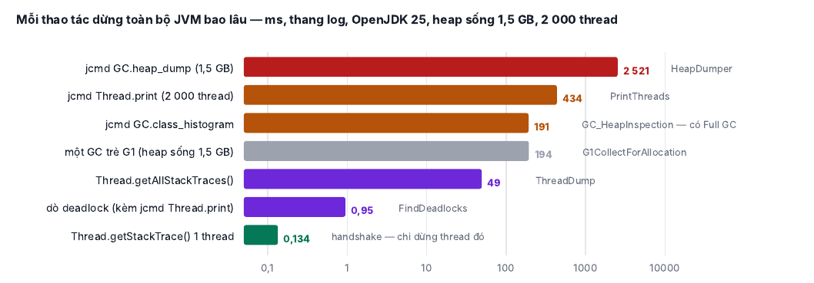
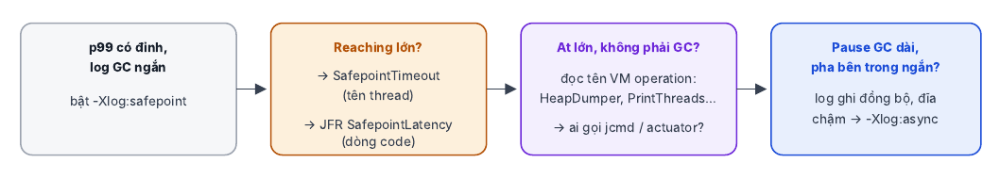

# Bài 18 — Thread, safepoint & stop-the-world



*Pause dài nhưng log GC lại ngắn — thời gian đi đâu?*

*Chặng IV · Concurrency nhìn từ JVM — poll, time-to-safepoint, VM operation, handshake, async log · Nền tảng: JDK 25 LTS / 27 · Thí nghiệm chạy thật trên OpenJDK 17 · 21 · 25*

Chặng III dạy đọc log GC: dòng `Pause Young … 4.6ms` là thời gian ứng dụng bị dừng. Bài 18 cho thấy dòng đó chỉ kể một phần câu chuyện. Trước khi GC được chạy, JVM phải đưa *mọi* thread về một điểm an toàn — **safepoint** — và khoảng chờ đó không nằm trong log GC. Bài này đo khoảng chờ đó, tìm ra đoạn code gây ra nó, và liệt kê những thứ khác ngoài GC cũng dừng cả JVM.

> **VỀ CÁC CON SỐ VÀ CÔNG CỤ TRONG BÀI** — Mọi output lấy từ việc **chạy thật** trên OpenJDK 25.0.4 (đối chiếu 17.0.20 và 21.0.12), Linux x86-64, 2 vCPU. Chương trình đo gồm ba thread: một thread tạo rác liên tục để GC chạy đều đặn; một thread “probe” ngủ 1 ms rồi đo nó bị trễ bao lâu — chính là độ trễ mà một request sẽ cảm thấy; và một thread “thủ phạm” chạy đoạn code đang xét. Mỗi cấu hình chạy 20 giây (15 giây với thí nghiệm log), heap 2 GB, ghi đồng thời `-Xlog:gc,safepoint`; một script nhỏ đặt hai con số cạnh nhau: tổng pause theo log GC và tổng thời gian safepoint. Các thao tác `jcmd` được bắn vào một JVM có heap sống 1,5 GB và 2 000 thread. Hành vi của JDK 22, 23, 26, 27 kiểm tra trong mã nguồn OpenJDK (tag GA), không chạy thử.

*Mã nguồn lab nằm trong repo: sources/under-hood/src/bai18-safepoint-src.zip.*

Pause dài nhưng log GC lại ngắn — thời gian đi đâu? Câu trả lời ngắn: **vào việc chờ**. GC chỉ được chạy khi mọi thread Java đã dừng ở một safepoint; thread nào đang ở giữa một vòng lặp không có điểm kiểm tra, một lần chép mảng lớn, hay đang bị ghi log chặn, bắt cả JVM chờ nó. Log GC đo từ lúc mọi thread đã dừng; ứng dụng của bạn thì bị dừng từ lúc thread đầu tiên dừng.



*Bốn con số trên đều đo được trong bài.*

## 1 Vì sao một dev Spring Boot nên quan tâm

- **Pod nhỏ chạy Serial GC**: [Bài 13](13-gc-cho-container.md) đã đo — dưới 2 CPU hoặc dưới 1 792 MB, JVM tự chọn Serial (tới JDK 26). Và Serial là một trong hai GC **không** đặt điểm dừng vào vòng lặp đếm (mục 5).
- **Dashboard nói GC ổn, người dùng nói chậm**: p99 latency có đỉnh 1 giây nhưng `jvm.gc.pause` max chỉ vài ms — đó chính là khoảng chờ vào safepoint, không có metric nào của Micrometer đo nó.
- **Công cụ vận hành cũng dừng JVM**: endpoint `/actuator/threaddump`, `/actuator/heapdump`, agent APM chụp thread dump định kỳ (mục 7).
- **Log là đường đi chung**: GC log ghi ra một đĩa mạng chậm hay stdout bị nghẽn có thể kéo một pause 5 ms thành 900 ms (mục 9).

## 2 Thread Java là thread của hệ điều hành

Mỗi `java.lang.Thread` (platform thread) là đúng một thread của hệ điều hành — `pthread` trên Linux, có stack riêng (mặc định 1 MB), do kernel lập lịch. Bên trong HotSpot, mỗi thread có một struct C++ `JavaThread` (thanh ghi `r15` trong mã máy ở các bài trước luôn trỏ tới nó), và một **trạng thái** cho biết thread đang làm gì *theo góc nhìn của JVM*. Trạng thái này quyết định thread có cản safepoint hay không:



*Hình 18.1 — Bốn trạng thái chính của `JavaThread` (`JavaThreadState` trong mã nguồn HotSpot). Thread của Tomcat đang chờ DB nằm trong in_native hoặc blocked — chúng không bao giờ là thủ phạm của một safepoint chậm.*

## 3 Safepoint: dừng mọi thread ở chỗ an toàn

GC cần dời object và sửa mọi tham chiếu tới chúng — kể cả tham chiếu đang nằm trong thanh ghi và trên stack của mỗi thread. Điều đó chỉ làm được khi thread dừng ở chỗ JIT đã ghi lại “ô nào đang chứa tham chiếu” (oop map). Những chỗ đó gọi là **safepoint**. JIT rải **poll** — một lệnh đọc thử bộ nhớ — ở cuối mỗi method và ở cạnh quay lại của vòng lặp; interpreter kiểm tra giữa các bytecode. Khi cần dừng, VM thread “gài” trang poll của mọi thread; lần tới thread chạm vào poll, nó rơi vào runtime và đứng yên.



*Hình 18.2 — Thread nhanh chân dừng sớm và đứng chờ; JVM chỉ bắt đầu GC khi thread chậm nhất tới nơi. Log GC đo từ lúc bắt đầu GC; `-Xlog:safepoint` đo cả hai đoạn; ứng dụng chịu toàn bộ.*

Cơ chế poll hiện đại có từ JDK 10 (JEP 312, thread-local handshake): mỗi thread có “trang poll” riêng, nên JVM có thể gài cho tất cả (safepoint) hoặc chỉ cho một thread (handshake, mục 8). Lệnh poll trong mã máy C2 trên x86 là hai lệnh: `mov 0x30(%r15),%r11` (đọc địa chỉ trang poll của thread hiện tại) rồi `test %eax,(%r11)` (đọc thử trang đó — nếu đã bị gài, CPU báo lỗi trang và thread rơi vào runtime).

## 4 Thời gian đi đâu: bắt quả tang trong log

Thread thủ phạm chạy một method rất bình thường — một vòng `for` với biến chạy kiểu `int`, 1,5 tỷ vòng, đọc một mảng:

```java
static long loop(int n) {
  long s = 0;
  for (int i = 0; i < n; i++) { s += data[i & ((1 << 20) - 1)] ^ i; }   // line 21
  return s;
}
```

Chạy với Serial GC (lựa chọn mặc định của một pod 1 CPU), log GC và log safepoint được ghi vào cùng một file, nên dòng này nằm ngay dưới dòng kia:

```text
$ java -XX:+UseSerialGC -Xmx2g -Xlog:gc,safepoint:file=gc.log lab18.Ttsp loop 20
[2.909s][info][gc       ] GC(2) Pause Young (Allocation Failure) 1064M->518M(1979M) 2.519ms
[2.909s][info][safepoint] Safepoint "SerialCollectForAllocation", Time since last: 93156983 ns,
                          Reaching safepoint: 1172593837 ns, At safepoint: 2638406 ns,
                          Leaving safepoint: 25387 ns, Total: 1175257630 ns, Threads: 1 runnable, 13 total
```

Log GC: 2,5 ms. Thời gian JVM thật sự đứng yên: **1 175 ms**, trong đó 1 172 ms là chờ *một* thread (“1 runnable”) đi tới poll. Thread probe xác nhận từ phía ứng dụng: trong 20 giây có 21 lần nó bị trễ ≥ 500 ms, lớn nhất 1 173 ms. Lặp lại cùng phép đo trên nhiều cấu hình:



*Hình 18.3 — Xám: thứ dashboard GC cho bạn thấy. Đỏ: thứ ứng dụng thật sự chịu. Với Serial và Parallel, JVM nằm trong safepoint 18 trên 20 giây — vì GC liên tục phải chờ vòng lặp — trong khi log GC chỉ cộng được 40 ms. Kết quả giống hệt trên JDK 17 (chờ vào 682 ms cho một pause 13,9 ms) và JDK 21 (9,8 s trên 10 s).*

Hai hệ quả phụ đáng chú ý. Thread tạo rác cũng bị dừng theo mỗi lần chờ, nên số lần GC giảm từ ~248 xuống 21 — thông lượng của *mọi* thread sụp, không chỉ độ trễ. Và trường “Threads: 1 runnable” cho biết đúng có bao nhiêu thread JVM phải chờ — nếu nó là 1, bạn đang tìm một thread duy nhất.

## 5 Vòng lặp không có poll

Đặt poll ở mọi cạnh quay lại của vòng lặp tốn một lệnh đọc bộ nhớ mỗi vòng và cản tối ưu (unroll, vector hoá). Nên C2 có một ngoại lệ có chủ đích: **vòng lặp đếm** (counted loop — biến chạy `int`, bước cố định, cận không đổi) được coi là “sẽ sớm kết thúc” và **không đặt poll**. Giả định đó sai khi vòng lặp chạy một tỷ lần. Từ JDK 10, C2 có **loop strip mining**: chia vòng lặp dài thành vòng trong không poll và vòng ngoài có poll. Nhưng chỉ một số GC bật nó — mã nguồn JDK 25, `g1Arguments.cpp`:

```cpp
if (FLAG_IS_DEFAULT(UseCountedLoopSafepoints)) {
  FLAG_SET_DEFAULT(UseCountedLoopSafepoints, true);
  if (FLAG_IS_DEFAULT(LoopStripMiningIter)) FLAG_SET_DEFAULT(LoopStripMiningIter, 1000);
```

| GC (JDK 17, 21, 25 như nhau) | `UseCountedLoopSafepoints` | `LoopStripMiningIter` | Vòng lặp đếm dài |
|---|---:|---:|---|
| G1, ZGC, Shenandoah | true | 1000 | có poll định kỳ |
| **Serial, Parallel** | **false** | **0** | **không có poll** |

Lý do: Serial và Parallel là các GC tối ưu thông lượng, chấp nhận pause dài; G1, ZGC, Shenandoah nhắm độ trễ thấp nên chịu tốn một chút để đảm bảo time-to-safepoint ngắn. Mã máy C2 của cùng method `loop` trên JDK 25 — cả hai đều unroll 16 lần, chỉ khác ở cuối:

```asm
; G1 — vòng trong tối đa 16 000 lần lặp
cmp    $0x3e80,%edi       ; 16 000
...    ; 16 lần thân vòng (unroll)
add    $0x10,%r9d
cmp    %edi,%r9d
jl     vòng_trong
mov    0x30(%r15),%r11  ; ← poll
test   %eax,(%r11)
cmp    %r8d,%r9d
jl     vòng_ngoài
```

```asm
; Serial — một vòng duy nhất
...    ; 16 lần thân vòng (unroll)
add    $0x10,%r11d
mov    %r11d,%ecx
and    $0xfffff,%ecx
cmp    %edx,%r11d
jl     vòng_trong         ; ← không poll
; cả method: 0 lệnh test (%r..) — đếm
; trên 214 lệnh
```

Bật lại poll cho Serial bằng tay — `-XX:+UseCountedLoopSafepoints -XX:LoopStripMiningIter=1000` — đưa tổng thời gian safepoint từ 17 996 ms về **183,7 ms**, lần chờ lớn nhất từ 1 171,8 ms về 3,3 ms, số lần GC trở lại 245. Đừng mong “sửa” bằng cách đổi biến chạy sang `long`: chúng tôi đã thử, cùng Serial GC, lần chờ lớn nhất vẫn là **1 186 ms** (tổng safepoint 11,4 s trong 15 s, log GC 161 ms). Hai cách chắc chắn là dùng một GC có bật strip mining (G1 — mặc định ở mọi môi trường từ JDK 27, mục 11), hoặc bật hai cờ trên.

> **ĐÂY KHÔNG PHẢI CHUYỆN CỦA CODE HIẾM GẶP** — Vòng lặp đếm dài xuất hiện trong mã hoá/giải mã, tính hash, nén, xử lý ảnh, parse một mảng byte lớn, tổng hợp trên một mảng hàng triệu phần tử, và trong thư viện bạn không viết. Một thread như vậy không cần chạy lâu — chỉ cần chạy đúng lúc GC muốn bắt đầu.

## 6 Những đoạn code khác không dừng được

Không chỉ vòng lặp đếm. Mọi đoạn mã máy dài mà JIT sinh ra như một khối liền — các **stub** và **intrinsic** — đều không có poll ở giữa:

| Thread thủ phạm làm (G1, JDK 25) | tổng safepoint / log GC | chờ vào lớn nhất | Vì sao |
|---|---:|---:|---|
| `System.arraycopy` 256 MB | **2 950 / 215 ms** | 86 ms | stub chép mảng: một khối, không poll; 13,7 × log GC |
| `CRC32.update` 64 MB | 347 / 156 ms | 3,4 ms | intrinsic, không poll — nhưng nhanh nên khoảng chờ ngắn |
| `Deflater.deflate` 64 MB (JNI, zlib) | 195 / 186 ms | ≈ 0 ms | thread ở **in_native**: không cần chờ |

Dòng cuối là đối chứng quan trọng: code native *không* phải vấn đề, dù nó chạy lâu cỡ nào — thread trong JNI đã được tính là an toàn (Hình 18.1). Thủ phạm luôn là code đang chạy mã máy Java mà lâu không chạm poll. Trong ứng dụng thật, `arraycopy` lớn nấp sau `Arrays.copyOf` khi một `ArrayList`, `ByteArrayOutputStream` hay `StringBuilder` khổng lồ tăng kích thước — mỗi lần nhân đôi là một lần chép toàn bộ.

## 7 Stop-the-world không do GC

GC chỉ là một loại **VM operation** — công việc mà VM thread làm khi mọi thread Java đã dừng. Tên của nó là chuỗi trong ngoặc kép ở dòng `Safepoint "…"`. Một JVM có heap sống 1,5 GB và 2 000 thread (Tomcat với thread pool lớn, hoặc một service có nhiều kết nối), bắn lần lượt các lệnh vận hành quen thuộc:



*Hình 18.4 — Mỗi thanh là thời gian “At safepoint” — toàn bộ JVM đứng yên — đo bằng `-Xlog:safepoint`. Thread probe xác nhận từng lần: trễ 433 ms lúc `Thread.print`, 187 ms lúc histogram, 2 521 ms lúc heap dump.*

| Tên trong log safepoint | Gây ra bởi | Ghi chú |
|---|---|---|
| `HeapDumper` | `jcmd GC.heap_dump`, `/actuator/heapdump`, `-XX:+HeapDumpOnOutOfMemoryError` | tỉ lệ với heap sống — giây trên heap vài GB |
| `PrintThreads`, `FindDeadlocks` | `jcmd Thread.print`, `jstack` | tỉ lệ với số thread × độ sâu stack |
| `ThreadDump` | `Thread.getAllStackTraces()`, `ThreadMXBean.dumpAllThreads` (thứ `/actuator/threaddump` dùng) | 49 ms với 2 000 thread |
| `GC_HeapInspection` | `jcmd GC.class_histogram` | kèm một Full GC ([Bài 14](14-log-gc-memory-leak.md)) |
| `…CollectForAllocation`, `G1PauseRemark` … | GC | thứ duy nhất có trong log GC |

> **AGENT GIÁM SÁT CŨNG LÀ MỘT NGUỒN PAUSE** — Một agent APM chụp thread dump mỗi 10 giây trên service 2 000 thread như trên là 434 ms đứng yên mỗi 10 giây — 4% thời gian, dồn thành những đỉnh p99 đều đặn mà log GC không bao giờ giải thích được. Kiểm tra tần suất chụp của agent; ưu tiên JFR (lấy mẫu từng thread, không dừng cả JVM).

## 8 Handshake: chỉ dừng một thread

JEP 312 (JDK 10) thêm khả năng chỉ gài poll cho *một* thread: **handshake**. Thread đó tự chạy một đoạn việc nhỏ khi chạm poll (hoặc, nếu nó đang in_native/blocked, thread yêu cầu làm hộ), mọi thread khác chạy tiếp. Nhiều thao tác từng cần safepoint đã chuyển sang handshake. So sánh trong cùng JVM 2 000 thread:

```text
$ java -Xlog:safepoint,handshake ... lab18.VmOps 1500 2000 34       # “…” = lược bớt trường
[app] 1000 × Thread.getStackTrace() một thread: 235.0 ms tổng
[3.766s][handshake] Handshake "GetStackTraceClosure", Targeted threads: 1, … Total completion time: 133873 ns
[3.769s][handshake] Handshake "GetStackTraceClosure", Targeted threads: 1, … Total completion time: 5290 ns
[app] Thread.getAllStackTraces(): 2008 thread, 88.3 ms
[5.051s][safepoint] Safepoint "ThreadDump", Reaching safepoint: 279769 ns, At safepoint: 48765123 ns, …
[1.758s][handshake] Handshake "Deoptimize", Targeted threads: 2012, … Total completion time: 11869037 ns
```

Lấy stack của một thread: handshake 5–134 µs, chỉ thread đó bị chạm. Lấy stack của tất cả: một safepoint 49 ms, cả JVM dừng. Dòng cuối cho thấy handshake cũng có thể nhắm mọi thread (“Deoptimize”, 2 012 thread, 11,9 ms) — nhưng mỗi thread dừng riêng lẻ, chỉ trong lúc làm phần việc của mình, nên không có khoảnh khắc “cả JVM đứng yên”.

## 9 Khi chính việc ghi log làm dài pause

Unified logging ([Bài 14](14-log-gc-memory-leak.md)) mặc định ghi **đồng bộ**: thread nào sinh dòng log thì tự ghi nó ra. Trong một GC, đó là VM thread và các thread GC — đang *ở bên trong* safepoint. Nếu đích ghi chậm (đĩa mạng, stdout của container bị collector đọc chậm, file trên volume đầy I/O), cả JVM chờ đĩa. Thí nghiệm: `-Xlog:gc*=debug` ghi vào một named pipe được đọc 20 KB/s, cùng tải, cùng G1:

| 15 giây | số GC | tổng pause (log GC) | pause lớn nhất | probe trễ ≥ 500 ms |
|---|---:|---:|---:|---:|
| log đồng bộ (mặc định) | 19 | **13 076 ms** | **911 ms** | 15 lần |
| `-Xlog:async` | 66 | 214 ms | 7,9 ms | 0 |

Lần này log GC *có* báo pause dài — vì thời gian chờ ghi nằm bên trong bộ đếm giờ của GC. Dấu hiệu nhận biết nằm ở `gc+phases` (ghi riêng ra một file nhanh, lần chạy lại):

```text
[2.224s][info][gc,phases] GC(5)   Pre Evacuate Collection Set: 0.39ms
[2.224s][info][gc,phases] GC(5)   Merge Heap Roots: 99.32ms
[2.423s][info][gc,phases] GC(5)   Evacuate Collection Set: 0.68ms
[2.423s][info][gc,phases] GC(5)   Post Evacuate Collection Set: 1.30ms
[2.825s][info][gc,phases] GC(5)   Other: 0.16ms
[3.029s][info][gc       ] GC(5) Pause Young (Normal) (G1 Evacuation Pause) 686M->74M(1024M) 907.472ms
```

Cộng các pha được ~102 ms, nhưng `Pause` là 907 ms, và dấu thời gian giữa các dòng nhảy 200–400 ms một lần: đó là lúc VM thread đứng chờ ghi log. `-Xlog:async` (JDK 17) chuyển việc ghi sang một thread riêng với buffer trong bộ nhớ; khi buffer (mặc định 2 MB, `AsyncLogBufferSize`) đầy, dòng log bị bỏ và JVM ghi lại “N messages dropped due to async logging”, thay vì bắt GC chờ. Với log GC trong production, đó gần như luôn là đánh đổi đúng.

## 10 Đo và tìm thủ phạm

**Bước 1 — có vấn đề không?** Bật `-Xlog:safepoint` cạnh `-Xlog:gc` (chi phí không đáng kể). Mỗi dòng có đủ thông tin:

| Trường (JDK 25) | Ý nghĩa |
|---|---|
| `Safepoint "…"` | VM operation — GC hay thứ khác (mục 7) |
| `Reaching safepoint` | **time-to-safepoint**: chờ thread chậm nhất. Lớn hơn vài ms là có thủ phạm |
| `At safepoint` | thời gian làm việc — tương đương con số trong log GC |
| `Total` | thời gian JVM đứng yên; so với p99 latency của bạn |
| `Threads: N runnable` | số thread JVM đã phải chờ — thường chỉ 1 hoặc 2 |

**Bước 2 — thread nào?** `-XX:+SafepointTimeout -XX:SafepointTimeoutDelay=200` in tên thread chưa tới poll sau 200 ms:

```text
[1.528s][warning][safepoint] # SafepointSynchronize::begin: Timed out while spinning to reach a safepoint.
[1.528s][warning][safepoint] # SafepointSynchronize::begin: Threads which did not reach the safepoint:
[1.528s][warning][safepoint] # "culprit" #17 [878] prio=5 os_prio=0 cpu=1376.20ms elapsed=1.45s tid=0x00007fc5301a21f0 nid=878 runnable
```

**Bước 3 — dòng code nào?** Từ JDK 25, JFR lấy mẫu stack theo kiểu hợp tác (JEP 518): đánh dấu thread, rồi để chính nó dựng stack khi tới poll kế tiếp. Sự kiện `jdk.SafepointLatency` đo đúng khoảng chờ đó, kèm stack trace — vô tình là công cụ tốt nhất để tìm vòng lặp thiếu poll. Nó tắt mặc định; bật trên dòng lệnh:

```text
$ java -XX:StartFlightRecording:filename=r.jfr,settings=profile,jdk.SafepointLatency#enabled=true,\
       jdk.SafepointLatency#stackTrace=true,jdk.SafepointStateSynchronization#enabled=true ...
$ jfr view safepoints r.jfr
Start Time   Duration     State Syncronization   JNI Critical Threads   Total Threads
18:35:11     Indefinite             1.01 s                      0               15
18:35:16     Indefinite             1.20 s                      0               15
# gom jdk.SafepointLatency theo thread (script trong file đính kèm):
culprit      n= 116 max= 1300.000 ms    →  lab18.Ttsp.loop(int) line: 21
allocator    n= 113 max=    0.884 ms
```

Ba bước, ba công cụ có sẵn trong JDK, từ “có vấn đề” tới đúng dòng 21 của đúng method — không cần profiler ngoài.

## 11 Trong Spring Boot và container

Ghép bài này với [Bài 13](13-gc-cho-container.md) cho ra một kịch bản rất thật: service Spring Boot trong pod `limits.cpu: 1` → JVM (JDK 17–26) tự chọn **Serial GC** → vòng lặp đếm không có poll → một request đang băm, nén hay parse một mảng lớn làm mọi request khác đứng chờ mỗi lần GC muốn chạy. Metric `jvm.gc.pause` của Micrometer được tính từ thông báo của GC, nên nó nhìn thấy “At safepoint”, không nhìn thấy “Reaching safepoint” — dashboard xanh, p99 đỏ.

> **SPRING BOOT · SÁU THIẾT LẬP**
>
> 1. **`-Xlog:safepoint` cạnh `-Xlog:gc`** trên mọi môi trường (rẻ). Cảnh báo khi `Reaching safepoint` > 50 ms — đó là thứ duy nhất đo được time-to-safepoint mà không cần công cụ ngoài.
> 2. **Pod nhỏ: chọn GC tường minh.** `-XX:+UseG1GC` (G1 bật strip mining sẵn). Nếu cố ý giữ Serial vì bộ nhớ, thêm `-XX:+UseCountedLoopSafepoints -XX:LoopStripMiningIter=1000`. Từ JDK 27, G1 là mặc định ở mọi môi trường (JEP 523) và vấn đề này tự biến mất với cấu hình mặc định.
> 3. **`-Xlog:async`** khi log ra stdout của container hoặc volume mạng — đổi khả năng mất vài dòng log khi bão lấy việc GC không bao giờ phải chờ đĩa.
> 4. **Actuator**: `/actuator/heapdump` dừng JVM hàng giây trên heap lớn, `/actuator/threaddump` dừng tỉ lệ với số thread. Không mở cho hệ thống giám sát gọi định kỳ; kiểm tra tần suất thread dump của agent APM.
> 5. **Mảng lớn trong đường nóng**: `ByteArrayOutputStream`, `ArrayList`, `StringBuilder` tăng tới hàng trăm MB nghĩa là những lần `arraycopy` không dừng được. Định cỡ trước, hoặc stream thay vì gom cả khối.
> 6. **Khi p99 có đỉnh không giải thích được**: ghi JFR với `jdk.SafepointLatency` bật (JDK 25) hoặc chạy staging với `-XX:+SafepointTimeout` — mục 10.

> **THAY ĐỔI THEO PHIÊN BẢN CẦN BIẾT** — **JDK 10** — thread-local handshake và poll riêng cho từng thread (JEP 312); loop strip mining cho G1. **JDK 17** — `-Xlog:async`. **JDK 23** — `GuaranteedSafepointInterval` đổi từ 1 000 ms về 0: JVM không còn tự dừng mỗi giây để “dọn dẹp” khi không có việc (JDK-8325872; kiểm tra trong `globals.hpp` của jdk-22-ga và jdk-23-ga). **JDK 25** — JFR lấy mẫu hợp tác (JEP 518) và sự kiện `jdk.SafepointLatency`; dòng `-Xlog:safepoint` bỏ trường “Cleanup”, thêm trường “Threads”; tên VM operation của Serial đổi từ `GenCollectForAllocation` (JDK 17, 21) thành `SerialCollectForAllocation` — sửa luôn các truy vấn log của bạn. **JDK 27** — G1 mặc định ở mọi môi trường (JEP 523). Qua mọi phiên bản: Serial và Parallel vẫn không bật poll trong vòng lặp đếm.

## 12 Ghép lại: một trang để nhớ cả bài

| Nguồn pause | Thấy trong log GC? | Thấy ở đâu | Đo trong bài (JDK 25) |
|---|---|---|---|
| GC (pha làm việc) | có | `-Xlog:gc`, `jvm.gc.pause` | 2–10 ms mỗi lần |
| Chờ vòng lặp đếm (Serial/Parallel) | **không** | `Reaching safepoint` | tới 1 256 ms; 18 s / 20 s |
| Chờ `arraycopy` lớn (mọi GC) | **không** | `Reaching safepoint` | 86 ms cho 256 MB |
| Code native / JNI | không gây chờ — thread in_native đã an toàn | ″ | Deflater 64 MB: ≈ 0 ms |
| Heap dump, thread dump, histogram | **không** | `Safepoint "HeapDumper"` … | 2 521 / 434 / 191 ms |
| Log ghi đồng bộ vào đích chậm | có, nhưng pha bên trong ngắn | `gc+phases` vs `Pause` | 911 ms; async: 7,9 ms |
| Lấy stack một thread | handshake — chỉ thread đó | ″ | 5–134 µs |



*Hình 18.5 — Quy trình chẩn đoán khi độ trễ của ứng dụng và log GC không khớp nhau.*

Tóm cả bài trong một đoạn: *Mỗi platform thread là một thread hệ điều hành mà JVM không thể dừng từ bên ngoài; nó chỉ dừng khi tự chạm vào một poll do JIT rải ở cuối method và ở vòng lặp. GC, heap dump, thread dump đều cần mọi thread dừng — safepoint — và phải chờ thread chậm nhất. Log GC chỉ đo phần làm việc sau khi mọi thread đã dừng; phần chờ (“Reaching safepoint”) nằm trong `-Xlog:safepoint`. Vòng lặp đếm dưới Serial/Parallel, `arraycopy` lớn dưới mọi GC có thể kéo phần chờ lên cả giây; code native thì không. Ngoài GC, công cụ vận hành và log ghi đồng bộ cũng dừng cả JVM. Pause dài nhưng log GC ngắn: thời gian đã đi vào việc chờ một thread, và JDK có sẵn ba công cụ để chỉ ra thread đó.*

## 13 Hiểu lầm thường gặp, bài tập, bài tiếp theo

### Hiểu lầm thường gặp

| Hiểu lầm | Thực tế |
|---|---|
| “Pause trong log GC là thời gian ứng dụng bị dừng.” | Thiếu phần chờ vào safepoint: 2,5 ms trong log, 1 175 ms thực tế (mục 4). |
| “JVM dừng thread bằng tín hiệu của hệ điều hành.” | Thread tự dừng khi chạm poll; JVM chỉ có thể chờ. |
| “Code JNI chạy lâu làm GC chờ.” | Ngược lại: thread in_native được coi là an toàn ngay. Thủ phạm là mã máy Java không có poll. |
| “Đổi biến chạy sang `long` là có poll.” | Với Serial GC vẫn chờ 1 186 ms. Dùng G1 hoặc bật hai cờ. |
| “ZGC/Shenandoah không có stop-the-world.” | Vẫn có safepoint ngắn (ZGC: 229 lần trong 20 s, tổng 91 ms) — và vẫn phải chờ thread tới poll. |
| “Thread dump, heap dump vô hại trên production.” | 434 ms và 2,5 s đứng yên toàn JVM với 2 000 thread / 1,5 GB heap. |
| “Log chỉ tốn I/O, không ảnh hưởng GC.” | Log đồng bộ ghi từ bên trong safepoint: pause 5 ms thành 911 ms khi đích ghi chậm. |

### Bài tập tự làm (khoảng 60 phút)

> **THỰC HÀNH**
>
> 1. **Khoảng hở của bạn** (bài tập quan trọng nhất). Bật `-Xlog:gc,safepoint` trên staging dưới tải 30 phút, chạy `sp.py` trong file đính kèm: tổng safepoint chia tổng pause GC bằng bao nhiêu? `Reaching` lớn nhất là bao nhiêu?
> 2. **GC thật sự đang chạy**: trong pod production, `jcmd <pid> VM.flags | grep -E "Use.*GC|CountedLoop|StripMining"`. Nếu là Serial/Parallel, kiểm tra hai cờ poll.
> 3. **Thủ phạm**: tái hiện mục 4 với `Ttsp.java`, rồi tìm dòng code bằng JFR `jdk.SafepointLatency` và `latency.py`.
> 4. **Công cụ vận hành**: đo `Safepoint "PrintThreads"` khi chạy `jcmd Thread.print` trên service của bạn; agent APM có chụp thread dump định kỳ không?
> 5. **Log**: log GC của bạn ghi vào đâu? Thử `-Xlog:async` và so p99 lúc đĩa bận.

### Thuật ngữ của bài

| Thuật ngữ | Nghĩa ngắn gọn |
|---|---|
| Safepoint | Trạng thái mọi thread Java dừng ở chỗ JVM biết rõ tham chiếu nằm đâu. |
| Poll | Lệnh đọc thử trang poll; nếu trang đã bị gài, thread rơi vào runtime và dừng. |
| Time-to-safepoint (TTSP) | Thời gian từ khi yêu cầu dừng tới khi thread cuối cùng dừng (“Reaching safepoint”). |
| VM operation | Việc VM thread làm trong safepoint: GC, heap dump, thread dump… |
| Handshake | Dừng và chạy một việc nhỏ trên từng thread riêng lẻ, không dừng cả JVM. |
| Counted loop | Vòng lặp biến chạy nguyên, bước cố định, cận không đổi — C2 tối ưu mạnh, có thể bỏ poll. |
| Loop strip mining | Chia vòng lặp dài thành vòng trong không poll và vòng ngoài có poll. |
| Stub / intrinsic | Đoạn mã máy viết sẵn trong JVM (arraycopy, CRC32…), không có poll ở giữa. |
| JavaThreadState | Trạng thái của thread theo JVM: in_Java, in_vm, in_native, blocked. |
| Async logging | Ghi log qua buffer và thread riêng (`-Xlog:async`). |

> **BÀI TIẾP THEO · BÀI 19** — **Virtual threads.** Bài này nói “mỗi platform thread là một thread hệ điều hành”. Virtual thread phá vỡ đúng câu đó: hàng triệu thread chạy trên vài carrier, stack sống trên heap, mount và unmount ở mỗi lần chờ I/O. [Bài 17](17-synchronized-monitor.md) đã thấy một cách nó hỏng (pinning trên JDK 21). [Bài 19](19-virtual-threads.md) đo những cách còn lại — `ThreadLocal`, pool kết nối có hạn, CPU-bound, file I/O. Câu hỏi của bài: *Bật `spring.threads.virtual.enabled` rồi, khi nào hệ thống lại chậm hơn?*

### Tài liệu tham khảo

- Mã nguồn HotSpot (jdk-25+36; jdk-22-ga, jdk-23-ga, jdk-26-ga, jdk-27-ga): `gc/g1/g1Arguments.cpp`, `gc/z/zArguments.cpp`, `gc/shenandoah/shenandoahArguments.cpp` (UseCountedLoopSafepoints), `runtime/globals.hpp`, `logging/logAsyncWriter.cpp`. github.com/openjdk/jdk
- JEP 312: Thread-Local Handshakes (JDK 10); JEP 518: JFR Cooperative Sampling (JDK 25); JEP 523: Make G1 the Default Garbage Collector in All Environments (JDK 27). openjdk.org/jeps
- JDK-8325872: Make GuaranteedSafepointInterval default 0; JDK-8186027: C2 loop strip mining; JDK-8229517: asynchronous logging.
- ej-technologies — “JVM performance watch roundup, May 2025” (JEP 518).
- Nitsan Wakart — “Safepoints: Meaning, Side Effects and Overheads”; Aleksey Shipilёv — “JVM Anatomy Quarks” về safepoint poll và counted loops.
- JDK Flight Recorder: `jdk.SafepointBegin`, `jdk.SafepointStateSynchronization`, `jdk.SafepointLatency`, `jfr view safepoints`.
