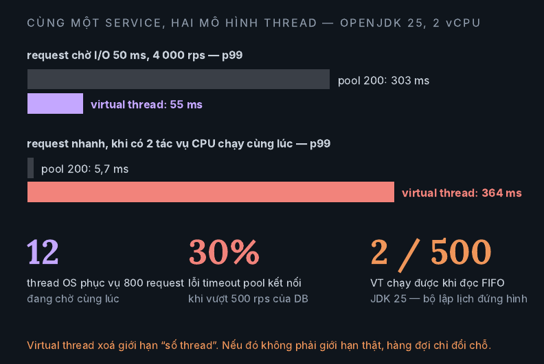
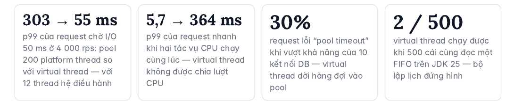
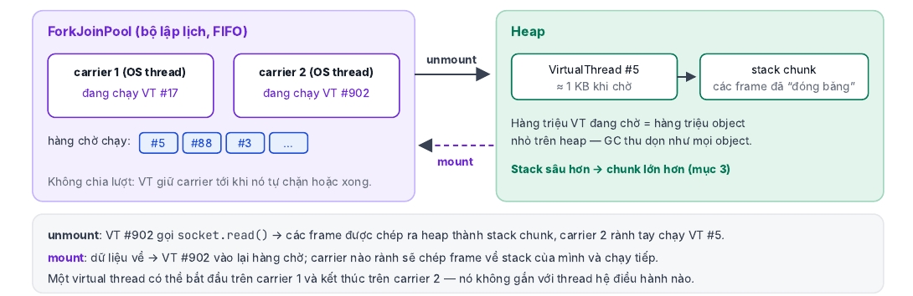
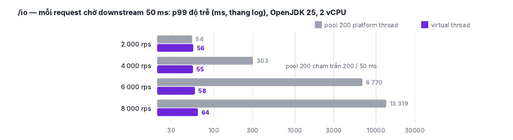
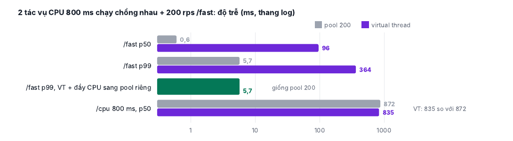
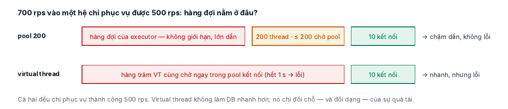
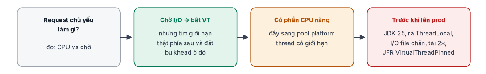

# Bài 19 — Virtual threads mổ xẻ



*Bật virtual thread rồi, khi nào hệ thống lại chậm hơn?*

*Chặng IV · Concurrency nhìn từ JVM — carrier, mount/unmount, pinning, ThreadLocal, structured concurrency · Nền tảng: JDK 25 LTS / 27 · Thí nghiệm chạy thật trên OpenJDK 21 · 25*

[Bài 18](18-thread-safepoint.md) nói mỗi `java.lang.Thread` là một thread hệ điều hành. Virtual thread phá vỡ đúng câu đó: hàng triệu thread chạy trên vài carrier, stack sống trên heap, “tháo ra” mỗi lần chờ I/O. Với một service Spring Boot chủ yếu chờ database và HTTP, đó là một món quà. Bài này đo món quà đó — và đo luôn bốn tình huống nó làm hệ thống **chậm đi**.

> **VỀ CÁC CON SỐ VÀ CÔNG CỤ TRONG BÀI** — Mọi output lấy từ việc **chạy thật** trên OpenJDK 25.0.4 (đối chiếu 21.0.12), Linux x86-64, **2 vCPU** — nên mặc định chỉ có 2 carrier thread. Không có Spring Boot 3.2+ trong môi trường này, nên service thử nghiệm là `com.sun.net.httpserver.HttpServer` của JDK, đổi qua lại giữa hai mô hình đúng như cờ của Spring Boot làm với Tomcat: **pool 200 platform thread** (mặc định `server.tomcat.threads.max`) hoặc **một virtual thread mỗi request**. Downstream (DB, HTTP) được giả lập bằng `Thread.sleep`, pool kết nối bằng một `Semaphore` 10 chỗ. Bộ tải gửi theo nhịp cố định (open-loop) và tính độ trễ từ lúc request *lẽ ra* được gửi; nó chạy trên cùng máy, chia CPU với service. Mỗi cấu hình chạy 10–15 giây, một lần.

Bật `spring.threads.virtual.enabled` rồi, khi nào hệ thống lại chậm hơn? Câu trả lời ngắn: **khi giới hạn của hệ thống không phải là số thread**. Virtual thread xoá đúng một giới hạn — “200 thread đang chờ I/O là hết chỗ”. Nếu thứ đang nghẽn là CPU, là pool kết nối, là một object đắt cache theo thread, hay là một lời gọi ghim carrier, thì bỏ giới hạn số thread chỉ làm hàng đợi dài hơn, ở một chỗ khó thấy hơn.



*Bốn con số trên đều đo được trong bài.*

## 1 Vì sao một dev Spring Boot nên quan tâm

- **Một dòng cấu hình thay mô hình thread của cả ứng dụng**: Tomcat/Jetty, `@Async`, `@Scheduled`, listener Kafka và RabbitMQ đều chuyển sang virtual thread (mục 11). Không ai review dòng đó như review một thay đổi kiến trúc.
- **Thread pool từng là bộ giới hạn tải ngầm định**: 200 thread Tomcat đồng nghĩa tối đa 200 request cùng chạm DB. Bỏ nó đi, giới hạn rơi xuống chỗ khác (mục 6).
- **Thư viện cũ giả định thread được tái sử dụng**: cache trong `ThreadLocal`, MDC, connection gắn theo thread (mục 7).
- **Các bài trước đã gặp nó**: [Bài 17](17-synchronized-monitor.md) đo pinning trong `synchronized` (JDK 21: 10,2 s; JDK 25: 79 ms); [Bài 18](18-thread-safepoint.md) cho thấy thread dump và safepoint. Bài này ghép lại thành bức tranh đầy đủ.

## 2 Bên trong một virtual thread

Virtual thread (JEP 444, chính thức từ JDK 21) là một object Java — `VirtualThread` — cộng một **continuation**: phần stack có thể đóng gói lại và mở ra. Nó chạy trên một **carrier**, là platform thread của một `ForkJoinPool` riêng (số carrier mặc định bằng số CPU, chỉnh bằng `jdk.virtualThreadScheduler.parallelism`). Khi virtual thread gọi một thao tác chặn mà JDK biết cách xử lý — `Thread.sleep`, đọc socket, `LockSupport.park`, chờ `Lock` hay (từ JDK 24) `synchronized` — nó **unmount**: các frame được chép thành một object “stack chunk” trên heap, carrier rảnh tay chạy virtual thread khác. Khi I/O xong, nó được xếp lại vào hàng, **mount** lên một carrier bất kỳ và chạy tiếp.



*Hình 19.1 — Virtual thread không phải thread của hệ điều hành; nó là việc mà vài platform thread (carrier) thay nhau chạy. Mọi lợi ích và mọi cái bẫy của bài này đều đến từ hai câu trong hình: “unmount khi chặn” và “không chia lượt”.*

Hai hệ quả cần nhớ ngay. **Thứ nhất**, chỉ những thao tác chặn mà JDK đã viết lại mới unmount được; một thao tác chặn mà JDK không biết — một lời gọi native, một file bị treo (mục 8) — chặn luôn cả carrier. **Thứ hai**, JEP 444 nói rõ bộ lập lịch “hiện không chia lượt thời gian”: một virtual thread đang tính toán giữ carrier tới khi xong (mục 5).

## 3 Rẻ tới mức nào

Tạo N thread, mỗi thread đi xuống một chuỗi lời gọi đệ quy rồi `park()`, đo thời gian và bộ nhớ (heap sau GC, RSS từ `/proc`):

| JDK 25 | N | độ sâu stack | tạo + chạy tới park | heap / thread | RSS / thread | thread OS |
|---|---:|---:|---:|---:|---:|---:|
| platform | 10 000 | 10 | 225 µs | 0,26 KB | 24,5 KB | 10 006 |
| virtual | 10 000 | 10 | **14 µs** | 1,81 KB | 3,5 KB | **9** |
| virtual | 1 000 000 | 10 | **2,2 µs** | 0,89 KB | 1,2 KB | 9 |
| virtual | 100 000 | 100 | 10 µs | 3,24 KB | 4,2 KB | 9 |
| platform | 10 000 | 100 | 249 µs | 0,26 KB | 29,7 KB | 10 006 |

Một triệu virtual thread đang chờ: 2,2 giây để tạo, 865 MB heap, 9 thread hệ điều hành. Mười nghìn platform thread đã tốn 238 MB RSS và 2,25 giây — và giới hạn của máy này là 32 025 tiến trình/thread cho mỗi user. Nhưng để ý cột heap: stack của virtual thread **sống trên heap** và lớn lên theo độ sâu — 0,9–1,8 KB ở độ sâu 10, 3,2 KB ở độ sâu 100. Một request Spring đi qua filter, interceptor, proxy, repository dễ dàng sâu hơn 100 frame; 50 000 request đang chờ là vài trăm MB heap mà GC phải quét — một chi phí platform thread không có (stack của chúng nằm ngoài heap).

## 4 Nơi virtual thread thắng: chờ I/O

Endpoint `/io` mô phỏng một request điển hình của service Spring: gọi downstream mất 50 ms rồi trả JSON. Với pool 200 thread, trần lý thuyết là 200 / 0,05 s = **4 000 rps** — bất kể CPU còn rảnh bao nhiêu.



*Hình 19.2 — Ở 2 000 rps hai mô hình như nhau (p99 54 và 56 ms). Ở 4 000 rps, pool 200 vừa chạm trần: request bắt đầu xếp hàng chờ thread, p50 đã là 230 ms. Vượt qua đó, hàng đợi lớn không giới hạn: p99 6,8 s rồi 13,3 s. Virtual thread giữ p99 dưới 64 ms tới 8 000 rps, với 801 request đồng thời trên 12 thread hệ điều hành.*

```text
[pool200] /io?ms=50  mục tiêu 4000 rps | p50   230.3  p90   274.6  p99    303.1  max    335.3 ms
[pool200] /io?ms=50  mục tiêu 6000 rps | p50  4266.4  p90  6305.9  p99   6770.5  max   6843.9 ms
          /stats: maxInflight 200, threads 208
[vt]      /io?ms=50  mục tiêu 4000 rps | p50    50.4  p90    51.1  p99     55.2  max     82.9 ms
[vt]      /io?ms=50  mục tiêu 8000 rps | p50    50.6  p90    52.6  p99     63.7  max     97.6 ms
          /stats: maxInflight 801, threads 12
```

Đây là trường hợp virtual thread được thiết kế cho: **thông lượng bị giới hạn bởi số việc đang chờ**, không phải bởi CPU. Với pool cố định, bạn phải đoán đúng số thread (định luật Little: rps × thời gian chờ); với virtual thread, số thread tự bằng số việc đang chờ. Mọi mục còn lại của bài là những trường hợp giả định “nghẽn ở số thread” không đúng.

> **MỘT CÁI BẪY CỦA CHÍNH PHÉP ĐO** — Lần chạy đầu, bản virtual thread có hàng nghìn kết nối bị đóng giữa chừng. Nguyên nhân: `HttpServer` của JDK chỉ giữ tối đa 200 kết nối keep-alive nhàn rỗi (`sun.net.httpserver.maxIdleConnections`). Với pool 200, request xếp hàng nên kết nối ít khi nhàn rỗi; với virtual thread, phản hồi về nhanh nên nhiều kết nối nhàn rỗi cùng lúc và bị đóng. Một giới hạn “ngầm” khác bị lộ khi giới hạn số thread biến mất — đúng chủ đề của bài. Mọi số liệu trên đã nâng giới hạn này.

## 5 Chậm hơn #1: việc CPU — không ai chia lượt

Platform thread được kernel chia lượt: một thread tính toán dài vẫn bị ngắt vài ms một lần để thread khác chạy. Virtual thread thì không — nó giữ carrier tới khi tự chặn hoặc xong. Thử: 2 request `/cpu` chạy chồng nhau, mỗi cái tốn một lượng tính toán cố định ≈ 800 ms; cùng lúc 200 rps vào `/fast` (trả về ngay).



*Hình 19.3 — Với 2 carrier và 2 tác vụ CPU, có những khoảng cả hai carrier đều bận; request `/fast` đến lúc đó phải xếp hàng tới khi một tác vụ CPU xong. Đẩy phần tính toán sang một pool platform thread riêng (`/cpuoff`) đưa `/fast` về đúng như pool 200.*

| JDK 25, 15 giây | `/fast` p50 | `/fast` p99 | `/fast` max | `/cpu` p50 |
|---|---:|---:|---:|---:|
| pool 200 platform thread | 0,6 ms | 5,7 ms | 10,3 ms | 872 ms |
| virtual thread | **95,8 ms** | **364 ms** | 420 ms | 835 ms |
| virtual thread, CPU đẩy sang `newFixedThreadPool(2)` | 0,6 ms | 5,7 ms | 19,2 ms | 829 ms |

Một điều tinh tế: với virtual thread, tác vụ CPU lại xong *nhanh hơn* (835 so với 872 ms) — không bị chia lượt nghĩa là ít chuyển ngữ cảnh. Bộ lập lịch FIFO tối ưu thông lượng, đánh đổi bằng độ trễ của việc ngắn. Trong một service, đó thường là đánh đổi sai: endpoint báo cáo, xuất PDF, nén ảnh, băm mật khẩu bằng bcrypt chạy chung carrier với health check và request đăng nhập. Một lỗi đo cần tránh: phiên bản đầu của `/cpu` “tính toán cho tới khi hết 800 ms đồng hồ” — với platform thread bị chia lượt, nó tiêu ít CPU hơn mà vẫn xong đúng giờ, làm phép so sánh thiên vị; số liệu trên dùng khối lượng việc cố định.

## 6 Chậm hơn #2: tài nguyên có hạn — hàng đợi đổi chỗ

Endpoint `/db` lấy một trong 10 “kết nối” (như HikariCP `maximumPoolSize=10`), chờ tối đa 1 giây (`connectionTimeout` ngắn lại cho dễ thấy), giữ nó 20 ms. Khả năng tối đa: 10 / 0,02 s = **500 rps**, bất kể mô hình thread.

| JDK 25, 15 giây | tải | p50 | p99 | lỗi 503 (hết hạn chờ pool) | request đồng thời tối đa |
|---|---:|---:|---:|---:|---:|
| pool 200 | 400 rps | 20,8 ms | 24,1 ms | 0 | — |
| virtual thread | 400 rps | 21,3 ms | 26,5 ms | 0 | — |
| pool 200 | 700 rps | 4 554 ms | 7 865 ms | 0 | 200 |
| virtual thread | 700 rps | 1 016 ms | 1 022 ms | **3 118 (30%)** | 728 |



*Hình 19.4 — Bỏ pool thread là bỏ một hàng đợi có giới hạn tự nhiên. Không có gì thay thế nó, hàng đợi dời vào tài nguyên khan hiếm tiếp theo — ở đây là pool kết nối, nơi timeout biến thành lỗi.*

Ngoài đời, thứ khan hiếm tiếp theo có thể là pool kết nối DB, giới hạn rate của API bên thứ ba, số file descriptor, hay chính bộ nhớ (mỗi request đang chờ giữ stack và dữ liệu trên heap). Cách chữa là đặt lại giới hạn một cách có chủ đích, ở đúng chỗ: một `Semaphore` (bulkhead) quanh lời gọi downstream, giới hạn đồng thời trên executor (`SimpleAsyncTaskExecutor.setConcurrencyLimit`), rate limit ở cổng vào — và chọn rõ ràng giữa “chờ lâu” và “từ chối nhanh”.

## 7 Chậm hơn #3: ThreadLocal làm cache

Mẫu code rất phổ biến trong thư viện và code cũ: “object này đắt và không thread-safe, mỗi thread giữ một bản” — `SimpleDateFormat`, buffer, `Cipher`, `MessageDigest`, parser. Với pool 200, 200 bản được tạo một lần rồi dùng mãi. Với virtual thread, **mỗi request là một thread mới**, nên mỗi request tạo một bản rồi vứt đi ([Bài 15](15-reference-off-heap.md) đã xem mặt bộ nhớ của `ThreadLocal`). Hai biến thể:

| JDK 25 | tải | số lần khởi tạo | p50 | p99 |
|---|---:|---:|---:|---:|
| buffer 64 KB rẻ — pool 200 | 3 000 rps | 200 | 0,2 ms | 6,7 ms |
| buffer 64 KB rẻ — virtual thread | 3 000 rps | **54 000** | 0,3 ms | 4,6 ms |
| object khởi tạo tốn 1 ms CPU — pool 200 | 1 800 rps | 200 | 0,4 ms | 4,1 ms |
| object khởi tạo tốn 1 ms CPU — virtual thread | 1 000 rps | ≈ 18 000 | 1,7 ms | 53,3 ms |
| object khởi tạo tốn 1 ms CPU — virtual thread | 1 800 rps | **50 401** (cả 2 lượt) | **1 164 ms** | **2 607 ms** |

Buffer rẻ: cache vô dụng — 54 000 lần cấp phát 64 KB, khoảng 3,5 GB rác thêm, GC tăng từ 3 lên 8 lần — nhưng độ trễ chưa bị ảnh hưởng. Object đắt: “cache” biến thành chi phí trả trên mỗi request; ở 1 800 rps, 1,8 giây CPU mỗi giây trên máy 2 lõi, và service sụp. Cùng code, cùng tải, pool 200 không hề biết vấn đề tồn tại.

> **THAY THREADLOCAL LÀM CACHE BẰNG GÌ** — Object bất biến hoặc thread-safe dùng chung (`DateTimeFormatter` thay `SimpleDateFormat`; `ObjectMapper` vốn thread-safe sau khi cấu hình); một pool object có giới hạn nếu thật sự cần tái sử dụng; hoặc tạo cục bộ nếu rẻ. Để **truyền ngữ cảnh** (request id, user, tenant) thay vì cache, dùng `ScopedValue` — chính thức từ JDK 25 (JEP 506), mục 9.

## 8 Chậm hơn #4: ghim carrier

Unmount chỉ xảy ra với các thao tác chặn mà JDK đã viết lại. Khi virtual thread chặn ở chỗ khác, nó **ghim** (pin) carrier: carrier đứng chờ cùng nó. Với 2 carrier, chỉ cần hai virtual thread bị ghim là toàn bộ bộ lập lịch đứng.

### `synchronized` — đã sửa ở JDK 24

[Bài 17](17-synchronized-monitor.md) đã đo: 1 000 virtual thread ngủ 20 ms bên trong `synchronized` mất **10 201 ms** trên JDK 21 (song song hiệu dụng 2), **79 ms** trên JDK 25 (JEP 491). Nếu còn chạy JDK 21 với virtual thread: JFR `jdk.VirtualThreadPinned`, nâng driver (pgjdbc ≥ 42.6.0, Connector/J ≥ 9.0.0), hoặc nâng JDK.

### File I/O chặn — tệ hơn trên JDK 25

500 virtual thread cùng mở và đọc một named pipe (FIFO) chưa có ai ghi — đại diện cho mọi “file” có thể chặn lâu: FIFO, thiết bị, NFS bị treo. Sau 3 giây, đếm carrier và thử chạy một virtual thread rỗng; đối chứng bằng 500 virtual thread chờ đọc socket:

| 500 virtual thread đang chặn | tới được lệnh chặn | carrier | Một virtual thread mới |
|---|---:|---:|---|
| JDK 21 — đọc socket | 500 / 500 | 2 | chạy sau 2,1 ms |
| JDK 21 — đọc FIFO | 256 / 500 | **256** | không chạy được trong 2 s |
| JDK 25 — đọc socket | 500 / 500 | 2 | chạy sau 2,2 ms |
| JDK 25 — đọc FIFO | **2 / 500** | 2 | **không chạy được trong 2 s** |

Socket không có vấn đề gì: đọc socket unmount, 2 carrier phục vụ cả 500. File thì khác. JDK 21 *bù*: khi virtual thread chặn trong file I/O, bộ lập lịch tạm thêm carrier — tới trần `jdk.virtualThreadScheduler.maxPoolSize` = 256 — rồi kẹt. JDK 25 không bù gì cả: 2 carrier bị ghim, 498 virtual thread còn lại và mọi virtual thread mới — kể cả request HTTP chẳng liên quan — đứng yên. Mã nguồn giải thích:

```java
// JDK 21 — java/io/FileInputStream.java
public int read() throws IOException {
    long comp = Blocker.begin();   // bù carrier
    try { return read0(); }
    finally { Blocker.end(comp); }
}
```

```java
// JDK 25 — java/io/FileInputStream.java
public int read() throws IOException {
    if (jfrTracing && FileReadEvent.enabled())
        return traceRead0();
    return read0();             // không bù
}
```

Thay đổi là JDK-8329593 (JDK 23): bỏ việc điều chỉnh song song khi virtual thread làm I/O trên file mở kiểu buffered, với lý do các thao tác này “thường quá ngắn để có lợi”; chỉ còn bù cho file mở kiểu direct I/O và cho lệnh ghi đồng bộ (`O_SYNC` / `O_DSYNC`). Với file trên đĩa local, đúng là ngắn — thay đổi hợp lý. Với một mount NFS đang treo hay một pipe đặt tên, nó biến một thread kẹt thành cả ứng dụng kẹt. Chúng tôi cũng thử đường hay gặp nhất là đọc output của tiến trình con (`ProcessBuilder`, 20 tiến trình `sleep 3`): **không** bị ảnh hưởng trên cả JDK 21 và 25 (xong sau 3,1 s, virtual thread mới chạy sau 2 ms).

Ghim còn lại theo InfoQ “Virtual Threads after JDK 24”: frame native (JNI/FFM) trên stack và khối khởi tạo class (`static {}`) đang chặn.

## 9 Structured concurrency và ScopedValue

Thread rẻ thì “mỗi lời gọi downstream một thread” trở thành cách tự nhiên để gọi song song. Vấn đề là vòng đời: lỗi ở một nhánh có dừng các nhánh khác không? `StructuredTaskScope` (preview, JDK 25 là lần thứ năm, JDK 27 lần thứ bảy — JEP 533) buộc các nhánh con sống trong một khối `try`: lỗi đầu tiên huỷ các nhánh còn lại, khối chỉ thoát khi mọi nhánh đã dừng. Một request gọi ba downstream (200 ms, 1 000 ms, và một cái lỗi sau 50 ms):

*Mã nguồn lab nằm trong repo: sources/under-hood/src/bai19-vthreads-src.zip.*

```text
$ java --enable-preview lab19.Fanout
Executor+Future : thấy lỗi sau 1038 ms, lúc đó còn 0 downstream đang chạy
Executor+Future : request kết thúc sau 1064 ms
StructuredScope : thấy lỗi sau   65 ms (pricing lỗi), còn 0 downstream đang chạy
StructuredScope : request kết thúc sau   66 ms
ScopedValue trong nhánh con: audit@req-77
```

```java
ScopedValue.where(REQUEST_ID, "req-42").call(() -> {
  try (var scope = StructuredTaskScope.open()) {           // JDK 25 preview API
    var user = scope.fork(() -> call("user", 200));
    var orders = scope.fork(() -> call("orders", 1000));
    var pricing = scope.fork(() -> call("pricing", 50));   // ném lỗi → huỷ hai nhánh kia
    scope.join();                                              // FailedException nếu có nhánh lỗi
    return combine(user.get(), orders.get(), pricing.get());
  }
});
```

Với `Future.get()` lần lượt, code chờ nhánh 1 000 ms xong rồi mới thấy lỗi — và nếu không cẩn thận, nhánh đó còn chạy sau khi request đã trả lỗi. Với scope, lỗi được thấy sau 65 ms và nhánh còn lại bị ngắt. `ScopedValue` (chính thức ở JDK 25) là thay thế cho `ThreadLocal` khi mục đích là *truyền ngữ cảnh*: giá trị bất biến, gắn với một khối code chứ không với thread, được các nhánh con của scope nhìn thấy mà không phải chép như `InheritableThreadLocal`.

## 10 Quan sát virtual thread

Công cụ quen thuộc nhìn thấy thread hệ điều hành; virtual thread phần lớn thời gian không gắn với thread nào. Cùng service đang phục vụ 4 000 rps với downstream 200 ms (≈ 800 request đang chờ), chụp hai loại dump cách nhau một giây:

```text
$ jcmd <pid> Thread.print                         # thread dump quen thuộc (Bài 17, 18)
  25 thread — carrier, GC, JIT, HttpServer dispatcher… không có request nào
$ jcmd <pid> Thread.dump_to_file -format=json /tmp/td.json
  663 thread, trong đó 650 virtual, cả 650 đang ở Thread.sleep (downstream giả lập)
  nhóm theo “thread container”: java.util.concurrent.ThreadPerTaskExecutor@21be96e8 → 650 thread
```

`Thread.dump_to_file` (JDK 21) ghi cả virtual thread, nhóm theo *container* — executor, scope — đã tạo ra chúng; file 900 KB cho 650 thread. Đó là công cụ cho câu hỏi “request đang kẹt ở đâu?” khi bật virtual thread. Ba thay đổi khác trong vận hành:

- **Metric số thread mất ý nghĩa**: `jvm.threads.live` báo 12 trong khi 800 request đang chạy; metric thread pool của Tomcat biến mất. Theo dõi số request đang xử lý ở tầng HTTP, độ trễ, và độ dài hàng đợi của tài nguyên phía sau thay thế.
- **JFR**: `jdk.VirtualThreadPinned` (bật sẵn, ngưỡng 20 ms) cho mọi lần ghim lâu kèm stack; `jdk.VirtualThreadSubmitFailed` khi bộ lập lịch không nhận thêm việc; `jdk.VirtualThreadStart/End` tắt mặc định vì quá nhiều.
- **Bộ nhớ**: stack của request đang chờ nằm trong heap (mục 3) — heap dump của một service bị nghẽn sẽ đầy `StackChunk`, và GC phải quét chúng.

## 11 Trong Spring Boot

Theo release notes Spring Boot 3.2 (Java 21+, `spring.threads.virtual.enabled=true`), một dòng cấu hình đổi:

| Thành phần | Khi bật |
|---|---|
| Tomcat, Jetty | xử lý request trên virtual thread — thay pool 200 |
| `applicationTaskExecutor` | `SimpleAsyncTaskExecutor` dùng virtual thread: `@Async`, async MVC, lời gọi chặn trong WebFlux |
| `taskScheduler` | `SimpleAsyncTaskScheduler` dùng virtual thread — bỏ qua mọi thuộc tính về pool |
| Listener RabbitMQ, Kafka; Redis cluster; Pulsar | executor virtual thread |
| `spring.main.keep-alive` | giữ JVM sống khi mọi thread còn lại là virtual/daemon (ứng dụng không có web server) |

Javadoc của `SimpleAsyncTaskExecutor` nói rõ: mặc định **không giới hạn** số tác vụ đồng thời và không tái sử dụng thread; có `setConcurrencyLimit` và (từ Spring Framework 6.2.6) `setRejectTasksWhenLimitReached` để từ chối thay vì bắt người gọi chờ. Đó chính là công cụ để đặt lại giới hạn đã mất ở mục 6.

> **SPRING BOOT · DANH SÁCH KIỂM TRA TRƯỚC KHI BẬT**
>
> 1. **JDK 24+, tốt nhất là 25 LTS** — `synchronized` không còn ghim ([Bài 17](17-synchronized-monitor.md)). Trên JDK 21: kiểm tra driver, JFR `VirtualThreadPinned` dưới tải.
> 2. **Tìm giới hạn thật**: pool kết nối, rate limit của API ngoài, bộ nhớ. Đặt bulkhead (`Semaphore`, Resilience4j) hoặc `setConcurrencyLimit` ở đúng chỗ; quyết định “chờ” hay “từ chối nhanh”.
> 3. **Tách việc CPU nặng** (báo cáo, PDF, nén, bcrypt) sang một `ThreadPoolTaskExecutor` platform thread có giới hạn — đừng để chúng chiếm carrier.
> 4. **Rà `ThreadLocal`** trong code và thư viện: cache object đắt sẽ thành chi phí mỗi request. MDC vẫn chạy đúng theo request; ngữ cảnh mới nên dùng `ScopedValue`.
> 5. **File system có thể treo** (NFS, FUSE, FIFO): từ JDK 23 không còn bù carrier — bọc I/O đó trong executor platform thread riêng.
> 6. **Đo trước và sau bằng tải open-loop** (mục 4): so p99 ở tải hiện tại và ở 2× tải, kèm tỉ lệ lỗi. Virtual thread thường đổi “chậm dần” thành “lỗi nhanh” — cả hai đều cần được thấy trước khi lên production.

> **THAY ĐỔI THEO PHIÊN BẢN CẦN BIẾT** — **JDK 21** — virtual thread chính thức (JEP 444); `Thread.dump_to_file`; file I/O được bù carrier. **JDK 23** — bỏ bù carrier cho file I/O buffered (JDK-8329593). **JDK 24** — `synchronized` không ghim (JEP 491); gỡ `jdk.tracePinnedThreads`. **JDK 25** — `ScopedValue` chính thức (JEP 506); structured concurrency preview lần năm với API `StructuredTaskScope.open()`. **JDK 27** — structured concurrency preview lần bảy (JEP 533). Trên mọi bản: không chia lượt thời gian cho virtual thread.

## 12 Ghép lại: một trang để nhớ cả bài

| Tình huống | Virtual thread | Vì sao | Đo trong bài (JDK 25) |
|---|---|---|---|
| Chờ I/O (DB, HTTP, socket) | **thắng** | unmount khi chờ; không trần số thread | p99 55 ms ở 4 000 rps (pool 200: 303 ms) |
| Việc CPU chung carrier với request nhanh | **thua** | không chia lượt; FIFO | `/fast` p99 364 ms (pool: 5,7 ms) |
| Tài nguyên phía sau có hạn | ngang thông lượng, khác cách hỏng | hàng đợi dời vào pool kết nối | 30% lỗi timeout vs p50 4,5 s |
| `ThreadLocal` làm cache object đắt | **thua** | mỗi request một thread mới | 50 401 lần khởi tạo; p50 1,16 s |
| `synchronized` quanh I/O | JDK 21 thua, 24+ ổn | JEP 491 | 10,2 s → 79 ms ([Bài 17](17-synchronized-monitor.md)) |
| File/FIFO/NFS chặn lâu | **thua nặng** | ghim carrier, JDK 23+ không bù | 2/500 chạy được; scheduler đứng |
| Gọi song song nhiều downstream | **thắng** với scope | thread rẻ + huỷ khi lỗi | lỗi thấy sau 65 ms thay vì 1 038 ms |



*Hình 19.5 — Bốn bước quyết định cho một service Spring Boot.*

Tóm cả bài trong một đoạn: *Virtual thread là continuation chạy trên vài carrier; khi chặn ở chỗ JDK hiểu, nó tháo stack ra heap và nhường carrier. Nhờ vậy nó xoá giới hạn “số thread” — và với service chủ yếu chờ I/O, đó là chiến thắng thật: 8 000 rps với p99 64 ms trên 12 thread. Nhưng nó không chia lượt CPU, không làm DB nhanh hơn, không tái sử dụng thread, và vẫn có chỗ ghim carrier. Hệ thống chậm đi khi giới hạn thật nằm ở chỗ khác: CPU (request nhanh chờ việc dài), tài nguyên phía sau (hàng đợi dời vào pool kết nối), cache theo thread (trả giá mỗi request), hoặc I/O mà JDK không unmount được (cả bộ lập lịch đứng). Bật nó như một thay đổi kiến trúc: tìm giới hạn thật, đặt lại giới hạn có chủ đích, đo trước khi lên production.*

## 13 Hiểu lầm thường gặp, bài tập, bài tiếp theo

### Hiểu lầm thường gặp

| Hiểu lầm | Thực tế |
|---|---|
| “Virtual thread làm code nhanh hơn.” | Làm được *nhiều việc chờ cùng lúc* hơn. Một request vẫn mất đúng thời gian của nó (p50 50 ms ở cả hai mô hình). |
| “Bật lên là tăng thông lượng.” | Chỉ khi nghẽn ở số thread. Nghẽn ở DB: vẫn 500 rps, cộng thêm lỗi timeout. |
| “Nên pool virtual thread như platform thread.” | Không. Chúng rẻ (2,2 µs) và được thiết kế để dùng một lần; giới hạn đồng thời bằng `Semaphore`/concurrency limit. |
| “JDK 24 hết pinning.” | Hết với `synchronized`. Còn native frame, khởi tạo class, và file I/O chặn — trên JDK 23+ còn không được bù carrier. |
| “`ThreadLocal` không dùng được với virtual thread.” | Dùng được, đúng ngữ nghĩa theo request. Chỉ *cache* theo thread là vô dụng. |
| “Thread dump cho thấy request đang kẹt ở đâu.” | `Thread.print` không thấy virtual thread đang chờ: 25 so với 663 thread. Dùng `Thread.dump_to_file -format=json`. |
| “Việc CPU chạy trên virtual thread không sao.” | Nó chiếm carrier tới khi xong: request nhanh p99 từ 5,7 lên 364 ms. |

### Bài tập tự làm (khoảng 60 phút)

> **THỰC HÀNH**
>
> 1. **Giới hạn thật** (bài tập quan trọng nhất). Với service của bạn: rps hiện tại × thời gian chờ trung bình = số request đồng thời. So với `server.tomcat.threads.max` và `maximumPoolSize` của HikariCP. Cái nào là trần thật?
> 2. **Tải open-loop**: chạy `Srv` + `Load` trong file đính kèm, đổi `ms` và tải sao cho giống service của bạn; tìm điểm pool 200 bắt đầu xếp hàng.
> 3. **Endpoint CPU**: liệt kê endpoint tốn > 50 ms CPU. Chúng có chạy chung executor với request nhanh không?
> 4. **`ThreadLocal`**: grep `ThreadLocal` trong code và thư viện (thêm `-verbose:class` nếu cần); cái nào là cache?
> 5. **Quan sát**: dưới tải, so `jcmd Thread.print` với `Thread.dump_to_file -format=json`; bật JFR và xem `jdk.VirtualThreadPinned`.

### Thuật ngữ của bài

| Thuật ngữ | Nghĩa ngắn gọn |
|---|---|
| Virtual thread | Thread do JVM lập lịch, chạy trên carrier; rẻ, dùng một lần. |
| Carrier thread | Platform thread của ForkJoinPool chạy virtual thread; mặc định bằng số CPU. |
| Continuation | Phần stack có thể đóng gói (unmount) và mở lại (mount). |
| Mount / unmount | Gắn virtual thread lên carrier / tháo ra, chép frame ra heap. |
| Stack chunk | Object trên heap chứa các frame của virtual thread đang chờ. |
| Pinning | Virtual thread chặn mà không unmount được, giữ luôn carrier. |
| Compensation | Bộ lập lịch tạm thêm carrier khi một carrier bị chặn (tối đa 256). |
| Bulkhead | Giới hạn số lời gọi đồng thời tới một tài nguyên. |
| Structured concurrency | Nhánh con sống trong một khối; lỗi một nhánh huỷ các nhánh khác. |
| ScopedValue | Giá trị ngữ cảnh bất biến gắn với một khối code, thay `ThreadLocal` để truyền ngữ cảnh. |

> **BÀI TIẾP THEO · BÀI 20 — KHÉP LẠI CHẶNG IV** — **Bên trong `java.util.concurrent`.** AQS — thứ nằm dưới `ReentrantLock` ở [Bài 17](17-synchronized-monitor.md) và `Semaphore` của bài này; `ConcurrentHashMap`; `ForkJoinPool` — chính là bộ lập lịch của virtual thread; `CompletableFuture`. Câu hỏi của bài: `parallelStream()` *trong một request Spring dùng chung pool với ai?*

### Tài liệu tham khảo

- JEP 444: Virtual Threads (JDK 21); JEP 491: Synchronize Virtual Threads without Pinning (JDK 24); JEP 506: Scoped Values (JDK 25); JEP 505 / 533: Structured Concurrency (preview). openjdk.org/jeps
- JDK-8329593: Drop adjustments to target parallelism when virtual threads do I/O on files opened for buffered I/O — thảo luận nio-dev, 4/2024.
- Mã nguồn OpenJDK tag jdk-21-ga và jdk-25+36: `java/io/FileInputStream.java`. github.com/openjdk/jdk
- Spring Boot 3.2 Release Notes — mục Virtual Threads; Spring Boot reference “Task Execution and Scheduling”; Javadoc `SimpleAsyncTaskExecutor` (Spring Framework 7.0).
- InfoQ — “Spring Boot 3.2 virtual threads” (12/2023); “Virtual Threads after JDK 24”.
- Ron Pressler, Alan Bateman — tài liệu thiết kế Project Loom; JDK Flight Recorder: `jdk.VirtualThreadPinned`, `jdk.VirtualThreadSubmitFailed`.
