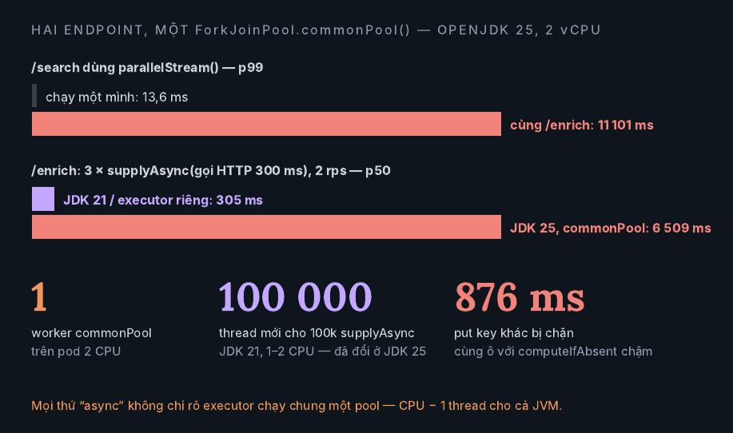
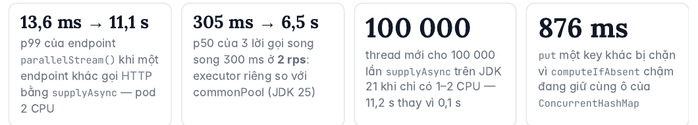
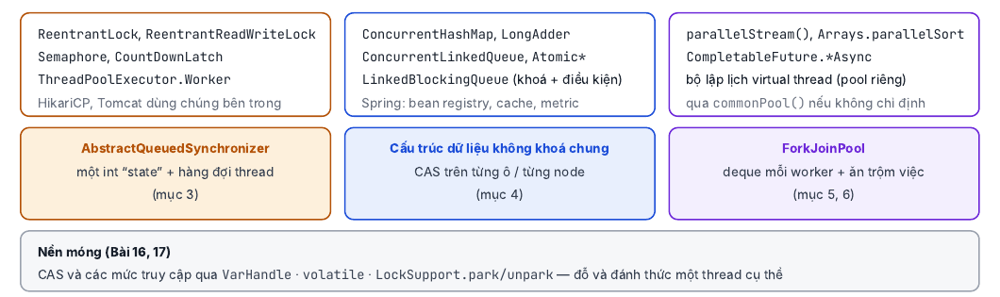
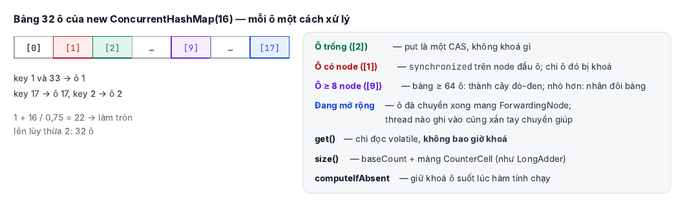
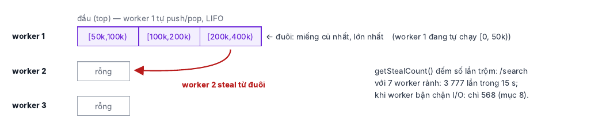
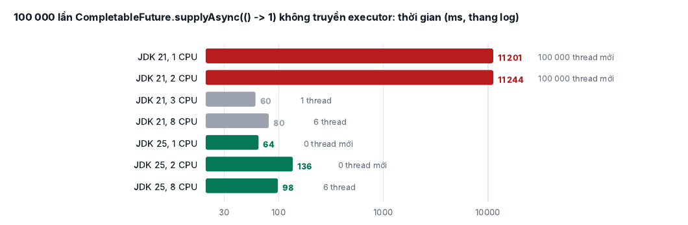
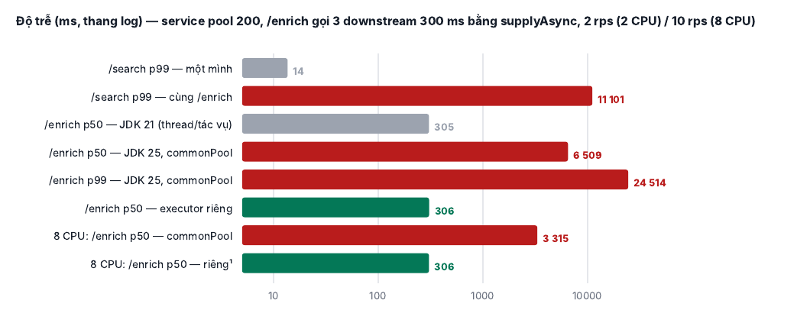
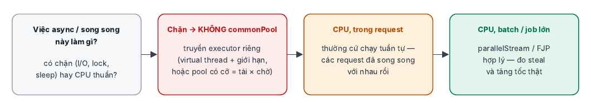

# Bài 20 — Bên trong java.util.concurrent



*parallelStream() trong request dùng chung pool với ai?*

*Chặng IV · Concurrency nhìn từ JVM — AQS, ConcurrentHashMap, ForkJoinPool, CompletableFuture · Nền tảng: JDK 25 LTS / 27 · Thí nghiệm chạy thật trên OpenJDK 21 · 25*

Bốn bài trước đi từ CPU lên: thứ tự bộ nhớ (16), khoá trong JVM (17), cách JVM dừng thread (18), virtual thread (19). Bài cuối của Chặng IV đọc tầng thư viện mà code Spring dùng hằng ngày: `ReentrantLock` và `Semaphore` đứng trên cái gì, `ConcurrentHashMap` khoá ra sao, và — câu hỏi của bài — vì sao một `parallelStream()` nhỏ trong một request có thể chờ 11 giây vì một endpoint khác.

> **VỀ CÁC CON SỐ VÀ CÔNG CỤ TRONG BÀI** — Mọi output lấy từ việc **chạy thật** trên OpenJDK 25.0.4 (đối chiếu 21.0.12), Linux x86-64, 2 vCPU. Để thấy hành vi trên máy nhiều lõi, một số lần chạy dùng `-XX:ActiveProcessorCount=8`: JVM *tin* rằng nó có 8 CPU và định cỡ mọi pool theo đó, nhưng CPU thật vẫn là 2 — đủ để thấy chuyện xếp hàng, không đủ để đo tăng tốc. Service thử nghiệm là `HttpServer` của JDK với pool 200 thread (như Tomcat mặc định); downstream được giả lập bằng `Thread.sleep(300)`; bộ tải open-loop của [Bài 19](19-virtual-threads.md). Hành vi của JDK 23, 24 được kiểm tra trong mã nguồn OpenJDK (tag GA). Mỗi cấu hình chạy 15 giây, một lần.

`parallelStream()` trong một request Spring dùng chung pool với ai? Câu trả lời ngắn: **với gần như mọi thứ “async” không chỉ rõ executor trong cả JVM** — mọi parallel stream khác, mọi `CompletableFuture.supplyAsync(…)` không truyền executor, `Arrays.parallelSort`, refresh của Caffeine. Tất cả dùng `ForkJoinPool.commonPool()`, có **số CPU − 1** thread — trên pod 2 CPU là đúng **một** thread. Một endpoint chặn I/O trong pool đó làm mọi thứ còn lại xếp hàng phía sau.



*Bốn con số trên đều đo được trong bài.*

## 1 Vì sao một dev Spring Boot nên quan tâm

- **`CompletableFuture.supplyAsync(() -> restClient.get()…)`** không truyền executor là một trong những dòng code phổ biến nhất để “gọi song song cho nhanh” — và nó chạy trên commonPool (mục 7–8).
- **`parallelStream()` trong code nghiệp vụ** trông vô hại; nó chia CPU với mọi request khác và với mọi thư viện dùng commonPool.
- **`ConcurrentHashMap.computeIfAbsent` làm cache tự viết** — loader chậm chặn cả những key khác; loader đệ quy ném exception (mục 4).
- **Pod nhỏ**: số thread của commonPool, của virtual thread scheduler, của GC đều tính từ số CPU ([Bài 13](13-gc-cho-container.md)). Pod 2 CPU có commonPool 1 thread.

## 2 Bản đồ java.util.concurrent

Gói `java.util.concurrent` có hơn trăm lớp, nhưng gần như tất cả được ghép từ ba khối xây dựng, và cả ba đặt trên đúng hai thứ đã gặp ở [Bài 16](16-java-memory-model.md)–17: lệnh CAS của CPU và khả năng đỗ (park) một thread rồi đánh thức đúng thread đó. Biết một lớp thuộc khối nào là đoán được nó hỏng theo kiểu nào: khối AQS hỏng bằng hàng đợi thread park dài; khối không khoá hỏng bằng CAS thất bại lặp lại khi tranh chấp cao; khối `ForkJoinPool` hỏng bằng worker bị chặn và không ai làm việc thay.



*Hình 20.1 — Ba khối xây dựng của `java.util.concurrent`, tất cả đặt trên CAS và park/unpark. Bài này mở từng khối, rồi dồn sự chú ý vào thứ nhiều người dùng mà ít người thấy: một ForkJoinPool duy nhất mà cả JVM dùng chung.*

## 3 AQS: một số nguyên và một hàng đợi

`AbstractQueuedSynchronizer` (Doug Lea, Java 5) tách bộ đồng bộ thành hai phần. Phần chung — xếp hàng thread, park, unpark, xử lý ngắt và timeout — AQS làm sẵn. Phần riêng — “được phép đi qua không?” — lớp con định nghĩa bằng cách đọc/CAS một `int state`. `ReentrantLock` coi state là số lần khoá lồng; `Semaphore` coi nó là số giấy phép còn lại; `CountDownLatch` coi nó là số đếm ngược. Một mutex đầy đủ chỉ cần thế này:

```java
final class Sync extends AbstractQueuedSynchronizer {          // state: 0 = mở, 1 = đã khoá
  protected boolean tryAcquire(int x) {
    if (compareAndSetState(0, 1)) { setExclusiveOwnerThread(Thread.currentThread()); return true; }
    return false;                                                // AQS xếp hàng + park thread này
  }
  protected boolean tryRelease(int x) {
    setExclusiveOwnerThread(null); setState(0); return true;       // ghi volatile = release
  }
}
void lock() { sync.acquire(1); }      void unlock() { sync.release(1); }
```

| 10 triệu lần tăng một biến đếm, JDK 25 | 2 thread | 8 thread | Ghi chú |
|---|---|---|---|
| Mutex tự viết trên AQS (12 dòng) | 963 ms | 277 ms | đúng 10 000 000; hàng đợi dài nhất thấy được: 7 thread |
| `ReentrantLock` | 822 ms | 272 ms | cùng AQS, thêm khoá lồng và fast path đã tối ưu |
| `synchronized` | 1 263 ms | 987 ms | monitor của JVM ([Bài 17](17-synchronized-monitor.md)) |

Mười hai dòng code tự viết chạy ngang `ReentrantLock` — vì toàn bộ phần khó nằm trong AQS. (Số liệu tranh chấp cực đoan, cùng hình dạng với [Bài 17](17-synchronized-monitor.md); nhắc lại: trong service thật, độ dài vùng găng quyết định chứ không phải loại khoá.) Đây cũng là lý do thread dump của mọi khoá `java.util.concurrent` trông giống nhau: `WAITING (parking)`, “parking to wait for <…> (a …$Sync)” — chữ `$Sync` là lớp con của AQS. Khi thấy 180 thread park trên `com.zaxxer.hikari.util.ConcurrentBag` hay `Semaphore$NonfairSync`, bạn biết đó là hàng đợi chờ tài nguyên, không phải deadlock.

## 4 ConcurrentHashMap: khoá từng ô

`Collections.synchronizedMap` có một khoá cho cả map. `ConcurrentHashMap` (bản viết lại ở Java 8) chia việc khoá theo **ô** (bin) của bảng băm:



*Hình 20.2 — Theo mã nguồn `ConcurrentHashMap.java` (JDK 25): `TREEIFY_THRESHOLD = 8`; constructor tính `tableSizeFor(1 + initialCapacity / loadFactor)`. Hai thread ghi vào hai ô khác nhau không hề chạm nhau.*

Đo thông lượng 80% `get` / 20% `put` trên 10 000 key:

| 5 triệu thao tác mỗi thread, JDK 25 | 2 thread | 8 thread |
|---|---|---|
| `Collections.synchronizedMap(new HashMap<>())` | 8,3 triệu/s | 7,6 triệu/s |
| `ConcurrentHashMap` | **27,3 triệu/s** | **42,0 triệu/s** |

Cái giá của khoá theo ô lộ ra khi bạn giữ khoá đó quá lâu. `computeIfAbsent` là cách “cache tự viết” phổ biến nhất — và hàm tính của nó chạy **trong lúc giữ khoá ô**. Thử một loader chậm 1 giây (như gọi DB):

*Mã nguồn lab nằm trong repo: sources/under-hood/src/bai20-juc-src.zip.*

```text
$ java lab20.Chm        # thread khác đang chạy computeIfAbsent(1, k -> { sleep(1000); … })
get(1) cùng lúc:   0.040 ms, trả về null (đọc không bao giờ bị khoá)
put(17) trong khi computeIfAbsent(1) đang chạy:    0.0 ms  (ô 17 / 32)
put( 2) trong khi computeIfAbsent(1) đang chạy:    0.0 ms  (ô 2 / 32)
put(33) trong khi computeIfAbsent(1) đang chạy:  876.2 ms  (ô 1 / 32)          ← key khác, cùng ô
fib bằng computeIfAbsent đệ quy: java.lang.IllegalStateException: Recursive update
```

Ba bài học. `put(33)` — một key hoàn toàn khác — chờ 876 ms chỉ vì rơi vào cùng ô với key đang được tính; trên map lớn hơn, xác suất trùng ô nhỏ hơn nhưng không bằng 0, và khi bảng đang mở rộng thì càng phức tạp. Lần chạy đầu của chúng tôi tính sai ô (giả định bảng 16 ô), và `put(17)` không bị chặn như dự đoán — đọc mã nguồn mới thấy constructor cấp 32 ô. **Đệ quy**: hàm tính gọi lại `computeIfAbsent` trên cùng map (memo hoá kiểu fibonacci) bị phát hiện và ném `IllegalStateException`. Và `get` không bao giờ bị chặn — nên trong lúc loader đang chạy, mọi thread khác thấy `null` và có thể tự gọi loader lần nữa nếu chúng dùng `get` rồi `put`. Cache có loader chậm nên dùng thư viện được thiết kế cho việc đó (Caffeine: loader chạy ngoài khoá, một lần cho mỗi key) — hoặc lưu `CompletableFuture` làm value để tính bên ngoài khoá.

## 5 ForkJoinPool: ăn trộm việc

`ThreadPoolExecutor` có một hàng đợi chung; mọi worker tranh nhau lấy từ đó. `ForkJoinPool` cho **mỗi worker một deque riêng**: worker đẩy việc con mình tạo ra vào đầu deque của mình và lấy ra từ đầu (LIFO — việc vừa tạo còn nóng trong cache); worker rảnh **ăn trộm** (steal) từ đuôi deque của worker khác (FIFO — việc cũ nhất, thường là phần lớn nhất chưa chia). Thread không thuộc pool gửi việc vào các hàng đợi chung (submission queue). Mô hình này sinh ra cho đệ quy chia-để-trị — đúng thứ `parallelStream()` làm: chia mảng làm đôi, đẩy một nửa, tự làm nửa kia, cho tới khi miếng đủ nhỏ.



*Hình 20.3 — Work stealing. Khi các worker còn lại đều bận (hoặc đang ngủ trong một lời gọi chặn), không ai trộm, và thread gọi tự làm hết phần việc của mình.*

Một chi tiết quan trọng cho mục 8: khi một thread *ngoài* pool (thread Tomcat) gọi `parallelStream()`, nó không chỉ gửi việc rồi ngồi chờ — nó tự làm phần việc gốc và giúp hoàn thành các phần con khi có thể. Trên máy 2 CPU, endpoint `/search` (lọc + tính điểm 400 000 phần tử) có p50 8,9 ms khi chạy tuần tự, 6,2 ms khi song song — thread Tomcat cộng với một worker của commonPool.

## 6 commonPool: một pool cho cả JVM

Java 8 thêm `ForkJoinPool.commonPool()`: một `ForkJoinPool` tĩnh, tạo lười, không bao giờ tắt, để những API “song song tự động” không phải mỗi lần tự tạo pool. Kích thước của nó tính lúc JVM khởi động, theo mã nguồn `ForkJoinPool.java`:

```java
int pc = Math.max(1, Runtime.getRuntime().availableProcessors() - 1);   // trừ 1: chừa chỗ cho thread gọi
// ghi đè bằng -Djava.util.concurrent.ForkJoinPool.common.parallelism=N
// thêm tối đa common.maximumSpares (mặc định 256) thread bù khi worker chờ qua ManagedBlocker
```

| CPU JVM nhìn thấy | 1 | 2 | 4 | 8 | 16 |
|---|---|---|---|---|---|
| Số worker của commonPool | 1 | **1** | 3 | 7 | 15 |

“CPU JVM nhìn thấy” trong container là **CPU limit** của pod, làm tròn lên ([Bài 13](13-gc-cho-container.md)) — hoặc giá trị `-XX:ActiveProcessorCount` nếu bạn đặt. Pod `limits.cpu: 2` nghĩa là commonPool có đúng một worker. Và đây là danh sách những thứ dùng chung worker đó nếu không ai chỉ định khác:

| Dùng commonPool | Không dùng commonPool |
|---|---|
| `Collection.parallelStream()`, `stream().parallel()` | Thread của Tomcat/Jetty/Undertow (`http-nio-8080-exec-*`) |
| `CompletableFuture.supplyAsync/runAsync/thenApplyAsync…` không truyền executor | `@Async` — dùng bean `applicationTaskExecutor` của Spring |
| `Arrays.parallelSort`, `parallelSetAll`, `parallelPrefix` | Bộ lập lịch virtual thread — một `ForkJoinPool` **riêng** ([Bài 19](19-virtual-threads.md)) |
| Thao tác hàng loạt của `ConcurrentHashMap` (`forEach(threshold, …)`, `reduce…`) | Reactor `Schedulers.parallel()` / `boundedElastic()` |
| Caffeine: refresh, loader async, removal listener, bảo trì — mặc định `Caffeine.executor` là commonPool | `ForkJoinPool` bạn tự `new` |
| JDK 25: `orTimeout`, `completeOnTimeout`, `delayedExecutor` — bộ hẹn giờ chuyển vào commonPool | HikariCP, Lettuce/Netty, Kafka client: pool riêng |

Một pool tĩnh dùng chung là lựa chọn hợp lý cho đúng thứ nó được thiết kế: việc **CPU thuần**, chia nhỏ được, không chặn. Khi đó, chung một pool cỡ CPU − 1 là tối ưu — có thêm thread cũng không có thêm CPU. Vấn đề bắt đầu khi ai đó đưa vào đó một việc **chặn**: một lời gọi HTTP, một truy vấn DB, một `Thread.sleep`. Worker ngủ không làm gì khác được, và commonPool không tự thêm thread trừ khi code chờ qua `ForkJoinPool.managedBlock` — `Thread.sleep`, socket hay JDBC thì không.

## 7 CompletableFuture chạy ở đâu?

Ba quy tắc, đọc thẳng từ Javadoc và mã nguồn:

1. **Phương thức `…Async(fn, executor)`** chạy trên executor bạn đưa. Luôn luôn.
2. **Phương thức `…Async(fn)` không có executor** chạy trên `ASYNC_POOL` — commonPool, *với một ngoại lệ đã thay đổi ở JDK 25* (dưới đây).
3. **Phương thức không có chữ Async** (`thenApply`, `thenCompose`…) chạy trên thread hoàn tất bước trước — hoặc ngay trên thread gọi nếu bước trước đã xong. `thenApply` sau một `supplyAsync` vì thế thường chạy trên worker của commonPool.

Ngoại lệ ở quy tắc 2 là một cái bẫy khi nâng cấp. Từ Java 8 tới JDK 24:

```java
// CompletableFuture.java — jdk-21-ga … jdk-24-ga
static final boolean USE_COMMON_POOL = (ForkJoinPool.getCommonPoolParallelism() > 1);
static final Executor ASYNC_POOL = USE_COMMON_POOL
        ? ForkJoinPool.commonPool() : new ThreadPerTaskExecutor();
// CompletableFuture.java — jdk-25+36
static final ForkJoinPool ASYNC_POOL = ForkJoinPool.asyncCommonPool();
// luôn là commonPool; nếu parallelism = 0 thì nâng lên 2
```

Trên máy 1–2 CPU (commonPool parallelism = 1), JDK ≤ 24 âm thầm **tạo một thread mới cho mỗi tác vụ async**. JDK 25 thay bằng commonPool. Đo trực tiếp, 100 000 lần `supplyAsync` rỗng:

```text
$ java -XX:ActiveProcessorCount=2 lab20.CfDefault    # JDK 21 rồi JDK 25; output ngắt dòng ở dấu |
JDK 21 CPU=2 commonPool.parallelism=1
    | executor mặc định: CompletableFuture$ThreadPerTaskExecutor chạy trên "Thread-0"
    | 100,000 supplyAsync: 11,244 ms, tạo 100,000 thread mới
JDK 25 CPU=2 commonPool.parallelism=1
    | executor mặc định: ForkJoinPool chạy trên "ForkJoinPool.commonPool-worker-1"
    | 100,000 supplyAsync:    136 ms, tạo 0 thread mới
```



*Hình 20.4 — Thời gian 100 000 lần `supplyAsync` theo JDK và số CPU (đặt bằng `-XX:ActiveProcessorCount`, CPU thật là 2). Chỉ JDK 21 ở 1–2 CPU dùng thread-per-task; từ 3 CPU trở lên cả hai JDK đều dùng commonPool và giống nhau.*

Với việc CPU rỗng, JDK 25 nhanh hơn 80 lần — Heinz Kabutz đo được kết quả cùng chiều (1 triệu tác vụ: khoảng 30 s trên Java 24, 98 ms trên Java 25, Java Specialists Newsletter số 332). Nhưng với một service mà `supplyAsync` bọc **lời gọi chặn**, chiều ngược lại mới đáng sợ: trên JDK 21, pod 2 CPU, mỗi lời gọi được một thread riêng nên chạy song song thật; lên JDK 25, cả ba lời gọi của mọi request xếp hàng sau **một** worker. Cùng code, cùng pod, chỉ đổi JDK:

| /enrich: 3 lời gọi 300 ms song song, 2 rps, pod 2 CPU | p50 | p99 |
|---|---|---|
| JDK 21 — `supplyAsync(fn)` (thread-per-task) | 305 ms | 346 ms |
| JDK 25 — `supplyAsync(fn)` (commonPool, 1 worker) | **6 509 ms** | **24 514 ms** |
| JDK 25 — `supplyAsync(fn, ownExecutor)` | **306 ms** | **309 ms** |

Không cần đo cũng tính được: 2 rps × 3 lời gọi × 0,3 s = **1,8 giây chờ cần phục vụ mỗi giây**, trong khi pool chỉ có 1 worker — tức 1 giây “chỗ ngồi” mỗi giây. Tải vượt khả năng 80%, hàng đợi chỉ có thể dài ra mãi; độ trễ đo được tăng dần theo thời gian chạy (p50 6,5 s sau 15 giây chạy, sẽ còn tệ hơn nếu chạy lâu hơn). Đây là định luật Little của [Bài 19](19-virtual-threads.md): số việc đang chờ đồng thời = tốc độ đến × thời gian chờ. Muốn gọi chặn song song, cần một executor có đủ chỗ cho con số đó.

## 8 Trả lời câu hỏi: parallelStream trong một request

Dựng một service giống thật: pool 200 thread kiểu Tomcat, hai endpoint không liên quan gì nhau do hai đội viết.

```java
// Đội A: tìm kiếm trên 400 000 phần tử — CPU thuần, "song song cho nhanh"
long r = Arrays.stream(DATA).parallel().filter(v -> (v & 7) != 0).mapToLong(Srv::score).sum();
// Đội B: làm giàu dữ liệu — gọi 3 service downstream "song song cho nhanh"
var user  = CompletableFuture.supplyAsync(() -> callDownstream("user"));    // chặn 300 ms
var price = CompletableFuture.supplyAsync(() -> callDownstream("price"));
var stock = CompletableFuture.supplyAsync(() -> callDownstream("stock"));
reply(user.join() + price.join() + stock.join());
```



*Hình 20.5 — JDK 25, tải open-loop 15 giây mỗi cấu hình. /search 20 rps; /enrich 2 rps trên 2 CPU, 10 rps trên 8 CPU (`-XX:ActiveProcessorCount=8`). ¹ đo khi chạy cùng /search. Không có code nào của đội A thay đổi giữa thanh xám và thanh đỏ.*

Trên pod 2 CPU, `/search` chạy một mình có p99 13,6 ms. Bật thêm `/enrich` ở chỉ **2 request mỗi giây**: p50 của `/search` vẫn 8,2 ms, nhưng **p99 thành 11 101 ms**, max 12 088 ms. Phần lớn lần, thread Tomcat tự làm gần hết việc của parallel stream (mục 5) nên vẫn nhanh. Thỉnh thoảng một mảnh con nó tách ra đã nằm trong hàng đợi chung của commonPool, phía sau hàng chục tác vụ `/enrich` đang chờ — thread gọi không lấy lại được mảnh đó, nên phải đợi worker duy nhất ngủ hết từng lượt 300 ms phía trước. (Cơ chế này là cách đọc mã nguồn `ForkJoinPool` của chúng tôi; phép đo chỉ thấy hệ quả ở đuôi phân phối, không thấy trực tiếp vị trí của mảnh trong hàng đợi.)

Trên “máy 8 CPU” (7 worker), hình ảnh khác nhưng không tốt hơn bao nhiêu:

| JVM thấy 8 CPU, commonPool 7 worker | /search p50 | /search p99 | /enrich p50 | Steal |
|---|---|---|---|---|
| /search một mình | 5,9 ms | 14,3 ms | — | 3 777 |
| /enrich một mình, 5 rps (cần 4,5 worker) | — | — | 305 ms | — |
| /enrich một mình, 10 rps (cần 9 worker) | — | — | **3 316 ms** | — |
| Cả hai, cùng commonPool | 6,8 ms | 13,0 ms | **3 775 ms** | **568** |
| Cả hai, /enrich dùng executor riêng | 5,1 ms | 13,1 ms | **306 ms** | 3 627 |

Ba điều đọc ra. Một, ngưỡng sụp đổ tính đúng bằng định luật Little: 5 rps × 3 × 0,3 s = 4,5 worker bận — dưới 7, ổn; 10 rps cần 9 — trên 7, hàng đợi phình vô hạn, p50 nhảy từ 305 ms lên 3,3 s. Không có vùng “chậm dần đều”: qua ngưỡng là sụp. Hai, `/search` trên 8 CPU không bị đuôi 11 giây (còn 6 worker để hút việc), nhưng số lần steal từ 3 777 tụt còn 568 — parallel stream **mất song song một cách im lặng** vì các worker đều đang ngủ thay cho `/enrich`. Ở đây CPU thật chỉ có 2 nên p50 gần như không đổi; trên máy 8 lõi thật, đó là mất tăng tốc thật. Ba, chỉ cần **truyền một executor** cho `supplyAsync` là cả hai endpoint về như lúc chạy riêng.

> **CÂU TRẢ LỜI CỦA BÀI** — `parallelStream()` trong một request Spring chạy trên **thread Tomcat đang xử lý request đó cộng với `ForkJoinPool.commonPool()`**. commonPool có CPU − 1 worker và được dùng chung bởi: mọi parallel stream khác trong JVM (của bạn, của thư viện, của request khác), mọi `CompletableFuture…Async` không truyền executor, `Arrays.parallelSort`, thao tác hàng loạt của `ConcurrentHashMap`, refresh/removal listener của Caffeine, và từ JDK 25 bộ hẹn giờ của `orTimeout`. Nó **không** dùng chung với pool request của Tomcat, `@Async`, hay bộ lập lịch virtual thread. Chỉ cần *một* người dùng chung đưa việc chặn vào, mọi người còn lại xếp hàng — và JDK 25 làm điều này xảy ra cả trên pod 1–2 CPU, nơi trước đây `supplyAsync` tự tạo thread riêng.

## 9 Trong Spring Boot: pool nào của ai

| Pool | Kích thước mặc định | Ai dùng |
|---|---|---|
| Tomcat `http-nio-*-exec-*` | `server.tomcat.threads.max=200` | xử lý request (hoặc virtual thread nếu `spring.threads.virtual.enabled`) |
| `applicationTaskExecutor` | core 8, queue không giới hạn | `@Async`, `AsyncTaskExecutor` được inject; `SimpleAsyncTaskExecutor` khi bật virtual thread |
| `taskScheduler` | 1 thread | `@Scheduled` |
| `ForkJoinPool.commonPool()` | CPU − 1 | mục 6 — không thuộc Spring, không có property nào của Spring chỉnh nó |
| Bộ lập lịch virtual thread | = số CPU | mọi virtual thread ([Bài 19](19-virtual-threads.md)) |
| HikariCP | `maximum-pool-size=10` | kết nối DB — giới hạn thật của nhiều service |

> **THAY ĐỔI THEO PHIÊN BẢN CẦN BIẾT**
>
> - **JDK 8**: `commonPool()`, `CompletableFuture`, parallel stream, `ConcurrentHashMap` viết lại theo ô + cây.
> - **JDK 9**: `orTimeout`, `completeOnTimeout`, `delayedExecutor` — bộ hẹn giờ là thread riêng `CompletableFutureDelayScheduler`.
> - **JDK 19**: `ForkJoinPool.setParallelism`; `CompletableFuture.resultNow/exceptionNow/state`. **JDK 21**: virtual thread — bộ lập lịch là một `ForkJoinPool` riêng.
> - **JDK 24**: `Gatherers.mapConcurrent` chính thức (JEP 485).
> - **JDK 25**: `supplyAsync` mặc định luôn dùng commonPool, kể cả khi parallelism = 1 (trước đó: thread mới mỗi tác vụ). `ForkJoinPool` implement `ScheduledExecutorService` (`schedule`, `submitWithTimeout`…); bộ hẹn giờ của `CompletableFuture` chuyển vào đó. Kiểm tra lại mọi `supplyAsync(fn)` trước khi nâng cấp pod nhỏ từ 21 lên 25.

> **SPRING BOOT · NĂM VIỆC NÊN LÀM**
>
> 1. **Không bao giờ gọi I/O trong `supplyAsync(fn)` không có executor.** Inject executor của Spring và truyền vào: `CompletableFuture.supplyAsync(() -> client.get(id), taskExecutor)`. Executor của Spring còn chạy được `TaskDecorator` để mang MDC/SecurityContext sang thread mới — commonPool thì không.
> 2. **Gọi song song I/O**: một executor virtual thread có giới hạn (`Semaphore` hoặc `SimpleAsyncTaskExecutor.setConcurrencyLimit`, [Bài 19](19-virtual-threads.md)). Từ JDK 24, `stream.gather(Gatherers.mapConcurrent(10, this::call))` làm việc đó trong một dòng: mỗi phần tử một virtual thread, tối đa 10 cùng lúc (JEP 485; chúng tôi không đo trong bài này).
> 3. **`parallelStream()` trong đường xử lý request**: mặc định là không. Request đã song song với nhau; thêm song song bên trong một request chỉ giúp khi CPU đang rảnh — tức là khi tải thấp. Nếu thật sự cần, chạy nó trên một `ForkJoinPool` riêng và đo.
> 4. **Caffeine / Spring Cache**: nếu loader hay `refreshAfterWrite` gọi DB hoặc HTTP, đặt `Caffeine.newBuilder().executor(…)`.
> 5. **Nhìn thấy commonPool**: `ExecutorServiceMetrics.monitor(registry, ForkJoinPool.commonPool(), "commonPool")` của Micrometer cho số worker đang chạy, hàng đợi, steal. Trong thread dump, worker tên `ForkJoinPool.commonPool-worker-N` nằm trong `Thread.sleep` / `NioSocketImpl.read` là dấu hiệu chắc chắn.

## 10 Ghép lại: một trang để nhớ cả bài

| Thành phần | Cơ chế cốt lõi | Cái bẫy · số đo trong bài (JDK 25) |
|---|---|---|
| AQS | `int state` + CAS + hàng đợi thread park | 12 dòng = một mutex ngang `ReentrantLock` (277 vs 272 ms, 8 thread). Thread dump: “parking to wait for …$Sync” |
| `ConcurrentHashMap` | CAS vào ô trống; `synchronized` trên node đầu ô; get không khoá | `computeIfAbsent` chậm chặn key khác cùng ô (876 ms); đệ quy → `IllegalStateException`. Nhanh hơn synchronizedMap 3,3–5,5 lần |
| `ForkJoinPool` | deque mỗi worker; LIFO cho mình, steal FIFO | worker ngủ thì không ai steal: 3 777 → 568 lần |
| `commonPool()` | tĩnh, CPU − 1 worker, dùng chung cả JVM | pod 2 CPU: 1 worker. Không bù thread cho `sleep`/socket/JDBC |
| `supplyAsync(fn)` | ASYNC_POOL = commonPool (JDK 25) | gọi I/O: 305 ms → 6,5 s khi nâng 21 → 25 trên pod 2 CPU |
| `parallelStream()` | thread gọi + commonPool | p99 13,6 ms → 11,1 s vì endpoint khác chặn trong commonPool |



*Hình 20.6 — Một câu hỏi trước mỗi `…Async` hay `.parallel()`: nó có chặn không, và nó chạy ở đâu?*

## 11 Hiểu lầm thường gặp, bài tập, bài tiếp theo

### Hiểu lầm thường gặp

| Hiểu lầm | Thực tế |
|---|---|
| “`supplyAsync` tạo thread mới.” | Chỉ trên JDK ≤ 24 khi commonPool có ≤ 1 worker. Còn lại, và luôn luôn từ JDK 25, nó xếp hàng trong commonPool. |
| “`parallelStream` chỉ dùng CPU của request mình.” | Nó dùng commonPool chung cả JVM — chung với code của đội khác và của thư viện. |
| “`ConcurrentHashMap` không bao giờ chặn.” | `get` không chặn. `put`/`compute` chặn nhau trong cùng một ô — 876 ms khi loader chậm. |
| “`computeIfAbsent` là một cache an toàn.” | Loader chạy trong khoá ô; không được đệ quy; không có hết hạn, giới hạn kích thước hay refresh. Dùng Caffeine. |
| “commonPool tự thêm thread khi worker bị chặn.” | Chỉ khi chờ qua `ForkJoinPool.managedBlock` (một số API của JDK làm vậy). `Thread.sleep`, socket, JDBC thì không — 1 worker vẫn là 1. |
| “Thêm `.parallel()` là nhanh hơn.” | Trên server đang tải, CPU đã bận phục vụ request khác. 2 CPU: 8,9 → 6,2 ms p50 khi rảnh; cái giá trả ở đuôi khi có người dùng chung. |

### Bài tập tự làm (khoảng 60 phút)

> **THỰC HÀNH**
>
> 1. **Tìm người dùng chung** (quan trọng nhất): grep `supplyAsync(`, `runAsync(`, `Async(`, `parallelStream`, `.parallel()`, `parallelSort` trong code của bạn. Cái nào không truyền executor? Cái nào bên trong có I/O?
> 2. **Tính ngưỡng**: với mỗi chỗ ở câu 1 có I/O, tốc độ gọi × thời gian chờ = số worker cần. So với CPU − 1 của pod.
> 3. **Nâng cấp 21 → 25**: chạy `CfDefault` trong file đính kèm với `-XX:ActiveProcessorCount` bằng CPU limit của pod, trên cả hai JDK.
> 4. **Tái hiện**: chạy `Srv` + `Load` (script `mix.sh`); đổi /enrich sang `?own=1`; thử `-Djava.util.concurrent.ForkJoinPool.common.parallelism=16` và giải thích vì sao đó chỉ là thuốc giảm đau.
> 5. **Thread dump dưới tải**: đếm `ForkJoinPool.commonPool-worker` đang `TIMED_WAITING (sleeping)` hoặc trong `read` của socket.

### Thuật ngữ của bài

| Thuật ngữ | Nghĩa ngắn gọn |
|---|---|
| AQS | `AbstractQueuedSynchronizer`: khung cho mọi khoá/bộ đồng bộ của j.u.c — một `int state` và một hàng đợi thread. |
| Ô (bin) | Một phần tử của mảng bảng băm; CHM khoá riêng từng ô. |
| Treeify | Chuyển ô có ≥ 8 node thành cây đỏ-đen để tra cứu O(log n). |
| ReservationNode | Node giữ chỗ trong ô trống khi `computeIfAbsent` đang tính. |
| Work stealing | Worker rảnh lấy việc từ đuôi deque của worker khác. |
| commonPool | `ForkJoinPool` tĩnh dùng chung cả JVM, CPU − 1 worker. |
| ManagedBlocker | Cách báo cho `ForkJoinPool` rằng worker sắp chặn để nó tạo thread bù. |
| ASYNC_POOL | Executor mặc định của `CompletableFuture…Async`. |
| Định luật Little | Số việc đồng thời = tốc độ đến × thời gian ở trong hệ thống. |

> **BÀI TIẾP THEO · BÀI 21 — MỞ ĐẦU CHẶNG V** — **`invokedynamic`: lambda, nối chuỗi, record.** Bootstrap method, `LambdaMetafactory`, `StringConcatFactory`, `ObjectMethods`, hidden class — những thứ biến một dòng `x -> x + 1` hay `"a" + b` thành bytecode rồi thành code máy. Câu hỏi của bài: *Lambda có tạo class mới mỗi lần gọi không?*

### Tài liệu tham khảo

- Mã nguồn OpenJDK tag jdk-21-ga, jdk-24-ga, jdk-25+36: `java/util/concurrent/CompletableFuture.java`, `ForkJoinPool.java`, `ConcurrentHashMap.java`, `locks/AbstractQueuedSynchronizer.java`. github.com/openjdk/jdk
- Doug Lea — “The java.util.concurrent Synchronizer Framework” (2004); “A Java Fork/Join Framework” (2000).
- Heinz Kabutz — The Java Specialists' Newsletter, Issue 332: thay đổi executor mặc định của `CompletableFuture` trong Java 25. javaspecialists.eu
- Javadoc Java SE 25: `ForkJoinPool`, `CompletableFuture`, `Gatherers.mapConcurrent`; JEP 485: Stream Gatherers (JDK 24).
- Caffeine wiki/docs — Population, Refresh: executor mặc định `ForkJoinPool.commonPool()`.
- Spring Boot reference — “Task Execution and Scheduling”; Micrometer `ExecutorServiceMetrics`.
