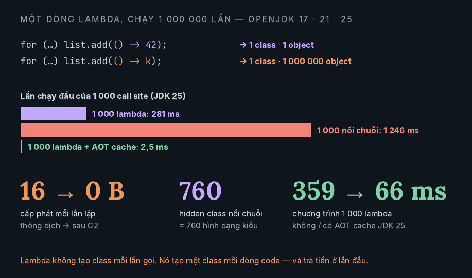
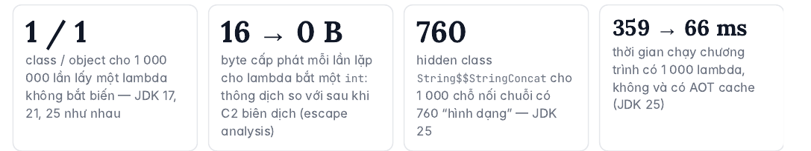
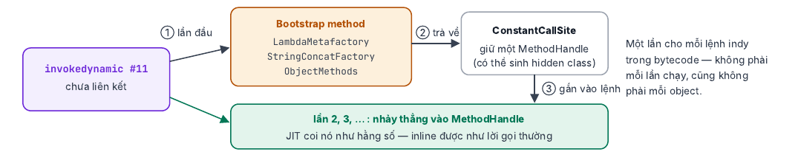
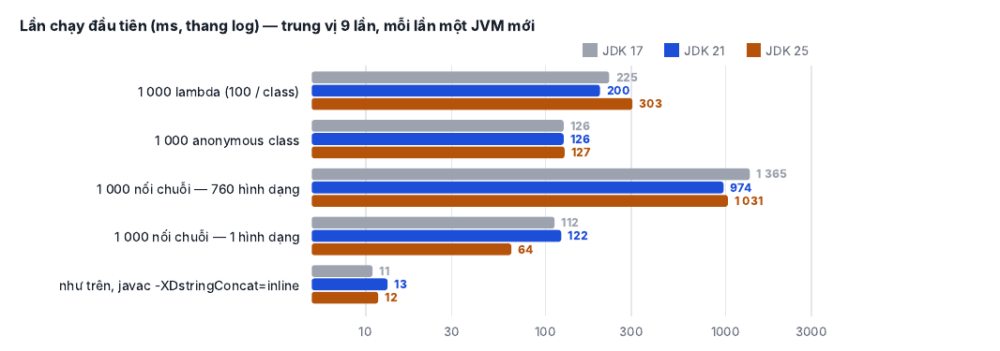
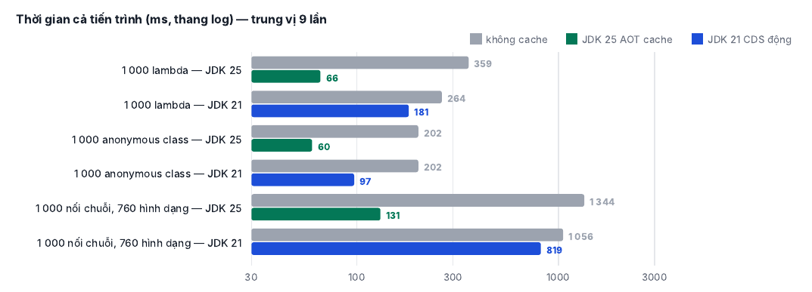
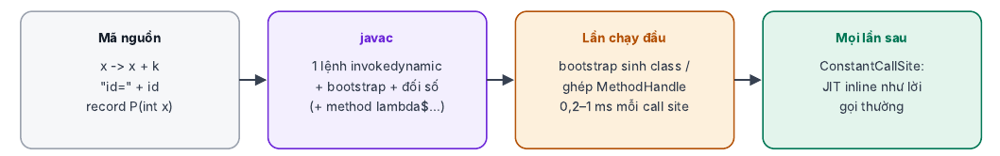

# Bài 21 — invokedynamic: lambda, nối chuỗi, record



*Lambda có tạo class mới mỗi lần gọi không?*

*Chặng V · Ngôn ngữ dưới lớp vỏ — bootstrap method, LambdaMetafactory, hidden class · Nền tảng: JDK 25 LTS / 27 · Thí nghiệm chạy thật trên OpenJDK 17 · 21 · 25*

Chặng V — *Ngôn ngữ dưới lớp vỏ* — hỏi một câu đơn giản: cú pháp quen thuộc biến thành gì trong bytecode và trong runtime? Bài mở đầu đi vào một lệnh bytecode duy nhất, `invokedynamic`, thứ đứng sau ba cú pháp bạn viết hằng ngày: lambda, `"a" + b` và `record`.

> **VỀ CÁC CON SỐ VÀ CÔNG CỤ TRONG BÀI** — Mọi output lấy từ việc **chạy thật** trên OpenJDK 17.0.20, 21.0.12 và 25.0.4, Linux x86-64, 2 vCPU. Bytecode xem bằng `javap -c -v`; class được nạp đếm bằng `-Xlog:class+load`; lượng cấp phát đo bằng `ThreadMXBean.getThreadAllocatedBytes` và JMH 1.37 (`-prof gc`). Các thí nghiệm “1 000 lambda / 1 000 chỗ nối chuỗi” dùng mã sinh tự động (10 class × 100), mỗi cấu hình chạy 9 lần, mỗi lần một JVM mới, lấy trung vị. Cơ chế được đối chiếu với mã nguồn OpenJDK các tag `jdk-17-ga`, `jdk-21-ga`, `jdk-23-ga`, `jdk-24-ga`, `jdk-25+36`.

Lambda có tạo class mới mỗi lần gọi không? Câu trả lời ngắn: **không**. Mỗi biểu thức lambda trong mã nguồn — mỗi *call site* — sinh **đúng một hidden class**, vào lần đầu tiên dòng đó chạy, rồi dùng mãi. Lambda không bắt biến còn dùng chung **một object duy nhất**; lambda bắt biến tạo một object nhỏ mỗi lần được đánh giá — và JIT thường xoá luôn object đó. Cái giá thật nằm ở **lần đầu**: liên kết, sinh bytecode, định nghĩa class — thứ mà AOT cache của JDK 25 trả trước được.



*Bốn con số trên đều đo được trong bài.*

## 1 Vì sao một dev Spring Boot nên quan tâm

- **Thời gian khởi động.** Một ứng dụng Spring Boot có hàng nghìn lambda và hàng nghìn chỗ nối chuỗi — trong code của bạn, Spring, Hibernate, Jackson. Mỗi chỗ trả phí liên kết *một lần*, vào lúc nó chạy lần đầu: trong lúc khởi động, hoặc ở request đầu tiên của một endpoint.
- **“Lambda trong vòng lặp nóng có tạo rác không?”** — câu hỏi review code phổ biến. Câu trả lời phụ thuộc vào việc lambda có bắt biến không và JIT có inline được không (mục 4).
- **Stack trace và profiler** đầy `lambda$process$3` và `$$Lambda/0x…`. Biết chúng từ đâu ra giúp đọc nhanh hơn.
- **AOT cache của JDK 25** — Spring Boot 4 đã hướng dẫn dùng — tác động mạnh nhất chính vào phần này (mục 8).

## 2 invokedynamic: lời gọi tự quyết định gọi ai

Bốn lệnh gọi cũ — `invokestatic`, `invokevirtual`, `invokeinterface`, `invokespecial` — đều ghi sẵn trong bytecode *tên class và tên method* cần gọi; JVM chỉ tìm và nhảy tới. `invokedynamic` (Java 7, JSR 292) thì không ghi đích đến. Nó ghi một **bootstrap method**: một method Java bình thường mà lần đầu lệnh chạy, JVM gọi để hỏi “dòng này nên làm gì?”. Bootstrap trả về một `CallSite` chứa một `MethodHandle`; JVM gắn nó vào đúng lệnh đó, và từ lần thứ hai trở đi lệnh chạy thẳng vào handle, không hỏi lại. Biên dịch đoạn code này bằng javac 25:

```java
static String demo(int id, String name) {
    Runnable hello = () -> System.out.println("hi");          // lambda không bắt biến
    IntSupplier twice = () -> id * 2;                           // lambda bắt biến id
    Function<String, Integer> len = String::length;             // method reference
    String msg = "user " + id + ": " + name;                    // nối chuỗi
    …
}
record Point(int x, int y) {}
```

```text
$ javap -c -p -v lab21.Shapes
 0: invokedynamic #7,  0   // InvokeDynamic #0:run:()Ljava/lang/Runnable;
 6: iload_0
 7: invokedynamic #11, 0   // InvokeDynamic #1:getAsInt:(I)Ljava/util/function/IntSupplier;
13: invokedynamic #15, 0   // InvokeDynamic #2:apply:()Ljava/util/function/Function;
20: iload_0
21: aload_1
22: invokedynamic #19, 0   // InvokeDynamic #3:makeConcatWithConstants:(ILjava/lang/String;)Ljava/lang/String;
BootstrapMethods:
  0: REF_invokeStatic java/lang/invoke/LambdaMetafactory.metafactory
     Method arguments: ()V   REF_invokeStatic lab21/Shapes.lambda$demo$0:()V   ()V
  1: REF_invokeStatic java/lang/invoke/LambdaMetafactory.metafactory
     Method arguments: ()I   REF_invokeStatic lab21/Shapes.lambda$demo$1:(I)I   ()I
  2: REF_invokeStatic java/lang/invoke/LambdaMetafactory.metafactory
     Method arguments: (Ljava/lang/Object;)Ljava/lang/Object;  REF_invokeVirtual String.length:()I  …
  3: REF_invokeStatic java/lang/invoke/StringConcatFactory.makeConcatWithConstants
     Method arguments: user \u0001: \u0001
# javap lab21.Shapes$Point — toString, hashCode, equals:
 1: invokedynamic #16, 0   // InvokeDynamic #0:toString:(Llab21/Shapes$Point;)Ljava/lang/String;
  0: REF_invokeStatic java/lang/runtime/ObjectMethods.bootstrap
     Method arguments: lab21/Shapes$Point   x;y   REF_getField …Point.x:I   REF_getField …Point.y:I
```

Đọc output theo bốn điểm. **Một**, thân lambda không nằm trong class nào mới: javac chép nó thành một method `private static` trong chính class của bạn — `lambda$demo$0`, `lambda$demo$1` (lambda bắt biến nhận biến đó thành tham số `(I)I`). Method reference `String::length` không cần method phụ. **Hai**, mô tả kiểu của lệnh indy cho biết “đầu vào” của nó: `()Runnable` — không nhận gì; `(I)IntSupplier` — nhận `id` để bắt. **Ba**, nối chuỗi không còn là `StringBuilder`: chỉ một lệnh indy, với “công thức” `user \u0001: \u0001` — `\u0001` là chỗ đặt đối số (JEP 280, Java 9). **Bốn**, record không có thân `toString/hashCode/equals` trong bytecode: cả ba là indy tới `ObjectMethods.bootstrap`, kèm danh sách tên thành phần `x;y` và getter của chúng.



*Hình 21.1 — Vòng đời của một call site `invokedynamic`. Cả ba bootstrap của bài đều trả về `ConstantCallSite` (đọc trong mã nguồn JDK 25): đích đến cố định vĩnh viễn, nên JIT inline xuyên qua được.*

## 3 Lambda: LambdaMetafactory và hidden class

Lần đầu lệnh indy của một lambda chạy, `LambdaMetafactory.metafactory` nhận ba thứ javac đã ghi sẵn — interface cần implement, method thân `lambda$demo$1`, và kiểu các biến bị bắt — rồi giao cho `InnerClassLambdaMetafactory`. Lớp này **sinh bytecode của một class nhỏ** ngay lúc chạy và định nghĩa nó thành *hidden class*:

```java
// Class được sinh ra cho IntSupplier twice = () -> id * 2   (tương đương, viết lại cho dễ đọc)
final class Shapes$$Lambda/0x… implements IntSupplier {
    private final int arg$1;                                     // biến id bị bắt
    private Shapes$$Lambda(int id) { this.arg$1 = id; }
    public int getAsInt() { return Shapes.lambda$demo$1(arg$1); }   // gọi private method của Shapes: nestmate
}
// InnerClassLambdaMetafactory.buildCallSite() — jdk-25+36, rút gọn
if (factoryType.parameterCount() == 0) {                        // không bắt biến nào
    Object inst = mh.invokeBasic();                                // tạo MỘT object ngay bây giờ
    return new ConstantCallSite(MethodHandles.constant(interfaceClass, inst));
} else {
    return new ConstantCallSite(mh.asType(factoryType));    // mh = constructor: mỗi lần gọi một object
}
```

Hai nhánh này là toàn bộ câu trả lời của bài, đọc thẳng từ mã nguồn: lambda không bắt biến được nối với một **hằng số** — object duy nhất; lambda bắt biến được nối với **constructor** của hidden class. Class được sinh ra là “hidden” theo nghĩa của JEP 371 (JDK 15), và in ra thì thấy:

```text
$ java lab21.Ident                # JDK 25; JDK 17 đặt tên lab21.Ident$$Lambda$6/0x…
getName()      = lab21.Ident$$Lambda/0x000000001c040438
isHidden()     = true   isSynthetic() = true
nest host      = lab21.Ident
field          = [private final int lab21.Ident$$Lambda/0x000000001c040438.arg$1]
anonymous      = lab21.Ident$1  isHidden() = false
Class.forName  → ClassNotFoundException: lab21.Ident$$Lambda/0x000000001c040438
  at lab21.Ident.lambda$main$4(Ident.java:37)          # exception ném trong một lambda
  at lab21.Ident.main(Ident.java:38)                   # không thấy frame của $$Lambda
$ java -XX:+UnlockDiagnosticVMOptions -XX:+ShowHiddenFrames lab21.Ident
  at lab21.Ident.lambda$main$4(Ident.java:37)
  at lab21.Ident$$Lambda/0x000000004a043000.getAsInt(Unknown Source)
  at lab21.Ident.main(Ident.java:38)
```

| Thuộc tính | Hidden class của lambda | Anonymous class |
|---|---|---|
| Có file `.class` trên đĩa/jar | không — bytecode sinh lúc chạy | có: `Ident$1.class` |
| Tìm bằng tên (`Class.forName`) | không được — tên có hậu tố `/0x…` | được |
| Truy cập private của class chứa | có, nhờ là nestmate của class chứa (JEP 181) | có, nhờ nestmate (JDK 11+) |
| Frame trong stack trace | ẩn, trừ khi `-XX:+ShowHiddenFrames` | hiện |
| Khi nào bị gỡ khỏi Metaspace | cùng class loader của class chứa (cờ `STRONG_LOADER_LINK`) | cùng class loader |
| Xem bytecode đã sinh | `-Djdk.invoke.LambdaMetafactory.dumpProxyClassFiles` (JDK 21+); JDK 17: `-Djdk.internal.lambda.dumpProxyClasses=dir` | `javap` file sẵn có |

## 4 Trả lời câu hỏi: lambda tạo gì, và khi nào

Đếm thẳng: gọi một method trả về lambda một triệu lần, gom các class và các object khác nhau (so sánh bằng `==`):

```text
$ java lab21.Ident               # JDK 17, 21, 25 cho cùng kết quả
không bắt biến, gọi 1 000 000 lần: 1 class, 1 object khác nhau
bắt biến k,      gọi 1 000 000 lần: 1 class, 1,000,000 object khác nhau
anonymous class, gọi 1 000 000 lần: 1 class, 1,000,000 object khác nhau
hai lambda giống hệt nhau ở hai chỗ: cùng class? false
```

Vậy: **class** được tạo một lần cho mỗi call site — kể cả hai lambda viết giống hệt nhau ở hai dòng khác nhau cũng là hai class. **Object**: lambda không bắt biến là một singleton (hành vi của OpenJDK; đặc tả Java không hứa điều này, nên đừng dùng `==` trên lambda); lambda bắt biến tạo object mới mỗi lần biểu thức lambda được đánh giá — đúng như `new` một anonymous class. Object đó nhỏ: header 12 byte + một `int` = 16 byte. Nhưng nó có thật sự được cấp phát không? Đo trong một vòng lặp nóng:

```java
static int apply(IntUnaryOperator f, int v) { return f.applyAsInt(v); }
for (int i = 0; i < n; i++) sum += apply(x -> x + k, i);     // lambda bắt k: về lý thuyết, 1 object mỗi vòng
```

| Byte cấp phát mỗi lần lặp (1 triệu lần mỗi vòng) | vòng 1 | vòng 3 | vòng 6+ | ms/vòng (6+) |
|---|---|---|---|---|
| JDK 25 mặc định (cũng như JDK 17, 21) | 2,61 | 0,13 | **0,00** | 0,6 |
| JDK 25 `-Xint` (chỉ thông dịch) | 16,04 | 16,00 | 16,00 | ~350 |
| JDK 25 `-XX:-DoEscapeAnalysis` | 16,04 | 16,00 | **16,00** | 2,8 |
| JDK 25, `apply()` không được inline (`CompileCommand=dontinline`) | 16,04 | 16,00 | **16,00** | 5,2 |
| JDK 25, call site trong `apply()` đã megamorphic (3 lambda khác) | 1,31 | 1,36 | **0,00** | 0,6 |

Khi C2 inline được `apply` và `applyAsInt`, nó thấy object lambda không thoát khỏi vòng lặp và **xoá hẳn lệnh cấp phát** (escape analysis + scalar replacement, [Bài 08](08-toi-uu-jit.md)). Dòng cuối đáng chú ý: dù `apply()` đã thấy ba class lambda khác, C2 vẫn biết chính xác kiểu vì nó *thấy lệnh tạo object* ngay trong cùng đoạn code đã inline. Object chỉ thực sự xuất hiện khi lambda **thoát**: truyền vào method không inline được (quá lớn, đệ quy, quá sâu), lưu vào field hay collection, trả về. Lúc đó nó là 16 byte rác trẻ — rẻ, như mọi object ngắn hạn ([Bài 10](10-nen-tang-gc.md)) — nhưng không còn là 0.

## 5 Cái giá lần đầu: liên kết 1 000 lambda

Lambda không tạo class mỗi lần gọi — nhưng lần *đầu* của mỗi call site thì đắt: gọi bootstrap, sinh bytecode, định nghĩa hidden class, dựng `MethodHandle`. Để đo, sinh tự động 10 class, mỗi class 100 lambda khác nhau (`() -> 17 + x`…), gọi mỗi lambda đúng một lần, đo thời gian trong chương trình; làm tương tự với 1 000 anonymous class viết tay — 1 000 file `.class` thật:

| Lần chạy đầu, trung vị 9 JVM (ms) | JDK 17 | JDK 21 | JDK 25 |
|---|---|---|---|
| 1 lambda (lambda đầu tiên của chương trình) | 8,5 | 9,9 | 10,8 |
| 100 lambda | 35,3 | 35,3 | 51,2 |
| 1 000 lambda | 225,4 | 200,2 | **303,2** |
| 1 000 anonymous class (nạp từ file) | 125,8 | 125,8 | 127,2 |
| Chi phí biên mỗi lambda, từ 100 → 1 000 | 0,21 | 0,18 | 0,28 |

Ba quan sát. **Lambda đầu tiên** trả khoảng 8–11 ms để khởi động hạ tầng `java.lang.invoke` — phần lớn đã được CDS mặc định của JDK nạp sẵn (bảng `-Xlog:class+load` cho thấy hầu hết class của nó đến từ “shared objects file”), nên đây đã là con số sau tối ưu. **Mỗi lambda tiếp theo** tốn 0,2–0,3 ms ở lần đầu — đắt hơn nạp một anonymous class đã biên dịch sẵn (khoảng 0,13 ms), vì class phải được *sinh ra* chứ không chỉ đọc vào. **JDK 25 chậm hơn JDK 21 khoảng 50%** ở phép đo này. Mã nguồn cho một manh mối: từ JDK 24, `InnerClassLambdaMetafactory` sinh bytecode bằng ClassFile API mới (`java.lang.classfile`) thay cho bản ASM nội bộ (tag `jdk-23-ga` còn import `jdk.internal.org.objectweb.asm`, `jdk-24-ga` thì không). Chúng tôi chưa tách riêng nguyên nhân, nên hãy coi đó là giả thuyết; điều chắc chắn là con số đo được, và mục 8 cho thấy JDK 25 cũng là bản đầu tiên xoá gần hết chi phí này.



*Hình 21.2 — Chi phí lần chạy đầu của 1 000 call site. Lambda đắt hơn anonymous class ở lần đầu; nối chuỗi với nhiều “hình dạng” khác nhau đắt nhất (mục 6). Biên dịch với `-XDstringConcat=inline` quay về `StringBuilder` và không có chi phí liên kết.*

Đặt con số vào ngữ cảnh: một service Spring Boot cỡ vừa có thể chạm vài nghìn lambda trong lúc khởi động. Vài nghìn × 0,2–0,3 ms là **một phần đáng kể của một giây** — chưa phải thủ phạm chính của thời gian khởi động (đó vẫn là quét classpath, tạo bean, JIT ấm máy — [Bài 09](09-khoi-dong-nhanh-cds-aot-native.md)), nhưng đủ để thấy trên flame graph khởi động dưới tên `LambdaMetafactory`, `InnerClassLambdaMetafactory.spinInnerClass`. Và nó không chỉ xảy ra lúc khởi động: một endpoint ít được gọi trả phí đó ở request đầu tiên của nó.

## 6 Nối chuỗi: StringConcatFactory

Trước Java 9, javac dịch `"user " + id + ": " + name` thành một chuỗi lệnh `new StringBuilder().append(…)…toString()` cứng trong bytecode. JEP 280 thay bằng một lệnh indy để **JDK tự chọn cách nối** — và đổi được cách đó giữa các phiên bản mà không cần biên dịch lại code. Và JDK đã đổi thật, theo mã nguồn `StringConcatFactory.java`:

| Phiên bản | Chiến lược mặc định | Đơn vị dùng chung |
|---|---|---|
| JDK 9 – 22 | Ghép `MethodHandle` combinator (tính độ dài, cấp `byte[]` đúng cỡ, chép ngược từng phần) | LambdaForm, cache theo hình dạng của MethodHandle |
| JDK 23 | Như trên đến 20 đối số; trên 20: sinh hidden class kiểu `StringBuilder` | — |
| JDK 24 – 25 | 0–1 đối số (hoặc 2 tham chiếu không kèm hằng chuỗi): dùng method có sẵn; còn lại: sinh hidden class `java.lang.String$$StringConcat` | **một class cho mỗi danh sách kiểu đối số** (sau khi quy `String`, mọi tham chiếu về `Object`; `byte/short` về `int`) |

“Danh sách kiểu đối số” là then chốt. Hai thí nghiệm, mỗi cái 1 000 chỗ nối chuỗi: một bộ gồm 760 tổ hợp kiểu khác nhau (3–6 đối số ngẫu nhiên trong `int, long, String, Object, double, char`), một bộ mà cả 1 000 chỗ đều là `"…" + int + "…" + String + "…" + long`, chỉ khác hằng chuỗi:

| Class sinh lúc chạy / lần chạy đầu | JDK 17 | JDK 21 | JDK 25 |
|---|---|---|---|
| 760 hình dạng — LambdaForm sinh ra | 7 624 | 5 270 | 3 013 |
| 760 hình dạng — `String$$StringConcat` | 0 | 0 | **760** |
| 760 hình dạng — thời gian lần đầu | 1 365 ms | 974 ms | 1 031 ms |
| 1 hình dạng — class sinh ra (LambdaForm + StringConcat) | 16 | 25 | 6 + **1** |
| 1 hình dạng — thời gian lần đầu | 112 ms | 122 ms | **64 ms** |
| `javac -XDstringConcat=inline` (StringBuilder) — cả hai bộ | 11–17 ms | 13–22 ms | 12–16 ms |

760 hình dạng sinh **đúng 760** class `String$$StringConcat` trên JDK 25 — khớp với số tổ hợp kiểu mà chúng tôi đếm được trong mã sinh ra. 1 000 chỗ cùng hình dạng chỉ sinh **một**: hằng chuỗi của mỗi chỗ được truyền vào constructor của một instance riêng, class thì dùng chung. Code thật nằm giữa hai cực này nhưng gần cực thứ hai: phần lớn chỗ nối chuỗi là “chữ + một hai biến”; với một biến JDK 25 không sinh class nào, và các hình dạng hai–ba biến phổ biến được dùng chung khắp ứng dụng.

Đổi lại, sau khi liên kết, indy nối chuỗi **nhanh hơn và ít rác hơn** `StringBuilder` mà javac cũ sinh ra — vì nó tính trước độ dài và mã hoá (Latin-1/UTF-16) của kết quả, cấp đúng một mảng `byte[]` rồi chép vào, thay vì để `StringBuilder` lớn dần và chép lại khi gặp ký tự ngoài Latin-1 (chuỗi thử có “Nguyễn An”):

| JMH, ns/op · byte/op | JDK 21 indy | JDK 21 inline | JDK 25 indy | JDK 25 inline |
|---|---|---|---|---|
| `"id=" + int + " name=" + String + " ts=" + long` | 57 · 120 | 134 · 480 | **43 · 120** | 103 · 336 |
| 6 đối số `int, long, String, double, char, int` | 131 · 248 | 236 · 584 | **130 · 224** | 201 · 496 |

Nên `-XDstringConcat=inline` không phải là lời khuyên: nó đổi chi phí một lần lúc khởi động lấy chi phí mỗi lần chạy. Cách hợp lý để bớt phí khởi động là AOT cache (mục 8).

## 7 Record: ObjectMethods

Với `record Point(int x, int y)`, javac không sinh thân `toString`, `hashCode`, `equals`. Mỗi method là đúng một lệnh indy (mục 2) tới `java.lang.runtime.ObjectMethods.bootstrap`, mang theo tên các thành phần (`"x;y"`) và `MethodHandle` getter của từng field. Lần gọi đầu, bootstrap ghép một `MethodHandle` theo đúng danh sách field đó — đọc trong mã nguồn JDK 25:

```java
// ObjectMethods.java — jdk-25+36, rút gọn
private static int hashCombiner(int x, int y) { return x*31 + y; }
// makeHashCode: với mỗi getter: acc = hashCombiner(acc, hash(getter(r)))  — ghép bằng filterArguments
// makeEquals:   cùng class && so từng field (float/double: compare; tham chiếu: Objects.equals)
// makeToString: "Point[x=" + x + ", y=" + y + "]" — ủy cho StringConcatFactory
return methodType != null ? new ConstantCallSite(handle) : handle;
```

Ở JDK 17, `toString` tự ghép bằng combinator (mã nguồn còn ghi chú “This is a pretty lousy algorithm… Better to … delegate to StringConcatFactory”); JDK 25 đã làm đúng điều đó. Công thức `31 * h + …` là chi tiết cài đặt — Javadoc của `Record.hashCode` nói rõ cách kết hợp không được đặc tả, nên đừng lưu hash của record xuống DB hay dùng làm khoá phân vùng lâu dài.

Sau khi liên kết, `MethodHandle` ghép sẵn là hằng số, JIT inline xuyên qua và kết quả không chậm hơn code viết tay (JMH, JDK 25, record 3 thành phần `(int, int, String)` so với class viết tay tương đương):

| JMH, JDK 25 (ns/op, 2 fork × 5 lần đo) | record | viết tay | cấp phát |
|---|---|---|---|
| `hashCode()` | 1,7 ± 0,7 | 3,3 ± 0,8 | 0 B |
| `equals()` | 1,9 ± 0,4 | 2,1 ± 0,5 | 0 B |

Ở mức vài nano giây trên máy 2 vCPU, chênh lệch nằm trong sai số — kết luận đúng là “không chậm hơn”, không phải “nhanh gấp đôi”. Cái giá lại nằm ở lần đầu. 100 record, mỗi record gọi `hashCode`, `equals`, `toString` một lần, so với 100 class viết tay làm cùng việc:

| Lần gọi đầu, 100 kiểu, trung vị 9 JVM | JDK 17 | JDK 21 | JDK 25 | JDK 25 + AOT cache |
|---|---|---|---|---|
| record — thời gian / class sinh lúc chạy | 166 ms / 70 | 192 ms / 89 | 137 ms / 30 | 99 ms / 29 |
| viết tay — thời gian / class sinh lúc chạy | 88 ms / 17 | 93 ms / 27 | 61 ms / 7 | — |

Khoảng 0,8 ms mỗi kiểu record cho ba bootstrap — trả một lần mỗi kiểu, không phải mỗi object. AOT cache chỉ bớt được một phần (137 → 99 ms), khớp với mã nguồn ở mục 8: `ObjectMethods` chưa nằm trong danh sách bootstrap được giải trước.

## 8 AOT cache: trả trước cái giá liên kết

Mọi chi phí ở mục 5–7 có chung một tính chất: lần nào khởi động JVM cũng lặp lại y hệt, cho ra y hệt những class đó. Đó chính là thứ đáng lưu lại. [Bài 09](09-khoi-dong-nhanh-cds-aot-native.md) đã giới thiệu CDS và AOT cache; ở đây chỉ đo riêng phần indy. Quy trình chạy huấn luyện, rồi chạy thật:

```bash
$ java -XX:AOTCacheOutput=app.aot -cp gen.jar gen.Main lambda      # JDK 25 (JEP 514): một bước
$ java -XX:AOTCache=app.aot       -cp gen.jar gen.Main lambda
$ java -XX:ArchiveClassesAtExit=app.jsa -cp gen.jar gen.Main lambda # JDK 21: CDS động
$ java -XX:SharedArchiveFile=app.jsa   -cp gen.jar gen.Main lambda
```



*Hình 21.3 — Thời gian cả tiến trình (gồm khởi động JVM), trung vị 9 lần. Thanh xám: không cache. JDK 25 AOT cache lưu sẵn cả lambda lẫn class nối chuỗi; CDS động của JDK 21 lưu lambda nhưng không lưu LambdaForm của nối chuỗi.*

| Lần chạy đầu trong chương trình (ms) | JDK 25 | + AOT cache | JDK 21 | + CDS động |
|---|---|---|---|---|
| 1 000 lambda | 280,6 | **2,5** | 183,0 | 100,7 |
| 1 000 anonymous class | 135,7 | **2,7** | 118,7 | 17,1 |
| 1 000 nối chuỗi, 760 hình dạng | 1 246,4 | **27,4** | 954,1 | 739,5 |
| 1 000 nối chuỗi, 1 hình dạng | 56,5 | **2,9** | 104,0 | 132,6 |

`-Xlog:class+load` cho thấy vì sao. Với AOT cache, cả 1 000 class `$$Lambda` và 3 790 class nối chuỗi/LambdaForm đều đến từ “shared objects file” — không cái nào được sinh lại. Với CDS động của JDK 21, 1 000 lambda đến từ archive (“shared objects file (top)”, có từ JDK 16) nhưng 3 782 LambdaForm của nối chuỗi vẫn sinh lại lúc chạy (`__JVM_LookupDefineClass__`). Khác biệt lớn hơn: AOT cache của JDK 24+ lưu cả trạng thái **đã liên kết** — trong mã nguồn HotSpot JDK 25, `AOTConstantPoolResolver` ghi rõ nó chỉ giải trước các call site indy của `LambdaMetafactory.metafactory` và `StringConcatFactory.makeConcatWithConstants`. Bootstrap của record (`ObjectMethods`) không nằm trong danh sách đó.

> **HAI ĐIỀU KIỆN ĐỂ CACHE CÓ TÁC DỤNG** — **Chạy huấn luyện phải đi qua code đó.** Call site nào không chạy lúc huấn luyện thì không có trong cache. Spring Boot khuyên huấn luyện bằng `-Dspring.context.exit=onRefresh` — dừng ngay sau khi context khởi tạo xong — nên lambda trong đường xử lý request vẫn trả phí ở request đầu. **Cache gắn với đúng bản build và đúng JDK**: đổi jar hay đổi bản JDK là phải tạo lại. Lần chạy AOT của bộ 760 hình dạng in ra 22 dòng cảnh báo `[aot,codecache,stubs]` về adapter không khớp; kết quả vẫn đúng và nhanh, nhưng đừng ngạc nhiên khi thấy chúng trong log.

## 9 Trong Spring Boot

> **SPRING BOOT · NĂM ĐIỀU RÚT RA**
>
> 1. **Đừng sợ lambda trong code nóng.** Object của lambda bắt biến thường bị JIT xoá; khi không bị xoá, nó là 16–24 byte rác trẻ. Đo bằng `-prof gc` của JMH hoặc JFR `jdk.ObjectAllocationSample` trước khi viết lại thành vòng lặp tay.
> 2. **Khởi động: dùng AOT cache trên JDK 25.** Spring Boot 4 có hướng dẫn chính thức: giải nén jar (`-Djarmode=tools extract`), chạy huấn luyện với `-XX:AOTCacheOutput=app.aot -Dspring.context.exit=onRefresh`, rồi chạy với `-XX:AOTCache=app.aot`. JDK 17–24: CDS với `-XX:ArchiveClassesAtExit`.
> 3. **Log có tham số, không nối chuỗi.** `log.debug("order " + id + " user " + user)` nối chuỗi *trước* khi biết level debug có bật không — mỗi lần chạy tốn một chuỗi, lần đầu tốn thêm liên kết. `log.debug("order {} user {}", id, user)` không có indy nối chuỗi nào.
> 4. **Đọc stack trace**: `lambda$findOrders$2` là thân lambda nằm trong class của bạn — số cuối là thứ tự javac đánh, không phải số dòng. Frame `$$Lambda/0x…` bị ẩn khỏi stack trace; cần thì bật `-XX:+ShowHiddenFrames`.
> 5. **Metaspace**: hidden class của lambda sống cùng class loader của class chứa — với Spring Boot DevTools (restart classloader) chúng được gỡ khi reload; class `String$$StringConcat` thuộc boot loader và sống tới khi JVM tắt, nhưng số lượng bị chặn bởi số hình dạng.

> **THAY ĐỔI THEO PHIÊN BẢN CẦN BIẾT**
>
> - **JDK 7**: `invokedynamic` (JSR 292). **JDK 8**: lambda dùng indy + `LambdaMetafactory`.
> - **JDK 9**: nối chuỗi dùng indy (JEP 280). **JDK 11**: nestmates (JEP 181); hằng động `condy` (JEP 309).
> - **JDK 15**: hidden class (JEP 371) — lambda chuyển từ `Unsafe.defineAnonymousClass` sang đây. **JDK 16**: record chính thức (JEP 395); CDS động lưu được lambda.
> - **JDK 21** (so với 17): tên class lambda bỏ số thứ tự (`X$$Lambda$6/0x…` → `X$$Lambda/0x…`); cờ dump đổi thành `jdk.invoke.LambdaMetafactory.dumpProxyClassFiles`.
> - **JDK 23**: nối chuỗi trên 20 đối số sinh hidden class. **JDK 24**: nối chuỗi sinh hidden class dùng chung theo hình dạng; lambda sinh bytecode bằng ClassFile API; AOT cache (JEP 483).
> - **JDK 25**: tạo AOT cache một bước `-XX:AOTCacheOutput` (JEP 514).

## 10 Ghép lại: một trang để nhớ cả bài

| Cú pháp | Bootstrap | Tạo ra gì, khi nào | Số đo trong bài |
|---|---|---|---|
| Lambda không bắt biến | `LambdaMetafactory` | 1 hidden class + 1 object cho mỗi call site, lần chạy đầu | 1 class, 1 object / 1 triệu lần |
| Lambda bắt biến, method ref có receiver | `LambdaMetafactory` | 1 hidden class mỗi call site; 1 object mỗi lần đánh giá — JIT thường xoá | 16 B/lần khi thông dịch; 0 B sau C2; 16 B nếu không inline được |
| `"a" + x + b` | `StringConcatFactory` | JDK 24+: 1 hidden class mỗi hình dạng kiểu, dùng chung | 760 hình dạng → 760 class; ~1 s lần đầu cho 1 000 chỗ |
| `record` | `ObjectMethods` | MethodHandle ghép cho `toString/hashCode/equals`, lần gọi đầu | xem mục 7 |
| Cả ba | — | chi phí lần đầu lặp lại ở mỗi lần khởi động | AOT cache JDK 25: 359 → 66 ms (1 000 lambda) |



*Hình 21.4 — Ba cú pháp, một cơ chế. Cái giá nằm ở ô màu cam; AOT cache (JDK 24+) chuyển ô đó sang lúc build.*

## 11 Hiểu lầm thường gặp, bài tập, bài tiếp theo

### Hiểu lầm thường gặp

| Hiểu lầm | Thực tế |
|---|---|
| “Lambda là cú pháp ngắn của anonymous class.” | Không có file `.class` nào; thân lambda là private method của class bạn, class implement interface sinh lúc chạy dưới dạng hidden class. |
| “Mỗi lần gọi lambda tạo một class.” | Một class mỗi call site, một lần. 1 triệu lần: 1 class. |
| “Lambda luôn cấp phát.” | Không bắt biến: không bao giờ (singleton). Bắt biến: 16 B khi thông dịch, 0 B khi C2 inline được. |
| “Hai lambda giống nhau dùng chung class.” | Không — mỗi call site một class, kể cả khi viết giống hệt. |
| “Nối chuỗi bằng `+` là `StringBuilder`.” | Từ Java 9 là indy; JDK 24+ sinh hidden class theo hình dạng. Chỉ còn là `StringBuilder` nếu biên dịch với `-XDstringConcat=inline`. |
| “`equals` của record chậm vì dùng reflection.” | Không dùng reflection lúc chạy: `ObjectMethods` ghép MethodHandle một lần, rồi JIT inline như code viết tay (mục 7). |

### Bài tập tự làm (khoảng 45 phút)

> **THỰC HÀNH**
>
> 1. **Đếm lambda lúc khởi động**: chạy service của bạn với `-Xlog:class+load:file=cl.txt` tới khi sẵn sàng; `grep -c '\$\$Lambda' cl.txt` và `grep -c 'String\$\$StringConcat' cl.txt`.
> 2. **Escape analysis**: chạy `Alloc` trong file đính kèm với và không có `-XX:-DoEscapeAnalysis`; sau đó lưu lambda vào một `List` và xem byte/lần lặp.
> 3. **AOT cache**: theo mục 8, đo thời gian khởi động service của bạn trên JDK 25 trước và sau; đếm bao nhiêu `$$Lambda` vẫn “source: __JVM_LookupDefineClass__” ở request đầu tiên.
>
> *Mã nguồn lab nằm trong repo: sources/under-hood/src/bai21-indy-src.zip.*

### Thuật ngữ của bài

| Thuật ngữ | Nghĩa ngắn gọn |
|---|---|
| `invokedynamic` (indy) | Lệnh gọi mà đích đến do một bootstrap method quyết định ở lần chạy đầu. |
| Bootstrap method | Method Java được JVM gọi để liên kết một call site indy; trả về `CallSite`. |
| Call site | Một lệnh indy cụ thể trong bytecode — tương ứng một chỗ trong mã nguồn. |
| `ConstantCallSite` | Call site có đích cố định vĩnh viễn; JIT coi như hằng số. |
| `MethodHandle` | Tham chiếu có kiểu tới một method/field, ghép được bằng combinator. |
| LambdaForm | Biểu diễn nội bộ của MethodHandle; khi cần thì được biên dịch thành class `LambdaForm$MH/…`. |
| Hidden class | Class định nghĩa lúc chạy, không tìm được bằng tên, frame ẩn khỏi stack trace (JEP 371). |
| Hình dạng nối chuỗi | Danh sách kiểu đối số sau khi quy tham chiếu về `Object`; JDK 24+ dùng chung class theo nó. |
| AOT cache | File lưu class đã nạp và đã liên kết (cả call site indy) từ lần chạy huấn luyện (JEP 483, 514). |

> **BÀI TIẾP THEO · BÀI 22** — **Generics, record, sealed, pattern matching dưới bytecode.** Type erasure, bridge method, attribute `Signature`, `switch` trên pattern (lại là một bootstrap: `SwitchBootstraps`). Câu hỏi của bài: *Vì sao Jackson cần `TypeReference`?*

### Tài liệu tham khảo

- JSR 292; JEP 280: Indify String Concatenation; JEP 181: Nest-Based Access Control; JEP 371: Hidden Classes; JEP 395: Records; JEP 483: Ahead-of-Time Class Loading & Linking; JEP 514: Ahead-of-Time Command-Line Ergonomics. openjdk.org/jeps
- Mã nguồn OpenJDK tag jdk-17-ga, jdk-21-ga, jdk-23-ga, jdk-24-ga, jdk-25+36: `java/lang/invoke/InnerClassLambdaMetafactory.java`, `StringConcatFactory.java`, `java/lang/runtime/ObjectMethods.java`, `hotspot/share/cds/aotConstantPoolResolver.cpp`. github.com/openjdk/jdk
- JDK-8198698: Support Lambda proxy classes in dynamic CDS archive (JDK 16); Spring Boot reference — “AOT Cache” (4.x).
