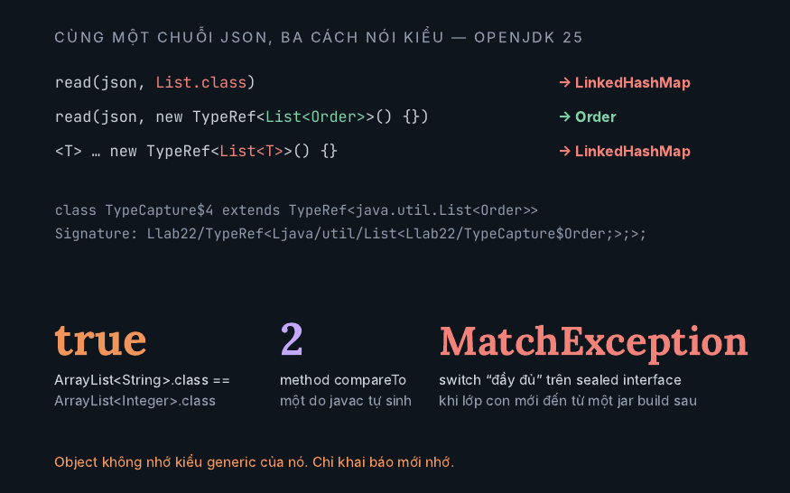
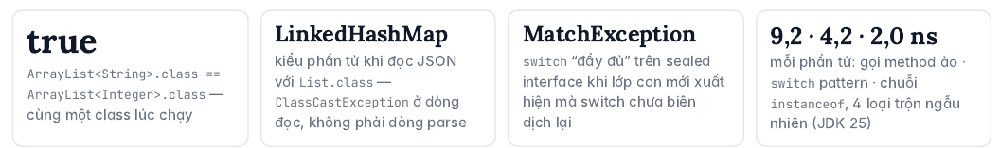
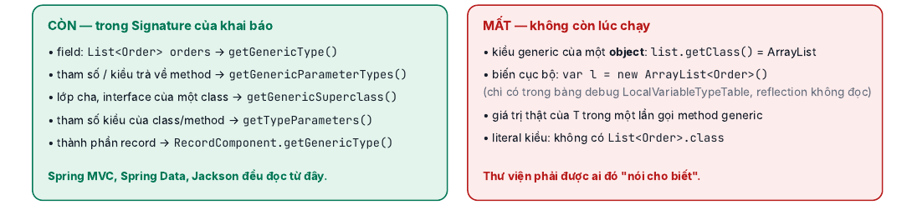
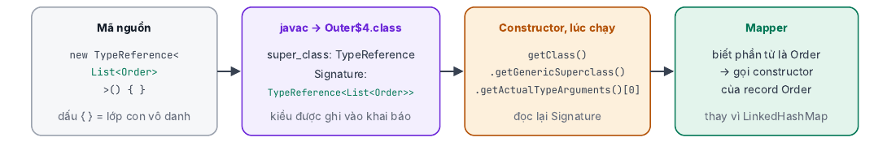
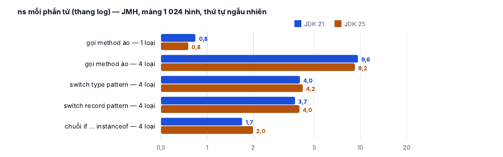

# Bài 22 — Generics, sealed, pattern matching



*Vì sao Jackson cần TypeReference?*

*Chặng V · Ngôn ngữ dưới lớp vỏ — erasure, Signature, bridge method, SwitchBootstraps · Nền tảng: JDK 25 LTS / 27 · Thí nghiệm chạy thật trên OpenJDK 21 · 25*

[Bài 21](21-invokedynamic.md) cho thấy lambda, nối chuỗi và record là một lệnh `invokedynamic`. Bài này đi tiếp vào những thứ Java viết cho trình biên dịch nhiều hơn cho JVM: generics, sealed, pattern matching. Câu hỏi xuyên suốt: **cái gì còn lại trong class file và lúc chạy**, cái gì đã biến mất sau `javac`?

> **VỀ CÁC CON SỐ VÀ CÔNG CỤ TRONG BÀI** — Mọi output lấy từ việc **chạy thật** trên OpenJDK 25.0.4 (đối chiếu 21.0.12), Linux x86-64, 2 vCPU. Bytecode xem bằng `javap -c -p -v`; hiệu năng đo bằng JMH 1.37. Môi trường thí nghiệm không tải được Jackson từ Maven Central, nên mục 5 dùng **một object mapper tối giản tự viết** (khoảng 50 dòng, có trong file đính kèm) cùng cơ chế với Jackson: dựng object theo `java.lang.reflect.Type` được truyền vào. Class `TypeReference` của Jackson được đọc từ mã nguồn jackson-core 2.18 trên GitHub. Cơ chế JDK đối chiếu với mã nguồn OpenJDK tag `jdk-21-ga` … `jdk-25+36`.
>
> *Mã nguồn lab nằm trong repo: sources/under-hood/src/bai22-generics-src.zip.*

Vì sao Jackson cần `TypeReference`? Câu trả lời ngắn: vì **object không mang kiểu generic của nó**. Lúc chạy, một `ArrayList<Order>` chỉ là `ArrayList`, và `List<Order>.class` không tồn tại. Kiểu generic chỉ còn sống ở một chỗ: attribute `Signature` của các **khai báo** — field, tham số method, kiểu trả về, và lớp cha của một class. `new TypeReference<List<Order>>() {}` tạo ra một lớp con vô danh, buộc javac ghi `List<Order>` vào lớp cha của nó, nơi Jackson đọc lại được bằng reflection.



*Bốn kết quả trên đều chạy thật trong bài.*

## 1 Vì sao một dev Spring Boot nên quan tâm

- **JSON**: `restClient.get()…body(new ParameterizedTypeReference<List<Order>>() {})`, `objectMapper.readValue(json, new TypeReference<…>() {})` — và lỗi kinh điển “`LinkedHashMap cannot be cast to Order`” xuất hiện cách xa chỗ gây ra nó.
- **Vì sao `@RequestBody List<Order>` trong controller lại chạy được** mà không cần `TypeReference` nào (mục 5).
- **Bridge method** làm reflection thấy hai method `compareTo`, hai method `handle` — và là lý do Spring có hẳn một class `BridgeMethodResolver`.
- **Sealed + pattern matching** đang thay dần visitor và chuỗi `instanceof` trong code nghiệp vụ Java 21+. Nó chạy thế nào, tốn gì, và hỏng ra sao khi các module được build lệch nhau.

## 2 Type erasure: generic biến đi đâu

Generics vào Java 5 (2004) với một ràng buộc: class file mới phải chạy được cùng thư viện cũ không có generic. Lời giải là **xoá kiểu** (erasure): javac kiểm tra kiểu đầy đủ lúc biên dịch, rồi trong bytecode thay mỗi biến kiểu bằng *cận trên* của nó (`T` → `Object`, `T extends Comparable<T>` → `Comparable`), và chèn lệnh `checkcast` ở chỗ một giá trị kiểu `T` được dùng như kiểu cụ thể. JVM không biết generic là gì.

```text
$ javap -v -p 'lab22.Erasure$Box'         # class Box<T extends Comparable<T>> { T value; T get(); void set(T v); }
  T value;
    descriptor: Ljava/lang/Comparable;              # JVM chỉ thấy Comparable
    Signature: #14                          // TT;  — chú thích cho javac và reflection
  T get();
    descriptor: ()Ljava/lang/Comparable;
  void set(T);
    descriptor: (Ljava/lang/Comparable;)V
```

Hệ quả đo được ngay (`Erasure.java`):

```text
$ java lab22.Erasure
ArrayList<String>.class == ArrayList<Integer>.class ? true
tham số kiểu của ArrayList: [E]
add(42) vào List<String>: không lỗi, size = 1                 # qua kiểu thô (List)s — chỉ có cảnh báo unchecked
Object o = s.get(0): không lỗi, o = 42
String x = s.get(0): ClassCastException: class java.lang.Integer cannot be cast to class java.lang.String
```

```text
$ javap -c lab22.Erasure        # main(), hai lần gọi s.get(0)
  74: invokeinterface List.add:(Ljava/lang/Object;)Z          # add(42): không kiểm tra gì
  99: invokeinterface List.get:(I)Ljava/lang/Object;          # Object o = s.get(0): không checkcast
 124: invokeinterface List.get:(I)Ljava/lang/Object;
 129: checkcast     class java/lang/String                     # String x = s.get(0): lỗi nổ ở ĐÂY
```

Đây là *heap pollution*: một `List<String>` chứa `Integer`. Lỗi không nổ ở chỗ đưa dữ liệu sai vào, mà ở chỗ **đọc ra và dùng như kiểu cụ thể** — có khi cách đó hàng chục method và vài thread. Ghi nhớ hình dạng này; mục 5 sẽ gặp lại y hệt với Jackson.

## 3 Signature: nơi generic còn sống

Erasure xoá kiểu khỏi *bytecode thực thi* và khỏi *object*, nhưng không xoá khỏi *khai báo*. Mỗi class, field và method có dùng generic mang thêm một attribute `Signature` (JVMS §4.7.9) — một chuỗi mô tả kiểu đầy đủ. JVM bỏ qua nó khi chạy; javac đọc nó khi biên dịch code khác dựa trên class này; và reflection trả nó ra qua các method `getGeneric…()`:

```text
$ javap -v -p lab22.Erasure
  java.util.List<lab22.Erasure$Order> orders;
    descriptor: Ljava/util/List;
    Signature: #141      // Ljava/util/List<Llab22/Erasure$Order;>;
  static void create(java.util.List<lab22.Erasure$Order>);
    descriptor: (Ljava/util/List;)V
    Signature: #145      // (Ljava/util/List<Llab22/Erasure$Order;>;)V
```

```text
$ java lab22.Erasure        # phần reflection
field orders:      getType() = java.util.List   getGenericType() = java.util.List<lab22.Erasure$Order>
param của create:  java.util.List<lab22.Erasure$Order>
kiểu trả về byUser: java.util.Map<java.lang.String, java.util.List<lab22.Erasure$Order>>
biến cục bộ new ArrayList<Order>(): getClass() = java.util.ArrayList, getGenericSuperclass() = java.util.AbstractList<E>
Box.value: getType() = java.lang.Comparable   getGenericType() = T
```



*Hình 22.1 — Ranh giới của erasure. Kiểu generic sống trong văn bản khai báo của class file, không sống trong object hay trong lần gọi method.*

## 4 Bridge method: cây cầu javac tự xây

Erasure tạo ra một vấn đề với override. `Comparable<T>` sau khi xoá kiểu có method `compareTo(Object)`; class `Name implements Comparable<Name>` viết `compareTo(Name)` — trong bytecode đó là *hai method khác chữ ký*, và gọi qua interface sẽ không tới được code của bạn. Javac vá bằng cách sinh thêm một method **bridge**:

```text
$ javap -c -p 'lab22.Bridge$Name'
  public int compareTo(java.lang.Object);       # ACC_BRIDGE | ACC_SYNTHETIC — javac tự sinh
     0: aload_0
     1: aload_1
     2: checkcast     class lab22/Bridge$Name
     5: invokevirtual Method compareTo:(Llab22/Bridge$Name;)I      # gọi sang method bạn viết
     8: ireturn
$ java lab22.Bridge
Name:
  public int Name.compareTo(java.lang.Object)    bridge=true  synthetic=true  @Audit=true
  public int Name.compareTo(Name)                bridge=false synthetic=false @Audit=true
Repo:                                            # String get() override Supplier<String>.get(): kiểu trả về hiệp biến
  public java.lang.Object Repo.get()             bridge=true  synthetic=true  @Audit=false
  public java.lang.String Repo.get()             bridge=false synthetic=false @Audit=false
ClassCastException: class java.lang.String cannot be cast to class lab22.Bridge$Name
  at lab22.Bridge$Name.compareTo(Bridge.java:12)        # dòng 12 = dòng khai báo class, vì bridge không có mã nguồn
  at lab22.Bridge.main(Bridge.java:29)
```

Ba điều đáng nhớ. **Reflection thấy hai method** cùng tên — `getDeclaredMethods()` trả cả bridge; code duyệt method để tìm annotation phải lọc `isBridge()`. **Javac 25 chép annotation sang bridge** (`@Audit=true` ở cả hai), nên lọc sai sẽ xử lý một method hai lần. Đây chính là việc của `org.springframework.core.BridgeMethodResolver`: từ một bridge, tìm về method thật để đọc annotation như `@Transactional`, `@EventListener`. **Stack trace có frame “ma”**: `ClassCastException` ở dòng khai báo class là dấu hiệu đã đi qua một bridge với đối số sai kiểu — thường do heap pollution ở đâu đó trước đó.

## 5 Trả lời câu hỏi: vì sao Jackson cần TypeReference

Một object mapper nhận chuỗi JSON và một mô tả kiểu, rồi dựng object theo mô tả đó. Với `readValue(json, Order.class)` thì đủ: `Class` nói hết. Với một danh sách, thứ cần truyền là `List<Order>` — mà Java không có cách viết nó thành giá trị: `List<Order>.class` không biên dịch được, và `new ArrayList<Order>().getClass()` chỉ là `ArrayList` (mục 3). Chỉ còn một chỗ có thể chứa nó: **Signature của lớp cha**. Đó là toàn bộ `TypeReference` của Jackson — phần cốt lõi, theo mã nguồn jackson-core 2.18:

```java
public abstract class TypeReference<T> implements Comparable<TypeReference<T>> {
    protected final Type _type;
    protected TypeReference() {
        Type superClass = getClass().getGenericSuperclass();      // đọc Signature của LỚP CON vô danh
        if (superClass instanceof Class<?>) throw new IllegalArgumentException(…);
        _type = ((ParameterizedType) superClass).getActualTypeArguments()[0];
    }
}
// abstract + constructor protected: chỉ tạo được bằng new TypeReference<X>() {} — một lớp con có kiểu cụ thể
```

```text
$ javap -v 'lab22.TypeCapture$4'          # new TypeRef<List<Order>>() {} — lớp con vô danh javac sinh ra
class lab22.TypeCapture$4 extends lab22.TypeRef<java.util.List<lab22.TypeCapture$Order>>
  super_class: #2                         // lab22/TypeRef
Signature: #12                            // Llab22/TypeRef<Ljava/util/List<Llab22/TypeCapture$Order;>;>;
```



*Hình 22.2 — “Super type token”: biến một kiểu thành một khai báo ngay tại chỗ gọi, để reflection đọc lại được.*

Chạy mapper tối giản (cùng cơ chế với Jackson, xem ghi chú đầu bài) qua năm cách truyền kiểu:

```text
$ java lab22.TypeCapture
read(json, List.class)                     phần tử[0] là java.util.LinkedHashMap
                                           l.get(0).id() → ClassCastException: class java.util.LinkedHashMap
                                           cannot be cast to class lab22.TypeCapture$Order
new TypeRef<List<Order>>(){}: class lab22.TypeCapture$4
   getGenericSuperclass() = lab22.TypeRef<java.util.List<lab22.TypeCapture$Order>>
read(json, new TypeRef<List<Order>>(){})   phần tử[0] là lab22.TypeCapture$Order      l.get(0).id() = 1
TypeRef<List<T>> trong method generic: type = java.util.List<T>
readList<Order>(json)                      phần tử[0] là java.util.LinkedHashMap   l.get(0).id() → ClassCastException
readList(json, Order.class)                phần tử[0] là lab22.TypeCapture$Order      l.get(0).id() = 1
create(List<Order> body): getGenericParameterTypes()[0] = java.util.List<lab22.TypeCapture$Order>
read(json, <kiểu tham số của create>)      phần tử[0] là lab22.TypeCapture$Order      l.get(0).id() = 1
```

| Cách truyền kiểu | Mapper thấy | Kết quả |
|---|---|---|
| `List.class` | `List` thô | không biết phần tử là gì → giữ nguyên cấu trúc JSON: `LinkedHashMap`. Lỗi nổ **lúc đọc phần tử**, như heap pollution ở mục 2. |
| `new TypeReference<List<Order>>() {}` | `List<Order>` | đúng — kiểu nằm trong Signature của lớp con vô danh. |
| `new TypeReference<List<T>>() {}` bên trong `<T> List<T> read(…)` | `List<T>` — `T` là một `TypeVariable` | **bẫy**: Signature ghi chữ “T”, không ghi `Order`; mỗi lần gọi đều dùng cùng một class vô danh. Mapper đành dùng cận trên `Object` → `LinkedHashMap`. |
| Truyền `Class<T>` rồi tự dựng kiểu | `List<Order>` | đúng. Với Jackson: `mapper.getTypeFactory().constructCollectionType(List.class, el)`. |
| Kiểu tham số của một method (`@RequestBody List<Order>`) | `List<Order>` | đúng, không cần `TypeReference` — Spring MVC đọc `getGenericParameterTypes()` của method controller. |

Vậy câu trả lời đầy đủ: Jackson cần `TypeReference` vì **giá trị và biểu thức không mang kiểu generic, chỉ khai báo mới mang**. Lớp con vô danh là mẹo rẻ nhất để biến một kiểu thành một *khai báo* ngay tại chỗ gọi. Mỗi `new TypeReference<…>() {}` trong mã nguồn là một class `Outer$N.class` thật trên đĩa — nhỏ, nạp một lần — và nó chỉ hữu ích khi kiểu bên trong là kiểu cụ thể.

## 6 Record và sealed trong class file

Hai tính năng này để lại dấu vết dạng **attribute** mới trong class file — thông tin cho javac (khi biên dịch code dùng chúng) và cho reflection, không làm thay đổi cách JVM chạy method:

```text
$ javap -v geo.Shape            # sealed interface Shape permits Circle, Square, Rect {}
PermittedSubclasses:
  geo/Circle
  geo/Square
  geo/Rect
$ javap -v geo.Rect             # record Rect(double w, double h) implements Shape {}
Record:
  double w;
    descriptor: D
  double h;
    descriptor: D
```

Attribute `Record` (JDK 16) liệt kê các thành phần theo đúng thứ tự khai báo, kèm Signature nếu chúng là generic — `Class.getRecordComponents()` đọc từ đây, và đây là cách Jackson (từ 2.12) tìm canonical constructor của record mà không cần `@JsonCreator`. Attribute `PermittedSubclasses` (JDK 17, JEP 409) được JVM **kiểm tra lúc nạp class**. Thử biên dịch `Hexagon implements Shape` với một bản `Shape` không sealed, rồi chạy cùng bản sealed:

```text
$ java -cp lib1:lib3:app3 app.Main3
Exception in thread "main" java.lang.IncompatibleClassChangeError: Failed listed permitted subclass check:
    class geo.Hexagon is not a permitted subclass of geo.Shape
        at java.base/java.lang.ClassLoader.defineClass1(Native Method)
```

Đó là phần “sealed” được JVM bảo đảm. Phần còn lại — `switch` không cần `default` — chỉ là lời hứa của javac, và mục 8 sẽ cho thấy nó có thể bị phá.

## 7 switch trên pattern: SwitchBootstraps

`switch` cổ điển chỉ nhận `int`, `String`, enum — vì bytecode có sẵn `tableswitch` / `lookupswitch` trên số nguyên. Switch theo *kiểu* thì cần một bước dịch “object này khớp case thứ mấy?”. Java 21 giao bước đó cho… một lệnh `invokedynamic` nữa:

```java
static double of(Shape s) {
    return switch (s) {
        case Circle c                 -> Math.PI * c.r() * c.r();
        case Square q                 -> q.side() * q.side();
        case Rect(double w, double h)  -> w * h;               // record pattern
    };                                                          // không có default
}
```

```text
$ javap -c -p -v geo.Area           # javac 25
  11: invokedynamic #13, 0     // InvokeDynamic #0:typeSwitch:(Lgeo/Shape;I)I   # (object, chỉ số bắt đầu) → số thứ tự case
  16: tableswitch   { 0: 54   1: 75   2: 95   default: 44 }
  44: new           class java/lang/MatchException             # default javac TỰ THÊM
  53: athrow
  55: checkcast     class geo/Circle                           # case 0: ép kiểu rồi dùng
  96: checkcast     class geo/Rect                             # case 2: tháo record bằng accessor
 103: invokevirtual Method geo/Rect.w:()D
 122: invokevirtual Method geo/Rect.h:()D
 142: iconst_3
 143: istore_2
 144: goto          9                                          # pattern lồng không khớp: thử lại từ case 3
 157: new           class java/lang/MatchException             # accessor ném lỗi → bọc lại
  Exception table:   103–106 → 156 Throwable    122–125 → 156 Throwable
BootstrapMethods:
  0: REF_invokeStatic java/lang/runtime/SwitchBootstraps.typeSwitch
     Method arguments: geo/Circle  geo/Square  geo/Rect
```

Bootstrap nhận danh sách nhãn (`Circle, Square, Rect`) và trả về một hàm “cho object và chỉ số bắt đầu, trả số thứ tự case đầu tiên khớp”. Javac giữ phần còn lại: `tableswitch` nhảy tới thân case, `checkcast` rồi gọi accessor để tháo record, và hai nhánh ném `MatchException` — một cho trường hợp không khớp gì (offset 44), một bọc exception từ accessor (offset 157). Thử nhánh thứ hai với một accessor kiểm tra dữ liệu:

```text
$ java lab22.AccessorThrows        # record Money(long cents) { public long cents() { if (cents < 0) throw … } }
nhỏ
java.lang.MatchException: java.lang.IllegalStateException: âm: -1
  cause: java.lang.IllegalStateException: âm: -1
```

Bootstrap ở JDK 21 và JDK 25 làm cùng việc theo hai cách — đọc trong mã nguồn `SwitchBootstraps.java`: JDK 21 ghép một chuỗi `MethodHandles.guardWithTest`; từ JDK 22 nó **sinh bytecode** một hidden class `…$$TypeSwitch` cho mỗi call site. Đếm bằng `-Xlog:class+load` trên 200 câu `switch` 4 nhánh, mỗi câu chạy một lần:

| 200 call site, lần chạy đầu (trung vị 9 JVM) | thời gian | `$$TypeSwitch` | LambdaForm sinh ra |
|---|---:|---:|---:|
| JDK 21 — `switch` pattern | 106,7 ms | 0 | 49 |
| JDK 25 — `switch` pattern | 99,3 ms | **200** | 1 |
| JDK 21 / 25 — chuỗi `if … instanceof` tương đương | 5,4 / 7,5 ms | 0 | 1 |

Khoảng 0,5 ms mỗi câu `switch` ở lần đầu, giống bậc chi phí của lambda ở [Bài 21](21-invokedynamic.md) — và cũng trả một lần. Sau khi JIT xong, câu hỏi là tốc độ. JMH, mảng 1 024 hình, một loại (đơn hình) hoặc trộn ngẫu nhiên bốn loại:

| ns cho 1 024 phần tử (JMH, 2 fork × 5) | JDK 21 · 1 loại | JDK 21 · 4 loại | JDK 25 · 1 loại | JDK 25 · 4 loại |
|---|---:|---:|---:|---:|
| gọi method ảo `s.area()` | 857 | 9 847 | 771 | 9 391 |
| `switch` type pattern | 881 | 4 118 | 879 | 4 297 |
| `switch` record pattern | 946 | 3 827 | 879 | 4 089 |
| chuỗi `if … instanceof` | 873 | 1 730 | 819 | 2 035 |



*Hình 22.3 — Cùng số liệu với bảng trên, quy ra mỗi phần tử. Một loại: mọi cách đều khoảng 0,8 ns. Bốn loại trộn ngẫu nhiên: lời gọi ảo megamorphic chậm nhất.*

Khi chỉ có một loại, cả bốn cách như nhau (khoảng 0,8 ns mỗi phần tử): JIT thấy một kiểu duy nhất và inline hết. Khi trộn bốn loại theo thứ tự ngẫu nhiên, lời gọi ảo thành *megamorphic* — không inline được, đi qua bảng itable ([Bài 06](06-interpreter-goi-method.md)) — chậm nhất, khoảng 9 ns mỗi phần tử. `switch` pattern nhanh hơn gấp đôi lời gọi ảo, nhưng trong phép đo này vẫn chậm hơn chuỗi `instanceof` viết tay khoảng hai lần; chúng tôi chưa mổ mã máy để biết vì sao, và độ lệch chuẩn ở mức ±15%. Điều rút ra: chọn `switch` pattern vì nó an toàn và rõ ràng (javac kiểm tra đủ case), không phải vì tốc độ; và đừng thay một lời gọi ảo đơn hình bằng switch với kỳ vọng nhanh hơn.

## 8 Biên dịch tách rời: MatchException

`switch` ở mục 7 không có `default` vì javac chứng minh được ba case là đủ — *tại thời điểm biên dịch*. Nhưng ứng dụng thật gồm nhiều jar build vào những lúc khác nhau. Thử đúng kịch bản đó: thêm `Triangle` vào `permits`, biên dịch lại phân cấp `Shape`, nhưng giữ nguyên `Area.class` cũ (như một thư viện chưa được nâng cấp):

```text
$ javac -d lib2 v2/*.java            # Shape permits Circle, Square, Rect, Triangle
$ cp lib1/geo/Area.class lib2/geo/    # switch biên dịch khi chỉ có 3 lớp con
$ java -cp lib2:app app.Main
Rect(2,3)     → 6.0
Exception in thread "main" java.lang.MatchException
        at geo.Area.of(Area.java:5)
        at app.Main.main(Main.java:6)
```

Đây chính là nhánh `default` mà javac lặng lẽ thêm vào ở offset 44 (mục 7). Từ JDK 21 (JEP 441), cùng tình huống với `switch` trên enum cũng ném `MatchException` thay vì `IncompatibleClassChangeError` như trước. Không có cảnh báo nào lúc build hay lúc khởi động: lỗi chỉ hiện khi một giá trị kiểu mới thực sự đi tới switch cũ. Bài học thực tế: **sealed hierarchy và mọi switch trên nó nên được build cùng nhau** (cùng module hoặc cùng phiên bản phát hành); nếu phải chia sẻ qua thư viện cho đội khác, thêm `default` rõ ràng hoặc một case cuối cho “loại chưa biết” thay vì dựa vào tính đầy đủ.

## 9 Trong Spring Boot

> **SPRING BOOT · KIỂU GENERIC ĐI QUA ĐÂU**
>
> 1. **Gọi HTTP**: `restClient.get().uri("/orders").retrieve().body(new ParameterizedTypeReference<List<Order>>() {})` — `ParameterizedTypeReference` là `TypeReference` của Spring, cùng mẹo lớp con vô danh. `RestTemplate.exchange(…)` và `WebClient…bodyToMono(…)` nhận cùng kiểu.
> 2. **Helper generic** kiểu `<T> List<T> getList(String url)` không được tạo `new ParameterizedTypeReference<List<T>>() {}` bên trong (mục 5). Nhận `Class<T>` và dựng kiểu: `ParameterizedTypeReference.forType(ResolvableType.forClassWithGenerics(List.class, el).getType())`.
> 3. **Controller**: `@RequestBody List<Order>` chạy được vì kiểu nằm trong Signature của method. Controller cha generic `AbstractCrud<T>` với `create(@RequestBody T)` cũng chạy, *miễn là* lớp con khai báo kiểu cụ thể (`OrderController extends AbstractCrud<Order>`) — Spring đọc `getGenericSuperclass()`, đúng mẹo của `TypeReference`. Spring Data đọc `JpaRepository<Order, Long>` theo cùng cách.
> 4. **Cache, Redis, Kafka**: dữ liệu ghi xuống không mang kiểu generic, nên serializer JSON “chung” phải tự ghi kiểu vào dữ liệu — thuộc tính `@class` của `GenericJackson2JsonRedisSerializer`, header kiểu của `JsonDeserializer` trong Spring Kafka. Đổi tên/đổi package class là làm hỏng dữ liệu cũ.
> 5. **Reflection tự viết** (AOP, quét annotation): lọc `Method.isBridge()` hoặc dùng `BridgeMethodResolver.findBridgedMethod`, nếu không sẽ xử lý một method hai lần.

> **THAY ĐỔI THEO PHIÊN BẢN CẦN BIẾT**
>
> - **JDK 5**: generics, erasure, attribute `Signature`, bridge method.
> - **JDK 16**: record chính thức (JEP 395), attribute `Record`. **JDK 17**: sealed (JEP 409), attribute `PermittedSubclasses`.
> - **JDK 21**: pattern matching cho `switch` (JEP 441) và record pattern (JEP 440) chính thức; `MatchException`; `SwitchBootstraps.typeSwitch` ghép bằng MethodHandle combinator.
> - **JDK 22**: `SwitchBootstraps` sinh bytecode thành hidden class `…$$TypeSwitch` (đọc trong mã nguồn tag `jdk-22-ga`); biến không tên `_` (JEP 456).
> - **JDK 23 – 25**: kiểu nguyên thuỷ trong pattern, `instanceof`, `switch` — vẫn là preview (JEP 455, 488, 507).

## 10 Ghép lại: một trang để nhớ cả bài

| Tính năng | Trong class file | Lúc chạy | Cái bẫy |
|---|---|---|---|
| Generics | descriptor đã xoá kiểu + `Signature` trên khai báo; `checkcast` ở chỗ dùng | object không mang kiểu generic | heap pollution; lỗi nổ ở chỗ đọc |
| Override generic | bridge method `ACC_BRIDGE`, có `checkcast` | reflection thấy 2 method | annotation bị xử lý hai lần |
| `TypeReference` | lớp con vô danh, Signature của lớp cha | `getGenericSuperclass()` | `TypeReference<List<T>>` trong method generic |
| Record | attribute `Record`; `toString/equals/hashCode` qua indy ([Bài 21](21-invokedynamic.md)) | `getRecordComponents()` | — |
| Sealed | attribute `PermittedSubclasses` | JVM từ chối lớp con lạ lúc nạp | switch “đủ” chỉ đủ lúc biên dịch |
| `switch` pattern | indy `typeSwitch` + `tableswitch` + `default` ném `MatchException` | JDK 22+: hidden class `$$TypeSwitch` | `MatchException` khi build lệch |

## 11 Hiểu lầm thường gặp, bài tập, bài tiếp theo

### Hiểu lầm thường gặp

| Hiểu lầm | Thực tế |
|---|---|
| “Erasure xoá sạch generic khỏi class file.” | Chỉ xoá khỏi descriptor và bytecode thực thi. Khai báo vẫn mang `Signature`; reflection đọc được. |
| “`List<String>` không bao giờ chứa được `Integer`.” | Chứa được qua kiểu thô hoặc cast unchecked; lỗi nổ muộn ở `checkcast` chỗ đọc. |
| “`TypeReference` là phép thuật của Jackson.” | Ba dòng reflection trên `getGenericSuperclass()` của một lớp con vô danh. |
| “Bọc `TypeReference` vào method generic là xong.” | `T` không được thay bằng kiểu thật; kết quả là `LinkedHashMap`. |
| “Switch đầy đủ trên sealed không bao giờ rơi vào default.” | Rơi khi lớp con mới xuất hiện mà switch chưa biên dịch lại → `MatchException`. |
| “Pattern matching chậm hơn gọi method ảo.” | Một loại: như nhau. Bốn loại trộn: `switch` nhanh gấp đôi lời gọi ảo megamorphic, nhưng chậm hơn chuỗi `instanceof` khoảng hai lần (mục 7). |

### Bài tập tự làm (khoảng 45 phút)

> **THỰC HÀNH**
>
> 1. **Tìm bẫy `TypeReference`**: grep `TypeReference<` và `ParameterizedTypeReference<` trong code; cái nào nằm trong method có `<T>`?
> 2. **Đọc Signature**: `javap -v` một controller và một repository của bạn; tìm `Signature:` của method và của interface cha.
> 3. **Bridge**: in `getDeclaredMethods()` của một class implement interface generic (một `Converter<S,T>`, một `ApplicationListener<E>`); đếm method `isBridge()`.
> 4. **Build lệch**: chạy lại thí nghiệm `sealed/` trong file đính kèm; thêm một `case` “không biết” và so sánh.

### Thuật ngữ của bài

| Thuật ngữ | Nghĩa ngắn gọn |
|---|---|
| Type erasure | javac thay biến kiểu bằng cận trên của nó trong bytecode; JVM không biết generic. |
| Descriptor | Chữ ký đã xoá kiểu mà JVM dùng để liên kết, ví dụ `(Ljava/util/List;)V`. |
| Attribute `Signature` | Chuỗi kiểu generic đầy đủ gắn với class, field, method. |
| Heap pollution | Biến kiểu generic trỏ tới object sai kiểu, chưa bị phát hiện. |
| Bridge method | Method tổng hợp javac sinh để override vẫn đúng sau khi xoá kiểu. |
| Super type token | Mẹo lớp con vô danh để giữ một kiểu generic — tên gọi chung của `TypeReference`. |
| `PermittedSubclasses` | Danh sách lớp con được phép của một class sealed; JVM kiểm tra khi nạp. |
| `MatchException` | Ném khi switch đầy đủ không khớp case nào lúc chạy, hoặc accessor ném lỗi khi tháo record. |

> **BÀI TIẾP THEO · BÀI 23** — **Reflection, MethodHandle, Proxy — cách Spring “làm phép”.** JDK dynamic proxy và CGLIB, sinh bytecode lúc chạy, Spring AOT processing. Câu hỏi của bài: *Gọi một method `@Transactional` từ chính class đó thì chuyện gì xảy ra trong bytecode?*

### Tài liệu tham khảo

- JVMS §4.7.9 (Signature), §4.7.30 (Record), §4.7.31 (PermittedSubclasses); JLS §4.6 (Type Erasure). docs.oracle.com/javase/specs
- JEP 395 (Records), JEP 409 (Sealed Classes), JEP 440 (Record Patterns), JEP 441 (Pattern Matching for switch), JEP 507 (Primitive Types in Patterns, Third Preview). openjdk.org/jeps
- Mã nguồn OpenJDK tag jdk-21-ga, jdk-22-ga, jdk-25+36: `java/lang/runtime/SwitchBootstraps.java`. github.com/openjdk/jdk
- jackson-core 2.18: `com/fasterxml/jackson/core/type/TypeReference.java`. github.com/FasterXML/jackson-core
- Neal Gafter — “Super Type Tokens” (2006). Spring Framework Javadoc: `ParameterizedTypeReference`, `ResolvableType`, `BridgeMethodResolver`.
