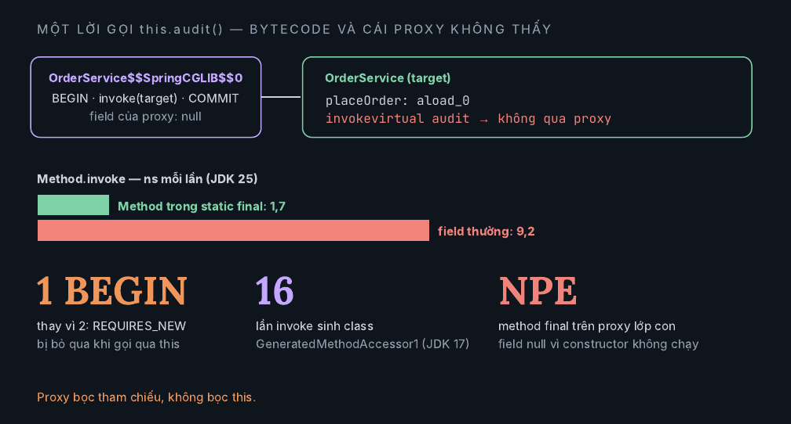
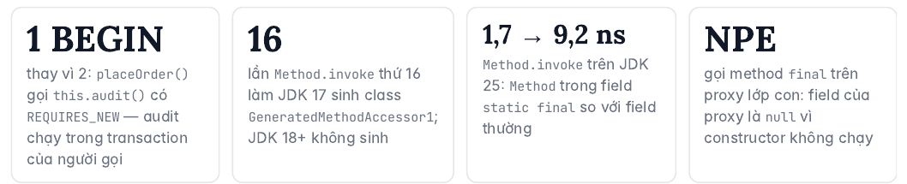
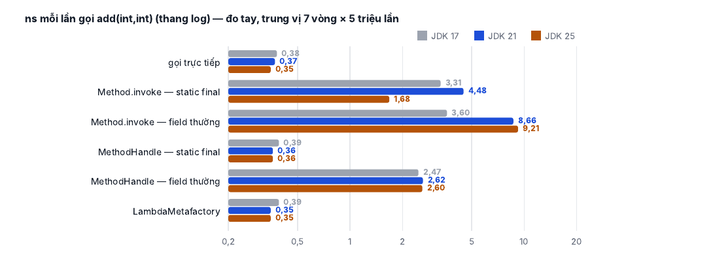
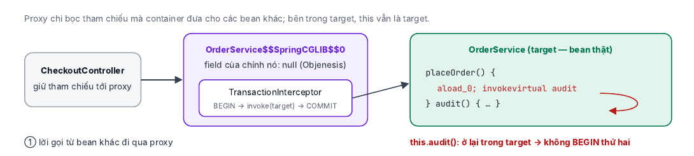

# Bài 23 — Reflection, MethodHandle, Proxy



*Gọi @Transactional từ chính class đó thì sao?*

*Chặng V · Ngôn ngữ dưới lớp vỏ — JEP 416, JDK proxy, CGLIB, Objenesis, @Configuration · Nền tảng: JDK 25 LTS / 27 · Thí nghiệm chạy thật trên OpenJDK 17 · 21 · 25*

Hai bài trước đọc những gì javac sinh ra. Bài này đọc những gì **framework sinh ra lúc chạy**: class proxy không có trong mã nguồn, method được gọi qua reflection, bytecode dựng ngay trong bộ nhớ. Đó là toàn bộ “phép thuật” của `@Transactional`, `@Cacheable`, `@Async` — và cũng là lý do chúng đôi khi lặng lẽ không chạy.

> **VỀ CÁC CON SỐ VÀ CÔNG CỤ TRONG BÀI** — Mọi output lấy từ việc **chạy thật** trên OpenJDK 17.0.20, 21.0.12 và 25.0.4, Linux x86-64, 2 vCPU. Môi trường thí nghiệm không tải được Spring từ Maven Central, nên bài **dựng lại đúng cơ chế bằng JDK thuần**: JDK dynamic proxy thật; một bộ sinh proxy lớp con kiểu CGLIB tự viết (`MiniCglib`, khoảng 100 dòng, dùng ClassFile API của JDK 24+) tạo instance không qua constructor như Objenesis; một `TxInterceptor` tối giản in BEGIN/COMMIT. Mỗi chi tiết của Spring được đối chiếu với mã nguồn Spring Framework nhánh `6.2.x` và Spring Boot `3.5.x` trên GitHub, trích dẫn tại chỗ. Số đo tốc độ là đo tay (chạy được cả trên JDK 17), trung vị 7 vòng.

*Mã nguồn lab nằm trong repo: sources/under-hood/src/bai23-proxy-src.zip.*

Gọi một method `@Transactional` từ chính class đó thì chuyện gì xảy ra trong bytecode? Câu trả lời ngắn: **không có gì đặc biệt cả** — và đó chính là vấn đề. `this.audit()` được javac dịch thành `aload_0; invokevirtual audit`, và `this` lúc đó là **object thật** của bạn, không phải proxy mà Spring đưa cho các bean khác. Lời gọi đi thẳng vào method, không qua interceptor nào, nên `REQUIRES_NEW`, `@Cacheable`, `@Async` trên method được gọi đều bị bỏ qua — không lỗi, không cảnh báo.



*Bốn kết quả trên đều chạy thật trong bài.*

## 1 Vì sao một dev Spring Boot nên quan tâm

- **Annotation “không ăn”**: `@Transactional(propagation = REQUIRES_NEW)`, `@Cacheable`, `@Async`, `@Retryable` trên một method được gọi từ cùng class — lỗi kinh điển nhất của Spring, và bytecode giải thích nó trong hai lệnh.
- **Stack trace** đầy `$$SpringCGLIB$$0`, `CglibAopProxy$DynamicAdvisedInterceptor`, `DirectMethodHandleAccessor`, `jdk.proxy2.$Proxy87`. Biết mỗi frame là gì giúp đọc nhanh hơn rất nhiều.
- **NullPointerException “không thể xảy ra”** trên một field được gán trong constructor — khi method là `final` và object là proxy.
- **Hiệu năng**: mỗi lời gọi qua proxy có giá, mỗi framework dùng reflection có giá; JDK 18 đã đổi hẳn cách reflection chạy, và cách bạn giữ `Method` quyết định nó nhanh hay chậm.

## 2 Method.invoke bên trong

Spring gọi method của bạn bằng reflection ở rất nhiều chỗ: handler của controller, `@EventListener`, `@Scheduled`, và — quan trọng cho bài này — mọi lời gọi xuyên qua proxy AOP. Trong Spring 6.2, bước cuối cùng của chuỗi interceptor là `AopUtils.invokeJoinpointUsingReflection(target, method, args)`, tức là `method.invoke(target, args)`. Bên dưới `Method.invoke` là gì thì phụ thuộc phiên bản JDK. Gọi cùng một `Method` 21 lần, bật `-Xlog:class+load`:

```text
$ java -Xlog:class+load lab23.Reflect          # JDK 17
-- lần gọi Method.invoke thứ 15
-- lần gọi Method.invoke thứ 16
  [class+load] jdk.internal.reflect.MethodAccessorGenerator source: jrt:/java.base
  [class+load] jdk.internal.reflect.GeneratedMethodAccessor1 source: __ClassDefiner__
-- lần gọi Method.invoke thứ 17
-- stack trace bên trong method được gọi qua reflection:
    at lab23.Reflect.add(Reflect.java:9)
    at jdk.internal.reflect.GeneratedMethodAccessor1.invoke(Unknown Source)
    at java.base/jdk.internal.reflect.DelegatingMethodAccessorImpl.invoke(DelegatingMethodAccessorImpl.java:43)
    at java.base/java.lang.reflect.Method.invoke(Method.java:569)
$ java -Xlog:class+load lab23.Reflect          # JDK 21 và 25: không có class nào được sinh
    at lab23.Reflect.add(Reflect.java:9)
    at java.base/jdk.internal.reflect.DirectMethodHandleAccessor.invoke(DirectMethodHandleAccessor.java:104)
    at java.base/java.lang.reflect.Method.invoke(Method.java:565)
```

JDK 17 dùng cơ chế cũ (từ Java 1.4): 15 lần đầu gọi qua code native trong JVM, đến lần thứ 16 — đúng ngưỡng `sun.reflect.inflationThreshold = 15` trong mã nguồn `ReflectionFactory` — nó **sinh bytecode** của một class `GeneratedMethodAccessorN` cho riêng method đó (“inflation”). Một ứng dụng Spring lớn có hàng nghìn class như vậy trong Metaspace. JEP 416 (JDK 18) viết lại toàn bộ trên nền `MethodHandle`: không sinh class, accessor là `DirectMethodHandleAccessor`. JDK 18–21 còn giữ đường lui `-Djdk.reflect.useDirectMethodHandle=false`; từ JDK 22, mã nguồn không còn bản cũ (`MethodAccessorGenerator` đã bị xoá).

## 3 MethodHandle và cái giá của hằng số

[Bài 21](21-invokedynamic.md) đã cho thấy JIT inline được xuyên qua một `MethodHandle` khi nó là **hằng số**. Reflection mới đứng trên `MethodHandle`, nên nó thừa hưởng cả ưu và nhược điểm đó. Đo sáu cách gọi cùng method `int add(int, int)`:



*Hình 23.1 — “static final”: object `Method` / `MethodHandle` nằm trong field `static final`, JIT coi là hằng số. “field thường”: cùng object nhưng trong field có thể đổi. Lần chạy thứ hai cho cùng xu hướng (JDK 25, field thường: 11,0 ns).*

| ns / lần · byte / lần | JDK 17 | JDK 21 | JDK 25 |
|---|---|---|---|
| gọi trực tiếp | 0,38 · 0 | 0,37 · 0 | 0,35 · 0 |
| `Method.invoke`, `Method` là `static final` | 3,31 · 16 | 4,48 · 16 | 1,68 · 0 |
| `Method.invoke`, `Method` trong field thường | 3,60 · 16 | 8,66 · 32 | 9,21 · 32 |
| `MethodHandle.invokeExact`, `static final` | 0,39 · 0 | 0,36 · 0 | 0,36 · 0 |
| `MethodHandle.invokeExact`, field thường | 2,47 · 0 | 2,62 · 0 | 2,60 · 0 |
| Interface sinh bằng `LambdaMetafactory` | 0,39 · 0 | 0,35 · 0 | 0,35 · 0 |

Ba điều đọc ra. **Một**, `MethodHandle` hằng số và interface sinh bằng `LambdaMetafactory` nhanh ngang gọi trực tiếp — JIT inline xuyên qua hết. Đây là cách framework hiện đại gọi code của bạn khi cần tốc độ. **Hai**, `Method.invoke` luôn tốn hơn: phải đóng gói đối số vào `Object[]`, boxing `int`, kiểm tra quyền truy cập và kiểu lúc chạy. **Ba**, reflection mới **nhạy với tính hằng số**: `Method` trong field `static final` trên JDK 25 nhanh gấp đôi JDK 17 và không cấp phát gì, nhưng `Method` trong field thường thì chậm hơn JDK 17 hơn hai lần. JEP 416 nói thẳng điều này: microbenchmark với `Method` không phải hằng số “cho thấy suy giảm hiệu năng”, và khuyên giữ chúng trong field `static final`. Mục 5 sẽ gặp lại hiện tượng này trong proxy.

## 4 JDK dynamic proxy: một class sinh lúc chạy

`java.lang.reflect.Proxy` (Java 1.3) tạo lúc chạy một class implement các interface bạn đưa, mà mọi method đều chuyển về một `InvocationHandler`. Bật `-Djdk.proxy.ProxyGenerator.saveGeneratedFiles=true` để JDK ghi class ra đĩa, rồi `javap`:

```text
$ javap -p jdk/proxy1/$Proxy0.class
public final class jdk.proxy1.$Proxy0 extends java.lang.reflect.Proxy implements lab23.app.OrderApi {
  private static final java.lang.reflect.Method m0;          # hashCode
  private static final java.lang.reflect.Method m1;          # equals
  private static final java.lang.reflect.Method m2;          # toString
  private static final java.lang.reflect.Method m3;          # placeOrder
  private static final java.lang.reflect.Method m4;          # audit
  public final java.lang.String placeOrder(java.lang.String);
  …
$ javap -c -p jdk/proxy1/$Proxy0.class         # thân placeOrder
   0: aload_0
   1: getfield      java/lang/reflect/Proxy.h:Ljava/lang/reflect/InvocationHandler;
   4: aload_0                                                 # proxy
   5: getstatic     m3:Ljava/lang/reflect/Method;                # Method hằng số
   8: iconst_1
   9: anewarray     class java/lang/Object                    # đóng gói đối số
  14: aload_1
  15: aastore
  16: invokeinterface InvocationHandler.invoke:(Object;Method;[Object;)Object;   # kiểu rút gọn
  21: checkcast     class java/lang/String
  24: areturn
```

Ba chi tiết đáng nhớ. Class tên `$ProxyN`, nằm trong một module động `jdk.proxyN` — tên bạn thấy trong stack trace. Nó `extends Proxy`, nên **không thể là lớp con của class của bạn**: `proxy instanceof OrderService` là `false`, và inject theo kiểu class thay vì interface sẽ hỏng. Và `Method` được giữ trong field `static final` — đúng điều mục 3 khuyên — nên lời gọi `method.invoke(target, args)` trong handler được JIT coi là hằng số sau khi inline.

## 5 Proxy lớp con: cách của CGLIB

Khi bean không có interface — hoặc khi được yêu cầu — Spring tạo proxy bằng cách **sinh một lớp con** của class bạn (thư viện CGLIB, được Spring đóng gói lại trong `org.springframework.cglib`). Logic chọn nằm trong `DefaultAopProxyFactory` (Spring 6.2):

```java
if (config.isOptimize() || config.isProxyTargetClass() || !config.hasUserSuppliedInterfaces()) {
    if (targetClass.isInterface() || Proxy.isProxyClass(targetClass)
            || ClassUtils.isLambdaClass(targetClass))
        return new JdkDynamicAopProxy(config);
    return new ObjenesisCglibAopProxy(config);
}
return new JdkDynamicAopProxy(config);
```

Và Spring Boot bật `proxyTargetClass` mặc định: `AopAutoConfiguration` chọn `@EnableAspectJAutoProxy(proxyTargetClass = true)` khi `spring.aop.proxy-target-class` không được đặt (`matchIfMissing = true`). Nghĩa là trong một ứng dụng Spring Boot, **gần như mọi bean có `@Transactional` là proxy lớp con**, kể cả khi nó implement interface. Tên class mang nhãn `$$SpringCGLIB$$` (hằng `SPRING_LABEL` trong `SpringNamingPolicy`), ví dụ `OrderService$$SpringCGLIB$$0`.

Để thấy bên trong mà không cần Spring, `MiniCglib` sinh lớp con theo cùng hình dạng: ghi đè mọi method `public` không `final`, giữ mỗi `Method` gốc trong một field `static final` (như CGLIB), chuyển lời gọi tới một interceptor:

```text
$ javap -c -p 'lab23.app.OrderService$$MiniCGLIB$$0'
  private static final java.lang.reflect.Method $m1;        # tra một lần trong static {}
  public java.lang.String placeOrder(java.lang.String);
     0: aload_0
     1: getfield      $cb:Llab23/proxy/Interceptor;
     4: aload_0
     5: getstatic     $m1:Ljava/lang/reflect/Method;
     8: iconst_1                                                # chỉ số method
     9: iconst_1
    10: anewarray     class java/lang/Object
    15: aload_1
    16: aastore
    17: invokeinterface Interceptor.intercept:(Object;Method;I[Object;)Object;   # kiểu rút gọn
    22: checkcast     class java/lang/String
    25: areturn
```

Interceptor của Spring AOP (`CglibAopProxy.DynamicAdvisedInterceptor.intercept`) làm ba việc: lấy object **target** từ `TargetSource`, dựng chuỗi advice (ví dụ `TransactionInterceptor`), rồi cuối cùng gọi `method.invoke(target, args)`. Lưu ý chữ *target*: proxy lớp con của Spring AOP **không gọi `super`**. Nó ủy quyền cho một object riêng — bean thật của bạn, tạo bằng constructor bình thường. Bản thân proxy được tạo bằng Objenesis (`ObjenesisCglibAopProxy`: `objenesis.newInstance(proxyClass, …)`), tức là **không chạy constructor nào**; `MiniCglib` làm y hệt bằng `ReflectionFactory.newConstructorForSerialization`, cũng là cách Objenesis làm trên HotSpot.

| Một lời gọi `echo(String)`, chưa có advice nào (JDK 25, 3 lần chạy) | ns / lần | cấp phát |
|---|---|---|
| gọi trực tiếp | 0,75 – 0,80 | 0 B |
| JDK proxy → `Method.invoke(target)` | 2,4 – 4,4 | 0 B |
| proxy lớp con, `Method` từ field `static final` | 2,4 – 4,3 | 0 B |
| proxy lớp con, phiên bản đầu: `Method` lấy từ một `List` | 8,8 – 13,9 | 0 B |

Vài nano giây mỗi lời gọi — không đáng kể so với một transaction thật (mở kết nối, `BEGIN`, `COMMIT` tốn hàng trăm micro giây). Dòng cuối là một bài học ngoài dự kiến: phiên bản đầu của `MiniCglib` lấy `Method` từ một `List` thay vì field `static final`, và chậm gấp ba — đúng hiện tượng “reflection mới nhạy với hằng số” ở mục 3. Chuỗi interceptor thật của Spring dài hơn và có thêm cấp phát (`ReflectiveMethodInvocation`, `TransactionInfo`), nên đây là cận dưới, không phải giá của `@Transactional`.

## 6 Trả lời câu hỏi: self-invocation trong bytecode

```java
public class OrderService {
    @Tx                     public String placeOrder(String sku) { … audit(sku); … }
    @Tx("REQUIRES_NEW")     public void audit(String sku) { … }
}
```

```text
$ javap -c -p lab23.app.OrderService           # thân placeOrder, rút gọn
  34: aload_0                                                     # this
  35: aload_1
  36: invokevirtual Method audit:(Ljava/lang/String;)V
$ java lab23.ProxyDemo
[proxy lớp con] class = lab23.app.OrderService$$MiniCGLIB$$0, superclass = OrderService
  proxy.placeOrder("B-2"):
    BEGIN tx#2 (REQUIRED) cho placeOrder
      placeOrder chạy trên: OrderService                       # this = target, không phải proxy
      audit chạy, tx hiện tại = tx#2                         # REQUIRES_NEW bị bỏ qua
    COMMIT tx#2
  proxy.audit("B-2") gọi từ bên ngoài:
    BEGIN tx#3 (REQUIRES_NEW) cho audit
      audit chạy, tx hiện tại = tx#3
    COMMIT tx#3
```



*Hình 23.2 — Self-invocation. Không có lệnh bytecode nào “đi vòng ra proxy”: `invokevirtual` dispatch theo class của object nhận — ở đây là `OrderService`, không phải lớp con proxy.*

Đó là toàn bộ câu trả lời. `invokevirtual` chọn method theo **class thực của object nhận** ([Bài 06](06-interpreter-goi-method.md)). Object nhận là `this`, mà bên trong `placeOrder` — được gọi qua `method.invoke(target, args)` — `this` là **target**, class `OrderService`. Proxy là một object khác, đứng bên ngoài; target không biết nó tồn tại. Hệ quả cụ thể trong Spring: `audit` chạy trong transaction của `placeOrder`, nên nếu `placeOrder` rollback, bản ghi audit — mà bạn muốn giữ lại bằng `REQUIRES_NEW` — cũng mất theo. Tương tự, `@Cacheable` không cache, `@Async` chạy đồng bộ trên thread hiện tại. Với JDK dynamic proxy kết quả y hệt (dòng đầu output đầy đủ trong file đính kèm): proxy là một class khác hẳn, `this` trong target vẫn là target.

## 7 final, private và những field null

Proxy lớp con chỉ chặn được những gì nó **ghi đè** được. JVM không cho ghi đè method `final`, `private` hay `static`, nên lời gọi tới chúng chạy thẳng code gốc — *trên chính object proxy*. Mà object proxy được tạo không qua constructor:

```java
private final List<String> events = new ArrayList<>();          // gán trong constructor
public final int eventCount() { return events.size(); }      // final: proxy không ghi đè được
```

```text
$ java lab23.ProxyDemo
  target.eventCount() = 5
  proxy.eventCount() → NullPointerException: Cannot invoke "java.util.List.size()" because "this.events" is null
```

Spring biết điều này và ghi đúng nó vào log — ở mức **DEBUG**, nên thường không ai thấy. Trong `CglibAopProxy.doValidateClass` (6.2): *“Final method […] cannot get proxied via CGLIB: Calls to this method will NOT be routed to the target instance and might lead to NPEs against uninitialized fields in the proxy instance.”* Chỉ khi method `final` đó implement một interface thì mới có WARN. Bảng tổng hợp cho proxy lớp con của Spring 6:

| Method | Advice có chạy? | Ghi chú |
|---|---|---|
| `public`, gọi từ bean khác | **có** | trường hợp bình thường |
| `protected`, package-private | **có** (Spring 6.0+) | `AbstractTransactionManagementConfiguration`: “Accept protected @Transactional methods on CGLIB proxies, as of 6.0” |
| bất kỳ, gọi qua `this` | **không** | mục 6 |
| `private`, `static` | **không** | không ghi đè được; im lặng |
| `final` | **không** | chạy trên proxy với field `null` → NPE, hoặc tệ hơn: chạy “đúng” với giá trị mặc định |

Kotlin đáng chú ý ở đây: class và method Kotlin mặc định là `final`, nên dự án Spring dùng Kotlin cần plugin `kotlin-spring` (all-open) để mở chúng ra cho proxy.

## 8 @Configuration: khi lớp con gọi super

Có một nơi Spring **cố ý** làm self-invocation chạy qua proxy: class `@Configuration`. Gọi `repo()` từ trong `orderSvc()` phải trả về *bean* singleton, không phải một `new Repo()` mới. `ConfigurationClassEnhancer` làm được vì nó dùng lớp con theo kiểu khác hẳn AOP: **không có target riêng**. Instance cấu hình *chính là* lớp con, nên `this` là proxy, và `invokevirtual repo` rơi vào method đã ghi đè. Method đó (`BeanMethodInterceptor`) hỏi bean factory trước; chỉ khi chính container đang tạo bean đó, nó mới gọi `cglibMethodProxy.invokeSuper(…)` để chạy code gốc của bạn.

```java
public class AppConfig {                                     // đóng vai @Configuration
    public Repo repo()       { return new Repo(); }
    public Svc  orderSvc()   { return new Svc(repo()); }      // this.repo()
    public Svc  paymentSvc() { return new Svc(repo()); }
}
```

```text
$ java lab23.ProxyDemo config
[@Configuration(proxyBeanMethods = false)] cùng một Repo? false
[@Configuration (mặc định, lớp con gọi super)] cùng một Repo? true
```

`MiniCglib` ở chế độ này sinh thêm method `repo$super()` dùng `invokespecial` lên lớp cha — tương đương `invokeSuper` của CGLIB — và interceptor giữ một `Map` singleton. Hai kiểu proxy, hai câu trả lời cho cùng một `invokevirtual` trên `this`:

| | Spring AOP (`@Transactional`, `@Async…`) | `@Configuration` (mặc định) |
|---|---|---|
| Proxy là | lớp con, tạo bằng Objenesis, field trống | lớp con, tạo bằng constructor, **là** bean cấu hình |
| Code của bạn chạy trên | một object target riêng | chính proxy, qua `invokeSuper` |
| `this.method()` | đi thẳng vào target — **không** advice | đi qua method ghi đè — **có** chặn |

`@Configuration(proxyBeanMethods = false)` (Spring 5.2+) tắt việc sinh lớp con: khởi động nhanh hơn, không có class CGLIB, nhưng gọi `repo()` trực tiếp sẽ tạo object mới. Các auto-configuration của Spring Boot đều dùng `proxyBeanMethods = false` và lấy phụ thuộc qua tham số method thay vì gọi lẫn nhau.

## 9 Trong Spring Boot

> **SPRING BOOT · NĂM CÁCH SỬA SELF-INVOCATION, XẾP THEO MỨC NÊN DÙNG**
>
> 1. **Tách method sang bean khác** — `AuditService.record()` với `@Transactional(REQUIRES_NEW)`, inject vào `OrderService`. Rõ ràng nhất, không phụ thuộc mẹo nào. (Đúng thí nghiệm “gọi từ bên ngoài” ở mục 6: BEGIN tx#3.)
> 2. **Gọi lập trình**: `TransactionTemplate` / `transactionTemplate.execute(status -> …)` với propagation `REQUIRES_NEW` — không cần proxy.
> 3. **Tự inject chính mình**: `@Autowired @Lazy OrderService self;` rồi gọi `self.audit()`. Đây là thí nghiệm `placeOrderViaSelf`: hai BEGIN lồng nhau (tx#4, tx#5). Chạy được, nhưng che giấu ý đồ.
> 4. **`AopContext.currentProxy()`** với `@EnableAspectJAutoProxy(exposeProxy = true)` — mặc định tắt; quên bật thì ném `IllegalStateException: Cannot find current proxy`.
> 5. **AspectJ weaving** (`@EnableTransactionManagement(mode = AdviceMode.ASPECTJ)`) — dệt advice vào chính bytecode của class, nên `this.audit()` cũng được chặn; đổi lại cần agent hoặc bước build.
>
> **Kiểm tra nhanh**: `AopUtils.isAopProxy(bean)`, hoặc in `bean.getClass()` — có `$$SpringCGLIB$$` là proxy. Bật `logging.level.org.springframework.transaction.interceptor=TRACE` để thấy từng “Getting transaction for […]”: method nào không có dòng đó là method không đi qua proxy.
>
> **Spring AOT** (bắt buộc cho native image, bật trên JVM bằng `-Dspring.aot.enabled=true`) dịch định nghĩa bean thành mã Java sinh sẵn “không dùng reflection nếu có thể”, và sinh trước bytecode “thường cho dynamic proxy” lúc build (theo tài liệu Spring Framework, mục *Ahead of Time Optimizations*). Cơ chế proxy không đổi — self-invocation vẫn bỏ qua advice — chỉ có lúc class được sinh là đổi.

> **THAY ĐỔI THEO PHIÊN BẢN CẦN BIẾT**
>
> - **JDK 1.3**: `java.lang.reflect.Proxy`. **JDK 1.4**: reflection “inflation” sinh `GeneratedMethodAccessor`. **JDK 7**: `MethodHandle` (JSR 292).
> - **JDK 18**: JEP 416 — reflection viết lại trên `MethodHandle`; đường lui `-Djdk.reflect.useDirectMethodHandle=false` đến JDK 21. **JDK 22**: bản cũ bị xoá khỏi mã nguồn.
> - **JDK 24**: ClassFile API chính thức (JEP 484) — API mà `MiniCglib` dùng, và JDK tự dùng để sinh proxy, lambda ([Bài 21](21-invokedynamic.md)).
> - **Spring 4.0**: proxy CGLIB tạo bằng Objenesis. **Spring 5.2**: `proxyBeanMethods`. **Spring 6.0**: nhãn `$$SpringCGLIB$$`; `@Transactional` trên method `protected`/package-private với proxy lớp con. **Spring Boot 2.0+**: `spring.aop.proxy-target-class=true` mặc định.

## 10 Ghép lại: một trang để nhớ cả bài

| Cơ chế | Sinh ra gì | Cần nhớ |
|---|---|---|
| `Method.invoke` | JDK 17: class `GeneratedMethodAccessorN` sau 15 lần; JDK 18+: `DirectMethodHandleAccessor` | giữ `Method` trong `static final`: 1,7 ns thay vì 9 ns (JDK 25) |
| `MethodHandle` / LMF | LambdaForm, hidden class ([Bài 21](21-invokedynamic.md)) | hằng số → nhanh ngang gọi trực tiếp |
| JDK dynamic proxy | `jdk.proxyN.$ProxyN extends Proxy` | chỉ là interface, không phải class của bạn |
| Proxy AOP lớp con | `X$$SpringCGLIB$$0 extends X`, tạo bằng Objenesis, ủy quyền cho target | self-invocation, `final`, `private`, `static` không được chặn |
| `@Configuration` | lớp con, *là* bean cấu hình, gọi `invokeSuper` | self-invocation **được** chặn → singleton |

## 11 Hiểu lầm thường gặp, bài tập, bài tiếp theo

### Hiểu lầm thường gặp

| Hiểu lầm | Thực tế |
|---|---|
| “Spring sửa bytecode class của tôi.” | Với proxy AOP thì không: nó sinh một class *khác* và bọc object của bạn. Chỉ AspectJ weaving mới sửa bytecode gốc. |
| “Bean implement interface thì là JDK proxy.” | Trong Spring Boot, mặc định là proxy lớp con (`proxy-target-class=true`). |
| “`@Transactional` trên method private chỉ là thừa.” | Nó bị bỏ qua hoàn toàn, im lặng. Với `final` còn tệ hơn: có thể NPE. |
| “Reflection luôn chậm.” | `MethodHandle` hằng số nhanh ngang gọi trực tiếp; `Method.invoke` hằng số 1,7 ns trên JDK 25. |
| “JDK mới thì reflection nhanh hơn mọi trường hợp.” | `Method` trong field thường: JDK 25 chậm hơn JDK 17 hơn hai lần. |
| “Gọi `repo()` trong `@Configuration` tạo object mới.” | Không, với cấu hình mặc định — trừ khi `proxyBeanMethods = false`. |

### Bài tập tự làm (khoảng 45 phút)

> **THỰC HÀNH**
>
> 1. **Săn self-invocation**: tìm method có `@Transactional`, `@Cacheable`, `@Async` được gọi từ method khác *trong cùng class*. Bật log TRACE ở mục 9 và xác nhận.
> 2. **Đọc proxy thật**: trong service của bạn, in `bean.getClass()` và `getClass().getSuperclass()` của vài bean; bean nào là `$$SpringCGLIB$$`?
> 3. **final**: tìm method `final` trong bean có annotation AOP (hoặc class Kotlin thiếu plugin all-open).
> 4. **Reflection**: chạy `ReflBench` trên JDK của bạn; rồi thêm một trường hợp `Method` lấy từ `Map`.

### Thuật ngữ của bài

| Thuật ngữ | Nghĩa ngắn gọn |
|---|---|
| Inflation | Cơ chế cũ (JDK ≤ 17): sau 15 lần gọi native, sinh class bytecode riêng cho mỗi `Method`. |
| JDK dynamic proxy | Class `$ProxyN` sinh lúc chạy, implement interface, chuyển mọi lời gọi về `InvocationHandler`. |
| CGLIB proxy | Lớp con sinh lúc chạy, ghi đè method không `final`, chuyển về interceptor. |
| Target | Object thật mà proxy AOP ủy quyền tới. |
| Objenesis | Thư viện tạo instance không chạy constructor; Spring dùng để tạo proxy. |
| Self-invocation | Gọi method của chính object qua `this`; không đi qua proxy. |
| `invokeSuper` | Gọi bản gốc của lớp cha từ lớp con proxy (`invokespecial`). |
| AspectJ weaving | Chèn advice thẳng vào bytecode của class lúc build hoặc lúc nạp. |

> **BÀI TIẾP THEO · BÀI 24** — **Exception & stack trace: chi phí thật.** `fillInStackTrace`, `StackWalker`, `OmitStackTraceInFastThrow`, exception trong luồng điều khiển. Câu hỏi của bài: *Vì sao log production đôi khi có `NullPointerException` không kèm stack trace?*

### Tài liệu tham khảo

- JEP 416: Reimplement Core Reflection with Method Handles (JDK 18); JEP 484: Class-File API (JDK 24). openjdk.org/jeps
- Mã nguồn OpenJDK tag jdk-17-ga, jdk-21-ga, jdk-22-ga, jdk-25+36: `jdk/internal/reflect/ReflectionFactory.java`, `java/lang/reflect/Proxy.java`, `ProxyGenerator.java`.
- Spring Framework 6.2.x trên GitHub: `CglibAopProxy`, `ObjenesisCglibAopProxy`, `DefaultAopProxyFactory`, `AopUtils`, `AopContext`, `ConfigurationClassEnhancer`, `SpringNamingPolicy`, `AbstractTransactionManagementConfiguration`. Spring Boot 3.5.x: `AopAutoConfiguration`.
- Spring Framework reference — “Understanding AOP Proxies”, “Ahead of Time Optimizations”.
