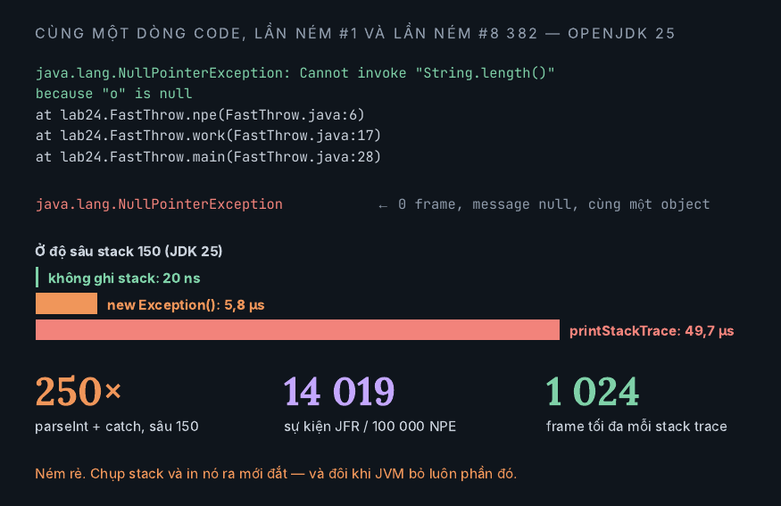
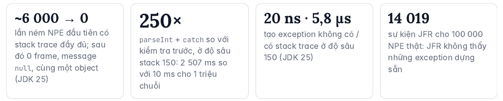
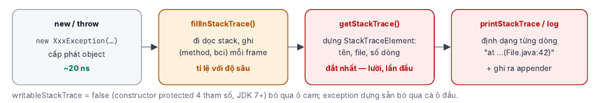
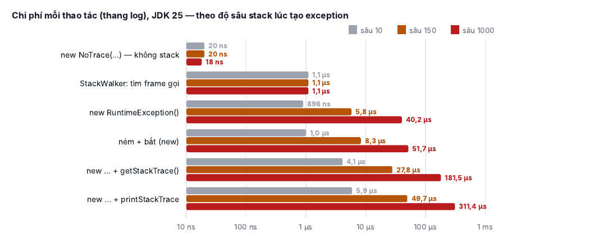
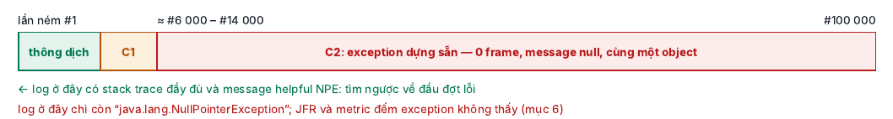

# Bài 24 — Exception & stack trace: chi phí thật



*Vì sao NPE trong log không có stack trace?*

*Chặng V · Ngôn ngữ dưới lớp vỏ — fillInStackTrace, OmitStackTraceInFastThrow, StackWalker · Nền tảng: JDK 25 LTS / 27 · Thí nghiệm chạy thật trên OpenJDK 17 · 21 · 25*

Bài cuối của Chặng V nhìn vào thứ mọi dev Java dùng hằng ngày mà ít khi đo: exception. Một exception tốn bao nhiêu, tốn vào đâu, và vì sao đôi khi JVM **cố ý vứt bỏ** stack trace của nó — đúng lúc bạn cần nhất.

> **VỀ CÁC CON SỐ VÀ CÔNG CỤ TRONG BÀI** — Mọi output lấy từ việc **chạy thật** trên OpenJDK 17.0.20, 21.0.12 và 25.0.4, Linux x86-64, 2 vCPU; mã biên dịch với `-g` như Maven/Gradle mặc định. Số đo chi phí là đo tay (chạy được cả JDK 17), trung vị 5 vòng sau 4 vòng khởi động; độ sâu stack được dựng bằng đệ quy. Cơ chế đối chiếu với mã nguồn HotSpot tag `jdk-25+36` (`opto/graphKit.cpp`, `runtime/globals.hpp`) và `java/lang/Throwable.java`; cấu hình JFR đọc từ file `lib/jfr/default.jfc` của từng JDK.

Vì sao log production đôi khi có `NullPointerException` không kèm stack trace? Câu trả lời ngắn: vì **C2 đã thay exception đó bằng một object dựng sẵn**. Khi một chỗ trong code nóng ném đi ném lại cùng một exception “ngầm” (NPE, chia cho 0, vượt chỉ số mảng, ép kiểu sai, lưu sai kiểu vào mảng), trình biên dịch C2 ngừng tạo exception mới và ném **một instance chung, không có stack trace, không có message** — cờ `-XX:+OmitStackTraceInFastThrow`, bật mặc định. Vài nghìn lần đầu vẫn có stack trace đầy đủ; hãy tìm chúng ở phần log sớm hơn.



*Bốn kết quả trên đều chạy thật trong bài.*

## 1 Vì sao một dev Spring Boot nên quan tâm

- **On-call**: dòng log `java.lang.NullPointerException` trơ trọi, không `at …` nào, không message — và một ticket nói “không tái hiện được”.
- **Exception nghiệp vụ**: `EntityNotFoundException`, `ResponseStatusException`, validation exception được ném hàng nghìn lần mỗi phút, mỗi lần chụp lại một stack sâu hàng trăm frame của Tomcat + Spring + AOP.
- **Dùng exception thay cho `if`**: `try { Integer.parseInt(x) } catch …`, `try { repo.findById().orElseThrow() } catch …` — đúng về logic, đắt về CPU.
- **Log**: `log.error("…", e)` định dạng cả stack trace; bật thông tin vị trí (`%L`, `%M`) trong pattern log là chụp stack ở *mỗi* dòng log.

## 2 Một exception được tạo ra thế nào

Viết `new RuntimeException("x")`, constructor của `Throwable` gọi `fillInStackTrace()` — một method native. JVM đi dọc stack của thread hiện tại, và với mỗi frame ghi lại *method nào, đang ở bytecode nào* vào một cấu trúc nội bộ gọn (`backtrace`), tối đa `MaxJavaStackTraceDepth = 1024` frame. Chưa có `StackTraceElement` nào được tạo. Chỉ khi ai đó gọi `getStackTrace()` — trực tiếp, hay qua `printStackTrace()`, hay qua logger — thì `Throwable.getOurStackTrace()` mới dựng mảng `StackTraceElement.of(backtrace, depth)`: tra tên class, tên method, tên file, số dòng cho từng frame, rồi cache lại.



*Hình 24.1 — Bốn tầng chi phí của một exception, đọc từ `Throwable.java` (JDK 25): `fillInStackTrace(0)` native trong constructor; `getOurStackTrace()` dựng mảng `StackTraceElement` lười biếng và cache.*

## 3 Chi phí theo độ sâu stack

Đo từng tầng ở ba độ sâu stack — 10 frame (một hàm main nhỏ), 150 frame, 1 000 frame — trên ba JDK:



*Hình 24.2 — JDK 25. Mọi thứ chạm tới stack đều tỉ lệ với độ sâu, trừ `StackWalker` (chỉ đọc vài frame đầu) và exception không ghi stack.*

| ns / µs mỗi thao tác | JDK 17 · sâu 150 | JDK 17 · sâu 1000 | JDK 21 · sâu 150 | JDK 21 · sâu 1000 | JDK 25 · sâu 150 | JDK 25 · sâu 1000 |
|---|---:|---:|---:|---:|---:|---:|
| `new RuntimeException()` | 4,6 µs | 28,3 µs | 4,2 µs | 24,6 µs | 5,8 µs | 40,2 µs |
| … + `getStackTrace()` | 24,3 µs | 153,7 µs | 23,4 µs | 146,7 µs | 27,8 µs | 181,5 µs |
| … + `printStackTrace` → `String` | 51,1 µs | 330,5 µs | 52,1 µs | 308,6 µs | 49,7 µs | 311,4 µs |
| exception `writableStackTrace = false` | 21 ns | 19 ns | 22 ns | 23 ns | 20 ns | 18 ns |
| ném + bắt qua d frame (exception mới) | 10,3 µs | 64,5 µs | 8,6 µs | 57,7 µs | 8,3 µs | 51,7 µs |
| ném + bắt qua d frame (dựng sẵn) | 4,9 µs | 32,9 µs | 3,7 µs | 29,4 µs | 3,6 µs | 23,7 µs |
| `Thread.currentThread().getStackTrace()` | 23,5 µs | 152,2 µs | 37,9 µs | 145,1 µs | 27,2 µs | 174,7 µs |
| `StackWalker`: tìm frame gọi | 1,9 µs | 1,9 µs | 1,3 µs | 1,3 µs | 1,1 µs | 1,1 µs |

Bốn điều đọc ra. **Một**, giá chính không nằm ở `throw` mà ở **chụp stack**: exception không ghi stack chỉ 20 ns — ngang một object bình thường — ở mọi độ sâu. **Hai**, chụp stack chỉ là một phần; **biến nó thành chữ** (`getStackTrace`, `printStackTrace`) đắt gấp 5–10 lần. Mỗi `log.error("…", e)` ở độ sâu 150 tốn khoảng 50 µs CPU chỉ để định dạng, chưa tính ghi ra đĩa. **Ba**, ném + bắt có cả chi phí *unwind*: kể cả exception dựng sẵn, đi qua 150 frame vẫn tốn 3,6 µs vì JVM phải tìm handler ở từng frame. **Bốn**, ba JDK gần như bằng nhau — đây là chi phí cấu trúc, không phải thứ một bản JDK mới sẽ xoá đi. (Đo tay, mỗi số một lần chạy; chênh lệch 20–30% giữa các JDK nằm trong độ nhiễu của máy 2 vCPU.)

## 4 Exception làm luồng điều khiển

Trường hợp thường gặp: kiểm tra một chuỗi có phải số không bằng cách thử parse. Một triệu chuỗi, một nửa không hợp lệ (`"SKU-17"`), chạy ở độ sâu stack 10 và 150:

```java
static int viaException(String s) {
    try { return Integer.parseInt(s); } catch (NumberFormatException e) { return -1; }
}
static int viaCheck(String s) {                        // kiểm tra trước, chỉ parse khi hợp lệ
    if (s.isEmpty() || s.length() > 9) return -1;
    for (int i = 0; i < s.length(); i++) { char c = s.charAt(i); if (c < '0' || c > '9') return -1; }
    return Integer.parseInt(s);
}
```

| 1 000 000 chuỗi, 50% không hợp lệ (trung vị 5 lần) | JDK 17 · sâu 10 | JDK 17 · sâu 150 | JDK 25 · sâu 10 | JDK 25 · sâu 150 |
|---|---:|---:|---:|---:|
| kiểm tra ký tự trước | 10,9 ms | 11,7 ms | 10,4 ms | 10,0 ms |
| `Integer.parseInt` + `catch` | 431,7 ms | **3 216 ms** | 412,2 ms | **2 507 ms** |

Chậm 40 lần ở độ sâu 10, **250 lần** ở độ sâu 150 — cùng code, chỉ khác chỗ nó được gọi. Đó là điểm dễ bỏ sót nhất: một hàm tiện ích “nhanh” trong unit test (stack nông) trở nên đắt khi được gọi từ trong một request Spring (stack sâu). `NumberFormatException` được tạo bằng `throw new` trong `Integer.parseInt`, nên nó không bao giờ được “tối ưu” như mục 5: lần nào cũng chụp đủ stack.

Khi thật sự cần exception cho luồng điều khiển — thoát khỏi một đệ quy sâu, một parser — hãy tạo lớp con với `writableStackTrace = false`:

```java
final class StopParsing extends RuntimeException {
    // enableSuppression = false, writableStackTrace = false — khoảng 20 ns
    StopParsing(String m) { super(m, null, false, false); }
}
```

## 5 Trả lời câu hỏi: OmitStackTraceInFastThrow

Có hai loại exception theo cách nó ra đời. Exception **tường minh** do code viết `throw new …`. Exception **ngầm** do chính JVM ném khi một lệnh bytecode thất bại: gọi method trên `null`, chia số nguyên cho 0, vượt chỉ số mảng, `checkcast` sai, lưu sai kiểu vào mảng. Thử một NPE ngầm lặp lại 100 000 lần trong một method có `try/catch`:

```text
$ java lab24.FastThrow npe v            # JDK 25, mặc định
lần ném #1:
java.lang.NullPointerException: Cannot invoke "String.length()" because "o" is null
        at lab24.FastThrow.npe(FastThrow.java:6)
        at lab24.FastThrow.work(FastThrow.java:17)
        at lab24.FastThrow.main(FastThrow.java:28)
lần ném #8382 (identityHashCode=2124308362):
java.lang.NullPointerException                                          # hết. Không "at", không message
npe  java.lang.NullPointerException  lần đầu mất stack trace: #8382  đủ: 8381  rỗng: 91619  cùng một object: true
```

Lần ném đầu có đủ: message “helpful NPE” (JEP 358, mặc định từ JDK 15) nói rõ biến nào null, và ba frame. Từ khoảng lần thứ vài nghìn, exception **không còn frame nào, message là `null`**, và 91 619 lần ném sau đều là **cùng một object**. Lặp lại cho cả năm loại exception ngầm, ba JDK, và một exception tường minh để đối chứng:

| Lần ném đầu tiên mất stack trace (/ 100 000) | JDK 17 | JDK 21 | JDK 25 |
|---|---:|---:|---:|
| `NullPointerException` — gọi trên `null` | #6 281 | #9 500 | #5 910 |
| `ArithmeticException` — chia cho 0 | #5 961 | #8 019 | #8 167 |
| `ArrayIndexOutOfBoundsException` | #7 667 | #7 367 | #10 873 |
| `ClassCastException` | #8 622 | #8 623 | #8 074 |
| `ArrayStoreException` | #6 285 | #13 979 | #9 623 |
| `throw new NullPointerException(…)` tường minh | không bao giờ | không bao giờ | không bao giờ |
| NPE ngầm, `-XX:-OmitStackTraceInFastThrow` / chỉ C1 / `-Xint` | | | không bao giờ (JDK 25, cả ba cấu hình) |

Cơ chế nằm trong `GraphKit::builtin_throw` của C2 (`opto/graphKit.cpp`, JDK 25). Khi biên dịch một lệnh có thể ném exception ngầm, C2 xem profile: nếu chỗ này đã từng ném (“hot”) và method có handler, thì thay vì sinh code gọi về runtime để tạo exception mới, nó dùng một instance dựng sẵn — `env()->NullPointerException_instance()` cho `Reason_null_check`, và tương tự cho `div0_check`, `range_check`, `class_check`, `array_check` — kèm một lệnh ghi `null` vào `detailMessage` (“Clear the detail message of the preallocated exception object”). Chú thích trong mã nguồn tự thừa nhận cái giá: *“This would lead to a missing backtrace … if the backtrace object is ever asked for its backtrace.”* Chỉ C2 làm điều này; thông dịch và C1 luôn tạo exception thật — nên con số “lần đầu mất” phụ thuộc vào lúc C2 biên dịch xong, dao động từ 5 900 đến 14 000 giữa các lần chạy.



*Hình 24.3 — Vòng đời của một NPE lặp lại. Tỉ lệ trục không chính xác; mốc chuyển đo được nằm trong khoảng 6–14% số lần ném đầu.*

## 6 Những exception không ai đếm

Exception dựng sẵn không đi qua constructor nào. Mọi công cụ đếm exception bằng cách móc vào constructor của `Throwable` sẽ không thấy nó. Chạy lại thí nghiệm với JFR, bật sự kiện `jdk.JavaExceptionThrow` và tắt giới hạn tần suất:

```text
$ java -XX:StartFlightRecording=filename=npe.jfr,jdk.JavaExceptionThrow#enabled=true,\
       jdk.JavaExceptionThrow#throttle=off,jdk.ExceptionStatistics#period=10ms lab24.FastThrow npe
npe  lần đầu mất stack trace: #14020   đủ: 14019   rỗng: 85981
  JFR: JavaExceptionThrow = 14019, ExceptionStatistics.throwables (cuối) = 14021
$ java -XX:-OmitStackTraceInFastThrow -XX:StartFlightRecording=… lab24.FastThrow npe
  JFR: JavaExceptionThrow = 100000, ExceptionStatistics.throwables (cuối) = 100002
```

100 000 lần ném, JFR thấy đúng 14 019 — số lần có stack trace. 85 981 lần còn lại vô hình với cả sự kiện từng exception lẫn bộ đếm tổng `jdk.ExceptionStatistics`. Hệ quả: một dashboard đếm exception bằng JFR, hay một agent đo exception theo cách tương tự, sẽ thấy tỉ lệ lỗi **giảm** đúng lúc lỗi trở nên nóng nhất. Chỉ có đếm ở chỗ `catch` (log, metric trong handler) mới thấy hết.

Chi tiết cấu hình đáng biết, đọc từ file `default.jfc` đi kèm JDK: ở JDK 21, `jdk.JavaExceptionThrow` mặc định **tắt**; ở JDK 25 nó **bật** với `throttle = 100/s` (cơ chế giới hạn tần suất của JDK-8351594). Lần chạy đầu tiên của chúng tôi chỉ thấy 20 sự kiện vì giới hạn đó — đọc số liệu exception từ JFR luôn phải nhớ nó bị lấy mẫu.

## 7 StackWalker: đọc stack mà không tạo exception

Nhiều thư viện cần biết “ai đang gọi tôi”: logger in vị trí (`%L`, `%M`, `%F`, `%C` trong pattern), framework kiểm tra quyền theo caller, code tìm class gọi. Cách cũ là `new Throwable().getStackTrace()[2]` hoặc `Thread.currentThread().getStackTrace()` — dựng toàn bộ mảng `StackTraceElement` chỉ để đọc một phần tử. `StackWalker` (JDK 9, JEP 259) duyệt **lười** và dừng sớm:

```java
static final StackWalker SW = StackWalker.getInstance();
int line = SW.walk(s -> s.skip(1).findFirst()).map(StackWalker.StackFrame::getLineNumber).orElse(0);
```

Kết quả ở mục 3: ở độ sâu 150, `StackWalker` tốn 1,1 µs (JDK 25) và **không đổi theo độ sâu**; `Thread.currentThread().getStackTrace()` tốn 27 µs ở độ sâu 150 và 175 µs ở độ sâu 1 000. Nếu pattern log của bạn có thông tin vị trí và framework log lấy nó bằng cách cũ, mỗi dòng log trả cái giá thứ hai. Hãy kiểm tra pattern log trên production: tên class và dòng code thường không cần thiết khi đã có tên logger.

## 8 Đọc một stack trace production

```text
$ java lab24.Trace
StackOverflowError: getStackTrace().length = 1024         # bị cắt ở MaxJavaStackTraceDepth
java.lang.RuntimeException: xử lý order thất bại
        at lab24.Trace.service(Trace.java:8)
        at lab24.Trace.main(Trace.java:12)
Caused by: java.lang.IllegalStateException: không tìm thấy order A-1
        at lab24.Trace.repo(Trace.java:6)
        ... 2 more                                              # 2 frame cuối trùng với exception bao ngoài
$ java -XX:MaxJavaStackTraceDepth=0 lab24.Trace          # 0 = không giới hạn
StackOverflowError: getStackTrace().length = 15657
```

| Bạn thấy trong log | Nghĩa là |
|---|---|
| `Caused by: …` ở cuối | nguyên nhân gốc thường nằm ở `Caused by` **cuối cùng**; đọc từ dưới lên. |
| `... 42 more` | 42 frame cuối giống hệt exception bao ngoài, in một lần cho gọn — không phải bị mất. |
| `Suppressed: …` | exception phụ từ `try-with-resources` (đóng tài nguyên cũng lỗi) — thường che mất lỗi chính nếu đọc vội. |
| Đúng 1 024 dòng `at`, không thấy đáy | bị cắt ở `MaxJavaStackTraceDepth`; với `StackOverflowError`, phần lặp ở đỉnh, nguyên nhân (lời gọi đầu tiên vào vòng đệ quy) ở đáy đã bị cắt. |
| `lambda$findAll$3`, `$$SpringCGLIB$$0`, `DirectMethodHandleAccessor`, `jdk.proxy2.$Proxy91` | thân lambda ([Bài 21](21-invokedynamic.md)), proxy lớp con và reflection ([Bài 23](23-reflection-proxy.md)), JDK proxy — khung “ống nước”, bỏ qua để tìm frame của code bạn. |
| `java.lang.NullPointerException` trơ trọi | exception dựng sẵn của C2 (mục 5): tìm những lần xuất hiện **đầu tiên** của cùng lỗi trong log, hoặc tạm chạy với `-XX:-OmitStackTraceInFastThrow`. |
| Chỉ có message, không có stack | thường là code log `e.getMessage()` hoặc `e.toString()` thay vì truyền `e` cho logger; hoặc exception được tạo với `writableStackTrace = false`. |

## 9 Trong Spring Boot

> **SPRING BOOT · NĂM VIỆC NÊN LÀM**
>
> 1. **Gặp NPE không stack trace**: tìm ngược log về lần xuất hiện đầu tiên sau lần khởi động gần nhất — vài nghìn lần đầu có đủ stack và message helpful NPE. Nếu log đã xoay vòng, bật `-XX:-OmitStackTraceInFastThrow` cho một pod để bắt lại. Cờ này an toàn về đúng sai; cái giá là mỗi lần ném lại tạo exception đầy đủ (mục 3), nên chỉ nên bật lâu dài nếu chỗ lỗi không nóng.
> 2. **Đừng parse/validate bằng exception trong đường xử lý request.** Kiểm tra trước (`Optional`, `StringUtils.hasText`, regex, `Character.isDigit`), hoặc dùng Bean Validation trả về danh sách lỗi. Mục 4: 250 lần ở độ sâu 150.
> 3. **Exception nghiệp vụ được ném thường xuyên** (404, 409, validation) mà không cần stack: cân nhắc tắt stack cho riêng chúng (`super(msg, null, false, false)`). `@ControllerAdvice` vẫn bắt và trả về đúng HTTP status; chỉ là log không có `at …`, nên chỉ làm với lỗi mà message đã đủ nghĩa.
> 4. **Log exception đúng một lần, ở đúng một chỗ.** `log.error("…", e)` rồi `throw e` lên tầng trên để tầng đó log lại là trả giá định dạng stack hai lần (khoảng 50 µs mỗi lần ở độ sâu 150) và làm log nhiễu. Không log stack trace cho lỗi 4xx dự kiến.
> 5. **Bỏ thông tin vị trí khỏi pattern log production** (`%L`, `%M`, `%F`, `%C`, `%class`, `%line`): chúng buộc logger chụp stack ở mỗi dòng log.

> **THAY ĐỔI THEO PHIÊN BẢN CẦN BIẾT**
>
> - **JDK 1.4**: `getStackTrace()`, chuỗi `Caused by`. **JDK 5**: `-XX:+OmitStackTraceInFastThrow` trong C2 (mặc định bật đến nay, vẫn có trong `globals.hpp` của JDK 27).
> - **JDK 7**: constructor `Throwable(msg, cause, enableSuppression, writableStackTrace)`; `Suppressed` cho try-with-resources.
> - **JDK 9**: `StackWalker` (JEP 259); tên module trong stack trace (`java.base/`).
> - **JDK 14–15**: helpful `NullPointerException` (JEP 358), mặc định bật từ JDK 15. Exception dựng sẵn của C2 không có message này.
> - **JDK 25**: `default.jfc` bật `jdk.JavaExceptionThrow` với giới hạn 100 sự kiện/giây (JDK 21: tắt).

## 10 Ghép lại: một trang để nhớ cả bài

| Thao tác (JDK 25, sâu 150) | Chi phí | Ghi nhớ |
|---|---:|---|
| exception không ghi stack | 20 ns | như một object thường; dùng cho luồng điều khiển |
| `StackWalker` tìm caller | 1,1 µs | không phụ thuộc độ sâu |
| `new XxxException()` | 5,8 µs | tỉ lệ với độ sâu: 0,9 µs ở 10, 40 µs ở 1 000 |
| ném + bắt qua 150 frame | 8,3 µs | gồm cả unwind |
| `getStackTrace()` | 27,8 µs | dựng `StackTraceElement` — lười, một lần |
| `printStackTrace` / `log.error(…, e)` | 49,7 µs | chỉ phần định dạng; log một lần thôi |
| NPE ngầm lặp lại trong code C2 | — | sau vài nghìn lần: object dựng sẵn, 0 frame, message `null`, JFR không thấy |

## 11 Hiểu lầm thường gặp, bài tập, bài tiếp theo

### Hiểu lầm thường gặp

| Hiểu lầm | Thực tế |
|---|---|
| “`throw` là thứ đắt.” | Chụp stack và định dạng nó mới đắt. Exception không ghi stack: 20 ns. |
| “NPE không stack trace là do logger cấu hình sai.” | Thường là C2 dùng exception dựng sẵn; lần ném đầu vẫn có stack. |
| “Bật `-XX:-OmitStackTraceInFastThrow` làm JVM chậm hẳn.” | Chỉ chậm ở đúng chỗ đang ném exception liên tục — vốn đã là một lỗi cần sửa. |
| “Đếm exception bằng JFR là đủ.” | Exception dựng sẵn vô hình với JFR: 14 019 / 100 000. JDK 25 còn giới hạn 100 sự kiện/giây mặc định. |
| “`Integer.parseInt` trong `try` là cách kiểm tra số gọn.” | Gọn, nhưng chậm 40–250 lần tùy độ sâu stack khi đầu vào sai thường xuyên. |
| “`... 42 more` là stack bị mất.” | Là 42 frame trùng với exception bao ngoài, chỉ được rút gọn. |

### Bài tập tự làm (khoảng 45 phút)

> **THỰC HÀNH**
>
> 1. **Đo độ sâu thật**: trong một controller, log `new Throwable().getStackTrace().length` một lần. Stack của bạn sâu bao nhiêu frame?
> 2. **Săn NPE trơ trọi**: grep log production tìm `^java.lang.NullPointerException$` (không message); tìm lần đầu cùng lỗi sau mỗi lần khởi động.
> 3. **Exception luồng điều khiển**: grep `catch (NumberFormatException`, `catch (NoSuchElementException`, `catch (EmptyResultDataAccessException`; cái nào nằm trong đường xử lý request?
> 4. **Thử nghiệm**: chạy `FastThrow` trong file đính kèm với các loại `npe div aioobe cce ase expl`, rồi thêm `-XX:-OmitStackTraceInFastThrow`.
>
> *Mã nguồn lab nằm trong repo: sources/under-hood/src/bai24-exception-src.zip.*

### Thuật ngữ của bài

| Thuật ngữ | Nghĩa ngắn gọn |
|---|---|
| `fillInStackTrace` | Method native ghi lại stack hiện tại vào exception, gọi trong constructor. |
| Backtrace | Dạng nội bộ gọn của stack đã chụp; chưa phải `StackTraceElement`. |
| Exception ngầm | Exception do JVM tự ném khi một lệnh bytecode thất bại (NPE, chia 0, vượt chỉ số…). |
| Fast throw | C2 ném một instance dựng sẵn, không stack, không message, cho exception ngầm “nóng”. |
| Unwind | Đi ngược từng frame tìm handler sau khi ném. |
| `writableStackTrace` | Tham số constructor (JDK 7+): `false` thì không chụp stack. |
| `StackWalker` | API duyệt stack lười, dừng sớm (JDK 9). |
| Helpful NPE | Message NPE chỉ rõ biểu thức nào null (JEP 358). |

> **BÀI TIẾP THEO · BÀI 25 — MỞ ĐẦU CHẶNG VI** — **Bộ đồ nghề: jcmd, JFR, JMC, async-profiler, NMT.** Thu thập và đọc profile CPU, allocation, lock; flame graph; JFR streaming trong production. Câu hỏi của bài: *Cách lấy dữ liệu chẩn đoán từ một pod đang chạy mà không restart?*

### Tài liệu tham khảo

- Mã nguồn OpenJDK tag jdk-25+36: `hotspot/share/opto/graphKit.cpp` (`builtin_throw`), `hotspot/share/runtime/globals.hpp`, `java/lang/Throwable.java`. github.com/openjdk/jdk
- JDK 5.0 release notes — mục về exception dựng sẵn và `-XX:-OmitStackTraceInFastThrow`.
- JEP 259: Stack-Walking API; JEP 358: Helpful NullPointerExceptions. openjdk.org/jeps
- JDK-8351594: JFR: Rate-limited sampling of Java events; file `lib/jfr/default.jfc` của JDK 21 và JDK 25.
