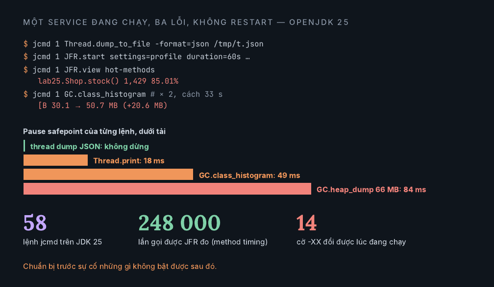
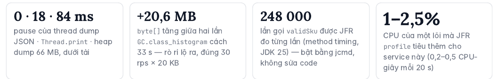
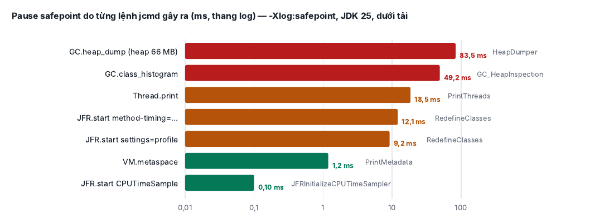
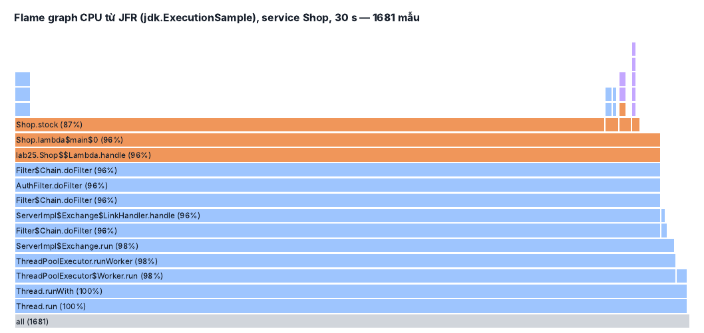
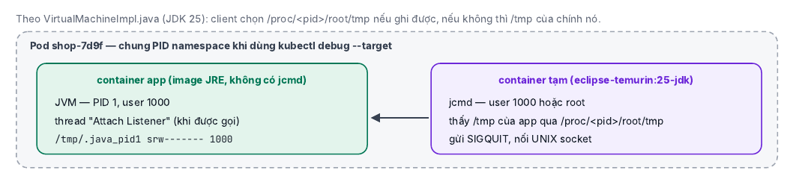

# Bài 25 — Bộ đồ nghề: jcmd, JFR, NMT



*Chẩn đoán một pod đang chạy mà không restart?*

*Chặng VI · Quan sát & chẩn đoán — jcmd, JFR, JMC, async-profiler, NMT · Nền tảng: JDK 25 LTS / 27 · Thí nghiệm chạy thật trên OpenJDK 25 (· 17 · 21)*

Chặng VI — *Quan sát & chẩn đoán* — gom 24 bài trước thành kỹ năng xử lý sự cố. Bài mở đầu là bộ đồ nghề: những công cụ đã đi kèm JDK của bạn, cách dùng chúng trên một tiến trình **đang chạy**, và cái giá của từng lệnh — vì công cụ chẩn đoán cũng có thể làm production chậm đi.

> **VỀ CÁC CON SỐ VÀ CÔNG CỤ TRONG BÀI** — Mọi output lấy từ việc **chạy thật** trên OpenJDK 25.0.4 (đối chiếu 17, 21), Linux x86-64, 2 vCPU. Đối tượng là `Shop` — một service HTTP nhỏ có ba lỗi cố ý: một endpoint đốt CPU vì biên dịch regex mỗi lần, một endpoint cấp phát nhiều và **rò bộ nhớ** 20 KB mỗi request, một endpoint đi qua một `synchronized` giữ khoá 2 ms. Nó chạy dưới tải open-loop (40 + 30 + 150 rps) trong khi ta chẩn đoán từ bên ngoài, **không restart**. Pause của từng lệnh đo bằng `-Xlog:safepoint`; CPU bằng `/proc/<pid>/stat`. async-profiler và JMC **không** được chạy trong môi trường thí nghiệm (binary native / ứng dụng đồ hoạ bên ngoài); phần về chúng lấy từ tài liệu chính thức của dự án, trích dẫn tại chỗ. Flame graph trong bài được dựng từ dữ liệu JFR bằng một script ~50 dòng có trong file đính kèm.

*Mã nguồn lab nằm trong repo: sources/under-hood/src/bai25-toolbox-src.zip.*

Lấy dữ liệu chẩn đoán từ một pod đang chạy mà không restart bằng cách nào? Câu trả lời ngắn: **`jcmd` gắn vào JVM đang chạy** (`kubectl exec`, hoặc `kubectl debug --target` với một image có JDK nếu image của bạn không có), rồi: `Thread.dump_to_file` cho thread dump không dừng JVM, `JFR.start` / `JFR.view` / `JFR.dump` cho profile CPU, cấp phát, khoá, GC, `GC.class_histogram` hai lần cách nhau để thấy rò rỉ, `VM.log` để bật log GC ngay lúc đó, và `GC.heap_dump` nếu chấp nhận một pause. Những thứ **bắt buộc** phải khai báo từ lúc khởi động — NMT, phần lớn cờ `-XX` — là lý do nên chuẩn bị trước khi có sự cố.



*Bốn kết quả trên đều đo được trong bài.*

## 1 Vì sao một dev Spring Boot nên quan tâm

- **Sự cố xảy ra trên production, không trên laptop.** Restart để thêm cờ là xoá luôn trạng thái đang cần quan sát: heap đang phình, thread đang kẹt, JIT đang ấm.
- **Actuator không đủ.** `/actuator/metrics` cho biết *có* vấn đề; nó không cho biết method nào đốt CPU, chỗ nào cấp phát, ai giữ khoá.
- **Công cụ có giá.** Một heap dump dừng cả JVM; một `GC.class_histogram` dừng 44–49 ms; một thread dump kiểu cũ dừng 18 ms. Biết giá để chọn lệnh khi đang có tải.
- **Container** thêm một lớp: image distroless không có `jcmd`, user khác nhau, `/tmp` không chung, `perf_events` bị chặn.

## 2 jcmd: một cửa vào JVM đang chạy

`jcmd` nói chuyện với JVM qua **Attach API**. Mặc định JVM không mở kênh nào; lần attach đầu tiên, phía client tạo file `.attach_pid<pid>` rồi gửi tín hiệu `SIGQUIT`; JVM thấy file đó, khởi động thread `Attach Listener` và mở một UNIX socket `/tmp/.java_pid<pid>` chỉ chủ sở hữu đọc được (mã nguồn `sun/tools/attach/VirtualMachineImpl.java`, JDK 25):

```text
$ ls -la /tmp/.java_pid4119      # trước lần attach đầu tiên
ls: cannot access '/tmp/.java_pid4119': No such file or directory
$ jcmd 4119 VM.uptime
4119:
1.774 s
$ ls -la /tmp/.java_pid4119
srw------- 1 root root 0 Oct 29 01:07 /tmp/.java_pid4119
$ jcmd 4119 Thread.print | grep 'Attach Listener'
"Attach Listener" #25 [4166] daemon prio=9 os_prio=0 cpu=0.71ms elapsed=0.27s …
# lần chạy thứ hai (pid 4215), gọi từ user khác:
$ su nobody -s /bin/sh -c 'jcmd 4215 VM.uptime'
java.io.IOException: Operation not permitted
```

Ba hệ quả thực tế. **Cùng user** (hoặc root): client kiểm tra chủ sở hữu socket (“file should be owned by the current user” trong `libattach`), và user khác thậm chí không gửi được `SIGQUIT`. **Cùng không gian `/tmp`**: khi client và JVM ở hai container khác nhau nhưng chung PID namespace, `jcmd` tìm socket qua `/proc/<pid>/root/tmp` — mã nguồn liệt kê đúng bốn trường hợp host/container. **Không bị tắt**: `-XX:+DisableAttachMechanism` khoá cửa này hoàn toàn. Lệnh `jcmd <pid> help` liệt kê 58 lệnh của JDK 25; bảng dưới là những lệnh dùng nhiều nhất khi có sự cố:

| Lệnh | Cho biết |
|---|---|
| `VM.version`, `VM.flags`, `VM.command_line`, `VM.system_properties` | đang chạy JDK nào, với cờ gì — thường là câu hỏi đầu tiên |
| `Thread.dump_to_file -format=json f.json` | thread dump đầy đủ, kể cả virtual thread ([Bài 19](19-virtual-threads.md)), **không cần safepoint** |
| `Thread.print` | thread dump dạng chữ, kèm phát hiện deadlock |
| `GC.heap_info`, `GC.class_histogram` | heap đang dùng bao nhiêu; object nào chiếm nhiều nhất |
| `JFR.start` / `JFR.view` / `JFR.dump` / `JFR.stop` | ghi và đọc profile (mục 4–5) |
| `VM.log` | bật/tắt unified logging (ví dụ log GC) lúc đang chạy |
| `VM.set_flag` | đổi cờ *manageable* — chỉ 14 cờ trên JDK 25 |
| `VM.native_memory`, `VM.metaspace`, `Compiler.codecache` | bộ nhớ ngoài heap (mục 7) |
| `GC.heap_dump f.hprof` | toàn bộ heap ra file — đắt nhất (mục 3) |

## 3 Mỗi lệnh tốn bao nhiêu

Mỗi lệnh `jcmd` mất khoảng 150–300 ms thời gian thực — phần lớn là khởi động chính tiến trình `jcmd` (một JVM nhỏ). Cái đáng quan tâm là phía *service*: lệnh nào bắt mọi thread của nó dừng lại ở safepoint ([Bài 18](18-thread-safepoint.md)), và dừng bao lâu. Đọc `-Xlog:safepoint` của `Shop` trong lúc chạy kịch bản chẩn đoán:



*Hình 25.1 — Mỗi thanh là một safepoint mà log ghi lại ngay sau lệnh tương ứng; nhãn bên phải là tên VM operation trong log. `Thread.dump_to_file -format=json`, `VM.version`, `VM.flags`, `GC.heap_info`, `VM.log` không tạo safepoint nào.*

```text
$ grep -E 'PrintThreads|GC_HeapInspection|HeapDumper|RedefineClasses' safepoint.log
[9.912s]  Safepoint "PrintThreads",      … Total: 18495439 ns, Threads: 0 runnable, 63 total
[10.720s] Safepoint "GC_HeapInspection", … Total: 44248397 ns, Threads: 0 runnable, 63 total
[11.384s] Safepoint "RedefineClasses",   … Total: 9188916 ns                 # JFR.start: chèn bytecode sự kiện
[12.016s] Safepoint "RedefineClasses",   … Total: 12118387 ns                # JFR.start method-timing=…
[43.536s] Safepoint "GC_HeapInspection", … Total: 49238548 ns
[44.844s] Safepoint "HeapDumper",        … Total: 83544964 ns, Threads: 1 runnable, 65 total
```

Thứ tự ưu tiên khi service đang có tải rút ra từ đây: **thread dump JSON trước** — không dừng gì, có cả virtual thread; `Thread.print` dừng 18 ms với 63 thread và tăng theo số thread. **`GC.class_histogram`** phải duyệt cả heap trong safepoint: 44–49 ms với heap 45–66 MB, tỉ lệ với heap — trên heap 8 GB là hàng giây. **Heap dump** dừng 84 ms cho 66 MB và ghi file 63 MB; heap 8 GB nghĩa là dừng nhiều giây và cần 8 GB đĩa trống trong pod. `JFR.start` trả một lần khoảng 10 ms để chèn bytecode vào các class sự kiện. Không lệnh nào trong phép đo làm request thất bại: ba luồng tải hoàn tất 0 lỗi, max 98–121 ms.

## 4 JFR: máy ghi hình luôn bật

JDK Flight Recorder (mở nguồn từ JDK 11) ghi sự kiện vào bộ đệm của từng thread rồi đổ ra file theo từng chunk; có hai cấu hình đi kèm JDK: `default` (mục tiêu dưới 1% overhead) và `profile` (chi tiết hơn). Toàn bộ vòng đời của một bản ghi có thể điều khiển bằng `jcmd` trên tiến trình đang chạy:

```text
$ jcmd $P JFR.start name=diag settings=profile filename=/tmp/diag.jfr
$ jcmd $P JFR.start name=cpu jdk.CPUTimeSample#enabled=true \
           jdk.CPUTimeSample#throttle=10ms filename=/tmp/cputime.jfr
$ jcmd $P JFR.start name=mt 'method-timing=lab25.Shop::validSku;lab25.Shop::stock' filename=/tmp/mt.jfr
   …30 giây sau…
$ jcmd $P JFR.stop name=diag          # ghi file và dừng; JFR.dump để chụp mà vẫn ghi tiếp
$ jcmd $P JFR.view gc                 # JDK 21+: đọc thẳng trong JVM đang chạy, không cần copy file
                                                  Garbage Collections
Start    GC ID Type                       Heap Before GC Heap After GC Longest Pause
08:08:14     1 Young Garbage Collection          42.4 MB        7.5 MB       15.0 ms
08:08:15     2 Young Garbage Collection          53.5 MB       10.5 MB       13.0 ms
```

Ba bản ghi trên chạy song song trên cùng JVM, mỗi cái một cấu hình. Hai cái sau là tính năng mới của JDK 25, cả hai bật được qua `jcmd` mà không sửa code hay restart:

- **CPU-time profiling** (JEP 509, thực nghiệm, chỉ Linux): sự kiện `jdk.CPUTimeSample` lấy mẫu theo thời gian CPU thật của từng thread qua bộ đếm CPU-time của kernel, thay vì lấy mẫu định kỳ các thread đang chạy Java như `jdk.ExecutionSample`. Xem bằng `jfr view cpu-time-hot-methods`.
- **Method timing & tracing** (JEP 520): JFR chèn bytecode vào đúng các method chỉ định, đếm số lần gọi và đo thời gian từng lần (`jdk.MethodTiming`), hoặc ghi từng lần gọi kèm stack (`jdk.MethodTrace`). Khi dừng bản ghi, bytecode chèn vào được gỡ ra. JEP ghi rõ đây là ngoại lệ của mục tiêu dưới 1%: đo method nóng có giá.

Overhead đo trên `Shop` dưới cùng tải (100 + 30 rps, CPU tiến trình trong 20 s, hai lần chạy):

| Cấu hình | CPU-giây / 20 s | thêm so với không JFR | p99 /price |
|---|---:|---:|---:|
| không JFR | 1,96 – 2,16 | — | 4,6 – 5,1 ms |
| `-XX:StartFlightRecording` (default) | 2,23 – 2,29 | +0,13 – 0,27 | 4,9 – 5,0 ms |
| `settings=profile` | 2,39 – 2,46 | +0,23 – 0,50 | 4,4 – 4,9 ms |
| `profile` + `CPUTimeSample` 10 ms | 2,39 – 2,54 | +0,23 – 0,58 | 4,9 – 5,3 ms |

Đọc đúng con số này: service thí nghiệm rất nhẹ (chỉ dùng khoảng 10% một lõi), nên tính theo *phần trăm* thì JFR `profile` trông như +12–25%. Tính theo *tuyệt đối*, nó tiêu thêm 1–2,5% một lõi — chi phí gần như cố định (lấy mẫu thread mỗi 10–20 ms, sự kiện định kỳ), không tăng theo tải. Trên một service bận thật, phần trăm sẽ nhỏ hơn nhiều. Độ trễ không đổi trong độ nhiễu.

## 5 Đọc profile: CPU, cấp phát, khoá, rò rỉ

Từ JDK 21, lệnh `jfr view` có sẵn hơn 70 “view” dạng bảng — đủ để chẩn đoán mà không cần mở JMC. Đây là những gì 30 giây ghi hình nói về `Shop`:

```text
$ jfr view hot-methods diag.jfr                         # jdk.ExecutionSample
Method                                                   Samples Percent
lab25.Shop.stock()                                         1,429  85.01%
lab25.Shop.lambda$main$0(HttpExchange)                        51   3.03%
java.util.concurrent.ConcurrentHashMap.get(Object)            40   2.38%
$ jfr view cpu-time-hot-methods cputime.jfr             # jdk.CPUTimeSample (JDK 25)
lab25.Shop.stock()                                           755  70.89%
sun.nio.ch.SocketDispatcher.write0(FileDescriptor, long, int) 65   6.10%
$ jfr view allocation-by-site diag.jfr
Method                                                   Allocation Pressure
java.lang.Long.valueOf(long)                                          20.80%   # boxing trong report()
java.util.Arrays.copyOf(Object[], int)                                12.16%   # ArrayList lớn dần
java.util.regex.Pattern.compile()                                      4.60%   # String.matches mỗi lần
$ jfr view method-timing mt.jfr                         # JDK 25, bật bằng jcmd lúc đang chạy
Timed Method                  Invocations Minimum Time Average Time Maximum Time
lab25.Shop.stock()                  4,649  2.000000 ms  2.050000 ms 12.800000 ms
lab25.Shop.validSku(String)       248,000  0.000178 ms  0.001020 ms 10.300000 ms
```

Hai cách lấy mẫu CPU đồng ý về thủ phạm — `stock()` quay vòng 2 ms trong khoá — nhưng không đồng ý về tỉ lệ: lấy mẫu theo thời gian CPU thật còn thấy cả thời gian ở trong kernel (`SocketDispatcher.write0`), thứ mà lấy mẫu kiểu cũ — chỉ chụp thread đang chạy code Java — hụt. Đó là lý do JEP 509 được thêm. Method timing cho câu trả lời chính xác thay vì ước lượng: 248 000 lần `validSku`, trung bình 1 µs mỗi lần — vô hại; `stock()` trung bình 2,05 ms, tức là gần như không phải chờ khoá ở tải 150 rps.

**Khoá: coi chừng ngưỡng.** `jfr view contention-by-site diag.jfr` trả về “No events found” — vì cấu hình `profile` chỉ ghi `jdk.JavaMonitorEnter` khi chờ từ 10 ms trở lên, mà ở 150 rps chẳng ai chờ lâu thế. Chạy lại ở 400 rps (khoá bận khoảng 80% thời gian), hạ ngưỡng lúc bắt đầu ghi:

```text
$ jcmd $P JFR.start name=lock jdk.JavaMonitorEnter#threshold=1ms filename=/tmp/lock.jfr
$ jfr view contention-by-site lock.jfr
StackTrace                                     Count    Avg.    Max.
lab25.Shop.stock()                               661 16.3 ms 90.5 ms
$ jcmd $P Thread.print | grep -c BLOCKED          # cùng lúc: 7 thread BLOCKED (on object monitor)
        - waiting to lock <0x00000000e0f20d60> (a java.lang.Object)
        at lab25.Shop.lambda$main$0(Shop.java:64)
```

**Rò rỉ: so sánh hai lần chụp.** Một histogram cho biết heap đang chứa gì; **hai** histogram cách nhau một khoảng cho biết cái gì đang *lớn lên*:

```text
$ jcmd $P GC.class_histogram > h1.txt ; …33 giây… ; jcmd $P GC.class_histogram > h2.txt
[B                                    21092 →    28397 obj      30.1 →    50.7 MB   (+20.6 MB)
[Ljdk.internal.vm.FillerElement;       1426 →     1724 obj       0.4 →     0.8 MB   (+0.4 MB)
java.lang.String                      15206 →    21372 obj       0.4 →     0.5 MB   (+0.1 MB)
```

+20,6 MB `byte[]` trong 33 giây — khớp với 30 rps × 20 KB × 33 s = 19,8 MB. Histogram chỉ cho biết *kiểu*; để biết *ai giữ* những `byte[]` đó cần đường đến GC root, tức là heap dump và một công cụ phân tích ([Bài 14](14-log-gc-memory-leak.md)), hoặc view `memory-leaks-by-site` của JFR với sự kiện `jdk.OldObjectSample` và tuỳ chọn `path-to-gc-roots=true` khi dump — một tuỳ chọn có giá, vì JFR phải duyệt heap lúc đó.

## 6 Flame graph

Một bảng “hot methods” chỉ nói *method lá* nào đốt CPU. Flame graph (Brendan Gregg) gộp **cả stack**: mỗi hộp là một frame, chiều rộng là tỉ lệ mẫu đi qua frame đó, frame gọi nằm dưới frame được gọi. Flame graph dưới đây được dựng trực tiếp từ 1 681 sự kiện `jdk.ExecutionSample` trong `diag.jfr` (`jfr print --json` rồi một script Python gộp stack):



*Hình 25.2 — Cam: code của `Shop`; tím: các lớp chuỗi, regex, collection của JDK; xanh: phần còn lại (server HTTP, thread pool). Chỉ vẽ hộp rộng từ 4 px. Tháp gần như toàn bộ chiều rộng là `stock()` bên trong handler — điều bảng hot-methods đã nói, nhưng ở đây thấy luôn đường đi từ `ThreadPoolExecutor` xuống.*

Trong thực tế, flame graph thường được tạo bởi **JMC** (JDK Mission Control — ứng dụng desktop đọc file `.jfr`, có view Flame Graph cho mẫu CPU và cấp phát) hoặc **async-profiler** (`asprof -d 30 -f flamegraph.html <pid>`, theo README của dự án). async-profiler đáng có trong bộ đồ nghề vì nó lấy mẫu bằng tín hiệu của hệ điều hành, thấy cả frame native và kernel, có chế độ `cpu`, `alloc`, `lock`, `wall`. Trong container, tài liệu của nó lưu ý `perf_event_open` thường bị seccomp chặn; khi đó dùng `-e ctimer` hoặc `-e itimer` thay cho `-e cpu`.

## 7 NMT và bộ nhớ ngoài heap

[Bài 04](04-runtime-data-areas.md) đã hỏi vì sao pod bị OOMKilled dù heap còn trống. Công cụ để trả lời là Native Memory Tracking — và đây là công cụ **không bật được lúc đang chạy**:

```text
$ jcmd $P VM.native_memory summary                  # Shop khởi động không có NMT
Native memory tracking is not enabled
$ java -XX:NativeMemoryTracking=summary … lab25.Shop   # lần khởi động khác
$ jcmd $P VM.native_memory baseline ; …18 giây tải… ; jcmd $P VM.native_memory summary.diff scale=MB
Total: reserved=2000MB +17MB, committed=189MB +17MB
-                 Java Heap (reserved=512MB, committed=96MB)
-                     Class (reserved=1024MB, committed=0MB)
-                    Thread (reserved=71MB, committed=7MB)
-                      Code (reserved=243MB, committed=9MB)
-                        GC (reserved=46MB, committed=38MB)
-        Shared class space (reserved=16MB, committed=14MB)
-               Arena Chunk (reserved=18MB +16MB, committed=18MB +16MB)
-                 Metaspace (reserved=64MB, committed=3MB)
$ grep VmRSS /proc/$P/status
VmRSS:    178888 kB
```

Tổng committed 189 MB, RSS thật 175 MB — NMT cho một bức tranh sát RSS, chia theo nơi tiêu: heap 96 MB chỉ là một nửa; GC (cấu trúc của G1) 38 MB, shared class space 14 MB, thread, code cache. `summary.diff` chỉ ra cái gì **đang tăng** so với baseline: ở đây là Arena Chunk của trình biên dịch JIT (+16 MB khi C2 đang làm việc). NMT có overhead nhỏ (bộ nhớ và CPU cho việc theo dõi mỗi lần cấp phát native) nên thường không bật mặc định; nhưng vì nó bắt buộc phải bật từ đầu, một lựa chọn hợp lý là bật `summary` sẵn cho các service hay gặp vấn đề bộ nhớ.

## 8 Trả lời câu hỏi: chẩn đoán một pod không restart

Gộp lại thành một quy trình. Với pod `shop-7d9f`, container `app`, JVM là PID 1 trong container:

```bash
# 0. Có jcmd trong image không? (image JRE/jlink tối giản thường không có)
kubectl exec shop-7d9f -c app -- jcmd -l
# Không có: gắn một container tạm có JDK, chung PID namespace với container app
kubectl debug -it shop-7d9f --image=eclipse-temurin:25-jdk --target=app -- bash
#    trong container tạm: tìm PID của JVM (ps), rồi jcmd PID … với CÙNG user (hoặc root) như app

# 1. Rẻ, không dừng JVM
jcmd 1 VM.version ; jcmd 1 VM.flags ; jcmd 1 GC.heap_info
jcmd 1 Thread.dump_to_file -format=json /tmp/threads.json
jcmd 1 VM.log output=/tmp/gc.log what=gc*=info decorators=uptime     # bật log GC ngay bây giờ
# 2. Ghi hình 60 giây
jcmd 1 JFR.start name=incident settings=profile duration=60s filename=/tmp/incident.jfr
jcmd 1 JFR.view hot-methods ; jcmd 1 JFR.view gc ; jcmd 1 JFR.view allocation-by-site
# 3. Nghi rò rỉ: hai histogram cách vài phút (mỗi lần dừng tỉ lệ với heap)
jcmd 1 GC.class_histogram > /tmp/h1.txt ; sleep 300 ; jcmd 1 GC.class_histogram > /tmp/h2.txt
# 4. Đắt nhất, khi đã quyết: dừng JVM tỉ lệ với heap, cần đĩa bằng kích thước heap
jcmd 1 GC.heap_dump /tmp/heap.hprof
# 5. Lấy file ra
kubectl cp shop-7d9f:/tmp/incident.jfr ./incident.jfr -c app
```



*Hình 25.3 — Attach từ một container tạm. Ba điều kiện: chung PID namespace (`--target`), cùng user hoặc root, JVM không chạy với `-XX:+DisableAttachMechanism`.*

| Muốn có | Không restart? | Cách |
|---|---|---|
| Thread dump, heap info, histogram, heap dump | **được** | `jcmd` (mục 2–3) |
| Profile CPU / cấp phát / khoá / GC | **được** | `JFR.start`, kể cả khi JVM khởi động không có JFR |
| Đo thời gian một method cụ thể | **được** (JDK 25) | `JFR.start method-timing=Class::method` |
| Log GC, log safepoint | **được** | `VM.log` |
| Đổi cờ `HeapDumpOnOutOfMemoryError`, `HeapDumpPath`, `SoftMaxHeapSize`… | **được** — 14 cờ *manageable* | `VM.set_flag`; cờ khác: “only 'writeable' flags can be set” |
| Native Memory Tracking | **không** | phải có `-XX:NativeMemoryTracking=summary` từ đầu |
| `-Xmx`, GC, `OmitStackTraceInFastThrow` ([Bài 24](24-exception-stack-trace.md))… | **không** | cờ không manageable |

## 9 Trong Spring Boot

> **SPRING BOOT · CHUẨN BỊ TRƯỚC KHI CÓ SỰ CỐ**
>
> 1. **Image có công cụ, hoặc biết cách mượn**: base image JDK đầy đủ cho phép `kubectl exec … jcmd`; image tối giản thì ghi sẵn lệnh `kubectl debug --target` và kiểm tra RBAC cho phép ephemeral container.
> 2. **Cờ khởi động nên có sẵn**: `-XX:StartFlightRecording=disk=true,maxage=1h,maxsize=512m,dumponexit=true,filename=/tmp/app.jfr` (bản ghi “hộp đen” liên tục, chi phí như bảng mục 4), `-XX:+HeapDumpOnOutOfMemoryError -XX:HeapDumpPath=/dumps` trên một volume có đủ chỗ, và cân nhắc `-XX:NativeMemoryTracking=summary`.
> 3. **Actuator**: `/actuator/threaddump` và `/actuator/heapdump` làm cùng việc qua HTTP — tiện, nhưng heap dump qua HTTP vẫn dừng JVM như mục 3 và trả về cả heap (dữ liệu nhạy cảm), nên đừng để lộ ra ngoài.
> 4. **Ứng dụng tự quan sát**: JFR streaming trong tiến trình (`RecordingStream`, JEP 349, JDK 14) cho phép phản ứng ngay với sự kiện — `Watchdog` trong file đính kèm in “chờ khoá 21 ms tại stock”, “GC G1New: pause 13 ms” trong lúc chạy.
> 5. **Ưu tiên lệnh rẻ khi đang có tải**: thread dump JSON → JFR → histogram → heap dump, theo thứ tự giá ở hình 25.1.

> **THAY ĐỔI THEO PHIÊN BẢN CẦN BIẾT**
>
> - **JDK 7**: `jcmd`; NMT (từ 7u40). **JDK 9**: unified logging (JEP 158) và `VM.log`.
> - **JDK 11**: JFR mở nguồn (JEP 328), lệnh `JFR.*` trong OpenJDK. **JDK 14**: JFR streaming (JEP 349).
> - **JDK 21**: `jfr view` và `jcmd JFR.view`; `Thread.dump_to_file` (cùng virtual thread).
> - **JDK 25**: CPU-time profiling (JEP 509, thực nghiệm, Linux), cooperative sampling (JEP 518), method timing & tracing (JEP 520); `default.jfc` bật sự kiện exception với giới hạn 100/s ([Bài 24](24-exception-stack-trace.md)).

## 10 Ghép lại: một trang để nhớ cả bài

| Câu hỏi khi có sự cố | Công cụ | Giá (đo trong bài) |
|---|---|---|
| Đang chạy gì, với cờ gì? | `VM.version`, `VM.flags`, `VM.command_line` | không dừng JVM |
| Thread đang làm gì, kẹt ở đâu? | `Thread.dump_to_file -format=json` (`Thread.print` nếu cần deadlock) | 0 / 18 ms |
| CPU đi đâu? | `JFR.start` → `JFR.view hot-methods`; JDK 25: `cpu-time-hot-methods`; async-profiler | +1–2,5% một lõi; 10 ms lúc bắt đầu |
| Ai cấp phát? | `JFR.view allocation-by-site` | như trên |
| Ai giữ khoá? | `JFR` với `jdk.JavaMonitorEnter#threshold` thấp; thread dump | như trên |
| Heap tăng vì cái gì? | hai `GC.class_histogram`; rồi `GC.heap_dump` | 44–49 ms mỗi lần; 84 ms / 66 MB |
| Bộ nhớ ngoài heap? | `VM.native_memory` (phải bật từ đầu), `VM.metaspace` | 1 ms (metaspace) |
| GC có vấn đề không? | `VM.log what=gc*`, `JFR.view gc`, `gc-pauses` | không dừng JVM |

## 11 Hiểu lầm thường gặp, bài tập, bài tiếp theo

### Hiểu lầm thường gặp

| Hiểu lầm | Thực tế |
|---|---|
| “Muốn profile phải restart với cờ JFR.” | `jcmd JFR.start` chạy trên JVM khởi động không có JFR. |
| “Thread dump là miễn phí.” | `Thread.print` dừng 18 ms với 63 thread; bản JSON không dừng. |
| “Heap dump là cách đầu tiên để tìm rò rỉ.” | Hai histogram rẻ hơn nhiều và thường đủ chỉ ra kiểu object đang lớn lên. |
| “JFR không có overhead.” | Nhỏ và gần như cố định: 1–2,5% một lõi ở `profile`; method timing thì không hứa dưới 1%. |
| “Không thấy sự kiện khoá trong JFR nghĩa là không có tranh chấp.” | Cấu hình mặc định bỏ qua lần chờ dưới 10–20 ms; hạ ngưỡng thì thấy 661 lần, trung bình 16 ms. |
| “jcmd không chạy được trong container.” | Chạy được nếu cùng user và chung PID namespace; image thiếu jcmd thì dùng `kubectl debug --target`. |

### Bài tập tự làm (khoảng 60 phút)

> **THỰC HÀNH**
>
> 1. **Diễn tập**: trên môi trường staging, thực hiện đúng quy trình mục 8 với một pod thật. Ghi lại lệnh nào thiếu quyền, thiếu công cụ.
> 2. **Đo giá**: bật `-Xlog:safepoint` trên một bản staging; chạy `Thread.print`, `GC.class_histogram`, `GC.heap_dump`; đọc pause theo heap thật của bạn.
> 3. **Tái hiện**: chạy `tools/diag.sh` trong file đính kèm; rồi tự sửa ba lỗi của `Shop` và chạy lại để thấy profile đổi.
> 4. **Hộp đen**: thêm `-XX:StartFlightRecording=disk=true,maxage=1h,…` cho một service; khi có sự cố tiếp theo, `JFR.dump` trước khi làm gì khác.

### Thuật ngữ của bài

| Thuật ngữ | Nghĩa ngắn gọn |
|---|---|
| Attach API | Cơ chế cho một tiến trình khác gửi lệnh vào JVM đang chạy qua UNIX socket. |
| JFR | JDK Flight Recorder — ghi sự kiện của JVM và ứng dụng với overhead thấp. |
| Recording / chunk | Một phiên ghi JFR; dữ liệu được ghi ra đĩa thành từng khối. |
| Ngưỡng (threshold) | Thời lượng tối thiểu để một sự kiện được ghi. |
| Flame graph | Biểu đồ gộp stack theo tỉ lệ mẫu; rộng = tốn nhiều. |
| NMT | Native Memory Tracking — chia bộ nhớ native của JVM theo hạng mục. |
| Cờ manageable | Cờ `-XX` đổi được lúc đang chạy bằng `VM.set_flag`. |
| Ephemeral container | Container tạm gắn vào pod đang chạy (`kubectl debug`). |

> **BÀI TIẾP THEO · BÀI 26 — BÀI CUỐI** — **Capstone: điều tra sự cố Spring Boot production từ A đến Z.** Ba kịch bản dựng lại được — CPU cao sau deploy, latency spike định kỳ, OOMKilled — đi từ triệu chứng đến nguyên nhân bằng kiến thức của cả series. Câu hỏi của bài: *Bạn bắt đầu từ đâu khi on-call lúc 2 giờ sáng?*

### Tài liệu tham khảo

- JEP 328 (Flight Recorder), JEP 349 (JFR Event Streaming), JEP 509 (JFR CPU-Time Profiling), JEP 518 (JFR Cooperative Sampling), JEP 520 (JFR Method Timing & Tracing). openjdk.org/jeps
- Mã nguồn OpenJDK tag jdk-25+36: `jdk.attach/linux/classes/sun/tools/attach/VirtualMachineImpl.java`, `jdk.attach/linux/native/libattach/VirtualMachineImpl.c`. github.com/openjdk/jdk
- async-profiler — README, “Profiling In Container”, “CPU Sampling Engines”. github.com/async-profiler/async-profiler
- Kubernetes — “Debug Running Pods” (`kubectl debug`, ephemeral containers). kubernetes.io/docs
