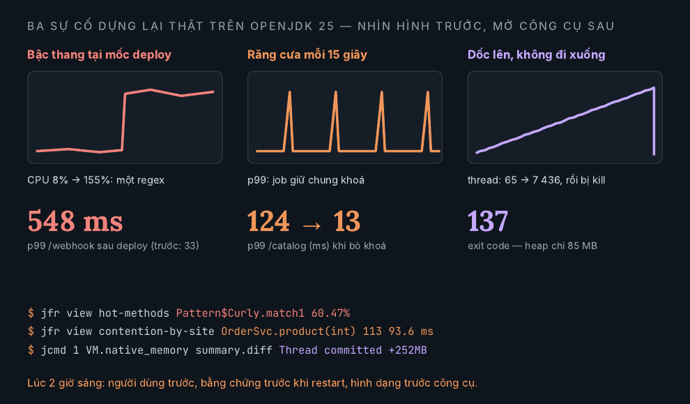
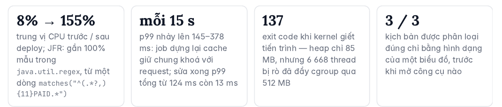
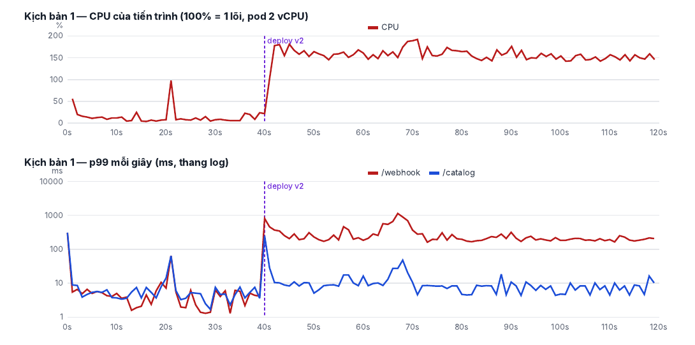
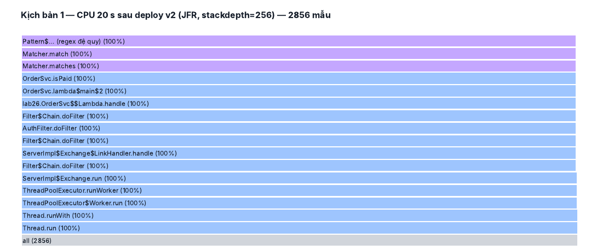
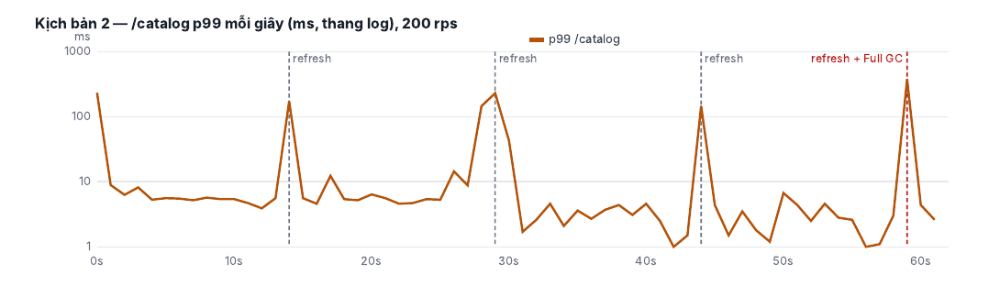
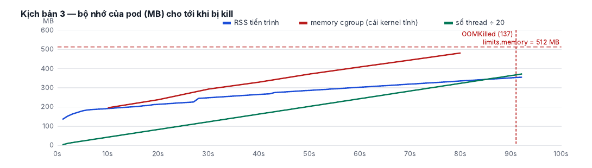
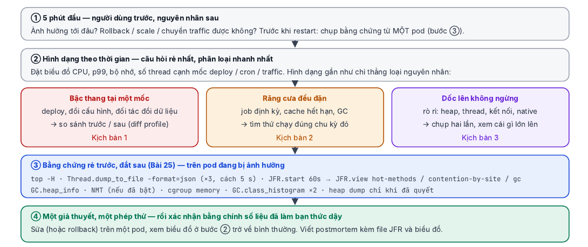

# Bài 26 — Capstone: điều tra sự cố production



*Bạn bắt đầu từ đâu khi on-call lúc 2 giờ sáng?*

*Chặng VI · Quan sát & chẩn đoán — bài cuối của series · Nền tảng: JDK 25 LTS · Thí nghiệm chạy thật, cgroup 512–800 MB*

Bài cuối không giới thiệu cơ chế mới. Nó dựng lại ba sự cố production kinh điển, để chúng thật sự xảy ra trên một tiến trình JVM có giới hạn CPU và bộ nhớ như một pod, rồi điều tra từng cái từ triệu chứng đến nguyên nhân — ghi lại cả những bước không tìm ra gì — bằng những gì 25 bài trước đã xây.

> **VỀ CÁC CON SỐ VÀ CÔNG CỤ TRONG BÀI** — Mọi output lấy từ việc **chạy thật** trên OpenJDK 25.0.4, Linux x86-64, 2 vCPU. Service `OrderSvc` là một HTTP server của JDK (pool 100 thread, tên `http-nio-exec-N` như Tomcat) — môi trường không tải được Spring, nên ba lỗi được viết bằng Java thuần, đúng hình dạng mà chúng có trong code Spring (mục 9). Tiến trình chạy trong một **cgroup bộ nhớ** thật (800 MB, kịch bản 3: 512 MB) để kernel đối xử với nó như một container: JVM tự nhận giới hạn (`Provider: cgroupv1, Memory Limit`) và kernel thật sự giết nó khi vượt. Tải open-loop in độ trễ **mỗi giây**, như một dashboard. Mỗi kịch bản đã chạy hai lần trở lên; khi kết quả giữa các lần khác nhau, bài nói rõ.

Bạn bắt đầu từ đâu khi on-call lúc 2 giờ sáng? Câu trả lời ngắn: **từ hình dạng của biểu đồ, không phải từ code**. Đầu tiên giảm ảnh hưởng cho người dùng, nhưng chụp bằng chứng trên một pod trước khi restart. Rồi đặt CPU, p99, bộ nhớ, số thread cạnh mốc thời gian: **bậc thang** tại một mốc → thứ vừa thay đổi; **răng cưa đều** → thứ chạy định kỳ; **dốc lên mãi** → rò rỉ. Sau đó mới tới công cụ, từ rẻ (thread dump JSON, JFR) đến đắt (histogram, heap dump), và kết thúc bằng một phép thử xác nhận trên chính biểu đồ ban đầu.



*Bốn kết quả trên đều đo được trong bài.*

## 1 Ba sự cố, một quy trình

`OrderSvc` có ba endpoint, mỗi cái mang một lỗi thường gặp đến mức gần như đội nào cũng từng gặp:

| Endpoint | Code (rút gọn) | Lỗi nằm ở đâu |
|---|---|---|
| `/webhook` | v1: `row.split(",")[11].startsWith("PAID")`<br>v2: `PAID_V2.matcher(row).matches()` với `^(.*?,){11}PAID.*` | bản deploy v2 “refactor” sang regex |
| `/catalog` | `synchronized` đọc một `Map` 600 000 phần tử; job `catalog-refresh` mỗi 15 s dựng lại map *trong cùng khoá* | khoá bị giữ suốt lúc dựng lại |
| `/export` | `Executors.newFixedThreadPool(4)` mỗi request để “song song cho nhanh” | pool không bao giờ `shutdown` |

Một chi tiết của môi trường đáng nói ngay, vì nó tự xuất hiện trong cả ba kịch bản: với giới hạn bộ nhớ 512–800 MB, log GC dòng đầu tiên là `Using Serial`. JVM coi một máy dưới 1 792 MB là “không phải server” và chọn SerialGC ([Bài 13](13-gc-cho-container.md)) — không ai trong đội chọn điều đó, nhưng nó sẽ góp mặt ở kịch bản 2.

## 2 Kịch bản 1: CPU cao sau deploy

Đối tác gửi webhook 40 lần mỗi giây; một phần tư số dòng có cột 12 là `REFUNDED` thay vì `PAID`. Đồng thời `/catalog` nhận 100 rps. Bản v1 chạy 40 giây, rồi bản v2 được deploy:



*Hình 26.1 — Hai biểu đồ đầu tiên một on-call nhìn thấy. CPU nhảy đúng tại mốc deploy: trung vị từ 8,5% lên 155% (phần lớn các giây 145–189%, gần hết 2 vCPU); p99 của `/webhook` từ 32,8 ms lên 548,5 ms (max 1,1 s). `/catalog` trong lần chạy này không bị ảnh hưởng (p99 12,3 ms); ở một lần chạy khác, khi CPU bão hoà hơn, nó lên 224 ms.*

Hình dạng: **bậc thang tại mốc deploy**. Trước khi mở công cụ, đã biết gần như chắc chắn thủ phạm nằm trong diff của bản deploy, và chỉ ảnh hưởng một endpoint. Hành động đúng cho người dùng: rollback. Nhưng trước đó, 60 giây bằng chứng.

## 3 Điều tra kịch bản 1

**Bước 1 — thread nào ăn CPU.** `top -H` cho thấy CPU nằm ở vài thread `http-nio-exec`, không phải GC hay JIT:

```text
$ top -b -H -n 1 -p $PID
  PID USER   PR  NI    VIRT    RES    SHR S  %CPU  %MEM   TIME+ COMMAND
24543 root   20   0 3176600 180320  25940 R  81.8   2.2  0:00.67 http-nio-+
24600 root   20   0 3176600 180320  25940 S  45.5   2.2  0:00.46 http-nio-+
```

**Bước 2 — chúng đang làm gì.** Thread dump JSON (không dừng JVM): 109 thread, 11 RUNNABLE, 5 trong số đó ở giữa một stack 79 frame toàn `java.util.regex.Pattern`, đáy là code của ta. Đáng chú ý: tra TID 24543 từ `top` trong dump thì thấy nó đang `WAITING` — request đó đã xong trong khoảng 0,2 giây giữa hai lệnh. **Một thread dump là một khoảnh khắc**; với request ngắn, phải chụp nhiều lần hoặc dùng JFR.

```text
$ jcmd $PID Thread.dump_to_file -format=json /tmp/threads.json
http-nio-exec-20   RUNNABLE   79 frame
   java.base/java.util.regex.Pattern$Curly.match1(Pattern.java:4610)
   java.base/java.util.regex.Pattern$Curly.match(Pattern.java:4546)
   java.base/java.util.regex.Pattern$GroupHead.match(Pattern.java:4969)
   …                                                        # ~70 frame regex đệ quy
   lab26.OrderSvc.isPaid(OrderSvc.java:23)
```

**Bước 3 — cả khoảng thời gian, không phải một khoảnh khắc.** JFR 20 giây, so với 15 giây ghi trên v1 trước khi deploy:

```text
$ jcmd $PID JFR.configure stackdepth=256          # trước JFR.start: stack regex sâu hơn 64
$ jcmd $PID JFR.start name=incident settings=profile duration=20s filename=/tmp/v2.jfr
$ jfr view hot-methods v2.jfr                       # v1: 13 mẫu trong 15 s — CPU gần như rảnh
Method                                                                 Samples Percent
java.util.regex.Pattern$Curly.match1(Matcher, int, int, CharSequence)    1,727  60.47%
java.util.regex.Pattern$BmpCharProperty.match(Matcher, int, CharSequence)  562  19.68%
java.util.regex.Pattern$GroupHead.match(Matcher, int, CharSequence)        417  14.60%
java.util.regex.Pattern$BmpCharPropertyGreedy.match(Matcher, int, …)       141   4.94%
```



*Hình 26.2 — Flame graph từ 2 856 mẫu JFR, khung regex đệ quy được gộp làm một. Toàn bộ chiều rộng đi qua `OrderSvc.isPaid`. Lần chạy đầu tiên dùng `stackdepth` mặc định 64: 2 385 / 2 881 mẫu bị cắt cụt và đáy stack — chính chỗ có `isPaid` — không xuất hiện.*

**Bước 4 — xác nhận cơ chế.** Thử riêng regex trên một dòng không có `PAID` ở cột 12: 12 cột 6 ms, 20 cột 34 ms, 24 cột 167 ms, 28 cột 1,2 s, 32 cột 6,1 s. `(.*?,){11}` buộc engine thử mọi cách chia dòng thành 11 đoạn trước khi chịu thua — số cách tăng theo luỹ thừa của số cột. Điều thú vị là regex của Java đã tự vệ trước những mẫu “ReDoS” kinh điển: `^(x+)+$`, `^(\w+\s?)*$`, `^(a+)+b$` đều xong dưới 0,1 ms với 28 ký tự trên JDK 25 trong thí nghiệm của bài — nhưng không phải mẫu nào cũng được bảo vệ.

**Bước 5 — sửa và xác nhận.** Rollback v1: CPU về 5–22%, p99 `/webhook` 32,8 ms. Sửa lâu dài: tách cột bằng `split` (hoặc thư viện CSV), giới hạn độ dài dữ liệu từ bên ngoài, và thêm vào test một dòng “xấu” với nhiều cột.

## 4 Kịch bản 2: latency spike định kỳ

Không có deploy nào. `/catalog` nhận đều 200 rps, p50 dưới 1 ms suốt 62 giây — trung vị không hề nhúc nhích. Nhưng alert p99 cứ vài phút lại kêu rồi tự hết. Biểu đồ p99 theo từng giây:



*Hình 26.3 — p99 của `/catalog` mỗi giây. Ngoài giây đầu (warm-up), bốn cụm nhô lên tại t = 14, 28–30, 44 và 59 s: 173, 230, 147 và 378 ms; các giây còn lại 1–14 ms. p99 cả lần chạy 124,3 ms, max 383,2 ms, 0 lỗi. Nhãn “refresh” được thêm vào sau khi điều tra xong.*

Hình dạng: **răng cưa đều, chu kỳ khoảng 15 giây**, không gắn với mốc thay đổi nào. Thứ chạy định kỳ là nghi phạm: một job `@Scheduled`, cache hết hạn đồng loạt, một batch — hoặc GC. Và GC là nghi phạm đầu tiên ai cũng nghĩ tới.

## 5 Điều tra kịch bản 2

**Bước 1 — loại trừ GC trước, vì rẻ.** Log GC ([Bài 14](14-log-gc-memory-leak.md), bật sẵn bằng `-Xlog:gc`) trả lời trong vài giây:

```text
$ grep Pause gc.log | awk '{print $NF}' | sort -n | tail -3
9.932ms
10.632ms
11.823ms                                                  # 159 lần young GC, không lần nào quá 12 ms
$ grep 'Pause Full' gc.log
[60.616s] GC(159) Pause Full (Allocation Failure) 343M->122M(491M) 266.265ms
```

Kết luận một nửa: GC *không* giải thích các spike ở 14, 29, 44 s; nhưng có giải thích một phần spike lớn nhất ở 59 s. Hai nguyên nhân chồng nhau trong cùng một biểu đồ — chuyện thường gặp hơn ta muốn.

**Bước 2 — thread dump, và giới hạn của nó.** Kịch bản chụp 10 bản `Thread.print`, cách nhau ~0,2 s, bắt đầu ngay trước spike ở giây 29. Chỉ **một** trong 10 bản (bản số 5) bắt được khoảnh khắc đó — chín bản còn lại trông hoàn toàn bình thường. Nhưng bản đó nói hết:

```text
"catalog-refresh" #16 [1797] daemon … elapsed=30.06s
   java.lang.Thread.State: RUNNABLE
        …StringConcatHelper.newArray / String$$StringConcat.concat …      # "product-" + i + "-" + …
        at lab26.OrderSvc.build(OrderSvc.java:39)
        at lab26.OrderSvc.rebuildCatalog(OrderSvc.java:35)
        - locked <0x00000000eadc0080> (a java.lang.Class for lab26.OrderSvc)
        at java.util.concurrent.ScheduledThreadPoolExecutor$ScheduledFutureTask.run(…)

"http-nio-exec-25" #25 [1834] … waiting for monitor entry
   java.lang.Thread.State: BLOCKED (on object monitor)
        at lab26.OrderSvc.product(OrderSvc.java:31)
        - waiting to lock <0x00000000eadc0080> (a java.lang.Class for lab26.OrderSvc)
        at lab26.OrderSvc.lambda$main$2(OrderSvc.java:76)            # …và 9 thread http-nio khác y hệt
```

Cùng địa chỉ monitor `0x…eadc0080`: một thread giữ, mười thread chờ ([Bài 17](17-synchronized-monitor.md)). Nhưng nếu bạn chỉ chụp một bản và rơi vào chín bản kia, bạn sẽ kết luận “không thấy gì”. Đó là lý do bước tiếp theo quan trọng hơn.

**Bước 3 — JFR: thống kê thay vì may rủi.** Sự kiện `jdk.JavaMonitorEnter` chỉ được ghi khi chờ lâu hơn ngưỡng (20 ms trong `default`, 10 ms trong `profile`; [Bài 25](25-bo-do-nghe-chan-doan.md)); kịch bản hạ xuống 1 ms:

```text
$ jcmd $PID JFR.start name=spike settings=profile jdk.JavaMonitorEnter#threshold=1ms …
$ jfr view contention-by-site spike.jfr
StackTrace                                              Count    Avg.    Max.
------------------------------------------------------- ----- ------- -------
lab26.OrderSvc.product(int)                               113 93.6 ms  232 ms
sun.nio.ch.EPollSelectorImpl.clearInterrupt()               8 2.83 ms 4.75 ms
sun.net.httpserver.ServerImpl$Dispatcher.run()              3 2.79 ms 3.51 ms
```

Nhóm 126 sự kiện theo thời điểm: chúng dồn thành ba cụm 35 / 47 / 31 sự kiện ở giây :24, :39, :54 — cách nhau đúng 15 giây, khớp chu kỳ trên biểu đồ. Trường `previousOwner` cho thấy thêm một hiệu ứng thú vị: chỉ 3 lần chủ khoá trước là `catalog-refresh`, còn lại là 55 thread `http-nio` khác nhau. Job giữ khoá suốt thời gian dựng map (lần chờ dài nhất JFR ghi được: 232 ms); trong lúc đó request xếp hàng; khi job nhả, chúng lần lượt lấy khoá — một **convoy**, mỗi request chờ cả job lẫn những request đứng trước.

**Bước 4 — sửa và xác nhận trên chính biểu đồ.** Dựng map mới *ngoài* khoá, rồi thay tham chiếu `volatile` một lần; người đọc không cần khoá vì map đã bất biến và được publish qua `volatile` ([Bài 16](16-java-memory-model.md)):

```java
// trước                                              // sau
synchronized (OrderSvc.class) {                       static volatile Map<Integer,String> catalog;
    catalog = build();         // 600k entry          catalog = build();   // dựng xong mới publish
}                                                     return catalog.getOrDefault(id, "?");
```

| Lần chạy (200 rps, 62 s) | p99 tổng | Giây nào còn p99 > 20 ms |
|---|---|---|
| Bản lỗi (SerialGC) | 124,3 ms | 0 (warm-up), 14, 28–30, 44, 59 |
| Bỏ khoá (SerialGC) | 13,2 ms | 0 (warm-up), 59 — **Full GC 259 ms** |
| Bỏ khoá + `-XX:+UseG1GC` | 14,5 ms | 0, 29, 31, 44, 59: 25–49 ms (pause G1 dài nhất 53 ms), không có Full GC |

Sửa khoá xoá được ba trong bốn cụm. Cụm còn lại là nguyên nhân thứ hai đã thấy ở bước 1: mỗi lần dựng lại tạo ~75 MB object mới, map cũ thành rác, và SerialGC (được chọn ngầm vì giới hạn bộ nhớ dưới 1 792 MB) phải dọn old gen bằng một Full GC dừng mọi thứ. Đổi sang G1 thay một lần dừng 259 ms bằng vài lần 25–53 ms. Ở mức này đó là đánh đổi, không phải “sửa” — p99 tổng nhích từ 13,2 lên 14,5 ms; với service thật, nên khai báo GC tường minh thay vì để JVM tự đoán từ kích thước container.

## 6 Kịch bản 3: OOMKilled khi heap còn trống

Pod có `limits.memory: 512Mi`; JVM tự đặt heap tối đa 25% = 128 MB. `/export` nhận 20 rps, `/catalog` 50 rps. Mọi thứ trông ổn — độ trễ thấp, không lỗi — cho đến giây thứ 92 thì cả hai endpoint đồng loạt lỗi 100%. Kubernetes sẽ ghi `Reason: OOMKilled`, `Exit Code: 137`. Không có dòng `OutOfMemoryError` nào trong log ứng dụng.



*Hình 26.4 — Bộ nhớ của tiến trình theo hai cách nhìn. RSS (thứ `top` và nhiều dashboard hiển thị) tăng 193 → 355 MB, vẫn cách giới hạn khá xa. Bộ nhớ cgroup — thứ kernel thực sự so với `limits.memory` — tăng 196 → 481 MB sau 80 s rồi chạm 512 MB. Số thread tăng đều ~80 mỗi giây tới 7 436. Kernel giết tiến trình ở ~92 s: exit 137 = 128 + 9 (SIGKILL), bộ đếm `oom_kill` của cgroup tăng từ 2 lên 3.*

Hình dạng: **dốc lên đều, không bao giờ đi xuống** — rò rỉ. Và hai câu hỏi để phân loại tiếp: rò *cái gì*? Ai “đếm” bộ nhớ khi giết?

## 7 Điều tra kịch bản 3

**Bước 1 — heap có phải thủ phạm không?** Câu hỏi đầu tiên gần như ai cũng hỏi, và cũng rẻ nhất để trả lời:

```text
$ jcmd $PID GC.heap_info                   # t = 80 s, 12 giây trước khi bị kill
DefNew     total 2432K, used 1143K
Tenured    total 84624K, used 84584K               # ~85 MB, phần lớn là catalog từ lúc khởi động
```

Heap committed 85 MB trong trần 128 MB, young GC đều đặn 11–16 ms. Heap không lớn lên theo thời gian. **Heap dump sẽ không tìm thấy gì** — và với một pod sắp chết, đó là vài phút quý giá bị phí.

**Bước 2 — NMT: cái gì ngoài heap đang lớn?** Service được khởi động với `-XX:NativeMemoryTracking=summary` ([Bài 25](25-bo-do-nghe-chan-doan.md): phải bật từ đầu), một baseline ở t ≈ 0, rồi diff mỗi 10 giây:

```text
$ jcmd $PID VM.native_memory summary.diff scale=MB          # t = 80 s so với baseline
Total: reserved=8210MB +6711MB, committed=391MB +281MB
-                 Java Heap (reserved=128MB, committed=85MB +10MB)
-                    Thread (reserved=6708MB +6693MB, committed=253MB +252MB)
                            (stack: reserved=6683MB +6668MB, committed=228MB +227MB)
-                  Internal (reserved=12MB +11MB, committed=12MB +11MB)
```

Trong 281 MB tăng thêm, 252 MB thuộc hạng mục **Thread**. Stack reserved +6 668 MB chính là 1 MB × khoảng 6 668 thread mới ([Bài 15](15-reference-off-heap.md), 18: mỗi platform thread được reserve một stack theo `-Xss`, mặc định 1 MB trên Linux x64). Lưu ý *reserved* 8 GB lớn hơn nhiều so với giới hạn mà không ai bị giết vì nó: cgroup chỉ tính trang đã thật sự chạm tới. Mỗi thread chỉ commit khoảng 34 KB stack — nhỏ, nhưng nhân với 7 000.

**Bước 3 — bộ nhớ mà JVM không thấy.** NMT nói 391 MB *committed*, RSS nói 340 MB, cgroup nói 481 MB — ba con số, ba định nghĩa. Phần chênh lớn nhất nằm ở đây:

```text
$ cat $CG/memory.usage_in_bytes $CG/memory.kmem.usage_in_bytes; grep VmRSS /proc/$PID/status
# cgroup v1, mỗi 10 s, đổi ra MB
t=10s  cgroup usage 196 MB, rss 193 MB, kmem  22 MB
t=40s  cgroup usage 329 MB, rss 267 MB, kmem  81 MB
t=80s  cgroup usage 481 MB, rss 340 MB, kmem 161 MB
```

**kmem** là bộ nhớ *kernel* cấp cho tiến trình — với mỗi thread: kernel stack, `task_struct`, page table… khoảng 23 KB mỗi thread trong lần đo này (161 MB / ~7 000). Nó không nằm trong heap, không nằm trong RSS, không nằm trong NMT; nhưng cgroup v1 tính nó vào `memory.usage_in_bytes` (kmem 22 → 161 MB — đủ lấp cả khoảng cách giữa RSS và cgroup), và kernel dùng con số đó để giết. Trên cgroup v2, bộ nhớ kernel cũng được tính vào `memory.current`. Đây là lý do “RSS còn xa giới hạn” không có nghĩa là an toàn.

**Bước 4 — thread của ai?** Một thread dump chụp ở giây 15 (bản riêng, trước khi pod quá tải):

```text
$ grep -c '"pool-' threads.txt;  grep -o '"pool-[0-9]*' threads.txt | sort -u | wc -l
1200                                                       # 1 309 thread tổng, 1 301 đang WAITING
300                                                        # 300 pool khác nhau × 4 thread
"pool-2-thread-1" #22 [3148] … waiting on condition
   java.lang.Thread.State: WAITING (parking)
        at java.util.concurrent.locks.LockSupport.park(LockSupport.java:369)
        …
        at java.util.concurrent.ThreadPoolExecutor.getTask(ThreadPoolExecutor.java:1016)   # chờ việc mãi mãi
```

Tên `pool-N-thread-M` là tên mặc định của `Executors.defaultThreadFactory()`: N tăng mỗi khi ai đó tạo một pool mới. 300 pool trong 15 giây ở 20 rps = **một pool mỗi request**. Chẳng thread nào làm gì — chúng chỉ tồn tại. Tìm `Executors.new` trong code dẫn thẳng tới `export()`. Bài học phụ: **đặt tên cho thread pool** (`ThreadFactory` hoặc `ThreadPoolTaskExecutor.setThreadNamePrefix`) — `export-worker-3` tự chỉ ra code, `pool-297-thread-3` thì không.

**Bước 5 — sửa và xác nhận.** Dùng một pool chung (bean được quản lý vòng đời), hoặc `try (var pool = Executors.newFixedThreadPool(4)) { … }` — từ JDK 19 `ExecutorService` là `AutoCloseable`, `close()` chờ việc xong rồi shutdown. Cùng tải, 100 giây:

| Lần chạy (512 MB, 20 + 50 rps) | Thread | RSS | p99 /export | Lỗi |
|---|---:|---:|---:|---:|
| Pool mới mỗi request | 65 → 7 436 | 135 → 355 MB | 15,2 ms | export 1 167, catalog 2 910 (sau khi bị kill) |
| Một pool dùng chung | phẳng ở 119 | ~170 MB | 5,7 ms | 0 |

Chú ý cột p99 của bản lỗi: 15,2 ms — **độ trễ trông bình thường cho tới tận lúc chết**. Một alert chỉ dựa trên latency hay error rate sẽ im lặng suốt 90 giây; alert trên số thread hoặc bộ nhớ cgroup (`container_memory_working_set_bytes`) sẽ kêu từ phút đầu.

## 8 Trả lời câu hỏi: bắt đầu từ đâu lúc 2 giờ sáng

Ba cuộc điều tra ở trên đi theo cùng một trình tự. Viết ra thành quy trình:



*Hình 26.5 — Quy trình 2 giờ sáng. Bước ② là bước hay bị bỏ qua nhất và rẻ nhất: cả ba kịch bản đều được phân loại đúng chỉ bằng hình dạng của một biểu đồ.*

Vậy câu trả lời: **bắt đầu từ biểu đồ, không phải từ code**. Hỏi “cái gì đã thay đổi, và triệu chứng có hình dạng gì theo thời gian?” trước khi mở bất kỳ công cụ nào. Rồi đi từ bằng chứng rẻ (không dừng JVM) tới đắt, trên đúng pod đang bị ảnh hưởng, và giữ lại bằng chứng trước khi restart — vì restart xoá đúng trạng thái bạn cần nhìn.

## 9 Trong Spring Boot

> **SPRING BOOT · BA LỖI CỦA BÀI, TRONG CODE SPRING THẬT**
>
> 1. **Kịch bản 1** trong Spring thường là `@Pattern(regexp = …)` trên DTO, `String.matches` trong một `Converter`, hay regex trong filter log/bảo mật. Biên dịch `Pattern` một lần là chưa đủ; regex trên dữ liệu bên ngoài cần được thử với đầu vào xấu, có giới hạn độ dài, và tốt nhất là không có cấu trúc lồng như `(.*?,){11}`. Tách cột CSV thì dùng `split` hoặc một parser CSV.
> 2. **Kịch bản 2** là `@Scheduled(fixedRate = …)` + `synchronized` / `ReentrantLock` quanh một cache. Dựng bản mới ngoài khoá rồi gán vào một field `volatile` (hoặc `AtomicReference`) là đủ ([Bài 16](16-java-memory-model.md)). Nếu dùng `@Cacheable` với Caffeine thì `refreshAfterWrite` làm đúng việc này, trên executor riêng ([Bài 20](20-java-util-concurrent.md)).
> 3. **Kịch bản 3** là `Executors.newFixedThreadPool` trong một `@Service` method, hoặc một `WebClient` / `RestClient`/connection pool tạo mới mỗi request. Pool là bean, tạo một lần, có tên thread rõ ràng (`ThreadPoolTaskExecutor.setThreadNamePrefix`); với I/O, dùng virtual thread có giới hạn đồng thời ([Bài 19](19-virtual-threads.md)).
> 4. **Actuator**: `/actuator/metrics/jvm.threads.live`, `process.cpu.usage`, `jvm.memory.used`, `http.server.requests` (có percentile nếu bật) là đủ để vẽ cả ba biểu đồ ở bước ②. Cảnh báo theo *hình dạng*: số thread tăng đều 30 phút, p99 dao động có chu kỳ.
> 5. **Pod nhỏ**: cả ba kịch bản chạy với `SerialGC` vì giới hạn bộ nhớ dưới 1 792 MB làm JVM coi máy là “không phải server” ([Bài 13](13-gc-cho-container.md)). Ghi rõ `-XX:+UseG1GC` và `-XX:MaxRAMPercentage` nếu đó không phải điều bạn muốn.

## 10 Cả series trên một trang

| Chặng | Điều cần mang theo | Xuất hiện trong bài này |
|---|---|---|
| **I** Nền móng (01–05) | JVM là một tiến trình với nhiều vùng nhớ; heap chỉ là một phần của RSS; object có header và padding | Kịch bản 3: RSS và cgroup ≫ heap |
| **II** Execution engine (06–09) | JIT biên dịch theo profile; code nóng sau warm-up khác code lạnh; AOT/CDS rút ngắn khởi động | Kịch bản 1: regex là code nóng duy nhất |
| **III** Bộ nhớ & GC (10–15) | Chọn GC theo container; đọc log GC; rò rỉ là thứ lớn lên giữa hai lần chụp | Kịch bản 2: SerialGC, Full GC trong lúc refresh; Kịch bản 3: heap không phải thủ phạm |
| **IV** Concurrency (16–20) | Khoá, safepoint, virtual thread, pool dùng chung — mọi hàng đợi đều có chủ | Kịch bản 2: khoá của job định kỳ; Kịch bản 3: pool không bao giờ đóng |
| **V** Ngôn ngữ dưới lớp vỏ (21–24) | Lambda, generics, proxy, exception đều có giá cụ thể và cơ chế đọc được bằng `javap` | Stack trace với `$$Lambda`, thread dump đọc theo khung |
| **VI** Quan sát (25–26) | jcmd, JFR, NMT trên tiến trình đang chạy; biểu đồ trước, công cụ sau | Toàn bộ bài |

## 11 Hiểu lầm thường gặp, bài tập, lời kết

### Hiểu lầm thường gặp

| Hiểu lầm | Thực tế |
|---|---|
| “Restart trước, điều tra sau.” | Restart xoá đúng trạng thái cần xem. Chụp 60 giây bằng chứng trên một pod trước. |
| “Một thread dump là đủ.” | Một lần chụp là một khoảnh khắc; cần nhiều lần, hoặc JFR cho cả khoảng thời gian. |
| “Latency spike thì xem log GC.” | Kịch bản 2: GC chỉ góp một phần; thủ phạm chính là khoá của một job. |
| “OOMKilled nghĩa là heap đầy.” | Kịch bản 3: heap ổn; thread, native, kernel memory làm đầy cgroup. |
| “Regex trong Java an toàn rồi.” | Engine đã chặn nhiều mẫu kinh điển, nhưng `(.*?,){11}` vẫn tốn hàng trăm ms đến hàng giây. |

### Bài tập tự làm (khoảng 90 phút)

> **THỰC HÀNH**
>
> 1. **Diễn tập không báo trước**: một người chạy một trong ba kịch bản của file đính kèm (`tools/kb1.sh`, `kb2.sh`, `kb3.sh`), người kia chỉ được xem biểu đồ CPU/p99/bộ nhớ và dùng `jcmd`.
> 2. **Biểu đồ**: kiểm tra dashboard của service bạn có đủ bốn đường của bước ② không: CPU, p99, bộ nhớ (RSS và heap), số thread.
> 3. **Runbook**: viết quy trình mục 8 thành tài liệu của đội, với tên pod, lệnh `kubectl debug` và chỗ lưu file JFR cụ thể.
> 4. **Postmortem**: chọn một sự cố cũ của đội; nó thuộc hình dạng nào trong ba? Công cụ nào lẽ ra tìm ra nó nhanh hơn?
>
> *Mã nguồn lab nằm trong repo: sources/under-hood/src/bai26-capstone-src.zip.*

### Thuật ngữ của bài

| Thuật ngữ | Nghĩa ngắn gọn |
|---|---|
| Backtracking (regex) | Engine quay lại thử cách khớp khác khi cách trước thất bại; có thể tăng theo luỹ thừa. |
| Lock convoy | Hàng request xếp sau một khoá; mỗi cái chờ cả chủ khoá lẫn những cái đứng trước. |
| OOMKilled / exit 137 | Kernel gửi SIGKILL (128 + 9) khi cgroup vượt giới hạn bộ nhớ; JVM không kịp ghi gì. |
| kmem | Bộ nhớ kernel cấp cho tiến trình (kernel stack, cấu trúc thread…), được tính vào cgroup. |
| Postmortem | Bản phân tích sau sự cố: dòng thời gian, nguyên nhân, việc cần làm — không đổ lỗi. |

> **LỜI KẾT** — Hai mươi sáu bài trước bắt đầu bằng một câu hỏi đơn giản: chuyện gì xảy ra khi bạn gõ `java`? Mỗi bài sau đó mở thêm một lớp — bytecode, JIT, heap, GC, khoá, thread, cú pháp, công cụ — và mỗi lớp đều được đo bằng thí nghiệm chạy thật, không bằng niềm tin. Mục tiêu chưa bao giờ là thuộc lòng các cờ `-XX`. Mục tiêu là khi production có chuyện lúc 2 giờ sáng, bạn biết phải nhìn vào đâu, biết công cụ nào rẻ và cái nào đắt, và biết rằng câu trả lời luôn nằm trong số liệu — chỉ cần hỏi đúng câu.

### Tài liệu tham khảo

- Các bài 01–25 của series *Java Under the Hood*; tài liệu tham khảo của từng bài.
- Mã nguồn `java/util/regex/Pattern.java` (JDK 25); Javadoc `java.util.regex.Pattern`.
- Linux kernel documentation — cgroup v1 memory controller (`memory.usage_in_bytes`, `memory.kmem.*`, `memory.oom_control`).
- Google SRE Book — chương “Emergency Response” và “Postmortem Culture”. sre.google
